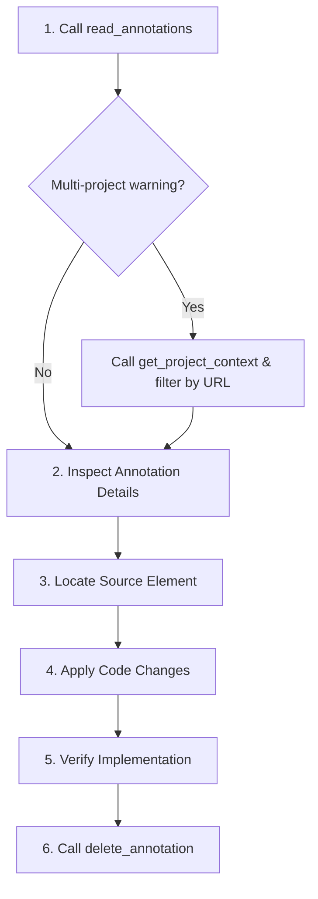

# Vibe Annotations Implementation Workflow

## Purpose
Inspect, translate, and implement visual user feedback captured via the Vibe Annotations Chrome extension. Guides the agent to locate target source elements, map CSS and DOM modifications, respect project design systems, and execute proper cleanup discipline.

---

## MCP Tools Reference

All tools are accessed via the `vibe-annotations` MCP server:

| Tool | Usage | Key Parameters |
| :--- | :--- | :--- |
| `read_annotations` | Retrieve pending visual feedback and DOM context | `url`, `status` ("pending"), `limit`, `offset`, `include_variants` |
| `get_project_context` | Infer framework, port conventions, and working directory | `url` |
| `get_annotation_screenshot` | Retrieve base64 screenshot data for an element | `id` |
| `delete_annotation` | Permanently remove a resolved annotation | `id` |
| `delete_project_annotations` | Batch delete all annotations for a specific project URL | `url` |
| `update_annotation` | Transition variant lifecycles or promote comment to variants | `id`, `mode`, `status`, `variantsPayload` |

---

## Step-by-Step Implementation Workflow



### 1. Discovery & Multi-Project Safety
Always query `read_annotations` without a URL filter first:

```json
{
  "ServerName": "vibe-annotations",
  "ToolName": "read_annotations",
  "Arguments": {
    "status": "pending"
  }
}
```

* If `multi_project_warning` is present or annotations come from multiple ports/projects, call `get_project_context` for the current project URL and filter:
  `read_annotations(url="http://localhost:<PORT>/*")`.

### 2. Inspect Annotation Structure
Each annotation contains rich visual and DOM context:

* **`selector` / `selector_preview`**: CSS path to the annotated element (e.g., `body`, `.nav-bar > button.btn-primary`).
* **`comment`**: User's written instruction or requirement.
* **`element_context`**:
  * `tag`: HTML element tag (`div`, `button`, `h1`, etc.).
  * `classes`: Class list applied to the element.
  * `text`: Inner text preview.
  * `position`: Bounding box (`x`, `y`, `width`, `height`).
  * `styles`: Computed CSS properties (colors, fonts, margins, display, padding).
* **`pending_changes`**: Direct CSS property modifications made in the Vibe extension visual editor, containing `{ property: { original, new } }`.
* **`attachments`**:
  * `kind="capture"`: Automatic screenshot of the element's current state.
  * `kind="user"`: User-attached image representing the target design reference ("make it look like this").

### 3. Locate Source Element & File
Use ripgrep or file search to locate the corresponding source file:
- Search by unique text content from `element_context.text`.
- Search by unique class names or IDs from `element_context.classes` / `selector`.
- Search by template structure or component name.

### 4. Implement Changes with Design System Mapping
* **Design Token Discipline**: When translating `pending_changes` or user styling requests, **do not hardcode raw pixel/hex values** if the project uses a design system (e.g. Tailwind classes, CSS variables, or design tokens).
  * Example: Map `#3b82f6` to `var(--primary)` or `text-blue-500`.
  * Map `16px` to `var(--spacing-md)` or `p-4`.
* **Scope Preservation**: Only modify lines relevant to the requested feedback. Keep unrelated comments, structure, and docstrings intact.

### 5. Variants Handling (If Applicable)
* If an annotation has `mode="variants"` or carries `variant_instructions`:
  1. Follow the self-contained contract in `variant_instructions`.
  2. Implement the coexisting variants behind the designated container and attribute (`data-vibe-active`).
  3. Call `update_annotation` with `variantsPayload` to transition to `"variants-ready"`.
  4. Do **not** delete the annotation until the user selects/finalizes a variant.

### 6. Deletion Discipline (MANDATORY)
After successfully implementing any standard annotation in source code:
* **You MUST call `delete_annotation(id="...")` immediately.**

> [!CAUTION]
> **Why Deletion Discipline is Critical**:
> The Vibe Annotations extension applies `pending_changes` as a **live inline-style overlay** in the browser. If an annotation is left undeleted after you modify the source code, the extension will re-apply its overlay on top of your source change on the next page reload (doubling the change or causing layout collisions). Always clean up resolved annotations.

---

## Verification & Response

After deleting the resolved annotations:
1. Run `read_annotations` to verify the queue is clear (`count: 0`).
2. Provide a concise summary to the user:
   - Annotation ID and targeted element.
   - Files modified with clickable links (e.g. [`styles.css`](file:///path/to/styles.css#L20-L35)).
   - Exact changes applied.
   - Confirmation of annotation cleanup.
