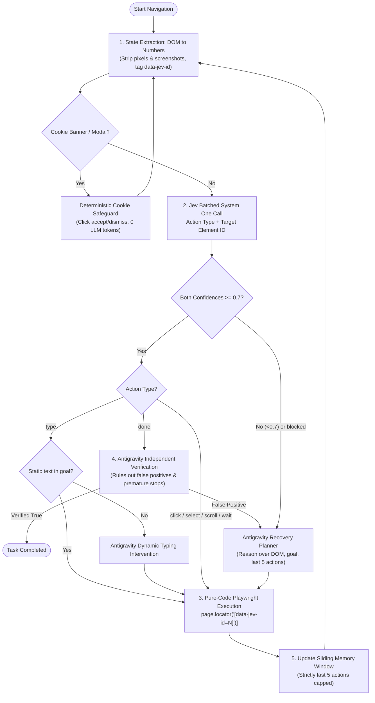

# Jev + Antigravity IDE Hybrid Fast-Browser Agent Architecture

A high-performance hybrid browser automation system combining **TypeSafe's Jev** (a "System One" micro-decision model) with the **Google Antigravity IDE** reasoning engine (Gemini 2.5 Flash / Pro) for ultra-fast, cost-effective, and robust web automation.

---

## 1. Architectural Highlights

Traditional Vision-Language Model (VLM) browser agents suffer from extreme latency (often 4–15 seconds per step) and high inference costs because they pass multi-megabyte screenshots and ask the LLM to generate unstructured coordinates or arbitrary code for every single micro-action.

This hybrid architecture resolves those bottlenecks through a **dual-agent division of labor**:



### Key Capabilities

1. **State Extraction (DOM to Numbers):**
   - Web pages are parsed directly in the browser via Playwright into a structured, numbered catalog of accessible interactive elements (`[1] Pricing Link`, `[2] Start Trial Button`, `[3] Email Input`).
   - Pure visual screenshots, pixels, and images are stripped away, maximizing token efficiency and eliminating vision coordinate errors.
   - Elements are injected with `data-jev-id="N"` attributes, allowing subsequent actions to execute via single direct DOM locators (`page.locator('[data-jev-id="N"]')`).

2. **Jev Batch Classifier Call:**
   - Evaluates the numbered DOM catalog in a single API round-trip against strongly-typed questions:
     - `action_type`: `['click', 'type', 'select', 'scroll_down', 'scroll_up', 'wait', 'done', 'blocked']`
     - `target_element`: `['1', '2', ..., 'none']`
     - `is_cookie_banner`: Noul (yes/no probability)
   - Operates with sub-20ms decision latencies and calibrated confidence scores.

3. **Deterministic Execution Rules:**
   - **Confidence Gating:** If both `action_type` and `target_element` confidences are $\ge 0.7$, the action executes deterministically in pure code via Playwright without calling an LLM.
   - **Typing Intervention:** Static strings (e.g., `'john@doe.com'`, search phrases in quotes) are extracted directly from the goal definition. When dynamic reasoning is required (e.g. summarizing text, formulating complex queries), the **Antigravity IDE reasoning engine** is invoked exclusively to produce the string.
   - **Uncertainty Recovery:** If confidence drops below $0.7$ or Jev outputs `blocked`, Antigravity receives the DOM catalog, recent action history, and goal to formulate a recovery plan.
   - **Cookie & Consent Safeguards:** Cookie banners, GDPR popups, and modal dialogs are deterministically detected and dismissed automatically without wasting reasoning steps.

4. **Independent Verification of 'Done':**
   - Jev's `done` output is never accepted at face value.
   - When Jev returns `done`, the execution trail, final DOM snapshot, and goal criteria are passed to Antigravity for independent verification to rule out premature termination, unsubmitted forms, or error states.

5. **Memory Constraint (Sliding Window):**
   - A strict sliding memory window limited to the last **5 actions** is maintained via a FIFO deque.
   - Prevents context window bloat and breaks repetitive hallucination loops.

---

## 2. Directory Structure

```
jev-browser-agent/
├── .env.example              # Environment variables template
├── pytest.ini                # Pytest configuration
├── requirements.txt          # Python dependencies
├── run.sh                    # One-command CLI runner wrapper
├── setup.sh                  # Automated venv & Playwright setup script
├── README.md                 # Documentation
├── jev_browser_agent/        # Core package
│   ├── __init__.py           # Public exports
│   ├── agent.py              # HybridFastBrowserAgent execution engine
│   ├── antigravity_handler.py# Antigravity IDE reasoning handler (typing, recovery, verification)
│   ├── config.py             # Settings & environment configuration
│   ├── cookie_guard.py       # Cookie banner & modal consent safeguards
│   ├── dom.py                # DOM extraction, element numbering & catalog formatting
│   ├── jev_client.py         # TypeSafe / Jev System One batched client
│   ├── llm_handler.py        # Compatibility re-export
│   ├── main.py               # CLI entry point
│   ├── memory.py             # 5-action sliding memory window & sub-goal manager
│   └── models.py             # Data classes and types
└── tests/                    # Comprehensive test suite
    ├── test_agent_loop.py    # End-to-end integration test
    ├── test_cookie_safeguard.py # Cookie detection & dismissal tests
    ├── test_dom.py           # DOM indexing and catalog generation tests
    ├── test_memory.py        # Sliding window & loop detection tests
    └── test_typing_and_verification.py # Typing intervention & verification tests
```

---

## 3. Installation & Setup

### Prerequisites
- Python 3.10+ (tested on Python 3.12)
- Linux / macOS / WSL
- **No Gemini API key needed!** The agent automatically bridges to your active **Antigravity IDE** session (using your Google account) via the native `agy` CLI.
- TypeSafe / Jev API Key (`TYPESAFE_API_KEY` or `JEV_API_KEY`) for the System One micro-decision classifier (or use `--mock` for offline simulation).

### 1. Run the Setup Script
The automated setup script creates a virtual environment, installs dependencies, and downloads the Playwright Chromium browser:

```bash
cd jev-browser-agent
./setup.sh
```

### 2. Configure API Keys
Edit the generated `.env` file with your TypeSafe credentials:

```bash
# TypeSafe AI / Jev API Key (required for Jev decisions)
TYPESAFE_API_KEY=your_typesafe_api_key_here
# or JEV_API_KEY=your_typesafe_api_key_here

# (Optional: Antigravity IDE uses your active Google Account automatically!)
# GEMINI_API_KEY is NOT required when running inside Antigravity IDE.
```

*(Note: You can also run the agent in `--mock` simulation mode without any API keys for testing and demonstrations!)*

---

## 4. Usage

### Running the Agent

Run with default target and goal:
```bash
./run.sh
```

Specify a custom URL and goal:
```bash
./run.sh \
  --url "https://news.ycombinator.com" \
  --goal "Find the search box, search for 'playwright', and view the first result" \
  --headless
```

Run in deterministic offline simulation mode (no live API keys required):
```bash
./run.sh --mock --headless --url "https://news.ycombinator.com" --goal "Find the search box and type 'playwright'"
```

### CLI Options

| Argument | Default | Description |
|---|---|---|
| `--url` | `https://news.ycombinator.com` | Initial page URL |
| `--goal` | *(example search goal)* | Target user goal description |
| `--sub-goals` | `None` | Optional list of chained sub-goals |
| `--headless` | `false` | Run browser in headless mode |
| `--slow-mo` | `50` | Milliseconds delay between browser actions |
| `--threshold` | `0.7` | Confidence threshold for deterministic Jev execution |
| `--max-steps` | `25` | Maximum steps before aborting |
| `--mock` | `false` | Run deterministic simulation mode |
| `-v, --verbose` | `false` | Enable detailed debug logging |

---

## 5. Antigravity IDE Integration

When working inside **Antigravity IDE**, this agent is registered directly as a workspace skill under `.agents/skills/fast-browser-agent/`.

You can trigger web automation tasks directly from the Antigravity chat panel:
```
/fast-browser-agent --url https://example.com --goal "Create account and verify dashboard"
```

Antigravity IDE automatically orchestrates the high-speed Jev micro-decisions and steps in seamlessly whenever dynamic reasoning, recovery, or independent verification is needed.

---

## 6. Running Tests

Run the full pytest test suite:

```bash
source .venv/bin/activate
pytest tests/ -v
```

All 8 tests pass covering:
- DOM extraction, element numbering, and data-jev-id injection
- Cookie banner detection and deterministic dismissal
- Sliding memory window constraint (capped at 5 actions)
- Anti-hallucination loop detection
- Static typing text extraction vs. Antigravity dynamic reasoning
- Independent Antigravity verification of 'done' (including false-positive rejection)
- Full end-to-end browser execution loop in Playwright
