# Project Map: SLSsteam_n_ACCELA

> Live, deterministic codebase map optimized for AI agents and developer tooling.

## Generation Metadata

- **Generation Command:** `project_map generate`
- **Project Root:** `/home/nicolas/Documents/my-github/SLSsteam_n_ACCELA`
- **Scope (Include):** *All eligible source files*
- **Exclusions:** *Default build/vendor ignores*
- **Languages Analyzed:** `cpp`, `javascript`, `python`
- **Private Symbols:** `Excluded (public/exported only)`
- **Bodies:** `Signatures only (bodies excluded)`

## Legend & Notation

| Notation | Category | Meaning |
| :--- | :--- | :--- |
| `+` | Visibility | Public symbol |
| `-` | Visibility | Private symbol |
| `#` | Visibility | Protected symbol |
| `~` | Visibility | Package-private / Internal symbol |
| `*` | Visibility | Explicitly exported symbol (`export` / `__all__`) |
| `-->` | Relationship | Direct call or reference |
| `-.->` | Relationship | Dynamic / Uncertain call reference |
| `<|--` | Relationship | Inheritance / Class extension |
| `..>` | Relationship | Type reference / Parameter type usage |
| `[L12-L34]` | Location | Source file line range |

## High-Level Architecture Overview

### Project Metrics

| Metric | Value |
| :--- | :--- |
| Scanned Source Files | 240 |
| Total Source Lines | 45160 |
| Total Symbols Extracted | 718 |
| Classes & Structs | 27 |
| Functions & Methods | 691 |
| External Dependencies | 97 |
| Resolved Direct References | 697 |
| Dynamic / Uncertain References | 72 |

### External Dependencies

`Crypto`, `X11/XKBlib`, `X11/Xlib`, `__future__`, `abc`, `algorithm`, `argparse`, `arpa/inet`, `ast`, `atomic`, `cctype`, `cerrno`, `charconv`, `chrono`, `cmath`, `collections`, `cstdarg`, `cstddef`, `cstdint`, `cstdio`, `cstdlib`, `cstring`, `curl/curl`, `dataclasses`, `datetime`, `dlfcn`, `elf`, `elftools`, `enum`, `errno`, `fcntl`, `filesystem`, `fnmatch`, `fstream`, `functional`, `future`, `glob`, `gtest/gtest`, `hashlib`, `iomanip`, `ios`, `iostream`, `iterator`, `json`, `link`, `linux/input`, `linux/joystick`, `linux/limits`, `map`, `memory`, `mutex`, `netdb`, `netinet/in`, `openssl/sha`, `optional`, `os`, `pathlib`, `project_map`, `pthread`, `pytest`, `random`, `re`, `regex`, `set`, `shared_mutex`, `shutil`, `signal`, `sstream`, `stdarg`, `stdexcept`, `stdio`, `string`, `string_view`, `strings`, `struct`, `subprocess`, `sys`, `sys/inotify`, `sys/ioctl`, `sys/mman`, `sys/socket`, `sys/stat`, `sys/types`, `sys/wait`, `system_error`, `thread`, `time`, `type_traits`, `typing`, `unistd`, `unittest`, `unordered_map`, `unordered_set`, `urllib`, `utility`, `vector`, `websocket`


### Central & High-Fan-Out Symbols

| Symbol | Kind | Inbound Callers | Outbound Calls | Location |
| :--- | :--- | :--- | :--- | :--- |
| [`run_project_map`](#sym-scripts-project_map-engine-py-run_project_map) | `function` | 10 | 8 | [scripts/project_map/engine.py#L18-L122](#file-scripts-project_map-engine-py) |
| [`log_step`](#sym-tests-integration-test_steam_ui_flow-py-log_step) | `function` | 15 | 0 | [tests/integration/test_steam_ui_flow.py#L63-L64](#file-tests-integration-test_steam_ui_flow-py) |
| [`log_pass`](#sym-tests-integration-test_steam_ui_flow-py-log_pass) | `function` | 15 | 0 | [tests/integration/test_steam_ui_flow.py#L66-L67](#file-tests-integration-test_steam_ui_flow-py) |
| [`log_info`](#sym-tests-integration-test_steam_ui_flow-py-log_info) | `function` | 15 | 0 | [tests/integration/test_steam_ui_flow.py#L72-L73](#file-tests-integration-test_steam_ui_flow-py) |
| [`run_installer`](#sym-tests-conftest-py-run_installer) | `function` | 13 | 0 | [tests/conftest.py#L70-L88](#file-tests-conftest-py) |
| [`ParseConfig`](#sym-scripts-project_map-models-py-parseconfig) | `class` | 10 | 0 | [scripts/project_map/models.py#L152-L164](#file-scripts-project_map-models-py) |
| [`SteamUIFlowTest.navigate_url`](#sym-tests-integration-test_steam_ui_flow-py-steamuiflowtest-navigate_url) | `method` | 9 | 0 | [tests/integration/test_steam_ui_flow.py#L403-L432](#file-tests-integration-test_steam_ui_flow-py) |
| [`main`](#sym-scripts-project_map-cli-py-main) | `function` | 4 | 3 | [scripts/project_map/cli.py#L168-L182](#file-scripts-project_map-cli-py) |
| [`SteamUIFlowTest.test_02_clean_slate_preflight`](#sym-tests-integration-test_steam_ui_flow-py-steamuiflowtest-test_02_clean_slate_preflight) | `method` | 0 | 6 | [tests/integration/test_steam_ui_flow.py#L450-L561](#file-tests-integration-test_steam_ui_flow-py) |
| [`SteamUIFlowTest.test_11_install_rogue_flow`](#sym-tests-integration-test_steam_ui_flow-py-steamuiflowtest-test_11_install_rogue_flow) | `method` | 0 | 6 | [tests/integration/test_steam_ui_flow.py#L1215-L1349](#file-tests-integration-test_steam_ui_flow-py) |
| [`SteamUIFlowTest.test_12_uninstall_rogue_flow`](#sym-tests-integration-test_steam_ui_flow-py-steamuiflowtest-test_12_uninstall_rogue_flow) | `method` | 0 | 6 | [tests/integration/test_steam_ui_flow.py#L1351-L1421](#file-tests-integration-test_steam_ui_flow-py) |
| [`SteamUIFlowTest.setUpClass`](#sym-tests-integration-test_steam_ui_flow-py-steamuiflowtest-setupclass) | `method` | 0 | 5 | [tests/integration/test_steam_ui_flow.py#L198-L322](#file-tests-integration-test_steam_ui_flow-py) |

### Key Entry Points & Public APIs

| Entry Point | Kind | Signature | File |
| :--- | :--- | :--- | :--- |
| [`main`](#sym-agents-skills-steam-version-update-scripts-audit_client_hash-py-main) | `function` | `def main():` | `.agents/skills/steam-version-update/scripts/audit_client_hash.py:60` |
| [`main`](#sym-agents-skills-steam-version-update-scripts-audit_vftable-py-main) | `function` | `def main():` | `.agents/skills/steam-version-update/scripts/audit_vftable.py:139` |
| [`main`](#sym-scripts-project_map-cli-py-main) | `function` | `def main(argv: Optional[List[str]] = None) -> int:` | `scripts/project_map/cli.py:168` |
| [`main`](#sym-tests-inspect_store_ui-py-main) | `function` | `def main():` | `tests/inspect_store_ui.py:455` |
| [`main`](#sym-tests-integration-test_steam_ui_flow-py-main) | `function` | `def main():` | `tests/integration/test_steam_ui_flow.py:1555` |

## Directory Tree & File Skeleton

```text
SLSsteam_n_ACCELA/
├── .agents/
│   ├── agents/
│   │   ├── implementer/
│   │   │   └── agent.md
│   │   ├── orchestrator/
│   │   │   └── agent.md
│   │   ├── researcher/
│   │   │   └── agent.md
│   │   ├── reviewer/
│   │   │   └── agent.md
│   │   └── validator/
│   │       └── agent.md
│   ├── rules/
│   │   ├── cpp_hooking_patterns.md
│   │   ├── devtools_interaction.md
│   │   ├── steam_cef_ui_patterns.md
│   │   ├── steam_controller_mapping.md
│   │   └── test-regression.md
│   ├── skills/
│   │   ├── cef-cdp-injection/
│   │   │   └── SKILL.md
│   │   ├── deep-reasoning/
│   │   │   └── SKILL.md
│   │   ├── handover/
│   │   │   └── SKILL.md
│   │   ├── linux-elf-reversing/
│   │   │   └── SKILL.md
│   │   ├── project-structure-cleaner/
│   │   │   └── SKILL.md
│   │   ├── release-workflow/
│   │   │   └── SKILL.md
│   │   ├── steam-native-hooking/
│   │   │   └── SKILL.md
│   │   ├── steam-version-update/
│   │   │   ├── scripts/
│   │   │   │   ├── audit_client_hash.py
│   │   │   │   └── audit_vftable.py
│   │   │   └── SKILL.md
│   │   ├── steamdeck-wireless-workflow/
│   │   │   └── SKILL.md
│   │   └── steamos-qemu-workflow/
│   │       └── SKILL.md
│   └── AGENTS.md
├── docker/
│   ├── Dockerfile
│   └── build.sh
├── docs/
│   └── LICENSE/
│       ├── base64
│       ├── libmem
│       ├── navi
│       ├── protobuf
│       └── yaml-cpp
├── nix-modules/
│   ├── default.nix
│   ├── deps.json
│   ├── home.nix
│   ├── schema-grabber.nix
│   ├── ticket-grabber.nix
│   └── wrapped.nix
├── pkg/
│   ├── navi/
│   │   └── PKGBUILD
│   └── navi-git/
│       └── PKGBUILD
├── res/
│   ├── inject-scripts/
│   │   ├── app-details-script.js
│   │   ├── auto-collection.js
│   │   ├── depot-selection-script.js
│   │   ├── import-lua-script.js
│   │   ├── navi_inject.js
│   │   ├── store-page-script.js
│   │   └── version-top-bar.js
│   ├── cache.diff.yaml
│   ├── config.diff.yaml
│   ├── config.yaml
│   ├── navi-native.desktop
│   ├── navi.desktop
│   ├── update-all.sh
│   ├── updates.yaml
│   └── version
├── scripts/
│   ├── dev/
│   │   └── deck-ctl.sh
│   ├── project_map/
│   │   ├── adapters/
│   │   │   ├── __init__.py
│   │   │   ├── base.py
│   │   │   ├── cpp_adapter.py
│   │   │   ├── js_ts_adapter.py
│   │   │   ├── python_adapter.py
│   │   │   └── registry.py
│   │   ├── __init__.py
│   │   ├── cli.py
│   │   ├── engine.py
│   │   ├── json_generator.py
│   │   ├── markdown_generator.py
│   │   ├── models.py
│   │   ├── resolver.py
│   │   ├── scanner.py
│   │   └── watcher.py
│   └── project_map.py
├── src/
│   ├── core/
│   │   ├── api.cpp
│   │   ├── api.hpp
│   │   ├── atomic_file.hpp
│   │   ├── curl.cpp
│   │   ├── curl.hpp
│   │   ├── decompiler.cpp
│   │   ├── decompiler.hpp
│   │   ├── filewatcher.cpp
│   │   ├── filewatcher.hpp
│   │   ├── globals.cpp
│   │   ├── globals.hpp
│   │   ├── log.cpp
│   │   ├── log.hpp
│   │   ├── memhlp.cpp
│   │   ├── memhlp.hpp
│   │   ├── mtvar.hpp
│   │   ├── patterns.cpp
│   │   ├── patterns.hpp
│   │   ├── utils.cpp
│   │   ├── utils.hpp
│   │   ├── version.hpp
│   │   ├── vftableinfo.cpp
│   │   ├── vftableinfo.hpp
│   │   ├── zip.cpp
│   │   └── zip.hpp
│   ├── model/
│   │   ├── migrations/
│   │   │   ├── cache_migration.cpp
│   │   │   ├── cache_migration.hpp
│   │   │   ├── config_migration.cpp
│   │   │   ├── config_migration.hpp
│   │   │   ├── legacy_migration.cpp
│   │   │   └── legacy_migration.hpp
│   │   ├── sdk/
│   │   │   ├── CAPIJob.cpp
│   │   │   ├── CAPIJob.hpp
│   │   │   ├── CCMInterface.cpp
│   │   │   ├── CCMInterface.hpp
│   │   │   ├── CClientUnifiedServiceTransport.cpp
│   │   │   ├── CClientUnifiedServiceTransport.hpp
│   │   │   ├── CNetPacket.cpp
│   │   │   ├── CNetPacket.hpp
│   │   │   ├── CProtoBufMsgBase.hpp
│   │   │   ├── CSteamClient.hpp
│   │   │   ├── CSteamEngine.cpp
│   │   │   ├── CSteamEngine.hpp
│   │   │   ├── CSteamMatchmakingServers.hpp
│   │   │   ├── CUser.cpp
│   │   │   ├── CUser.hpp
│   │   │   ├── CUtl.cpp
│   │   │   ├── CUtl.hpp
│   │   │   ├── CValidator.hpp
│   │   │   ├── CWebSocketConnection.cpp
│   │   │   ├── CWebSocketConnection.hpp
│   │   │   ├── IClientAppManager.cpp
│   │   │   ├── IClientAppManager.hpp
│   │   │   ├── IClientApps.cpp
│   │   │   ├── IClientApps.hpp
│   │   │   ├── IClientCompat.cpp
│   │   │   ├── IClientCompat.hpp
│   │   │   ├── IClientFriends.hpp
│   │   │   ├── IClientUser.cpp
│   │   │   ├── IClientUser.hpp
│   │   │   ├── IClientUtils.cpp
│   │   │   ├── IClientUtils.hpp
│   │   │   ├── binarykv.cpp
│   │   │   ├── binarykv.hpp
│   │   │   ├── sdk.hpp
│   │   │   ├── steam.cpp
│   │   │   ├── steam.hpp
│   │   │   └── types.hpp
│   │   ├── appsizes.hpp
│   │   ├── config.cpp
│   │   ├── config.hpp
│   │   ├── config_default.hpp
│   │   ├── depotkeys.cpp
│   │   ├── depotkeys.hpp
│   │   ├── lua_parser.cpp
│   │   ├── lua_parser.hpp
│   │   ├── manifestcode.cpp
│   │   ├── manifestcode.hpp
│   │   ├── paths.cpp
│   │   ├── paths.hpp
│   │   ├── vdf.cpp
│   │   └── vdf.hpp
│   ├── presenter/
│   │   ├── achievements.cpp
│   │   ├── achievements.hpp
│   │   ├── apps.cpp
│   │   ├── apps.hpp
│   │   ├── autoupdate.cpp
│   │   ├── autoupdate.hpp
│   │   ├── dlc.cpp
│   │   ├── dlc.hpp
│   │   ├── fakeappid.cpp
│   │   ├── fakeappid.hpp
│   │   ├── hooks.cpp
│   │   ├── hooks.hpp
│   │   ├── licenses.cpp
│   │   ├── licenses.hpp
│   │   ├── luadownload.cpp
│   │   ├── luadownload.hpp
│   │   ├── luagenerator.cpp
│   │   ├── luagenerator.hpp
│   │   ├── main.cpp
│   │   ├── misc.cpp
│   │   ├── misc.hpp
│   │   ├── nativeinstall.cpp
│   │   ├── nativeinstall.hpp
│   │   ├── removelua.cpp
│   │   ├── removelua.hpp
│   │   ├── storeinject.cpp
│   │   ├── storeinject.hpp
│   │   ├── ticket.cpp
│   │   ├── ticket.hpp
│   │   ├── tier0hook.cpp
│   │   ├── tier0hook.hpp
│   │   ├── update.cpp
│   │   └── update.hpp
│   └── view/
│       ├── cdpinject.cpp
│       ├── cdpinject.hpp
│       ├── cefsizefix.cpp
│       ├── cefsizefix.hpp
│       ├── storeinject_view.cpp
│       └── storeinject_view.hpp
├── tests/
│   ├── fixtures/
│   │   ├── __init__.py
│   │   └── legacy_migration_fixtures.py
│   ├── integration/
│   │   ├── test_installer.py
│   │   ├── test_migration.py
│   │   ├── test_steam_ui_flow.py
│   │   └── test_store_script.py
│   ├── unit/
│   │   ├── test_config.cpp
│   │   ├── test_depotkeys.cpp
│   │   ├── test_manifest_and_native.cpp
│   │   ├── test_migration.cpp
│   │   ├── test_patterns_and_utils.cpp
│   │   ├── test_stubs.cpp
│   │   ├── test_stubs.hpp
│   │   ├── test_stubs_appinfo.cpp
│   │   ├── test_stubs_player.cpp
│   │   ├── test_stubs_unified.cpp
│   │   ├── test_vdf_and_lua.cpp
│   │   └── test_zip_and_atomic.cpp
│   ├── conftest.py
│   ├── inspect_store_ui.py
│   └── test_project_map.py
├── tools/
│   ├── library-inject/
│   │   ├── .gitignore
│   │   ├── Makefile
│   │   └── main.cpp
│   ├── schema-grabber/
│   │   ├── .gitignore
│   │   ├── Makefile
│   │   ├── Program.cs
│   │   └── schema-grabber.csproj
│   ├── steamstub-unpack/
│   │   ├── steamstub_elf_unpack.py
│   │   └── xkb_fix.c
│   └── ticket-grabber/
│       ├── .gitignore
│       ├── Makefile
│       ├── Program.cs
│       └── ticket-grabber.csproj
├── .antigravityignore
├── .gitignore
├── .gitmodules
├── .mailmap
├── API.md
├── Dev-Plan.txt
├── LICENSE
├── Makefile
├── README.md
├── embed-config.sh
├── embed-version.sh
├── flake.nix
├── install.sh
├── navi.sln
└── pytest.ini
```

### File Summary Table

| File Path | Module | Language | Lines | Symbols | Structural Summary |
| :--- | :--- | :--- | :--- | :--- | :--- |
| [.agents/AGENTS.md](#file-agents-agents-md) | `AGENTS` | `generic` | 14 | 0 | 14 lines (no parser registered) |
| [.agents/agents/implementer/agent.md](#file-agents-agents-implementer-agent-md) | `agent` | `generic` | 33 | 0 | 33 lines (no parser registered) |
| [.agents/agents/orchestrator/agent.md](#file-agents-agents-orchestrator-agent-md) | `agent` | `generic` | 109 | 0 | 109 lines (no parser registered) |
| [.agents/agents/researcher/agent.md](#file-agents-agents-researcher-agent-md) | `agent` | `generic` | 31 | 0 | 31 lines (no parser registered) |
| [.agents/agents/reviewer/agent.md](#file-agents-agents-reviewer-agent-md) | `agent` | `generic` | 30 | 0 | 30 lines (no parser registered) |
| [.agents/agents/validator/agent.md](#file-agents-agents-validator-agent-md) | `agent` | `generic` | 36 | 0 | 36 lines (no parser registered) |
| [.agents/rules/cpp_hooking_patterns.md](#file-agents-rules-cpp_hooking_patterns-md) | `cpp_hooking_patterns` | `generic` | 41 | 0 | 41 lines (no parser registered) |
| [.agents/rules/devtools_interaction.md](#file-agents-rules-devtools_interaction-md) | `devtools_interaction` | `generic` | 16 | 0 | 16 lines (no parser registered) |
| [.agents/rules/steam_cef_ui_patterns.md](#file-agents-rules-steam_cef_ui_patterns-md) | `steam_cef_ui_patterns` | `generic` | 34 | 0 | 34 lines (no parser registered) |
| [.agents/rules/steam_controller_mapping.md](#file-agents-rules-steam_controller_mapping-md) | `steam_controller_mapping` | `generic` | 39 | 0 | 39 lines (no parser registered) |
| [.agents/rules/test-regression.md](#file-agents-rules-test-regression-md) | `test-regression` | `generic` | 69 | 0 | 69 lines (no parser registered) |
| [.agents/skills/cef-cdp-injection/SKILL.md](#file-agents-skills-cef-cdp-injection-skill-md) | `SKILL` | `generic` | 178 | 0 | 178 lines (no parser registered) |
| [.agents/skills/deep-reasoning/SKILL.md](#file-agents-skills-deep-reasoning-skill-md) | `SKILL` | `generic` | 57 | 0 | 57 lines (no parser registered) |
| [.agents/skills/handover/SKILL.md](#file-agents-skills-handover-skill-md) | `SKILL` | `generic` | 189 | 0 | 189 lines (no parser registered) |
| [.agents/skills/linux-elf-reversing/SKILL.md](#file-agents-skills-linux-elf-reversing-skill-md) | `SKILL` | `generic` | 88 | 0 | 88 lines (no parser registered) |
| [.agents/skills/project-structure-cleaner/SKILL.md](#file-agents-skills-project-structure-cleaner-skill-md) | `SKILL` | `generic` | 175 | 0 | 175 lines (no parser registered) |
| [.agents/skills/release-workflow/SKILL.md](#file-agents-skills-release-workflow-skill-md) | `SKILL` | `generic` | 164 | 0 | 164 lines (no parser registered) |
| [.agents/skills/steam-native-hooking/SKILL.md](#file-agents-skills-steam-native-hooking-skill-md) | `SKILL` | `generic` | 214 | 0 | 214 lines (no parser registered) |
| [.agents/skills/steam-version-update/SKILL.md](#file-agents-skills-steam-version-update-skill-md) | `SKILL` | `generic` | 189 | 0 | 189 lines (no parser registered) |
| [.agents/skills/steam-version-update/scripts/audit_client_hash.py](#file-agents-skills-steam-version-update-scripts-audit_client_hash-py) | `.agents.skills.steam-version-update.scripts.audit_client_hash` | `python` | 95 | 4 | 95 lines, 0 classes, 4 functions/methods |
| [.agents/skills/steam-version-update/scripts/audit_vftable.py](#file-agents-skills-steam-version-update-scripts-audit_vftable-py) | `.agents.skills.steam-version-update.scripts.audit_vftable` | `python` | 151 | 3 | 151 lines, 0 classes, 3 functions/methods |
| [.agents/skills/steamdeck-wireless-workflow/SKILL.md](#file-agents-skills-steamdeck-wireless-workflow-skill-md) | `SKILL` | `generic` | 70 | 0 | 70 lines (no parser registered) |
| [.agents/skills/steamos-qemu-workflow/SKILL.md](#file-agents-skills-steamos-qemu-workflow-skill-md) | `SKILL` | `generic` | 137 | 0 | 137 lines (no parser registered) |
| [.antigravityignore](#file-antigravityignore) | `.antigravityignore` | `generic` | 1 | 0 | 1 lines (no parser registered) |
| [.gitignore](#file-gitignore) | `.gitignore` | `generic` | 86 | 0 | 86 lines (no parser registered) |
| [.gitmodules](#file-gitmodules) | `.gitmodules` | `generic` | 3 | 0 | 3 lines (no parser registered) |
| [.mailmap](#file-mailmap) | `.mailmap` | `generic` | 1 | 0 | 1 lines (no parser registered) |
| [API.md](#file-api-md) | `API` | `generic` | 19 | 0 | 19 lines (no parser registered) |
| [Dev-Plan.txt](#file-dev-plan-txt) | `Dev-Plan` | `generic` | 32 | 0 | 32 lines (no parser registered) |
| [LICENSE](#file-license) | `LICENSE` | `generic` | 661 | 0 | 661 lines (no parser registered) |
| [Makefile](#file-makefile) | `Makefile` | `generic` | 264 | 0 | 264 lines (no parser registered) |
| [README.md](#file-readme-md) | `README` | `generic` | 60 | 0 | 60 lines (no parser registered) |
| [docker/Dockerfile](#file-docker-dockerfile) | `Dockerfile` | `generic` | 12 | 0 | 12 lines (no parser registered) |
| [docker/build.sh](#file-docker-build-sh) | `build` | `generic` | 31 | 0 | 31 lines (no parser registered) |
| [docs/LICENSE/base64](#file-docs-license-base64) | `base64` | `generic` | 21 | 0 | 21 lines (no parser registered) |
| [docs/LICENSE/libmem](#file-docs-license-libmem) | `libmem` | `generic` | 215 | 0 | 215 lines (no parser registered) |
| [docs/LICENSE/navi](#file-docs-license-navi) | `navi` | `generic` | 661 | 0 | 661 lines (no parser registered) |
| [docs/LICENSE/protobuf](#file-docs-license-protobuf) | `protobuf` | `generic` | 33 | 0 | 33 lines (no parser registered) |
| [docs/LICENSE/yaml-cpp](#file-docs-license-yaml-cpp) | `yaml-cpp` | `generic` | 19 | 0 | 19 lines (no parser registered) |
| [embed-config.sh](#file-embed-config-sh) | `embed-config` | `generic` | 17 | 0 | 17 lines (no parser registered) |
| [embed-version.sh](#file-embed-version-sh) | `embed-version` | `generic` | 20 | 0 | 20 lines (no parser registered) |
| [flake.nix](#file-flake-nix) | `flake` | `generic` | 53 | 0 | 53 lines (no parser registered) |
| [install.sh](#file-install-sh) | `install` | `generic` | 116 | 0 | 116 lines (no parser registered) |
| [navi.sln](#file-navi-sln) | `navi` | `generic` | 32 | 0 | 32 lines (no parser registered) |
| [nix-modules/default.nix](#file-nix-modules-default-nix) | `default` | `generic` | 42 | 0 | 42 lines (no parser registered) |
| [nix-modules/deps.json](#file-nix-modules-deps-json) | `deps` | `generic` | 47 | 0 | 47 lines (no parser registered) |
| [nix-modules/home.nix](#file-nix-modules-home-nix) | `home` | `generic` | 220 | 0 | 220 lines (no parser registered) |
| [nix-modules/schema-grabber.nix](#file-nix-modules-schema-grabber-nix) | `schema-grabber` | `generic` | 19 | 0 | 19 lines (no parser registered) |
| [nix-modules/ticket-grabber.nix](#file-nix-modules-ticket-grabber-nix) | `ticket-grabber` | `generic` | 19 | 0 | 19 lines (no parser registered) |
| [nix-modules/wrapped.nix](#file-nix-modules-wrapped-nix) | `wrapped` | `generic` | 31 | 0 | 31 lines (no parser registered) |
| [pkg/navi-git/PKGBUILD](#file-pkg-navi-git-pkgbuild) | `PKGBUILD` | `generic` | 58 | 0 | 58 lines (no parser registered) |
| [pkg/navi/PKGBUILD](#file-pkg-navi-pkgbuild) | `PKGBUILD` | `generic` | 49 | 0 | 49 lines (no parser registered) |
| [pytest.ini](#file-pytest-ini) | `pytest` | `generic` | 5 | 0 | 5 lines (no parser registered) |
| [res/cache.diff.yaml](#file-res-cache-diff-yaml) | `cache.diff` | `generic` | 8 | 0 | 8 lines (no parser registered) |
| [res/config.diff.yaml](#file-res-config-diff-yaml) | `config.diff` | `generic` | 21 | 0 | 21 lines (no parser registered) |
| [res/config.yaml](#file-res-config-yaml) | `config` | `generic` | 151 | 0 | 151 lines (no parser registered) |
| [res/inject-scripts/app-details-script.js](#file-res-inject-scripts-app-details-script-js) | `app-details-script` | `javascript` | 873 | 25 | 873 lines, 0 classes/interfaces, 12 functions/methods |
| [res/inject-scripts/auto-collection.js](#file-res-inject-scripts-auto-collection-js) | `auto-collection` | `javascript` | 70 | 1 | 70 lines, 0 classes/interfaces, 1 functions/methods |
| [res/inject-scripts/depot-selection-script.js](#file-res-inject-scripts-depot-selection-script-js) | `depot-selection-script` | `javascript` | 600 | 16 | 600 lines, 0 classes/interfaces, 11 functions/methods |
| [res/inject-scripts/import-lua-script.js](#file-res-inject-scripts-import-lua-script-js) | `import-lua-script` | `javascript` | 1199 | 26 | 1199 lines, 0 classes/interfaces, 13 functions/methods |
| [res/inject-scripts/navi_inject.js](#file-res-inject-scripts-navi_inject-js) | `navi_inject` | `javascript` | 190 | 4 | 190 lines, 0 classes/interfaces, 4 functions/methods |
| [res/inject-scripts/store-page-script.js](#file-res-inject-scripts-store-page-script-js) | `store-page-script` | `javascript` | 1784 | 49 | 1784 lines, 0 classes/interfaces, 35 functions/methods |
| [res/inject-scripts/version-top-bar.js](#file-res-inject-scripts-version-top-bar-js) | `version-top-bar` | `javascript` | 35 | 1 | 35 lines, 0 classes/interfaces, 1 functions/methods |
| [res/navi-native.desktop](#file-res-navi-native-desktop) | `navi-native` | `generic` | 283 | 0 | 283 lines (no parser registered) |
| [res/navi.desktop](#file-res-navi-desktop) | `navi` | `generic` | 282 | 0 | 282 lines (no parser registered) |
| [res/update-all.sh](#file-res-update-all-sh) | `update-all` | `generic` | 29 | 0 | 29 lines (no parser registered) |
| [res/updates.yaml](#file-res-updates-yaml) | `updates` | `generic` | 61 | 0 | 61 lines (no parser registered) |
| [res/version](#file-res-version) | `version` | `generic` | 28 | 0 | 28 lines (no parser registered) |
| [scripts/dev/deck-ctl.sh](#file-scripts-dev-deck-ctl-sh) | `deck-ctl` | `generic` | 561 | 0 | 561 lines (no parser registered) |
| [scripts/project_map.py](#file-scripts-project_map-py) | `scripts.project_map` | `python` | 29 | 0 | 29 lines, 0 classes, 0 functions/methods |
| [scripts/project_map/__init__.py](#file-scripts-project_map-__init__-py) | `scripts.project_map` | `python` | 26 | 0 | 26 lines, 0 classes, 0 functions/methods |
| [scripts/project_map/adapters/__init__.py](#file-scripts-project_map-adapters-__init__-py) | `scripts.project_map.adapters` | `python` | 13 | 0 | 13 lines, 0 classes, 0 functions/methods |
| [scripts/project_map/adapters/base.py](#file-scripts-project_map-adapters-base-py) | `scripts.project_map.adapters.base` | `python` | 40 | 3 | 40 lines, 1 classes, 2 functions/methods |
| [scripts/project_map/adapters/cpp_adapter.py](#file-scripts-project_map-adapters-cpp_adapter-py) | `scripts.project_map.adapters.cpp_adapter` | `python` | 374 | 2 | 374 lines, 1 classes, 1 functions/methods |
| [scripts/project_map/adapters/js_ts_adapter.py](#file-scripts-project_map-adapters-js_ts_adapter-py) | `scripts.project_map.adapters.js_ts_adapter` | `python` | 581 | 2 | 581 lines, 1 classes, 1 functions/methods |
| [scripts/project_map/adapters/python_adapter.py](#file-scripts-project_map-adapters-python_adapter-py) | `scripts.project_map.adapters.python_adapter` | `python` | 594 | 4 | 594 lines, 1 classes, 1 functions/methods |
| [scripts/project_map/adapters/registry.py](#file-scripts-project_map-adapters-registry-py) | `scripts.project_map.adapters.registry` | `python` | 44 | 3 | 44 lines, 0 classes, 3 functions/methods |
| [scripts/project_map/cli.py](#file-scripts-project_map-cli-py) | `scripts.project_map.cli` | `python` | 186 | 5 | 186 lines, 0 classes, 4 functions/methods |
| [scripts/project_map/engine.py](#file-scripts-project_map-engine-py) | `scripts.project_map.engine` | `python` | 122 | 1 | 122 lines, 0 classes, 1 functions/methods |
| [scripts/project_map/json_generator.py](#file-scripts-project_map-json_generator-py) | `scripts.project_map.json_generator` | `python` | 16 | 1 | 16 lines, 0 classes, 1 functions/methods |
| [scripts/project_map/markdown_generator.py](#file-scripts-project_map-markdown_generator-py) | `scripts.project_map.markdown_generator` | `python` | 352 | 3 | 352 lines, 0 classes, 3 functions/methods |
| [scripts/project_map/models.py](#file-scripts-project_map-models-py) | `scripts.project_map.models` | `python` | 198 | 13 | 198 lines, 8 classes, 5 functions/methods |
| [scripts/project_map/resolver.py](#file-scripts-project_map-resolver-py) | `scripts.project_map.resolver` | `python` | 230 | 1 | 230 lines, 0 classes, 1 functions/methods |
| [scripts/project_map/scanner.py](#file-scripts-project_map-scanner-py) | `scripts.project_map.scanner` | `python` | 258 | 6 | 258 lines, 0 classes, 6 functions/methods |
| [scripts/project_map/watcher.py](#file-scripts-project_map-watcher-py) | `scripts.project_map.watcher` | `python` | 62 | 2 | 62 lines, 0 classes, 1 functions/methods |
| [src/core/api.cpp](#file-src-core-api-cpp) | `api` | `cpp` | 326 | 0 | 326 lines, 0 classes/structs, 0 functions/methods |
| [src/core/api.hpp](#file-src-core-api-hpp) | `api` | `cpp` | 60 | 6 | 60 lines, 0 classes/structs, 6 functions/methods |
| [src/core/atomic_file.hpp](#file-src-core-atomic_file-hpp) | `atomic_file` | `cpp` | 295 | 11 | 295 lines, 0 classes/structs, 11 functions/methods |
| [src/core/curl.cpp](#file-src-core-curl-cpp) | `curl` | `cpp` | 110 | 0 | 110 lines, 0 classes/structs, 0 functions/methods |
| [src/core/curl.hpp](#file-src-core-curl-hpp) | `curl` | `cpp` | 9 | 1 | 9 lines, 0 classes/structs, 1 functions/methods |
| [src/core/decompiler.cpp](#file-src-core-decompiler-cpp) | `decompiler` | `cpp` | 751 | 0 | 751 lines, 0 classes/structs, 0 functions/methods |
| [src/core/decompiler.hpp](#file-src-core-decompiler-hpp) | `decompiler` | `cpp` | 73 | 13 | 73 lines, 0 classes/structs, 13 functions/methods |
| [src/core/filewatcher.cpp](#file-src-core-filewatcher-cpp) | `filewatcher` | `cpp` | 110 | 0 | 110 lines, 0 classes/structs, 0 functions/methods |
| [src/core/filewatcher.hpp](#file-src-core-filewatcher-hpp) | `filewatcher` | `cpp` | 31 | 3 | 31 lines, 0 classes/structs, 3 functions/methods |
| [src/core/globals.cpp](#file-src-core-globals-cpp) | `globals` | `cpp` | 8 | 0 | 8 lines, 0 classes/structs, 0 functions/methods |
| [src/core/globals.hpp](#file-src-core-globals-hpp) | `globals` | `cpp` | 12 | 0 | 12 lines, 0 classes/structs, 0 functions/methods |
| [src/core/log.cpp](#file-src-core-log-cpp) | `log` | `cpp` | 389 | 1 | 389 lines, 0 classes/structs, 1 functions/methods |
| [src/core/log.hpp](#file-src-core-log-hpp) | `log` | `cpp` | 96 | 19 | 96 lines, 0 classes/structs, 19 functions/methods |
| [src/core/memhlp.cpp](#file-src-core-memhlp-cpp) | `memhlp` | `cpp` | 344 | 0 | 344 lines, 0 classes/structs, 0 functions/methods |
| [src/core/memhlp.hpp](#file-src-core-memhlp-hpp) | `memhlp` | `cpp` | 85 | 9 | 85 lines, 0 classes/structs, 9 functions/methods |
| [src/core/mtvar.hpp](#file-src-core-mtvar-hpp) | `mtvar` | `cpp` | 40 | 0 | 40 lines, 0 classes/structs, 0 functions/methods |
| [src/core/patterns.cpp](#file-src-core-patterns-cpp) | `patterns` | `cpp` | 310 | 0 | 310 lines, 0 classes/structs, 0 functions/methods |
| [src/core/patterns.hpp](#file-src-core-patterns-hpp) | `patterns` | `cpp` | 98 | 2 | 98 lines, 0 classes/structs, 2 functions/methods |
| [src/core/utils.cpp](#file-src-core-utils-cpp) | `utils` | `cpp` | 77 | 2 | 77 lines, 0 classes/structs, 2 functions/methods |
| [src/core/utils.hpp](#file-src-core-utils-hpp) | `utils` | `cpp` | 43 | 3 | 43 lines, 0 classes/structs, 3 functions/methods |
| [src/core/version.hpp](#file-src-core-version-hpp) | `version` | `cpp` | 6 | 0 | 6 lines, 0 classes/structs, 0 functions/methods |
| [src/core/vftableinfo.cpp](#file-src-core-vftableinfo-cpp) | `vftableinfo` | `cpp` | 431 | 0 | 431 lines, 0 classes/structs, 0 functions/methods |
| [src/core/vftableinfo.hpp](#file-src-core-vftableinfo-hpp) | `vftableinfo` | `cpp` | 135 | 5 | 135 lines, 0 classes/structs, 5 functions/methods |
| [src/core/zip.cpp](#file-src-core-zip-cpp) | `zip` | `cpp` | 186 | 0 | 186 lines, 0 classes/structs, 0 functions/methods |
| [src/core/zip.hpp](#file-src-core-zip-hpp) | `zip` | `cpp` | 69 | 2 | 69 lines, 0 classes/structs, 2 functions/methods |
| [src/model/appsizes.hpp](#file-src-model-appsizes-hpp) | `appsizes` | `cpp` | 5 | 1 | 5 lines, 0 classes/structs, 1 functions/methods |
| [src/model/config.cpp](#file-src-model-config-cpp) | `config` | `cpp` | 994 | 5 | 994 lines, 0 classes/structs, 5 functions/methods |
| [src/model/config.hpp](#file-src-model-config-hpp) | `config` | `cpp` | 291 | 15 | 291 lines, 1 classes/structs, 14 functions/methods |
| [src/model/config_default.hpp](#file-src-model-config_default-hpp) | `config_default` | `cpp` | 153 | 0 | 153 lines, 0 classes/structs, 0 functions/methods |
| [src/model/depotkeys.cpp](#file-src-model-depotkeys-cpp) | `depotkeys` | `cpp` | 393 | 9 | 393 lines, 0 classes/structs, 9 functions/methods |
| [src/model/depotkeys.hpp](#file-src-model-depotkeys-hpp) | `depotkeys` | `cpp` | 46 | 9 | 46 lines, 0 classes/structs, 9 functions/methods |
| [src/model/lua_parser.cpp](#file-src-model-lua_parser-cpp) | `lua_parser` | `cpp` | 319 | 2 | 319 lines, 0 classes/structs, 2 functions/methods |
| [src/model/lua_parser.hpp](#file-src-model-lua_parser-hpp) | `lua_parser` | `cpp` | 75 | 2 | 75 lines, 0 classes/structs, 2 functions/methods |
| [src/model/manifestcode.cpp](#file-src-model-manifestcode-cpp) | `manifestcode` | `cpp` | 515 | 2 | 515 lines, 0 classes/structs, 2 functions/methods |
| [src/model/manifestcode.hpp](#file-src-model-manifestcode-hpp) | `manifestcode` | `cpp` | 69 | 22 | 69 lines, 0 classes/structs, 22 functions/methods |
| [src/model/migrations/cache_migration.cpp](#file-src-model-migrations-cache_migration-cpp) | `cache_migration` | `cpp` | 232 | 1 | 232 lines, 0 classes/structs, 1 functions/methods |
| [src/model/migrations/cache_migration.hpp](#file-src-model-migrations-cache_migration-hpp) | `cache_migration` | `cpp` | 18 | 4 | 18 lines, 1 classes/structs, 3 functions/methods |
| [src/model/migrations/config_migration.cpp](#file-src-model-migrations-config_migration-cpp) | `config_migration` | `cpp` | 199 | 5 | 199 lines, 0 classes/structs, 5 functions/methods |
| [src/model/migrations/config_migration.hpp](#file-src-model-migrations-config_migration-hpp) | `config_migration` | `cpp` | 14 | 2 | 14 lines, 1 classes/structs, 1 functions/methods |
| [src/model/migrations/legacy_migration.cpp](#file-src-model-migrations-legacy_migration-cpp) | `legacy_migration` | `cpp` | 393 | 1 | 393 lines, 0 classes/structs, 1 functions/methods |
| [src/model/migrations/legacy_migration.hpp](#file-src-model-migrations-legacy_migration-hpp) | `legacy_migration` | `cpp` | 32 | 6 | 32 lines, 2 classes/structs, 4 functions/methods |
| [src/model/paths.cpp](#file-src-model-paths-cpp) | `paths` | `cpp` | 154 | 2 | 154 lines, 0 classes/structs, 2 functions/methods |
| [src/model/paths.hpp](#file-src-model-paths-hpp) | `paths` | `cpp` | 52 | 5 | 52 lines, 0 classes/structs, 5 functions/methods |
| [src/model/sdk/CAPIJob.cpp](#file-src-model-sdk-capijob-cpp) | `CAPIJob` | `cpp` | 9 | 0 | 9 lines, 0 classes/structs, 0 functions/methods |
| [src/model/sdk/CAPIJob.hpp](#file-src-model-sdk-capijob-hpp) | `CAPIJob` | `cpp` | 16 | 1 | 16 lines, 0 classes/structs, 1 functions/methods |
| [src/model/sdk/CCMInterface.cpp](#file-src-model-sdk-ccminterface-cpp) | `CCMInterface` | `cpp` | 16 | 0 | 16 lines, 0 classes/structs, 0 functions/methods |
| [src/model/sdk/CCMInterface.hpp](#file-src-model-sdk-ccminterface-hpp) | `CCMInterface` | `cpp` | 20 | 2 | 20 lines, 0 classes/structs, 2 functions/methods |
| [src/model/sdk/CClientUnifiedServiceTransport.cpp](#file-src-model-sdk-cclientunifiedservicetransport-cpp) | `CClientUnifiedServiceTransport` | `cpp` | 9 | 0 | 9 lines, 0 classes/structs, 0 functions/methods |
| [src/model/sdk/CClientUnifiedServiceTransport.hpp](#file-src-model-sdk-cclientunifiedservicetransport-hpp) | `CClientUnifiedServiceTransport` | `cpp` | 12 | 1 | 12 lines, 0 classes/structs, 1 functions/methods |
| [src/model/sdk/CNetPacket.cpp](#file-src-model-sdk-cnetpacket-cpp) | `CNetPacket` | `cpp` | 51 | 0 | 51 lines, 0 classes/structs, 0 functions/methods |
| [src/model/sdk/CNetPacket.hpp](#file-src-model-sdk-cnetpacket-hpp) | `CNetPacket` | `cpp` | 148 | 3 | 148 lines, 0 classes/structs, 3 functions/methods |
| [src/model/sdk/CProtoBufMsgBase.hpp](#file-src-model-sdk-cprotobufmsgbase-hpp) | `CProtoBufMsgBase` | `cpp` | 61 | 0 | 61 lines, 0 classes/structs, 0 functions/methods |
| [src/model/sdk/CSteamClient.hpp](#file-src-model-sdk-csteamclient-hpp) | `CSteamClient` | `cpp` | 66 | 0 | 66 lines, 0 classes/structs, 0 functions/methods |
| [src/model/sdk/CSteamEngine.cpp](#file-src-model-sdk-csteamengine-cpp) | `CSteamEngine` | `cpp` | 191 | 0 | 191 lines, 0 classes/structs, 0 functions/methods |
| [src/model/sdk/CSteamEngine.hpp](#file-src-model-sdk-csteamengine-hpp) | `CSteamEngine` | `cpp` | 120 | 9 | 120 lines, 3 classes/structs, 6 functions/methods |
| [src/model/sdk/CSteamMatchmakingServers.hpp](#file-src-model-sdk-csteammatchmakingservers-hpp) | `CSteamMatchmakingServers` | `cpp` | 26 | 0 | 26 lines, 0 classes/structs, 0 functions/methods |
| [src/model/sdk/CUser.cpp](#file-src-model-sdk-cuser-cpp) | `CUser` | `cpp` | 63 | 0 | 63 lines, 0 classes/structs, 0 functions/methods |
| [src/model/sdk/CUser.hpp](#file-src-model-sdk-cuser-hpp) | `CUser` | `cpp` | 111 | 7 | 111 lines, 0 classes/structs, 7 functions/methods |
| [src/model/sdk/CUtl.cpp](#file-src-model-sdk-cutl-cpp) | `CUtl` | `cpp` | 48 | 0 | 48 lines, 0 classes/structs, 0 functions/methods |
| [src/model/sdk/CUtl.hpp](#file-src-model-sdk-cutl-hpp) | `CUtl` | `cpp` | 225 | 3 | 225 lines, 0 classes/structs, 3 functions/methods |
| [src/model/sdk/CValidator.hpp](#file-src-model-sdk-cvalidator-hpp) | `CValidator` | `cpp` | 31 | 0 | 31 lines, 0 classes/structs, 0 functions/methods |
| [src/model/sdk/CWebSocketConnection.cpp](#file-src-model-sdk-cwebsocketconnection-cpp) | `CWebSocketConnection` | `cpp` | 16 | 0 | 16 lines, 0 classes/structs, 0 functions/methods |
| [src/model/sdk/CWebSocketConnection.hpp](#file-src-model-sdk-cwebsocketconnection-hpp) | `CWebSocketConnection` | `cpp` | 21 | 2 | 21 lines, 0 classes/structs, 2 functions/methods |
| [src/model/sdk/IClientAppManager.cpp](#file-src-model-sdk-iclientappmanager-cpp) | `IClientAppManager` | `cpp` | 51 | 0 | 51 lines, 0 classes/structs, 0 functions/methods |
| [src/model/sdk/IClientAppManager.hpp](#file-src-model-sdk-iclientappmanager-hpp) | `IClientAppManager` | `cpp` | 56 | 6 | 56 lines, 0 classes/structs, 6 functions/methods |
| [src/model/sdk/IClientApps.cpp](#file-src-model-sdk-iclientapps-cpp) | `IClientApps` | `cpp` | 51 | 0 | 51 lines, 0 classes/structs, 0 functions/methods |
| [src/model/sdk/IClientApps.hpp](#file-src-model-sdk-iclientapps-hpp) | `IClientApps` | `cpp` | 46 | 4 | 46 lines, 0 classes/structs, 4 functions/methods |
| [src/model/sdk/IClientCompat.cpp](#file-src-model-sdk-iclientcompat-cpp) | `IClientCompat` | `cpp` | 570 | 2 | 570 lines, 0 classes/structs, 2 functions/methods |
| [src/model/sdk/IClientCompat.hpp](#file-src-model-sdk-iclientcompat-hpp) | `IClientCompat` | `cpp` | 21 | 3 | 21 lines, 0 classes/structs, 3 functions/methods |
| [src/model/sdk/IClientFriends.hpp](#file-src-model-sdk-iclientfriends-hpp) | `IClientFriends` | `cpp` | 12 | 0 | 12 lines, 0 classes/structs, 0 functions/methods |
| [src/model/sdk/IClientUser.cpp](#file-src-model-sdk-iclientuser-cpp) | `IClientUser` | `cpp` | 30 | 0 | 30 lines, 0 classes/structs, 0 functions/methods |
| [src/model/sdk/IClientUser.hpp](#file-src-model-sdk-iclientuser-hpp) | `IClientUser` | `cpp` | 25 | 2 | 25 lines, 0 classes/structs, 2 functions/methods |
| [src/model/sdk/IClientUtils.cpp](#file-src-model-sdk-iclientutils-cpp) | `IClientUtils` | `cpp` | 24 | 0 | 24 lines, 0 classes/structs, 0 functions/methods |
| [src/model/sdk/IClientUtils.hpp](#file-src-model-sdk-iclientutils-hpp) | `IClientUtils` | `cpp` | 13 | 2 | 13 lines, 0 classes/structs, 2 functions/methods |
| [src/model/sdk/binarykv.cpp](#file-src-model-sdk-binarykv-cpp) | `binarykv` | `cpp` | 278 | 0 | 278 lines, 0 classes/structs, 0 functions/methods |
| [src/model/sdk/binarykv.hpp](#file-src-model-sdk-binarykv-hpp) | `binarykv` | `cpp` | 54 | 5 | 54 lines, 0 classes/structs, 5 functions/methods |
| [src/model/sdk/sdk.hpp](#file-src-model-sdk-sdk-hpp) | `sdk` | `cpp` | 18 | 0 | 18 lines, 0 classes/structs, 0 functions/methods |
| [src/model/sdk/steam.cpp](#file-src-model-sdk-steam-cpp) | `steam` | `cpp` | 271 | 1 | 271 lines, 0 classes/structs, 1 functions/methods |
| [src/model/sdk/steam.hpp](#file-src-model-sdk-steam-hpp) | `steam` | `cpp` | 15 | 1 | 15 lines, 0 classes/structs, 1 functions/methods |
| [src/model/sdk/types.hpp](#file-src-model-sdk-types-hpp) | `types` | `cpp` | 251 | 0 | 251 lines, 0 classes/structs, 0 functions/methods |
| [src/model/vdf.cpp](#file-src-model-vdf-cpp) | `vdf` | `cpp` | 224 | 1 | 224 lines, 0 classes/structs, 1 functions/methods |
| [src/model/vdf.hpp](#file-src-model-vdf-hpp) | `vdf` | `cpp` | 26 | 4 | 26 lines, 0 classes/structs, 4 functions/methods |
| [src/presenter/achievements.cpp](#file-src-presenter-achievements-cpp) | `achievements` | `cpp` | 251 | 2 | 251 lines, 0 classes/structs, 2 functions/methods |
| [src/presenter/achievements.hpp](#file-src-presenter-achievements-hpp) | `achievements` | `cpp` | 41 | 4 | 41 lines, 0 classes/structs, 4 functions/methods |
| [src/presenter/apps.cpp](#file-src-presenter-apps-cpp) | `apps` | `cpp` | 1417 | 12 | 1417 lines, 0 classes/structs, 12 functions/methods |
| [src/presenter/apps.hpp](#file-src-presenter-apps-hpp) | `apps` | `cpp` | 62 | 28 | 62 lines, 0 classes/structs, 28 functions/methods |
| [src/presenter/autoupdate.cpp](#file-src-presenter-autoupdate-cpp) | `autoupdate` | `cpp` | 707 | 3 | 707 lines, 0 classes/structs, 3 functions/methods |
| [src/presenter/autoupdate.hpp](#file-src-presenter-autoupdate-hpp) | `autoupdate` | `cpp` | 11 | 2 | 11 lines, 0 classes/structs, 2 functions/methods |
| [src/presenter/dlc.cpp](#file-src-presenter-dlc-cpp) | `dlc` | `cpp` | 97 | 0 | 97 lines, 0 classes/structs, 0 functions/methods |
| [src/presenter/dlc.hpp](#file-src-presenter-dlc-hpp) | `dlc` | `cpp` | 20 | 7 | 20 lines, 0 classes/structs, 7 functions/methods |
| [src/presenter/fakeappid.cpp](#file-src-presenter-fakeappid-cpp) | `fakeappid` | `cpp` | 355 | 0 | 355 lines, 0 classes/structs, 0 functions/methods |
| [src/presenter/fakeappid.hpp](#file-src-presenter-fakeappid-hpp) | `fakeappid` | `cpp` | 33 | 13 | 33 lines, 0 classes/structs, 13 functions/methods |
| [src/presenter/hooks.cpp](#file-src-presenter-hooks-cpp) | `hooks` | `cpp` | 2213 | 7 | 2213 lines, 0 classes/structs, 7 functions/methods |
| [src/presenter/hooks.hpp](#file-src-presenter-hooks-hpp) | `hooks` | `cpp` | 233 | 12 | 233 lines, 0 classes/structs, 12 functions/methods |
| [src/presenter/licenses.cpp](#file-src-presenter-licenses-cpp) | `licenses` | `cpp` | 307 | 7 | 307 lines, 0 classes/structs, 7 functions/methods |
| [src/presenter/licenses.hpp](#file-src-presenter-licenses-hpp) | `licenses` | `cpp` | 29 | 13 | 29 lines, 0 classes/structs, 13 functions/methods |
| [src/presenter/luadownload.cpp](#file-src-presenter-luadownload-cpp) | `luadownload` | `cpp` | 917 | 7 | 917 lines, 0 classes/structs, 7 functions/methods |
| [src/presenter/luadownload.hpp](#file-src-presenter-luadownload-hpp) | `luadownload` | `cpp` | 25 | 1 | 25 lines, 0 classes/structs, 1 functions/methods |
| [src/presenter/luagenerator.cpp](#file-src-presenter-luagenerator-cpp) | `luagenerator` | `cpp` | 151 | 1 | 151 lines, 0 classes/structs, 1 functions/methods |
| [src/presenter/luagenerator.hpp](#file-src-presenter-luagenerator-hpp) | `luagenerator` | `cpp` | 16 | 2 | 16 lines, 0 classes/structs, 2 functions/methods |
| [src/presenter/main.cpp](#file-src-presenter-main-cpp) | `main` | `cpp` | 392 | 0 | 392 lines, 0 classes/structs, 0 functions/methods |
| [src/presenter/misc.cpp](#file-src-presenter-misc-cpp) | `misc` | `cpp` | 132 | 1 | 132 lines, 0 classes/structs, 1 functions/methods |
| [src/presenter/misc.hpp](#file-src-presenter-misc-hpp) | `misc` | `cpp` | 11 | 3 | 11 lines, 0 classes/structs, 3 functions/methods |
| [src/presenter/nativeinstall.cpp](#file-src-presenter-nativeinstall-cpp) | `nativeinstall` | `cpp` | 408 | 12 | 408 lines, 0 classes/structs, 12 functions/methods |
| [src/presenter/nativeinstall.hpp](#file-src-presenter-nativeinstall-hpp) | `nativeinstall` | `cpp` | 45 | 12 | 45 lines, 0 classes/structs, 12 functions/methods |
| [src/presenter/removelua.cpp](#file-src-presenter-removelua-cpp) | `removelua` | `cpp` | 163 | 2 | 163 lines, 0 classes/structs, 2 functions/methods |
| [src/presenter/removelua.hpp](#file-src-presenter-removelua-hpp) | `removelua` | `cpp` | 11 | 1 | 11 lines, 0 classes/structs, 1 functions/methods |
| [src/presenter/storeinject.cpp](#file-src-presenter-storeinject-cpp) | `storeinject` | `cpp` | 1587 | 8 | 1587 lines, 1 classes/structs, 7 functions/methods |
| [src/presenter/storeinject.hpp](#file-src-presenter-storeinject-hpp) | `storeinject` | `cpp` | 18 | 2 | 18 lines, 0 classes/structs, 2 functions/methods |
| [src/presenter/ticket.cpp](#file-src-presenter-ticket-cpp) | `ticket` | `cpp` | 268 | 2 | 268 lines, 0 classes/structs, 2 functions/methods |
| [src/presenter/ticket.hpp](#file-src-presenter-ticket-hpp) | `ticket` | `cpp` | 46 | 13 | 46 lines, 0 classes/structs, 13 functions/methods |
| [src/presenter/tier0hook.cpp](#file-src-presenter-tier0hook-cpp) | `tier0hook` | `cpp` | 202 | 8 | 202 lines, 1 classes/structs, 7 functions/methods |
| [src/presenter/tier0hook.hpp](#file-src-presenter-tier0hook-hpp) | `tier0hook` | `cpp` | 42 | 3 | 42 lines, 0 classes/structs, 3 functions/methods |
| [src/presenter/update.cpp](#file-src-presenter-update-cpp) | `update` | `cpp` | 217 | 0 | 217 lines, 0 classes/structs, 0 functions/methods |
| [src/presenter/update.hpp](#file-src-presenter-update-hpp) | `update` | `cpp` | 22 | 6 | 22 lines, 0 classes/structs, 6 functions/methods |
| [src/view/cdpinject.cpp](#file-src-view-cdpinject-cpp) | `cdpinject` | `cpp` | 1101 | 4 | 1101 lines, 0 classes/structs, 4 functions/methods |
| [src/view/cdpinject.hpp](#file-src-view-cdpinject-hpp) | `cdpinject` | `cpp` | 84 | 10 | 84 lines, 0 classes/structs, 10 functions/methods |
| [src/view/cefsizefix.cpp](#file-src-view-cefsizefix-cpp) | `cefsizefix` | `cpp` | 309 | 6 | 309 lines, 0 classes/structs, 6 functions/methods |
| [src/view/cefsizefix.hpp](#file-src-view-cefsizefix-hpp) | `cefsizefix` | `cpp` | 25 | 2 | 25 lines, 0 classes/structs, 2 functions/methods |
| [src/view/storeinject_view.cpp](#file-src-view-storeinject_view-cpp) | `storeinject_view` | `cpp` | 219 | 1 | 219 lines, 0 classes/structs, 1 functions/methods |
| [src/view/storeinject_view.hpp](#file-src-view-storeinject_view-hpp) | `storeinject_view` | `cpp` | 111 | 9 | 111 lines, 2 classes/structs, 7 functions/methods |
| [tests/conftest.py](#file-tests-conftest-py) | `tests.conftest` | `python` | 88 | 5 | 88 lines, 0 classes, 5 functions/methods |
| [tests/fixtures/__init__.py](#file-tests-fixtures-__init__-py) | `tests.fixtures` | `python` | 1 | 0 | 1 lines, 0 classes, 0 functions/methods |
| [tests/fixtures/legacy_migration_fixtures.py](#file-tests-fixtures-legacy_migration_fixtures-py) | `tests.fixtures.legacy_migration_fixtures` | `python` | 151 | 5 | 151 lines, 0 classes, 5 functions/methods |
| [tests/inspect_store_ui.py](#file-tests-inspect_store_ui-py) | `tests.inspect_store_ui` | `python` | 505 | 12 | 505 lines, 1 classes, 11 functions/methods |
| [tests/integration/test_installer.py](#file-tests-integration-test_installer-py) | `tests.integration.test_installer` | `python` | 227 | 6 | 227 lines, 0 classes, 6 functions/methods |
| [tests/integration/test_migration.py](#file-tests-integration-test_migration-py) | `tests.integration.test_migration` | `python` | 237 | 7 | 237 lines, 0 classes, 7 functions/methods |
| [tests/integration/test_steam_ui_flow.py](#file-tests-integration-test_steam_ui_flow-py) | `tests.integration.test_steam_ui_flow` | `python` | 1592 | 39 | 1592 lines, 2 classes, 37 functions/methods |
| [tests/integration/test_store_script.py](#file-tests-integration-test_store_script-py) | `tests.integration.test_store_script` | `python` | 339 | 6 | 339 lines, 0 classes, 6 functions/methods |
| [tests/test_project_map.py](#file-tests-test_project_map-py) | `tests.test_project_map` | `python` | 519 | 14 | 519 lines, 0 classes, 14 functions/methods |
| [tests/unit/test_config.cpp](#file-tests-unit-test_config-cpp) | `test_config` | `cpp` | 240 | 3 | 240 lines, 0 classes/structs, 3 functions/methods |
| [tests/unit/test_depotkeys.cpp](#file-tests-unit-test_depotkeys-cpp) | `test_depotkeys` | `cpp` | 263 | 5 | 263 lines, 0 classes/structs, 5 functions/methods |
| [tests/unit/test_manifest_and_native.cpp](#file-tests-unit-test_manifest_and_native-cpp) | `test_manifest_and_native` | `cpp` | 396 | 9 | 396 lines, 0 classes/structs, 9 functions/methods |
| [tests/unit/test_migration.cpp](#file-tests-unit-test_migration-cpp) | `test_migration` | `cpp` | 623 | 38 | 623 lines, 0 classes/structs, 38 functions/methods |
| [tests/unit/test_patterns_and_utils.cpp](#file-tests-unit-test_patterns_and_utils-cpp) | `test_patterns_and_utils` | `cpp` | 132 | 3 | 132 lines, 0 classes/structs, 3 functions/methods |
| [tests/unit/test_stubs.cpp](#file-tests-unit-test_stubs-cpp) | `test_stubs` | `cpp` | 180 | 27 | 180 lines, 0 classes/structs, 27 functions/methods |
| [tests/unit/test_stubs.hpp](#file-tests-unit-test_stubs-hpp) | `test_stubs` | `cpp` | 10 | 4 | 10 lines, 0 classes/structs, 4 functions/methods |
| [tests/unit/test_stubs_appinfo.cpp](#file-tests-unit-test_stubs_appinfo-cpp) | `test_stubs_appinfo` | `cpp` | 1 | 0 | 1 lines, 0 classes/structs, 0 functions/methods |
| [tests/unit/test_stubs_player.cpp](#file-tests-unit-test_stubs_player-cpp) | `test_stubs_player` | `cpp` | 1 | 0 | 1 lines, 0 classes/structs, 0 functions/methods |
| [tests/unit/test_stubs_unified.cpp](#file-tests-unit-test_stubs_unified-cpp) | `test_stubs_unified` | `cpp` | 1 | 0 | 1 lines, 0 classes/structs, 0 functions/methods |
| [tests/unit/test_vdf_and_lua.cpp](#file-tests-unit-test_vdf_and_lua-cpp) | `test_vdf_and_lua` | `cpp` | 320 | 6 | 320 lines, 0 classes/structs, 6 functions/methods |
| [tests/unit/test_zip_and_atomic.cpp](#file-tests-unit-test_zip_and_atomic-cpp) | `test_zip_and_atomic` | `cpp` | 169 | 10 | 169 lines, 0 classes/structs, 10 functions/methods |
| [tools/library-inject/.gitignore](#file-tools-library-inject-gitignore) | `.gitignore` | `generic` | 1 | 0 | 1 lines (no parser registered) |
| [tools/library-inject/Makefile](#file-tools-library-inject-makefile) | `Makefile` | `generic` | 2 | 0 | 2 lines (no parser registered) |
| [tools/library-inject/main.cpp](#file-tools-library-inject-main-cpp) | `main` | `cpp` | 89 | 0 | 89 lines, 0 classes/structs, 0 functions/methods |
| [tools/schema-grabber/.gitignore](#file-tools-schema-grabber-gitignore) | `.gitignore` | `generic` | 3 | 0 | 3 lines (no parser registered) |
| [tools/schema-grabber/Makefile](#file-tools-schema-grabber-makefile) | `Makefile` | `generic` | 5 | 0 | 5 lines (no parser registered) |
| [tools/schema-grabber/Program.cs](#file-tools-schema-grabber-program-cs) | `Program` | `generic` | 437 | 0 | 437 lines (no parser registered) |
| [tools/schema-grabber/schema-grabber.csproj](#file-tools-schema-grabber-schema-grabber-csproj) | `schema-grabber` | `generic` | 17 | 0 | 17 lines (no parser registered) |
| [tools/steamstub-unpack/steamstub_elf_unpack.py](#file-tools-steamstub-unpack-steamstub_elf_unpack-py) | `tools.steamstub-unpack.steamstub_elf_unpack` | `python` | 108 | 1 | 108 lines, 0 classes, 1 functions/methods |
| [tools/steamstub-unpack/xkb_fix.c](#file-tools-steamstub-unpack-xkb_fix-c) | `xkb_fix` | `cpp` | 131 | 3 | 131 lines, 0 classes/structs, 3 functions/methods |
| [tools/ticket-grabber/.gitignore](#file-tools-ticket-grabber-gitignore) | `.gitignore` | `generic` | 4 | 0 | 4 lines (no parser registered) |
| [tools/ticket-grabber/Makefile](#file-tools-ticket-grabber-makefile) | `Makefile` | `generic` | 5 | 0 | 5 lines (no parser registered) |
| [tools/ticket-grabber/Program.cs](#file-tools-ticket-grabber-program-cs) | `Program` | `generic` | 398 | 0 | 398 lines (no parser registered) |
| [tools/ticket-grabber/ticket-grabber.csproj](#file-tools-ticket-grabber-ticket-grabber-csproj) | `ticket-grabber` | `generic` | 17 | 0 | 17 lines (no parser registered) |

## Symbol Index

| Symbol | Kind | Visibility | File Location | Parent Scope |
| :--- | :--- | :--- | :--- | :--- |
| [`compute_sha256`](#sym-agents-skills-steam-version-update-scripts-audit_client_hash-py-compute_sha256) | `function` | `+` public | [.agents/skills/steam-version-update/scripts/audit_client_hash.py:L25-L30](#file-agents-skills-steam-version-update-scripts-audit_client_hash-py) | *(root)* |
| [`extract_client_version`](#sym-agents-skills-steam-version-update-scripts-audit_client_hash-py-extract_client_version) | `function` | `+` public | [.agents/skills/steam-version-update/scripts/audit_client_hash.py:L32-L58](#file-agents-skills-steam-version-update-scripts-audit_client_hash-py) | *(root)* |
| [`get_steamclient_path`](#sym-agents-skills-steam-version-update-scripts-audit_client_hash-py-get_steamclient_path) | `function` | `+` public | [.agents/skills/steam-version-update/scripts/audit_client_hash.py:L14-L23](#file-agents-skills-steam-version-update-scripts-audit_client_hash-py) | *(root)* |
| [`main`](#sym-agents-skills-steam-version-update-scripts-audit_client_hash-py-main) | `function` | `+` public | [.agents/skills/steam-version-update/scripts/audit_client_hash.py:L60-L92](#file-agents-skills-steam-version-update-scripts-audit_client_hash-py) | *(root)* |
| [`audit_class_vtable`](#sym-agents-skills-steam-version-update-scripts-audit_vftable-py-audit_class_vtable) | `function` | `+` public | [.agents/skills/steam-version-update/scripts/audit_vftable.py:L30-L137](#file-agents-skills-steam-version-update-scripts-audit_vftable-py) | *(root)* |
| [`find_binary`](#sym-agents-skills-steam-version-update-scripts-audit_vftable-py-find_binary) | `function` | `+` public | [.agents/skills/steam-version-update/scripts/audit_vftable.py:L19-L28](#file-agents-skills-steam-version-update-scripts-audit_vftable-py) | *(root)* |
| [`main`](#sym-agents-skills-steam-version-update-scripts-audit_vftable-py-main) | `function` | `+` public | [.agents/skills/steam-version-update/scripts/audit_vftable.py:L139-L148](#file-agents-skills-steam-version-update-scripts-audit_vftable-py) | *(root)* |
| [`addRemoveLuaButton`](#sym-res-inject-scripts-app-details-script-js-addremoveluabutton) | `function` | `+` public | [res/inject-scripts/app-details-script.js:L822-L822](#file-res-inject-scripts-app-details-script-js) | *(root)* |
| [`checkAndCreateButton`](#sym-res-inject-scripts-app-details-script-js-checkandcreatebutton) | `function` | `+` public | [res/inject-scripts/app-details-script.js:L165-L165](#file-res-inject-scripts-app-details-script-js) | *(root)* |
| [`createRemoveButton`](#sym-res-inject-scripts-app-details-script-js-createremovebutton) | `function` | `+` public | [res/inject-scripts/app-details-script.js:L625-L625](#file-res-inject-scripts-app-details-script-js) | *(root)* |
| [`createRemoveButton.makeSteamButton`](#sym-res-inject-scripts-app-details-script-js-createremovebutton-makesteambutton) | `nested_function` | `+` public | [res/inject-scripts/app-details-script.js:L648-L648](#file-res-inject-scripts-app-details-script-js) | `createRemoveButton` |
| [`createRemoveButton.setDeckRestartState`](#sym-res-inject-scripts-app-details-script-js-createremovebutton-setdeckrestartstate) | `nested_function` | `+` public | [res/inject-scripts/app-details-script.js:L699-L699](#file-res-inject-scripts-app-details-script-js) | `createRemoveButton` |
| [`createRemoveButton.setRestartState`](#sym-res-inject-scripts-app-details-script-js-createremovebutton-setrestartstate) | `nested_function` | `+` public | [res/inject-scripts/app-details-script.js:L754-L754](#file-res-inject-scripts-app-details-script-js) | `createRemoveButton` |
| [`debouncedAddButtons`](#sym-res-inject-scripts-app-details-script-js-debouncedaddbuttons) | `function` | `+` public | [res/inject-scripts/app-details-script.js:L851-L851](#file-res-inject-scripts-app-details-script-js) | *(root)* |
| [`extractAppId`](#sym-res-inject-scripts-app-details-script-js-extractappid) | `function` | `+` public | [res/inject-scripts/app-details-script.js:L98-L98](#file-res-inject-scripts-app-details-script-js) | *(root)* |
| [`log`](#sym-res-inject-scripts-app-details-script-js-log) | `function` | `+` public | [res/inject-scripts/app-details-script.js:L6-L6](#file-res-inject-scripts-app-details-script-js) | *(root)* |
| [`openChangeProviderModal`](#sym-res-inject-scripts-app-details-script-js-openchangeprovidermodal) | `function` | `+` public | [res/inject-scripts/app-details-script.js:L334-L334](#file-res-inject-scripts-app-details-script-js) | *(root)* |
| [`openChangeProviderModal.closeModal`](#sym-res-inject-scripts-app-details-script-js-openchangeprovidermodal-closemodal) | `nested_function` | `+` public | [res/inject-scripts/app-details-script.js:L385-L385](#file-res-inject-scripts-app-details-script-js) | `openChangeProviderModal` |
| [`openNaviModal`](#sym-res-inject-scripts-app-details-script-js-opennavimodal) | `function` | `+` public | [res/inject-scripts/app-details-script.js:L518-L518](#file-res-inject-scripts-app-details-script-js) | *(root)* |
| [`openNaviModal.closeModal`](#sym-res-inject-scripts-app-details-script-js-opennavimodal-closemodal) | `nested_function` | `+` public | [res/inject-scripts/app-details-script.js:L574-L574](#file-res-inject-scripts-app-details-script-js) | `openNaviModal` |
| [`openRemoveConfirmModal`](#sym-res-inject-scripts-app-details-script-js-openremoveconfirmmodal) | `function` | `+` public | [res/inject-scripts/app-details-script.js:L467-L467](#file-res-inject-scripts-app-details-script-js) | *(root)* |
| [`openSlsConfig`](#sym-res-inject-scripts-app-details-script-js-openslsconfig) | `function` | `+` public | [res/inject-scripts/app-details-script.js:L201-L201](#file-res-inject-scripts-app-details-script-js) | *(root)* |
| [`openSlsConfig.close`](#sym-res-inject-scripts-app-details-script-js-openslsconfig-close) | `nested_function` | `+` public | [res/inject-scripts/app-details-script.js:L258-L258](#file-res-inject-scripts-app-details-script-js) | `openSlsConfig` |
| [`openSlsConfig.updateCrackBtn`](#sym-res-inject-scripts-app-details-script-js-openslsconfig-updatecrackbtn) | `nested_function` | `+` public | [res/inject-scripts/app-details-script.js:L297-L297](#file-res-inject-scripts-app-details-script-js) | `openSlsConfig` |
| [`openSlsConfig.updateFixBtn`](#sym-res-inject-scripts-app-details-script-js-openslsconfig-updatefixbtn) | `nested_function` | `+` public | [res/inject-scripts/app-details-script.js:L273-L273](#file-res-inject-scripts-app-details-script-js) | `openSlsConfig` |
| [`registerSteamFocusNode`](#sym-res-inject-scripts-app-details-script-js-registersteamfocusnode) | `function` | `+` public | [res/inject-scripts/app-details-script.js:L11-L11](#file-res-inject-scripts-app-details-script-js) | *(root)* |
| [`trapSteamGamepadModal`](#sym-res-inject-scripts-app-details-script-js-trapsteamgamepadmodal) | `function` | `+` public | [res/inject-scripts/app-details-script.js:L45-L45](#file-res-inject-scripts-app-details-script-js) | *(root)* |
| [`trapSteamGamepadModal.cancelCatcher`](#sym-res-inject-scripts-app-details-script-js-trapsteamgamepadmodal-cancelcatcher) | `nested_function` | `+` public | [res/inject-scripts/app-details-script.js:L87-L87](#file-res-inject-scripts-app-details-script-js) | `trapSteamGamepadModal` |
| [`trapSteamGamepadModal.cleanup`](#sym-res-inject-scripts-app-details-script-js-trapsteamgamepadmodal-cleanup) | `nested_function` | `+` public | [res/inject-scripts/app-details-script.js:L62-L62](#file-res-inject-scripts-app-details-script-js) | `trapSteamGamepadModal` |
| [`trapSteamGamepadModal.gamepadCatcher`](#sym-res-inject-scripts-app-details-script-js-trapsteamgamepadmodal-gamepadcatcher) | `nested_function` | `+` public | [res/inject-scripts/app-details-script.js:L67-L67](#file-res-inject-scripts-app-details-script-js) | `trapSteamGamepadModal` |
| [`trapSteamGamepadModal.okCatcher`](#sym-res-inject-scripts-app-details-script-js-trapsteamgamepadmodal-okcatcher) | `nested_function` | `+` public | [res/inject-scripts/app-details-script.js:L82-L82](#file-res-inject-scripts-app-details-script-js) | `trapSteamGamepadModal` |
| [`trapSteamGamepadModal.updateFocus`](#sym-res-inject-scripts-app-details-script-js-trapsteamgamepadmodal-updatefocus) | `nested_function` | `+` public | [res/inject-scripts/app-details-script.js:L47-L47](#file-res-inject-scripts-app-details-script-js) | `trapSteamGamepadModal` |
| [`syncAutoCollection`](#sym-res-inject-scripts-auto-collection-js-syncautocollection) | `function` | `+` public | [res/inject-scripts/auto-collection.js:L8-L8](#file-res-inject-scripts-auto-collection-js) | *(root)* |
| [`buildOsBadge`](#sym-res-inject-scripts-depot-selection-script-js-buildosbadge) | `function` | `+` public | [res/inject-scripts/depot-selection-script.js:L279-L279](#file-res-inject-scripts-depot-selection-script-js) | *(root)* |
| [`buildOsBadgeElement`](#sym-res-inject-scripts-depot-selection-script-js-buildosbadgeelement) | `function` | `+` public | [res/inject-scripts/depot-selection-script.js:L286-L286](#file-res-inject-scripts-depot-selection-script-js) | *(root)* |
| [`closeAndCancel`](#sym-res-inject-scripts-depot-selection-script-js-closeandcancel) | `function` | `+` public | [res/inject-scripts/depot-selection-script.js:L295-L295](#file-res-inject-scripts-depot-selection-script-js) | *(root)* |
| [`closeSuccess`](#sym-res-inject-scripts-depot-selection-script-js-closesuccess) | `function` | `+` public | [res/inject-scripts/depot-selection-script.js:L309-L309](#file-res-inject-scripts-depot-selection-script-js) | *(root)* |
| [`dismissResolvingPill`](#sym-res-inject-scripts-depot-selection-script-js-dismissresolvingpill) | `function` | `+` public | [res/inject-scripts/depot-selection-script.js:L417-L417](#file-res-inject-scripts-depot-selection-script-js) | *(root)* |
| [`formatBytes`](#sym-res-inject-scripts-depot-selection-script-js-formatbytes) | `function` | `+` public | [res/inject-scripts/depot-selection-script.js:L259-L259](#file-res-inject-scripts-depot-selection-script-js) | *(root)* |
| [`getOsInfo`](#sym-res-inject-scripts-depot-selection-script-js-getosinfo) | `function` | `+` public | [res/inject-scripts/depot-selection-script.js:L269-L269](#file-res-inject-scripts-depot-selection-script-js) | *(root)* |
| [`setupGamepadTrap`](#sym-res-inject-scripts-depot-selection-script-js-setupgamepadtrap) | `function` | `+` public | [res/inject-scripts/depot-selection-script.js:L15-L15](#file-res-inject-scripts-depot-selection-script-js) | *(root)* |
| [`trapSteamGamepadModal`](#sym-res-inject-scripts-depot-selection-script-js-trapsteamgamepadmodal) | `function` | `+` public | [res/inject-scripts/depot-selection-script.js:L23-L23](#file-res-inject-scripts-depot-selection-script-js) | *(root)* |
| [`trapSteamGamepadModal.cancelCatcher`](#sym-res-inject-scripts-depot-selection-script-js-trapsteamgamepadmodal-cancelcatcher) | `nested_function` | `+` public | [res/inject-scripts/depot-selection-script.js:L114-L114](#file-res-inject-scripts-depot-selection-script-js) | `trapSteamGamepadModal` |
| [`trapSteamGamepadModal.cleanup`](#sym-res-inject-scripts-depot-selection-script-js-trapsteamgamepadmodal-cleanup) | `nested_function` | `+` public | [res/inject-scripts/depot-selection-script.js:L124-L124](#file-res-inject-scripts-depot-selection-script-js) | `trapSteamGamepadModal` |
| [`trapSteamGamepadModal.gamepadCatcher`](#sym-res-inject-scripts-depot-selection-script-js-trapsteamgamepadmodal-gamepadcatcher) | `nested_function` | `+` public | [res/inject-scripts/depot-selection-script.js:L48-L48](#file-res-inject-scripts-depot-selection-script-js) | `trapSteamGamepadModal` |
| [`trapSteamGamepadModal.gamepadCatcher.move`](#sym-res-inject-scripts-depot-selection-script-js-trapsteamgamepadmodal-gamepadcatcher-move) | `function` | `+` public | [res/inject-scripts/depot-selection-script.js:L56-L56](#file-res-inject-scripts-depot-selection-script-js) | `trapSteamGamepadModal.gamepadCatcher` |
| [`trapSteamGamepadModal.okCatcher`](#sym-res-inject-scripts-depot-selection-script-js-trapsteamgamepadmodal-okcatcher) | `nested_function` | `+` public | [res/inject-scripts/depot-selection-script.js:L97-L97](#file-res-inject-scripts-depot-selection-script-js) | `trapSteamGamepadModal` |
| [`trapSteamGamepadModal.updateFocus`](#sym-res-inject-scripts-depot-selection-script-js-trapsteamgamepadmodal-updatefocus) | `nested_function` | `+` public | [res/inject-scripts/depot-selection-script.js:L29-L29](#file-res-inject-scripts-depot-selection-script-js) | `trapSteamGamepadModal` |
| [`updateButtonState`](#sym-res-inject-scripts-depot-selection-script-js-updatebuttonstate) | `function` | `+` public | [res/inject-scripts/depot-selection-script.js:L517-L517](#file-res-inject-scripts-depot-selection-script-js) | *(root)* |
| [`addSlsTab`](#sym-res-inject-scripts-import-lua-script-js-addslstab) | `function` | `+` public | [res/inject-scripts/import-lua-script.js:L1108-L1108](#file-res-inject-scripts-import-lua-script-js) | *(root)* |
| [`debouncedAddButtons`](#sym-res-inject-scripts-import-lua-script-js-debouncedaddbuttons) | `function` | `+` public | [res/inject-scripts/import-lua-script.js:L1188-L1188](#file-res-inject-scripts-import-lua-script-js) | *(root)* |
| [`findSuperNavContainer`](#sym-res-inject-scripts-import-lua-script-js-findsupernavcontainer) | `function` | `+` public | [res/inject-scripts/import-lua-script.js:L42-L42](#file-res-inject-scripts-import-lua-script-js) | *(root)* |
| [`getSteamHistory`](#sym-res-inject-scripts-import-lua-script-js-getsteamhistory) | `function` | `+` public | [res/inject-scripts/import-lua-script.js:L98-L98](#file-res-inject-scripts-import-lua-script-js) | *(root)* |
| [`getTopBarHeight`](#sym-res-inject-scripts-import-lua-script-js-gettopbarheight) | `function` | `+` public | [res/inject-scripts/import-lua-script.js:L64-L64](#file-res-inject-scripts-import-lua-script-js) | *(root)* |
| [`hideSlsPage`](#sym-res-inject-scripts-import-lua-script-js-hideslspage) | `function` | `+` public | [res/inject-scripts/import-lua-script.js:L221-L221](#file-res-inject-scripts-import-lua-script-js) | *(root)* |
| [`initManualInstallPage`](#sym-res-inject-scripts-import-lua-script-js-initmanualinstallpage) | `function` | `+` public | [res/inject-scripts/import-lua-script.js:L232-L232](#file-res-inject-scripts-import-lua-script-js) | *(root)* |
| [`initManualInstallPage.classifyFile`](#sym-res-inject-scripts-import-lua-script-js-initmanualinstallpage-classifyfile) | `nested_function` | `+` public | [res/inject-scripts/import-lua-script.js:L476-L476](#file-res-inject-scripts-import-lua-script-js) | `initManualInstallPage` |
| [`initManualInstallPage.detectAppIdFromCheckedFiles`](#sym-res-inject-scripts-import-lua-script-js-initmanualinstallpage-detectappidfromcheckedfiles) | `nested_function` | `+` public | [res/inject-scripts/import-lua-script.js:L603-L603](#file-res-inject-scripts-import-lua-script-js) | `initManualInstallPage` |
| [`initManualInstallPage.extractZipFiles`](#sym-res-inject-scripts-import-lua-script-js-initmanualinstallpage-extractzipfiles) | `nested_function` | `+` public | [res/inject-scripts/import-lua-script.js:L313-L313](#file-res-inject-scripts-import-lua-script-js) | `initManualInstallPage` |
| [`initManualInstallPage.fetchAppMetadata`](#sym-res-inject-scripts-import-lua-script-js-initmanualinstallpage-fetchappmetadata) | `nested_function` | `+` public | [res/inject-scripts/import-lua-script.js:L434-L434](#file-res-inject-scripts-import-lua-script-js) | `initManualInstallPage` |
| [`initManualInstallPage.findRelatedLuaFile`](#sym-res-inject-scripts-import-lua-script-js-initmanualinstallpage-findrelatedluafile) | `nested_function` | `+` public | [res/inject-scripts/import-lua-script.js:L558-L558](#file-res-inject-scripts-import-lua-script-js) | `initManualInstallPage` |
| [`initManualInstallPage.getAppIdFromFileName`](#sym-res-inject-scripts-import-lua-script-js-initmanualinstallpage-getappidfromfilename) | `nested_function` | `+` public | [res/inject-scripts/import-lua-script.js:L462-L462](#file-res-inject-scripts-import-lua-script-js) | `initManualInstallPage` |
| [`initManualInstallPage.getAppIdFromLuaContent`](#sym-res-inject-scripts-import-lua-script-js-initmanualinstallpage-getappidfromluacontent) | `nested_function` | `+` public | [res/inject-scripts/import-lua-script.js:L596-L596](#file-res-inject-scripts-import-lua-script-js) | `initManualInstallPage` |
| [`initManualInstallPage.getCheckedOSCount`](#sym-res-inject-scripts-import-lua-script-js-initmanualinstallpage-getcheckedoscount) | `nested_function` | `+` public | [res/inject-scripts/import-lua-script.js:L546-L546](#file-res-inject-scripts-import-lua-script-js) | `initManualInstallPage` |
| [`initManualInstallPage.handleFiles`](#sym-res-inject-scripts-import-lua-script-js-initmanualinstallpage-handlefiles) | `nested_function` | `+` public | [res/inject-scripts/import-lua-script.js:L335-L335](#file-res-inject-scripts-import-lua-script-js) | `initManualInstallPage` |
| [`initManualInstallPage.handleFiles.addFiles`](#sym-res-inject-scripts-import-lua-script-js-initmanualinstallpage-handlefiles-addfiles) | `function` | `+` public | [res/inject-scripts/import-lua-script.js:L351-L351](#file-res-inject-scripts-import-lua-script-js) | `initManualInstallPage.handleFiles` |
| [`initManualInstallPage.initCheckedFiles`](#sym-res-inject-scripts-import-lua-script-js-initmanualinstallpage-initcheckedfiles) | `nested_function` | `+` public | [res/inject-scripts/import-lua-script.js:L537-L537](#file-res-inject-scripts-import-lua-script-js) | `initManualInstallPage` |
| [`initManualInstallPage.loadLuaFilesCache`](#sym-res-inject-scripts-import-lua-script-js-initmanualinstallpage-loadluafilescache) | `nested_function` | `+` public | [res/inject-scripts/import-lua-script.js:L281-L281](#file-res-inject-scripts-import-lua-script-js) | `initManualInstallPage` |
| [`initManualInstallPage.updateFileList`](#sym-res-inject-scripts-import-lua-script-js-initmanualinstallpage-updatefilelist) | `nested_function` | `+` public | [res/inject-scripts/import-lua-script.js:L647-L647](#file-res-inject-scripts-import-lua-script-js) | `initManualInstallPage` |
| [`initManualInstallPage.updateSubmitButton`](#sym-res-inject-scripts-import-lua-script-js-initmanualinstallpage-updatesubmitbutton) | `nested_function` | `+` public | [res/inject-scripts/import-lua-script.js:L627-L627](#file-res-inject-scripts-import-lua-script-js) | `initManualInstallPage` |
| [`initSlsTabAndPage`](#sym-res-inject-scripts-import-lua-script-js-initslstabandpage) | `function` | `+` public | [res/inject-scripts/import-lua-script.js:L1163-L1163](#file-res-inject-scripts-import-lua-script-js) | *(root)* |
| [`loadJSZip`](#sym-res-inject-scripts-import-lua-script-js-loadjszip) | `function` | `+` public | [res/inject-scripts/import-lua-script.js:L13-L13](#file-res-inject-scripts-import-lua-script-js) | *(root)* |
| [`log`](#sym-res-inject-scripts-import-lua-script-js-log) | `function` | `+` public | [res/inject-scripts/import-lua-script.js:L6-L6](#file-res-inject-scripts-import-lua-script-js) | *(root)* |
| [`setActiveTabStyle`](#sym-res-inject-scripts-import-lua-script-js-setactivetabstyle) | `function` | `+` public | [res/inject-scripts/import-lua-script.js:L82-L82](#file-res-inject-scripts-import-lua-script-js) | *(root)* |
| [`showSlsPage`](#sym-res-inject-scripts-import-lua-script-js-showslspage) | `function` | `+` public | [res/inject-scripts/import-lua-script.js:L126-L126](#file-res-inject-scripts-import-lua-script-js) | *(root)* |
| [`fetchAppSize`](#sym-res-inject-scripts-navi_inject-js-fetchappsize) | `function` | `+` public | [res/inject-scripts/navi_inject.js:L28-L28](#file-res-inject-scripts-navi_inject-js) | *(root)* |
| [`getUnlockedAppIds`](#sym-res-inject-scripts-navi_inject-js-getunlockedappids) | `function` | `+` public | [res/inject-scripts/navi_inject.js:L88-L88](#file-res-inject-scripts-navi_inject-js) | *(root)* |
| [`needsSizeInjection`](#sym-res-inject-scripts-navi_inject-js-needssizeinjection) | `function` | `+` public | [res/inject-scripts/navi_inject.js:L100-L100](#file-res-inject-scripts-navi_inject-js) | *(root)* |
| [`waitForSteamClient`](#sym-res-inject-scripts-navi_inject-js-waitforsteamclient) | `function` | `+` public | [res/inject-scripts/navi_inject.js:L109-L109](#file-res-inject-scripts-navi_inject-js) | *(root)* |
| [`addButtons`](#sym-res-inject-scripts-store-page-script-js-addbuttons) | `function` | `+` public | [res/inject-scripts/store-page-script.js:L1287-L1287](#file-res-inject-scripts-store-page-script-js) | *(root)* |
| [`applyLuaLibraryOwnership`](#sym-res-inject-scripts-store-page-script-js-applylualibraryownership) | `function` | `+` public | [res/inject-scripts/store-page-script.js:L1578-L1578](#file-res-inject-scripts-store-page-script-js) | *(root)* |
| [`cleanupLegacyHiding`](#sym-res-inject-scripts-store-page-script-js-cleanuplegacyhiding) | `function` | `+` public | [res/inject-scripts/store-page-script.js:L1540-L1540](#file-res-inject-scripts-store-page-script-js) | *(root)* |
| [`clearAllCache`](#sym-res-inject-scripts-store-page-script-js-clearallcache) | `function` | `+` public | [res/inject-scripts/store-page-script.js:L805-L805](#file-res-inject-scripts-store-page-script-js) | *(root)* |
| [`clearAppCache`](#sym-res-inject-scripts-store-page-script-js-clearappcache) | `function` | `+` public | [res/inject-scripts/store-page-script.js:L768-L768](#file-res-inject-scripts-store-page-script-js) | *(root)* |
| [`debouncedAddButtons`](#sym-res-inject-scripts-store-page-script-js-debouncedaddbuttons) | `function` | `+` public | [res/inject-scripts/store-page-script.js:L1771-L1771](#file-res-inject-scripts-store-page-script-js) | *(root)* |
| [`escapeHtml`](#sym-res-inject-scripts-store-page-script-js-escapehtml) | `function` | `+` public | [res/inject-scripts/store-page-script.js:L315-L315](#file-res-inject-scripts-store-page-script-js) | *(root)* |
| [`fetchConfigApiKeys`](#sym-res-inject-scripts-store-page-script-js-fetchconfigapikeys) | `function` | `+` public | [res/inject-scripts/store-page-script.js:L338-L338](#file-res-inject-scripts-store-page-script-js) | *(root)* |
| [`findProviderIndexFromText`](#sym-res-inject-scripts-store-page-script-js-findproviderindexfromtext) | `function` | `+` public | [res/inject-scripts/store-page-script.js:L639-L639](#file-res-inject-scripts-store-page-script-js) | *(root)* |
| [`finishGlobalTracking`](#sym-res-inject-scripts-store-page-script-js-finishglobaltracking) | `function` | `+` public | [res/inject-scripts/store-page-script.js:L735-L735](#file-res-inject-scripts-store-page-script-js) | *(root)* |
| [`getIsTesting`](#sym-res-inject-scripts-store-page-script-js-getistesting) | `function` | `+` public | [res/inject-scripts/store-page-script.js:L1530-L1530](#file-res-inject-scripts-store-page-script-js) | *(root)* |
| [`getOrCreateGlobalSession`](#sym-res-inject-scripts-store-page-script-js-getorcreateglobalsession) | `function` | `+` public | [res/inject-scripts/store-page-script.js:L566-L566](#file-res-inject-scripts-store-page-script-js) | *(root)* |
| [`getProviderOrder`](#sym-res-inject-scripts-store-page-script-js-getproviderorder) | `function` | `+` public | [res/inject-scripts/store-page-script.js:L273-L273](#file-res-inject-scripts-store-page-script-js) | *(root)* |
| [`initLuaLibraryOwnership`](#sym-res-inject-scripts-store-page-script-js-initlualibraryownership) | `function` | `+` public | [res/inject-scripts/store-page-script.js:L1737-L1737](#file-res-inject-scripts-store-page-script-js) | *(root)* |
| [`injectLoadingBarStyles`](#sym-res-inject-scripts-store-page-script-js-injectloadingbarstyles) | `function` | `+` public | [res/inject-scripts/store-page-script.js:L396-L396](#file-res-inject-scripts-store-page-script-js) | *(root)* |
| [`loadSessionFromStorage`](#sym-res-inject-scripts-store-page-script-js-loadsessionfromstorage) | `function` | `+` public | [res/inject-scripts/store-page-script.js:L555-L555](#file-res-inject-scripts-store-page-script-js) | *(root)* |
| [`naviFetch`](#sym-res-inject-scripts-store-page-script-js-navifetch) | `function` | `+` public | [res/inject-scripts/store-page-script.js:L27-L27](#file-res-inject-scripts-store-page-script-js) | *(root)* |
| [`naviRequest`](#sym-res-inject-scripts-store-page-script-js-navirequest) | `function` | `+` public | [res/inject-scripts/store-page-script.js:L357-L357](#file-res-inject-scripts-store-page-script-js) | *(root)* |
| [`openLuaProviderConfig`](#sym-res-inject-scripts-store-page-script-js-openluaproviderconfig) | `function` | `+` public | [res/inject-scripts/store-page-script.js:L848-L848](#file-res-inject-scripts-store-page-script-js) | *(root)* |
| [`openLuaProviderConfig.buildModalButtons`](#sym-res-inject-scripts-store-page-script-js-openluaproviderconfig-buildmodalbuttons) | `nested_function` | `+` public | [res/inject-scripts/store-page-script.js:L921-L921](#file-res-inject-scripts-store-page-script-js) | `openLuaProviderConfig` |
| [`openLuaProviderConfig.close`](#sym-res-inject-scripts-store-page-script-js-openluaproviderconfig-close) | `nested_function` | `+` public | [res/inject-scripts/store-page-script.js:L951-L951](#file-res-inject-scripts-store-page-script-js) | `openLuaProviderConfig` |
| [`openLuaProviderConfig.disableProviderBtn`](#sym-res-inject-scripts-store-page-script-js-openluaproviderconfig-disableproviderbtn) | `nested_function` | `+` public | [res/inject-scripts/store-page-script.js:L966-L966](#file-res-inject-scripts-store-page-script-js) | `openLuaProviderConfig` |
| [`openLuaProviderConfig.saveApiKey`](#sym-res-inject-scripts-store-page-script-js-openluaproviderconfig-saveapikey) | `nested_function` | `+` public | [res/inject-scripts/store-page-script.js:L989-L989](#file-res-inject-scripts-store-page-script-js) | `openLuaProviderConfig` |
| [`openSlsConfig`](#sym-res-inject-scripts-store-page-script-js-openslsconfig) | `function` | `+` public | [res/inject-scripts/store-page-script.js:L1170-L1170](#file-res-inject-scripts-store-page-script-js) | *(root)* |
| [`openSlsConfig.close`](#sym-res-inject-scripts-store-page-script-js-openslsconfig-close) | `nested_function` | `+` public | [res/inject-scripts/store-page-script.js:L1254-L1254](#file-res-inject-scripts-store-page-script-js) | `openSlsConfig` |
| [`ping`](#sym-res-inject-scripts-store-page-script-js-ping) | `function` | `+` public | [res/inject-scripts/store-page-script.js:L6-L6](#file-res-inject-scripts-store-page-script-js) | *(root)* |
| [`registerSteamFocusNode`](#sym-res-inject-scripts-store-page-script-js-registersteamfocusnode) | `function` | `+` public | [res/inject-scripts/store-page-script.js:L229-L229](#file-res-inject-scripts-store-page-script-js) | *(root)* |
| [`sanitizeSeedKey`](#sym-res-inject-scripts-store-page-script-js-sanitizeseedkey) | `function` | `+` public | [res/inject-scripts/store-page-script.js:L321-L321](#file-res-inject-scripts-store-page-script-js) | *(root)* |
| [`saveProviderOrder`](#sym-res-inject-scripts-store-page-script-js-saveproviderorder) | `function` | `+` public | [res/inject-scripts/store-page-script.js:L311-L311](#file-res-inject-scripts-store-page-script-js) | *(root)* |
| [`saveSessionToStorage`](#sym-res-inject-scripts-store-page-script-js-savesessiontostorage) | `function` | `+` public | [res/inject-scripts/store-page-script.js:L539-L539](#file-res-inject-scripts-store-page-script-js) | *(root)* |
| [`sendApiKeys`](#sym-res-inject-scripts-store-page-script-js-sendapikeys) | `function` | `+` public | [res/inject-scripts/store-page-script.js:L365-L365](#file-res-inject-scripts-store-page-script-js) | *(root)* |
| [`sendLuaRequest`](#sym-res-inject-scripts-store-page-script-js-sendluarequest) | `function` | `+` public | [res/inject-scripts/store-page-script.js:L373-L373](#file-res-inject-scripts-store-page-script-js) | *(root)* |
| [`setupDownloadButton`](#sym-res-inject-scripts-store-page-script-js-setupdownloadbutton) | `function` | `+` public | [res/inject-scripts/store-page-script.js:L1063-L1063](#file-res-inject-scripts-store-page-script-js) | *(root)* |
| [`setupRemoveButton`](#sym-res-inject-scripts-store-page-script-js-setupremovebutton) | `function` | `+` public | [res/inject-scripts/store-page-script.js:L1092-L1092](#file-res-inject-scripts-store-page-script-js) | *(root)* |
| [`slsTriggerLoadingBar`](#sym-res-inject-scripts-store-page-script-js-slstriggerloadingbar) | `function` | `+` public | [res/inject-scripts/store-page-script.js:L1085-L1085](#file-res-inject-scripts-store-page-script-js) | *(root)* |
| [`startGlobalDownloadTracking`](#sym-res-inject-scripts-store-page-script-js-startglobaldownloadtracking) | `function` | `+` public | [res/inject-scripts/store-page-script.js:L651-L651](#file-res-inject-scripts-store-page-script-js) | *(root)* |
| [`startRowLoadingBar`](#sym-res-inject-scripts-store-page-script-js-startrowloadingbar) | `function` | `+` public | [res/inject-scripts/store-page-script.js:L440-L440](#file-res-inject-scripts-store-page-script-js) | *(root)* |
| [`startRowLoadingBar.crawl`](#sym-res-inject-scripts-store-page-script-js-startrowloadingbar-crawl) | `nested_function` | `+` public | [res/inject-scripts/store-page-script.js:L497-L497](#file-res-inject-scripts-store-page-script-js) | `startRowLoadingBar` |
| [`startRowLoadingBar.finish`](#sym-res-inject-scripts-store-page-script-js-startrowloadingbar-finish) | `nested_function` | `+` public | [res/inject-scripts/store-page-script.js:L467-L467](#file-res-inject-scripts-store-page-script-js) | `startRowLoadingBar` |
| [`startRowLoadingBar.setTarget`](#sym-res-inject-scripts-store-page-script-js-startrowloadingbar-settarget) | `nested_function` | `+` public | [res/inject-scripts/store-page-script.js:L461-L461](#file-res-inject-scripts-store-page-script-js) | `startRowLoadingBar` |
| [`syncModalUI`](#sym-res-inject-scripts-store-page-script-js-syncmodalui) | `function` | `+` public | [res/inject-scripts/store-page-script.js:L598-L598](#file-res-inject-scripts-store-page-script-js) | *(root)* |
| [`trapSteamGamepadModal`](#sym-res-inject-scripts-store-page-script-js-trapsteamgamepadmodal) | `function` | `+` public | [res/inject-scripts/store-page-script.js:L63-L63](#file-res-inject-scripts-store-page-script-js) | *(root)* |
| [`trapSteamGamepadModal.cancelCatcher`](#sym-res-inject-scripts-store-page-script-js-trapsteamgamepadmodal-cancelcatcher) | `nested_function` | `+` public | [res/inject-scripts/store-page-script.js:L218-L218](#file-res-inject-scripts-store-page-script-js) | `trapSteamGamepadModal` |
| [`trapSteamGamepadModal.cleanup`](#sym-res-inject-scripts-store-page-script-js-trapsteamgamepadmodal-cleanup) | `nested_function` | `+` public | [res/inject-scripts/store-page-script.js:L129-L129](#file-res-inject-scripts-store-page-script-js) | `trapSteamGamepadModal` |
| [`trapSteamGamepadModal.gamepadCatcher`](#sym-res-inject-scripts-store-page-script-js-trapsteamgamepadmodal-gamepadcatcher) | `nested_function` | `+` public | [res/inject-scripts/store-page-script.js:L156-L156](#file-res-inject-scripts-store-page-script-js) | `trapSteamGamepadModal` |
| [`trapSteamGamepadModal.gamepadCatcher.move`](#sym-res-inject-scripts-store-page-script-js-trapsteamgamepadmodal-gamepadcatcher-move) | `function` | `+` public | [res/inject-scripts/store-page-script.js:L165-L165](#file-res-inject-scripts-store-page-script-js) | `trapSteamGamepadModal.gamepadCatcher` |
| [`trapSteamGamepadModal.okCatcher`](#sym-res-inject-scripts-store-page-script-js-trapsteamgamepadmodal-okcatcher) | `nested_function` | `+` public | [res/inject-scripts/store-page-script.js:L206-L206](#file-res-inject-scripts-store-page-script-js) | `trapSteamGamepadModal` |
| [`trapSteamGamepadModal.onOverlayFocusIn`](#sym-res-inject-scripts-store-page-script-js-trapsteamgamepadmodal-onoverlayfocusin) | `nested_function` | `+` public | [res/inject-scripts/store-page-script.js:L115-L115](#file-res-inject-scripts-store-page-script-js) | `trapSteamGamepadModal` |
| [`trapSteamGamepadModal.updateFocus`](#sym-res-inject-scripts-store-page-script-js-trapsteamgamepadmodal-updatefocus) | `nested_function` | `+` public | [res/inject-scripts/store-page-script.js:L69-L69](#file-res-inject-scripts-store-page-script-js) | `trapSteamGamepadModal` |
| [`addVersionLabel`](#sym-res-inject-scripts-version-top-bar-js-addversionlabel) | `function` | `+` public | [res/inject-scripts/version-top-bar.js:L11-L11](#file-res-inject-scripts-version-top-bar-js) | *(root)* |
| [`BaseLanguageAdapter`](#sym-scripts-project_map-adapters-base-py-baselanguageadapter) | `class` | `+` public | [scripts/project_map/adapters/base.py:L14-L40](#file-scripts-project_map-adapters-base-py) | *(root)* |
| [`BaseLanguageAdapter.can_handle`](#sym-scripts-project_map-adapters-base-py-baselanguageadapter-can_handle) | `method` | `+` public | [scripts/project_map/adapters/base.py:L22-L25](#file-scripts-project_map-adapters-base-py) | `BaseLanguageAdapter` |
| [`BaseLanguageAdapter.parse`](#sym-scripts-project_map-adapters-base-py-baselanguageadapter-parse) | `method` | `+` public | [scripts/project_map/adapters/base.py:L28-L40](#file-scripts-project_map-adapters-base-py) | `BaseLanguageAdapter` |
| [`CppAdapter`](#sym-scripts-project_map-adapters-cpp_adapter-py-cppadapter) | `class` | `+` public | [scripts/project_map/adapters/cpp_adapter.py:L37-L374](#file-scripts-project_map-adapters-cpp_adapter-py) | *(root)* |
| [`CppAdapter.parse`](#sym-scripts-project_map-adapters-cpp_adapter-py-cppadapter-parse) | `method` | `+` public | [scripts/project_map/adapters/cpp_adapter.py:L45-L88](#file-scripts-project_map-adapters-cpp_adapter-py) | `CppAdapter` |
| [`JsTsAdapter`](#sym-scripts-project_map-adapters-js_ts_adapter-py-jstsadapter) | `class` | `+` public | [scripts/project_map/adapters/js_ts_adapter.py:L42-L581](#file-scripts-project_map-adapters-js_ts_adapter-py) | *(root)* |
| [`JsTsAdapter.parse`](#sym-scripts-project_map-adapters-js_ts_adapter-py-jstsadapter-parse) | `method` | `+` public | [scripts/project_map/adapters/js_ts_adapter.py:L50-L97](#file-scripts-project_map-adapters-js_ts_adapter-py) | `JsTsAdapter` |
| [`PythonAdapter`](#sym-scripts-project_map-adapters-python_adapter-py-pythonadapter) | `class` | `+` public | [scripts/project_map/adapters/python_adapter.py:L71-L594](#file-scripts-project_map-adapters-python_adapter-py) | *(root)* |
| [`PythonAdapter._extract_callees_from_body.visit_stmt`](#sym-scripts-project_map-adapters-python_adapter-py-pythonadapter-_extract_callees_from_body-visit_stmt) | `nested_function` | `+` public | [scripts/project_map/adapters/python_adapter.py:L577-L589](#file-scripts-project_map-adapters-python_adapter-py) | *(root)* |
| [`PythonAdapter._extract_symbols.process_node`](#sym-scripts-project_map-adapters-python_adapter-py-pythonadapter-_extract_symbols-process_node) | `nested_function` | `+` public | [scripts/project_map/adapters/python_adapter.py:L247-L297](#file-scripts-project_map-adapters-python_adapter-py) | *(root)* |
| [`PythonAdapter.parse`](#sym-scripts-project_map-adapters-python_adapter-py-pythonadapter-parse) | `method` | `+` public | [scripts/project_map/adapters/python_adapter.py:L79-L159](#file-scripts-project_map-adapters-python_adapter-py) | `PythonAdapter` |
| [`get_adapter_for_file`](#sym-scripts-project_map-adapters-registry-py-get_adapter_for_file) | `function` | `+` public | [scripts/project_map/adapters/registry.py:L32-L44](#file-scripts-project_map-adapters-registry-py) | *(root)* |
| [`get_all_adapters`](#sym-scripts-project_map-adapters-registry-py-get_all_adapters) | `function` | `+` public | [scripts/project_map/adapters/registry.py:L27-L29](#file-scripts-project_map-adapters-registry-py) | *(root)* |
| [`register_adapter`](#sym-scripts-project_map-adapters-registry-py-register_adapter) | `function` | `+` public | [scripts/project_map/adapters/registry.py:L22-L24](#file-scripts-project_map-adapters-registry-py) | *(root)* |
| [`build_parser`](#sym-scripts-project_map-cli-py-build_parser) | `function` | `+` public | [scripts/project_map/cli.py:L47-L63](#file-scripts-project_map-cli-py) | *(root)* |
| [`main`](#sym-scripts-project_map-cli-py-main) | `function` | `+` public | [scripts/project_map/cli.py:L168-L182](#file-scripts-project_map-cli-py) | *(root)* |
| [`main.do_generate`](#sym-scripts-project_map-cli-py-main-do_generate) | `nested_function` | `+` public | [scripts/project_map/cli.py:L172-L174](#file-scripts-project_map-cli-py) | `main` |
| [`parse_args_to_config`](#sym-scripts-project_map-cli-py-parse_args_to_config) | `function` | `+` public | [scripts/project_map/cli.py:L141-L165](#file-scripts-project_map-cli-py) | *(root)* |
| [`print_summary`](#sym-scripts-project_map-cli-py-print_summary) | `function` | `+` public | [scripts/project_map/cli.py:L17-L44](#file-scripts-project_map-cli-py) | *(root)* |
| [`run_project_map`](#sym-scripts-project_map-engine-py-run_project_map) | `function` | `+` public | [scripts/project_map/engine.py:L18-L122](#file-scripts-project_map-engine-py) | *(root)* |
| [`generate_json`](#sym-scripts-project_map-json_generator-py-generate_json) | `function` | `+` public | [scripts/project_map/json_generator.py:L11-L16](#file-scripts-project_map-json_generator-py) | *(root)* |
| [`format_visibility_badge`](#sym-scripts-project_map-markdown_generator-py-format_visibility_badge) | `function` | `+` public | [scripts/project_map/markdown_generator.py:L19-L31](#file-scripts-project_map-markdown_generator-py) | *(root)* |
| [`generate_markdown`](#sym-scripts-project_map-markdown_generator-py-generate_markdown) | `function` | `+` public | [scripts/project_map/markdown_generator.py:L34-L268](#file-scripts-project_map-markdown_generator-py) | *(root)* |
| [`slugify_anchor`](#sym-scripts-project_map-markdown_generator-py-slugify_anchor) | `function` | `+` public | [scripts/project_map/markdown_generator.py:L13-L16](#file-scripts-project_map-markdown_generator-py) | *(root)* |
| [`FileInfo`](#sym-scripts-project_map-models-py-fileinfo) | `class` | `+` public | [scripts/project_map/models.py:L124-L148](#file-scripts-project_map-models-py) | *(root)* |
| [`FileInfo.to_dict`](#sym-scripts-project_map-models-py-fileinfo-to_dict) | `method` | `+` public | [scripts/project_map/models.py:L136-L148](#file-scripts-project_map-models-py) | `FileInfo` |
| [`ImportInfo`](#sym-scripts-project_map-models-py-importinfo) | `class` | `+` public | [scripts/project_map/models.py:L106-L120](#file-scripts-project_map-models-py) | *(root)* |
| [`ImportInfo.to_dict`](#sym-scripts-project_map-models-py-importinfo-to_dict) | `method` | `+` public | [scripts/project_map/models.py:L113-L120](#file-scripts-project_map-models-py) | `ImportInfo` |
| [`ParameterInfo`](#sym-scripts-project_map-models-py-parameterinfo) | `class` | `+` public | [scripts/project_map/models.py:L35-L49](#file-scripts-project_map-models-py) | *(root)* |
| [`ParameterInfo.to_dict`](#sym-scripts-project_map-models-py-parameterinfo-to_dict) | `method` | `+` public | [scripts/project_map/models.py:L42-L49](#file-scripts-project_map-models-py) | `ParameterInfo` |
| [`ParseConfig`](#sym-scripts-project_map-models-py-parseconfig) | `class` | `+` public | [scripts/project_map/models.py:L152-L164](#file-scripts-project_map-models-py) | *(root)* |
| [`ProjectMap`](#sym-scripts-project_map-models-py-projectmap) | `class` | `+` public | [scripts/project_map/models.py:L168-L198](#file-scripts-project_map-models-py) | *(root)* |
| [`ProjectMap.to_dict`](#sym-scripts-project_map-models-py-projectmap-to_dict) | `method` | `+` public | [scripts/project_map/models.py:L184-L198](#file-scripts-project_map-models-py) | `ProjectMap` |
| [`SymbolInfo`](#sym-scripts-project_map-models-py-symbolinfo) | `class` | `+` public | [scripts/project_map/models.py:L53-L102](#file-scripts-project_map-models-py) | *(root)* |
| [`SymbolInfo.to_dict`](#sym-scripts-project_map-models-py-symbolinfo-to_dict) | `method` | `+` public | [scripts/project_map/models.py:L78-L102](#file-scripts-project_map-models-py) | `SymbolInfo` |
| [`SymbolKind`](#sym-scripts-project_map-models-py-symbolkind) | `class` | `+` public | [scripts/project_map/models.py:L21-L31](#file-scripts-project_map-models-py) | *(root)* |
| [`Visibility`](#sym-scripts-project_map-models-py-visibility) | `class` | `+` public | [scripts/project_map/models.py:L13-L18](#file-scripts-project_map-models-py) | *(root)* |
| [`resolve_references`](#sym-scripts-project_map-resolver-py-resolve_references) | `function` | `+` public | [scripts/project_map/resolver.py:L33-L230](#file-scripts-project_map-resolver-py) | *(root)* |
| [`build_directory_tree`](#sym-scripts-project_map-scanner-py-build_directory_tree) | `function` | `+` public | [scripts/project_map/scanner.py:L220-L258](#file-scripts-project_map-scanner-py) | *(root)* |
| [`is_binary_file`](#sym-scripts-project_map-scanner-py-is_binary_file) | `function` | `+` public | [scripts/project_map/scanner.py:L93-L100](#file-scripts-project_map-scanner-py) | *(root)* |
| [`matches_globs`](#sym-scripts-project_map-scanner-py-matches_globs) | `function` | `+` public | [scripts/project_map/scanner.py:L132-L146](#file-scripts-project_map-scanner-py) | *(root)* |
| [`scan_project_files`](#sym-scripts-project_map-scanner-py-scan_project_files) | `function` | `+` public | [scripts/project_map/scanner.py:L189-L217](#file-scripts-project_map-scanner-py) | *(root)* |
| [`should_ignore_dir`](#sym-scripts-project_map-scanner-py-should_ignore_dir) | `function` | `+` public | [scripts/project_map/scanner.py:L103-L129](#file-scripts-project_map-scanner-py) | *(root)* |
| [`should_include_file`](#sym-scripts-project_map-scanner-py-should_include_file) | `function` | `+` public | [scripts/project_map/scanner.py:L149-L186](#file-scripts-project_map-scanner-py) | *(root)* |
| [`watch_and_regenerate`](#sym-scripts-project_map-watcher-py-watch_and_regenerate) | `function` | `+` public | [scripts/project_map/watcher.py:L17-L62](#file-scripts-project_map-watcher-py) | *(root)* |
| [`watch_and_regenerate.get_file_mtimes`](#sym-scripts-project_map-watcher-py-watch_and_regenerate-get_file_mtimes) | `nested_function` | `+` public | [scripts/project_map/watcher.py:L27-L35](#file-scripts-project_map-watcher-py) | `watch_and_regenerate` |
| [`init`](#sym-src-core-api-hpp-init) | `function` | `+` public | [src/core/api.hpp:L55-L55](#file-src-core-api-hpp) | *(root)* |
| [`isEnabled`](#sym-src-core-api-hpp-isenabled) | `function` | `+` public | [src/core/api.hpp:L53-L53](#file-src-core-api-hpp) | *(root)* |
| [`onFileChange`](#sym-src-core-api-hpp-onfilechange) | `function` | `+` public | [src/core/api.hpp:L54-L54](#file-src-core-api-hpp) | *(root)* |
| [`runCompatOps`](#sym-src-core-api-hpp-runcompatops) | `function` | `+` public | [src/core/api.hpp:L57-L57](#file-src-core-api-hpp) | *(root)* |
| [`runIPCFrame`](#sym-src-core-api-hpp-runipcframe) | `function` | `+` public | [src/core/api.hpp:L59-L59](#file-src-core-api-hpp) | *(root)* |
| [`runInstallOps`](#sym-src-core-api-hpp-runinstallops) | `function` | `+` public | [src/core/api.hpp:L58-L58](#file-src-core-api-hpp) | *(root)* |
| [`dis`](#sym-src-core-atomic_file-hpp-dis) | `function` | `+` public | [src/core/atomic_file.hpp:L42-L42](#file-src-core-atomic_file-hpp) | *(root)* |
| [`dismiss`](#sym-src-core-atomic_file-hpp-dismiss) | `function` | `+` public | [src/core/atomic_file.hpp:L64-L64](#file-src-core-atomic_file-hpp) | *(root)* |
| [`dstPath`](#sym-src-core-atomic_file-hpp-dstpath) | `function` | `+` public | [src/core/atomic_file.hpp:L212-L212](#file-src-core-atomic_file-hpp) | *(root)* |
| [`guard`](#sym-src-core-atomic_file-hpp-guard) | `function` | `+` public | [src/core/atomic_file.hpp:L179-L179](#file-src-core-atomic_file-hpp) | *(root)* |
| [`ofs`](#sym-src-core-atomic_file-hpp-ofs) | `function` | `+` public | [src/core/atomic_file.hpp:L141-L141](#file-src-core-atomic_file-hpp) | *(root)* |
| [`p`](#sym-src-core-atomic_file-hpp-p) | `function` | `+` public | [src/core/atomic_file.hpp:L171-L171](#file-src-core-atomic_file-hpp) | *(root)* |
| [`getString`](#sym-src-core-curl-hpp-getstring) | `function` | `+` public | [src/core/curl.hpp:L8-L8](#file-src-core-curl-hpp) | *(root)* |
| [`cleanUp`](#sym-src-core-decompiler-hpp-cleanup) | `function` | `+` public | [src/core/decompiler.hpp:L72-L72](#file-src-core-decompiler-hpp) | *(root)* |
| [`collectStrings`](#sym-src-core-decompiler-hpp-collectstrings) | `function` | `+` public | [src/core/decompiler.hpp:L54-L54](#file-src-core-decompiler-hpp) | *(root)* |
| [`collectVFTables`](#sym-src-core-decompiler-hpp-collectvftables) | `function` | `+` public | [src/core/decompiler.hpp:L55-L55](#file-src-core-decompiler-hpp) | *(root)* |
| [`extractHexNum`](#sym-src-core-decompiler-hpp-extracthexnum) | `function` | `+` public | [src/core/decompiler.hpp:L47-L47](#file-src-core-decompiler-hpp) | *(root)* |
| [`getLeaOffset`](#sym-src-core-decompiler-hpp-getleaoffset) | `function` | `+` public | [src/core/decompiler.hpp:L50-L50](#file-src-core-decompiler-hpp) | *(root)* |
| [`getRelativeTarget`](#sym-src-core-decompiler-hpp-getrelativetarget) | `function` | `+` public | [src/core/decompiler.hpp:L49-L49](#file-src-core-decompiler-hpp) | *(root)* |
| [`getSection`](#sym-src-core-decompiler-hpp-getsection) | `function` | `+` public | [src/core/decompiler.hpp:L52-L52](#file-src-core-decompiler-hpp) | *(root)* |
| [`init`](#sym-src-core-decompiler-hpp-init) | `function` | `+` public | [src/core/decompiler.hpp:L32-L32](#file-src-core-decompiler-hpp) | *(root)* |
| [`isPICThunk`](#sym-src-core-decompiler-hpp-ispicthunk) | `function` | `+` public | [src/core/decompiler.hpp:L48-L48](#file-src-core-decompiler-hpp) | *(root)* |
| [`parseFunction`](#sym-src-core-decompiler-hpp-parsefunction) | `function` | `+` public | [src/core/decompiler.hpp:L60-L60](#file-src-core-decompiler-hpp) | *(root)* |
| [`parseHeader`](#sym-src-core-decompiler-hpp-parseheader) | `function` | `+` public | [src/core/decompiler.hpp:L57-L57](#file-src-core-decompiler-hpp) | *(root)* |
| [`parseInterfaceMapBase`](#sym-src-core-decompiler-hpp-parseinterfacemapbase) | `function` | `+` public | [src/core/decompiler.hpp:L70-L70](#file-src-core-decompiler-hpp) | *(root)* |
| [`parseModule`](#sym-src-core-decompiler-hpp-parsemodule) | `function` | `+` public | [src/core/decompiler.hpp:L58-L58](#file-src-core-decompiler-hpp) | *(root)* |
| [`addWatch`](#sym-src-core-filewatcher-hpp-addwatch) | `function` | `+` public | [src/core/filewatcher.hpp:L27-L27](#file-src-core-filewatcher-hpp) | *(root)* |
| [`start`](#sym-src-core-filewatcher-hpp-start) | `function` | `+` public | [src/core/filewatcher.hpp:L28-L28](#file-src-core-filewatcher-hpp) | *(root)* |
| [`stop`](#sym-src-core-filewatcher-hpp-stop) | `function` | `+` public | [src/core/filewatcher.hpp:L29-L29](#file-src-core-filewatcher-hpp) | *(root)* |
| [`std::runtime_error`](#sym-src-core-log-cpp-std-runtime_error) | `function` | `+` public | [src/core/log.cpp:L204-L204](#file-src-core-log-cpp) | *(root)* |
| [`ELogLevel_ToString`](#sym-src-core-log-hpp-eloglevel_tostring) | `function` | `+` public | [src/core/log.hpp:L45-L45](#file-src-core-log-hpp) | *(root)* |
| [`__log`](#sym-src-core-log-hpp-__log) | `function` | `+` public | [src/core/log.hpp:L55-L55](#file-src-core-log-hpp) | *(root)* |
| [`api`](#sym-src-core-log-hpp-api) | `function` | `+` public | [src/core/log.hpp:L89-L89](#file-src-core-log-hpp) | *(root)* |
| [`buildNotification`](#sym-src-core-log-hpp-buildnotification) | `function` | `+` public | [src/core/log.hpp:L54-L54](#file-src-core-log-hpp) | *(root)* |
| [`createDefaultLog`](#sym-src-core-log-hpp-createdefaultlog) | `function` | `+` public | [src/core/log.hpp:L93-L93](#file-src-core-log-hpp) | *(root)* |
| [`custom`](#sym-src-core-log-hpp-custom) | `function` | `+` public | [src/core/log.hpp:L91-L91](#file-src-core-log-hpp) | *(root)* |
| [`debug`](#sym-src-core-log-hpp-debug) | `function` | `+` public | [src/core/log.hpp:L71-L71](#file-src-core-log-hpp) | *(root)* |
| [`debugOnce`](#sym-src-core-log-hpp-debugonce) | `function` | `+` public | [src/core/log.hpp:L73-L73](#file-src-core-log-hpp) | *(root)* |
| [`error`](#sym-src-core-log-hpp-error) | `function` | `+` public | [src/core/log.hpp:L77-L77](#file-src-core-log-hpp) | *(root)* |
| [`info`](#sym-src-core-log-hpp-info) | `function` | `+` public | [src/core/log.hpp:L79-L79](#file-src-core-log-hpp) | *(root)* |
| [`notify`](#sym-src-core-log-hpp-notify) | `function` | `+` public | [src/core/log.hpp:L81-L81](#file-src-core-log-hpp) | *(root)* |
| [`notifyError`](#sym-src-core-log-hpp-notifyerror) | `function` | `+` public | [src/core/log.hpp:L87-L87](#file-src-core-log-hpp) | *(root)* |
| [`notifyLong`](#sym-src-core-log-hpp-notifylong) | `function` | `+` public | [src/core/log.hpp:L83-L83](#file-src-core-log-hpp) | *(root)* |
| [`notifyWarn`](#sym-src-core-log-hpp-notifywarn) | `function` | `+` public | [src/core/log.hpp:L85-L85](#file-src-core-log-hpp) | *(root)* |
| [`once`](#sym-src-core-log-hpp-once) | `function` | `+` public | [src/core/log.hpp:L69-L69](#file-src-core-log-hpp) | *(root)* |
| [`shouldNotify`](#sym-src-core-log-hpp-shouldnotify) | `function` | `+` public | [src/core/log.hpp:L53-L53](#file-src-core-log-hpp) | *(root)* |
| [`trace`](#sym-src-core-log-hpp-trace) | `function` | `+` public | [src/core/log.hpp:L65-L65](#file-src-core-log-hpp) | *(root)* |
| [`traceOnce`](#sym-src-core-log-hpp-traceonce) | `function` | `+` public | [src/core/log.hpp:L67-L67](#file-src-core-log-hpp) | *(root)* |
| [`warn`](#sym-src-core-log-hpp-warn) | `function` | `+` public | [src/core/log.hpp:L75-L75](#file-src-core-log-hpp) | *(root)* |
| [`findPrologue`](#sym-src-core-memhlp-hpp-findprologue) | `function` | `+` public | [src/core/memhlp.hpp:L69-L69](#file-src-core-memhlp-hpp) | *(root)* |
| [`fixPICThunkCall`](#sym-src-core-memhlp-hpp-fixpicthunkcall) | `function` | `+` public | [src/core/memhlp.hpp:L72-L72](#file-src-core-memhlp-hpp) | *(root)* |
| [`getJmpTarget`](#sym-src-core-memhlp-hpp-getjmptarget) | `function` | `+` public | [src/core/memhlp.hpp:L68-L68](#file-src-core-memhlp-hpp) | *(root)* |
| [`hexdump`](#sym-src-core-memhlp-hpp-hexdump) | `function` | `+` public | [src/core/memhlp.hpp:L74-L74](#file-src-core-memhlp-hpp) | *(root)* |
| [`patternScan`](#sym-src-core-memhlp-hpp-patternscan) | `function` | `+` public | [src/core/memhlp.hpp:L62-L62](#file-src-core-memhlp-hpp) | *(root)* |
| [`patternToBytes`](#sym-src-core-memhlp-hpp-patterntobytes) | `function` | `+` public | [src/core/memhlp.hpp:L61-L61](#file-src-core-memhlp-hpp) | *(root)* |
| [`searchSignature`](#sym-src-core-memhlp-hpp-searchsignature) | `function` | `+` public | [src/core/memhlp.hpp:L66-L66](#file-src-core-memhlp-hpp) | *(root)* |
| [`find`](#sym-src-core-patterns-hpp-find) | `function` | `+` public | [src/core/patterns.hpp:L27-L27](#file-src-core-patterns-hpp) | *(root)* |
| [`init`](#sym-src-core-patterns-hpp-init) | `function` | `+` public | [src/core/patterns.hpp:L97-L97](#file-src-core-patterns-hpp) | *(root)* |
| [`fs`](#sym-src-core-utils-cpp-fs) | `function` | `+` public | [src/core/utils.cpp:L57-L57](#file-src-core-utils-cpp) | *(root)* |
| [`std::runtime_error`](#sym-src-core-utils-cpp-std-runtime_error) | `function` | `+` public | [src/core/utils.cpp:L61-L61](#file-src-core-utils-cpp) | *(root)* |
| [`getFileSHA256`](#sym-src-core-utils-hpp-getfilesha256) | `function` | `+` public | [src/core/utils.hpp:L42-L42](#file-src-core-utils-hpp) | *(root)* |
| [`isNumber`](#sym-src-core-utils-hpp-isnumber) | `function` | `+` public | [src/core/utils.hpp:L10-L10](#file-src-core-utils-hpp) | *(root)* |
| [`strsplit`](#sym-src-core-utils-hpp-strsplit) | `function` | `+` public | [src/core/utils.hpp:L41-L41](#file-src-core-utils-hpp) | *(root)* |
| [`dump`](#sym-src-core-vftableinfo-hpp-dump) | `function` | `+` public | [src/core/vftableinfo.hpp:L133-L133](#file-src-core-vftableinfo-hpp) | *(root)* |
| [`getPrintName`](#sym-src-core-vftableinfo-hpp-getprintname) | `function` | `+` public | [src/core/vftableinfo.hpp:L26-L26](#file-src-core-vftableinfo-hpp) | *(root)* |
| [`init`](#sym-src-core-vftableinfo-hpp-init) | `function` | `+` public | [src/core/vftableinfo.hpp:L134-L134](#file-src-core-vftableinfo-hpp) | *(root)* |
| [`resolved`](#sym-src-core-vftableinfo-hpp-resolved) | `function` | `+` public | [src/core/vftableinfo.hpp:L24-L24](#file-src-core-vftableinfo-hpp) | *(root)* |
| [`extract`](#sym-src-core-zip-hpp-extract) | `function` | `+` public | [src/core/zip.hpp:L50-L50](#file-src-core-zip-hpp) | *(root)* |
| [`isValid`](#sym-src-core-zip-hpp-isvalid) | `function` | `+` public | [src/core/zip.hpp:L24-L24](#file-src-core-zip-hpp) | *(root)* |
| [`GetAppSize`](#sym-src-model-appsizes-hpp-getappsize) | `function` | `+` public | [src/model/appsizes.hpp:L5-L5](#file-src-model-appsizes-hpp) | *(root)* |
| [`file`](#sym-src-model-config-cpp-file) | `function` | `+` public | [src/model/config.cpp:L884-L884](#file-src-model-config-cpp) | *(root)* |
| [`inFile`](#sym-src-model-config-cpp-infile) | `function` | `+` public | [src/model/config.cpp:L770-L770](#file-src-model-config-cpp) | *(root)* |
| [`s`](#sym-src-model-config-cpp-s) | `function` | `+` public | [src/model/config.cpp:L105-L105](#file-src-model-config-cpp) | *(root)* |
| [`CConfig`](#sym-src-model-config-hpp-cconfig) | `class` | `+` public | [src/model/config.hpp:L23-L23](#file-src-model-config-hpp) | *(root)* |
| [`CConfig::addAdditionalAppId`](#sym-src-model-config-hpp-cconfig-addadditionalappid) | `method` | `+` public | [src/model/config.hpp:L276-L276](#file-src-model-config-hpp) | `CConfig` |
| [`CConfig::createFile`](#sym-src-model-config-hpp-cconfig-createfile) | `method` | `+` public | [src/model/config.hpp:L99-L99](#file-src-model-config-hpp) | `CConfig` |
| [`CConfig::getDenuvoGameOwner`](#sym-src-model-config-hpp-cconfig-getdenuvogameowner) | `method` | `+` public | [src/model/config.hpp:L283-L283](#file-src-model-config-hpp) | `CConfig` |
| [`CConfig::getDir`](#sym-src-model-config-hpp-cconfig-getdir) | `method` | `+` public | [src/model/config.hpp:L96-L96](#file-src-model-config-hpp) | `CConfig` |
| [`CConfig::getPath`](#sym-src-model-config-hpp-cconfig-getpath) | `method` | `+` public | [src/model/config.hpp:L97-L97](#file-src-model-config-hpp) | `CConfig` |
| [`CConfig::getPluginDir`](#sym-src-model-config-hpp-cconfig-getplugindir) | `method` | `+` public | [src/model/config.hpp:L98-L98](#file-src-model-config-hpp) | `CConfig` |
| [`CConfig::init`](#sym-src-model-config-hpp-cconfig-init) | `method` | `+` public | [src/model/config.hpp:L100-L100](#file-src-model-config-hpp) | `CConfig` |
| [`CConfig::isAddedAppId`](#sym-src-model-config-hpp-cconfig-isaddedappid) | `method` | `+` public | [src/model/config.hpp:L275-L275](#file-src-model-config-hpp) | `CConfig` |
| [`CConfig::loadSettings`](#sym-src-model-config-hpp-cconfig-loadsettings) | `method` | `+` public | [src/model/config.hpp:L103-L103](#file-src-model-config-hpp) | `CConfig` |
| [`CConfig::removeAdditionalAppId`](#sym-src-model-config-hpp-cconfig-removeadditionalappid) | `method` | `+` public | [src/model/config.hpp:L277-L277](#file-src-model-config-hpp) | `CConfig` |
| [`CConfig::setError`](#sym-src-model-config-hpp-cconfig-seterror) | `method` | `+` public | [src/model/config.hpp:L102-L102](#file-src-model-config-hpp) | `CConfig` |
| [`CConfig::shouldExcludeAppId`](#sym-src-model-config-hpp-cconfig-shouldexcludeappid) | `method` | `+` public | [src/model/config.hpp:L282-L282](#file-src-model-config-hpp) | `CConfig` |
| [`CConfig::updateApiAuth`](#sym-src-model-config-hpp-cconfig-updateapiauth) | `method` | `+` public | [src/model/config.hpp:L280-L280](#file-src-model-config-hpp) | `CConfig` |
| [`scanLuaPluginsAndUpdateConfig`](#sym-src-model-config-hpp-scanluapluginsandupdateconfig) | `function` | `+` public | [src/model/config.hpp:L291-L291](#file-src-model-config-hpp) | *(root)* |
| [`dummyTicket`](#sym-src-model-depotkeys-cpp-dummyticket) | `function` | `+` public | [src/model/depotkeys.cpp:L359-L359](#file-src-model-depotkeys-cpp) | *(root)* |
| [`file`](#sym-src-model-depotkeys-cpp-file) | `function` | `+` public | [src/model/depotkeys.cpp:L246-L246](#file-src-model-depotkeys-cpp) | *(root)* |
| [`lock`](#sym-src-model-depotkeys-cpp-lock) | `function` | `+` public | [src/model/depotkeys.cpp:L273-L273](#file-src-model-depotkeys-cpp) | *(root)* |
| [`getAllAppIdsWithKeys`](#sym-src-model-depotkeys-hpp-getallappidswithkeys) | `function` | `+` public | [src/model/depotkeys.hpp:L41-L41](#file-src-model-depotkeys-hpp) | *(root)* |
| [`getDepotKey`](#sym-src-model-depotkeys-hpp-getdepotkey) | `function` | `+` public | [src/model/depotkeys.hpp:L29-L29](#file-src-model-depotkeys-hpp) | *(root)* |
| [`getDepotKeysYamlPath`](#sym-src-model-depotkeys-hpp-getdepotkeysyamlpath) | `function` | `+` public | [src/model/depotkeys.hpp:L19-L19](#file-src-model-depotkeys-hpp) | *(root)* |
| [`getDepotsForApp`](#sym-src-model-depotkeys-hpp-getdepotsforapp) | `function` | `+` public | [src/model/depotkeys.hpp:L38-L38](#file-src-model-depotkeys-hpp) | *(root)* |
| [`hasKeysForApp`](#sym-src-model-depotkeys-hpp-haskeysforapp) | `function` | `+` public | [src/model/depotkeys.hpp:L35-L35](#file-src-model-depotkeys-hpp) | *(root)* |
| [`isKeyManagedApp`](#sym-src-model-depotkeys-hpp-iskeymanagedapp) | `function` | `+` public | [src/model/depotkeys.hpp:L32-L32](#file-src-model-depotkeys-hpp) | *(root)* |
| [`loadDepotKeysYaml`](#sym-src-model-depotkeys-hpp-loaddepotkeysyaml) | `function` | `+` public | [src/model/depotkeys.hpp:L22-L22](#file-src-model-depotkeys-hpp) | *(root)* |
| [`recvMsg`](#sym-src-model-depotkeys-hpp-recvmsg) | `function` | `+` public | [src/model/depotkeys.hpp:L44-L44](#file-src-model-depotkeys-hpp) | *(root)* |
| [`scanLuaPluginsForDepotKeys`](#sym-src-model-depotkeys-hpp-scanluapluginsfordepotkeys) | `function` | `+` public | [src/model/depotkeys.hpp:L26-L26](#file-src-model-depotkeys-hpp) | *(root)* |
| [`f`](#sym-src-model-lua_parser-cpp-f) | `function` | `+` public | [src/model/lua_parser.cpp:L307-L307](#file-src-model-lua_parser-cpp) | *(root)* |
| [`ss`](#sym-src-model-lua_parser-cpp-ss) | `function` | `+` public | [src/model/lua_parser.cpp:L94-L94](#file-src-model-lua_parser-cpp) | *(root)* |
| [`parse`](#sym-src-model-lua_parser-hpp-parse) | `function` | `+` public | [src/model/lua_parser.hpp:L67-L67](#file-src-model-lua_parser-hpp) | *(root)* |
| [`parseFile`](#sym-src-model-lua_parser-hpp-parsefile) | `function` | `+` public | [src/model/lua_parser.hpp:L73-L73](#file-src-model-lua_parser-hpp) | *(root)* |
| [`lock`](#sym-src-model-manifestcode-cpp-lock) | `function` | `+` public | [src/model/manifestcode.cpp:L485-L485](#file-src-model-manifestcode-cpp) | *(root)* |
| [`ByteSizeLong`](#sym-src-model-manifestcode-hpp-bytesizelong) | `function` | `+` public | [src/model/manifestcode.hpp:L59-L59](#file-src-model-manifestcode-hpp) | *(root)* |
| [`ParseFromArray`](#sym-src-model-manifestcode-hpp-parsefromarray) | `function` | `+` public | [src/model/manifestcode.hpp:L58-L58](#file-src-model-manifestcode-hpp) | *(root)* |
| [`SerializeToArray`](#sym-src-model-manifestcode-hpp-serializetoarray) | `function` | `+` public | [src/model/manifestcode.hpp:L60-L60](#file-src-model-manifestcode-hpp) | *(root)* |
| [`app_id`](#sym-src-model-manifestcode-hpp-app_id) | `function` | `+` public | [src/model/manifestcode.hpp:L32-L32](#file-src-model-manifestcode-hpp) | *(root)* |
| [`depot_id`](#sym-src-model-manifestcode-hpp-depot_id) | `function` | `+` public | [src/model/manifestcode.hpp:L36-L36](#file-src-model-manifestcode-hpp) | *(root)* |
| [`ensureManifestFile`](#sym-src-model-manifestcode-hpp-ensuremanifestfile) | `function` | `+` public | [src/model/manifestcode.hpp:L65-L65](#file-src-model-manifestcode-hpp) | *(root)* |
| [`fetchManifestRequestCode`](#sym-src-model-manifestcode-hpp-fetchmanifestrequestcode) | `function` | `+` public | [src/model/manifestcode.hpp:L64-L64](#file-src-model-manifestcode-hpp) | *(root)* |
| [`has_app_id`](#sym-src-model-manifestcode-hpp-has_app_id) | `function` | `+` public | [src/model/manifestcode.hpp:L31-L31](#file-src-model-manifestcode-hpp) | *(root)* |
| [`has_depot_id`](#sym-src-model-manifestcode-hpp-has_depot_id) | `function` | `+` public | [src/model/manifestcode.hpp:L35-L35](#file-src-model-manifestcode-hpp) | *(root)* |
| [`has_manifest_id`](#sym-src-model-manifestcode-hpp-has_manifest_id) | `function` | `+` public | [src/model/manifestcode.hpp:L39-L39](#file-src-model-manifestcode-hpp) | *(root)* |
| [`has_manifest_request_code`](#sym-src-model-manifestcode-hpp-has_manifest_request_code) | `function` | `+` public | [src/model/manifestcode.hpp:L54-L54](#file-src-model-manifestcode-hpp) | *(root)* |
| [`manifest_id`](#sym-src-model-manifestcode-hpp-manifest_id) | `function` | `+` public | [src/model/manifestcode.hpp:L40-L40](#file-src-model-manifestcode-hpp) | *(root)* |
| [`manifest_request_code`](#sym-src-model-manifestcode-hpp-manifest_request_code) | `function` | `+` public | [src/model/manifestcode.hpp:L55-L55](#file-src-model-manifestcode-hpp) | *(root)* |
| [`recvMsg`](#sym-src-model-manifestcode-hpp-recvmsg) | `function` | `+` public | [src/model/manifestcode.hpp:L68-L68](#file-src-model-manifestcode-hpp) | *(root)* |
| [`sendMsg`](#sym-src-model-manifestcode-hpp-sendmsg) | `function` | `+` public | [src/model/manifestcode.hpp:L67-L67](#file-src-model-manifestcode-hpp) | *(root)* |
| [`set_app_id`](#sym-src-model-manifestcode-hpp-set_app_id) | `function` | `+` public | [src/model/manifestcode.hpp:L33-L33](#file-src-model-manifestcode-hpp) | *(root)* |
| [`set_depot_id`](#sym-src-model-manifestcode-hpp-set_depot_id) | `function` | `+` public | [src/model/manifestcode.hpp:L37-L37](#file-src-model-manifestcode-hpp) | *(root)* |
| [`set_manifest_id`](#sym-src-model-manifestcode-hpp-set_manifest_id) | `function` | `+` public | [src/model/manifestcode.hpp:L41-L41](#file-src-model-manifestcode-hpp) | *(root)* |
| [`set_manifest_request_code`](#sym-src-model-manifestcode-hpp-set_manifest_request_code) | `function` | `+` public | [src/model/manifestcode.hpp:L56-L56](#file-src-model-manifestcode-hpp) | *(root)* |
| [`vf`](#sym-src-model-migrations-cache_migration-cpp-vf) | `function` | `+` public | [src/model/migrations/cache_migration.cpp:L84-L84](#file-src-model-migrations-cache_migration-cpp) | *(root)* |
| [`CacheMigration`](#sym-src-model-migrations-cache_migration-hpp-cachemigration) | `class` | `+` public | [src/model/migrations/cache_migration.hpp:L6-L6](#file-src-model-migrations-cache_migration-hpp) | *(root)* |
| [`CacheMigration::backupCaches`](#sym-src-model-migrations-cache_migration-hpp-cachemigration-backupcaches) | `method` | `+` public | [src/model/migrations/cache_migration.hpp:L14-L14](#file-src-model-migrations-cache_migration-hpp) | `CacheMigration` |
| [`CacheMigration::migrate`](#sym-src-model-migrations-cache_migration-hpp-cachemigration-migrate) | `method` | `+` public | [src/model/migrations/cache_migration.hpp:L11-L11](#file-src-model-migrations-cache_migration-hpp) | `CacheMigration` |
| [`CacheMigration::resolvePath`](#sym-src-model-migrations-cache_migration-hpp-cachemigration-resolvepath) | `method` | `+` public | [src/model/migrations/cache_migration.hpp:L17-L17](#file-src-model-migrations-cache_migration-hpp) | `CacheMigration` |
| [`ConfigMigration::applyMigration`](#sym-src-model-migrations-config_migration-cpp-configmigration-applymigration) | `function` | `+` public | [src/model/migrations/config_migration.cpp:L41-L41](#file-src-model-migrations-config_migration-cpp) | *(root)* |
| [`ConfigMigration::backupConfig`](#sym-src-model-migrations-config_migration-cpp-configmigration-backupconfig) | `function` | `+` public | [src/model/migrations/config_migration.cpp:L9-L9](#file-src-model-migrations-config_migration-cpp) | *(root)* |
| [`ConfigMigration::mergeTemplate`](#sym-src-model-migrations-config_migration-cpp-configmigration-mergetemplate) | `function` | `+` public | [src/model/migrations/config_migration.cpp:L137-L137](#file-src-model-migrations-config_migration-cpp) | *(root)* |
| [`ConfigMigration::migrate`](#sym-src-model-migrations-config_migration-cpp-configmigration-migrate) | `function` | `+` public | [src/model/migrations/config_migration.cpp:L152-L152](#file-src-model-migrations-config_migration-cpp) | *(root)* |
| [`configPath`](#sym-src-model-migrations-config_migration-cpp-configpath) | `function` | `+` public | [src/model/migrations/config_migration.cpp:L10-L10](#file-src-model-migrations-config_migration-cpp) | *(root)* |
| [`ConfigMigration`](#sym-src-model-migrations-config_migration-hpp-configmigration) | `class` | `+` public | [src/model/migrations/config_migration.hpp:L6-L6](#file-src-model-migrations-config_migration-hpp) | *(root)* |
| [`ConfigMigration::migrate`](#sym-src-model-migrations-config_migration-hpp-configmigration-migrate) | `method` | `+` public | [src/model/migrations/config_migration.hpp:L8-L8](#file-src-model-migrations-config_migration-hpp) | `ConfigMigration` |
| [`p`](#sym-src-model-migrations-legacy_migration-cpp-p) | `function` | `+` public | [src/model/migrations/legacy_migration.cpp:L41-L41](#file-src-model-migrations-legacy_migration-cpp) | *(root)* |
| [`LegacyMigration`](#sym-src-model-migrations-legacy_migration-hpp-legacymigration) | `class` | `+` public | [src/model/migrations/legacy_migration.hpp:L5-L5](#file-src-model-migrations-legacy_migration-hpp) | *(root)* |
| [`LegacyMigration::Paths`](#sym-src-model-migrations-legacy_migration-hpp-legacymigration-paths) | `struct` | `+` public | [src/model/migrations/legacy_migration.hpp:L7-L7](#file-src-model-migrations-legacy_migration-hpp) | `LegacyMigration` |
| [`LegacyMigration::buildPaths`](#sym-src-model-migrations-legacy_migration-hpp-legacymigration-buildpaths) | `method` | `+` public | [src/model/migrations/legacy_migration.hpp:L28-L28](#file-src-model-migrations-legacy_migration-hpp) | `LegacyMigration` |
| [`LegacyMigration::migrate`](#sym-src-model-migrations-legacy_migration-hpp-legacymigration-migrate) | `method` | `+` public | [src/model/migrations/legacy_migration.hpp:L25-L25](#file-src-model-migrations-legacy_migration-hpp) | `LegacyMigration` |
| [`LegacyMigration::migrateIfNeeded`](#sym-src-model-migrations-legacy_migration-hpp-legacymigration-migrateifneeded) | `method` | `+` public | [src/model/migrations/legacy_migration.hpp:L19-L19](#file-src-model-migrations-legacy_migration-hpp) | `LegacyMigration` |
| [`it`](#sym-src-model-paths-cpp-it) | `function` | `+` public | [src/model/paths.cpp:L139-L139](#file-src-model-paths-cpp) | *(root)* |
| [`clearAllCache`](#sym-src-model-paths-hpp-clearallcache) | `function` | `+` public | [src/model/paths.hpp:L50-L50](#file-src-model-paths-hpp) | *(root)* |
| [`clearAppCache`](#sym-src-model-paths-hpp-clearappcache) | `function` | `+` public | [src/model/paths.hpp:L44-L44](#file-src-model-paths-hpp) | *(root)* |
| [`depotcacheDir`](#sym-src-model-paths-hpp-depotcachedir) | `function` | `+` public | [src/model/paths.hpp:L38-L38](#file-src-model-paths-hpp) | *(root)* |
| [`findSteamRoot`](#sym-src-model-paths-hpp-findsteamroot) | `function` | `+` public | [src/model/paths.hpp:L22-L22](#file-src-model-paths-hpp) | *(root)* |
| [`stplugDir`](#sym-src-model-paths-hpp-stplugdir) | `function` | `+` public | [src/model/paths.hpp:L30-L30](#file-src-model-paths-hpp) | *(root)* |
| [`sendAndRecv`](#sym-src-model-sdk-capijob-hpp-sendandrecv) | `function` | `+` public | [src/model/sdk/CAPIJob.hpp:L15-L15](#file-src-model-sdk-capijob-hpp) | *(root)* |
| [`recvPkt`](#sym-src-model-sdk-ccminterface-hpp-recvpkt) | `function` | `+` public | [src/model/sdk/CCMInterface.hpp:L16-L16](#file-src-model-sdk-ccminterface-hpp) | *(root)* |
| [`recvPktHk`](#sym-src-model-sdk-ccminterface-hpp-recvpkthk) | `function` | `+` public | [src/model/sdk/CCMInterface.hpp:L17-L17](#file-src-model-sdk-ccminterface-hpp) | *(root)* |
| [`sendAndRecvMsg`](#sym-src-model-sdk-cclientunifiedservicetransport-hpp-sendandrecvmsg) | `function` | `+` public | [src/model/sdk/CClientUnifiedServiceTransport.hpp:L11-L11](#file-src-model-sdk-cclientunifiedservicetransport-hpp) | *(root)* |
| [`deserializeHeader`](#sym-src-model-sdk-cnetpacket-hpp-deserializeheader) | `function` | `+` public | [src/model/sdk/CNetPacket.hpp:L68-L68](#file-src-model-sdk-cnetpacket-hpp) | *(root)* |
| [`free`](#sym-src-model-sdk-cnetpacket-hpp-free) | `function` | `+` public | [src/model/sdk/CNetPacket.hpp:L147-L147](#file-src-model-sdk-cnetpacket-hpp) | *(root)* |
| [`getProtoBufTypeName`](#sym-src-model-sdk-cnetpacket-hpp-getprotobuftypename) | `function` | `+` public | [src/model/sdk/CNetPacket.hpp:L51-L51](#file-src-model-sdk-cnetpacket-hpp) | *(root)* |
| [`EIPCCmd_ToString`](#sym-src-model-sdk-csteamengine-hpp-eipccmd_tostring) | `function` | `+` public | [src/model/sdk/CSteamEngine.hpp:L24-L24](#file-src-model-sdk-csteamengine-hpp) | *(root)* |
| [`EIPCInterface_ToString`](#sym-src-model-sdk-csteamengine-hpp-eipcinterface_tostring) | `function` | `+` public | [src/model/sdk/CSteamEngine.hpp:L84-L84](#file-src-model-sdk-csteamengine-hpp) | *(root)* |
| [`IProcessPipe`](#sym-src-model-sdk-csteamengine-hpp-iprocesspipe) | `class` | `+` public | [src/model/sdk/CSteamEngine.hpp:L86-L86](#file-src-model-sdk-csteamengine-hpp) | *(root)* |
| [`IProcessPipe::CCrossProcessPipe`](#sym-src-model-sdk-csteamengine-hpp-iprocesspipe-ccrossprocesspipe) | `class` | `+` public | [src/model/sdk/CSteamEngine.hpp:L87-L87](#file-src-model-sdk-csteamengine-hpp) | `IProcessPipe` |
| [`IProcessPipe::CCrossProcessPipe::CSingleProcessPipe`](#sym-src-model-sdk-csteamengine-hpp-iprocesspipe-ccrossprocesspipe-csingleprocesspipe) | `class` | `+` public | [src/model/sdk/CSteamEngine.hpp:L88-L88](#file-src-model-sdk-csteamengine-hpp) | `IProcessPipe::CCrossProcessPipe` |
| [`getServerPipe`](#sym-src-model-sdk-csteamengine-hpp-getserverpipe) | `function` | `+` public | [src/model/sdk/CSteamEngine.hpp:L113-L113](#file-src-model-sdk-csteamengine-hpp) | *(root)* |
| [`getUser`](#sym-src-model-sdk-csteamengine-hpp-getuser) | `function` | `+` public | [src/model/sdk/CSteamEngine.hpp:L114-L114](#file-src-model-sdk-csteamengine-hpp) | *(root)* |
| [`getUtils`](#sym-src-model-sdk-csteamengine-hpp-getutils) | `function` | `+` public | [src/model/sdk/CSteamEngine.hpp:L115-L115](#file-src-model-sdk-csteamengine-hpp) | *(root)* |
| [`setAppIdForCurrentPipe`](#sym-src-model-sdk-csteamengine-hpp-setappidforcurrentpipe) | `function` | `+` public | [src/model/sdk/CSteamEngine.hpp:L117-L117](#file-src-model-sdk-csteamengine-hpp) | *(root)* |
| [`checkAppOwnership`](#sym-src-model-sdk-cuser-hpp-checkappownership) | `function` | `+` public | [src/model/sdk/CUser.hpp:L106-L106](#file-src-model-sdk-cuser-hpp) | *(root)* |
| [`getAppManager`](#sym-src-model-sdk-cuser-hpp-getappmanager) | `function` | `+` public | [src/model/sdk/CUser.hpp:L102-L102](#file-src-model-sdk-cuser-hpp) | *(root)* |
| [`getClientApps`](#sym-src-model-sdk-cuser-hpp-getclientapps) | `function` | `+` public | [src/model/sdk/CUser.hpp:L103-L103](#file-src-model-sdk-cuser-hpp) | *(root)* |
| [`getClientUser`](#sym-src-model-sdk-cuser-hpp-getclientuser) | `function` | `+` public | [src/model/sdk/CUser.hpp:L104-L104](#file-src-model-sdk-cuser-hpp) | *(root)* |
| [`isSubscribed`](#sym-src-model-sdk-cuser-hpp-issubscribed) | `function` | `+` public | [src/model/sdk/CUser.hpp:L107-L107](#file-src-model-sdk-cuser-hpp) | *(root)* |
| [`postCallback`](#sym-src-model-sdk-cuser-hpp-postcallback) | `function` | `+` public | [src/model/sdk/CUser.hpp:L109-L109](#file-src-model-sdk-cuser-hpp) | *(root)* |
| [`updateAppOwnershipTicket`](#sym-src-model-sdk-cuser-hpp-updateappownershipticket) | `function` | `+` public | [src/model/sdk/CUser.hpp:L110-L110](#file-src-model-sdk-cuser-hpp) | *(root)* |
| [`resize`](#sym-src-model-sdk-cutl-hpp-resize) | `function` | `+` public | [src/model/sdk/CUtl.hpp:L163-L163](#file-src-model-sdk-cutl-hpp) | *(root)* |
| [`setValue`](#sym-src-model-sdk-cutl-hpp-setvalue) | `function` | `+` public | [src/model/sdk/CUtl.hpp:L164-L164](#file-src-model-sdk-cutl-hpp) | *(root)* |
| [`buildAndAsyncSendFrame`](#sym-src-model-sdk-cwebsocketconnection-hpp-buildandasyncsendframe) | `function` | `+` public | [src/model/sdk/CWebSocketConnection.hpp:L17-L17](#file-src-model-sdk-cwebsocketconnection-hpp) | *(root)* |
| [`buildAndAsyncSendFrameHk`](#sym-src-model-sdk-cwebsocketconnection-hpp-buildandasyncsendframehk) | `function` | `+` public | [src/model/sdk/CWebSocketConnection.hpp:L18-L18](#file-src-model-sdk-cwebsocketconnection-hpp) | *(root)* |
| [`getAppInstallState`](#sym-src-model-sdk-iclientappmanager-hpp-getappinstallstate) | `function` | `+` public | [src/model/sdk/IClientAppManager.hpp:L53-L53](#file-src-model-sdk-iclientappmanager-hpp) | *(root)* |
| [`getLibraryFolderLabel`](#sym-src-model-sdk-iclientappmanager-hpp-getlibraryfolderlabel) | `function` | `+` public | [src/model/sdk/IClientAppManager.hpp:L51-L51](#file-src-model-sdk-iclientappmanager-hpp) | *(root)* |
| [`getLibraryFolderPath`](#sym-src-model-sdk-iclientappmanager-hpp-getlibraryfolderpath) | `function` | `+` public | [src/model/sdk/IClientAppManager.hpp:L52-L52](#file-src-model-sdk-iclientappmanager-hpp) | *(root)* |
| [`getNumLibraryFolders`](#sym-src-model-sdk-iclientappmanager-hpp-getnumlibraryfolders) | `function` | `+` public | [src/model/sdk/IClientAppManager.hpp:L50-L50](#file-src-model-sdk-iclientappmanager-hpp) | *(root)* |
| [`installApp`](#sym-src-model-sdk-iclientappmanager-hpp-installapp) | `function` | `+` public | [src/model/sdk/IClientAppManager.hpp:L54-L54](#file-src-model-sdk-iclientappmanager-hpp) | *(root)* |
| [`uninstallApp`](#sym-src-model-sdk-iclientappmanager-hpp-uninstallapp) | `function` | `+` public | [src/model/sdk/IClientAppManager.hpp:L55-L55](#file-src-model-sdk-iclientappmanager-hpp) | *(root)* |
| [`getAppData`](#sym-src-model-sdk-iclientapps-hpp-getappdata) | `function` | `+` public | [src/model/sdk/IClientApps.hpp:L40-L40](#file-src-model-sdk-iclientapps-hpp) | *(root)* |
| [`getAppDataSection`](#sym-src-model-sdk-iclientapps-hpp-getappdatasection) | `function` | `+` public | [src/model/sdk/IClientApps.hpp:L41-L41](#file-src-model-sdk-iclientapps-hpp) | *(root)* |
| [`getAppType`](#sym-src-model-sdk-iclientapps-hpp-getapptype) | `function` | `+` public | [src/model/sdk/IClientApps.hpp:L43-L43](#file-src-model-sdk-iclientapps-hpp) | *(root)* |
| [`requestAppInfoUpdate`](#sym-src-model-sdk-iclientapps-hpp-requestappinfoupdate) | `function` | `+` public | [src/model/sdk/IClientApps.hpp:L42-L42](#file-src-model-sdk-iclientapps-hpp) | *(root)* |
| [`Steam::Plat_Alloc`](#sym-src-model-sdk-iclientcompat-cpp-steam-plat_alloc) | `function` | `+` public | [src/model/sdk/IClientCompat.cpp:L47-L47](#file-src-model-sdk-iclientcompat-cpp) | *(root)* |
| [`vf`](#sym-src-model-sdk-iclientcompat-cpp-vf) | `function` | `+` public | [src/model/sdk/IClientCompat.cpp:L217-L217](#file-src-model-sdk-iclientcompat-cpp) | *(root)* |
| [`getCompatToolsForApp`](#sym-src-model-sdk-iclientcompat-hpp-getcompattoolsforapp) | `function` | `+` public | [src/model/sdk/IClientCompat.hpp:L14-L14](#file-src-model-sdk-iclientcompat-hpp) | *(root)* |
| [`isCompatToolEnabled`](#sym-src-model-sdk-iclientcompat-hpp-iscompattoolenabled) | `function` | `+` public | [src/model/sdk/IClientCompat.hpp:L12-L12](#file-src-model-sdk-iclientcompat-hpp) | *(root)* |
| [`specifyCompatTool`](#sym-src-model-sdk-iclientcompat-hpp-specifycompattool) | `function` | `+` public | [src/model/sdk/IClientCompat.hpp:L18-L18](#file-src-model-sdk-iclientcompat-hpp) | *(root)* |
| [`loggedOn`](#sym-src-model-sdk-iclientuser-hpp-loggedon) | `function` | `+` public | [src/model/sdk/IClientUser.hpp:L12-L12](#file-src-model-sdk-iclientuser-hpp) | *(root)* |
| [`setLegacyCDKey`](#sym-src-model-sdk-iclientuser-hpp-setlegacycdkey) | `function` | `+` public | [src/model/sdk/IClientUser.hpp:L24-L24](#file-src-model-sdk-iclientuser-hpp) | *(root)* |
| [`getAppId`](#sym-src-model-sdk-iclientutils-hpp-getappid) | `function` | `+` public | [src/model/sdk/IClientUtils.hpp:L10-L10](#file-src-model-sdk-iclientutils-hpp) | *(root)* |
| [`getCurrentSteamPipe`](#sym-src-model-sdk-iclientutils-hpp-getcurrentsteampipe) | `function` | `+` public | [src/model/sdk/IClientUtils.hpp:L9-L9](#file-src-model-sdk-iclientutils-hpp) | *(root)* |
| [`getString`](#sym-src-model-sdk-binarykv-hpp-getstring) | `function` | `+` public | [src/model/sdk/binarykv.hpp:L34-L34](#file-src-model-sdk-binarykv-hpp) | *(root)* |
| [`getUint32`](#sym-src-model-sdk-binarykv-hpp-getuint32) | `function` | `+` public | [src/model/sdk/binarykv.hpp:L36-L36](#file-src-model-sdk-binarykv-hpp) | *(root)* |
| [`getUint64`](#sym-src-model-sdk-binarykv-hpp-getuint64) | `function` | `+` public | [src/model/sdk/binarykv.hpp:L35-L35](#file-src-model-sdk-binarykv-hpp) | *(root)* |
| [`parse`](#sym-src-model-sdk-binarykv-hpp-parse) | `function` | `+` public | [src/model/sdk/binarykv.hpp:L38-L38](#file-src-model-sdk-binarykv-hpp) | *(root)* |
| [`parseDepotsSection`](#sym-src-model-sdk-binarykv-hpp-parsedepotssection) | `function` | `+` public | [src/model/sdk/binarykv.hpp:L53-L53](#file-src-model-sdk-binarykv-hpp) | *(root)* |
| [`lock`](#sym-src-model-sdk-steam-cpp-lock) | `function` | `+` public | [src/model/sdk/steam.cpp:L148-L148](#file-src-model-sdk-steam-cpp) | *(root)* |
| [`init`](#sym-src-model-sdk-steam-hpp-init) | `function` | `+` public | [src/model/sdk/steam.hpp:L14-L14](#file-src-model-sdk-steam-hpp) | *(root)* |
| [`file`](#sym-src-model-vdf-cpp-file) | `function` | `+` public | [src/model/vdf.cpp:L214-L214](#file-src-model-vdf-cpp) | *(root)* |
| [`getChildren`](#sym-src-model-vdf-hpp-getchildren) | `function` | `+` public | [src/model/vdf.hpp:L21-L21](#file-src-model-vdf-hpp) | *(root)* |
| [`getString`](#sym-src-model-vdf-hpp-getstring) | `function` | `+` public | [src/model/vdf.hpp:L20-L20](#file-src-model-vdf-hpp) | *(root)* |
| [`parse`](#sym-src-model-vdf-hpp-parse) | `function` | `+` public | [src/model/vdf.hpp:L24-L24](#file-src-model-vdf-hpp) | *(root)* |
| [`parseFile`](#sym-src-model-vdf-hpp-parsefile) | `function` | `+` public | [src/model/vdf.hpp:L25-L25](#file-src-model-vdf-hpp) | *(root)* |
| [`idRe`](#sym-src-presenter-achievements-cpp-idre) | `function` | `+` public | [src/presenter/achievements.cpp:L63-L63](#file-src-presenter-achievements-cpp) | *(root)* |
| [`steamIdFieldsRe`](#sym-src-presenter-achievements-cpp-steamidfieldsre) | `function` | `+` public | [src/presenter/achievements.cpp:L51-L51](#file-src-presenter-achievements-cpp) | *(root)* |
| [`getReviewUrl`](#sym-src-presenter-achievements-hpp-getreviewurl) | `function` | `+` public | [src/presenter/achievements.hpp:L18-L18](#file-src-presenter-achievements-hpp) | *(root)* |
| [`getReviewersForGame`](#sym-src-presenter-achievements-hpp-getreviewersforgame) | `function` | `+` public | [src/presenter/achievements.hpp:L19-L19](#file-src-presenter-achievements-hpp) | *(root)* |
| [`sendAndRecvGetUserStats`](#sym-src-presenter-achievements-hpp-sendandrecvgetuserstats) | `function` | `+` public | [src/presenter/achievements.hpp:L40-L40](#file-src-presenter-achievements-hpp) | *(root)* |
| [`tryGetUserStats`](#sym-src-presenter-achievements-hpp-trygetuserstats) | `function` | `+` public | [src/presenter/achievements.hpp:L38-L38](#file-src-presenter-achievements-hpp) | *(root)* |
| [`Steam::Plat_Alloc`](#sym-src-presenter-apps-cpp-steam-plat_alloc) | `function` | `+` public | [src/presenter/apps.cpp:L733-L733](#file-src-presenter-apps-cpp) | *(root)* |
| [`file`](#sym-src-presenter-apps-cpp-file) | `function` | `+` public | [src/presenter/apps.cpp:L196-L196](#file-src-presenter-apps-cpp) | *(root)* |
| [`getSteamLibraryPaths`](#sym-src-presenter-apps-cpp-getsteamlibrarypaths) | `function` | `+` public | [src/presenter/apps.cpp:L207-L207](#file-src-presenter-apps-cpp) | *(root)* |
| [`lock`](#sym-src-presenter-apps-cpp-lock) | `function` | `+` public | [src/presenter/apps.cpp:L1033-L1033](#file-src-presenter-apps-cpp) | *(root)* |
| [`manifest`](#sym-src-presenter-apps-cpp-manifest) | `function` | `+` public | [src/presenter/apps.cpp:L557-L557](#file-src-presenter-apps-cpp) | *(root)* |
| [`out`](#sym-src-presenter-apps-cpp-out) | `function` | `+` public | [src/presenter/apps.cpp:L289-L289](#file-src-presenter-apps-cpp) | *(root)* |
| [`ss`](#sym-src-presenter-apps-cpp-ss) | `function` | `+` public | [src/presenter/apps.cpp:L94-L94](#file-src-presenter-apps-cpp) | *(root)* |
| [`vdf`](#sym-src-presenter-apps-cpp-vdf) | `function` | `+` public | [src/presenter/apps.cpp:L421-L421](#file-src-presenter-apps-cpp) | *(root)* |
| [`buildDepotDependency`](#sym-src-presenter-apps-hpp-builddepotdependency) | `function` | `+` public | [src/presenter/apps.hpp:L24-L24](#file-src-presenter-apps-hpp) | *(root)* |
| [`checkAppOwnership`](#sym-src-presenter-apps-hpp-checkappownership) | `function` | `+` public | [src/presenter/apps.hpp:L25-L25](#file-src-presenter-apps-hpp) | *(root)* |
| [`deleteGameFiles`](#sym-src-presenter-apps-hpp-deletegamefiles) | `function` | `+` public | [src/presenter/apps.hpp:L41-L41](#file-src-presenter-apps-hpp) | *(root)* |
| [`gameFilesExist`](#sym-src-presenter-apps-hpp-gamefilesexist) | `function` | `+` public | [src/presenter/apps.hpp:L42-L42](#file-src-presenter-apps-hpp) | *(root)* |
| [`getLegacyCDKey`](#sym-src-presenter-apps-hpp-getlegacycdkey) | `function` | `+` public | [src/presenter/apps.hpp:L26-L26](#file-src-presenter-apps-hpp) | *(root)* |
| [`getSubscribedApps`](#sym-src-presenter-apps-hpp-getsubscribedapps) | `function` | `+` public | [src/presenter/apps.hpp:L27-L27](#file-src-presenter-apps-hpp) | *(root)* |
| [`init`](#sym-src-presenter-apps-hpp-init) | `function` | `+` public | [src/presenter/apps.hpp:L14-L14](#file-src-presenter-apps-hpp) | *(root)* |
| [`isAutoCrackInstalled`](#sym-src-presenter-apps-hpp-isautocrackinstalled) | `function` | `+` public | [src/presenter/apps.hpp:L47-L47](#file-src-presenter-apps-hpp) | *(root)* |
| [`isInstalled`](#sym-src-presenter-apps-hpp-isinstalled) | `function` | `+` public | [src/presenter/apps.hpp:L38-L38](#file-src-presenter-apps-hpp) | *(root)* |
| [`isNonSteamApp`](#sym-src-presenter-apps-hpp-isnonsteamapp) | `function` | `+` public | [src/presenter/apps.hpp:L36-L36](#file-src-presenter-apps-hpp) | *(root)* |
| [`isOnlineFixInstalled`](#sym-src-presenter-apps-hpp-isonlinefixinstalled) | `function` | `+` public | [src/presenter/apps.hpp:L44-L44](#file-src-presenter-apps-hpp) | *(root)* |
| [`parseProductInfoFromResponse`](#sym-src-presenter-apps-hpp-parseproductinfofromresponse) | `function` | `+` public | [src/presenter/apps.hpp:L28-L28](#file-src-presenter-apps-hpp) | *(root)* |
| [`postAppLicensesChanged`](#sym-src-presenter-apps-hpp-postapplicenseschanged) | `function` | `+` public | [src/presenter/apps.hpp:L50-L50](#file-src-presenter-apps-hpp) | *(root)* |
| [`removeInstalled`](#sym-src-presenter-apps-hpp-removeinstalled) | `function` | `+` public | [src/presenter/apps.hpp:L40-L40](#file-src-presenter-apps-hpp) | *(root)* |
| [`runIPCFrame`](#sym-src-presenter-apps-hpp-runipcframe) | `function` | `+` public | [src/presenter/apps.hpp:L29-L29](#file-src-presenter-apps-hpp) | *(root)* |
| [`sendAndRecvLastPlayedTimes`](#sym-src-presenter-apps-hpp-sendandrecvlastplayedtimes) | `function` | `+` public | [src/presenter/apps.hpp:L56-L56](#file-src-presenter-apps-hpp) | *(root)* |
| [`sendGamesPlayed`](#sym-src-presenter-apps-hpp-sendgamesplayed) | `function` | `+` public | [src/presenter/apps.hpp:L57-L57](#file-src-presenter-apps-hpp) | *(root)* |
| [`sendMsg`](#sym-src-presenter-apps-hpp-sendmsg) | `function` | `+` public | [src/presenter/apps.hpp:L59-L59](#file-src-presenter-apps-hpp) | *(root)* |
| [`sendPICSInfoRequest`](#sym-src-presenter-apps-hpp-sendpicsinforequest) | `function` | `+` public | [src/presenter/apps.hpp:L58-L58](#file-src-presenter-apps-hpp) | *(root)* |
| [`setAutoCrackInstalled`](#sym-src-presenter-apps-hpp-setautocrackinstalled) | `function` | `+` public | [src/presenter/apps.hpp:L48-L48](#file-src-presenter-apps-hpp) | *(root)* |
| [`setConfigStoreString`](#sym-src-presenter-apps-hpp-setconfigstorestring) | `function` | `+` public | [src/presenter/apps.hpp:L61-L61](#file-src-presenter-apps-hpp) | *(root)* |
| [`setInstalled`](#sym-src-presenter-apps-hpp-setinstalled) | `function` | `+` public | [src/presenter/apps.hpp:L39-L39](#file-src-presenter-apps-hpp) | *(root)* |
| [`setOnlineFixInstalled`](#sym-src-presenter-apps-hpp-setonlinefixinstalled) | `function` | `+` public | [src/presenter/apps.hpp:L45-L45](#file-src-presenter-apps-hpp) | *(root)* |
| [`shouldDisableCDKey`](#sym-src-presenter-apps-hpp-shoulddisablecdkey) | `function` | `+` public | [src/presenter/apps.hpp:L53-L53](#file-src-presenter-apps-hpp) | *(root)* |
| [`shouldDisableCloud`](#sym-src-presenter-apps-hpp-shoulddisablecloud) | `function` | `+` public | [src/presenter/apps.hpp:L52-L52](#file-src-presenter-apps-hpp) | *(root)* |
| [`shouldDisableUpdates`](#sym-src-presenter-apps-hpp-shoulddisableupdates) | `function` | `+` public | [src/presenter/apps.hpp:L54-L54](#file-src-presenter-apps-hpp) | *(root)* |
| [`unlockApp`](#sym-src-presenter-apps-hpp-unlockapp) | `function` | `+` public | [src/presenter/apps.hpp:L22-L22](#file-src-presenter-apps-hpp) | *(root)* |
| [`file`](#sym-src-presenter-autoupdate-cpp-file) | `function` | `+` public | [src/presenter/autoupdate.cpp:L181-L181](#file-src-presenter-autoupdate-cpp) | *(root)* |
| [`guard`](#sym-src-presenter-autoupdate-cpp-guard) | `function` | `+` public | [src/presenter/autoupdate.cpp:L83-L83](#file-src-presenter-autoupdate-cpp) | *(root)* |
| [`vf`](#sym-src-presenter-autoupdate-cpp-vf) | `function` | `+` public | [src/presenter/autoupdate.cpp:L263-L263](#file-src-presenter-autoupdate-cpp) | *(root)* |
| [`checkAndPrompt`](#sym-src-presenter-autoupdate-hpp-checkandprompt) | `function` | `+` public | [src/presenter/autoupdate.hpp:L7-L7](#file-src-presenter-autoupdate-hpp) | *(root)* |
| [`checkAndPromptSync`](#sym-src-presenter-autoupdate-hpp-checkandpromptsync) | `function` | `+` public | [src/presenter/autoupdate.hpp:L10-L10](#file-src-presenter-autoupdate-hpp) | *(root)* |
| [`checkAppOwnership`](#sym-src-presenter-dlc-hpp-checkappownership) | `function` | `+` public | [src/presenter/dlc.hpp:L13-L13](#file-src-presenter-dlc-hpp) | *(root)* |
| [`getDlcCount`](#sym-src-presenter-dlc-hpp-getdlccount) | `function` | `+` public | [src/presenter/dlc.hpp:L18-L18](#file-src-presenter-dlc-hpp) | *(root)* |
| [`getDlcDataByIndex`](#sym-src-presenter-dlc-hpp-getdlcdatabyindex) | `function` | `+` public | [src/presenter/dlc.hpp:L19-L19](#file-src-presenter-dlc-hpp) | *(root)* |
| [`isAppDlcInstalled`](#sym-src-presenter-dlc-hpp-isappdlcinstalled) | `function` | `+` public | [src/presenter/dlc.hpp:L15-L15](#file-src-presenter-dlc-hpp) | *(root)* |
| [`isDlcEnabled`](#sym-src-presenter-dlc-hpp-isdlcenabled) | `function` | `+` public | [src/presenter/dlc.hpp:L14-L14](#file-src-presenter-dlc-hpp) | *(root)* |
| [`shouldUnlockDlc`](#sym-src-presenter-dlc-hpp-shouldunlockdlc) | `function` | `+` public | [src/presenter/dlc.hpp:L11-L11](#file-src-presenter-dlc-hpp) | *(root)* |
| [`userSubscribedInTicket`](#sym-src-presenter-dlc-hpp-usersubscribedinticket) | `function` | `+` public | [src/presenter/dlc.hpp:L16-L16](#file-src-presenter-dlc-hpp) | *(root)* |
| [`closePipe`](#sym-src-presenter-fakeappid-hpp-closepipe) | `function` | `+` public | [src/presenter/fakeappid.hpp:L21-L21](#file-src-presenter-fakeappid-hpp) | *(root)* |
| [`getFakeAppId`](#sym-src-presenter-fakeappid-hpp-getfakeappid) | `function` | `+` public | [src/presenter/fakeappid.hpp:L15-L15](#file-src-presenter-fakeappid-hpp) | *(root)* |
| [`getRealAppIdForCurrentPipe`](#sym-src-presenter-fakeappid-hpp-getrealappidforcurrentpipe) | `function` | `+` public | [src/presenter/fakeappid.hpp:L17-L17](#file-src-presenter-fakeappid-hpp) | *(root)* |
| [`getRealAppIdFromEnv`](#sym-src-presenter-fakeappid-hpp-getrealappidfromenv) | `function` | `+` public | [src/presenter/fakeappid.hpp:L16-L16](#file-src-presenter-fakeappid-hpp) | *(root)* |
| [`getServerDetails`](#sym-src-presenter-fakeappid-hpp-getserverdetails) | `function` | `+` public | [src/presenter/fakeappid.hpp:L26-L26](#file-src-presenter-fakeappid-hpp) | *(root)* |
| [`pingResponse`](#sym-src-presenter-fakeappid-hpp-pingresponse) | `function` | `+` public | [src/presenter/fakeappid.hpp:L28-L28](#file-src-presenter-fakeappid-hpp) | *(root)* |
| [`requestInternetServerList`](#sym-src-presenter-fakeappid-hpp-requestinternetserverlist) | `function` | `+` public | [src/presenter/fakeappid.hpp:L27-L27](#file-src-presenter-fakeappid-hpp) | *(root)* |
| [`runIPCFrame`](#sym-src-presenter-fakeappid-hpp-runipcframe) | `function` | `+` public | [src/presenter/fakeappid.hpp:L23-L23](#file-src-presenter-fakeappid-hpp) | *(root)* |
| [`sendGamesPlayed`](#sym-src-presenter-fakeappid-hpp-sendgamesplayed) | `function` | `+` public | [src/presenter/fakeappid.hpp:L30-L30](#file-src-presenter-fakeappid-hpp) | *(root)* |
| [`sendMsg`](#sym-src-presenter-fakeappid-hpp-sendmsg) | `function` | `+` public | [src/presenter/fakeappid.hpp:L32-L32](#file-src-presenter-fakeappid-hpp) | *(root)* |
| [`sendRichPresenceUpload`](#sym-src-presenter-fakeappid-hpp-sendrichpresenceupload) | `function` | `+` public | [src/presenter/fakeappid.hpp:L31-L31](#file-src-presenter-fakeappid-hpp) | *(root)* |
| [`setAppIdForCurrentPipe`](#sym-src-presenter-fakeappid-hpp-setappidforcurrentpipe) | `function` | `+` public | [src/presenter/fakeappid.hpp:L22-L22](#file-src-presenter-fakeappid-hpp) | *(root)* |
| [`shouldUseRealAppIdForInterface`](#sym-src-presenter-fakeappid-hpp-shoulduserealappidforinterface) | `function` | `+` public | [src/presenter/fakeappid.hpp:L18-L18](#file-src-presenter-fakeappid-hpp) | *(root)* |
| [`guard`](#sym-src-presenter-hooks-cpp-guard) | `function` | `+` public | [src/presenter/hooks.cpp:L2044-L2044](#file-src-presenter-hooks-cpp) | *(root)* |
| [`hkClientUser_GetSteamId`](#sym-src-presenter-hooks-cpp-hkclientuser_getsteamid) | `function` | `+` public | [src/presenter/hooks.cpp:L557-L557](#file-src-presenter-hooks-cpp) | *(root)* |
| [`hkClientUtils_GetAppId`](#sym-src-presenter-hooks-cpp-hkclientutils_getappid) | `function` | `+` public | [src/presenter/hooks.cpp:L1333-L1333](#file-src-presenter-hooks-cpp) | *(root)* |
| [`hkClientUtils_GetOfflineMode`](#sym-src-presenter-hooks-cpp-hkclientutils_getofflinemode) | `function` | `+` public | [src/presenter/hooks.cpp:L1334-L1334](#file-src-presenter-hooks-cpp) | *(root)* |
| [`lock`](#sym-src-presenter-hooks-cpp-lock) | `function` | `+` public | [src/presenter/hooks.cpp:L177-L177](#file-src-presenter-hooks-cpp) | *(root)* |
| [`source`](#sym-src-presenter-hooks-cpp-source) | `function` | `+` public | [src/presenter/hooks.cpp:L1449-L1449](#file-src-presenter-hooks-cpp) | *(root)* |
| [`place`](#sym-src-presenter-hooks-hpp-place) | `function` | `+` public | [src/presenter/hooks.hpp:L230-L230](#file-src-presenter-hooks-hpp) | *(root)* |
| [`placeVFTHooks`](#sym-src-presenter-hooks-hpp-placevfthooks) | `function` | `+` public | [src/presenter/hooks.hpp:L231-L231](#file-src-presenter-hooks-hpp) | *(root)* |
| [`remove`](#sym-src-presenter-hooks-hpp-remove) | `function` | `+` public | [src/presenter/hooks.hpp:L232-L232](#file-src-presenter-hooks-hpp) | *(root)* |
| [`setup`](#sym-src-presenter-hooks-hpp-setup) | `function` | `+` public | [src/presenter/hooks.hpp:L229-L229](#file-src-presenter-hooks-hpp) | *(root)* |
| [`Steam::Plat_Alloc`](#sym-src-presenter-licenses-cpp-steam-plat_alloc) | `function` | `+` public | [src/presenter/licenses.cpp:L116-L116](#file-src-presenter-licenses-cpp) | *(root)* |
| [`lock`](#sym-src-presenter-licenses-cpp-lock) | `function` | `+` public | [src/presenter/licenses.cpp:L304-L304](#file-src-presenter-licenses-cpp) | *(root)* |
| [`appendAppId`](#sym-src-presenter-licenses-hpp-appendappid) | `function` | `+` public | [src/presenter/licenses.hpp:L22-L22](#file-src-presenter-licenses-hpp) | *(root)* |
| [`clearPendingUIRefresh`](#sym-src-presenter-licenses-hpp-clearpendinguirefresh) | `function` | `+` public | [src/presenter/licenses.hpp:L26-L26](#file-src-presenter-licenses-hpp) | *(root)* |
| [`drainPendingRefresh`](#sym-src-presenter-licenses-hpp-drainpendingrefresh) | `function` | `+` public | [src/presenter/licenses.hpp:L20-L20](#file-src-presenter-licenses-hpp) | *(root)* |
| [`hasPendingRefresh`](#sym-src-presenter-licenses-hpp-haspendingrefresh) | `function` | `+` public | [src/presenter/licenses.hpp:L19-L19](#file-src-presenter-licenses-hpp) | *(root)* |
| [`hasPendingUIRefresh`](#sym-src-presenter-licenses-hpp-haspendinguirefresh) | `function` | `+` public | [src/presenter/licenses.hpp:L25-L25](#file-src-presenter-licenses-hpp) | *(root)* |
| [`init`](#sym-src-presenter-licenses-hpp-init) | `function` | `+` public | [src/presenter/licenses.hpp:L10-L10](#file-src-presenter-licenses-hpp) | *(root)* |
| [`isInitialized`](#sym-src-presenter-licenses-hpp-isinitialized) | `function` | `+` public | [src/presenter/licenses.hpp:L15-L15](#file-src-presenter-licenses-hpp) | *(root)* |
| [`queueRefresh`](#sym-src-presenter-licenses-hpp-queuerefresh) | `function` | `+` public | [src/presenter/licenses.hpp:L18-L18](#file-src-presenter-licenses-hpp) | *(root)* |
| [`removeAppId`](#sym-src-presenter-licenses-hpp-removeappid) | `function` | `+` public | [src/presenter/licenses.hpp:L23-L23](#file-src-presenter-licenses-hpp) | *(root)* |
| [`setPackageInfoCache`](#sym-src-presenter-licenses-hpp-setpackageinfocache) | `function` | `+` public | [src/presenter/licenses.hpp:L13-L13](#file-src-presenter-licenses-hpp) | *(root)* |
| [`setUser`](#sym-src-presenter-licenses-hpp-setuser) | `function` | `+` public | [src/presenter/licenses.hpp:L12-L12](#file-src-presenter-licenses-hpp) | *(root)* |
| [`tryInitPackage0`](#sym-src-presenter-licenses-hpp-tryinitpackage0) | `function` | `+` public | [src/presenter/licenses.hpp:L16-L16](#file-src-presenter-licenses-hpp) | *(root)* |
| [`wasInjected`](#sym-src-presenter-licenses-hpp-wasinjected) | `function` | `+` public | [src/presenter/licenses.hpp:L28-L28](#file-src-presenter-licenses-hpp) | *(root)* |
| [`guard`](#sym-src-presenter-luadownload-cpp-guard) | `function` | `+` public | [src/presenter/luadownload.cpp:L142-L142](#file-src-presenter-luadownload-cpp) | *(root)* |
| [`ifs`](#sym-src-presenter-luadownload-cpp-ifs) | `function` | `+` public | [src/presenter/luadownload.cpp:L635-L635](#file-src-presenter-luadownload-cpp) | *(root)* |
| [`luaOut`](#sym-src-presenter-luadownload-cpp-luaout) | `function` | `+` public | [src/presenter/luadownload.cpp:L721-L721](#file-src-presenter-luadownload-cpp) | *(root)* |
| [`pIn`](#sym-src-presenter-luadownload-cpp-pin) | `function` | `+` public | [src/presenter/luadownload.cpp:L878-L878](#file-src-presenter-luadownload-cpp) | *(root)* |
| [`findSteamRoot`](#sym-src-presenter-luadownload-hpp-findsteamroot) | `function` | `+` public | [src/presenter/luadownload.hpp:L21-L21](#file-src-presenter-luadownload-hpp) | *(root)* |
| [`buf`](#sym-src-presenter-luagenerator-cpp-buf) | `function` | `+` public | [src/presenter/luagenerator.cpp:L49-L49](#file-src-presenter-luagenerator-cpp) | *(root)* |
| [`generateForApp`](#sym-src-presenter-luagenerator-hpp-generateforapp) | `function` | `+` public | [src/presenter/luagenerator.hpp:L12-L12](#file-src-presenter-luagenerator-hpp) | *(root)* |
| [`syncAllAppsWithKeys`](#sym-src-presenter-luagenerator-hpp-syncallappswithkeys) | `function` | `+` public | [src/presenter/luagenerator.hpp:L15-L15](#file-src-presenter-luagenerator-hpp) | *(root)* |
| [`ofs`](#sym-src-presenter-misc-cpp-ofs) | `function` | `+` public | [src/presenter/misc.cpp:L101-L101](#file-src-presenter-misc-cpp) | *(root)* |
| [`recvMsg`](#sym-src-presenter-misc-hpp-recvmsg) | `function` | `+` public | [src/presenter/misc.hpp:L9-L9](#file-src-presenter-misc-hpp) | *(root)* |
| [`sendMsg`](#sym-src-presenter-misc-hpp-sendmsg) | `function` | `+` public | [src/presenter/misc.hpp:L10-L10](#file-src-presenter-misc-hpp) | *(root)* |
| [`shouldFakeOffline`](#sym-src-presenter-misc-hpp-shouldfakeoffline) | `function` | `+` public | [src/presenter/misc.hpp:L8-L8](#file-src-presenter-misc-hpp) | *(root)* |
| [`lock`](#sym-src-presenter-nativeinstall-cpp-lock) | `function` | `+` public | [src/presenter/nativeinstall.cpp:L400-L400](#file-src-presenter-nativeinstall-cpp) | *(root)* |
| [`ss`](#sym-src-presenter-nativeinstall-cpp-ss) | `function` | `+` public | [src/presenter/nativeinstall.cpp:L194-L194](#file-src-presenter-nativeinstall-cpp) | *(root)* |
| [`arm`](#sym-src-presenter-nativeinstall-hpp-arm) | `function` | `+` public | [src/presenter/nativeinstall.hpp:L37-L37](#file-src-presenter-nativeinstall-hpp) | *(root)* |
| [`cacheInstallRequest`](#sym-src-presenter-nativeinstall-hpp-cacheinstallrequest) | `function` | `+` public | [src/presenter/nativeinstall.hpp:L34-L34](#file-src-presenter-nativeinstall-hpp) | *(root)* |
| [`disarm`](#sym-src-presenter-nativeinstall-hpp-disarm) | `function` | `+` public | [src/presenter/nativeinstall.hpp:L38-L38](#file-src-presenter-nativeinstall-hpp) | *(root)* |
| [`discardCachedInstall`](#sym-src-presenter-nativeinstall-hpp-discardcachedinstall) | `function` | `+` public | [src/presenter/nativeinstall.hpp:L35-L35](#file-src-presenter-nativeinstall-hpp) | *(root)* |
| [`getSelection`](#sym-src-presenter-nativeinstall-hpp-getselection) | `function` | `+` public | [src/presenter/nativeinstall.hpp:L40-L40](#file-src-presenter-nativeinstall-hpp) | *(root)* |
| [`init`](#sym-src-presenter-nativeinstall-hpp-init) | `function` | `+` public | [src/presenter/nativeinstall.hpp:L33-L33](#file-src-presenter-nativeinstall-hpp) | *(root)* |
| [`isNative`](#sym-src-presenter-nativeinstall-hpp-isnative) | `function` | `+` public | [src/presenter/nativeinstall.hpp:L41-L41](#file-src-presenter-nativeinstall-hpp) | *(root)* |
| [`isQueuedOrArmed`](#sym-src-presenter-nativeinstall-hpp-isqueuedorarmed) | `function` | `+` public | [src/presenter/nativeinstall.hpp:L42-L42](#file-src-presenter-nativeinstall-hpp) | *(root)* |
| [`load`](#sym-src-presenter-nativeinstall-hpp-load) | `function` | `+` public | [src/presenter/nativeinstall.hpp:L43-L43](#file-src-presenter-nativeinstall-hpp) | *(root)* |
| [`runFrame`](#sym-src-presenter-nativeinstall-hpp-runframe) | `function` | `+` public | [src/presenter/nativeinstall.hpp:L39-L39](#file-src-presenter-nativeinstall-hpp) | *(root)* |
| [`save`](#sym-src-presenter-nativeinstall-hpp-save) | `function` | `+` public | [src/presenter/nativeinstall.hpp:L44-L44](#file-src-presenter-nativeinstall-hpp) | *(root)* |
| [`takeCachedInstall`](#sym-src-presenter-nativeinstall-hpp-takecachedinstall) | `function` | `+` public | [src/presenter/nativeinstall.hpp:L36-L36](#file-src-presenter-nativeinstall-hpp) | *(root)* |
| [`file`](#sym-src-presenter-removelua-cpp-file) | `function` | `+` public | [src/presenter/removelua.cpp:L48-L48](#file-src-presenter-removelua-cpp) | *(root)* |
| [`libPath`](#sym-src-presenter-removelua-cpp-libpath) | `function` | `+` public | [src/presenter/removelua.cpp:L25-L25](#file-src-presenter-removelua-cpp) | *(root)* |
| [`injectRemoveLuaScript`](#sym-src-presenter-removelua-hpp-injectremoveluascript) | `function` | `+` public | [src/presenter/removelua.hpp:L9-L9](#file-src-presenter-removelua-hpp) | *(root)* |
| [`ManualFile`](#sym-src-presenter-storeinject-cpp-manualfile) | `struct` | `+` public | [src/presenter/storeinject.cpp:L88-L88](#file-src-presenter-storeinject-cpp) | *(root)* |
| [`g_shouldStop`](#sym-src-presenter-storeinject-cpp-g_shouldstop) | `function` | `+` public | [src/presenter/storeinject.cpp:L84-L84](#file-src-presenter-storeinject-cpp) | *(root)* |
| [`if`](#sym-src-presenter-storeinject-cpp-if) | `function` | `+` public | [src/presenter/storeinject.cpp:L438-L438](#file-src-presenter-storeinject-cpp) | *(root)* |
| [`pf`](#sym-src-presenter-storeinject-cpp-pf) | `function` | `+` public | [src/presenter/storeinject.cpp:L866-L866](#file-src-presenter-storeinject-cpp) | *(root)* |
| [`stream`](#sym-src-presenter-storeinject-cpp-stream) | `function` | `+` public | [src/presenter/storeinject.cpp:L55-L55](#file-src-presenter-storeinject-cpp) | *(root)* |
| [`urlDecode`](#sym-src-presenter-storeinject-cpp-urldecode) | `function` | `+` public | [src/presenter/storeinject.cpp:L34-L34](#file-src-presenter-storeinject-cpp) | *(root)* |
| [`init`](#sym-src-presenter-storeinject-hpp-init) | `function` | `+` public | [src/presenter/storeinject.hpp:L12-L12](#file-src-presenter-storeinject-hpp) | *(root)* |
| [`shutdown`](#sym-src-presenter-storeinject-hpp-shutdown) | `function` | `+` public | [src/presenter/storeinject.hpp:L17-L17](#file-src-presenter-storeinject-hpp) | *(root)* |
| [`ifs`](#sym-src-presenter-ticket-cpp-ifs) | `function` | `+` public | [src/presenter/ticket.cpp:L167-L167](#file-src-presenter-ticket-cpp) | *(root)* |
| [`getCachedEncryptedTicket`](#sym-src-presenter-ticket-hpp-getcachedencryptedticket) | `function` | `+` public | [src/presenter/ticket.hpp:L40-L40](#file-src-presenter-ticket-hpp) | *(root)* |
| [`getCachedTicket`](#sym-src-presenter-ticket-hpp-getcachedticket) | `function` | `+` public | [src/presenter/ticket.hpp:L32-L32](#file-src-presenter-ticket-hpp) | *(root)* |
| [`getEncryptedAppTicket`](#sym-src-presenter-ticket-hpp-getencryptedappticket) | `function` | `+` public | [src/presenter/ticket.hpp:L36-L36](#file-src-presenter-ticket-hpp) | *(root)* |
| [`getEncryptedTicketPath`](#sym-src-presenter-ticket-hpp-getencryptedticketpath) | `function` | `+` public | [src/presenter/ticket.hpp:L39-L39](#file-src-presenter-ticket-hpp) | *(root)* |
| [`getTicketDir`](#sym-src-presenter-ticket-hpp-getticketdir) | `function` | `+` public | [src/presenter/ticket.hpp:L28-L28](#file-src-presenter-ticket-hpp) | *(root)* |
| [`getTicketOwnershipExtendedData`](#sym-src-presenter-ticket-hpp-getticketownershipextendeddata) | `function` | `+` public | [src/presenter/ticket.hpp:L37-L37](#file-src-presenter-ticket-hpp) | *(root)* |
| [`getTicketPath`](#sym-src-presenter-ticket-hpp-getticketpath) | `function` | `+` public | [src/presenter/ticket.hpp:L31-L31](#file-src-presenter-ticket-hpp) | *(root)* |
| [`launchApp`](#sym-src-presenter-ticket-hpp-launchapp) | `function` | `+` public | [src/presenter/ticket.hpp:L35-L35](#file-src-presenter-ticket-hpp) | *(root)* |
| [`recvAppTicket`](#sym-src-presenter-ticket-hpp-recvappticket) | `function` | `+` public | [src/presenter/ticket.hpp:L44-L44](#file-src-presenter-ticket-hpp) | *(root)* |
| [`recvEncryptedAppTicket`](#sym-src-presenter-ticket-hpp-recvencryptedappticket) | `function` | `+` public | [src/presenter/ticket.hpp:L43-L43](#file-src-presenter-ticket-hpp) | *(root)* |
| [`recvMsg`](#sym-src-presenter-ticket-hpp-recvmsg) | `function` | `+` public | [src/presenter/ticket.hpp:L45-L45](#file-src-presenter-ticket-hpp) | *(root)* |
| [`saveEncryptedTicketToCache`](#sym-src-presenter-ticket-hpp-saveencryptedtickettocache) | `function` | `+` public | [src/presenter/ticket.hpp:L41-L41](#file-src-presenter-ticket-hpp) | *(root)* |
| [`saveTicketToCache`](#sym-src-presenter-ticket-hpp-savetickettocache) | `function` | `+` public | [src/presenter/ticket.hpp:L33-L33](#file-src-presenter-ticket-hpp) | *(root)* |
| [`ParsedCmd`](#sym-src-presenter-tier0hook-cpp-parsedcmd) | `struct` | `+` public | [src/presenter/tier0hook.cpp:L27-L27](#file-src-presenter-tier0hook-cpp) | *(root)* |
| [`ParsedCmd::build`](#sym-src-presenter-tier0hook-cpp-parsedcmd-build) | `method` | `+` public | [src/presenter/tier0hook.cpp:L31-L31](#file-src-presenter-tier0hook-cpp) | `ParsedCmd` |
| [`ParsedCmd::ensureParam`](#sym-src-presenter-tier0hook-cpp-parsedcmd-ensureparam) | `method` | `+` public | [src/presenter/tier0hook.cpp:L40-L40](#file-src-presenter-tier0hook-cpp) | `ParsedCmd` |
| [`ParsedCmd::ensureParamWithValue`](#sym-src-presenter-tier0hook-cpp-parsedcmd-ensureparamwithvalue) | `method` | `+` public | [src/presenter/tier0hook.cpp:L47-L47](#file-src-presenter-tier0hook-cpp) | `ParsedCmd` |
| [`cmdStr`](#sym-src-presenter-tier0hook-cpp-cmdstr) | `function` | `+` public | [src/presenter/tier0hook.cpp:L97-L97](#file-src-presenter-tier0hook-cpp) | *(root)* |
| [`iss`](#sym-src-presenter-tier0hook-cpp-iss) | `function` | `+` public | [src/presenter/tier0hook.cpp:L62-L62](#file-src-presenter-tier0hook-cpp) | *(root)* |
| [`parseCommand`](#sym-src-presenter-tier0hook-cpp-parsecommand) | `function` | `+` public | [src/presenter/tier0hook.cpp:L59-L59](#file-src-presenter-tier0hook-cpp) | *(root)* |
| [`install`](#sym-src-presenter-tier0hook-hpp-install) | `function` | `+` public | [src/presenter/tier0hook.hpp:L29-L29](#file-src-presenter-tier0hook-hpp) | *(root)* |
| [`isHookInstalled`](#sym-src-presenter-tier0hook-hpp-ishookinstalled) | `function` | `+` public | [src/presenter/tier0hook.hpp:L41-L41](#file-src-presenter-tier0hook-hpp) | *(root)* |
| [`remove`](#sym-src-presenter-tier0hook-hpp-remove) | `function` | `+` public | [src/presenter/tier0hook.hpp:L35-L35](#file-src-presenter-tier0hook-hpp) | *(root)* |
| [`getCacheFilePath`](#sym-src-presenter-update-hpp-getcachefilepath) | `function` | `+` public | [src/presenter/update.hpp:L15-L15](#file-src-presenter-update-hpp) | *(root)* |
| [`init`](#sym-src-presenter-update-hpp-init) | `function` | `+` public | [src/presenter/update.hpp:L19-L19](#file-src-presenter-update-hpp) | *(root)* |
| [`isEnabled`](#sym-src-presenter-update-hpp-isenabled) | `function` | `+` public | [src/presenter/update.hpp:L21-L21](#file-src-presenter-update-hpp) | *(root)* |
| [`loadFromCache`](#sym-src-presenter-update-hpp-loadfromcache) | `function` | `+` public | [src/presenter/update.hpp:L16-L16](#file-src-presenter-update-hpp) | *(root)* |
| [`saveToCache`](#sym-src-presenter-update-hpp-savetocache) | `function` | `+` public | [src/presenter/update.hpp:L17-L17](#file-src-presenter-update-hpp) | *(root)* |
| [`verifySafeModeHash`](#sym-src-presenter-update-hpp-verifysafemodehash) | `function` | `+` public | [src/presenter/update.hpp:L20-L20](#file-src-presenter-update-hpp) | *(root)* |
| [`dist`](#sym-src-view-cdpinject-cpp-dist) | `function` | `+` public | [src/view/cdpinject.cpp:L613-L613](#file-src-view-cdpinject-cpp) | *(root)* |
| [`file`](#sym-src-view-cdpinject-cpp-file) | `function` | `+` public | [src/view/cdpinject.cpp:L839-L839](#file-src-view-cdpinject-cpp) | *(root)* |
| [`libPath`](#sym-src-view-cdpinject-cpp-libpath) | `function` | `+` public | [src/view/cdpinject.cpp:L816-L816](#file-src-view-cdpinject-cpp) | *(root)* |
| [`downloadViaPage`](#sym-src-view-cdpinject-hpp-downloadviapage) | `function` | `+` public | [src/view/cdpinject.hpp:L73-L73](#file-src-view-cdpinject-hpp) | *(root)* |
| [`ensureCompatTool`](#sym-src-view-cdpinject-hpp-ensurecompattool) | `function` | `+` public | [src/view/cdpinject.hpp:L83-L83](#file-src-view-cdpinject-hpp) | *(root)* |
| [`evalString`](#sym-src-view-cdpinject-hpp-evalstring) | `function` | `+` public | [src/view/cdpinject.hpp:L51-L51](#file-src-view-cdpinject-hpp) | *(root)* |
| [`fetchPages`](#sym-src-view-cdpinject-hpp-fetchpages) | `function` | `+` public | [src/view/cdpinject.hpp:L24-L24](#file-src-view-cdpinject-hpp) | *(root)* |
| [`injectDepotSelectionUI`](#sym-src-view-cdpinject-hpp-injectdepotselectionui) | `function` | `+` public | [src/view/cdpinject.hpp:L64-L64](#file-src-view-cdpinject-hpp) | *(root)* |
| [`injectJS`](#sym-src-view-cdpinject-hpp-injectjs) | `function` | `+` public | [src/view/cdpinject.hpp:L38-L38](#file-src-view-cdpinject-hpp) | *(root)* |
| [`injectStorePages`](#sym-src-view-cdpinject-hpp-injectstorepages) | `function` | `+` public | [src/view/cdpinject.hpp:L59-L59](#file-src-view-cdpinject-hpp) | *(root)* |
| [`isScriptInjected`](#sym-src-view-cdpinject-hpp-isscriptinjected) | `function` | `+` public | [src/view/cdpinject.hpp:L44-L44](#file-src-view-cdpinject-hpp) | *(root)* |
| [`notifyAppRemoved`](#sym-src-view-cdpinject-hpp-notifyappremoved) | `function` | `+` public | [src/view/cdpinject.hpp:L78-L78](#file-src-view-cdpinject-hpp) | *(root)* |
| [`tcpConnect`](#sym-src-view-cdpinject-hpp-tcpconnect) | `function` | `+` public | [src/view/cdpinject.hpp:L30-L30](#file-src-view-cdpinject-hpp) | *(root)* |
| [`applyFix`](#sym-src-view-cefsizefix-cpp-applyfix) | `function` | `+` public | [src/view/cefsizefix.cpp:L151-L151](#file-src-view-cefsizefix-cpp) | *(root)* |
| [`fetchAppSize`](#sym-src-view-cefsizefix-cpp-fetchappsize) | `function` | `+` public | [src/view/cefsizefix.cpp:L64-L64](#file-src-view-cefsizefix-cpp) | *(root)* |
| [`inFile`](#sym-src-view-cefsizefix-cpp-infile) | `function` | `+` public | [src/view/cefsizefix.cpp:L284-L284](#file-src-view-cefsizefix-cpp) | *(root)* |
| [`needsSizeInjection`](#sym-src-view-cefsizefix-cpp-needssizeinjection) | `function` | `+` public | [src/view/cefsizefix.cpp:L143-L143](#file-src-view-cefsizefix-cpp) | *(root)* |
| [`waitForSteamClient`](#sym-src-view-cefsizefix-cpp-waitforsteamclient) | `function` | `+` public | [src/view/cefsizefix.cpp:L171-L171](#file-src-view-cefsizefix-cpp) | *(root)* |
| [`injectSizeFixScript`](#sym-src-view-cefsizefix-hpp-injectsizefixscript) | `function` | `+` public | [src/view/cefsizefix.hpp:L18-L18](#file-src-view-cefsizefix-hpp) | *(root)* |
| [`removeSizeFixScript`](#sym-src-view-cefsizefix-hpp-removesizefixscript) | `function` | `+` public | [src/view/cefsizefix.hpp:L24-L24](#file-src-view-cefsizefix-hpp) | *(root)* |
| [`inFile`](#sym-src-view-storeinject_view-cpp-infile) | `function` | `+` public | [src/view/storeinject_view.cpp:L37-L37](#file-src-view-storeinject_view-cpp) | *(root)* |
| [`CheckViewModel`](#sym-src-view-storeinject_view-hpp-checkviewmodel) | `struct` | `+` public | [src/view/storeinject_view.hpp:L57-L57](#file-src-view-storeinject_view-hpp) | *(root)* |
| [`DepotEntryViewModel`](#sym-src-view-storeinject_view-hpp-depotentryviewmodel) | `struct` | `+` public | [src/view/storeinject_view.hpp:L79-L79](#file-src-view-storeinject_view-hpp) | *(root)* |
| [`findSteamUIIndexHtml`](#sym-src-view-storeinject_view-hpp-findsteamuiindexhtml) | `function` | `+` public | [src/view/storeinject_view.hpp:L30-L30](#file-src-view-storeinject_view-hpp) | *(root)* |
| [`removeStoreInjectScript`](#sym-src-view-storeinject_view-hpp-removestoreinjectscript) | `function` | `+` public | [src/view/storeinject_view.hpp:L35-L35](#file-src-view-storeinject_view-hpp) | *(root)* |
| [`renderApiKeysJson`](#sym-src-view-storeinject_view-hpp-renderapikeysjson) | `function` | `+` public | [src/view/storeinject_view.hpp:L55-L55](#file-src-view-storeinject_view-hpp) | *(root)* |
| [`renderCheckJson`](#sym-src-view-storeinject_view-hpp-rendercheckjson) | `function` | `+` public | [src/view/storeinject_view.hpp:L73-L73](#file-src-view-storeinject_view-hpp) | *(root)* |
| [`renderErrorJson`](#sym-src-view-storeinject_view-hpp-rendererrorjson) | `function` | `+` public | [src/view/storeinject_view.hpp:L45-L45](#file-src-view-storeinject_view-hpp) | *(root)* |
| [`renderLuaAppsJson`](#sym-src-view-storeinject_view-hpp-renderluaappsjson) | `function` | `+` public | [src/view/storeinject_view.hpp:L50-L50](#file-src-view-storeinject_view-hpp) | *(root)* |
| [`renderSuccessJson`](#sym-src-view-storeinject_view-hpp-rendersuccessjson) | `function` | `+` public | [src/view/storeinject_view.hpp:L40-L40](#file-src-view-storeinject_view-hpp) | *(root)* |
| [`fake_home`](#sym-tests-conftest-py-fake_home) | `function` | `+` public | [tests/conftest.py:L42-L66](#file-tests-conftest-py) | *(root)* |
| [`pytest_addoption`](#sym-tests-conftest-py-pytest_addoption) | `function` | `+` public | [tests/conftest.py:L16-L22](#file-tests-conftest-py) | *(root)* |
| [`pytest_collection_modifyitems`](#sym-tests-conftest-py-pytest_collection_modifyitems) | `function` | `+` public | [tests/conftest.py:L32-L38](#file-tests-conftest-py) | *(root)* |
| [`pytest_configure`](#sym-tests-conftest-py-pytest_configure) | `function` | `+` public | [tests/conftest.py:L25-L29](#file-tests-conftest-py) | *(root)* |
| [`run_installer`](#sym-tests-conftest-py-run_installer) | `function` | `+` public | [tests/conftest.py:L70-L88](#file-tests-conftest-py) | *(root)* |
| [`populate_legacy_accela`](#sym-tests-fixtures-legacy_migration_fixtures-py-populate_legacy_accela) | `function` | `+` public | [tests/fixtures/legacy_migration_fixtures.py:L8-L47](#file-tests-fixtures-legacy_migration_fixtures-py) | *(root)* |
| [`populate_legacy_headcrab_client_sh`](#sym-tests-fixtures-legacy_migration_fixtures-py-populate_legacy_headcrab_client_sh) | `function` | `+` public | [tests/fixtures/legacy_migration_fixtures.py:L110-L132](#file-tests-fixtures-legacy_migration_fixtures-py) | *(root)* |
| [`populate_legacy_slssteam`](#sym-tests-fixtures-legacy_migration_fixtures-py-populate_legacy_slssteam) | `function` | `+` public | [tests/fixtures/legacy_migration_fixtures.py:L50-L89](#file-tests-fixtures-legacy_migration_fixtures-py) | *(root)* |
| [`populate_legacy_steam_sh_audit`](#sym-tests-fixtures-legacy_migration_fixtures-py-populate_legacy_steam_sh_audit) | `function` | `+` public | [tests/fixtures/legacy_migration_fixtures.py:L92-L107](#file-tests-fixtures-legacy_migration_fixtures-py) | *(root)* |
| [`populate_legacy_steam_sh_inline_audit`](#sym-tests-fixtures-legacy_migration_fixtures-py-populate_legacy_steam_sh_inline_audit) | `function` | `+` public | [tests/fixtures/legacy_migration_fixtures.py:L135-L150](#file-tests-fixtures-legacy_migration_fixtures-py) | *(root)* |
| [`SteamCEFInspector`](#sym-tests-inspect_store_ui-py-steamcefinspector) | `class` | `+` public | [tests/inspect_store_ui.py:L55-L165](#file-tests-inspect_store_ui-py) | *(root)* |
| [`SteamCEFInspector.__init__`](#sym-tests-inspect_store_ui-py-steamcefinspector-__init__) | `method` | `+` public | [tests/inspect_store_ui.py:L56-L58](#file-tests-inspect_store_ui-py) | `SteamCEFInspector` |
| [`SteamCEFInspector.evaluate`](#sym-tests-inspect_store_ui-py-steamcefinspector-evaluate) | `method` | `+` public | [tests/inspect_store_ui.py:L132-L165](#file-tests-inspect_store_ui-py) | `SteamCEFInspector` |
| [`SteamCEFInspector.find_target`](#sym-tests-inspect_store_ui-py-steamcefinspector-find_target) | `method` | `+` public | [tests/inspect_store_ui.py:L88-L130](#file-tests-inspect_store_ui-py) | `SteamCEFInspector` |
| [`SteamCEFInspector.get_targets`](#sym-tests-inspect_store_ui-py-steamcefinspector-get_targets) | `method` | `+` public | [tests/inspect_store_ui.py:L82-L86](#file-tests-inspect_store_ui-py) | `SteamCEFInspector` |
| [`SteamCEFInspector.is_reachable`](#sym-tests-inspect_store_ui-py-steamcefinspector-is_reachable) | `method` | `+` public | [tests/inspect_store_ui.py:L73-L80](#file-tests-inspect_store_ui-py) | `SteamCEFInspector` |
| [`cmd_click`](#sym-tests-inspect_store_ui-py-cmd_click) | `function` | `+` public | [tests/inspect_store_ui.py:L358-L452](#file-tests-inspect_store_ui-py) | *(root)* |
| [`cmd_dump`](#sym-tests-inspect_store_ui-py-cmd_dump) | `function` | `+` public | [tests/inspect_store_ui.py:L237-L328](#file-tests-inspect_store_ui-py) | *(root)* |
| [`cmd_eval`](#sym-tests-inspect_store_ui-py-cmd_eval) | `function` | `+` public | [tests/inspect_store_ui.py:L331-L355](#file-tests-inspect_store_ui-py) | *(root)* |
| [`cmd_nav`](#sym-tests-inspect_store_ui-py-cmd_nav) | `function` | `+` public | [tests/inspect_store_ui.py:L190-L234](#file-tests-inspect_store_ui-py) | *(root)* |
| [`cmd_targets`](#sym-tests-inspect_store_ui-py-cmd_targets) | `function` | `+` public | [tests/inspect_store_ui.py:L168-L187](#file-tests-inspect_store_ui-py) | *(root)* |
| [`main`](#sym-tests-inspect_store_ui-py-main) | `function` | `+` public | [tests/inspect_store_ui.py:L455-L501](#file-tests-inspect_store_ui-py) | *(root)* |
| [`test_dry_run_modes`](#sym-tests-integration-test_installer-py-test_dry_run_modes) | `function` | `+` public | [tests/integration/test_installer.py:L12-L34](#file-tests-integration-test_installer-py) | *(root)* |
| [`test_flatpak_steam_detection`](#sym-tests-integration-test_installer-py-test_flatpak_steam_detection) | `function` | `+` public | [tests/integration/test_installer.py:L139-L165](#file-tests-integration-test_installer-py) | *(root)* |
| [`test_install_update_uninstall_lifecycle`](#sym-tests-integration-test_installer-py-test_install_update_uninstall_lifecycle) | `function` | `+` public | [tests/integration/test_installer.py:L37-L77](#file-tests-integration-test_installer-py) | *(root)* |
| [`test_installer_idempotency`](#sym-tests-integration-test_installer-py-test_installer_idempotency) | `function` | `+` public | [tests/integration/test_installer.py:L80-L101](#file-tests-integration-test_installer-py) | *(root)* |
| [`test_steam_running_guard`](#sym-tests-integration-test_installer-py-test_steam_running_guard) | `function` | `+` public | [tests/integration/test_installer.py:L104-L136](#file-tests-integration-test_installer-py) | *(root)* |
| [`test_steamdeck_and_autostart_integration`](#sym-tests-integration-test_installer-py-test_steamdeck_and_autostart_integration) | `function` | `+` public | [tests/integration/test_installer.py:L168-L226](#file-tests-integration-test_installer-py) | *(root)* |
| [`test_accela_manifest_migration_and_cleanup`](#sym-tests-integration-test_migration-py-test_accela_manifest_migration_and_cleanup) | `function` | `+` public | [tests/integration/test_migration.py:L16-L62](#file-tests-integration-test_migration-py) | *(root)* |
| [`test_headcrab_steam_sh_and_client_sh_restoration`](#sym-tests-integration-test_migration-py-test_headcrab_steam_sh_and_client_sh_restoration) | `function` | `+` public | [tests/integration/test_migration.py:L178-L217](#file-tests-integration-test_migration-py) | *(root)* |
| [`test_legacy_slssteam_audit_lines_replaced`](#sym-tests-integration-test_migration-py-test_legacy_slssteam_audit_lines_replaced) | `function` | `+` public | [tests/integration/test_migration.py:L148-L175](#file-tests-integration-test_migration-py) | *(root)* |
| [`test_legacy_steam_sh_inline_audit_stripped`](#sym-tests-integration-test_migration-py-test_legacy_steam_sh_inline_audit_stripped) | `function` | `+` public | [tests/integration/test_migration.py:L220-L236](#file-tests-integration-test_migration-py) | *(root)* |
| [`test_slssteam_config_conflict_navi_wins`](#sym-tests-integration-test_migration-py-test_slssteam_config_conflict_navi_wins) | `function` | `+` public | [tests/integration/test_migration.py:L102-L120](#file-tests-integration-test_migration-py) | *(root)* |
| [`test_slssteam_config_migration`](#sym-tests-integration-test_migration-py-test_slssteam_config_migration) | `function` | `+` public | [tests/integration/test_migration.py:L65-L99](#file-tests-integration-test_migration-py) | *(root)* |
| [`test_slssteam_config_retention_on_uninstall`](#sym-tests-integration-test_migration-py-test_slssteam_config_retention_on_uninstall) | `function` | `+` public | [tests/integration/test_migration.py:L123-L145](#file-tests-integration-test_migration-py) | *(root)* |
| [`SteamCDPClient`](#sym-tests-integration-test_steam_ui_flow-py-steamcdpclient) | `class` | `+` public | [tests/integration/test_steam_ui_flow.py:L76-L152](#file-tests-integration-test_steam_ui_flow-py) | *(root)* |
| [`SteamCDPClient.__init__`](#sym-tests-integration-test_steam_ui_flow-py-steamcdpclient-__init__) | `method` | `+` public | [tests/integration/test_steam_ui_flow.py:L78-L80](#file-tests-integration-test_steam_ui_flow-py) | `SteamCDPClient` |
| [`SteamCDPClient.evaluate`](#sym-tests-integration-test_steam_ui_flow-py-steamcdpclient-evaluate) | `method` | `+` public | [tests/integration/test_steam_ui_flow.py:L128-L152](#file-tests-integration-test_steam_ui_flow-py) | `SteamCDPClient` |
| [`SteamCDPClient.find_target_by_title`](#sym-tests-integration-test_steam_ui_flow-py-steamcdpclient-find_target_by_title) | `method` | `+` public | [tests/integration/test_steam_ui_flow.py:L110-L114](#file-tests-integration-test_steam_ui_flow-py) | `SteamCDPClient` |
| [`SteamCDPClient.find_target_by_title_substring`](#sym-tests-integration-test_steam_ui_flow-py-steamcdpclient-find_target_by_title_substring) | `method` | `+` public | [tests/integration/test_steam_ui_flow.py:L116-L120](#file-tests-integration-test_steam_ui_flow-py) | `SteamCDPClient` |
| [`SteamCDPClient.find_target_by_url_substring`](#sym-tests-integration-test_steam_ui_flow-py-steamcdpclient-find_target_by_url_substring) | `method` | `+` public | [tests/integration/test_steam_ui_flow.py:L122-L126](#file-tests-integration-test_steam_ui_flow-py) | `SteamCDPClient` |
| [`SteamCDPClient.get_targets`](#sym-tests-integration-test_steam_ui_flow-py-steamcdpclient-get_targets) | `method` | `+` public | [tests/integration/test_steam_ui_flow.py:L104-L108](#file-tests-integration-test_steam_ui_flow-py) | `SteamCDPClient` |
| [`SteamCDPClient.is_reachable`](#sym-tests-integration-test_steam_ui_flow-py-steamcdpclient-is_reachable) | `method` | `+` public | [tests/integration/test_steam_ui_flow.py:L95-L102](#file-tests-integration-test_steam_ui_flow-py) | `SteamCDPClient` |
| [`SteamUIFlowTest`](#sym-tests-integration-test_steam_ui_flow-py-steamuiflowtest) | `class` | `+` public | [tests/integration/test_steam_ui_flow.py:L155-L1541](#file-tests-integration-test_steam_ui_flow-py) | *(root)* |
| [`SteamUIFlowTest.backup_files`](#sym-tests-integration-test_steam_ui_flow-py-steamuiflowtest-backup_files) | `method` | `+` public | [tests/integration/test_steam_ui_flow.py:L332-L357](#file-tests-integration-test_steam_ui_flow-py) | `SteamUIFlowTest` |
| [`SteamUIFlowTest.is_app_installed_in_steam`](#sym-tests-integration-test_steam_ui_flow-py-steamuiflowtest-is_app_installed_in_steam) | `method` | `+` public | [tests/integration/test_steam_ui_flow.py:L1196-L1213](#file-tests-integration-test_steam_ui_flow-py) | `SteamUIFlowTest` |
| [`SteamUIFlowTest.is_app_installed_on_disk`](#sym-tests-integration-test_steam_ui_flow-py-steamuiflowtest-is_app_installed_on_disk) | `method` | `+` public | [tests/integration/test_steam_ui_flow.py:L1158-L1194](#file-tests-integration-test_steam_ui_flow-py) | `SteamUIFlowTest` |
| [`SteamUIFlowTest.is_steam_running`](#sym-tests-integration-test_steam_ui_flow-py-steamuiflowtest-is_steam_running) | `method` | `+` public | [tests/integration/test_steam_ui_flow.py:L159-L168](#file-tests-integration-test_steam_ui_flow-py) | `SteamUIFlowTest` |
| [`SteamUIFlowTest.navigate_url`](#sym-tests-integration-test_steam_ui_flow-py-steamuiflowtest-navigate_url) | `method` | `+` public | [tests/integration/test_steam_ui_flow.py:L403-L432](#file-tests-integration-test_steam_ui_flow-py) | `SteamUIFlowTest` |
| [`SteamUIFlowTest.restore_files`](#sym-tests-integration-test_steam_ui_flow-py-steamuiflowtest-restore_files) | `method` | `+` public | [tests/integration/test_steam_ui_flow.py:L360-L401](#file-tests-integration-test_steam_ui_flow-py) | `SteamUIFlowTest` |
| [`SteamUIFlowTest.setUpClass`](#sym-tests-integration-test_steam_ui_flow-py-steamuiflowtest-setupclass) | `method` | `+` public | [tests/integration/test_steam_ui_flow.py:L198-L322](#file-tests-integration-test_steam_ui_flow-py) | `SteamUIFlowTest` |
| [`SteamUIFlowTest.start_steam`](#sym-tests-integration-test_steam_ui_flow-py-steamuiflowtest-start_steam) | `method` | `+` public | [tests/integration/test_steam_ui_flow.py:L171-L195](#file-tests-integration-test_steam_ui_flow-py) | `SteamUIFlowTest` |
| [`SteamUIFlowTest.tearDownClass`](#sym-tests-integration-test_steam_ui_flow-py-steamuiflowtest-teardownclass) | `method` | `+` public | [tests/integration/test_steam_ui_flow.py:L325-L329](#file-tests-integration-test_steam_ui_flow-py) | `SteamUIFlowTest` |
| [`SteamUIFlowTest.test_01_cef_targets_and_process`](#sym-tests-integration-test_steam_ui_flow-py-steamuiflowtest-test_01_cef_targets_and_process) | `method` | `+` public | [tests/integration/test_steam_ui_flow.py:L434-L448](#file-tests-integration-test_steam_ui_flow-py) | `SteamUIFlowTest` |
| [`SteamUIFlowTest.test_02_clean_slate_preflight`](#sym-tests-integration-test_steam_ui_flow-py-steamuiflowtest-test_02_clean_slate_preflight) | `method` | `+` public | [tests/integration/test_steam_ui_flow.py:L450-L561](#file-tests-integration-test_steam_ui_flow-py) | `SteamUIFlowTest` |
| [`SteamUIFlowTest.test_03_store_navigation_and_download_button`](#sym-tests-integration-test_steam_ui_flow-py-steamuiflowtest-test_03_store_navigation_and_download_button) | `method` | `+` public | [tests/integration/test_steam_ui_flow.py:L563-L623](#file-tests-integration-test_steam_ui_flow-py) | `SteamUIFlowTest` |
| [`SteamUIFlowTest.test_04_download_modal_zero_progress_audit`](#sym-tests-integration-test_steam_ui_flow-py-steamuiflowtest-test_04_download_modal_zero_progress_audit) | `method` | `+` public | [tests/integration/test_steam_ui_flow.py:L625-L672](#file-tests-integration-test_steam_ui_flow-py) | `SteamUIFlowTest` |
| [`SteamUIFlowTest.test_05_auto_download_and_installation`](#sym-tests-integration-test_steam_ui_flow-py-steamuiflowtest-test_05_auto_download_and_installation) | `method` | `+` public | [tests/integration/test_steam_ui_flow.py:L674-L739](#file-tests-integration-test_steam_ui_flow-py) | `SteamUIFlowTest` |
| [`SteamUIFlowTest.test_06_library_search_and_click`](#sym-tests-integration-test_steam_ui_flow-py-steamuiflowtest-test_06_library_search_and_click) | `method` | `+` public | [tests/integration/test_steam_ui_flow.py:L741-L808](#file-tests-integration-test_steam_ui_flow-py) | `SteamUIFlowTest` |
| [`SteamUIFlowTest.test_07_game_detail_view_and_hot_reload`](#sym-tests-integration-test_steam_ui_flow-py-steamuiflowtest-test_07_game_detail_view_and_hot_reload) | `method` | `+` public | [tests/integration/test_steam_ui_flow.py:L810-L904](#file-tests-integration-test_steam_ui_flow-py) | `SteamUIFlowTest` |
| [`SteamUIFlowTest.test_08_luas_collection_and_date_sort`](#sym-tests-integration-test_steam_ui_flow-py-steamuiflowtest-test_08_luas_collection_and_date_sort) | `method` | `+` public | [tests/integration/test_steam_ui_flow.py:L906-L1083](#file-tests-integration-test_steam_ui_flow-py) | `SteamUIFlowTest` |
| [`SteamUIFlowTest.test_09_navi_native_hook_telemetry`](#sym-tests-integration-test_steam_ui_flow-py-steamuiflowtest-test_09_navi_native_hook_telemetry) | `method` | `+` public | [tests/integration/test_steam_ui_flow.py:L1085-L1101](#file-tests-integration-test_steam_ui_flow-py) | `SteamUIFlowTest` |
| [`SteamUIFlowTest.test_10_change_provider_flow`](#sym-tests-integration-test_steam_ui_flow-py-steamuiflowtest-test_10_change_provider_flow) | `method` | `+` public | [tests/integration/test_steam_ui_flow.py:L1103-L1156](#file-tests-integration-test_steam_ui_flow-py) | `SteamUIFlowTest` |
| [`SteamUIFlowTest.test_11_install_rogue_flow`](#sym-tests-integration-test_steam_ui_flow-py-steamuiflowtest-test_11_install_rogue_flow) | `method` | `+` public | [tests/integration/test_steam_ui_flow.py:L1215-L1349](#file-tests-integration-test_steam_ui_flow-py) | `SteamUIFlowTest` |
| [`SteamUIFlowTest.test_12_uninstall_rogue_flow`](#sym-tests-integration-test_steam_ui_flow-py-steamuiflowtest-test_12_uninstall_rogue_flow) | `method` | `+` public | [tests/integration/test_steam_ui_flow.py:L1351-L1421](#file-tests-integration-test_steam_ui_flow-py) | `SteamUIFlowTest` |
| [`SteamUIFlowTest.test_13_remove_lua_flow`](#sym-tests-integration-test_steam_ui_flow-py-steamuiflowtest-test_13_remove_lua_flow) | `method` | `+` public | [tests/integration/test_steam_ui_flow.py:L1423-L1501](#file-tests-integration-test_steam_ui_flow-py) | `SteamUIFlowTest` |
| [`SteamUIFlowTest.test_14_stability_and_no_crash_dumps`](#sym-tests-integration-test_steam_ui_flow-py-steamuiflowtest-test_14_stability_and_no_crash_dumps) | `method` | `+` public | [tests/integration/test_steam_ui_flow.py:L1503-L1513](#file-tests-integration-test_steam_ui_flow-py) | `SteamUIFlowTest` |
| [`SteamUIFlowTest.test_15_search_state_reset`](#sym-tests-integration-test_steam_ui_flow-py-steamuiflowtest-test_15_search_state_reset) | `method` | `+` public | [tests/integration/test_steam_ui_flow.py:L1515-L1541](#file-tests-integration-test_steam_ui_flow-py) | `SteamUIFlowTest` |
| [`log_fail`](#sym-tests-integration-test_steam_ui_flow-py-log_fail) | `function` | `+` public | [tests/integration/test_steam_ui_flow.py:L69-L70](#file-tests-integration-test_steam_ui_flow-py) | *(root)* |
| [`log_info`](#sym-tests-integration-test_steam_ui_flow-py-log_info) | `function` | `+` public | [tests/integration/test_steam_ui_flow.py:L72-L73](#file-tests-integration-test_steam_ui_flow-py) | *(root)* |
| [`log_pass`](#sym-tests-integration-test_steam_ui_flow-py-log_pass) | `function` | `+` public | [tests/integration/test_steam_ui_flow.py:L66-L67](#file-tests-integration-test_steam_ui_flow-py) | *(root)* |
| [`log_step`](#sym-tests-integration-test_steam_ui_flow-py-log_step) | `function` | `+` public | [tests/integration/test_steam_ui_flow.py:L63-L64](#file-tests-integration-test_steam_ui_flow-py) | *(root)* |
| [`main`](#sym-tests-integration-test_steam_ui_flow-py-main) | `function` | `+` public | [tests/integration/test_steam_ui_flow.py:L1555-L1589](#file-tests-integration-test_steam_ui_flow-py) | *(root)* |
| [`test_steam_ui_flow`](#sym-tests-integration-test_steam_ui_flow-py-test_steam_ui_flow) | `function` | `+` public | [tests/integration/test_steam_ui_flow.py:L1545-L1552](#file-tests-integration-test_steam_ui_flow-py) | *(root)* |
| [`test_hiding_functions_completely_removed`](#sym-tests-integration-test_store_script-py-test_hiding_functions_completely_removed) | `function` | `+` public | [tests/integration/test_store_script.py:L25-L50](#file-tests-integration-test_store_script-py) | *(root)* |
| [`test_node_execution_simulation`](#sym-tests-integration-test_store_script-py-test_node_execution_simulation) | `function` | `+` public | [tests/integration/test_store_script.py:L78-L178](#file-tests-integration-test_store_script-py) | *(root)* |
| [`test_ownership_decoration_functions_present`](#sym-tests-integration-test_store_script-py-test_ownership_decoration_functions_present) | `function` | `+` public | [tests/integration/test_store_script.py:L53-L75](#file-tests-integration-test_store_script-py) | *(root)* |
| [`test_store_page_script_syntax`](#sym-tests-integration-test_store_script-py-test_store_page_script_syntax) | `function` | `+` public | [tests/integration/test_store_script.py:L14-L22](#file-tests-integration-test_store_script-py) | *(root)* |
| [`test_testing_mode_decorates_all_items`](#sym-tests-integration-test_store_script-py-test_testing_mode_decorates_all_items) | `function` | `+` public | [tests/integration/test_store_script.py:L181-L271](#file-tests-integration-test_store_script-py) | *(root)* |
| [`test_testing_mode_toggle_off`](#sym-tests-integration-test_store_script-py-test_testing_mode_toggle_off) | `function` | `+` public | [tests/integration/test_store_script.py:L274-L339](#file-tests-integration-test_store_script-py) | *(root)* |
| [`sample_project`](#sym-tests-test_project_map-py-sample_project) | `function` | `+` public | [tests/test_project_map.py:L29-L166](#file-tests-test_project_map-py) | *(root)* |
| [`test_call_graph_and_cross_references`](#sym-tests-test_project_map-py-test_call_graph_and_cross_references) | `function` | `+` public | [tests/test_project_map.py:L262-L284](#file-tests-test_project_map-py) | *(root)* |
| [`test_classes_and_inheritance`](#sym-tests-test_project_map-py-test_classes_and_inheritance) | `function` | `+` public | [tests/test_project_map.py:L208-L239](#file-tests-test_project_map-py) | *(root)* |
| [`test_cli_exclude_and_max_depth`](#sym-tests-test_project_map-py-test_cli_exclude_and_max_depth) | `function` | `+` public | [tests/test_project_map.py:L388-L405](#file-tests-test_project_map-py) | *(root)* |
| [`test_cli_generate_json_format`](#sym-tests-test_project_map-py-test_cli_generate_json_format) | `function` | `+` public | [tests/test_project_map.py:L367-L385](#file-tests-test_project_map-py) | *(root)* |
| [`test_cpp_adapter`](#sym-tests-test_project_map-py-test_cpp_adapter) | `function` | `+` public | [tests/test_project_map.py:L287-L324](#file-tests-test_project_map-py) | *(root)* |
| [`test_deterministic_output`](#sym-tests-test_project_map-py-test_deterministic_output) | `function` | `+` public | [tests/test_project_map.py:L408-L420](#file-tests-test_project_map-py) | *(root)* |
| [`test_imports_and_exports`](#sym-tests-test_project_map-py-test_imports_and_exports) | `function` | `+` public | [tests/test_project_map.py:L242-L259](#file-tests-test_project_map-py) | *(root)* |
| [`test_include_bodies_flag`](#sym-tests-test_project_map-py-test_include_bodies_flag) | `function` | `+` public | [tests/test_project_map.py:L423-L437](#file-tests-test_project_map-py) | *(root)* |
| [`test_js_ts_adapter`](#sym-tests-test_project_map-py-test_js_ts_adapter) | `function` | `+` public | [tests/test_project_map.py:L327-L364](#file-tests-test_project_map-py) | *(root)* |
| [`test_nested_functions_and_containment`](#sym-tests-test_project_map-py-test_nested_functions_and_containment) | `function` | `+` public | [tests/test_project_map.py:L169-L205](#file-tests-test_project_map-py) | *(root)* |
| [`test_private_symbols_filtering`](#sym-tests-test_project_map-py-test_private_symbols_filtering) | `function` | `+` public | [tests/test_project_map.py:L492-L518](#file-tests-test_project_map-py) | *(root)* |
| [`test_route_decorator_detection`](#sym-tests-test_project_map-py-test_route_decorator_detection) | `function` | `+` public | [tests/test_project_map.py:L472-L489](#file-tests-test_project_map-py) | *(root)* |
| [`test_uncertain_dynamic_references`](#sym-tests-test_project_map-py-test_uncertain_dynamic_references) | `function` | `+` public | [tests/test_project_map.py:L440-L469](#file-tests-test_project_map-py) | *(root)* |
| [`f`](#sym-tests-unit-test_config-cpp-f) | `function` | `+` public | [tests/unit/test_config.cpp:L215-L215](#file-tests-unit-test_config-cpp) | *(root)* |
| [`sf`](#sym-tests-unit-test_config-cpp-sf) | `function` | `+` public | [tests/unit/test_config.cpp:L203-L203](#file-tests-unit-test_config-cpp) | *(root)* |
| [`in`](#sym-tests-unit-test_depotkeys-cpp-in) | `function` | `+` public | [tests/unit/test_depotkeys.cpp:L226-L226](#file-tests-unit-test_depotkeys-cpp) | *(root)* |
| [`out`](#sym-tests-unit-test_depotkeys-cpp-out) | `function` | `+` public | [tests/unit/test_depotkeys.cpp:L256-L256](#file-tests-unit-test_depotkeys-cpp) | *(root)* |
| [`f`](#sym-tests-unit-test_manifest_and_native-cpp-f) | `function` | `+` public | [tests/unit/test_manifest_and_native.cpp:L381-L381](#file-tests-unit-test_manifest_and_native-cpp) | *(root)* |
| [`out`](#sym-tests-unit-test_manifest_and_native-cpp-out) | `function` | `+` public | [tests/unit/test_manifest_and_native.cpp:L111-L111](#file-tests-unit-test_manifest_and_native-cpp) | *(root)* |
| [`pf`](#sym-tests-unit-test_manifest_and_native-cpp-pf) | `function` | `+` public | [tests/unit/test_manifest_and_native.cpp:L232-L232](#file-tests-unit-test_manifest_and_native-cpp) | *(root)* |
| [`respBuf`](#sym-tests-unit-test_manifest_and_native-cpp-respbuf) | `function` | `+` public | [tests/unit/test_manifest_and_native.cpp:L70-L70](#file-tests-unit-test_manifest_and_native-cpp) | *(root)* |
| [`dummyTmp`](#sym-tests-unit-test_migration-cpp-dummytmp) | `function` | `+` public | [tests/unit/test_migration.cpp:L516-L516](#file-tests-unit-test_migration-cpp) | *(root)* |
| [`f`](#sym-tests-unit-test_migration-cpp-f) | `function` | `+` public | [tests/unit/test_migration.cpp:L616-L616](#file-tests-unit-test_migration-cpp) | *(root)* |
| [`in`](#sym-tests-unit-test_migration-cpp-in) | `function` | `+` public | [tests/unit/test_migration.cpp:L441-L441](#file-tests-unit-test_migration-cpp) | *(root)* |
| [`legacyIn`](#sym-tests-unit-test_migration-cpp-legacyin) | `function` | `+` public | [tests/unit/test_migration.cpp:L446-L446](#file-tests-unit-test_migration-cpp) | *(root)* |
| [`vf`](#sym-tests-unit-test_migration-cpp-vf) | `function` | `+` public | [tests/unit/test_migration.cpp:L177-L177](#file-tests-unit-test_migration-cpp) | *(root)* |
| [`fallbackInfo`](#sym-tests-unit-test_patterns_and_utils-cpp-fallbackinfo) | `function` | `+` public | [tests/unit/test_patterns_and_utils.cpp:L120-L120](#file-tests-unit-test_patterns_and_utils-cpp) | *(root)* |
| [`optionalInfo`](#sym-tests-unit-test_patterns_and_utils-cpp-optionalinfo) | `function` | `+` public | [tests/unit/test_patterns_and_utils.cpp:L126-L126](#file-tests-unit-test_patterns_and_utils-cpp) | *(root)* |
| [`requiredInfo`](#sym-tests-unit-test_patterns_and_utils-cpp-requiredinfo) | `function` | `+` public | [tests/unit/test_patterns_and_utils.cpp:L130-L130](#file-tests-unit-test_patterns_and_utils-cpp) | *(root)* |
| [`CLog::api`](#sym-tests-unit-test_stubs-cpp-clog-api) | `function` | `+` public | [tests/unit/test_stubs.cpp:L54-L54](#file-tests-unit-test_stubs-cpp) | *(root)* |
| [`CLog::createDefaultLog`](#sym-tests-unit-test_stubs-cpp-clog-createdefaultlog) | `function` | `+` public | [tests/unit/test_stubs.cpp:L59-L59](#file-tests-unit-test_stubs-cpp) | *(root)* |
| [`CLog::custom`](#sym-tests-unit-test_stubs-cpp-clog-custom) | `function` | `+` public | [tests/unit/test_stubs.cpp:L55-L55](#file-tests-unit-test_stubs-cpp) | *(root)* |
| [`CLog::debug`](#sym-tests-unit-test_stubs-cpp-clog-debug) | `function` | `+` public | [tests/unit/test_stubs.cpp:L45-L45](#file-tests-unit-test_stubs-cpp) | *(root)* |
| [`CLog::debugOnce`](#sym-tests-unit-test_stubs-cpp-clog-debugonce) | `function` | `+` public | [tests/unit/test_stubs.cpp:L46-L46](#file-tests-unit-test_stubs-cpp) | *(root)* |
| [`CLog::error`](#sym-tests-unit-test_stubs-cpp-clog-error) | `function` | `+` public | [tests/unit/test_stubs.cpp:L48-L48](#file-tests-unit-test_stubs-cpp) | *(root)* |
| [`CLog::info`](#sym-tests-unit-test_stubs-cpp-clog-info) | `function` | `+` public | [tests/unit/test_stubs.cpp:L49-L49](#file-tests-unit-test_stubs-cpp) | *(root)* |
| [`CLog::notify`](#sym-tests-unit-test_stubs-cpp-clog-notify) | `function` | `+` public | [tests/unit/test_stubs.cpp:L50-L50](#file-tests-unit-test_stubs-cpp) | *(root)* |
| [`CLog::notifyError`](#sym-tests-unit-test_stubs-cpp-clog-notifyerror) | `function` | `+` public | [tests/unit/test_stubs.cpp:L53-L53](#file-tests-unit-test_stubs-cpp) | *(root)* |
| [`CLog::notifyLong`](#sym-tests-unit-test_stubs-cpp-clog-notifylong) | `function` | `+` public | [tests/unit/test_stubs.cpp:L51-L51](#file-tests-unit-test_stubs-cpp) | *(root)* |
| [`CLog::notifyWarn`](#sym-tests-unit-test_stubs-cpp-clog-notifywarn) | `function` | `+` public | [tests/unit/test_stubs.cpp:L52-L52](#file-tests-unit-test_stubs-cpp) | *(root)* |
| [`CLog::once`](#sym-tests-unit-test_stubs-cpp-clog-once) | `function` | `+` public | [tests/unit/test_stubs.cpp:L44-L44](#file-tests-unit-test_stubs-cpp) | *(root)* |
| [`CLog::trace`](#sym-tests-unit-test_stubs-cpp-clog-trace) | `function` | `+` public | [tests/unit/test_stubs.cpp:L42-L42](#file-tests-unit-test_stubs-cpp) | *(root)* |
| [`CLog::traceOnce`](#sym-tests-unit-test_stubs-cpp-clog-traceonce) | `function` | `+` public | [tests/unit/test_stubs.cpp:L43-L43](#file-tests-unit-test_stubs-cpp) | *(root)* |
| [`CLog::warn`](#sym-tests-unit-test_stubs-cpp-clog-warn) | `function` | `+` public | [tests/unit/test_stubs.cpp:L47-L47](#file-tests-unit-test_stubs-cpp) | *(root)* |
| [`CUser::checkAppOwnership`](#sym-tests-unit-test_stubs-cpp-cuser-checkappownership) | `function` | `+` public | [tests/unit/test_stubs.cpp:L117-L117](#file-tests-unit-test_stubs-cpp) | *(root)* |
| [`CUser::getAppManager`](#sym-tests-unit-test_stubs-cpp-cuser-getappmanager) | `function` | `+` public | [tests/unit/test_stubs.cpp:L114-L114](#file-tests-unit-test_stubs-cpp) | *(root)* |
| [`CUser::getClientApps`](#sym-tests-unit-test_stubs-cpp-cuser-getclientapps) | `function` | `+` public | [tests/unit/test_stubs.cpp:L115-L115](#file-tests-unit-test_stubs-cpp) | *(root)* |
| [`CUser::getClientUser`](#sym-tests-unit-test_stubs-cpp-cuser-getclientuser) | `function` | `+` public | [tests/unit/test_stubs.cpp:L116-L116](#file-tests-unit-test_stubs-cpp) | *(root)* |
| [`CUser::isSubscribed`](#sym-tests-unit-test_stubs-cpp-cuser-issubscribed) | `function` | `+` public | [tests/unit/test_stubs.cpp:L118-L118](#file-tests-unit-test_stubs-cpp) | *(root)* |
| [`CUser::postCallback`](#sym-tests-unit-test_stubs-cpp-cuser-postcallback) | `function` | `+` public | [tests/unit/test_stubs.cpp:L119-L119](#file-tests-unit-test_stubs-cpp) | *(root)* |
| [`CUser::updateAppOwnershipTicket`](#sym-tests-unit-test_stubs-cpp-cuser-updateappownershipticket) | `function` | `+` public | [tests/unit/test_stubs.cpp:L120-L120](#file-tests-unit-test_stubs-cpp) | *(root)* |
| [`FakeAppIds::getFakeAppId`](#sym-tests-unit-test_stubs-cpp-fakeappids-getfakeappid) | `function` | `+` public | [tests/unit/test_stubs.cpp:L129-L129](#file-tests-unit-test_stubs-cpp) | *(root)* |
| [`IClientUser::getAppOwnershipTicketExtendeData`](#sym-tests-unit-test_stubs-cpp-iclientuser-getappownershipticketextendedata) | `function` | `+` public | [tests/unit/test_stubs.cpp:L124-L124](#file-tests-unit-test_stubs-cpp) | *(root)* |
| [`IClientUser::loggedOn`](#sym-tests-unit-test_stubs-cpp-iclientuser-loggedon) | `function` | `+` public | [tests/unit/test_stubs.cpp:L123-L123](#file-tests-unit-test_stubs-cpp) | *(root)* |
| [`IClientUser::setLegacyCDKey`](#sym-tests-unit-test_stubs-cpp-iclientuser-setlegacycdkey) | `function` | `+` public | [tests/unit/test_stubs.cpp:L125-L125](#file-tests-unit-test_stubs-cpp) | *(root)* |
| [`Licenses::queueRefresh`](#sym-tests-unit-test_stubs-cpp-licenses-queuerefresh) | `function` | `+` public | [tests/unit/test_stubs.cpp:L100-L100](#file-tests-unit-test_stubs-cpp) | *(root)* |
| [`clearMockDepotsSection`](#sym-tests-unit-test_stubs-hpp-clearmockdepotssection) | `function` | `+` public | [tests/unit/test_stubs.hpp:L8-L8](#file-tests-unit-test_stubs-hpp) | *(root)* |
| [`getWarnCount`](#sym-tests-unit-test_stubs-hpp-getwarncount) | `function` | `+` public | [tests/unit/test_stubs.hpp:L9-L9](#file-tests-unit-test_stubs-hpp) | *(root)* |
| [`resetWarnCount`](#sym-tests-unit-test_stubs-hpp-resetwarncount) | `function` | `+` public | [tests/unit/test_stubs.hpp:L10-L10](#file-tests-unit-test_stubs-hpp) | *(root)* |
| [`setMockDepotsSection`](#sym-tests-unit-test_stubs-hpp-setmockdepotssection) | `function` | `+` public | [tests/unit/test_stubs.hpp:L7-L7](#file-tests-unit-test_stubs-hpp) | *(root)* |
| [`f`](#sym-tests-unit-test_vdf_and_lua-cpp-f) | `function` | `+` public | [tests/unit/test_vdf_and_lua.cpp:L137-L137](#file-tests-unit-test_vdf_and_lua-cpp) | *(root)* |
| [`unsetenv`](#sym-tests-unit-test_vdf_and_lua-cpp-unsetenv) | `function` | `+` public | [tests/unit/test_vdf_and_lua.cpp:L317-L317](#file-tests-unit-test_vdf_and_lua-cpp) | *(root)* |
| [`f`](#sym-tests-unit-test_zip_and_atomic-cpp-f) | `function` | `+` public | [tests/unit/test_zip_and_atomic.cpp:L156-L156](#file-tests-unit-test_zip_and_atomic-cpp) | *(root)* |
| [`pf`](#sym-tests-unit-test_zip_and_atomic-cpp-pf) | `function` | `+` public | [tests/unit/test_zip_and_atomic.cpp:L77-L77](#file-tests-unit-test_zip_and_atomic-cpp) | *(root)* |
| [`unpack_steamstub_elf`](#sym-tools-steamstub-unpack-steamstub_elf_unpack-py-unpack_steamstub_elf) | `function` | `+` public | [tools/steamstub-unpack/steamstub_elf_unpack.py:L22-L100](#file-tools-steamstub-unpack-steamstub_elf_unpack-py) | *(root)* |
| [`XkbGetKeyboard`](#sym-tools-steamstub-unpack-xkb_fix-c-xkbgetkeyboard) | `function` | `+` public | [tools/steamstub-unpack/xkb_fix.c:L30-L30](#file-tools-steamstub-unpack-xkb_fix-c) | *(root)* |
| [`init_shim`](#sym-tools-steamstub-unpack-xkb_fix-c-init_shim) | `function` | `+` public | [tools/steamstub-unpack/xkb_fix.c:L75-L75](#file-tools-steamstub-unpack-xkb_fix-c) | *(root)* |
| [`ioctl`](#sym-tools-steamstub-unpack-xkb_fix-c-ioctl) | `function` | `+` public | [tools/steamstub-unpack/xkb_fix.c:L81-L81](#file-tools-steamstub-unpack-xkb_fix-c) | *(root)* |

## Call & Reference Graph

### Architecture Call Flow (Mermaid)

```mermaid
graph TD
    do_generate["main.do_generate"] --> print_summary["print_summary"]
    do_generate["main.do_generate"] --> run_project_map["run_project_map"]
    find_target["SteamCEFInspector.find_target"] --> get_targets["SteamCEFInspector.get_targets"]
    find_target_by_title["SteamCDPClient.find_target_by_title"] --> get_targets["SteamCDPClient.get_targets"]
    find_target_by_title_substring["SteamCDPClient.find_target_by_title_substring"] --> get_targets["SteamCDPClient.get_targets"]
    find_target_by_url_substring["SteamCDPClient.find_target_by_url_substring"] --> get_targets["SteamCDPClient.get_targets"]
    generate_markdown["generate_markdown"] --> format_visibility_badge["format_visibility_badge"]
    generate_markdown["generate_markdown"] --> slugify_anchor["slugify_anchor"]
    get_file_mtimes["watch_and_regenerate.get_file_mtimes"] --> scan_project_files["scan_project_files"]
    main["main"] --> audit_class_vtable["audit_class_vtable"]
    main["main"] --> compute_sha256["compute_sha256"]
    main["main"] --> do_generate["main.do_generate"]
    main["main"] --> extract_client_version["extract_client_version"]
    main["main"] --> find_binary["find_binary"]
    main["main"] --> get_steamclient_path["get_steamclient_path"]
    main["main"] --> parse_args_to_config["parse_args_to_config"]
    main["main"] --> steamcefinspector["SteamCEFInspector"]
    main["main"] --> watch_and_regenerate["watch_and_regenerate"]
    parse["CppAdapter.parse"] --> fileinfo["FileInfo"]
    parse["JsTsAdapter.parse"] --> fileinfo["FileInfo"]
    parse["PythonAdapter.parse"] --> fileinfo["FileInfo"]
    parse_args_to_config["parse_args_to_config"] --> build_parser["build_parser"]
    parse_args_to_config["parse_args_to_config"] --> parseconfig["ParseConfig"]
    run_project_map["run_project_map"] --> build_directory_tree["build_directory_tree"]
    run_project_map["run_project_map"] --> fileinfo["FileInfo"]
    run_project_map["run_project_map"] --> generate_json["generate_json"]
    run_project_map["run_project_map"] --> generate_markdown["generate_markdown"]
    run_project_map["run_project_map"] --> get_adapter_for_file["get_adapter_for_file"]
    run_project_map["run_project_map"] --> projectmap["ProjectMap"]
    run_project_map["run_project_map"] --> resolve_references["resolve_references"]
```



### Cross-Reference Table

| Caller Symbol | Status | Callee / Target Symbol | Type References |
| :--- | :--- | :--- | :--- |
| [`main`](#sym-agents-skills-steam-version-update-scripts-audit_client_hash-py-main) | `--> direct` | [`compute_sha256`](#sym-agents-skills-steam-version-update-scripts-audit_client_hash-py-compute_sha256) | - |
| [`main`](#sym-agents-skills-steam-version-update-scripts-audit_client_hash-py-main) | `--> direct` | [`extract_client_version`](#sym-agents-skills-steam-version-update-scripts-audit_client_hash-py-extract_client_version) | - |
| [`main`](#sym-agents-skills-steam-version-update-scripts-audit_client_hash-py-main) | `--> direct` | [`get_steamclient_path`](#sym-agents-skills-steam-version-update-scripts-audit_client_hash-py-get_steamclient_path) | - |
| [`audit_class_vtable`](#sym-agents-skills-steam-version-update-scripts-audit_vftable-py-audit_class_vtable) | `-.-> uncertain (dynamic)` | [`find`](#sym-src-core-patterns-hpp-find) | - |
| [`main`](#sym-agents-skills-steam-version-update-scripts-audit_vftable-py-main) | `--> direct` | [`audit_class_vtable`](#sym-agents-skills-steam-version-update-scripts-audit_vftable-py-audit_class_vtable) | - |
| [`main`](#sym-agents-skills-steam-version-update-scripts-audit_vftable-py-main) | `--> direct` | [`find_binary`](#sym-agents-skills-steam-version-update-scripts-audit_vftable-py-find_binary) | - |
| [`addRemoveLuaButton`](#sym-res-inject-scripts-app-details-script-js-addremoveluabutton) | `--> direct` | [`addRemoveLuaButton`](#sym-res-inject-scripts-app-details-script-js-addremoveluabutton) | - |
| [`checkAndCreateButton`](#sym-res-inject-scripts-app-details-script-js-checkandcreatebutton) | `--> direct` | [`checkAndCreateButton`](#sym-res-inject-scripts-app-details-script-js-checkandcreatebutton) | - |
| [`createRemoveButton`](#sym-res-inject-scripts-app-details-script-js-createremovebutton) | `--> direct` | [`createRemoveButton`](#sym-res-inject-scripts-app-details-script-js-createremovebutton) | - |
| [`createRemoveButton.makeSteamButton`](#sym-res-inject-scripts-app-details-script-js-createremovebutton-makesteambutton) | `--> direct` | [`createRemoveButton.makeSteamButton`](#sym-res-inject-scripts-app-details-script-js-createremovebutton-makesteambutton) | - |
| [`createRemoveButton.setDeckRestartState`](#sym-res-inject-scripts-app-details-script-js-createremovebutton-setdeckrestartstate) | `--> direct` | [`createRemoveButton.setDeckRestartState`](#sym-res-inject-scripts-app-details-script-js-createremovebutton-setdeckrestartstate) | - |
| [`createRemoveButton.setRestartState`](#sym-res-inject-scripts-app-details-script-js-createremovebutton-setrestartstate) | `--> direct` | [`createRemoveButton.setRestartState`](#sym-res-inject-scripts-app-details-script-js-createremovebutton-setrestartstate) | - |
| [`debouncedAddButtons`](#sym-res-inject-scripts-app-details-script-js-debouncedaddbuttons) | `--> direct` | [`debouncedAddButtons`](#sym-res-inject-scripts-app-details-script-js-debouncedaddbuttons) | - |
| [`extractAppId`](#sym-res-inject-scripts-app-details-script-js-extractappid) | `--> direct` | [`extractAppId`](#sym-res-inject-scripts-app-details-script-js-extractappid) | - |
| [`log`](#sym-res-inject-scripts-app-details-script-js-log) | `--> direct` | [`log`](#sym-res-inject-scripts-app-details-script-js-log) | - |
| [`openChangeProviderModal`](#sym-res-inject-scripts-app-details-script-js-openchangeprovidermodal) | `--> direct` | [`openChangeProviderModal`](#sym-res-inject-scripts-app-details-script-js-openchangeprovidermodal) | - |
| [`openChangeProviderModal.closeModal`](#sym-res-inject-scripts-app-details-script-js-openchangeprovidermodal-closemodal) | `-.-> uncertain (dynamic)` | [`openChangeProviderModal.closeModal`](#sym-res-inject-scripts-app-details-script-js-openchangeprovidermodal-closemodal) | - |
| [`openNaviModal`](#sym-res-inject-scripts-app-details-script-js-opennavimodal) | `--> direct` | [`openNaviModal`](#sym-res-inject-scripts-app-details-script-js-opennavimodal) | - |
| [`openNaviModal.closeModal`](#sym-res-inject-scripts-app-details-script-js-opennavimodal-closemodal) | `-.-> uncertain (dynamic)` | [`openChangeProviderModal.closeModal`](#sym-res-inject-scripts-app-details-script-js-openchangeprovidermodal-closemodal) | - |
| [`openRemoveConfirmModal`](#sym-res-inject-scripts-app-details-script-js-openremoveconfirmmodal) | `--> direct` | [`openRemoveConfirmModal`](#sym-res-inject-scripts-app-details-script-js-openremoveconfirmmodal) | - |
| [`openSlsConfig`](#sym-res-inject-scripts-app-details-script-js-openslsconfig) | `--> direct` | [`openSlsConfig`](#sym-res-inject-scripts-app-details-script-js-openslsconfig) | - |
| [`openSlsConfig.close`](#sym-res-inject-scripts-app-details-script-js-openslsconfig-close) | `--> direct` | [`openSlsConfig.close`](#sym-res-inject-scripts-app-details-script-js-openslsconfig-close) | - |
| [`openSlsConfig.updateCrackBtn`](#sym-res-inject-scripts-app-details-script-js-openslsconfig-updatecrackbtn) | `--> direct` | [`openSlsConfig.updateCrackBtn`](#sym-res-inject-scripts-app-details-script-js-openslsconfig-updatecrackbtn) | - |
| [`openSlsConfig.updateFixBtn`](#sym-res-inject-scripts-app-details-script-js-openslsconfig-updatefixbtn) | `--> direct` | [`openSlsConfig.updateFixBtn`](#sym-res-inject-scripts-app-details-script-js-openslsconfig-updatefixbtn) | - |
| [`registerSteamFocusNode`](#sym-res-inject-scripts-app-details-script-js-registersteamfocusnode) | `--> direct` | [`registerSteamFocusNode`](#sym-res-inject-scripts-app-details-script-js-registersteamfocusnode) | - |
| [`trapSteamGamepadModal`](#sym-res-inject-scripts-app-details-script-js-trapsteamgamepadmodal) | `--> direct` | [`trapSteamGamepadModal`](#sym-res-inject-scripts-app-details-script-js-trapsteamgamepadmodal) | - |
| [`trapSteamGamepadModal.cancelCatcher`](#sym-res-inject-scripts-app-details-script-js-trapsteamgamepadmodal-cancelcatcher) | `--> direct` | [`trapSteamGamepadModal.cancelCatcher`](#sym-res-inject-scripts-app-details-script-js-trapsteamgamepadmodal-cancelcatcher) | - |
| [`trapSteamGamepadModal.cleanup`](#sym-res-inject-scripts-app-details-script-js-trapsteamgamepadmodal-cleanup) | `--> direct` | [`trapSteamGamepadModal.cleanup`](#sym-res-inject-scripts-app-details-script-js-trapsteamgamepadmodal-cleanup) | - |
| [`trapSteamGamepadModal.gamepadCatcher`](#sym-res-inject-scripts-app-details-script-js-trapsteamgamepadmodal-gamepadcatcher) | `--> direct` | [`trapSteamGamepadModal.gamepadCatcher`](#sym-res-inject-scripts-app-details-script-js-trapsteamgamepadmodal-gamepadcatcher) | - |
| [`trapSteamGamepadModal.okCatcher`](#sym-res-inject-scripts-app-details-script-js-trapsteamgamepadmodal-okcatcher) | `--> direct` | [`trapSteamGamepadModal.okCatcher`](#sym-res-inject-scripts-app-details-script-js-trapsteamgamepadmodal-okcatcher) | - |
| [`trapSteamGamepadModal.updateFocus`](#sym-res-inject-scripts-app-details-script-js-trapsteamgamepadmodal-updatefocus) | `--> direct` | [`trapSteamGamepadModal.updateFocus`](#sym-res-inject-scripts-app-details-script-js-trapsteamgamepadmodal-updatefocus) | - |
| [`syncAutoCollection`](#sym-res-inject-scripts-auto-collection-js-syncautocollection) | `--> direct` | [`syncAutoCollection`](#sym-res-inject-scripts-auto-collection-js-syncautocollection) | - |
| [`buildOsBadge`](#sym-res-inject-scripts-depot-selection-script-js-buildosbadge) | `--> direct` | [`buildOsBadge`](#sym-res-inject-scripts-depot-selection-script-js-buildosbadge) | - |
| [`buildOsBadgeElement`](#sym-res-inject-scripts-depot-selection-script-js-buildosbadgeelement) | `--> direct` | [`buildOsBadgeElement`](#sym-res-inject-scripts-depot-selection-script-js-buildosbadgeelement) | - |
| [`closeAndCancel`](#sym-res-inject-scripts-depot-selection-script-js-closeandcancel) | `--> direct` | [`closeAndCancel`](#sym-res-inject-scripts-depot-selection-script-js-closeandcancel) | - |
| [`closeSuccess`](#sym-res-inject-scripts-depot-selection-script-js-closesuccess) | `--> direct` | [`closeSuccess`](#sym-res-inject-scripts-depot-selection-script-js-closesuccess) | - |
| [`dismissResolvingPill`](#sym-res-inject-scripts-depot-selection-script-js-dismissresolvingpill) | `--> direct` | [`dismissResolvingPill`](#sym-res-inject-scripts-depot-selection-script-js-dismissresolvingpill) | - |
| [`formatBytes`](#sym-res-inject-scripts-depot-selection-script-js-formatbytes) | `--> direct` | [`formatBytes`](#sym-res-inject-scripts-depot-selection-script-js-formatbytes) | - |
| [`getOsInfo`](#sym-res-inject-scripts-depot-selection-script-js-getosinfo) | `--> direct` | [`getOsInfo`](#sym-res-inject-scripts-depot-selection-script-js-getosinfo) | - |
| [`setupGamepadTrap`](#sym-res-inject-scripts-depot-selection-script-js-setupgamepadtrap) | `--> direct` | [`setupGamepadTrap`](#sym-res-inject-scripts-depot-selection-script-js-setupgamepadtrap) | - |
| [`trapSteamGamepadModal`](#sym-res-inject-scripts-depot-selection-script-js-trapsteamgamepadmodal) | `--> direct` | [`trapSteamGamepadModal`](#sym-res-inject-scripts-depot-selection-script-js-trapsteamgamepadmodal) | - |
| [`trapSteamGamepadModal.cancelCatcher`](#sym-res-inject-scripts-depot-selection-script-js-trapsteamgamepadmodal-cancelcatcher) | `--> direct` | [`trapSteamGamepadModal.cancelCatcher`](#sym-res-inject-scripts-depot-selection-script-js-trapsteamgamepadmodal-cancelcatcher) | - |
| [`trapSteamGamepadModal.cleanup`](#sym-res-inject-scripts-depot-selection-script-js-trapsteamgamepadmodal-cleanup) | `--> direct` | [`trapSteamGamepadModal.cleanup`](#sym-res-inject-scripts-depot-selection-script-js-trapsteamgamepadmodal-cleanup) | - |
| [`trapSteamGamepadModal.gamepadCatcher`](#sym-res-inject-scripts-depot-selection-script-js-trapsteamgamepadmodal-gamepadcatcher) | `--> direct` | [`trapSteamGamepadModal.gamepadCatcher`](#sym-res-inject-scripts-depot-selection-script-js-trapsteamgamepadmodal-gamepadcatcher) | - |
| [`trapSteamGamepadModal.gamepadCatcher.move`](#sym-res-inject-scripts-depot-selection-script-js-trapsteamgamepadmodal-gamepadcatcher-move) | `--> direct` | [`trapSteamGamepadModal.gamepadCatcher.move`](#sym-res-inject-scripts-depot-selection-script-js-trapsteamgamepadmodal-gamepadcatcher-move) | - |
| [`trapSteamGamepadModal.okCatcher`](#sym-res-inject-scripts-depot-selection-script-js-trapsteamgamepadmodal-okcatcher) | `--> direct` | [`trapSteamGamepadModal.okCatcher`](#sym-res-inject-scripts-depot-selection-script-js-trapsteamgamepadmodal-okcatcher) | - |
| [`trapSteamGamepadModal.updateFocus`](#sym-res-inject-scripts-depot-selection-script-js-trapsteamgamepadmodal-updatefocus) | `--> direct` | [`trapSteamGamepadModal.updateFocus`](#sym-res-inject-scripts-depot-selection-script-js-trapsteamgamepadmodal-updatefocus) | - |
| [`updateButtonState`](#sym-res-inject-scripts-depot-selection-script-js-updatebuttonstate) | `--> direct` | [`updateButtonState`](#sym-res-inject-scripts-depot-selection-script-js-updatebuttonstate) | - |
| [`addSlsTab`](#sym-res-inject-scripts-import-lua-script-js-addslstab) | `--> direct` | [`addSlsTab`](#sym-res-inject-scripts-import-lua-script-js-addslstab) | - |
| [`debouncedAddButtons`](#sym-res-inject-scripts-import-lua-script-js-debouncedaddbuttons) | `--> direct` | [`debouncedAddButtons`](#sym-res-inject-scripts-import-lua-script-js-debouncedaddbuttons) | - |
| [`findSuperNavContainer`](#sym-res-inject-scripts-import-lua-script-js-findsupernavcontainer) | `--> direct` | [`findSuperNavContainer`](#sym-res-inject-scripts-import-lua-script-js-findsupernavcontainer) | - |
| [`getSteamHistory`](#sym-res-inject-scripts-import-lua-script-js-getsteamhistory) | `--> direct` | [`getSteamHistory`](#sym-res-inject-scripts-import-lua-script-js-getsteamhistory) | - |
| [`getTopBarHeight`](#sym-res-inject-scripts-import-lua-script-js-gettopbarheight) | `--> direct` | [`getTopBarHeight`](#sym-res-inject-scripts-import-lua-script-js-gettopbarheight) | - |
| [`hideSlsPage`](#sym-res-inject-scripts-import-lua-script-js-hideslspage) | `--> direct` | [`hideSlsPage`](#sym-res-inject-scripts-import-lua-script-js-hideslspage) | - |
| [`initManualInstallPage`](#sym-res-inject-scripts-import-lua-script-js-initmanualinstallpage) | `--> direct` | [`initManualInstallPage`](#sym-res-inject-scripts-import-lua-script-js-initmanualinstallpage) | - |
| [`initManualInstallPage.classifyFile`](#sym-res-inject-scripts-import-lua-script-js-initmanualinstallpage-classifyfile) | `--> direct` | [`initManualInstallPage.classifyFile`](#sym-res-inject-scripts-import-lua-script-js-initmanualinstallpage-classifyfile) | - |
| [`initManualInstallPage.detectAppIdFromCheckedFiles`](#sym-res-inject-scripts-import-lua-script-js-initmanualinstallpage-detectappidfromcheckedfiles) | `--> direct` | [`initManualInstallPage.detectAppIdFromCheckedFiles`](#sym-res-inject-scripts-import-lua-script-js-initmanualinstallpage-detectappidfromcheckedfiles) | - |
| [`initManualInstallPage.extractZipFiles`](#sym-res-inject-scripts-import-lua-script-js-initmanualinstallpage-extractzipfiles) | `--> direct` | [`initManualInstallPage.extractZipFiles`](#sym-res-inject-scripts-import-lua-script-js-initmanualinstallpage-extractzipfiles) | - |
| [`initManualInstallPage.fetchAppMetadata`](#sym-res-inject-scripts-import-lua-script-js-initmanualinstallpage-fetchappmetadata) | `--> direct` | [`initManualInstallPage.fetchAppMetadata`](#sym-res-inject-scripts-import-lua-script-js-initmanualinstallpage-fetchappmetadata) | - |
| [`initManualInstallPage.findRelatedLuaFile`](#sym-res-inject-scripts-import-lua-script-js-initmanualinstallpage-findrelatedluafile) | `--> direct` | [`initManualInstallPage.findRelatedLuaFile`](#sym-res-inject-scripts-import-lua-script-js-initmanualinstallpage-findrelatedluafile) | - |
| [`initManualInstallPage.getAppIdFromFileName`](#sym-res-inject-scripts-import-lua-script-js-initmanualinstallpage-getappidfromfilename) | `--> direct` | [`initManualInstallPage.getAppIdFromFileName`](#sym-res-inject-scripts-import-lua-script-js-initmanualinstallpage-getappidfromfilename) | - |
| [`initManualInstallPage.getAppIdFromLuaContent`](#sym-res-inject-scripts-import-lua-script-js-initmanualinstallpage-getappidfromluacontent) | `--> direct` | [`initManualInstallPage.getAppIdFromLuaContent`](#sym-res-inject-scripts-import-lua-script-js-initmanualinstallpage-getappidfromluacontent) | - |
| [`initManualInstallPage.getCheckedOSCount`](#sym-res-inject-scripts-import-lua-script-js-initmanualinstallpage-getcheckedoscount) | `--> direct` | [`initManualInstallPage.getCheckedOSCount`](#sym-res-inject-scripts-import-lua-script-js-initmanualinstallpage-getcheckedoscount) | - |
| [`initManualInstallPage.handleFiles`](#sym-res-inject-scripts-import-lua-script-js-initmanualinstallpage-handlefiles) | `--> direct` | [`initManualInstallPage.handleFiles`](#sym-res-inject-scripts-import-lua-script-js-initmanualinstallpage-handlefiles) | - |
| [`initManualInstallPage.handleFiles.addFiles`](#sym-res-inject-scripts-import-lua-script-js-initmanualinstallpage-handlefiles-addfiles) | `--> direct` | [`initManualInstallPage.handleFiles.addFiles`](#sym-res-inject-scripts-import-lua-script-js-initmanualinstallpage-handlefiles-addfiles) | - |
| [`initManualInstallPage.initCheckedFiles`](#sym-res-inject-scripts-import-lua-script-js-initmanualinstallpage-initcheckedfiles) | `--> direct` | [`initManualInstallPage.initCheckedFiles`](#sym-res-inject-scripts-import-lua-script-js-initmanualinstallpage-initcheckedfiles) | - |
| [`initManualInstallPage.loadLuaFilesCache`](#sym-res-inject-scripts-import-lua-script-js-initmanualinstallpage-loadluafilescache) | `--> direct` | [`initManualInstallPage.loadLuaFilesCache`](#sym-res-inject-scripts-import-lua-script-js-initmanualinstallpage-loadluafilescache) | - |
| [`initManualInstallPage.updateFileList`](#sym-res-inject-scripts-import-lua-script-js-initmanualinstallpage-updatefilelist) | `--> direct` | [`initManualInstallPage.updateFileList`](#sym-res-inject-scripts-import-lua-script-js-initmanualinstallpage-updatefilelist) | - |
| [`initManualInstallPage.updateSubmitButton`](#sym-res-inject-scripts-import-lua-script-js-initmanualinstallpage-updatesubmitbutton) | `--> direct` | [`initManualInstallPage.updateSubmitButton`](#sym-res-inject-scripts-import-lua-script-js-initmanualinstallpage-updatesubmitbutton) | - |
| [`initSlsTabAndPage`](#sym-res-inject-scripts-import-lua-script-js-initslstabandpage) | `--> direct` | [`initSlsTabAndPage`](#sym-res-inject-scripts-import-lua-script-js-initslstabandpage) | - |
| [`loadJSZip`](#sym-res-inject-scripts-import-lua-script-js-loadjszip) | `--> direct` | [`loadJSZip`](#sym-res-inject-scripts-import-lua-script-js-loadjszip) | - |
| [`log`](#sym-res-inject-scripts-import-lua-script-js-log) | `--> direct` | [`log`](#sym-res-inject-scripts-import-lua-script-js-log) | - |
| [`setActiveTabStyle`](#sym-res-inject-scripts-import-lua-script-js-setactivetabstyle) | `--> direct` | [`setActiveTabStyle`](#sym-res-inject-scripts-import-lua-script-js-setactivetabstyle) | - |
| [`showSlsPage`](#sym-res-inject-scripts-import-lua-script-js-showslspage) | `--> direct` | [`showSlsPage`](#sym-res-inject-scripts-import-lua-script-js-showslspage) | - |
| [`fetchAppSize`](#sym-res-inject-scripts-navi_inject-js-fetchappsize) | `--> direct` | [`fetchAppSize`](#sym-res-inject-scripts-navi_inject-js-fetchappsize) | - |
| [`getUnlockedAppIds`](#sym-res-inject-scripts-navi_inject-js-getunlockedappids) | `--> direct` | [`getUnlockedAppIds`](#sym-res-inject-scripts-navi_inject-js-getunlockedappids) | - |
| [`needsSizeInjection`](#sym-res-inject-scripts-navi_inject-js-needssizeinjection) | `--> direct` | [`needsSizeInjection`](#sym-res-inject-scripts-navi_inject-js-needssizeinjection) | - |
| [`waitForSteamClient`](#sym-res-inject-scripts-navi_inject-js-waitforsteamclient) | `--> direct` | [`waitForSteamClient`](#sym-res-inject-scripts-navi_inject-js-waitforsteamclient) | - |
| [`addButtons`](#sym-res-inject-scripts-store-page-script-js-addbuttons) | `--> direct` | [`addButtons`](#sym-res-inject-scripts-store-page-script-js-addbuttons) | - |
| [`applyLuaLibraryOwnership`](#sym-res-inject-scripts-store-page-script-js-applylualibraryownership) | `--> direct` | [`applyLuaLibraryOwnership`](#sym-res-inject-scripts-store-page-script-js-applylualibraryownership) | - |
| [`cleanupLegacyHiding`](#sym-res-inject-scripts-store-page-script-js-cleanuplegacyhiding) | `--> direct` | [`cleanupLegacyHiding`](#sym-res-inject-scripts-store-page-script-js-cleanuplegacyhiding) | - |
| [`clearAllCache`](#sym-res-inject-scripts-store-page-script-js-clearallcache) | `--> direct` | [`clearAllCache`](#sym-res-inject-scripts-store-page-script-js-clearallcache) | - |
| [`clearAppCache`](#sym-res-inject-scripts-store-page-script-js-clearappcache) | `--> direct` | [`clearAppCache`](#sym-res-inject-scripts-store-page-script-js-clearappcache) | - |
| [`debouncedAddButtons`](#sym-res-inject-scripts-store-page-script-js-debouncedaddbuttons) | `--> direct` | [`debouncedAddButtons`](#sym-res-inject-scripts-store-page-script-js-debouncedaddbuttons) | - |
| [`escapeHtml`](#sym-res-inject-scripts-store-page-script-js-escapehtml) | `--> direct` | [`escapeHtml`](#sym-res-inject-scripts-store-page-script-js-escapehtml) | - |
| [`fetchConfigApiKeys`](#sym-res-inject-scripts-store-page-script-js-fetchconfigapikeys) | `--> direct` | [`fetchConfigApiKeys`](#sym-res-inject-scripts-store-page-script-js-fetchconfigapikeys) | - |
| [`findProviderIndexFromText`](#sym-res-inject-scripts-store-page-script-js-findproviderindexfromtext) | `--> direct` | [`findProviderIndexFromText`](#sym-res-inject-scripts-store-page-script-js-findproviderindexfromtext) | - |
| [`finishGlobalTracking`](#sym-res-inject-scripts-store-page-script-js-finishglobaltracking) | `--> direct` | [`finishGlobalTracking`](#sym-res-inject-scripts-store-page-script-js-finishglobaltracking) | - |
| [`getIsTesting`](#sym-res-inject-scripts-store-page-script-js-getistesting) | `--> direct` | [`getIsTesting`](#sym-res-inject-scripts-store-page-script-js-getistesting) | - |
| [`getOrCreateGlobalSession`](#sym-res-inject-scripts-store-page-script-js-getorcreateglobalsession) | `--> direct` | [`getOrCreateGlobalSession`](#sym-res-inject-scripts-store-page-script-js-getorcreateglobalsession) | - |
| [`getProviderOrder`](#sym-res-inject-scripts-store-page-script-js-getproviderorder) | `--> direct` | [`getProviderOrder`](#sym-res-inject-scripts-store-page-script-js-getproviderorder) | - |
| [`initLuaLibraryOwnership`](#sym-res-inject-scripts-store-page-script-js-initlualibraryownership) | `--> direct` | [`initLuaLibraryOwnership`](#sym-res-inject-scripts-store-page-script-js-initlualibraryownership) | - |
| [`injectLoadingBarStyles`](#sym-res-inject-scripts-store-page-script-js-injectloadingbarstyles) | `--> direct` | [`injectLoadingBarStyles`](#sym-res-inject-scripts-store-page-script-js-injectloadingbarstyles) | - |
| [`loadSessionFromStorage`](#sym-res-inject-scripts-store-page-script-js-loadsessionfromstorage) | `--> direct` | [`loadSessionFromStorage`](#sym-res-inject-scripts-store-page-script-js-loadsessionfromstorage) | - |
| [`naviFetch`](#sym-res-inject-scripts-store-page-script-js-navifetch) | `--> direct` | [`naviFetch`](#sym-res-inject-scripts-store-page-script-js-navifetch) | - |
| [`naviRequest`](#sym-res-inject-scripts-store-page-script-js-navirequest) | `--> direct` | [`naviRequest`](#sym-res-inject-scripts-store-page-script-js-navirequest) | - |
| [`openLuaProviderConfig`](#sym-res-inject-scripts-store-page-script-js-openluaproviderconfig) | `--> direct` | [`openLuaProviderConfig`](#sym-res-inject-scripts-store-page-script-js-openluaproviderconfig) | - |
| [`openLuaProviderConfig.buildModalButtons`](#sym-res-inject-scripts-store-page-script-js-openluaproviderconfig-buildmodalbuttons) | `--> direct` | [`openLuaProviderConfig.buildModalButtons`](#sym-res-inject-scripts-store-page-script-js-openluaproviderconfig-buildmodalbuttons) | - |
| [`openLuaProviderConfig.close`](#sym-res-inject-scripts-store-page-script-js-openluaproviderconfig-close) | `-.-> uncertain (dynamic)` | [`openSlsConfig.close`](#sym-res-inject-scripts-app-details-script-js-openslsconfig-close) | - |
| [`openLuaProviderConfig.disableProviderBtn`](#sym-res-inject-scripts-store-page-script-js-openluaproviderconfig-disableproviderbtn) | `--> direct` | [`openLuaProviderConfig.disableProviderBtn`](#sym-res-inject-scripts-store-page-script-js-openluaproviderconfig-disableproviderbtn) | - |
| [`openLuaProviderConfig.saveApiKey`](#sym-res-inject-scripts-store-page-script-js-openluaproviderconfig-saveapikey) | `--> direct` | [`openLuaProviderConfig.saveApiKey`](#sym-res-inject-scripts-store-page-script-js-openluaproviderconfig-saveapikey) | - |
| [`openSlsConfig`](#sym-res-inject-scripts-store-page-script-js-openslsconfig) | `--> direct` | [`openSlsConfig`](#sym-res-inject-scripts-store-page-script-js-openslsconfig) | - |
| [`openSlsConfig.close`](#sym-res-inject-scripts-store-page-script-js-openslsconfig-close) | `-.-> uncertain (dynamic)` | [`openSlsConfig.close`](#sym-res-inject-scripts-app-details-script-js-openslsconfig-close) | - |
| [`ping`](#sym-res-inject-scripts-store-page-script-js-ping) | `--> direct` | [`ping`](#sym-res-inject-scripts-store-page-script-js-ping) | - |
| [`ping`](#sym-res-inject-scripts-store-page-script-js-ping) | `-.-> uncertain (dynamic)` | [`log`](#sym-res-inject-scripts-app-details-script-js-log) | - |
| [`registerSteamFocusNode`](#sym-res-inject-scripts-store-page-script-js-registersteamfocusnode) | `--> direct` | [`registerSteamFocusNode`](#sym-res-inject-scripts-store-page-script-js-registersteamfocusnode) | - |
| [`sanitizeSeedKey`](#sym-res-inject-scripts-store-page-script-js-sanitizeseedkey) | `--> direct` | [`sanitizeSeedKey`](#sym-res-inject-scripts-store-page-script-js-sanitizeseedkey) | - |
| [`saveProviderOrder`](#sym-res-inject-scripts-store-page-script-js-saveproviderorder) | `--> direct` | [`saveProviderOrder`](#sym-res-inject-scripts-store-page-script-js-saveproviderorder) | - |
| [`saveSessionToStorage`](#sym-res-inject-scripts-store-page-script-js-savesessiontostorage) | `--> direct` | [`saveSessionToStorage`](#sym-res-inject-scripts-store-page-script-js-savesessiontostorage) | - |
| [`sendApiKeys`](#sym-res-inject-scripts-store-page-script-js-sendapikeys) | `--> direct` | [`sendApiKeys`](#sym-res-inject-scripts-store-page-script-js-sendapikeys) | - |
| [`sendLuaRequest`](#sym-res-inject-scripts-store-page-script-js-sendluarequest) | `--> direct` | [`sendLuaRequest`](#sym-res-inject-scripts-store-page-script-js-sendluarequest) | - |
| [`setupDownloadButton`](#sym-res-inject-scripts-store-page-script-js-setupdownloadbutton) | `--> direct` | [`setupDownloadButton`](#sym-res-inject-scripts-store-page-script-js-setupdownloadbutton) | - |
| [`setupRemoveButton`](#sym-res-inject-scripts-store-page-script-js-setupremovebutton) | `--> direct` | [`setupRemoveButton`](#sym-res-inject-scripts-store-page-script-js-setupremovebutton) | - |
| [`slsTriggerLoadingBar`](#sym-res-inject-scripts-store-page-script-js-slstriggerloadingbar) | `--> direct` | [`slsTriggerLoadingBar`](#sym-res-inject-scripts-store-page-script-js-slstriggerloadingbar) | - |
| [`startGlobalDownloadTracking`](#sym-res-inject-scripts-store-page-script-js-startglobaldownloadtracking) | `--> direct` | [`startGlobalDownloadTracking`](#sym-res-inject-scripts-store-page-script-js-startglobaldownloadtracking) | - |
| [`startRowLoadingBar`](#sym-res-inject-scripts-store-page-script-js-startrowloadingbar) | `--> direct` | [`startRowLoadingBar`](#sym-res-inject-scripts-store-page-script-js-startrowloadingbar) | - |
| [`startRowLoadingBar.crawl`](#sym-res-inject-scripts-store-page-script-js-startrowloadingbar-crawl) | `--> direct` | [`startRowLoadingBar.crawl`](#sym-res-inject-scripts-store-page-script-js-startrowloadingbar-crawl) | - |
| [`startRowLoadingBar.finish`](#sym-res-inject-scripts-store-page-script-js-startrowloadingbar-finish) | `--> direct` | [`startRowLoadingBar.finish`](#sym-res-inject-scripts-store-page-script-js-startrowloadingbar-finish) | - |
| [`startRowLoadingBar.setTarget`](#sym-res-inject-scripts-store-page-script-js-startrowloadingbar-settarget) | `--> direct` | [`startRowLoadingBar.setTarget`](#sym-res-inject-scripts-store-page-script-js-startrowloadingbar-settarget) | - |
| [`syncModalUI`](#sym-res-inject-scripts-store-page-script-js-syncmodalui) | `--> direct` | [`syncModalUI`](#sym-res-inject-scripts-store-page-script-js-syncmodalui) | - |
| [`trapSteamGamepadModal`](#sym-res-inject-scripts-store-page-script-js-trapsteamgamepadmodal) | `--> direct` | [`trapSteamGamepadModal`](#sym-res-inject-scripts-store-page-script-js-trapsteamgamepadmodal) | - |
| [`trapSteamGamepadModal.cancelCatcher`](#sym-res-inject-scripts-store-page-script-js-trapsteamgamepadmodal-cancelcatcher) | `--> direct` | [`trapSteamGamepadModal.cancelCatcher`](#sym-res-inject-scripts-store-page-script-js-trapsteamgamepadmodal-cancelcatcher) | - |
| [`trapSteamGamepadModal.cleanup`](#sym-res-inject-scripts-store-page-script-js-trapsteamgamepadmodal-cleanup) | `--> direct` | [`trapSteamGamepadModal.cleanup`](#sym-res-inject-scripts-store-page-script-js-trapsteamgamepadmodal-cleanup) | - |
| [`trapSteamGamepadModal.gamepadCatcher`](#sym-res-inject-scripts-store-page-script-js-trapsteamgamepadmodal-gamepadcatcher) | `--> direct` | [`trapSteamGamepadModal.gamepadCatcher`](#sym-res-inject-scripts-store-page-script-js-trapsteamgamepadmodal-gamepadcatcher) | - |
| [`trapSteamGamepadModal.gamepadCatcher.move`](#sym-res-inject-scripts-store-page-script-js-trapsteamgamepadmodal-gamepadcatcher-move) | `--> direct` | [`trapSteamGamepadModal.gamepadCatcher.move`](#sym-res-inject-scripts-store-page-script-js-trapsteamgamepadmodal-gamepadcatcher-move) | - |
| [`trapSteamGamepadModal.okCatcher`](#sym-res-inject-scripts-store-page-script-js-trapsteamgamepadmodal-okcatcher) | `--> direct` | [`trapSteamGamepadModal.okCatcher`](#sym-res-inject-scripts-store-page-script-js-trapsteamgamepadmodal-okcatcher) | - |
| [`trapSteamGamepadModal.onOverlayFocusIn`](#sym-res-inject-scripts-store-page-script-js-trapsteamgamepadmodal-onoverlayfocusin) | `--> direct` | [`trapSteamGamepadModal.onOverlayFocusIn`](#sym-res-inject-scripts-store-page-script-js-trapsteamgamepadmodal-onoverlayfocusin) | - |
| [`trapSteamGamepadModal.updateFocus`](#sym-res-inject-scripts-store-page-script-js-trapsteamgamepadmodal-updatefocus) | `--> direct` | [`trapSteamGamepadModal.updateFocus`](#sym-res-inject-scripts-store-page-script-js-trapsteamgamepadmodal-updatefocus) | - |
| [`addVersionLabel`](#sym-res-inject-scripts-version-top-bar-js-addversionlabel) | `--> direct` | [`addVersionLabel`](#sym-res-inject-scripts-version-top-bar-js-addversionlabel) | - |
| [`CppAdapter.parse`](#sym-scripts-project_map-adapters-cpp_adapter-py-cppadapter-parse) | `--> direct` | [`FileInfo`](#sym-scripts-project_map-models-py-fileinfo) | `FileInfo`, `List`, `ParseConfig`, `Path` |
| [`JsTsAdapter.parse`](#sym-scripts-project_map-adapters-js_ts_adapter-py-jstsadapter-parse) | `--> direct` | [`FileInfo`](#sym-scripts-project_map-models-py-fileinfo) | `FileInfo`, `List`, `ParseConfig`, `Path` |
| [`PythonAdapter._extract_callees_from_body.visit_stmt`](#sym-scripts-project_map-adapters-python_adapter-py-pythonadapter-_extract_callees_from_body-visit_stmt) | `--> direct` | [`PythonAdapter._extract_callees_from_body.visit_stmt`](#sym-scripts-project_map-adapters-python_adapter-py-pythonadapter-_extract_callees_from_body-visit_stmt) | `ast`, `ast.AST` |
| [`PythonAdapter._extract_symbols.process_node`](#sym-scripts-project_map-adapters-python_adapter-py-pythonadapter-_extract_symbols-process_node) | `--> direct` | [`PythonAdapter._extract_symbols.process_node`](#sym-scripts-project_map-adapters-python_adapter-py-pythonadapter-_extract_symbols-process_node) | `Optional`, `SymbolKind`, `ast`, `ast.AST` |
| [`PythonAdapter.parse`](#sym-scripts-project_map-adapters-python_adapter-py-pythonadapter-parse) | `--> direct` | [`FileInfo`](#sym-scripts-project_map-models-py-fileinfo) | `FileInfo`, `List`, `ParseConfig`, `Path` |
| [`PythonAdapter.parse`](#sym-scripts-project_map-adapters-python_adapter-py-pythonadapter-parse) | `-.-> uncertain (dynamic)` | [`BaseLanguageAdapter.parse`](#sym-scripts-project_map-adapters-base-py-baselanguageadapter-parse) | `FileInfo`, `List`, `ParseConfig`, `Path` |
| [`get_adapter_for_file`](#sym-scripts-project_map-adapters-registry-py-get_adapter_for_file) | `-.-> uncertain (dynamic)` | [`BaseLanguageAdapter.can_handle`](#sym-scripts-project_map-adapters-base-py-baselanguageadapter-can_handle) | `BaseLanguageAdapter`, `Optional`, `Path`, `str` |
| [`main`](#sym-scripts-project_map-cli-py-main) | `--> direct` | [`main.do_generate`](#sym-scripts-project_map-cli-py-main-do_generate) | `List`, `Optional`, `int`, `str` |
| [`main`](#sym-scripts-project_map-cli-py-main) | `--> direct` | [`parse_args_to_config`](#sym-scripts-project_map-cli-py-parse_args_to_config) | `List`, `Optional`, `int`, `str` |
| [`main`](#sym-scripts-project_map-cli-py-main) | `--> direct` | [`watch_and_regenerate`](#sym-scripts-project_map-watcher-py-watch_and_regenerate) | `List`, `Optional`, `int`, `str` |
| [`main.do_generate`](#sym-scripts-project_map-cli-py-main-do_generate) | `--> direct` | [`print_summary`](#sym-scripts-project_map-cli-py-print_summary) | `ParseConfig` |
| [`main.do_generate`](#sym-scripts-project_map-cli-py-main-do_generate) | `--> direct` | [`run_project_map`](#sym-scripts-project_map-engine-py-run_project_map) | `ParseConfig` |
| [`parse_args_to_config`](#sym-scripts-project_map-cli-py-parse_args_to_config) | `--> direct` | [`build_parser`](#sym-scripts-project_map-cli-py-build_parser) | `List`, `Optional`, `ParseConfig`, `str` |
| [`parse_args_to_config`](#sym-scripts-project_map-cli-py-parse_args_to_config) | `--> direct` | [`ParseConfig`](#sym-scripts-project_map-models-py-parseconfig) | `List`, `Optional`, `ParseConfig`, `str` |
| [`run_project_map`](#sym-scripts-project_map-engine-py-run_project_map) | `--> direct` | [`get_adapter_for_file`](#sym-scripts-project_map-adapters-registry-py-get_adapter_for_file) | `ParseConfig`, `ProjectMap`, `Tuple`, `str` |
| [`run_project_map`](#sym-scripts-project_map-engine-py-run_project_map) | `--> direct` | [`generate_json`](#sym-scripts-project_map-json_generator-py-generate_json) | `ParseConfig`, `ProjectMap`, `Tuple`, `str` |
| [`run_project_map`](#sym-scripts-project_map-engine-py-run_project_map) | `--> direct` | [`generate_markdown`](#sym-scripts-project_map-markdown_generator-py-generate_markdown) | `ParseConfig`, `ProjectMap`, `Tuple`, `str` |
| [`run_project_map`](#sym-scripts-project_map-engine-py-run_project_map) | `--> direct` | [`FileInfo`](#sym-scripts-project_map-models-py-fileinfo) | `ParseConfig`, `ProjectMap`, `Tuple`, `str` |
| [`run_project_map`](#sym-scripts-project_map-engine-py-run_project_map) | `--> direct` | [`ProjectMap`](#sym-scripts-project_map-models-py-projectmap) | `ParseConfig`, `ProjectMap`, `Tuple`, `str` |
| [`run_project_map`](#sym-scripts-project_map-engine-py-run_project_map) | `--> direct` | [`resolve_references`](#sym-scripts-project_map-resolver-py-resolve_references) | `ParseConfig`, `ProjectMap`, `Tuple`, `str` |
| [`run_project_map`](#sym-scripts-project_map-engine-py-run_project_map) | `--> direct` | [`build_directory_tree`](#sym-scripts-project_map-scanner-py-build_directory_tree) | `ParseConfig`, `ProjectMap`, `Tuple`, `str` |
| [`run_project_map`](#sym-scripts-project_map-engine-py-run_project_map) | `--> direct` | [`scan_project_files`](#sym-scripts-project_map-scanner-py-scan_project_files) | `ParseConfig`, `ProjectMap`, `Tuple`, `str` |
| [`run_project_map`](#sym-scripts-project_map-engine-py-run_project_map) | `-.-> uncertain (dynamic)` | [`BaseLanguageAdapter.parse`](#sym-scripts-project_map-adapters-base-py-baselanguageadapter-parse) | `ParseConfig`, `ProjectMap`, `Tuple`, `str` |
| [`generate_json`](#sym-scripts-project_map-json_generator-py-generate_json) | `-.-> uncertain (dynamic)` | [`ParameterInfo.to_dict`](#sym-scripts-project_map-models-py-parameterinfo-to_dict) | `ProjectMap`, `str` |
| [`generate_markdown`](#sym-scripts-project_map-markdown_generator-py-generate_markdown) | `--> direct` | [`format_visibility_badge`](#sym-scripts-project_map-markdown_generator-py-format_visibility_badge) | `ProjectMap`, `str` |
| [`generate_markdown`](#sym-scripts-project_map-markdown_generator-py-generate_markdown) | `--> direct` | [`slugify_anchor`](#sym-scripts-project_map-markdown_generator-py-slugify_anchor) | `ProjectMap`, `str` |
| [`FileInfo.to_dict`](#sym-scripts-project_map-models-py-fileinfo-to_dict) | `-.-> uncertain (dynamic)` | [`ParameterInfo.to_dict`](#sym-scripts-project_map-models-py-parameterinfo-to_dict) | `Any`, `Dict`, `str` |
| [`ProjectMap.to_dict`](#sym-scripts-project_map-models-py-projectmap-to_dict) | `-.-> uncertain (dynamic)` | [`ParameterInfo.to_dict`](#sym-scripts-project_map-models-py-parameterinfo-to_dict) | `Any`, `Dict`, `str` |
| [`SymbolInfo.to_dict`](#sym-scripts-project_map-models-py-symbolinfo-to_dict) | `-.-> uncertain (dynamic)` | [`ParameterInfo.to_dict`](#sym-scripts-project_map-models-py-parameterinfo-to_dict) | `Any`, `Dict`, `str` |
| [`scan_project_files`](#sym-scripts-project_map-scanner-py-scan_project_files) | `--> direct` | [`should_ignore_dir`](#sym-scripts-project_map-scanner-py-should_ignore_dir) | `List`, `ParseConfig`, `Path`, `Tuple` |
| [`scan_project_files`](#sym-scripts-project_map-scanner-py-scan_project_files) | `--> direct` | [`should_include_file`](#sym-scripts-project_map-scanner-py-should_include_file) | `List`, `ParseConfig`, `Path`, `Tuple` |
| [`should_include_file`](#sym-scripts-project_map-scanner-py-should_include_file) | `--> direct` | [`is_binary_file`](#sym-scripts-project_map-scanner-py-is_binary_file) | `ParseConfig`, `Path`, `bool`, `str` |
| [`should_include_file`](#sym-scripts-project_map-scanner-py-should_include_file) | `--> direct` | [`matches_globs`](#sym-scripts-project_map-scanner-py-matches_globs) | `ParseConfig`, `Path`, `bool`, `str` |
| [`watch_and_regenerate`](#sym-scripts-project_map-watcher-py-watch_and_regenerate) | `--> direct` | [`watch_and_regenerate.get_file_mtimes`](#sym-scripts-project_map-watcher-py-watch_and_regenerate-get_file_mtimes) | `Callable`, `ParseConfig`, `float` |
| [`watch_and_regenerate.get_file_mtimes`](#sym-scripts-project_map-watcher-py-watch_and_regenerate-get_file_mtimes) | `--> direct` | [`scan_project_files`](#sym-scripts-project_map-scanner-py-scan_project_files) | `Dict`, `float`, `str` |
| [`init`](#sym-src-core-api-hpp-init) | `--> direct` | [`init`](#sym-src-core-api-hpp-init) | `void` |
| [`isEnabled`](#sym-src-core-api-hpp-isenabled) | `--> direct` | [`isEnabled`](#sym-src-core-api-hpp-isenabled) | `bool` |
| [`onFileChange`](#sym-src-core-api-hpp-onfilechange) | `--> direct` | [`onFileChange`](#sym-src-core-api-hpp-onfilechange) | `const char*`, `void` |
| [`runCompatOps`](#sym-src-core-api-hpp-runcompatops) | `--> direct` | [`runCompatOps`](#sym-src-core-api-hpp-runcompatops) | `void` |
| [`runIPCFrame`](#sym-src-core-api-hpp-runipcframe) | `--> direct` | [`runIPCFrame`](#sym-src-core-api-hpp-runipcframe) | `void` |
| [`runInstallOps`](#sym-src-core-api-hpp-runinstallops) | `--> direct` | [`runInstallOps`](#sym-src-core-api-hpp-runinstallops) | `void` |
| [`dis`](#sym-src-core-atomic_file-hpp-dis) | `--> direct` | [`dis`](#sym-src-core-atomic_file-hpp-dis) | `std::uniform_int_distribution<unsigned int>` |
| [`dismiss`](#sym-src-core-atomic_file-hpp-dismiss) | `--> direct` | [`dismiss`](#sym-src-core-atomic_file-hpp-dismiss) | `void` |
| [`dstPath`](#sym-src-core-atomic_file-hpp-dstpath) | `--> direct` | [`dstPath`](#sym-src-core-atomic_file-hpp-dstpath) | `fs::path` |
| [`guard`](#sym-src-core-atomic_file-hpp-guard) | `--> direct` | [`guard`](#sym-src-core-atomic_file-hpp-guard) | `TempFileGuard` |
| [`ofs`](#sym-src-core-atomic_file-hpp-ofs) | `--> direct` | [`ofs`](#sym-src-core-atomic_file-hpp-ofs) | `std::ofstream` |
| [`p`](#sym-src-core-atomic_file-hpp-p) | `--> direct` | [`p`](#sym-src-core-atomic_file-hpp-p) | `fs::path` |
| [`getString`](#sym-src-core-curl-hpp-getstring) | `--> direct` | [`getString`](#sym-src-core-curl-hpp-getstring) | `const char*`, `int`, `std::string&` |
| [`cleanUp`](#sym-src-core-decompiler-hpp-cleanup) | `--> direct` | [`cleanUp`](#sym-src-core-decompiler-hpp-cleanup) | `void` |
| [`collectStrings`](#sym-src-core-decompiler-hpp-collectstrings) | `--> direct` | [`collectStrings`](#sym-src-core-decompiler-hpp-collectstrings) | `const Elf_Shdr&`, `const lm_module_t&`, `void` |
| [`collectVFTables`](#sym-src-core-decompiler-hpp-collectvftables) | `--> direct` | [`collectVFTables`](#sym-src-core-decompiler-hpp-collectvftables) | `bool`, `const Elf_Shdr&`, `const lm_module_t&` |
| [`extractHexNum`](#sym-src-core-decompiler-hpp-extracthexnum) | `--> direct` | [`extractHexNum`](#sym-src-core-decompiler-hpp-extracthexnum) | `const std::string&`, `lm_address_t` |
| [`getLeaOffset`](#sym-src-core-decompiler-hpp-getleaoffset) | `--> direct` | [`getLeaOffset`](#sym-src-core-decompiler-hpp-getleaoffset) | `lm_address_t`, `lm_inst_t&` |
| [`getRelativeTarget`](#sym-src-core-decompiler-hpp-getrelativetarget) | `--> direct` | [`getRelativeTarget`](#sym-src-core-decompiler-hpp-getrelativetarget) | `bool`, `const lm_inst_t&`, `lm_address_t&` |
| [`getSection`](#sym-src-core-decompiler-hpp-getsection) | `--> direct` | [`getSection`](#sym-src-core-decompiler-hpp-getsection) | `Elf_Shdr*`, `const char*`, `const lm_module_t&` |
| [`init`](#sym-src-core-decompiler-hpp-init) | `--> direct` | [`init`](#sym-src-core-decompiler-hpp-init) | `const lm_address_t`, `const lm_module_t&`, `void` |
| [`isPICThunk`](#sym-src-core-decompiler-hpp-ispicthunk) | `--> direct` | [`isPICThunk`](#sym-src-core-decompiler-hpp-ispicthunk) | `bool`, `const lm_inst_t&`, `std::string*` |
| [`parseFunction`](#sym-src-core-decompiler-hpp-parsefunction) | `--> direct` | [`parseFunction`](#sym-src-core-decompiler-hpp-parsefunction) | `const lm_address_t`, `unsigned int>&`, `void` |
| [`parseHeader`](#sym-src-core-decompiler-hpp-parseheader) | `--> direct` | [`parseHeader`](#sym-src-core-decompiler-hpp-parseheader) | `bool`, `const lm_module_t&` |
| [`parseInterfaceMapBase`](#sym-src-core-decompiler-hpp-parseinterfacemapbase) | `--> direct` | [`parseInterfaceMapBase`](#sym-src-core-decompiler-hpp-parseinterfacemapbase) | `const char*`, `std::map<std::string, unsigned int>` |
| [`parseModule`](#sym-src-core-decompiler-hpp-parsemodule) | `--> direct` | [`parseModule`](#sym-src-core-decompiler-hpp-parsemodule) | `const lm_module_t&`, `void` |
| [`addWatch`](#sym-src-core-filewatcher-hpp-addwatch) | `--> direct` | [`addWatch`](#sym-src-core-filewatcher-hpp-addwatch) | `bool`, `const char*`, `uint32_t` |
| [`start`](#sym-src-core-filewatcher-hpp-start) | `--> direct` | [`start`](#sym-src-core-filewatcher-hpp-start) | `bool` |
| [`stop`](#sym-src-core-filewatcher-hpp-stop) | `--> direct` | [`stop`](#sym-src-core-filewatcher-hpp-stop) | `void` |
| [`std::runtime_error`](#sym-src-core-log-cpp-std-runtime_error) | `--> direct` | [`std::runtime_error`](#sym-src-core-log-cpp-std-runtime_error) | `"Unable to open`, `throw` |
| [`ELogLevel_ToString`](#sym-src-core-log-hpp-eloglevel_tostring) | `--> direct` | [`ELogLevel_ToString`](#sym-src-core-log-hpp-eloglevel_tostring) | `std::string`, `unsigned int` |
| [`__log`](#sym-src-core-log-hpp-__log) | `--> direct` | [`__log`](#sym-src-core-log-hpp-__log) | `const char*`, `const int`, `const unsigned int`, `const va_list&` |
| [`api`](#sym-src-core-log-hpp-api) | `--> direct` | [`api`](#sym-src-core-log-hpp-api) | `const char*`, `const int`, `void` |
| [`buildNotification`](#sym-src-core-log-hpp-buildnotification) | `--> direct` | [`buildNotification`](#sym-src-core-log-hpp-buildnotification) | `const char*`, `const unsigned int`, `std::string` |
| [`createDefaultLog`](#sym-src-core-log-hpp-createdefaultlog) | `--> direct` | [`createDefaultLog`](#sym-src-core-log-hpp-createdefaultlog) | `CLog*` |
| [`custom`](#sym-src-core-log-hpp-custom) | `--> direct` | [`custom`](#sym-src-core-log-hpp-custom) | `const char*`, `const int`, `const unsigned int`, `void` |
| [`debug`](#sym-src-core-log-hpp-debug) | `--> direct` | [`debug`](#sym-src-core-log-hpp-debug) | `const char*`, `const int`, `void` |
| [`debugOnce`](#sym-src-core-log-hpp-debugonce) | `--> direct` | [`debugOnce`](#sym-src-core-log-hpp-debugonce) | `const char*`, `const int`, `void` |
| [`error`](#sym-src-core-log-hpp-error) | `--> direct` | [`error`](#sym-src-core-log-hpp-error) | `const char*`, `const int`, `void` |
| [`info`](#sym-src-core-log-hpp-info) | `--> direct` | [`info`](#sym-src-core-log-hpp-info) | `const char*`, `const int`, `void` |
| [`notify`](#sym-src-core-log-hpp-notify) | `--> direct` | [`notify`](#sym-src-core-log-hpp-notify) | `const char*`, `const int`, `void` |
| [`notifyError`](#sym-src-core-log-hpp-notifyerror) | `--> direct` | [`notifyError`](#sym-src-core-log-hpp-notifyerror) | `const char*`, `const int`, `void` |
| [`notifyLong`](#sym-src-core-log-hpp-notifylong) | `--> direct` | [`notifyLong`](#sym-src-core-log-hpp-notifylong) | `const char*`, `const int`, `void` |
| [`notifyWarn`](#sym-src-core-log-hpp-notifywarn) | `--> direct` | [`notifyWarn`](#sym-src-core-log-hpp-notifywarn) | `const char*`, `const int`, `void` |
| [`once`](#sym-src-core-log-hpp-once) | `--> direct` | [`once`](#sym-src-core-log-hpp-once) | `const char*`, `const int`, `void` |
| [`shouldNotify`](#sym-src-core-log-hpp-shouldnotify) | `--> direct` | [`shouldNotify`](#sym-src-core-log-hpp-shouldnotify) | `bool`, `const unsigned int` |
| [`trace`](#sym-src-core-log-hpp-trace) | `--> direct` | [`trace`](#sym-src-core-log-hpp-trace) | `const char*`, `const int`, `void` |
| [`traceOnce`](#sym-src-core-log-hpp-traceonce) | `--> direct` | [`traceOnce`](#sym-src-core-log-hpp-traceonce) | `const char*`, `const int`, `void` |
| [`warn`](#sym-src-core-log-hpp-warn) | `--> direct` | [`warn`](#sym-src-core-log-hpp-warn) | `const char*`, `const int`, `void` |
| [`findPrologue`](#sym-src-core-memhlp-hpp-findprologue) | `--> direct` | [`findPrologue`](#sym-src-core-memhlp-hpp-findprologue) | `const int16_t*`, `const lm_address_t`, `const lm_size_t`, `lm_address_t` |
| [`fixPICThunkCall`](#sym-src-core-memhlp-hpp-fixpicthunkcall) | `--> direct` | [`fixPICThunkCall`](#sym-src-core-memhlp-hpp-fixpicthunkcall) | `bool`, `const char*`, `const lm_address_t` |
| [`getJmpTarget`](#sym-src-core-memhlp-hpp-getjmptarget) | `--> direct` | [`getJmpTarget`](#sym-src-core-memhlp-hpp-getjmptarget) | `const lm_address_t`, `lm_address_t` |
| [`hexdump`](#sym-src-core-memhlp-hpp-hexdump) | `--> direct` | [`hexdump`](#sym-src-core-memhlp-hpp-hexdump) | `const size_t`, `const void*`, `std::string` |
| [`patternScan`](#sym-src-core-memhlp-hpp-patternscan) | `--> direct` | [`patternScan`](#sym-src-core-memhlp-hpp-patternscan) | `const char*`, `const lm_module_t`, `lm_address_t` |
| [`patternToBytes`](#sym-src-core-memhlp-hpp-patterntobytes) | `--> direct` | [`patternToBytes`](#sym-src-core-memhlp-hpp-patterntobytes) | `const char*`, `std::vector<int16_t>` |
| [`searchSignature`](#sym-src-core-memhlp-hpp-searchsignature) | `--> direct` | [`searchSignature`](#sym-src-core-memhlp-hpp-searchsignature) | `const char*`, `const lm_module_t`, `lm_address_t` |
| [`find`](#sym-src-core-patterns-hpp-find) | `--> direct` | [`find`](#sym-src-core-patterns-hpp-find) | `bool` |
| [`init`](#sym-src-core-patterns-hpp-init) | `--> direct` | [`init`](#sym-src-core-patterns-hpp-init) | `bool` |
| [`fs`](#sym-src-core-utils-cpp-fs) | `--> direct` | [`fs`](#sym-src-core-utils-cpp-fs) | `std::ifstream` |
| [`std::runtime_error`](#sym-src-core-utils-cpp-std-runtime_error) | `--> direct` | [`std::runtime_error`](#sym-src-core-utils-cpp-std-runtime_error) | `"Unable to read`, `throw` |
| [`getFileSHA256`](#sym-src-core-utils-hpp-getfilesha256) | `--> direct` | [`getFileSHA256`](#sym-src-core-utils-hpp-getfilesha256) | `const char*`, `std::string` |
| [`isNumber`](#sym-src-core-utils-hpp-isnumber) | `--> direct` | [`isNumber`](#sym-src-core-utils-hpp-isnumber) | `bool`, `const char*` |
| [`strsplit`](#sym-src-core-utils-hpp-strsplit) | `--> direct` | [`strsplit`](#sym-src-core-utils-hpp-strsplit) | `char*`, `const char*`, `std::vector<std::string>` |
| [`dump`](#sym-src-core-vftableinfo-hpp-dump) | `--> direct` | [`dump`](#sym-src-core-vftableinfo-hpp-dump) | `const`, `const std::string&`, `unsigned int>&`, `void` |
| [`getPrintName`](#sym-src-core-vftableinfo-hpp-getprintname) | `--> direct` | [`getPrintName`](#sym-src-core-vftableinfo-hpp-getprintname) | `std::string` |
| [`init`](#sym-src-core-vftableinfo-hpp-init) | `--> direct` | [`init`](#sym-src-core-vftableinfo-hpp-init) | `bool` |
| [`resolved`](#sym-src-core-vftableinfo-hpp-resolved) | `--> direct` | [`resolved`](#sym-src-core-vftableinfo-hpp-resolved) | `bool` |
| [`extract`](#sym-src-core-zip-hpp-extract) | `--> direct` | [`extract`](#sym-src-core-zip-hpp-extract) | `bool`, `const std::string&` |
| [`isValid`](#sym-src-core-zip-hpp-isvalid) | `--> direct` | [`isValid`](#sym-src-core-zip-hpp-isvalid) | `bool`, `const std::string&` |
| [`GetAppSize`](#sym-src-model-appsizes-hpp-getappsize) | `--> direct` | [`GetAppSize`](#sym-src-model-appsizes-hpp-getappsize) | `std::string`, `uint32_t` |
| [`file`](#sym-src-model-config-cpp-file) | `--> direct` | [`file`](#sym-src-model-config-cpp-file) | `std::ifstream` |
| [`inFile`](#sym-src-model-config-cpp-infile) | `--> direct` | [`inFile`](#sym-src-model-config-cpp-infile) | `std::ifstream` |
| [`s`](#sym-src-model-config-cpp-s) | `--> direct` | [`s`](#sym-src-model-config-cpp-s) | `std::string` |
| [`CConfig::addAdditionalAppId`](#sym-src-model-config-hpp-cconfig-addadditionalappid) | `--> direct` | [`CConfig::addAdditionalAppId`](#sym-src-model-config-hpp-cconfig-addadditionalappid) | `bool`, `const AppId_t` |
| [`CConfig::createFile`](#sym-src-model-config-hpp-cconfig-createfile) | `--> direct` | [`CConfig::createFile`](#sym-src-model-config-hpp-cconfig-createfile) | `bool` |
| [`CConfig::getDenuvoGameOwner`](#sym-src-model-config-hpp-cconfig-getdenuvogameowner) | `--> direct` | [`CConfig::getDenuvoGameOwner`](#sym-src-model-config-hpp-cconfig-getdenuvogameowner) | `CSteamId`, `const AppId_t` |
| [`CConfig::getDir`](#sym-src-model-config-hpp-cconfig-getdir) | `--> direct` | [`CConfig::getDir`](#sym-src-model-config-hpp-cconfig-getdir) | `std::string` |
| [`CConfig::getPath`](#sym-src-model-config-hpp-cconfig-getpath) | `--> direct` | [`CConfig::getPath`](#sym-src-model-config-hpp-cconfig-getpath) | `std::string` |
| [`CConfig::getPluginDir`](#sym-src-model-config-hpp-cconfig-getplugindir) | `--> direct` | [`CConfig::getPluginDir`](#sym-src-model-config-hpp-cconfig-getplugindir) | `std::string` |
| [`CConfig::init`](#sym-src-model-config-hpp-cconfig-init) | `--> direct` | [`CConfig::init`](#sym-src-model-config-hpp-cconfig-init) | `bool` |
| [`CConfig::isAddedAppId`](#sym-src-model-config-hpp-cconfig-isaddedappid) | `--> direct` | [`CConfig::isAddedAppId`](#sym-src-model-config-hpp-cconfig-isaddedappid) | `bool`, `const AppId_t` |
| [`CConfig::loadSettings`](#sym-src-model-config-hpp-cconfig-loadsettings) | `--> direct` | [`CConfig::loadSettings`](#sym-src-model-config-hpp-cconfig-loadsettings) | `bool`, `const bool` |
| [`CConfig::removeAdditionalAppId`](#sym-src-model-config-hpp-cconfig-removeadditionalappid) | `--> direct` | [`CConfig::removeAdditionalAppId`](#sym-src-model-config-hpp-cconfig-removeadditionalappid) | `bool`, `uint32_t` |
| [`CConfig::setError`](#sym-src-model-config-hpp-cconfig-seterror) | `--> direct` | [`CConfig::setError`](#sym-src-model-config-hpp-cconfig-seterror) | `const ELoadError`, `const char*`, `void` |
| [`CConfig::shouldExcludeAppId`](#sym-src-model-config-hpp-cconfig-shouldexcludeappid) | `--> direct` | [`CConfig::shouldExcludeAppId`](#sym-src-model-config-hpp-cconfig-shouldexcludeappid) | `bool`, `const AppId_t`, `const bool` |
| [`CConfig::updateApiAuth`](#sym-src-model-config-hpp-cconfig-updateapiauth) | `--> direct` | [`CConfig::updateApiAuth`](#sym-src-model-config-hpp-cconfig-updateapiauth) | `bool`, `const std::string&` |
| [`scanLuaPluginsAndUpdateConfig`](#sym-src-model-config-hpp-scanluapluginsandupdateconfig) | `--> direct` | [`scanLuaPluginsAndUpdateConfig`](#sym-src-model-config-hpp-scanluapluginsandupdateconfig) | `void` |
| [`dummyTicket`](#sym-src-model-depotkeys-cpp-dummyticket) | `--> direct` | [`dummyTicket`](#sym-src-model-depotkeys-cpp-dummyticket) | `std::string` |
| [`file`](#sym-src-model-depotkeys-cpp-file) | `--> direct` | [`file`](#sym-src-model-depotkeys-cpp-file) | `std::ifstream` |
| [`lock`](#sym-src-model-depotkeys-cpp-lock) | `--> direct` | [`lock`](#sym-src-model-depotkeys-cpp-lock) | `std::lock_guard<std::mutex>` |
| [`getAllAppIdsWithKeys`](#sym-src-model-depotkeys-hpp-getallappidswithkeys) | `--> direct` | [`getAllAppIdsWithKeys`](#sym-src-model-depotkeys-hpp-getallappidswithkeys) | `std::unordered_set<uint32_t>` |
| [`getDepotKey`](#sym-src-model-depotkeys-hpp-getdepotkey) | `--> direct` | [`getDepotKey`](#sym-src-model-depotkeys-hpp-getdepotkey) | `std::string`, `uint32_t` |
| [`getDepotKeysYamlPath`](#sym-src-model-depotkeys-hpp-getdepotkeysyamlpath) | `--> direct` | [`getDepotKeysYamlPath`](#sym-src-model-depotkeys-hpp-getdepotkeysyamlpath) | `std::string` |
| [`getDepotsForApp`](#sym-src-model-depotkeys-hpp-getdepotsforapp) | `--> direct` | [`getDepotsForApp`](#sym-src-model-depotkeys-hpp-getdepotsforapp) | `std::unordered_set<uint32_t>`, `uint32_t` |
| [`hasKeysForApp`](#sym-src-model-depotkeys-hpp-haskeysforapp) | `--> direct` | [`hasKeysForApp`](#sym-src-model-depotkeys-hpp-haskeysforapp) | `bool`, `uint32_t` |
| [`isKeyManagedApp`](#sym-src-model-depotkeys-hpp-iskeymanagedapp) | `--> direct` | [`isKeyManagedApp`](#sym-src-model-depotkeys-hpp-iskeymanagedapp) | `bool`, `uint32_t` |
| [`loadDepotKeysYaml`](#sym-src-model-depotkeys-hpp-loaddepotkeysyaml) | `--> direct` | [`loadDepotKeysYaml`](#sym-src-model-depotkeys-hpp-loaddepotkeysyaml) | `void` |
| [`recvMsg`](#sym-src-model-depotkeys-hpp-recvmsg) | `--> direct` | [`recvMsg`](#sym-src-model-depotkeys-hpp-recvmsg) | `CNetPacket*`, `void` |
| [`scanLuaPluginsForDepotKeys`](#sym-src-model-depotkeys-hpp-scanluapluginsfordepotkeys) | `--> direct` | [`scanLuaPluginsForDepotKeys`](#sym-src-model-depotkeys-hpp-scanluapluginsfordepotkeys) | `void` |
| [`f`](#sym-src-model-lua_parser-cpp-f) | `--> direct` | [`f`](#sym-src-model-lua_parser-cpp-f) | `std::ifstream` |
| [`ss`](#sym-src-model-lua_parser-cpp-ss) | `--> direct` | [`ss`](#sym-src-model-lua_parser-cpp-ss) | `std::istringstream` |
| [`parse`](#sym-src-model-lua_parser-hpp-parse) | `--> direct` | [`parse`](#sym-src-model-lua_parser-hpp-parse) | `ParseResult`, `const std::string&` |
| [`parseFile`](#sym-src-model-lua_parser-hpp-parsefile) | `--> direct` | [`parseFile`](#sym-src-model-lua_parser-hpp-parsefile) | `ParseResult`, `const std::string&` |
| [`lock`](#sym-src-model-manifestcode-cpp-lock) | `--> direct` | [`lock`](#sym-src-model-manifestcode-cpp-lock) | `std::lock_guard<std::mutex>` |
| [`ByteSizeLong`](#sym-src-model-manifestcode-hpp-bytesizelong) | `--> direct` | [`ByteSizeLong`](#sym-src-model-manifestcode-hpp-bytesizelong) | `size_t` |
| [`ParseFromArray`](#sym-src-model-manifestcode-hpp-parsefromarray) | `--> direct` | [`ParseFromArray`](#sym-src-model-manifestcode-hpp-parsefromarray) | `bool`, `const void*`, `size_t` |
| [`SerializeToArray`](#sym-src-model-manifestcode-hpp-serializetoarray) | `--> direct` | [`SerializeToArray`](#sym-src-model-manifestcode-hpp-serializetoarray) | `bool`, `size_t`, `void*` |
| [`app_id`](#sym-src-model-manifestcode-hpp-app_id) | `--> direct` | [`app_id`](#sym-src-model-manifestcode-hpp-app_id) | `uint32_t` |
| [`depot_id`](#sym-src-model-manifestcode-hpp-depot_id) | `--> direct` | [`depot_id`](#sym-src-model-manifestcode-hpp-depot_id) | `uint32_t` |
| [`ensureManifestFile`](#sym-src-model-manifestcode-hpp-ensuremanifestfile) | `--> direct` | [`ensureManifestFile`](#sym-src-model-manifestcode-hpp-ensuremanifestfile) | `bool`, `uint32_t`, `uint64_t` |
| [`fetchManifestRequestCode`](#sym-src-model-manifestcode-hpp-fetchmanifestrequestcode) | `--> direct` | [`fetchManifestRequestCode`](#sym-src-model-manifestcode-hpp-fetchmanifestrequestcode) | `bool`, `uint32_t`, `uint64_t`, `uint64_t*` |
| [`has_app_id`](#sym-src-model-manifestcode-hpp-has_app_id) | `--> direct` | [`has_app_id`](#sym-src-model-manifestcode-hpp-has_app_id) | `bool` |
| [`has_depot_id`](#sym-src-model-manifestcode-hpp-has_depot_id) | `--> direct` | [`has_depot_id`](#sym-src-model-manifestcode-hpp-has_depot_id) | `bool` |
| [`has_manifest_id`](#sym-src-model-manifestcode-hpp-has_manifest_id) | `--> direct` | [`has_manifest_id`](#sym-src-model-manifestcode-hpp-has_manifest_id) | `bool` |
| [`has_manifest_request_code`](#sym-src-model-manifestcode-hpp-has_manifest_request_code) | `--> direct` | [`has_manifest_request_code`](#sym-src-model-manifestcode-hpp-has_manifest_request_code) | `bool` |
| [`manifest_id`](#sym-src-model-manifestcode-hpp-manifest_id) | `--> direct` | [`manifest_id`](#sym-src-model-manifestcode-hpp-manifest_id) | `uint64_t` |
| [`manifest_request_code`](#sym-src-model-manifestcode-hpp-manifest_request_code) | `--> direct` | [`manifest_request_code`](#sym-src-model-manifestcode-hpp-manifest_request_code) | `uint64_t` |
| [`recvMsg`](#sym-src-model-manifestcode-hpp-recvmsg) | `--> direct` | [`recvMsg`](#sym-src-model-manifestcode-hpp-recvmsg) | `CNetPacket*`, `void` |
| [`sendMsg`](#sym-src-model-manifestcode-hpp-sendmsg) | `--> direct` | [`sendMsg`](#sym-src-model-manifestcode-hpp-sendmsg) | `CNetPacket*`, `void` |
| [`set_app_id`](#sym-src-model-manifestcode-hpp-set_app_id) | `--> direct` | [`set_app_id`](#sym-src-model-manifestcode-hpp-set_app_id) | `uint32_t`, `void` |
| [`set_depot_id`](#sym-src-model-manifestcode-hpp-set_depot_id) | `--> direct` | [`set_depot_id`](#sym-src-model-manifestcode-hpp-set_depot_id) | `uint32_t`, `void` |
| [`set_manifest_id`](#sym-src-model-manifestcode-hpp-set_manifest_id) | `--> direct` | [`set_manifest_id`](#sym-src-model-manifestcode-hpp-set_manifest_id) | `uint64_t`, `void` |
| [`set_manifest_request_code`](#sym-src-model-manifestcode-hpp-set_manifest_request_code) | `--> direct` | [`set_manifest_request_code`](#sym-src-model-manifestcode-hpp-set_manifest_request_code) | `uint64_t`, `void` |
| [`vf`](#sym-src-model-migrations-cache_migration-cpp-vf) | `--> direct` | [`vf`](#sym-src-model-migrations-cache_migration-cpp-vf) | `std::ifstream` |
| [`CacheMigration::backupCaches`](#sym-src-model-migrations-cache_migration-hpp-cachemigration-backupcaches) | `--> direct` | [`CacheMigration::backupCaches`](#sym-src-model-migrations-cache_migration-hpp-cachemigration-backupcaches) | `bool`, `const std::string&`, `const std::vector<std::string>&` |
| [`CacheMigration::migrate`](#sym-src-model-migrations-cache_migration-hpp-cachemigration-migrate) | `--> direct` | [`CacheMigration::migrate`](#sym-src-model-migrations-cache_migration-hpp-cachemigration-migrate) | `bool`, `const std::string&` |
| [`CacheMigration::resolvePath`](#sym-src-model-migrations-cache_migration-hpp-cachemigration-resolvepath) | `--> direct` | [`CacheMigration::resolvePath`](#sym-src-model-migrations-cache_migration-hpp-cachemigration-resolvepath) | `const std::string&`, `std::string` |
| [`ConfigMigration::applyMigration`](#sym-src-model-migrations-config_migration-cpp-configmigration-applymigration) | `--> direct` | [`ConfigMigration::applyMigration`](#sym-src-model-migrations-config_migration-cpp-configmigration-applymigration) | `YAML::Node&`, `const YAML::Node&`, `void` |
| [`ConfigMigration::backupConfig`](#sym-src-model-migrations-config_migration-cpp-configmigration-backupconfig) | `--> direct` | [`ConfigMigration::backupConfig`](#sym-src-model-migrations-config_migration-cpp-configmigration-backupconfig) | `bool`, `const std::string&` |
| [`ConfigMigration::mergeTemplate`](#sym-src-model-migrations-config_migration-cpp-configmigration-mergetemplate) | `--> direct` | [`ConfigMigration::mergeTemplate`](#sym-src-model-migrations-config_migration-cpp-configmigration-mergetemplate) | `YAML::Node&`, `const YAML::Node&`, `void` |
| [`ConfigMigration::migrate`](#sym-src-model-migrations-config_migration-cpp-configmigration-migrate) | `--> direct` | [`ConfigMigration::migrate`](#sym-src-model-migrations-config_migration-cpp-configmigration-migrate) | `bool`, `const std::string&` |
| [`configPath`](#sym-src-model-migrations-config_migration-cpp-configpath) | `--> direct` | [`configPath`](#sym-src-model-migrations-config_migration-cpp-configpath) | `std::filesystem::path` |
| [`ConfigMigration::migrate`](#sym-src-model-migrations-config_migration-hpp-configmigration-migrate) | `--> direct` | [`ConfigMigration::migrate`](#sym-src-model-migrations-config_migration-hpp-configmigration-migrate) | `bool`, `const std::string&` |
| [`p`](#sym-src-model-migrations-legacy_migration-cpp-p) | `--> direct` | [`p`](#sym-src-model-migrations-legacy_migration-cpp-p) | `fs::path` |
| [`LegacyMigration::buildPaths`](#sym-src-model-migrations-legacy_migration-hpp-legacymigration-buildpaths) | `--> direct` | [`LegacyMigration::buildPaths`](#sym-src-model-migrations-legacy_migration-hpp-legacymigration-buildpaths) | `Paths`, `const std::string&` |
| [`LegacyMigration::migrate`](#sym-src-model-migrations-legacy_migration-hpp-legacymigration-migrate) | `--> direct` | [`LegacyMigration::migrate`](#sym-src-model-migrations-legacy_migration-hpp-legacymigration-migrate) | `bool`, `const std::string&` |
| [`LegacyMigration::migrateIfNeeded`](#sym-src-model-migrations-legacy_migration-hpp-legacymigration-migrateifneeded) | `--> direct` | [`LegacyMigration::migrateIfNeeded`](#sym-src-model-migrations-legacy_migration-hpp-legacymigration-migrateifneeded) | `bool` |
| [`it`](#sym-src-model-paths-cpp-it) | `--> direct` | [`it`](#sym-src-model-paths-cpp-it) | `fs::directory_iterator` |
| [`clearAllCache`](#sym-src-model-paths-hpp-clearallcache) | `--> direct` | [`clearAllCache`](#sym-src-model-paths-hpp-clearallcache) | `bool` |
| [`clearAppCache`](#sym-src-model-paths-hpp-clearappcache) | `--> direct` | [`clearAppCache`](#sym-src-model-paths-hpp-clearappcache) | `bool`, `uint32_t` |
| [`depotcacheDir`](#sym-src-model-paths-hpp-depotcachedir) | `--> direct` | [`depotcacheDir`](#sym-src-model-paths-hpp-depotcachedir) | `std::string` |
| [`findSteamRoot`](#sym-src-model-paths-hpp-findsteamroot) | `--> direct` | [`findSteamRoot`](#sym-src-model-paths-hpp-findsteamroot) | `std::string` |
| [`stplugDir`](#sym-src-model-paths-hpp-stplugdir) | `--> direct` | [`stplugDir`](#sym-src-model-paths-hpp-stplugdir) | `std::string` |
| [`sendAndRecv`](#sym-src-model-sdk-capijob-hpp-sendandrecv) | `--> direct` | [`sendAndRecv`](#sym-src-model-sdk-capijob-hpp-sendandrecv) | `CProtoBufMsgBase*`, `const EMsg`, `const uint32_t`, `uint32_t` |
| [`recvPkt`](#sym-src-model-sdk-ccminterface-hpp-recvpkt) | `--> direct` | [`recvPkt`](#sym-src-model-sdk-ccminterface-hpp-recvpkt) | `CNetPacket*`, `void` |
| [`recvPktHk`](#sym-src-model-sdk-ccminterface-hpp-recvpkthk) | `--> direct` | [`recvPktHk`](#sym-src-model-sdk-ccminterface-hpp-recvpkthk) | `CNetPacket*`, `void` |
| [`sendAndRecvMsg`](#sym-src-model-sdk-cclientunifiedservicetransport-hpp-sendandrecvmsg) | `--> direct` | [`sendAndRecvMsg`](#sym-src-model-sdk-cclientunifiedservicetransport-hpp-sendandrecvmsg) | `const char*`, `uint32_t`, `void*` |
| [`deserializeHeader`](#sym-src-model-sdk-cnetpacket-hpp-deserializeheader) | `--> direct` | [`deserializeHeader`](#sym-src-model-sdk-cnetpacket-hpp-deserializeheader) | `CMsgProtoBufHeader` |
| [`getProtoBufTypeName`](#sym-src-model-sdk-cnetpacket-hpp-getprotobuftypename) | `--> direct` | [`getProtoBufTypeName`](#sym-src-model-sdk-cnetpacket-hpp-getprotobuftypename) | `std::string` |
| [`EIPCCmd_ToString`](#sym-src-model-sdk-csteamengine-hpp-eipccmd_tostring) | `--> direct` | [`EIPCCmd_ToString`](#sym-src-model-sdk-csteamengine-hpp-eipccmd_tostring) | `const EIPCCmd`, `std::string` |
| [`EIPCInterface_ToString`](#sym-src-model-sdk-csteamengine-hpp-eipcinterface_tostring) | `--> direct` | [`EIPCInterface_ToString`](#sym-src-model-sdk-csteamengine-hpp-eipcinterface_tostring) | `const EIPCInterface`, `std::string` |
| [`getServerPipe`](#sym-src-model-sdk-csteamengine-hpp-getserverpipe) | `--> direct` | [`getServerPipe`](#sym-src-model-sdk-csteamengine-hpp-getserverpipe) | `CServerPipe*`, `const HSteamPipe` |
| [`getUser`](#sym-src-model-sdk-csteamengine-hpp-getuser) | `--> direct` | [`getUser`](#sym-src-model-sdk-csteamengine-hpp-getuser) | `CUser*`, `const uint32_t` |
| [`getUtils`](#sym-src-model-sdk-csteamengine-hpp-getutils) | `--> direct` | [`getUtils`](#sym-src-model-sdk-csteamengine-hpp-getutils) | `IClientUtils*` |
| [`setAppIdForCurrentPipe`](#sym-src-model-sdk-csteamengine-hpp-setappidforcurrentpipe) | `--> direct` | [`setAppIdForCurrentPipe`](#sym-src-model-sdk-csteamengine-hpp-setappidforcurrentpipe) | `const AppId_t`, `void` |
| [`checkAppOwnership`](#sym-src-model-sdk-cuser-hpp-checkappownership) | `--> direct` | [`checkAppOwnership`](#sym-src-model-sdk-cuser-hpp-checkappownership) | `AppOwnershipInfo_t*`, `bool`, `const AppId_t` |
| [`getAppManager`](#sym-src-model-sdk-cuser-hpp-getappmanager) | `--> direct` | [`getAppManager`](#sym-src-model-sdk-cuser-hpp-getappmanager) | `IClientAppManager*` |
| [`getClientApps`](#sym-src-model-sdk-cuser-hpp-getclientapps) | `--> direct` | [`getClientApps`](#sym-src-model-sdk-cuser-hpp-getclientapps) | `IClientApps*` |
| [`getClientUser`](#sym-src-model-sdk-cuser-hpp-getclientuser) | `--> direct` | [`getClientUser`](#sym-src-model-sdk-cuser-hpp-getclientuser) | `IClientUser*` |
| [`isSubscribed`](#sym-src-model-sdk-cuser-hpp-issubscribed) | `--> direct` | [`isSubscribed`](#sym-src-model-sdk-cuser-hpp-issubscribed) | `bool`, `const AppId_t` |
| [`postCallback`](#sym-src-model-sdk-cuser-hpp-postcallback) | `--> direct` | [`postCallback`](#sym-src-model-sdk-cuser-hpp-postcallback) | `const ECallbackType`, `const uint32_t`, `void`, `void*` |
| [`updateAppOwnershipTicket`](#sym-src-model-sdk-cuser-hpp-updateappownershipticket) | `--> direct` | [`updateAppOwnershipTicket`](#sym-src-model-sdk-cuser-hpp-updateappownershipticket) | `const AppId_t`, `const uint32_t`, `void`, `void*` |
| [`resize`](#sym-src-model-sdk-cutl-hpp-resize) | `--> direct` | [`resize`](#sym-src-model-sdk-cutl-hpp-resize) | `bool`, `const size_t` |
| [`setValue`](#sym-src-model-sdk-cutl-hpp-setvalue) | `--> direct` | [`setValue`](#sym-src-model-sdk-cutl-hpp-setvalue) | `const char*`, `void` |
| [`buildAndAsyncSendFrame`](#sym-src-model-sdk-cwebsocketconnection-hpp-buildandasyncsendframe) | `--> direct` | [`buildAndAsyncSendFrame`](#sym-src-model-sdk-cwebsocketconnection-hpp-buildandasyncsendframe) | `bool`, `const EWebSocketConnectionSendType`, `const uint32_t`, `void*` |
| [`buildAndAsyncSendFrameHk`](#sym-src-model-sdk-cwebsocketconnection-hpp-buildandasyncsendframehk) | `--> direct` | [`buildAndAsyncSendFrameHk`](#sym-src-model-sdk-cwebsocketconnection-hpp-buildandasyncsendframehk) | `bool`, `const EWebSocketConnectionSendType`, `const uint32_t`, `void*` |
| [`getAppInstallState`](#sym-src-model-sdk-iclientappmanager-hpp-getappinstallstate) | `--> direct` | [`getAppInstallState`](#sym-src-model-sdk-iclientappmanager-hpp-getappinstallstate) | `EAppState`, `const AppId_t` |
| [`getLibraryFolderLabel`](#sym-src-model-sdk-iclientappmanager-hpp-getlibraryfolderlabel) | `--> direct` | [`getLibraryFolderLabel`](#sym-src-model-sdk-iclientappmanager-hpp-getlibraryfolderlabel) | `char*`, `const uint32_t`, `uint32_t` |
| [`getLibraryFolderPath`](#sym-src-model-sdk-iclientappmanager-hpp-getlibraryfolderpath) | `--> direct` | [`getLibraryFolderPath`](#sym-src-model-sdk-iclientappmanager-hpp-getlibraryfolderpath) | `char*`, `const uint32_t`, `uint32_t` |
| [`getNumLibraryFolders`](#sym-src-model-sdk-iclientappmanager-hpp-getnumlibraryfolders) | `--> direct` | [`getNumLibraryFolders`](#sym-src-model-sdk-iclientappmanager-hpp-getnumlibraryfolders) | `uint32_t` |
| [`installApp`](#sym-src-model-sdk-iclientappmanager-hpp-installapp) | `--> direct` | [`installApp`](#sym-src-model-sdk-iclientappmanager-hpp-installapp) | `bool`, `const AppId_t`, `const uint32_t` |
| [`uninstallApp`](#sym-src-model-sdk-iclientappmanager-hpp-uninstallapp) | `--> direct` | [`uninstallApp`](#sym-src-model-sdk-iclientappmanager-hpp-uninstallapp) | `const AppId_t`, `uint32_t` |
| [`getAppData`](#sym-src-model-sdk-iclientapps-hpp-getappdata) | `--> direct` | [`getAppData`](#sym-src-model-sdk-iclientapps-hpp-getappdata) | `const AppId_t`, `const char*`, `const uint32_t`, `int32_t` |
| [`getAppDataSection`](#sym-src-model-sdk-iclientapps-hpp-getappdatasection) | `--> direct` | [`getAppDataSection`](#sym-src-model-sdk-iclientapps-hpp-getappdatasection) | `const AppId_t`, `const EAppInfoSection`, `const char*`, `const uint32_t` |
| [`getAppType`](#sym-src-model-sdk-iclientapps-hpp-getapptype) | `--> direct` | [`getAppType`](#sym-src-model-sdk-iclientapps-hpp-getapptype) | `EAppType`, `const AppId_t` |
| [`requestAppInfoUpdate`](#sym-src-model-sdk-iclientapps-hpp-requestappinfoupdate) | `--> direct` | [`requestAppInfoUpdate`](#sym-src-model-sdk-iclientapps-hpp-requestappinfoupdate) | `bool`, `const AppId_t*`, `const uint32_t` |
| [`Steam::Plat_Alloc`](#sym-src-model-sdk-iclientcompat-cpp-steam-plat_alloc) | `--> direct` | [`Steam::Plat_Alloc`](#sym-src-model-sdk-iclientcompat-cpp-steam-plat_alloc) | `:` |
| [`vf`](#sym-src-model-sdk-iclientcompat-cpp-vf) | `--> direct` | [`vf`](#sym-src-model-sdk-iclientcompat-cpp-vf) | `std::ifstream` |
| [`getCompatToolsForApp`](#sym-src-model-sdk-iclientcompat-hpp-getcompattoolsforapp) | `--> direct` | [`getCompatToolsForApp`](#sym-src-model-sdk-iclientcompat-hpp-getcompattoolsforapp) | `CUtlVector<CUtlString>*`, `const AppId_t`, `void` |
| [`isCompatToolEnabled`](#sym-src-model-sdk-iclientcompat-hpp-iscompattoolenabled) | `--> direct` | [`isCompatToolEnabled`](#sym-src-model-sdk-iclientcompat-hpp-iscompattoolenabled) | `bool`, `const AppId_t` |
| [`specifyCompatTool`](#sym-src-model-sdk-iclientcompat-hpp-specifycompattool) | `--> direct` | [`specifyCompatTool`](#sym-src-model-sdk-iclientcompat-hpp-specifycompattool) | `const AppId_t`, `const char*`, `int32_t`, `void` |
| [`loggedOn`](#sym-src-model-sdk-iclientuser-hpp-loggedon) | `--> direct` | [`loggedOn`](#sym-src-model-sdk-iclientuser-hpp-loggedon) | `bool` |
| [`setLegacyCDKey`](#sym-src-model-sdk-iclientuser-hpp-setlegacycdkey) | `--> direct` | [`setLegacyCDKey`](#sym-src-model-sdk-iclientuser-hpp-setlegacycdkey) | `bool`, `const AppId_t`, `const char*` |
| [`getAppId`](#sym-src-model-sdk-iclientutils-hpp-getappid) | `--> direct` | [`getAppId`](#sym-src-model-sdk-iclientutils-hpp-getappid) | `AppId_t` |
| [`getCurrentSteamPipe`](#sym-src-model-sdk-iclientutils-hpp-getcurrentsteampipe) | `--> direct` | [`getCurrentSteamPipe`](#sym-src-model-sdk-iclientutils-hpp-getcurrentsteampipe) | `HSteamPipe` |
| [`getString`](#sym-src-model-sdk-binarykv-hpp-getstring) | `--> direct` | [`getString`](#sym-src-model-sdk-binarykv-hpp-getstring) | `const std::string&`, `std::string` |
| [`getUint32`](#sym-src-model-sdk-binarykv-hpp-getuint32) | `--> direct` | [`getUint32`](#sym-src-model-sdk-binarykv-hpp-getuint32) | `const std::string&`, `uint32_t` |
| [`getUint64`](#sym-src-model-sdk-binarykv-hpp-getuint64) | `--> direct` | [`getUint64`](#sym-src-model-sdk-binarykv-hpp-getuint64) | `const std::string&`, `uint64_t` |
| [`parse`](#sym-src-model-sdk-binarykv-hpp-parse) | `--> direct` | [`parse`](#sym-src-model-sdk-binarykv-hpp-parse) | `const char*`, `size_t`, `std::shared_ptr<BinaryKVNode>` |
| [`parseDepotsSection`](#sym-src-model-sdk-binarykv-hpp-parsedepotssection) | `--> direct` | [`parseDepotsSection`](#sym-src-model-sdk-binarykv-hpp-parsedepotssection) | `const char*`, `size_t`, `std::vector<DepotInfo>` |
| [`lock`](#sym-src-model-sdk-steam-cpp-lock) | `--> direct` | [`lock`](#sym-src-model-sdk-steam-cpp-lock) | `std::lock_guard<std::mutex>` |
| [`init`](#sym-src-model-sdk-steam-hpp-init) | `--> direct` | [`init`](#sym-src-model-sdk-steam-hpp-init) | `bool` |
| [`file`](#sym-src-model-vdf-cpp-file) | `--> direct` | [`file`](#sym-src-model-vdf-cpp-file) | `std::ifstream` |
| [`getChildren`](#sym-src-model-vdf-hpp-getchildren) | `--> direct` | [`getChildren`](#sym-src-model-vdf-hpp-getchildren) | `const std::string&`, `std::vector<const Node*>` |
| [`getString`](#sym-src-model-vdf-hpp-getstring) | `--> direct` | [`getString`](#sym-src-model-vdf-hpp-getstring) | `const std::string&`, `std::string` |
| [`parse`](#sym-src-model-vdf-hpp-parse) | `--> direct` | [`parse`](#sym-src-model-vdf-hpp-parse) | `Node&`, `bool`, `const std::string&` |
| [`parseFile`](#sym-src-model-vdf-hpp-parsefile) | `--> direct` | [`parseFile`](#sym-src-model-vdf-hpp-parsefile) | `Node&`, `bool`, `const std::string&` |
| [`idRe`](#sym-src-presenter-achievements-cpp-idre) | `--> direct` | [`idRe`](#sym-src-presenter-achievements-cpp-idre) | `std::regex` |
| [`steamIdFieldsRe`](#sym-src-presenter-achievements-cpp-steamidfieldsre) | `--> direct` | [`steamIdFieldsRe`](#sym-src-presenter-achievements-cpp-steamidfieldsre) | `std::regex` |
| [`getReviewUrl`](#sym-src-presenter-achievements-hpp-getreviewurl) | `--> direct` | [`getReviewUrl`](#sym-src-presenter-achievements-hpp-getreviewurl) | `const AppId_t`, `std::string` |
| [`getReviewersForGame`](#sym-src-presenter-achievements-hpp-getreviewersforgame) | `--> direct` | [`getReviewersForGame`](#sym-src-presenter-achievements-hpp-getreviewersforgame) | `const AppId_t`, `std::unordered_set<uint64_t>` |
| [`sendAndRecvGetUserStats`](#sym-src-presenter-achievements-hpp-sendandrecvgetuserstats) | `--> direct` | [`sendAndRecvGetUserStats`](#sym-src-presenter-achievements-hpp-sendandrecvgetuserstats) | `CAPIJob*`, `CProtoBufMsgBase*`, `const EMsg`, `const uint32_t` |
| [`tryGetUserStats`](#sym-src-presenter-achievements-hpp-trygetuserstats) | `--> direct` | [`tryGetUserStats`](#sym-src-presenter-achievements-hpp-trygetuserstats) | `CAPIJob*`, `CProtoBufMsgBase*`, `const EMsg`, `const uint32_t` |
| [`Steam::Plat_Alloc`](#sym-src-presenter-apps-cpp-steam-plat_alloc) | `--> direct` | [`Steam::Plat_Alloc`](#sym-src-presenter-apps-cpp-steam-plat_alloc) | `:` |
| [`file`](#sym-src-presenter-apps-cpp-file) | `--> direct` | [`file`](#sym-src-presenter-apps-cpp-file) | `std::ifstream` |
| [`getSteamLibraryPaths`](#sym-src-presenter-apps-cpp-getsteamlibrarypaths) | `--> direct` | [`getSteamLibraryPaths`](#sym-src-presenter-apps-cpp-getsteamlibrarypaths) | `std::vector<std::filesystem::path>` |
| [`lock`](#sym-src-presenter-apps-cpp-lock) | `--> direct` | [`lock`](#sym-src-presenter-apps-cpp-lock) | `std::lock_guard` |
| [`manifest`](#sym-src-presenter-apps-cpp-manifest) | `--> direct` | [`manifest`](#sym-src-presenter-apps-cpp-manifest) | `std::ifstream` |
| [`out`](#sym-src-presenter-apps-cpp-out) | `--> direct` | [`out`](#sym-src-presenter-apps-cpp-out) | `std::ofstream` |
| [`ss`](#sym-src-presenter-apps-cpp-ss) | `--> direct` | [`ss`](#sym-src-presenter-apps-cpp-ss) | `std::stringstream` |
| [`vdf`](#sym-src-presenter-apps-cpp-vdf) | `--> direct` | [`vdf`](#sym-src-presenter-apps-cpp-vdf) | `std::ifstream` |
| [`buildDepotDependency`](#sym-src-presenter-apps-hpp-builddepotdependency) | `--> direct` | [`buildDepotDependency`](#sym-src-presenter-apps-hpp-builddepotdependency) | `AppId_t`, `CUtlVector<DepotInfo_t>*`, `void` |
| [`checkAppOwnership`](#sym-src-presenter-apps-hpp-checkappownership) | `--> direct` | [`checkAppOwnership`](#sym-src-presenter-apps-hpp-checkappownership) | `AppOwnershipInfo_t*`, `bool`, `const AppId_t` |
| [`deleteGameFiles`](#sym-src-presenter-apps-hpp-deletegamefiles) | `--> direct` | [`deleteGameFiles`](#sym-src-presenter-apps-hpp-deletegamefiles) | `uint32_t`, `void` |
| [`gameFilesExist`](#sym-src-presenter-apps-hpp-gamefilesexist) | `--> direct` | [`gameFilesExist`](#sym-src-presenter-apps-hpp-gamefilesexist) | `bool`, `uint32_t` |
| [`getLegacyCDKey`](#sym-src-presenter-apps-hpp-getlegacycdkey) | `--> direct` | [`getLegacyCDKey`](#sym-src-presenter-apps-hpp-getlegacycdkey) | `const AppId_t`, `void` |
| [`getSubscribedApps`](#sym-src-presenter-apps-hpp-getsubscribedapps) | `--> direct` | [`getSubscribedApps`](#sym-src-presenter-apps-hpp-getsubscribedapps) | `AppId_t*`, `const uint32_t`, `uint32_t&`, `void` |
| [`init`](#sym-src-presenter-apps-hpp-init) | `--> direct` | [`init`](#sym-src-presenter-apps-hpp-init) | `void` |
| [`isAutoCrackInstalled`](#sym-src-presenter-apps-hpp-isautocrackinstalled) | `--> direct` | [`isAutoCrackInstalled`](#sym-src-presenter-apps-hpp-isautocrackinstalled) | `bool`, `uint32_t` |
| [`isInstalled`](#sym-src-presenter-apps-hpp-isinstalled) | `--> direct` | [`isInstalled`](#sym-src-presenter-apps-hpp-isinstalled) | `bool`, `uint32_t` |
| [`isNonSteamApp`](#sym-src-presenter-apps-hpp-isnonsteamapp) | `--> direct` | [`isNonSteamApp`](#sym-src-presenter-apps-hpp-isnonsteamapp) | `bool`, `uint32_t` |
| [`isOnlineFixInstalled`](#sym-src-presenter-apps-hpp-isonlinefixinstalled) | `--> direct` | [`isOnlineFixInstalled`](#sym-src-presenter-apps-hpp-isonlinefixinstalled) | `bool`, `uint32_t` |
| [`parseProductInfoFromResponse`](#sym-src-presenter-apps-hpp-parseproductinfofromresponse) | `--> direct` | [`parseProductInfoFromResponse`](#sym-src-presenter-apps-hpp-parseproductinfofromresponse) | `CMsgClientPICSProductInfoResponse*`, `void` |
| [`postAppLicensesChanged`](#sym-src-presenter-apps-hpp-postapplicenseschanged) | `--> direct` | [`postAppLicensesChanged`](#sym-src-presenter-apps-hpp-postapplicenseschanged) | `const std::unordered_set<AppId_t>&`, `void` |
| [`removeInstalled`](#sym-src-presenter-apps-hpp-removeinstalled) | `--> direct` | [`removeInstalled`](#sym-src-presenter-apps-hpp-removeinstalled) | `uint32_t`, `void` |
| [`runIPCFrame`](#sym-src-presenter-apps-hpp-runipcframe) | `--> direct` | [`runIPCFrame`](#sym-src-presenter-apps-hpp-runipcframe) | `void` |
| [`sendAndRecvLastPlayedTimes`](#sym-src-presenter-apps-hpp-sendandrecvlastplayedtimes) | `--> direct` | [`sendAndRecvLastPlayedTimes`](#sym-src-presenter-apps-hpp-sendandrecvlastplayedtimes) | `CPlayer_GetLastPlayedTimes_Response*`, `const char*`, `void` |
| [`sendGamesPlayed`](#sym-src-presenter-apps-hpp-sendgamesplayed) | `--> direct` | [`sendGamesPlayed`](#sym-src-presenter-apps-hpp-sendgamesplayed) | `CNetPacket*`, `void` |
| [`sendMsg`](#sym-src-presenter-apps-hpp-sendmsg) | `--> direct` | [`sendMsg`](#sym-src-presenter-apps-hpp-sendmsg) | `CNetPacket*`, `void` |
| [`sendPICSInfoRequest`](#sym-src-presenter-apps-hpp-sendpicsinforequest) | `--> direct` | [`sendPICSInfoRequest`](#sym-src-presenter-apps-hpp-sendpicsinforequest) | `CNetPacket*`, `void` |
| [`setAutoCrackInstalled`](#sym-src-presenter-apps-hpp-setautocrackinstalled) | `--> direct` | [`setAutoCrackInstalled`](#sym-src-presenter-apps-hpp-setautocrackinstalled) | `bool`, `uint32_t`, `void` |
| [`setConfigStoreString`](#sym-src-presenter-apps-hpp-setconfigstorestring) | `--> direct` | [`setConfigStoreString`](#sym-src-presenter-apps-hpp-setconfigstorestring) | `const char*`, `void` |
| [`setInstalled`](#sym-src-presenter-apps-hpp-setinstalled) | `--> direct` | [`setInstalled`](#sym-src-presenter-apps-hpp-setinstalled) | `uint32_t`, `void` |
| [`setOnlineFixInstalled`](#sym-src-presenter-apps-hpp-setonlinefixinstalled) | `--> direct` | [`setOnlineFixInstalled`](#sym-src-presenter-apps-hpp-setonlinefixinstalled) | `bool`, `uint32_t`, `void` |
| [`shouldDisableCDKey`](#sym-src-presenter-apps-hpp-shoulddisablecdkey) | `--> direct` | [`shouldDisableCDKey`](#sym-src-presenter-apps-hpp-shoulddisablecdkey) | `bool`, `const AppId_t` |
| [`shouldDisableCloud`](#sym-src-presenter-apps-hpp-shoulddisablecloud) | `--> direct` | [`shouldDisableCloud`](#sym-src-presenter-apps-hpp-shoulddisablecloud) | `bool`, `const AppId_t` |
| [`shouldDisableUpdates`](#sym-src-presenter-apps-hpp-shoulddisableupdates) | `--> direct` | [`shouldDisableUpdates`](#sym-src-presenter-apps-hpp-shoulddisableupdates) | `bool`, `const AppId_t` |
| [`unlockApp`](#sym-src-presenter-apps-hpp-unlockapp) | `--> direct` | [`unlockApp`](#sym-src-presenter-apps-hpp-unlockapp) | `AppOwnershipInfo_t*`, `bool`, `const AppId_t` |
| [`file`](#sym-src-presenter-autoupdate-cpp-file) | `--> direct` | [`file`](#sym-src-presenter-autoupdate-cpp-file) | `std::ifstream` |
| [`guard`](#sym-src-presenter-autoupdate-cpp-guard) | `--> direct` | [`guard`](#sym-src-presenter-autoupdate-cpp-guard) | `AtomicFile::TempFileGuard` |
| [`vf`](#sym-src-presenter-autoupdate-cpp-vf) | `--> direct` | [`vf`](#sym-src-presenter-autoupdate-cpp-vf) | `std::ifstream` |
| [`checkAndPrompt`](#sym-src-presenter-autoupdate-hpp-checkandprompt) | `--> direct` | [`checkAndPrompt`](#sym-src-presenter-autoupdate-hpp-checkandprompt) | `void` |
| [`checkAndPromptSync`](#sym-src-presenter-autoupdate-hpp-checkandpromptsync) | `--> direct` | [`checkAndPromptSync`](#sym-src-presenter-autoupdate-hpp-checkandpromptsync) | `void` |
| [`checkAppOwnership`](#sym-src-presenter-dlc-hpp-checkappownership) | `--> direct` | [`checkAppOwnership`](#sym-src-presenter-dlc-hpp-checkappownership) | `AppOwnershipInfo_t*`, `bool`, `const AppId_t` |
| [`getDlcCount`](#sym-src-presenter-dlc-hpp-getdlccount) | `--> direct` | [`getDlcCount`](#sym-src-presenter-dlc-hpp-getdlccount) | `const AppId_t`, `uint32_t` |
| [`getDlcDataByIndex`](#sym-src-presenter-dlc-hpp-getdlcdatabyindex) | `--> direct` | [`getDlcDataByIndex`](#sym-src-presenter-dlc-hpp-getdlcdatabyindex) | `AppId_t*`, `bool`, `bool*`, `char*` |
| [`isAppDlcInstalled`](#sym-src-presenter-dlc-hpp-isappdlcinstalled) | `--> direct` | [`isAppDlcInstalled`](#sym-src-presenter-dlc-hpp-isappdlcinstalled) | `bool`, `const AppId_t` |
| [`isDlcEnabled`](#sym-src-presenter-dlc-hpp-isdlcenabled) | `--> direct` | [`isDlcEnabled`](#sym-src-presenter-dlc-hpp-isdlcenabled) | `bool`, `const AppId_t` |
| [`shouldUnlockDlc`](#sym-src-presenter-dlc-hpp-shouldunlockdlc) | `--> direct` | [`shouldUnlockDlc`](#sym-src-presenter-dlc-hpp-shouldunlockdlc) | `bool`, `const AppId_t` |
| [`userSubscribedInTicket`](#sym-src-presenter-dlc-hpp-usersubscribedinticket) | `--> direct` | [`userSubscribedInTicket`](#sym-src-presenter-dlc-hpp-usersubscribedinticket) | `bool`, `const AppId_t` |
| [`closePipe`](#sym-src-presenter-fakeappid-hpp-closepipe) | `--> direct` | [`closePipe`](#sym-src-presenter-fakeappid-hpp-closepipe) | `const HSteamPipe`, `void` |
| [`getFakeAppId`](#sym-src-presenter-fakeappid-hpp-getfakeappid) | `--> direct` | [`getFakeAppId`](#sym-src-presenter-fakeappid-hpp-getfakeappid) | `AppId_t`, `const AppId_t` |
| [`getRealAppIdForCurrentPipe`](#sym-src-presenter-fakeappid-hpp-getrealappidforcurrentpipe) | `--> direct` | [`getRealAppIdForCurrentPipe`](#sym-src-presenter-fakeappid-hpp-getrealappidforcurrentpipe) | `AppId_t`, `const bool` |
| [`getRealAppIdFromEnv`](#sym-src-presenter-fakeappid-hpp-getrealappidfromenv) | `--> direct` | [`getRealAppIdFromEnv`](#sym-src-presenter-fakeappid-hpp-getrealappidfromenv) | `AppId_t`, `const HSteamPipe` |
| [`getServerDetails`](#sym-src-presenter-fakeappid-hpp-getserverdetails) | `--> direct` | [`getServerDetails`](#sym-src-presenter-fakeappid-hpp-getserverdetails) | `const uint32_t`, `gameserverdetails_t&`, `void` |
| [`pingResponse`](#sym-src-presenter-fakeappid-hpp-pingresponse) | `--> direct` | [`pingResponse`](#sym-src-presenter-fakeappid-hpp-pingresponse) | `gameserverdetails_t*`, `void` |
| [`requestInternetServerList`](#sym-src-presenter-fakeappid-hpp-requestinternetserverlist) | `--> direct` | [`requestInternetServerList`](#sym-src-presenter-fakeappid-hpp-requestinternetserverlist) | `const AppId_t`, `uint32_t` |
| [`runIPCFrame`](#sym-src-presenter-fakeappid-hpp-runipcframe) | `--> direct` | [`runIPCFrame`](#sym-src-presenter-fakeappid-hpp-runipcframe) | `const EIPCInterface`, `const bool`, `void` |
| [`sendGamesPlayed`](#sym-src-presenter-fakeappid-hpp-sendgamesplayed) | `--> direct` | [`sendGamesPlayed`](#sym-src-presenter-fakeappid-hpp-sendgamesplayed) | `CNetPacket*`, `void` |
| [`sendMsg`](#sym-src-presenter-fakeappid-hpp-sendmsg) | `--> direct` | [`sendMsg`](#sym-src-presenter-fakeappid-hpp-sendmsg) | `CNetPacket*`, `void` |
| [`sendRichPresenceUpload`](#sym-src-presenter-fakeappid-hpp-sendrichpresenceupload) | `--> direct` | [`sendRichPresenceUpload`](#sym-src-presenter-fakeappid-hpp-sendrichpresenceupload) | `CNetPacket*`, `void` |
| [`setAppIdForCurrentPipe`](#sym-src-presenter-fakeappid-hpp-setappidforcurrentpipe) | `--> direct` | [`setAppIdForCurrentPipe`](#sym-src-presenter-fakeappid-hpp-setappidforcurrentpipe) | `AppId_t&`, `void` |
| [`shouldUseRealAppIdForInterface`](#sym-src-presenter-fakeappid-hpp-shoulduserealappidforinterface) | `--> direct` | [`shouldUseRealAppIdForInterface`](#sym-src-presenter-fakeappid-hpp-shoulduserealappidforinterface) | `bool`, `const EIPCInterface` |
| [`guard`](#sym-src-presenter-hooks-cpp-guard) | `--> direct` | [`guard`](#sym-src-presenter-hooks-cpp-guard) | `std::lock_guard` |
| [`hkClientUser_GetSteamId`](#sym-src-presenter-hooks-cpp-hkclientuser_getsteamid) | `--> direct` | [`hkClientUser_GetSteamId`](#sym-src-presenter-hooks-cpp-hkclientuser_getsteamid) | `CSteamId`, `const CSteamId&` |
| [`hkClientUtils_GetAppId`](#sym-src-presenter-hooks-cpp-hkclientutils_getappid) | `--> direct` | [`hkClientUtils_GetAppId`](#sym-src-presenter-hooks-cpp-hkclientutils_getappid) | `IClientUtils*`, `uint32_t` |
| [`hkClientUtils_GetOfflineMode`](#sym-src-presenter-hooks-cpp-hkclientutils_getofflinemode) | `--> direct` | [`hkClientUtils_GetOfflineMode`](#sym-src-presenter-hooks-cpp-hkclientutils_getofflinemode) | `IClientUtils*`, `bool` |
| [`lock`](#sym-src-presenter-hooks-cpp-lock) | `--> direct` | [`lock`](#sym-src-presenter-hooks-cpp-lock) | `std::lock_guard<std::mutex>` |
| [`source`](#sym-src-presenter-hooks-cpp-source) | `--> direct` | [`source`](#sym-src-presenter-hooks-cpp-source) | `std::vector<uint8_t>` |
| [`place`](#sym-src-presenter-hooks-hpp-place) | `--> direct` | [`place`](#sym-src-presenter-hooks-hpp-place) | `void` |
| [`placeVFTHooks`](#sym-src-presenter-hooks-hpp-placevfthooks) | `--> direct` | [`placeVFTHooks`](#sym-src-presenter-hooks-hpp-placevfthooks) | `void` |
| [`remove`](#sym-src-presenter-hooks-hpp-remove) | `--> direct` | [`remove`](#sym-src-presenter-hooks-hpp-remove) | `void` |
| [`setup`](#sym-src-presenter-hooks-hpp-setup) | `--> direct` | [`setup`](#sym-src-presenter-hooks-hpp-setup) | `bool` |
| [`Steam::Plat_Alloc`](#sym-src-presenter-licenses-cpp-steam-plat_alloc) | `--> direct` | [`Steam::Plat_Alloc`](#sym-src-presenter-licenses-cpp-steam-plat_alloc) | `:` |
| [`lock`](#sym-src-presenter-licenses-cpp-lock) | `--> direct` | [`lock`](#sym-src-presenter-licenses-cpp-lock) | `std::lock_guard<std::recursive_mutex>` |
| [`appendAppId`](#sym-src-presenter-licenses-hpp-appendappid) | `--> direct` | [`appendAppId`](#sym-src-presenter-licenses-hpp-appendappid) | `AppId_t`, `CUtlVector<AppId_t>*`, `bool` |
| [`clearPendingUIRefresh`](#sym-src-presenter-licenses-hpp-clearpendinguirefresh) | `--> direct` | [`clearPendingUIRefresh`](#sym-src-presenter-licenses-hpp-clearpendinguirefresh) | `void` |
| [`drainPendingRefresh`](#sym-src-presenter-licenses-hpp-drainpendingrefresh) | `--> direct` | [`drainPendingRefresh`](#sym-src-presenter-licenses-hpp-drainpendingrefresh) | `void` |
| [`hasPendingRefresh`](#sym-src-presenter-licenses-hpp-haspendingrefresh) | `--> direct` | [`hasPendingRefresh`](#sym-src-presenter-licenses-hpp-haspendingrefresh) | `bool` |
| [`hasPendingUIRefresh`](#sym-src-presenter-licenses-hpp-haspendinguirefresh) | `--> direct` | [`hasPendingUIRefresh`](#sym-src-presenter-licenses-hpp-haspendinguirefresh) | `bool` |
| [`init`](#sym-src-presenter-licenses-hpp-init) | `--> direct` | [`init`](#sym-src-presenter-licenses-hpp-init) | `void` |
| [`isInitialized`](#sym-src-presenter-licenses-hpp-isinitialized) | `--> direct` | [`isInitialized`](#sym-src-presenter-licenses-hpp-isinitialized) | `bool` |
| [`queueRefresh`](#sym-src-presenter-licenses-hpp-queuerefresh) | `--> direct` | [`queueRefresh`](#sym-src-presenter-licenses-hpp-queuerefresh) | `void` |
| [`removeAppId`](#sym-src-presenter-licenses-hpp-removeappid) | `--> direct` | [`removeAppId`](#sym-src-presenter-licenses-hpp-removeappid) | `AppId_t`, `CUtlVector<AppId_t>*`, `bool` |
| [`setPackageInfoCache`](#sym-src-presenter-licenses-hpp-setpackageinfocache) | `--> direct` | [`setPackageInfoCache`](#sym-src-presenter-licenses-hpp-setpackageinfocache) | `void`, `void*` |
| [`setUser`](#sym-src-presenter-licenses-hpp-setuser) | `--> direct` | [`setUser`](#sym-src-presenter-licenses-hpp-setuser) | `CUser*`, `void` |
| [`tryInitPackage0`](#sym-src-presenter-licenses-hpp-tryinitpackage0) | `--> direct` | [`tryInitPackage0`](#sym-src-presenter-licenses-hpp-tryinitpackage0) | `bool` |
| [`wasInjected`](#sym-src-presenter-licenses-hpp-wasinjected) | `--> direct` | [`wasInjected`](#sym-src-presenter-licenses-hpp-wasinjected) | `AppId_t`, `bool` |
| [`guard`](#sym-src-presenter-luadownload-cpp-guard) | `--> direct` | [`guard`](#sym-src-presenter-luadownload-cpp-guard) | `AtomicFile::TempFileGuard` |
| [`ifs`](#sym-src-presenter-luadownload-cpp-ifs) | `--> direct` | [`ifs`](#sym-src-presenter-luadownload-cpp-ifs) | `std::ifstream` |
| [`luaOut`](#sym-src-presenter-luadownload-cpp-luaout) | `--> direct` | [`luaOut`](#sym-src-presenter-luadownload-cpp-luaout) | `std::ofstream` |
| [`pIn`](#sym-src-presenter-luadownload-cpp-pin) | `--> direct` | [`pIn`](#sym-src-presenter-luadownload-cpp-pin) | `std::ifstream` |
| [`findSteamRoot`](#sym-src-presenter-luadownload-hpp-findsteamroot) | `--> direct` | [`findSteamRoot`](#sym-src-presenter-luadownload-hpp-findsteamroot) | `std::string` |
| [`buf`](#sym-src-presenter-luagenerator-cpp-buf) | `--> direct` | [`buf`](#sym-src-presenter-luagenerator-cpp-buf) | `512 *`, `std::vector<char>` |
| [`generateForApp`](#sym-src-presenter-luagenerator-hpp-generateforapp) | `--> direct` | [`generateForApp`](#sym-src-presenter-luagenerator-hpp-generateforapp) | `bool`, `uint32_t` |
| [`syncAllAppsWithKeys`](#sym-src-presenter-luagenerator-hpp-syncallappswithkeys) | `--> direct` | [`syncAllAppsWithKeys`](#sym-src-presenter-luagenerator-hpp-syncallappswithkeys) | `size_t` |
| [`ofs`](#sym-src-presenter-misc-cpp-ofs) | `--> direct` | [`ofs`](#sym-src-presenter-misc-cpp-ofs) | `std::ofstream` |
| [`recvMsg`](#sym-src-presenter-misc-hpp-recvmsg) | `--> direct` | [`recvMsg`](#sym-src-presenter-misc-hpp-recvmsg) | `CNetPacket*`, `void` |
| [`sendMsg`](#sym-src-presenter-misc-hpp-sendmsg) | `--> direct` | [`sendMsg`](#sym-src-presenter-misc-hpp-sendmsg) | `CNetPacket*`, `void` |
| [`shouldFakeOffline`](#sym-src-presenter-misc-hpp-shouldfakeoffline) | `--> direct` | [`shouldFakeOffline`](#sym-src-presenter-misc-hpp-shouldfakeoffline) | `bool` |
| [`lock`](#sym-src-presenter-nativeinstall-cpp-lock) | `--> direct` | [`lock`](#sym-src-presenter-nativeinstall-cpp-lock) | `std::lock_guard<std::mutex>` |
| [`ss`](#sym-src-presenter-nativeinstall-cpp-ss) | `--> direct` | [`ss`](#sym-src-presenter-nativeinstall-cpp-ss) | `std::stringstream` |
| [`arm`](#sym-src-presenter-nativeinstall-hpp-arm) | `--> direct` | [`arm`](#sym-src-presenter-nativeinstall-hpp-arm) | `bool`, `const std::string&`, `uint32_t` |
| [`cacheInstallRequest`](#sym-src-presenter-nativeinstall-hpp-cacheinstallrequest) | `--> direct` | [`cacheInstallRequest`](#sym-src-presenter-nativeinstall-hpp-cacheinstallrequest) | `IClientAppManager*`, `uint32_t`, `uint8_t`, `void` |
| [`disarm`](#sym-src-presenter-nativeinstall-hpp-disarm) | `--> direct` | [`disarm`](#sym-src-presenter-nativeinstall-hpp-disarm) | `uint32_t`, `void` |
| [`discardCachedInstall`](#sym-src-presenter-nativeinstall-hpp-discardcachedinstall) | `--> direct` | [`discardCachedInstall`](#sym-src-presenter-nativeinstall-hpp-discardcachedinstall) | `uint32_t`, `void` |
| [`getSelection`](#sym-src-presenter-nativeinstall-hpp-getselection) | `--> direct` | [`getSelection`](#sym-src-presenter-nativeinstall-hpp-getselection) | `std::shared_ptr<const Selection>`, `uint32_t` |
| [`init`](#sym-src-presenter-nativeinstall-hpp-init) | `--> direct` | [`init`](#sym-src-presenter-nativeinstall-hpp-init) | `void` |
| [`isNative`](#sym-src-presenter-nativeinstall-hpp-isnative) | `--> direct` | [`isNative`](#sym-src-presenter-nativeinstall-hpp-isnative) | `bool`, `uint32_t` |
| [`isQueuedOrArmed`](#sym-src-presenter-nativeinstall-hpp-isqueuedorarmed) | `--> direct` | [`isQueuedOrArmed`](#sym-src-presenter-nativeinstall-hpp-isqueuedorarmed) | `bool`, `uint32_t` |
| [`load`](#sym-src-presenter-nativeinstall-hpp-load) | `--> direct` | [`load`](#sym-src-presenter-nativeinstall-hpp-load) | `void` |
| [`runFrame`](#sym-src-presenter-nativeinstall-hpp-runframe) | `--> direct` | [`runFrame`](#sym-src-presenter-nativeinstall-hpp-runframe) | `InstallAppFn`, `void` |
| [`save`](#sym-src-presenter-nativeinstall-hpp-save) | `--> direct` | [`save`](#sym-src-presenter-nativeinstall-hpp-save) | `void` |
| [`takeCachedInstall`](#sym-src-presenter-nativeinstall-hpp-takecachedinstall) | `--> direct` | [`takeCachedInstall`](#sym-src-presenter-nativeinstall-hpp-takecachedinstall) | `QueuedInstall&`, `bool`, `uint32_t` |
| [`file`](#sym-src-presenter-removelua-cpp-file) | `--> direct` | [`file`](#sym-src-presenter-removelua-cpp-file) | `std::ifstream` |
| [`libPath`](#sym-src-presenter-removelua-cpp-libpath) | `--> direct` | [`libPath`](#sym-src-presenter-removelua-cpp-libpath) | `std::filesystem::path` |
| [`injectRemoveLuaScript`](#sym-src-presenter-removelua-hpp-injectremoveluascript) | `--> direct` | [`injectRemoveLuaScript`](#sym-src-presenter-removelua-hpp-injectremoveluascript) | `bool` |
| [`g_shouldStop`](#sym-src-presenter-storeinject-cpp-g_shouldstop) | `--> direct` | [`g_shouldStop`](#sym-src-presenter-storeinject-cpp-g_shouldstop) | `std::atomic<bool>` |
| [`pf`](#sym-src-presenter-storeinject-cpp-pf) | `--> direct` | [`pf`](#sym-src-presenter-storeinject-cpp-pf) | `std::ifstream` |
| [`stream`](#sym-src-presenter-storeinject-cpp-stream) | `--> direct` | [`stream`](#sym-src-presenter-storeinject-cpp-stream) | `std::stringstream` |
| [`urlDecode`](#sym-src-presenter-storeinject-cpp-urldecode) | `--> direct` | [`urlDecode`](#sym-src-presenter-storeinject-cpp-urldecode) | `const std::string&`, `std::string` |
| [`init`](#sym-src-presenter-storeinject-hpp-init) | `--> direct` | [`init`](#sym-src-presenter-storeinject-hpp-init) | `void` |
| [`shutdown`](#sym-src-presenter-storeinject-hpp-shutdown) | `--> direct` | [`shutdown`](#sym-src-presenter-storeinject-hpp-shutdown) | `void` |
| [`ifs`](#sym-src-presenter-ticket-cpp-ifs) | `--> direct` | [`ifs`](#sym-src-presenter-ticket-cpp-ifs) | `std::ifstream` |
| [`getCachedEncryptedTicket`](#sym-src-presenter-ticket-hpp-getcachedencryptedticket) | `--> direct` | [`getCachedEncryptedTicket`](#sym-src-presenter-ticket-hpp-getcachedencryptedticket) | `SavedTicket*`, `const AppId_t` |
| [`getCachedTicket`](#sym-src-presenter-ticket-hpp-getcachedticket) | `--> direct` | [`getCachedTicket`](#sym-src-presenter-ticket-hpp-getcachedticket) | `SavedTicket*`, `const AppId_t` |
| [`getEncryptedAppTicket`](#sym-src-presenter-ticket-hpp-getencryptedappticket) | `--> direct` | [`getEncryptedAppTicket`](#sym-src-presenter-ticket-hpp-getencryptedappticket) | `const AppId_t`, `void` |
| [`getEncryptedTicketPath`](#sym-src-presenter-ticket-hpp-getencryptedticketpath) | `--> direct` | [`getEncryptedTicketPath`](#sym-src-presenter-ticket-hpp-getencryptedticketpath) | `const AppId_t`, `std::string` |
| [`getTicketDir`](#sym-src-presenter-ticket-hpp-getticketdir) | `--> direct` | [`getTicketDir`](#sym-src-presenter-ticket-hpp-getticketdir) | `std::string` |
| [`getTicketOwnershipExtendedData`](#sym-src-presenter-ticket-hpp-getticketownershipextendeddata) | `--> direct` | [`getTicketOwnershipExtendedData`](#sym-src-presenter-ticket-hpp-getticketownershipextendeddata) | `const AppId_t`, `void` |
| [`getTicketPath`](#sym-src-presenter-ticket-hpp-getticketpath) | `--> direct` | [`getTicketPath`](#sym-src-presenter-ticket-hpp-getticketpath) | `const AppId_t`, `std::string` |
| [`launchApp`](#sym-src-presenter-ticket-hpp-launchapp) | `--> direct` | [`launchApp`](#sym-src-presenter-ticket-hpp-launchapp) | `const AppId_t`, `void` |
| [`recvAppTicket`](#sym-src-presenter-ticket-hpp-recvappticket) | `--> direct` | [`recvAppTicket`](#sym-src-presenter-ticket-hpp-recvappticket) | `CNetPacket*`, `void` |
| [`recvEncryptedAppTicket`](#sym-src-presenter-ticket-hpp-recvencryptedappticket) | `--> direct` | [`recvEncryptedAppTicket`](#sym-src-presenter-ticket-hpp-recvencryptedappticket) | `CNetPacket*`, `void` |
| [`recvMsg`](#sym-src-presenter-ticket-hpp-recvmsg) | `--> direct` | [`recvMsg`](#sym-src-presenter-ticket-hpp-recvmsg) | `CNetPacket*`, `void` |
| [`saveEncryptedTicketToCache`](#sym-src-presenter-ticket-hpp-saveencryptedtickettocache) | `--> direct` | [`saveEncryptedTicketToCache`](#sym-src-presenter-ticket-hpp-saveencryptedtickettocache) | `bool`, `const CMsgClientRequestEncryptedAppTicketResponse&` |
| [`saveTicketToCache`](#sym-src-presenter-ticket-hpp-savetickettocache) | `--> direct` | [`saveTicketToCache`](#sym-src-presenter-ticket-hpp-savetickettocache) | `bool`, `const CMsgClientGetAppOwnershipTicketResponse&` |
| [`ParsedCmd::build`](#sym-src-presenter-tier0hook-cpp-parsedcmd-build) | `--> direct` | [`ParsedCmd::build`](#sym-src-presenter-tier0hook-cpp-parsedcmd-build) | `std::string` |
| [`ParsedCmd::ensureParam`](#sym-src-presenter-tier0hook-cpp-parsedcmd-ensureparam) | `--> direct` | [`ParsedCmd::ensureParam`](#sym-src-presenter-tier0hook-cpp-parsedcmd-ensureparam) | `const std::string&`, `void` |
| [`ParsedCmd::ensureParamWithValue`](#sym-src-presenter-tier0hook-cpp-parsedcmd-ensureparamwithvalue) | `--> direct` | [`ParsedCmd::ensureParamWithValue`](#sym-src-presenter-tier0hook-cpp-parsedcmd-ensureparamwithvalue) | `const std::string&`, `void` |
| [`cmdStr`](#sym-src-presenter-tier0hook-cpp-cmdstr) | `--> direct` | [`cmdStr`](#sym-src-presenter-tier0hook-cpp-cmdstr) | `cmd ? cmd :`, `std::string` |
| [`iss`](#sym-src-presenter-tier0hook-cpp-iss) | `--> direct` | [`iss`](#sym-src-presenter-tier0hook-cpp-iss) | `std::istringstream` |
| [`parseCommand`](#sym-src-presenter-tier0hook-cpp-parsecommand) | `--> direct` | [`parseCommand`](#sym-src-presenter-tier0hook-cpp-parsecommand) | `ParsedCmd`, `const char*` |
| [`install`](#sym-src-presenter-tier0hook-hpp-install) | `--> direct` | [`install`](#sym-src-presenter-tier0hook-hpp-install) | `bool` |
| [`isHookInstalled`](#sym-src-presenter-tier0hook-hpp-ishookinstalled) | `--> direct` | [`isHookInstalled`](#sym-src-presenter-tier0hook-hpp-ishookinstalled) | `bool` |
| [`remove`](#sym-src-presenter-tier0hook-hpp-remove) | `--> direct` | [`remove`](#sym-src-presenter-tier0hook-hpp-remove) | `void` |
| [`getCacheFilePath`](#sym-src-presenter-update-hpp-getcachefilepath) | `--> direct` | [`getCacheFilePath`](#sym-src-presenter-update-hpp-getcachefilepath) | `std::string` |
| [`init`](#sym-src-presenter-update-hpp-init) | `--> direct` | [`init`](#sym-src-presenter-update-hpp-init) | `bool` |
| [`isEnabled`](#sym-src-presenter-update-hpp-isenabled) | `--> direct` | [`isEnabled`](#sym-src-presenter-update-hpp-isenabled) | `bool` |
| [`loadFromCache`](#sym-src-presenter-update-hpp-loadfromcache) | `--> direct` | [`loadFromCache`](#sym-src-presenter-update-hpp-loadfromcache) | `std::string` |
| [`saveToCache`](#sym-src-presenter-update-hpp-savetocache) | `--> direct` | [`saveToCache`](#sym-src-presenter-update-hpp-savetocache) | `const std::string`, `void` |
| [`verifySafeModeHash`](#sym-src-presenter-update-hpp-verifysafemodehash) | `--> direct` | [`verifySafeModeHash`](#sym-src-presenter-update-hpp-verifysafemodehash) | `bool` |
| [`dist`](#sym-src-view-cdpinject-cpp-dist) | `--> direct` | [`dist`](#sym-src-view-cdpinject-cpp-dist) | `std::uniform_int_distribution<>` |
| [`file`](#sym-src-view-cdpinject-cpp-file) | `--> direct` | [`file`](#sym-src-view-cdpinject-cpp-file) | `std::ifstream` |
| [`libPath`](#sym-src-view-cdpinject-cpp-libpath) | `--> direct` | [`libPath`](#sym-src-view-cdpinject-cpp-libpath) | `std::filesystem::path` |
| [`downloadViaPage`](#sym-src-view-cdpinject-hpp-downloadviapage) | `--> direct` | [`downloadViaPage`](#sym-src-view-cdpinject-hpp-downloadviapage) | `const std::string&`, `int` |
| [`ensureCompatTool`](#sym-src-view-cdpinject-hpp-ensurecompattool) | `--> direct` | [`ensureCompatTool`](#sym-src-view-cdpinject-hpp-ensurecompattool) | `uint32_t`, `void` |
| [`evalString`](#sym-src-view-cdpinject-hpp-evalstring) | `--> direct` | [`evalString`](#sym-src-view-cdpinject-hpp-evalstring) | `const std::string&`, `std::string` |
| [`fetchPages`](#sym-src-view-cdpinject-hpp-fetchpages) | `--> direct` | [`fetchPages`](#sym-src-view-cdpinject-hpp-fetchpages) | `const char*`, `int`, `std::vector<CDPPage>` |
| [`injectDepotSelectionUI`](#sym-src-view-cdpinject-hpp-injectdepotselectionui) | `--> direct` | [`injectDepotSelectionUI`](#sym-src-view-cdpinject-hpp-injectdepotselectionui) | `uint32_t`, `void` |
| [`injectJS`](#sym-src-view-cdpinject-hpp-injectjs) | `--> direct` | [`injectJS`](#sym-src-view-cdpinject-hpp-injectjs) | `bool`, `const std::string&` |
| [`injectStorePages`](#sym-src-view-cdpinject-hpp-injectstorepages) | `--> direct` | [`injectStorePages`](#sym-src-view-cdpinject-hpp-injectstorepages) | `void` |
| [`isScriptInjected`](#sym-src-view-cdpinject-hpp-isscriptinjected) | `--> direct` | [`isScriptInjected`](#sym-src-view-cdpinject-hpp-isscriptinjected) | `bool`, `const std::string&` |
| [`notifyAppRemoved`](#sym-src-view-cdpinject-hpp-notifyappremoved) | `--> direct` | [`notifyAppRemoved`](#sym-src-view-cdpinject-hpp-notifyappremoved) | `uint32_t`, `void` |
| [`tcpConnect`](#sym-src-view-cdpinject-hpp-tcpconnect) | `--> direct` | [`tcpConnect`](#sym-src-view-cdpinject-hpp-tcpconnect) | `const char*`, `int` |
| [`applyFix`](#sym-src-view-cefsizefix-cpp-applyfix) | `--> direct` | [`applyFix`](#sym-src-view-cefsizefix-cpp-applyfix) | `function` |
| [`fetchAppSize`](#sym-src-view-cefsizefix-cpp-fetchappsize) | `--> direct` | [`fetchAppSize`](#sym-src-view-cefsizefix-cpp-fetchappsize) | `function` |
| [`inFile`](#sym-src-view-cefsizefix-cpp-infile) | `--> direct` | [`inFile`](#sym-src-view-cefsizefix-cpp-infile) | `std::ifstream` |
| [`needsSizeInjection`](#sym-src-view-cefsizefix-cpp-needssizeinjection) | `--> direct` | [`needsSizeInjection`](#sym-src-view-cefsizefix-cpp-needssizeinjection) | `function` |
| [`waitForSteamClient`](#sym-src-view-cefsizefix-cpp-waitforsteamclient) | `--> direct` | [`waitForSteamClient`](#sym-src-view-cefsizefix-cpp-waitforsteamclient) | `function` |
| [`injectSizeFixScript`](#sym-src-view-cefsizefix-hpp-injectsizefixscript) | `--> direct` | [`injectSizeFixScript`](#sym-src-view-cefsizefix-hpp-injectsizefixscript) | `bool` |
| [`removeSizeFixScript`](#sym-src-view-cefsizefix-hpp-removesizefixscript) | `--> direct` | [`removeSizeFixScript`](#sym-src-view-cefsizefix-hpp-removesizefixscript) | `void` |
| [`inFile`](#sym-src-view-storeinject_view-cpp-infile) | `--> direct` | [`inFile`](#sym-src-view-storeinject_view-cpp-infile) | `std::ifstream` |
| [`findSteamUIIndexHtml`](#sym-src-view-storeinject_view-hpp-findsteamuiindexhtml) | `--> direct` | [`findSteamUIIndexHtml`](#sym-src-view-storeinject_view-hpp-findsteamuiindexhtml) | `std::filesystem::path` |
| [`removeStoreInjectScript`](#sym-src-view-storeinject_view-hpp-removestoreinjectscript) | `--> direct` | [`removeStoreInjectScript`](#sym-src-view-storeinject_view-hpp-removestoreinjectscript) | `void` |
| [`renderApiKeysJson`](#sym-src-view-storeinject_view-hpp-renderapikeysjson) | `--> direct` | [`renderApiKeysJson`](#sym-src-view-storeinject_view-hpp-renderapikeysjson) | `const std::string&`, `std::string` |
| [`renderCheckJson`](#sym-src-view-storeinject_view-hpp-rendercheckjson) | `--> direct` | [`renderCheckJson`](#sym-src-view-storeinject_view-hpp-rendercheckjson) | `const CheckViewModel&`, `std::string` |
| [`renderErrorJson`](#sym-src-view-storeinject_view-hpp-rendererrorjson) | `--> direct` | [`renderErrorJson`](#sym-src-view-storeinject_view-hpp-rendererrorjson) | `const std::string&`, `std::string` |
| [`renderLuaAppsJson`](#sym-src-view-storeinject_view-hpp-renderluaappsjson) | `--> direct` | [`renderLuaAppsJson`](#sym-src-view-storeinject_view-hpp-renderluaappsjson) | `const std::set<uint32_t>&`, `std::string` |
| [`renderSuccessJson`](#sym-src-view-storeinject_view-hpp-rendersuccessjson) | `--> direct` | [`renderSuccessJson`](#sym-src-view-storeinject_view-hpp-rendersuccessjson) | `const std::string&`, `std::string` |
| [`SteamCEFInspector.evaluate`](#sym-tests-inspect_store_ui-py-steamcefinspector-evaluate) | `-.-> uncertain (dynamic)` | [`openSlsConfig.close`](#sym-res-inject-scripts-app-details-script-js-openslsconfig-close) | - |
| [`SteamCEFInspector.find_target`](#sym-tests-inspect_store_ui-py-steamcefinspector-find_target) | `--> direct` | [`SteamCEFInspector.get_targets`](#sym-tests-inspect_store_ui-py-steamcefinspector-get_targets) | - |
| [`cmd_click`](#sym-tests-inspect_store_ui-py-cmd_click) | `-.-> uncertain (dynamic)` | [`SteamCEFInspector.evaluate`](#sym-tests-inspect_store_ui-py-steamcefinspector-evaluate) | - |
| [`cmd_click`](#sym-tests-inspect_store_ui-py-cmd_click) | `-.-> uncertain (dynamic)` | [`SteamCEFInspector.find_target`](#sym-tests-inspect_store_ui-py-steamcefinspector-find_target) | - |
| [`cmd_click`](#sym-tests-inspect_store_ui-py-cmd_click) | `-.-> uncertain (dynamic)` | [`SteamCEFInspector.is_reachable`](#sym-tests-inspect_store_ui-py-steamcefinspector-is_reachable) | - |
| [`cmd_dump`](#sym-tests-inspect_store_ui-py-cmd_dump) | `-.-> uncertain (dynamic)` | [`SteamCEFInspector.evaluate`](#sym-tests-inspect_store_ui-py-steamcefinspector-evaluate) | - |
| [`cmd_dump`](#sym-tests-inspect_store_ui-py-cmd_dump) | `-.-> uncertain (dynamic)` | [`SteamCEFInspector.find_target`](#sym-tests-inspect_store_ui-py-steamcefinspector-find_target) | - |
| [`cmd_dump`](#sym-tests-inspect_store_ui-py-cmd_dump) | `-.-> uncertain (dynamic)` | [`SteamCEFInspector.is_reachable`](#sym-tests-inspect_store_ui-py-steamcefinspector-is_reachable) | - |
| [`cmd_eval`](#sym-tests-inspect_store_ui-py-cmd_eval) | `-.-> uncertain (dynamic)` | [`SteamCEFInspector.evaluate`](#sym-tests-inspect_store_ui-py-steamcefinspector-evaluate) | - |
| [`cmd_eval`](#sym-tests-inspect_store_ui-py-cmd_eval) | `-.-> uncertain (dynamic)` | [`SteamCEFInspector.find_target`](#sym-tests-inspect_store_ui-py-steamcefinspector-find_target) | - |
| [`cmd_eval`](#sym-tests-inspect_store_ui-py-cmd_eval) | `-.-> uncertain (dynamic)` | [`SteamCEFInspector.is_reachable`](#sym-tests-inspect_store_ui-py-steamcefinspector-is_reachable) | - |
| [`cmd_nav`](#sym-tests-inspect_store_ui-py-cmd_nav) | `-.-> uncertain (dynamic)` | [`SteamCEFInspector.evaluate`](#sym-tests-inspect_store_ui-py-steamcefinspector-evaluate) | - |
| [`cmd_nav`](#sym-tests-inspect_store_ui-py-cmd_nav) | `-.-> uncertain (dynamic)` | [`SteamCEFInspector.find_target`](#sym-tests-inspect_store_ui-py-steamcefinspector-find_target) | - |
| [`cmd_nav`](#sym-tests-inspect_store_ui-py-cmd_nav) | `-.-> uncertain (dynamic)` | [`SteamCEFInspector.get_targets`](#sym-tests-inspect_store_ui-py-steamcefinspector-get_targets) | - |
| [`cmd_nav`](#sym-tests-inspect_store_ui-py-cmd_nav) | `-.-> uncertain (dynamic)` | [`SteamCEFInspector.is_reachable`](#sym-tests-inspect_store_ui-py-steamcefinspector-is_reachable) | - |
| [`cmd_targets`](#sym-tests-inspect_store_ui-py-cmd_targets) | `-.-> uncertain (dynamic)` | [`SteamCEFInspector.get_targets`](#sym-tests-inspect_store_ui-py-steamcefinspector-get_targets) | - |
| [`cmd_targets`](#sym-tests-inspect_store_ui-py-cmd_targets) | `-.-> uncertain (dynamic)` | [`SteamCEFInspector.is_reachable`](#sym-tests-inspect_store_ui-py-steamcefinspector-is_reachable) | - |
| [`main`](#sym-tests-inspect_store_ui-py-main) | `--> direct` | [`SteamCEFInspector`](#sym-tests-inspect_store_ui-py-steamcefinspector) | - |
| [`test_dry_run_modes`](#sym-tests-integration-test_installer-py-test_dry_run_modes) | `--> direct` | [`run_installer`](#sym-tests-conftest-py-run_installer) | - |
| [`test_flatpak_steam_detection`](#sym-tests-integration-test_installer-py-test_flatpak_steam_detection) | `--> direct` | [`run_installer`](#sym-tests-conftest-py-run_installer) | - |
| [`test_install_update_uninstall_lifecycle`](#sym-tests-integration-test_installer-py-test_install_update_uninstall_lifecycle) | `--> direct` | [`run_installer`](#sym-tests-conftest-py-run_installer) | - |
| [`test_installer_idempotency`](#sym-tests-integration-test_installer-py-test_installer_idempotency) | `--> direct` | [`run_installer`](#sym-tests-conftest-py-run_installer) | - |
| [`test_steam_running_guard`](#sym-tests-integration-test_installer-py-test_steam_running_guard) | `--> direct` | [`run_installer`](#sym-tests-conftest-py-run_installer) | - |
| [`test_steamdeck_and_autostart_integration`](#sym-tests-integration-test_installer-py-test_steamdeck_and_autostart_integration) | `--> direct` | [`run_installer`](#sym-tests-conftest-py-run_installer) | - |
| [`test_accela_manifest_migration_and_cleanup`](#sym-tests-integration-test_migration-py-test_accela_manifest_migration_and_cleanup) | `--> direct` | [`run_installer`](#sym-tests-conftest-py-run_installer) | - |
| [`test_accela_manifest_migration_and_cleanup`](#sym-tests-integration-test_migration-py-test_accela_manifest_migration_and_cleanup) | `--> direct` | [`populate_legacy_accela`](#sym-tests-fixtures-legacy_migration_fixtures-py-populate_legacy_accela) | - |
| [`test_headcrab_steam_sh_and_client_sh_restoration`](#sym-tests-integration-test_migration-py-test_headcrab_steam_sh_and_client_sh_restoration) | `--> direct` | [`run_installer`](#sym-tests-conftest-py-run_installer) | - |
| [`test_headcrab_steam_sh_and_client_sh_restoration`](#sym-tests-integration-test_migration-py-test_headcrab_steam_sh_and_client_sh_restoration) | `--> direct` | [`populate_legacy_headcrab_client_sh`](#sym-tests-fixtures-legacy_migration_fixtures-py-populate_legacy_headcrab_client_sh) | - |
| [`test_headcrab_steam_sh_and_client_sh_restoration`](#sym-tests-integration-test_migration-py-test_headcrab_steam_sh_and_client_sh_restoration) | `--> direct` | [`populate_legacy_slssteam`](#sym-tests-fixtures-legacy_migration_fixtures-py-populate_legacy_slssteam) | - |
| [`test_legacy_slssteam_audit_lines_replaced`](#sym-tests-integration-test_migration-py-test_legacy_slssteam_audit_lines_replaced) | `--> direct` | [`run_installer`](#sym-tests-conftest-py-run_installer) | - |
| [`test_legacy_slssteam_audit_lines_replaced`](#sym-tests-integration-test_migration-py-test_legacy_slssteam_audit_lines_replaced) | `--> direct` | [`populate_legacy_slssteam`](#sym-tests-fixtures-legacy_migration_fixtures-py-populate_legacy_slssteam) | - |
| [`test_legacy_slssteam_audit_lines_replaced`](#sym-tests-integration-test_migration-py-test_legacy_slssteam_audit_lines_replaced) | `--> direct` | [`populate_legacy_steam_sh_audit`](#sym-tests-fixtures-legacy_migration_fixtures-py-populate_legacy_steam_sh_audit) | - |
| [`test_legacy_steam_sh_inline_audit_stripped`](#sym-tests-integration-test_migration-py-test_legacy_steam_sh_inline_audit_stripped) | `--> direct` | [`run_installer`](#sym-tests-conftest-py-run_installer) | - |
| [`test_legacy_steam_sh_inline_audit_stripped`](#sym-tests-integration-test_migration-py-test_legacy_steam_sh_inline_audit_stripped) | `--> direct` | [`populate_legacy_steam_sh_inline_audit`](#sym-tests-fixtures-legacy_migration_fixtures-py-populate_legacy_steam_sh_inline_audit) | - |
| [`test_slssteam_config_conflict_navi_wins`](#sym-tests-integration-test_migration-py-test_slssteam_config_conflict_navi_wins) | `--> direct` | [`run_installer`](#sym-tests-conftest-py-run_installer) | - |
| [`test_slssteam_config_migration`](#sym-tests-integration-test_migration-py-test_slssteam_config_migration) | `--> direct` | [`run_installer`](#sym-tests-conftest-py-run_installer) | - |
| [`test_slssteam_config_migration`](#sym-tests-integration-test_migration-py-test_slssteam_config_migration) | `--> direct` | [`populate_legacy_slssteam`](#sym-tests-fixtures-legacy_migration_fixtures-py-populate_legacy_slssteam) | - |
| [`test_slssteam_config_retention_on_uninstall`](#sym-tests-integration-test_migration-py-test_slssteam_config_retention_on_uninstall) | `--> direct` | [`run_installer`](#sym-tests-conftest-py-run_installer) | - |
| [`test_slssteam_config_retention_on_uninstall`](#sym-tests-integration-test_migration-py-test_slssteam_config_retention_on_uninstall) | `--> direct` | [`populate_legacy_slssteam`](#sym-tests-fixtures-legacy_migration_fixtures-py-populate_legacy_slssteam) | - |
| [`SteamCDPClient.evaluate`](#sym-tests-integration-test_steam_ui_flow-py-steamcdpclient-evaluate) | `-.-> uncertain (dynamic)` | [`openSlsConfig.close`](#sym-res-inject-scripts-app-details-script-js-openslsconfig-close) | - |
| [`SteamCDPClient.find_target_by_title`](#sym-tests-integration-test_steam_ui_flow-py-steamcdpclient-find_target_by_title) | `--> direct` | [`SteamCDPClient.get_targets`](#sym-tests-integration-test_steam_ui_flow-py-steamcdpclient-get_targets) | - |
| [`SteamCDPClient.find_target_by_title_substring`](#sym-tests-integration-test_steam_ui_flow-py-steamcdpclient-find_target_by_title_substring) | `--> direct` | [`SteamCDPClient.get_targets`](#sym-tests-integration-test_steam_ui_flow-py-steamcdpclient-get_targets) | - |
| [`SteamCDPClient.find_target_by_url_substring`](#sym-tests-integration-test_steam_ui_flow-py-steamcdpclient-find_target_by_url_substring) | `--> direct` | [`SteamCDPClient.get_targets`](#sym-tests-integration-test_steam_ui_flow-py-steamcdpclient-get_targets) | - |
| [`SteamUIFlowTest.is_app_installed_in_steam`](#sym-tests-integration-test_steam_ui_flow-py-steamuiflowtest-is_app_installed_in_steam) | `-.-> uncertain (dynamic)` | [`SteamCEFInspector.evaluate`](#sym-tests-inspect_store_ui-py-steamcefinspector-evaluate) | - |
| [`SteamUIFlowTest.is_app_installed_in_steam`](#sym-tests-integration-test_steam_ui_flow-py-steamuiflowtest-is_app_installed_in_steam) | `-.-> uncertain (dynamic)` | [`SteamCDPClient.find_target_by_title`](#sym-tests-integration-test_steam_ui_flow-py-steamcdpclient-find_target_by_title) | - |
| [`SteamUIFlowTest.navigate_url`](#sym-tests-integration-test_steam_ui_flow-py-steamuiflowtest-navigate_url) | `-.-> uncertain (dynamic)` | [`SteamCEFInspector.evaluate`](#sym-tests-inspect_store_ui-py-steamcefinspector-evaluate) | - |
| [`SteamUIFlowTest.navigate_url`](#sym-tests-integration-test_steam_ui_flow-py-steamuiflowtest-navigate_url) | `-.-> uncertain (dynamic)` | [`SteamCDPClient.find_target_by_title`](#sym-tests-integration-test_steam_ui_flow-py-steamcdpclient-find_target_by_title) | - |
| [`SteamUIFlowTest.setUpClass`](#sym-tests-integration-test_steam_ui_flow-py-steamuiflowtest-setupclass) | `--> direct` | [`SteamCDPClient`](#sym-tests-integration-test_steam_ui_flow-py-steamcdpclient) | - |
| [`SteamUIFlowTest.setUpClass`](#sym-tests-integration-test_steam_ui_flow-py-steamuiflowtest-setupclass) | `--> direct` | [`SteamUIFlowTest.backup_files`](#sym-tests-integration-test_steam_ui_flow-py-steamuiflowtest-backup_files) | - |
| [`SteamUIFlowTest.setUpClass`](#sym-tests-integration-test_steam_ui_flow-py-steamuiflowtest-setupclass) | `--> direct` | [`SteamUIFlowTest.is_steam_running`](#sym-tests-integration-test_steam_ui_flow-py-steamuiflowtest-is_steam_running) | - |
| [`SteamUIFlowTest.setUpClass`](#sym-tests-integration-test_steam_ui_flow-py-steamuiflowtest-setupclass) | `--> direct` | [`SteamUIFlowTest.start_steam`](#sym-tests-integration-test_steam_ui_flow-py-steamuiflowtest-start_steam) | - |
| [`SteamUIFlowTest.setUpClass`](#sym-tests-integration-test_steam_ui_flow-py-steamuiflowtest-setupclass) | `--> direct` | [`log_info`](#sym-tests-integration-test_steam_ui_flow-py-log_info) | - |
| [`SteamUIFlowTest.setUpClass`](#sym-tests-integration-test_steam_ui_flow-py-steamuiflowtest-setupclass) | `-.-> uncertain (dynamic)` | [`remove`](#sym-src-presenter-hooks-hpp-remove) | - |
| [`SteamUIFlowTest.setUpClass`](#sym-tests-integration-test_steam_ui_flow-py-steamuiflowtest-setupclass) | `-.-> uncertain (dynamic)` | [`SteamCEFInspector.evaluate`](#sym-tests-inspect_store_ui-py-steamcefinspector-evaluate) | - |
| [`SteamUIFlowTest.setUpClass`](#sym-tests-integration-test_steam_ui_flow-py-steamuiflowtest-setupclass) | `-.-> uncertain (dynamic)` | [`SteamCEFInspector.get_targets`](#sym-tests-inspect_store_ui-py-steamcefinspector-get_targets) | - |
| [`SteamUIFlowTest.setUpClass`](#sym-tests-integration-test_steam_ui_flow-py-steamuiflowtest-setupclass) | `-.-> uncertain (dynamic)` | [`SteamCEFInspector.is_reachable`](#sym-tests-inspect_store_ui-py-steamcefinspector-is_reachable) | - |
| [`SteamUIFlowTest.setUpClass`](#sym-tests-integration-test_steam_ui_flow-py-steamuiflowtest-setupclass) | `-.-> uncertain (dynamic)` | [`SteamCDPClient.find_target_by_title`](#sym-tests-integration-test_steam_ui_flow-py-steamcdpclient-find_target_by_title) | - |
| [`SteamUIFlowTest.start_steam`](#sym-tests-integration-test_steam_ui_flow-py-steamuiflowtest-start_steam) | `--> direct` | [`log_info`](#sym-tests-integration-test_steam_ui_flow-py-log_info) | - |
| [`SteamUIFlowTest.test_01_cef_targets_and_process`](#sym-tests-integration-test_steam_ui_flow-py-steamuiflowtest-test_01_cef_targets_and_process) | `--> direct` | [`log_info`](#sym-tests-integration-test_steam_ui_flow-py-log_info) | - |
| [`SteamUIFlowTest.test_01_cef_targets_and_process`](#sym-tests-integration-test_steam_ui_flow-py-steamuiflowtest-test_01_cef_targets_and_process) | `--> direct` | [`log_pass`](#sym-tests-integration-test_steam_ui_flow-py-log_pass) | - |
| [`SteamUIFlowTest.test_01_cef_targets_and_process`](#sym-tests-integration-test_steam_ui_flow-py-steamuiflowtest-test_01_cef_targets_and_process) | `--> direct` | [`log_step`](#sym-tests-integration-test_steam_ui_flow-py-log_step) | - |
| [`SteamUIFlowTest.test_01_cef_targets_and_process`](#sym-tests-integration-test_steam_ui_flow-py-steamuiflowtest-test_01_cef_targets_and_process) | `-.-> uncertain (dynamic)` | [`SteamCEFInspector.get_targets`](#sym-tests-inspect_store_ui-py-steamcefinspector-get_targets) | - |
| [`SteamUIFlowTest.test_01_cef_targets_and_process`](#sym-tests-integration-test_steam_ui_flow-py-steamuiflowtest-test_01_cef_targets_and_process) | `-.-> uncertain (dynamic)` | [`SteamCDPClient.find_target_by_title`](#sym-tests-integration-test_steam_ui_flow-py-steamcdpclient-find_target_by_title) | - |
| [`SteamUIFlowTest.test_02_clean_slate_preflight`](#sym-tests-integration-test_steam_ui_flow-py-steamuiflowtest-test_02_clean_slate_preflight) | `--> direct` | [`SteamUIFlowTest.is_app_installed_in_steam`](#sym-tests-integration-test_steam_ui_flow-py-steamuiflowtest-is_app_installed_in_steam) | - |
| [`SteamUIFlowTest.test_02_clean_slate_preflight`](#sym-tests-integration-test_steam_ui_flow-py-steamuiflowtest-test_02_clean_slate_preflight) | `--> direct` | [`SteamUIFlowTest.is_app_installed_on_disk`](#sym-tests-integration-test_steam_ui_flow-py-steamuiflowtest-is_app_installed_on_disk) | - |
| [`SteamUIFlowTest.test_02_clean_slate_preflight`](#sym-tests-integration-test_steam_ui_flow-py-steamuiflowtest-test_02_clean_slate_preflight) | `--> direct` | [`SteamUIFlowTest.navigate_url`](#sym-tests-integration-test_steam_ui_flow-py-steamuiflowtest-navigate_url) | - |
| [`SteamUIFlowTest.test_02_clean_slate_preflight`](#sym-tests-integration-test_steam_ui_flow-py-steamuiflowtest-test_02_clean_slate_preflight) | `--> direct` | [`log_info`](#sym-tests-integration-test_steam_ui_flow-py-log_info) | - |
| [`SteamUIFlowTest.test_02_clean_slate_preflight`](#sym-tests-integration-test_steam_ui_flow-py-steamuiflowtest-test_02_clean_slate_preflight) | `--> direct` | [`log_pass`](#sym-tests-integration-test_steam_ui_flow-py-log_pass) | - |
| [`SteamUIFlowTest.test_02_clean_slate_preflight`](#sym-tests-integration-test_steam_ui_flow-py-steamuiflowtest-test_02_clean_slate_preflight) | `--> direct` | [`log_step`](#sym-tests-integration-test_steam_ui_flow-py-log_step) | - |
| [`SteamUIFlowTest.test_02_clean_slate_preflight`](#sym-tests-integration-test_steam_ui_flow-py-steamuiflowtest-test_02_clean_slate_preflight) | `-.-> uncertain (dynamic)` | [`remove`](#sym-src-presenter-hooks-hpp-remove) | - |
| [`SteamUIFlowTest.test_02_clean_slate_preflight`](#sym-tests-integration-test_steam_ui_flow-py-steamuiflowtest-test_02_clean_slate_preflight) | `-.-> uncertain (dynamic)` | [`SteamCEFInspector.evaluate`](#sym-tests-inspect_store_ui-py-steamcefinspector-evaluate) | - |
| [`SteamUIFlowTest.test_02_clean_slate_preflight`](#sym-tests-integration-test_steam_ui_flow-py-steamuiflowtest-test_02_clean_slate_preflight) | `-.-> uncertain (dynamic)` | [`SteamCEFInspector.get_targets`](#sym-tests-inspect_store_ui-py-steamcefinspector-get_targets) | - |
| [`SteamUIFlowTest.test_02_clean_slate_preflight`](#sym-tests-integration-test_steam_ui_flow-py-steamuiflowtest-test_02_clean_slate_preflight) | `-.-> uncertain (dynamic)` | [`SteamCDPClient.find_target_by_title`](#sym-tests-integration-test_steam_ui_flow-py-steamcdpclient-find_target_by_title) | - |
| [`SteamUIFlowTest.test_03_store_navigation_and_download_button`](#sym-tests-integration-test_steam_ui_flow-py-steamuiflowtest-test_03_store_navigation_and_download_button) | `--> direct` | [`SteamUIFlowTest.navigate_url`](#sym-tests-integration-test_steam_ui_flow-py-steamuiflowtest-navigate_url) | - |
| [`SteamUIFlowTest.test_03_store_navigation_and_download_button`](#sym-tests-integration-test_steam_ui_flow-py-steamuiflowtest-test_03_store_navigation_and_download_button) | `--> direct` | [`log_info`](#sym-tests-integration-test_steam_ui_flow-py-log_info) | - |
| [`SteamUIFlowTest.test_03_store_navigation_and_download_button`](#sym-tests-integration-test_steam_ui_flow-py-steamuiflowtest-test_03_store_navigation_and_download_button) | `--> direct` | [`log_pass`](#sym-tests-integration-test_steam_ui_flow-py-log_pass) | - |
| [`SteamUIFlowTest.test_03_store_navigation_and_download_button`](#sym-tests-integration-test_steam_ui_flow-py-steamuiflowtest-test_03_store_navigation_and_download_button) | `--> direct` | [`log_step`](#sym-tests-integration-test_steam_ui_flow-py-log_step) | - |
| [`SteamUIFlowTest.test_03_store_navigation_and_download_button`](#sym-tests-integration-test_steam_ui_flow-py-steamuiflowtest-test_03_store_navigation_and_download_button) | `-.-> uncertain (dynamic)` | [`SteamCEFInspector.evaluate`](#sym-tests-inspect_store_ui-py-steamcefinspector-evaluate) | - |
| [`SteamUIFlowTest.test_03_store_navigation_and_download_button`](#sym-tests-integration-test_steam_ui_flow-py-steamuiflowtest-test_03_store_navigation_and_download_button) | `-.-> uncertain (dynamic)` | [`SteamCDPClient.find_target_by_title`](#sym-tests-integration-test_steam_ui_flow-py-steamcdpclient-find_target_by_title) | - |
| [`SteamUIFlowTest.test_03_store_navigation_and_download_button`](#sym-tests-integration-test_steam_ui_flow-py-steamuiflowtest-test_03_store_navigation_and_download_button) | `-.-> uncertain (dynamic)` | [`SteamCDPClient.find_target_by_url_substring`](#sym-tests-integration-test_steam_ui_flow-py-steamcdpclient-find_target_by_url_substring) | - |
| [`SteamUIFlowTest.test_04_download_modal_zero_progress_audit`](#sym-tests-integration-test_steam_ui_flow-py-steamuiflowtest-test_04_download_modal_zero_progress_audit) | `--> direct` | [`log_info`](#sym-tests-integration-test_steam_ui_flow-py-log_info) | - |
| [`SteamUIFlowTest.test_04_download_modal_zero_progress_audit`](#sym-tests-integration-test_steam_ui_flow-py-steamuiflowtest-test_04_download_modal_zero_progress_audit) | `--> direct` | [`log_pass`](#sym-tests-integration-test_steam_ui_flow-py-log_pass) | - |
| [`SteamUIFlowTest.test_04_download_modal_zero_progress_audit`](#sym-tests-integration-test_steam_ui_flow-py-steamuiflowtest-test_04_download_modal_zero_progress_audit) | `--> direct` | [`log_step`](#sym-tests-integration-test_steam_ui_flow-py-log_step) | - |
| [`SteamUIFlowTest.test_04_download_modal_zero_progress_audit`](#sym-tests-integration-test_steam_ui_flow-py-steamuiflowtest-test_04_download_modal_zero_progress_audit) | `-.-> uncertain (dynamic)` | [`SteamCEFInspector.evaluate`](#sym-tests-inspect_store_ui-py-steamcefinspector-evaluate) | - |
| [`SteamUIFlowTest.test_04_download_modal_zero_progress_audit`](#sym-tests-integration-test_steam_ui_flow-py-steamuiflowtest-test_04_download_modal_zero_progress_audit) | `-.-> uncertain (dynamic)` | [`SteamCDPClient.find_target_by_url_substring`](#sym-tests-integration-test_steam_ui_flow-py-steamcdpclient-find_target_by_url_substring) | - |
| [`SteamUIFlowTest.test_05_auto_download_and_installation`](#sym-tests-integration-test_steam_ui_flow-py-steamuiflowtest-test_05_auto_download_and_installation) | `--> direct` | [`log_info`](#sym-tests-integration-test_steam_ui_flow-py-log_info) | - |
| [`SteamUIFlowTest.test_05_auto_download_and_installation`](#sym-tests-integration-test_steam_ui_flow-py-steamuiflowtest-test_05_auto_download_and_installation) | `--> direct` | [`log_pass`](#sym-tests-integration-test_steam_ui_flow-py-log_pass) | - |
| [`SteamUIFlowTest.test_05_auto_download_and_installation`](#sym-tests-integration-test_steam_ui_flow-py-steamuiflowtest-test_05_auto_download_and_installation) | `--> direct` | [`log_step`](#sym-tests-integration-test_steam_ui_flow-py-log_step) | - |
| [`SteamUIFlowTest.test_05_auto_download_and_installation`](#sym-tests-integration-test_steam_ui_flow-py-steamuiflowtest-test_05_auto_download_and_installation) | `-.-> uncertain (dynamic)` | [`SteamCEFInspector.evaluate`](#sym-tests-inspect_store_ui-py-steamcefinspector-evaluate) | - |
| [`SteamUIFlowTest.test_05_auto_download_and_installation`](#sym-tests-integration-test_steam_ui_flow-py-steamuiflowtest-test_05_auto_download_and_installation) | `-.-> uncertain (dynamic)` | [`SteamCDPClient.find_target_by_url_substring`](#sym-tests-integration-test_steam_ui_flow-py-steamcdpclient-find_target_by_url_substring) | - |
| [`SteamUIFlowTest.test_06_library_search_and_click`](#sym-tests-integration-test_steam_ui_flow-py-steamuiflowtest-test_06_library_search_and_click) | `--> direct` | [`SteamUIFlowTest.navigate_url`](#sym-tests-integration-test_steam_ui_flow-py-steamuiflowtest-navigate_url) | - |
| [`SteamUIFlowTest.test_06_library_search_and_click`](#sym-tests-integration-test_steam_ui_flow-py-steamuiflowtest-test_06_library_search_and_click) | `--> direct` | [`log_info`](#sym-tests-integration-test_steam_ui_flow-py-log_info) | - |
| [`SteamUIFlowTest.test_06_library_search_and_click`](#sym-tests-integration-test_steam_ui_flow-py-steamuiflowtest-test_06_library_search_and_click) | `--> direct` | [`log_pass`](#sym-tests-integration-test_steam_ui_flow-py-log_pass) | - |
| [`SteamUIFlowTest.test_06_library_search_and_click`](#sym-tests-integration-test_steam_ui_flow-py-steamuiflowtest-test_06_library_search_and_click) | `--> direct` | [`log_step`](#sym-tests-integration-test_steam_ui_flow-py-log_step) | - |
| [`SteamUIFlowTest.test_06_library_search_and_click`](#sym-tests-integration-test_steam_ui_flow-py-steamuiflowtest-test_06_library_search_and_click) | `-.-> uncertain (dynamic)` | [`SteamCEFInspector.evaluate`](#sym-tests-inspect_store_ui-py-steamcefinspector-evaluate) | - |
| [`SteamUIFlowTest.test_06_library_search_and_click`](#sym-tests-integration-test_steam_ui_flow-py-steamuiflowtest-test_06_library_search_and_click) | `-.-> uncertain (dynamic)` | [`SteamCDPClient.find_target_by_title`](#sym-tests-integration-test_steam_ui_flow-py-steamcdpclient-find_target_by_title) | - |
| [`SteamUIFlowTest.test_07_game_detail_view_and_hot_reload`](#sym-tests-integration-test_steam_ui_flow-py-steamuiflowtest-test_07_game_detail_view_and_hot_reload) | `--> direct` | [`SteamUIFlowTest.navigate_url`](#sym-tests-integration-test_steam_ui_flow-py-steamuiflowtest-navigate_url) | - |
| [`SteamUIFlowTest.test_07_game_detail_view_and_hot_reload`](#sym-tests-integration-test_steam_ui_flow-py-steamuiflowtest-test_07_game_detail_view_and_hot_reload) | `--> direct` | [`log_info`](#sym-tests-integration-test_steam_ui_flow-py-log_info) | - |
| [`SteamUIFlowTest.test_07_game_detail_view_and_hot_reload`](#sym-tests-integration-test_steam_ui_flow-py-steamuiflowtest-test_07_game_detail_view_and_hot_reload) | `--> direct` | [`log_pass`](#sym-tests-integration-test_steam_ui_flow-py-log_pass) | - |
| [`SteamUIFlowTest.test_07_game_detail_view_and_hot_reload`](#sym-tests-integration-test_steam_ui_flow-py-steamuiflowtest-test_07_game_detail_view_and_hot_reload) | `--> direct` | [`log_step`](#sym-tests-integration-test_steam_ui_flow-py-log_step) | - |
| [`SteamUIFlowTest.test_07_game_detail_view_and_hot_reload`](#sym-tests-integration-test_steam_ui_flow-py-steamuiflowtest-test_07_game_detail_view_and_hot_reload) | `-.-> uncertain (dynamic)` | [`SteamCEFInspector.evaluate`](#sym-tests-inspect_store_ui-py-steamcefinspector-evaluate) | - |
| [`SteamUIFlowTest.test_07_game_detail_view_and_hot_reload`](#sym-tests-integration-test_steam_ui_flow-py-steamuiflowtest-test_07_game_detail_view_and_hot_reload) | `-.-> uncertain (dynamic)` | [`SteamCDPClient.find_target_by_title`](#sym-tests-integration-test_steam_ui_flow-py-steamcdpclient-find_target_by_title) | - |
| [`SteamUIFlowTest.test_07_game_detail_view_and_hot_reload`](#sym-tests-integration-test_steam_ui_flow-py-steamuiflowtest-test_07_game_detail_view_and_hot_reload) | `-.-> uncertain (dynamic)` | [`SteamCDPClient.find_target_by_title_substring`](#sym-tests-integration-test_steam_ui_flow-py-steamcdpclient-find_target_by_title_substring) | - |
| [`SteamUIFlowTest.test_08_luas_collection_and_date_sort`](#sym-tests-integration-test_steam_ui_flow-py-steamuiflowtest-test_08_luas_collection_and_date_sort) | `--> direct` | [`log_info`](#sym-tests-integration-test_steam_ui_flow-py-log_info) | - |
| [`SteamUIFlowTest.test_08_luas_collection_and_date_sort`](#sym-tests-integration-test_steam_ui_flow-py-steamuiflowtest-test_08_luas_collection_and_date_sort) | `--> direct` | [`log_pass`](#sym-tests-integration-test_steam_ui_flow-py-log_pass) | - |
| [`SteamUIFlowTest.test_08_luas_collection_and_date_sort`](#sym-tests-integration-test_steam_ui_flow-py-steamuiflowtest-test_08_luas_collection_and_date_sort) | `--> direct` | [`log_step`](#sym-tests-integration-test_steam_ui_flow-py-log_step) | - |
| [`SteamUIFlowTest.test_08_luas_collection_and_date_sort`](#sym-tests-integration-test_steam_ui_flow-py-steamuiflowtest-test_08_luas_collection_and_date_sort) | `-.-> uncertain (dynamic)` | [`SteamCEFInspector.evaluate`](#sym-tests-inspect_store_ui-py-steamcefinspector-evaluate) | - |
| [`SteamUIFlowTest.test_08_luas_collection_and_date_sort`](#sym-tests-integration-test_steam_ui_flow-py-steamuiflowtest-test_08_luas_collection_and_date_sort) | `-.-> uncertain (dynamic)` | [`SteamCDPClient.find_target_by_title`](#sym-tests-integration-test_steam_ui_flow-py-steamcdpclient-find_target_by_title) | - |
| [`SteamUIFlowTest.test_08_luas_collection_and_date_sort`](#sym-tests-integration-test_steam_ui_flow-py-steamuiflowtest-test_08_luas_collection_and_date_sort) | `-.-> uncertain (dynamic)` | [`SteamCDPClient.find_target_by_title_substring`](#sym-tests-integration-test_steam_ui_flow-py-steamcdpclient-find_target_by_title_substring) | - |
| [`SteamUIFlowTest.test_09_navi_native_hook_telemetry`](#sym-tests-integration-test_steam_ui_flow-py-steamuiflowtest-test_09_navi_native_hook_telemetry) | `--> direct` | [`log_info`](#sym-tests-integration-test_steam_ui_flow-py-log_info) | - |
| [`SteamUIFlowTest.test_09_navi_native_hook_telemetry`](#sym-tests-integration-test_steam_ui_flow-py-steamuiflowtest-test_09_navi_native_hook_telemetry) | `--> direct` | [`log_pass`](#sym-tests-integration-test_steam_ui_flow-py-log_pass) | - |
| [`SteamUIFlowTest.test_09_navi_native_hook_telemetry`](#sym-tests-integration-test_steam_ui_flow-py-steamuiflowtest-test_09_navi_native_hook_telemetry) | `--> direct` | [`log_step`](#sym-tests-integration-test_steam_ui_flow-py-log_step) | - |
| [`SteamUIFlowTest.test_10_change_provider_flow`](#sym-tests-integration-test_steam_ui_flow-py-steamuiflowtest-test_10_change_provider_flow) | `--> direct` | [`SteamUIFlowTest.navigate_url`](#sym-tests-integration-test_steam_ui_flow-py-steamuiflowtest-navigate_url) | - |
| [`SteamUIFlowTest.test_10_change_provider_flow`](#sym-tests-integration-test_steam_ui_flow-py-steamuiflowtest-test_10_change_provider_flow) | `--> direct` | [`log_info`](#sym-tests-integration-test_steam_ui_flow-py-log_info) | - |
| [`SteamUIFlowTest.test_10_change_provider_flow`](#sym-tests-integration-test_steam_ui_flow-py-steamuiflowtest-test_10_change_provider_flow) | `--> direct` | [`log_pass`](#sym-tests-integration-test_steam_ui_flow-py-log_pass) | - |
| [`SteamUIFlowTest.test_10_change_provider_flow`](#sym-tests-integration-test_steam_ui_flow-py-steamuiflowtest-test_10_change_provider_flow) | `--> direct` | [`log_step`](#sym-tests-integration-test_steam_ui_flow-py-log_step) | - |
| [`SteamUIFlowTest.test_10_change_provider_flow`](#sym-tests-integration-test_steam_ui_flow-py-steamuiflowtest-test_10_change_provider_flow) | `-.-> uncertain (dynamic)` | [`SteamCEFInspector.evaluate`](#sym-tests-inspect_store_ui-py-steamcefinspector-evaluate) | - |
| [`SteamUIFlowTest.test_10_change_provider_flow`](#sym-tests-integration-test_steam_ui_flow-py-steamuiflowtest-test_10_change_provider_flow) | `-.-> uncertain (dynamic)` | [`SteamCDPClient.find_target_by_title`](#sym-tests-integration-test_steam_ui_flow-py-steamcdpclient-find_target_by_title) | - |
| [`SteamUIFlowTest.test_11_install_rogue_flow`](#sym-tests-integration-test_steam_ui_flow-py-steamuiflowtest-test_11_install_rogue_flow) | `--> direct` | [`SteamUIFlowTest.is_app_installed_in_steam`](#sym-tests-integration-test_steam_ui_flow-py-steamuiflowtest-is_app_installed_in_steam) | - |
| [`SteamUIFlowTest.test_11_install_rogue_flow`](#sym-tests-integration-test_steam_ui_flow-py-steamuiflowtest-test_11_install_rogue_flow) | `--> direct` | [`SteamUIFlowTest.is_app_installed_on_disk`](#sym-tests-integration-test_steam_ui_flow-py-steamuiflowtest-is_app_installed_on_disk) | - |
| [`SteamUIFlowTest.test_11_install_rogue_flow`](#sym-tests-integration-test_steam_ui_flow-py-steamuiflowtest-test_11_install_rogue_flow) | `--> direct` | [`SteamUIFlowTest.navigate_url`](#sym-tests-integration-test_steam_ui_flow-py-steamuiflowtest-navigate_url) | - |
| [`SteamUIFlowTest.test_11_install_rogue_flow`](#sym-tests-integration-test_steam_ui_flow-py-steamuiflowtest-test_11_install_rogue_flow) | `--> direct` | [`log_info`](#sym-tests-integration-test_steam_ui_flow-py-log_info) | - |
| [`SteamUIFlowTest.test_11_install_rogue_flow`](#sym-tests-integration-test_steam_ui_flow-py-steamuiflowtest-test_11_install_rogue_flow) | `--> direct` | [`log_pass`](#sym-tests-integration-test_steam_ui_flow-py-log_pass) | - |
| [`SteamUIFlowTest.test_11_install_rogue_flow`](#sym-tests-integration-test_steam_ui_flow-py-steamuiflowtest-test_11_install_rogue_flow) | `--> direct` | [`log_step`](#sym-tests-integration-test_steam_ui_flow-py-log_step) | - |
| [`SteamUIFlowTest.test_11_install_rogue_flow`](#sym-tests-integration-test_steam_ui_flow-py-steamuiflowtest-test_11_install_rogue_flow) | `-.-> uncertain (dynamic)` | [`SteamCEFInspector.evaluate`](#sym-tests-inspect_store_ui-py-steamcefinspector-evaluate) | - |
| [`SteamUIFlowTest.test_11_install_rogue_flow`](#sym-tests-integration-test_steam_ui_flow-py-steamuiflowtest-test_11_install_rogue_flow) | `-.-> uncertain (dynamic)` | [`SteamCEFInspector.get_targets`](#sym-tests-inspect_store_ui-py-steamcefinspector-get_targets) | - |
| [`SteamUIFlowTest.test_11_install_rogue_flow`](#sym-tests-integration-test_steam_ui_flow-py-steamuiflowtest-test_11_install_rogue_flow) | `-.-> uncertain (dynamic)` | [`SteamCDPClient.find_target_by_title`](#sym-tests-integration-test_steam_ui_flow-py-steamcdpclient-find_target_by_title) | - |
| [`SteamUIFlowTest.test_12_uninstall_rogue_flow`](#sym-tests-integration-test_steam_ui_flow-py-steamuiflowtest-test_12_uninstall_rogue_flow) | `--> direct` | [`SteamUIFlowTest.is_app_installed_in_steam`](#sym-tests-integration-test_steam_ui_flow-py-steamuiflowtest-is_app_installed_in_steam) | - |
| [`SteamUIFlowTest.test_12_uninstall_rogue_flow`](#sym-tests-integration-test_steam_ui_flow-py-steamuiflowtest-test_12_uninstall_rogue_flow) | `--> direct` | [`SteamUIFlowTest.is_app_installed_on_disk`](#sym-tests-integration-test_steam_ui_flow-py-steamuiflowtest-is_app_installed_on_disk) | - |
| [`SteamUIFlowTest.test_12_uninstall_rogue_flow`](#sym-tests-integration-test_steam_ui_flow-py-steamuiflowtest-test_12_uninstall_rogue_flow) | `--> direct` | [`SteamUIFlowTest.navigate_url`](#sym-tests-integration-test_steam_ui_flow-py-steamuiflowtest-navigate_url) | - |
| [`SteamUIFlowTest.test_12_uninstall_rogue_flow`](#sym-tests-integration-test_steam_ui_flow-py-steamuiflowtest-test_12_uninstall_rogue_flow) | `--> direct` | [`log_info`](#sym-tests-integration-test_steam_ui_flow-py-log_info) | - |
| [`SteamUIFlowTest.test_12_uninstall_rogue_flow`](#sym-tests-integration-test_steam_ui_flow-py-steamuiflowtest-test_12_uninstall_rogue_flow) | `--> direct` | [`log_pass`](#sym-tests-integration-test_steam_ui_flow-py-log_pass) | - |
| [`SteamUIFlowTest.test_12_uninstall_rogue_flow`](#sym-tests-integration-test_steam_ui_flow-py-steamuiflowtest-test_12_uninstall_rogue_flow) | `--> direct` | [`log_step`](#sym-tests-integration-test_steam_ui_flow-py-log_step) | - |
| [`SteamUIFlowTest.test_12_uninstall_rogue_flow`](#sym-tests-integration-test_steam_ui_flow-py-steamuiflowtest-test_12_uninstall_rogue_flow) | `-.-> uncertain (dynamic)` | [`SteamCEFInspector.evaluate`](#sym-tests-inspect_store_ui-py-steamcefinspector-evaluate) | - |
| [`SteamUIFlowTest.test_12_uninstall_rogue_flow`](#sym-tests-integration-test_steam_ui_flow-py-steamuiflowtest-test_12_uninstall_rogue_flow) | `-.-> uncertain (dynamic)` | [`SteamCDPClient.find_target_by_title`](#sym-tests-integration-test_steam_ui_flow-py-steamcdpclient-find_target_by_title) | - |
| [`SteamUIFlowTest.test_13_remove_lua_flow`](#sym-tests-integration-test_steam_ui_flow-py-steamuiflowtest-test_13_remove_lua_flow) | `--> direct` | [`SteamUIFlowTest.navigate_url`](#sym-tests-integration-test_steam_ui_flow-py-steamuiflowtest-navigate_url) | - |
| [`SteamUIFlowTest.test_13_remove_lua_flow`](#sym-tests-integration-test_steam_ui_flow-py-steamuiflowtest-test_13_remove_lua_flow) | `--> direct` | [`log_info`](#sym-tests-integration-test_steam_ui_flow-py-log_info) | - |
| [`SteamUIFlowTest.test_13_remove_lua_flow`](#sym-tests-integration-test_steam_ui_flow-py-steamuiflowtest-test_13_remove_lua_flow) | `--> direct` | [`log_pass`](#sym-tests-integration-test_steam_ui_flow-py-log_pass) | - |
| [`SteamUIFlowTest.test_13_remove_lua_flow`](#sym-tests-integration-test_steam_ui_flow-py-steamuiflowtest-test_13_remove_lua_flow) | `--> direct` | [`log_step`](#sym-tests-integration-test_steam_ui_flow-py-log_step) | - |
| [`SteamUIFlowTest.test_13_remove_lua_flow`](#sym-tests-integration-test_steam_ui_flow-py-steamuiflowtest-test_13_remove_lua_flow) | `-.-> uncertain (dynamic)` | [`SteamCEFInspector.evaluate`](#sym-tests-inspect_store_ui-py-steamcefinspector-evaluate) | - |
| [`SteamUIFlowTest.test_13_remove_lua_flow`](#sym-tests-integration-test_steam_ui_flow-py-steamuiflowtest-test_13_remove_lua_flow) | `-.-> uncertain (dynamic)` | [`SteamCDPClient.find_target_by_title`](#sym-tests-integration-test_steam_ui_flow-py-steamcdpclient-find_target_by_title) | - |
| [`SteamUIFlowTest.test_14_stability_and_no_crash_dumps`](#sym-tests-integration-test_steam_ui_flow-py-steamuiflowtest-test_14_stability_and_no_crash_dumps) | `--> direct` | [`log_pass`](#sym-tests-integration-test_steam_ui_flow-py-log_pass) | - |
| [`SteamUIFlowTest.test_14_stability_and_no_crash_dumps`](#sym-tests-integration-test_steam_ui_flow-py-steamuiflowtest-test_14_stability_and_no_crash_dumps) | `--> direct` | [`log_step`](#sym-tests-integration-test_steam_ui_flow-py-log_step) | - |
| [`SteamUIFlowTest.test_14_stability_and_no_crash_dumps`](#sym-tests-integration-test_steam_ui_flow-py-steamuiflowtest-test_14_stability_and_no_crash_dumps) | `-.-> uncertain (dynamic)` | [`SteamCEFInspector.is_reachable`](#sym-tests-inspect_store_ui-py-steamcefinspector-is_reachable) | - |
| [`SteamUIFlowTest.test_15_search_state_reset`](#sym-tests-integration-test_steam_ui_flow-py-steamuiflowtest-test_15_search_state_reset) | `--> direct` | [`SteamUIFlowTest.navigate_url`](#sym-tests-integration-test_steam_ui_flow-py-steamuiflowtest-navigate_url) | - |
| [`SteamUIFlowTest.test_15_search_state_reset`](#sym-tests-integration-test_steam_ui_flow-py-steamuiflowtest-test_15_search_state_reset) | `--> direct` | [`log_pass`](#sym-tests-integration-test_steam_ui_flow-py-log_pass) | - |
| [`SteamUIFlowTest.test_15_search_state_reset`](#sym-tests-integration-test_steam_ui_flow-py-steamuiflowtest-test_15_search_state_reset) | `--> direct` | [`log_step`](#sym-tests-integration-test_steam_ui_flow-py-log_step) | - |
| [`SteamUIFlowTest.test_15_search_state_reset`](#sym-tests-integration-test_steam_ui_flow-py-steamuiflowtest-test_15_search_state_reset) | `-.-> uncertain (dynamic)` | [`SteamCEFInspector.evaluate`](#sym-tests-inspect_store_ui-py-steamcefinspector-evaluate) | - |
| [`SteamUIFlowTest.test_15_search_state_reset`](#sym-tests-integration-test_steam_ui_flow-py-steamuiflowtest-test_15_search_state_reset) | `-.-> uncertain (dynamic)` | [`SteamCDPClient.find_target_by_title`](#sym-tests-integration-test_steam_ui_flow-py-steamcdpclient-find_target_by_title) | - |
| [`test_call_graph_and_cross_references`](#sym-tests-test_project_map-py-test_call_graph_and_cross_references) | `--> direct` | [`run_project_map`](#sym-scripts-project_map-engine-py-run_project_map) | `Path` |
| [`test_call_graph_and_cross_references`](#sym-tests-test_project_map-py-test_call_graph_and_cross_references) | `--> direct` | [`ParseConfig`](#sym-scripts-project_map-models-py-parseconfig) | `Path` |
| [`test_classes_and_inheritance`](#sym-tests-test_project_map-py-test_classes_and_inheritance) | `--> direct` | [`run_project_map`](#sym-scripts-project_map-engine-py-run_project_map) | `Path` |
| [`test_classes_and_inheritance`](#sym-tests-test_project_map-py-test_classes_and_inheritance) | `--> direct` | [`ParseConfig`](#sym-scripts-project_map-models-py-parseconfig) | `Path` |
| [`test_cli_exclude_and_max_depth`](#sym-tests-test_project_map-py-test_cli_exclude_and_max_depth) | `--> direct` | [`main`](#sym-scripts-project_map-cli-py-main) | `Path` |
| [`test_cli_generate_json_format`](#sym-tests-test_project_map-py-test_cli_generate_json_format) | `--> direct` | [`main`](#sym-scripts-project_map-cli-py-main) | `Path` |
| [`test_cpp_adapter`](#sym-tests-test_project_map-py-test_cpp_adapter) | `--> direct` | [`run_project_map`](#sym-scripts-project_map-engine-py-run_project_map) | `Path` |
| [`test_cpp_adapter`](#sym-tests-test_project_map-py-test_cpp_adapter) | `--> direct` | [`ParseConfig`](#sym-scripts-project_map-models-py-parseconfig) | `Path` |
| [`test_deterministic_output`](#sym-tests-test_project_map-py-test_deterministic_output) | `--> direct` | [`main`](#sym-scripts-project_map-cli-py-main) | `Path` |
| [`test_imports_and_exports`](#sym-tests-test_project_map-py-test_imports_and_exports) | `--> direct` | [`run_project_map`](#sym-scripts-project_map-engine-py-run_project_map) | `Path` |
| [`test_imports_and_exports`](#sym-tests-test_project_map-py-test_imports_and_exports) | `--> direct` | [`ParseConfig`](#sym-scripts-project_map-models-py-parseconfig) | `Path` |
| [`test_include_bodies_flag`](#sym-tests-test_project_map-py-test_include_bodies_flag) | `--> direct` | [`main`](#sym-scripts-project_map-cli-py-main) | `Path` |
| [`test_js_ts_adapter`](#sym-tests-test_project_map-py-test_js_ts_adapter) | `--> direct` | [`run_project_map`](#sym-scripts-project_map-engine-py-run_project_map) | `Path` |
| [`test_js_ts_adapter`](#sym-tests-test_project_map-py-test_js_ts_adapter) | `--> direct` | [`ParseConfig`](#sym-scripts-project_map-models-py-parseconfig) | `Path` |
| [`test_nested_functions_and_containment`](#sym-tests-test_project_map-py-test_nested_functions_and_containment) | `--> direct` | [`run_project_map`](#sym-scripts-project_map-engine-py-run_project_map) | `Path` |
| [`test_nested_functions_and_containment`](#sym-tests-test_project_map-py-test_nested_functions_and_containment) | `--> direct` | [`ParseConfig`](#sym-scripts-project_map-models-py-parseconfig) | `Path` |
| [`test_private_symbols_filtering`](#sym-tests-test_project_map-py-test_private_symbols_filtering) | `--> direct` | [`run_project_map`](#sym-scripts-project_map-engine-py-run_project_map) | `Path` |
| [`test_private_symbols_filtering`](#sym-tests-test_project_map-py-test_private_symbols_filtering) | `--> direct` | [`ParseConfig`](#sym-scripts-project_map-models-py-parseconfig) | `Path` |
| [`test_route_decorator_detection`](#sym-tests-test_project_map-py-test_route_decorator_detection) | `--> direct` | [`run_project_map`](#sym-scripts-project_map-engine-py-run_project_map) | `Path` |
| [`test_route_decorator_detection`](#sym-tests-test_project_map-py-test_route_decorator_detection) | `--> direct` | [`ParseConfig`](#sym-scripts-project_map-models-py-parseconfig) | `Path` |
| [`test_uncertain_dynamic_references`](#sym-tests-test_project_map-py-test_uncertain_dynamic_references) | `--> direct` | [`run_project_map`](#sym-scripts-project_map-engine-py-run_project_map) | `Path` |
| [`test_uncertain_dynamic_references`](#sym-tests-test_project_map-py-test_uncertain_dynamic_references) | `--> direct` | [`ParseConfig`](#sym-scripts-project_map-models-py-parseconfig) | `Path` |
| [`f`](#sym-tests-unit-test_config-cpp-f) | `--> direct` | [`f`](#sym-tests-unit-test_config-cpp-f) | `std::ifstream` |
| [`sf`](#sym-tests-unit-test_config-cpp-sf) | `--> direct` | [`sf`](#sym-tests-unit-test_config-cpp-sf) | `std::ifstream` |
| [`in`](#sym-tests-unit-test_depotkeys-cpp-in) | `--> direct` | [`in`](#sym-tests-unit-test_depotkeys-cpp-in) | `std::ifstream` |
| [`out`](#sym-tests-unit-test_depotkeys-cpp-out) | `--> direct` | [`out`](#sym-tests-unit-test_depotkeys-cpp-out) | `std::ofstream` |
| [`f`](#sym-tests-unit-test_manifest_and_native-cpp-f) | `--> direct` | [`f`](#sym-tests-unit-test_manifest_and_native-cpp-f) | `std::ofstream` |
| [`out`](#sym-tests-unit-test_manifest_and_native-cpp-out) | `--> direct` | [`out`](#sym-tests-unit-test_manifest_and_native-cpp-out) | `std::ofstream` |
| [`pf`](#sym-tests-unit-test_manifest_and_native-cpp-pf) | `--> direct` | [`pf`](#sym-tests-unit-test_manifest_and_native-cpp-pf) | `std::ifstream` |
| [`respBuf`](#sym-tests-unit-test_manifest_and_native-cpp-respbuf) | `--> direct` | [`respBuf`](#sym-tests-unit-test_manifest_and_native-cpp-respbuf) | `std::vector<uint8_t>` |
| [`dummyTmp`](#sym-tests-unit-test_migration-cpp-dummytmp) | `--> direct` | [`dummyTmp`](#sym-tests-unit-test_migration-cpp-dummytmp) | `std::ofstream`, `testDir +` |
| [`f`](#sym-tests-unit-test_migration-cpp-f) | `--> direct` | [`f`](#sym-tests-unit-test_migration-cpp-f) | `commonDir +`, `std::ifstream` |
| [`in`](#sym-tests-unit-test_migration-cpp-in) | `--> direct` | [`in`](#sym-tests-unit-test_migration-cpp-in) | `paths.targetConfigDir +`, `std::ifstream` |
| [`legacyIn`](#sym-tests-unit-test_migration-cpp-legacyin) | `--> direct` | [`legacyIn`](#sym-tests-unit-test_migration-cpp-legacyin) | `paths.legacyConfigDir +`, `std::ifstream` |
| [`vf`](#sym-tests-unit-test_migration-cpp-vf) | `--> direct` | [`vf`](#sym-tests-unit-test_migration-cpp-vf) | `std::ifstream` |
| [`fallbackInfo`](#sym-tests-unit-test_patterns_and_utils-cpp-fallbackinfo) | `--> direct` | [`fallbackInfo`](#sym-tests-unit-test_patterns_and_utils-cpp-fallbackinfo) | `VFTableInfo_t` |
| [`optionalInfo`](#sym-tests-unit-test_patterns_and_utils-cpp-optionalinfo) | `--> direct` | [`optionalInfo`](#sym-tests-unit-test_patterns_and_utils-cpp-optionalinfo) | `VFTableInfo_t` |
| [`requiredInfo`](#sym-tests-unit-test_patterns_and_utils-cpp-requiredinfo) | `--> direct` | [`requiredInfo`](#sym-tests-unit-test_patterns_and_utils-cpp-requiredinfo) | `VFTableInfo_t` |
| [`CLog::api`](#sym-tests-unit-test_stubs-cpp-clog-api) | `--> direct` | [`CLog::api`](#sym-tests-unit-test_stubs-cpp-clog-api) | `const`, `void` |
| [`CLog::createDefaultLog`](#sym-tests-unit-test_stubs-cpp-clog-createdefaultlog) | `--> direct` | [`CLog::createDefaultLog`](#sym-tests-unit-test_stubs-cpp-clog-createdefaultlog) | `CLog*` |
| [`CLog::custom`](#sym-tests-unit-test_stubs-cpp-clog-custom) | `--> direct` | [`CLog::custom`](#sym-tests-unit-test_stubs-cpp-clog-custom) | `const`, `const unsigned`, `void` |
| [`CLog::debug`](#sym-tests-unit-test_stubs-cpp-clog-debug) | `--> direct` | [`CLog::debug`](#sym-tests-unit-test_stubs-cpp-clog-debug) | `const`, `void` |
| [`CLog::debugOnce`](#sym-tests-unit-test_stubs-cpp-clog-debugonce) | `--> direct` | [`CLog::debugOnce`](#sym-tests-unit-test_stubs-cpp-clog-debugonce) | `const`, `void` |
| [`CLog::error`](#sym-tests-unit-test_stubs-cpp-clog-error) | `--> direct` | [`CLog::error`](#sym-tests-unit-test_stubs-cpp-clog-error) | `const`, `void` |
| [`CLog::info`](#sym-tests-unit-test_stubs-cpp-clog-info) | `--> direct` | [`CLog::info`](#sym-tests-unit-test_stubs-cpp-clog-info) | `const`, `void` |
| [`CLog::notify`](#sym-tests-unit-test_stubs-cpp-clog-notify) | `--> direct` | [`CLog::notify`](#sym-tests-unit-test_stubs-cpp-clog-notify) | `const`, `void` |
| [`CLog::notifyError`](#sym-tests-unit-test_stubs-cpp-clog-notifyerror) | `--> direct` | [`CLog::notifyError`](#sym-tests-unit-test_stubs-cpp-clog-notifyerror) | `const`, `void` |
| [`CLog::notifyLong`](#sym-tests-unit-test_stubs-cpp-clog-notifylong) | `--> direct` | [`CLog::notifyLong`](#sym-tests-unit-test_stubs-cpp-clog-notifylong) | `const`, `void` |
| [`CLog::notifyWarn`](#sym-tests-unit-test_stubs-cpp-clog-notifywarn) | `--> direct` | [`CLog::notifyWarn`](#sym-tests-unit-test_stubs-cpp-clog-notifywarn) | `const`, `void` |
| [`CLog::once`](#sym-tests-unit-test_stubs-cpp-clog-once) | `--> direct` | [`CLog::once`](#sym-tests-unit-test_stubs-cpp-clog-once) | `const`, `void` |
| [`CLog::trace`](#sym-tests-unit-test_stubs-cpp-clog-trace) | `--> direct` | [`CLog::trace`](#sym-tests-unit-test_stubs-cpp-clog-trace) | `const`, `void` |
| [`CLog::traceOnce`](#sym-tests-unit-test_stubs-cpp-clog-traceonce) | `--> direct` | [`CLog::traceOnce`](#sym-tests-unit-test_stubs-cpp-clog-traceonce) | `const`, `void` |
| [`CLog::warn`](#sym-tests-unit-test_stubs-cpp-clog-warn) | `--> direct` | [`CLog::warn`](#sym-tests-unit-test_stubs-cpp-clog-warn) | `const`, `void` |
| [`CUser::checkAppOwnership`](#sym-tests-unit-test_stubs-cpp-cuser-checkappownership) | `--> direct` | [`CUser::checkAppOwnership`](#sym-tests-unit-test_stubs-cpp-cuser-checkappownership) | `bool`, `const` |
| [`CUser::getAppManager`](#sym-tests-unit-test_stubs-cpp-cuser-getappmanager) | `--> direct` | [`CUser::getAppManager`](#sym-tests-unit-test_stubs-cpp-cuser-getappmanager) | `IClientAppManager*` |
| [`CUser::getClientApps`](#sym-tests-unit-test_stubs-cpp-cuser-getclientapps) | `--> direct` | [`CUser::getClientApps`](#sym-tests-unit-test_stubs-cpp-cuser-getclientapps) | `IClientApps*` |
| [`CUser::getClientUser`](#sym-tests-unit-test_stubs-cpp-cuser-getclientuser) | `--> direct` | [`CUser::getClientUser`](#sym-tests-unit-test_stubs-cpp-cuser-getclientuser) | `IClientUser*` |
| [`CUser::isSubscribed`](#sym-tests-unit-test_stubs-cpp-cuser-issubscribed) | `--> direct` | [`CUser::isSubscribed`](#sym-tests-unit-test_stubs-cpp-cuser-issubscribed) | `bool`, `const` |
| [`CUser::postCallback`](#sym-tests-unit-test_stubs-cpp-cuser-postcallback) | `--> direct` | [`CUser::postCallback`](#sym-tests-unit-test_stubs-cpp-cuser-postcallback) | `const`, `void` |
| [`CUser::updateAppOwnershipTicket`](#sym-tests-unit-test_stubs-cpp-cuser-updateappownershipticket) | `--> direct` | [`CUser::updateAppOwnershipTicket`](#sym-tests-unit-test_stubs-cpp-cuser-updateappownershipticket) | `const`, `void` |
| [`FakeAppIds::getFakeAppId`](#sym-tests-unit-test_stubs-cpp-fakeappids-getfakeappid) | `--> direct` | [`FakeAppIds::getFakeAppId`](#sym-tests-unit-test_stubs-cpp-fakeappids-getfakeappid) | `AppId_t`, `const AppId_t` |
| [`IClientUser::getAppOwnershipTicketExtendeData`](#sym-tests-unit-test_stubs-cpp-iclientuser-getappownershipticketextendedata) | `--> direct` | [`IClientUser::getAppOwnershipTicketExtendeData`](#sym-tests-unit-test_stubs-cpp-iclientuser-getappownershipticketextendedata) | `const`, `uint32_t` |
| [`IClientUser::loggedOn`](#sym-tests-unit-test_stubs-cpp-iclientuser-loggedon) | `--> direct` | [`IClientUser::loggedOn`](#sym-tests-unit-test_stubs-cpp-iclientuser-loggedon) | `bool` |
| [`IClientUser::setLegacyCDKey`](#sym-tests-unit-test_stubs-cpp-iclientuser-setlegacycdkey) | `--> direct` | [`IClientUser::setLegacyCDKey`](#sym-tests-unit-test_stubs-cpp-iclientuser-setlegacycdkey) | `bool`, `const` |
| [`Licenses::queueRefresh`](#sym-tests-unit-test_stubs-cpp-licenses-queuerefresh) | `--> direct` | [`Licenses::queueRefresh`](#sym-tests-unit-test_stubs-cpp-licenses-queuerefresh) | `void` |
| [`clearMockDepotsSection`](#sym-tests-unit-test_stubs-hpp-clearmockdepotssection) | `--> direct` | [`clearMockDepotsSection`](#sym-tests-unit-test_stubs-hpp-clearmockdepotssection) | `void` |
| [`getWarnCount`](#sym-tests-unit-test_stubs-hpp-getwarncount) | `--> direct` | [`getWarnCount`](#sym-tests-unit-test_stubs-hpp-getwarncount) | `int` |
| [`resetWarnCount`](#sym-tests-unit-test_stubs-hpp-resetwarncount) | `--> direct` | [`resetWarnCount`](#sym-tests-unit-test_stubs-hpp-resetwarncount) | `void` |
| [`setMockDepotsSection`](#sym-tests-unit-test_stubs-hpp-setmockdepotssection) | `--> direct` | [`setMockDepotsSection`](#sym-tests-unit-test_stubs-hpp-setmockdepotssection) | `const std::vector<char>&`, `void` |
| [`f`](#sym-tests-unit-test_vdf_and_lua-cpp-f) | `--> direct` | [`f`](#sym-tests-unit-test_vdf_and_lua-cpp-f) | `std::ofstream` |
| [`unsetenv`](#sym-tests-unit-test_vdf_and_lua-cpp-unsetenv) | `--> direct` | [`unsetenv`](#sym-tests-unit-test_vdf_and_lua-cpp-unsetenv) | `else` |
| [`f`](#sym-tests-unit-test_zip_and_atomic-cpp-f) | `--> direct` | [`f`](#sym-tests-unit-test_zip_and_atomic-cpp-f) | `std::ifstream` |
| [`pf`](#sym-tests-unit-test_zip_and_atomic-cpp-pf) | `--> direct` | [`pf`](#sym-tests-unit-test_zip_and_atomic-cpp-pf) | `std::ifstream` |
| [`XkbGetKeyboard`](#sym-tools-steamstub-unpack-xkb_fix-c-xkbgetkeyboard) | `--> direct` | [`XkbGetKeyboard`](#sym-tools-steamstub-unpack-xkb_fix-c-xkbgetkeyboard) | `Display`, `XkbDescPtr`, `unsigned int` |
| [`init_shim`](#sym-tools-steamstub-unpack-xkb_fix-c-init_shim) | `--> direct` | [`init_shim`](#sym-tools-steamstub-unpack-xkb_fix-c-init_shim) | `void` |
| [`ioctl`](#sym-tools-steamstub-unpack-xkb_fix-c-ioctl) | `--> direct` | [`ioctl`](#sym-tools-steamstub-unpack-xkb_fix-c-ioctl) | `int`, `unsigned long` |

## Per-File Detailed Structure

### <a id="file-agents-skills-steam-version-update-scripts-audit_client_hash-py"></a>File: `.agents/skills/steam-version-update/scripts/audit_client_hash.py`

- **Module:** `.agents.skills.steam-version-update.scripts.audit_client_hash` | **Language:** `python` | **Lines:** 95 (`L1-L95`)
- **Summary:** audit_client_hash.py (====================)
- **Structure:** 95 lines, 0 classes, 4 functions/methods
- **External Dependencies:** `os`, `sys`, `hashlib`, `re`

#### <a id="sym-agents-skills-steam-version-update-scripts-audit_client_hash-py-get_steamclient_path"></a>`get_steamclient_path` (function)

- **Qualified Name:** `get_steamclient_path`
- **Signature:** `def get_steamclient_path():`
- **Visibility:** `+` public
- **Source Location:** [`.agents/skills/steam-version-update/scripts/audit_client_hash.py:L14-L23`](#file-agents-skills-steam-version-update-scripts-audit_client_hash-py)
- **Called By:** [`main`](#sym-agents-skills-steam-version-update-scripts-audit_client_hash-py-main)

#### <a id="sym-agents-skills-steam-version-update-scripts-audit_client_hash-py-compute_sha256"></a>`compute_sha256` (function)

- **Qualified Name:** `compute_sha256`
- **Signature:** `def compute_sha256(filepath):`
- **Visibility:** `+` public
- **Source Location:** [`.agents/skills/steam-version-update/scripts/audit_client_hash.py:L25-L30`](#file-agents-skills-steam-version-update-scripts-audit_client_hash-py)
- **Parameters:**
  | Name | Type | Default | Required | Kind |
  | :--- | :--- | :--- | :--- | :--- |
  | `filepath` | *(any)* | *(none)* | Yes | `positional_or_keyword` |
- **Called By:** [`main`](#sym-agents-skills-steam-version-update-scripts-audit_client_hash-py-main)

#### <a id="sym-agents-skills-steam-version-update-scripts-audit_client_hash-py-extract_client_version"></a>`extract_client_version` (function)

- **Qualified Name:** `extract_client_version`
- **Signature:** `def extract_client_version(filepath):`
- **Visibility:** `+` public
- **Source Location:** [`.agents/skills/steam-version-update/scripts/audit_client_hash.py:L32-L58`](#file-agents-skills-steam-version-update-scripts-audit_client_hash-py)
- **Parameters:**
  | Name | Type | Default | Required | Kind |
  | :--- | :--- | :--- | :--- | :--- |
  | `filepath` | *(any)* | *(none)* | Yes | `positional_or_keyword` |
- **Called By:** [`main`](#sym-agents-skills-steam-version-update-scripts-audit_client_hash-py-main)

#### <a id="sym-agents-skills-steam-version-update-scripts-audit_client_hash-py-main"></a>`main` (function)

- **Qualified Name:** `main`
- **Signature:** `def main():`
- **Visibility:** `+` public
- **Source Location:** [`.agents/skills/steam-version-update/scripts/audit_client_hash.py:L60-L92`](#file-agents-skills-steam-version-update-scripts-audit_client_hash-py)
- **Calls:** [`compute_sha256`](#sym-agents-skills-steam-version-update-scripts-audit_client_hash-py-compute_sha256), [`extract_client_version`](#sym-agents-skills-steam-version-update-scripts-audit_client_hash-py-extract_client_version), [`get_steamclient_path`](#sym-agents-skills-steam-version-update-scripts-audit_client_hash-py-get_steamclient_path)

### <a id="file-agents-skills-steam-version-update-scripts-audit_vftable-py"></a>File: `.agents/skills/steam-version-update/scripts/audit_vftable.py`

- **Module:** `.agents.skills.steam-version-update.scripts.audit_vftable` | **Language:** `python` | **Lines:** 151 (`L1-L151`)
- **Summary:** audit_vftable.py (================)
- **Structure:** 151 lines, 0 classes, 3 functions/methods
- **External Dependencies:** `os`, `sys`, `struct`, `elftools.elf.elffile`

#### <a id="sym-agents-skills-steam-version-update-scripts-audit_vftable-py-find_binary"></a>`find_binary` (function)

- **Qualified Name:** `find_binary`
- **Signature:** `def find_binary(name = 'steamclient.so'):`
- **Visibility:** `+` public
- **Source Location:** [`.agents/skills/steam-version-update/scripts/audit_vftable.py:L19-L28`](#file-agents-skills-steam-version-update-scripts-audit_vftable-py)
- **Parameters:**
  | Name | Type | Default | Required | Kind |
  | :--- | :--- | :--- | :--- | :--- |
  | `name` | *(any)* | `'steamclient.so'` | No | `positional_or_keyword` |
- **Called By:** [`main`](#sym-agents-skills-steam-version-update-scripts-audit_vftable-py-main)

#### <a id="sym-agents-skills-steam-version-update-scripts-audit_vftable-py-audit_class_vtable"></a>`audit_class_vtable` (function)

- **Qualified Name:** `audit_class_vtable`
- **Signature:** `def audit_class_vtable(binary_path, class_name, max_slots = 95):`
- **Visibility:** `+` public
- **Source Location:** [`.agents/skills/steam-version-update/scripts/audit_vftable.py:L30-L137`](#file-agents-skills-steam-version-update-scripts-audit_vftable-py)
- **Parameters:**
  | Name | Type | Default | Required | Kind |
  | :--- | :--- | :--- | :--- | :--- |
  | `binary_path` | *(any)* | *(none)* | Yes | `positional_or_keyword` |
  | `class_name` | *(any)* | *(none)* | Yes | `positional_or_keyword` |
  | `max_slots` | *(any)* | `95` | No | `positional_or_keyword` |
- **Called By:** [`main`](#sym-agents-skills-steam-version-update-scripts-audit_vftable-py-main)
- **Uncertain / Dynamic Calls:** [`find` (dynamic)](#sym-src-core-patterns-hpp-find)

#### <a id="sym-agents-skills-steam-version-update-scripts-audit_vftable-py-main"></a>`main` (function)

- **Qualified Name:** `main`
- **Signature:** `def main():`
- **Visibility:** `+` public
- **Source Location:** [`.agents/skills/steam-version-update/scripts/audit_vftable.py:L139-L148`](#file-agents-skills-steam-version-update-scripts-audit_vftable-py)
- **Calls:** [`audit_class_vtable`](#sym-agents-skills-steam-version-update-scripts-audit_vftable-py-audit_class_vtable), [`find_binary`](#sym-agents-skills-steam-version-update-scripts-audit_vftable-py-find_binary)

### <a id="file-res-inject-scripts-app-details-script-js"></a>File: `res/inject-scripts/app-details-script.js`

- **Module:** `app-details-script` | **Language:** `javascript` | **Lines:** 873 (`L1-L873`)
- **Structure:** 873 lines, 0 classes/interfaces, 12 functions/methods

#### <a id="sym-res-inject-scripts-app-details-script-js-log"></a>`log` (function)

- **Qualified Name:** `log`
- **Signature:** `function log(m)`
- **Visibility:** `+` public
- **Source Location:** [`res/inject-scripts/app-details-script.js:L6-L6`](#file-res-inject-scripts-app-details-script-js)
- **Parameters:**
  | Name | Type | Default | Required | Kind |
  | :--- | :--- | :--- | :--- | :--- |
  | `m` | *(any)* | *(none)* | Yes | `positional_or_keyword` |
- **Calls:** [`log`](#sym-res-inject-scripts-app-details-script-js-log)
- **Called By:** [`log`](#sym-res-inject-scripts-app-details-script-js-log)

#### <a id="sym-res-inject-scripts-app-details-script-js-registersteamfocusnode"></a>`registerSteamFocusNode` (function)

- **Qualified Name:** `registerSteamFocusNode`
- **Signature:** `function registerSteamFocusNode(element, properties)`
- **Visibility:** `+` public
- **Source Location:** [`res/inject-scripts/app-details-script.js:L11-L11`](#file-res-inject-scripts-app-details-script-js)
- **Parameters:**
  | Name | Type | Default | Required | Kind |
  | :--- | :--- | :--- | :--- | :--- |
  | `element` | *(any)* | *(none)* | Yes | `positional_or_keyword` |
  | `properties` | *(any)* | *(none)* | Yes | `positional_or_keyword` |
- **Calls:** [`registerSteamFocusNode`](#sym-res-inject-scripts-app-details-script-js-registersteamfocusnode)
- **Called By:** [`registerSteamFocusNode`](#sym-res-inject-scripts-app-details-script-js-registersteamfocusnode)

#### <a id="sym-res-inject-scripts-app-details-script-js-trapsteamgamepadmodal"></a>`trapSteamGamepadModal` (function)

- **Qualified Name:** `trapSteamGamepadModal`
- **Signature:** `function trapSteamGamepadModal(overlay, buttons)`
- **Visibility:** `+` public
- **Source Location:** [`res/inject-scripts/app-details-script.js:L45-L45`](#file-res-inject-scripts-app-details-script-js)
- **Parameters:**
  | Name | Type | Default | Required | Kind |
  | :--- | :--- | :--- | :--- | :--- |
  | `overlay` | *(any)* | *(none)* | Yes | `positional_or_keyword` |
  | `buttons` | *(any)* | *(none)* | Yes | `positional_or_keyword` |
- **Calls:** [`trapSteamGamepadModal`](#sym-res-inject-scripts-app-details-script-js-trapsteamgamepadmodal)
- **Called By:** [`trapSteamGamepadModal`](#sym-res-inject-scripts-app-details-script-js-trapsteamgamepadmodal)

##### <a id="sym-res-inject-scripts-app-details-script-js-trapsteamgamepadmodal-updatefocus"></a>`updateFocus` (nested_function)

- **Qualified Name:** `trapSteamGamepadModal.updateFocus`
- **Signature:** `function updateFocus()`
- **Visibility:** `+` public
- **Source Location:** [`res/inject-scripts/app-details-script.js:L47-L47`](#file-res-inject-scripts-app-details-script-js)
- **Calls:** [`trapSteamGamepadModal.updateFocus`](#sym-res-inject-scripts-app-details-script-js-trapsteamgamepadmodal-updatefocus)
- **Called By:** [`trapSteamGamepadModal.updateFocus`](#sym-res-inject-scripts-app-details-script-js-trapsteamgamepadmodal-updatefocus)

##### <a id="sym-res-inject-scripts-app-details-script-js-trapsteamgamepadmodal-cleanup"></a>`cleanup` (nested_function)

- **Qualified Name:** `trapSteamGamepadModal.cleanup`
- **Signature:** `function cleanup()`
- **Visibility:** `+` public
- **Source Location:** [`res/inject-scripts/app-details-script.js:L62-L62`](#file-res-inject-scripts-app-details-script-js)
- **Calls:** [`trapSteamGamepadModal.cleanup`](#sym-res-inject-scripts-app-details-script-js-trapsteamgamepadmodal-cleanup)
- **Called By:** [`trapSteamGamepadModal.cleanup`](#sym-res-inject-scripts-app-details-script-js-trapsteamgamepadmodal-cleanup)

##### <a id="sym-res-inject-scripts-app-details-script-js-trapsteamgamepadmodal-gamepadcatcher"></a>`gamepadCatcher` (nested_function)

- **Qualified Name:** `trapSteamGamepadModal.gamepadCatcher`
- **Signature:** `function gamepadCatcher(e)`
- **Visibility:** `+` public
- **Source Location:** [`res/inject-scripts/app-details-script.js:L67-L67`](#file-res-inject-scripts-app-details-script-js)
- **Parameters:**
  | Name | Type | Default | Required | Kind |
  | :--- | :--- | :--- | :--- | :--- |
  | `e` | *(any)* | *(none)* | Yes | `positional_or_keyword` |
- **Calls:** [`trapSteamGamepadModal.gamepadCatcher`](#sym-res-inject-scripts-app-details-script-js-trapsteamgamepadmodal-gamepadcatcher)
- **Called By:** [`trapSteamGamepadModal.gamepadCatcher`](#sym-res-inject-scripts-app-details-script-js-trapsteamgamepadmodal-gamepadcatcher)

##### <a id="sym-res-inject-scripts-app-details-script-js-trapsteamgamepadmodal-okcatcher"></a>`okCatcher` (nested_function)

- **Qualified Name:** `trapSteamGamepadModal.okCatcher`
- **Signature:** `function okCatcher(e)`
- **Visibility:** `+` public
- **Source Location:** [`res/inject-scripts/app-details-script.js:L82-L82`](#file-res-inject-scripts-app-details-script-js)
- **Parameters:**
  | Name | Type | Default | Required | Kind |
  | :--- | :--- | :--- | :--- | :--- |
  | `e` | *(any)* | *(none)* | Yes | `positional_or_keyword` |
- **Calls:** [`trapSteamGamepadModal.okCatcher`](#sym-res-inject-scripts-app-details-script-js-trapsteamgamepadmodal-okcatcher)
- **Called By:** [`trapSteamGamepadModal.okCatcher`](#sym-res-inject-scripts-app-details-script-js-trapsteamgamepadmodal-okcatcher)

##### <a id="sym-res-inject-scripts-app-details-script-js-trapsteamgamepadmodal-cancelcatcher"></a>`cancelCatcher` (nested_function)

- **Qualified Name:** `trapSteamGamepadModal.cancelCatcher`
- **Signature:** `function cancelCatcher(e)`
- **Visibility:** `+` public
- **Source Location:** [`res/inject-scripts/app-details-script.js:L87-L87`](#file-res-inject-scripts-app-details-script-js)
- **Parameters:**
  | Name | Type | Default | Required | Kind |
  | :--- | :--- | :--- | :--- | :--- |
  | `e` | *(any)* | *(none)* | Yes | `positional_or_keyword` |
- **Calls:** [`trapSteamGamepadModal.cancelCatcher`](#sym-res-inject-scripts-app-details-script-js-trapsteamgamepadmodal-cancelcatcher)
- **Called By:** [`trapSteamGamepadModal.cancelCatcher`](#sym-res-inject-scripts-app-details-script-js-trapsteamgamepadmodal-cancelcatcher)

#### <a id="sym-res-inject-scripts-app-details-script-js-extractappid"></a>`extractAppId` (function)

- **Qualified Name:** `extractAppId`
- **Signature:** `function extractAppId(manageBtn)`
- **Visibility:** `+` public
- **Source Location:** [`res/inject-scripts/app-details-script.js:L98-L98`](#file-res-inject-scripts-app-details-script-js)
- **Parameters:**
  | Name | Type | Default | Required | Kind |
  | :--- | :--- | :--- | :--- | :--- |
  | `manageBtn` | *(any)* | *(none)* | Yes | `positional_or_keyword` |
- **Calls:** [`extractAppId`](#sym-res-inject-scripts-app-details-script-js-extractappid)
- **Called By:** [`extractAppId`](#sym-res-inject-scripts-app-details-script-js-extractappid)

#### <a id="sym-res-inject-scripts-app-details-script-js-checkandcreatebutton"></a>`checkAndCreateButton` (function)

- **Qualified Name:** `checkAndCreateButton`
- **Signature:** `function checkAndCreateButton(manageContainer, appid, retryCount)`
- **Visibility:** `+` public
- **Source Location:** [`res/inject-scripts/app-details-script.js:L165-L165`](#file-res-inject-scripts-app-details-script-js)
- **Parameters:**
  | Name | Type | Default | Required | Kind |
  | :--- | :--- | :--- | :--- | :--- |
  | `manageContainer` | *(any)* | *(none)* | Yes | `positional_or_keyword` |
  | `appid` | *(any)* | *(none)* | Yes | `positional_or_keyword` |
  | `retryCount` | *(any)* | *(none)* | Yes | `positional_or_keyword` |
- **Calls:** [`checkAndCreateButton`](#sym-res-inject-scripts-app-details-script-js-checkandcreatebutton)
- **Called By:** [`checkAndCreateButton`](#sym-res-inject-scripts-app-details-script-js-checkandcreatebutton)

#### <a id="sym-res-inject-scripts-app-details-script-js-openslsconfig"></a>`openSlsConfig` (function)

- **Qualified Name:** `openSlsConfig`
- **Signature:** `function openSlsConfig(appid)`
- **Visibility:** `+` public
- **Source Location:** [`res/inject-scripts/app-details-script.js:L201-L201`](#file-res-inject-scripts-app-details-script-js)
- **Parameters:**
  | Name | Type | Default | Required | Kind |
  | :--- | :--- | :--- | :--- | :--- |
  | `appid` | *(any)* | *(none)* | Yes | `positional_or_keyword` |
- **Calls:** [`openSlsConfig`](#sym-res-inject-scripts-app-details-script-js-openslsconfig)
- **Called By:** [`openSlsConfig`](#sym-res-inject-scripts-app-details-script-js-openslsconfig)

##### <a id="sym-res-inject-scripts-app-details-script-js-openslsconfig-close"></a>`close` (nested_function)

- **Qualified Name:** `openSlsConfig.close`
- **Signature:** `function close()`
- **Visibility:** `+` public
- **Source Location:** [`res/inject-scripts/app-details-script.js:L258-L258`](#file-res-inject-scripts-app-details-script-js)
- **Calls:** [`openSlsConfig.close`](#sym-res-inject-scripts-app-details-script-js-openslsconfig-close)
- **Called By:** [`openSlsConfig.close`](#sym-res-inject-scripts-app-details-script-js-openslsconfig-close)

##### <a id="sym-res-inject-scripts-app-details-script-js-openslsconfig-updatefixbtn"></a>`updateFixBtn` (nested_function)

- **Qualified Name:** `openSlsConfig.updateFixBtn`
- **Signature:** `function updateFixBtn(installed)`
- **Visibility:** `+` public
- **Source Location:** [`res/inject-scripts/app-details-script.js:L273-L273`](#file-res-inject-scripts-app-details-script-js)
- **Parameters:**
  | Name | Type | Default | Required | Kind |
  | :--- | :--- | :--- | :--- | :--- |
  | `installed` | *(any)* | *(none)* | Yes | `positional_or_keyword` |
- **Calls:** [`openSlsConfig.updateFixBtn`](#sym-res-inject-scripts-app-details-script-js-openslsconfig-updatefixbtn)
- **Called By:** [`openSlsConfig.updateFixBtn`](#sym-res-inject-scripts-app-details-script-js-openslsconfig-updatefixbtn)

##### <a id="sym-res-inject-scripts-app-details-script-js-openslsconfig-updatecrackbtn"></a>`updateCrackBtn` (nested_function)

- **Qualified Name:** `openSlsConfig.updateCrackBtn`
- **Signature:** `function updateCrackBtn(installed)`
- **Visibility:** `+` public
- **Source Location:** [`res/inject-scripts/app-details-script.js:L297-L297`](#file-res-inject-scripts-app-details-script-js)
- **Parameters:**
  | Name | Type | Default | Required | Kind |
  | :--- | :--- | :--- | :--- | :--- |
  | `installed` | *(any)* | *(none)* | Yes | `positional_or_keyword` |
- **Calls:** [`openSlsConfig.updateCrackBtn`](#sym-res-inject-scripts-app-details-script-js-openslsconfig-updatecrackbtn)
- **Called By:** [`openSlsConfig.updateCrackBtn`](#sym-res-inject-scripts-app-details-script-js-openslsconfig-updatecrackbtn)

#### <a id="sym-res-inject-scripts-app-details-script-js-openchangeprovidermodal"></a>`openChangeProviderModal` (function)

- **Qualified Name:** `openChangeProviderModal`
- **Signature:** `function openChangeProviderModal(appid, currentProvider)`
- **Visibility:** `+` public
- **Source Location:** [`res/inject-scripts/app-details-script.js:L334-L334`](#file-res-inject-scripts-app-details-script-js)
- **Parameters:**
  | Name | Type | Default | Required | Kind |
  | :--- | :--- | :--- | :--- | :--- |
  | `appid` | *(any)* | *(none)* | Yes | `positional_or_keyword` |
  | `currentProvider` | *(any)* | *(none)* | Yes | `positional_or_keyword` |
- **Calls:** [`openChangeProviderModal`](#sym-res-inject-scripts-app-details-script-js-openchangeprovidermodal)
- **Called By:** [`openChangeProviderModal`](#sym-res-inject-scripts-app-details-script-js-openchangeprovidermodal)

##### <a id="sym-res-inject-scripts-app-details-script-js-openchangeprovidermodal-closemodal"></a>`closeModal` (nested_function)

- **Qualified Name:** `openChangeProviderModal.closeModal`
- **Signature:** `function closeModal()`
- **Visibility:** `+` public
- **Source Location:** [`res/inject-scripts/app-details-script.js:L385-L385`](#file-res-inject-scripts-app-details-script-js)
- **Uncertain / Dynamic Calls:** [`openChangeProviderModal.closeModal` (dynamic)](#sym-res-inject-scripts-app-details-script-js-openchangeprovidermodal-closemodal)

#### <a id="sym-res-inject-scripts-app-details-script-js-openremoveconfirmmodal"></a>`openRemoveConfirmModal` (function)

- **Qualified Name:** `openRemoveConfirmModal`
- **Signature:** `function openRemoveConfirmModal(appid, onConfirmed)`
- **Visibility:** `+` public
- **Source Location:** [`res/inject-scripts/app-details-script.js:L467-L467`](#file-res-inject-scripts-app-details-script-js)
- **Parameters:**
  | Name | Type | Default | Required | Kind |
  | :--- | :--- | :--- | :--- | :--- |
  | `appid` | *(any)* | *(none)* | Yes | `positional_or_keyword` |
  | `onConfirmed` | *(any)* | *(none)* | Yes | `positional_or_keyword` |
- **Calls:** [`openRemoveConfirmModal`](#sym-res-inject-scripts-app-details-script-js-openremoveconfirmmodal)
- **Called By:** [`openRemoveConfirmModal`](#sym-res-inject-scripts-app-details-script-js-openremoveconfirmmodal)

#### <a id="sym-res-inject-scripts-app-details-script-js-opennavimodal"></a>`openNaviModal` (function)

- **Qualified Name:** `openNaviModal`
- **Signature:** `function openNaviModal(appid, isPending, onlineFixInstalled, autoCrackInstalled, provider, onRestart)`
- **Visibility:** `+` public
- **Source Location:** [`res/inject-scripts/app-details-script.js:L518-L518`](#file-res-inject-scripts-app-details-script-js)
- **Parameters:**
  | Name | Type | Default | Required | Kind |
  | :--- | :--- | :--- | :--- | :--- |
  | `appid` | *(any)* | *(none)* | Yes | `positional_or_keyword` |
  | `isPending` | *(any)* | *(none)* | Yes | `positional_or_keyword` |
  | `onlineFixInstalled` | *(any)* | *(none)* | Yes | `positional_or_keyword` |
  | `autoCrackInstalled` | *(any)* | *(none)* | Yes | `positional_or_keyword` |
  | `provider` | *(any)* | *(none)* | Yes | `positional_or_keyword` |
  | `onRestart` | *(any)* | *(none)* | Yes | `positional_or_keyword` |
- **Calls:** [`openNaviModal`](#sym-res-inject-scripts-app-details-script-js-opennavimodal)
- **Called By:** [`openNaviModal`](#sym-res-inject-scripts-app-details-script-js-opennavimodal)

##### <a id="sym-res-inject-scripts-app-details-script-js-opennavimodal-closemodal"></a>`closeModal` (nested_function)

- **Qualified Name:** `openNaviModal.closeModal`
- **Signature:** `function closeModal(cb)`
- **Visibility:** `+` public
- **Source Location:** [`res/inject-scripts/app-details-script.js:L574-L574`](#file-res-inject-scripts-app-details-script-js)
- **Parameters:**
  | Name | Type | Default | Required | Kind |
  | :--- | :--- | :--- | :--- | :--- |
  | `cb` | *(any)* | *(none)* | Yes | `positional_or_keyword` |
- **Uncertain / Dynamic Calls:** [`openChangeProviderModal.closeModal` (dynamic)](#sym-res-inject-scripts-app-details-script-js-openchangeprovidermodal-closemodal)

#### <a id="sym-res-inject-scripts-app-details-script-js-createremovebutton"></a>`createRemoveButton` (function)

- **Qualified Name:** `createRemoveButton`
- **Signature:** `function createRemoveButton(manageContainer, appid, isPending, onlineFixInstalled, autoCrackInstalled, provider)`
- **Visibility:** `+` public
- **Source Location:** [`res/inject-scripts/app-details-script.js:L625-L625`](#file-res-inject-scripts-app-details-script-js)
- **Parameters:**
  | Name | Type | Default | Required | Kind |
  | :--- | :--- | :--- | :--- | :--- |
  | `manageContainer` | *(any)* | *(none)* | Yes | `positional_or_keyword` |
  | `appid` | *(any)* | *(none)* | Yes | `positional_or_keyword` |
  | `isPending` | *(any)* | *(none)* | Yes | `positional_or_keyword` |
  | `onlineFixInstalled` | *(any)* | *(none)* | Yes | `positional_or_keyword` |
  | `autoCrackInstalled` | *(any)* | *(none)* | Yes | `positional_or_keyword` |
  | `provider` | *(any)* | *(none)* | Yes | `positional_or_keyword` |
- **Calls:** [`createRemoveButton`](#sym-res-inject-scripts-app-details-script-js-createremovebutton)
- **Called By:** [`createRemoveButton`](#sym-res-inject-scripts-app-details-script-js-createremovebutton)

##### <a id="sym-res-inject-scripts-app-details-script-js-createremovebutton-makesteambutton"></a>`makeSteamButton` (nested_function)

- **Qualified Name:** `createRemoveButton.makeSteamButton`
- **Signature:** `function makeSteamButton(className, text, extraAttrs)`
- **Visibility:** `+` public
- **Source Location:** [`res/inject-scripts/app-details-script.js:L648-L648`](#file-res-inject-scripts-app-details-script-js)
- **Parameters:**
  | Name | Type | Default | Required | Kind |
  | :--- | :--- | :--- | :--- | :--- |
  | `className` | *(any)* | *(none)* | Yes | `positional_or_keyword` |
  | `text` | *(any)* | *(none)* | Yes | `positional_or_keyword` |
  | `extraAttrs` | *(any)* | *(none)* | Yes | `positional_or_keyword` |
- **Calls:** [`createRemoveButton.makeSteamButton`](#sym-res-inject-scripts-app-details-script-js-createremovebutton-makesteambutton)
- **Called By:** [`createRemoveButton.makeSteamButton`](#sym-res-inject-scripts-app-details-script-js-createremovebutton-makesteambutton)

##### <a id="sym-res-inject-scripts-app-details-script-js-createremovebutton-setdeckrestartstate"></a>`setDeckRestartState` (nested_function)

- **Qualified Name:** `createRemoveButton.setDeckRestartState`
- **Signature:** `function setDeckRestartState()`
- **Visibility:** `+` public
- **Source Location:** [`res/inject-scripts/app-details-script.js:L699-L699`](#file-res-inject-scripts-app-details-script-js)
- **Calls:** [`createRemoveButton.setDeckRestartState`](#sym-res-inject-scripts-app-details-script-js-createremovebutton-setdeckrestartstate)
- **Called By:** [`createRemoveButton.setDeckRestartState`](#sym-res-inject-scripts-app-details-script-js-createremovebutton-setdeckrestartstate)

##### <a id="sym-res-inject-scripts-app-details-script-js-createremovebutton-setrestartstate"></a>`setRestartState` (nested_function)

- **Qualified Name:** `createRemoveButton.setRestartState`
- **Signature:** `function setRestartState()`
- **Visibility:** `+` public
- **Source Location:** [`res/inject-scripts/app-details-script.js:L754-L754`](#file-res-inject-scripts-app-details-script-js)
- **Calls:** [`createRemoveButton.setRestartState`](#sym-res-inject-scripts-app-details-script-js-createremovebutton-setrestartstate)
- **Called By:** [`createRemoveButton.setRestartState`](#sym-res-inject-scripts-app-details-script-js-createremovebutton-setrestartstate)

#### <a id="sym-res-inject-scripts-app-details-script-js-addremoveluabutton"></a>`addRemoveLuaButton` (function)

- **Qualified Name:** `addRemoveLuaButton`
- **Signature:** `function addRemoveLuaButton()`
- **Visibility:** `+` public
- **Source Location:** [`res/inject-scripts/app-details-script.js:L822-L822`](#file-res-inject-scripts-app-details-script-js)
- **Calls:** [`addRemoveLuaButton`](#sym-res-inject-scripts-app-details-script-js-addremoveluabutton)
- **Called By:** [`addRemoveLuaButton`](#sym-res-inject-scripts-app-details-script-js-addremoveluabutton)

#### <a id="sym-res-inject-scripts-app-details-script-js-debouncedaddbuttons"></a>`debouncedAddButtons` (function)

- **Qualified Name:** `debouncedAddButtons`
- **Signature:** `function debouncedAddButtons()`
- **Visibility:** `+` public
- **Source Location:** [`res/inject-scripts/app-details-script.js:L851-L851`](#file-res-inject-scripts-app-details-script-js)
- **Calls:** [`debouncedAddButtons`](#sym-res-inject-scripts-app-details-script-js-debouncedaddbuttons)
- **Called By:** [`debouncedAddButtons`](#sym-res-inject-scripts-app-details-script-js-debouncedaddbuttons)

### <a id="file-res-inject-scripts-auto-collection-js"></a>File: `res/inject-scripts/auto-collection.js`

- **Module:** `auto-collection` | **Language:** `javascript` | **Lines:** 70 (`L1-L70`)
- **Summary:** Auto-Collection Script for Navi Injected into SteamUI to automatically add all spoofed games to a collection named "LUAs".
- **Structure:** 70 lines, 0 classes/interfaces, 1 functions/methods

#### <a id="sym-res-inject-scripts-auto-collection-js-syncautocollection"></a>`syncAutoCollection` (function)

- **Qualified Name:** `syncAutoCollection`
- **Signature:** `function syncAutoCollection()`
- **Visibility:** `+` public
- **Source Location:** [`res/inject-scripts/auto-collection.js:L8-L8`](#file-res-inject-scripts-auto-collection-js)
- **Calls:** [`syncAutoCollection`](#sym-res-inject-scripts-auto-collection-js-syncautocollection)
- **Called By:** [`syncAutoCollection`](#sym-res-inject-scripts-auto-collection-js-syncautocollection)

### <a id="file-res-inject-scripts-depot-selection-script-js"></a>File: `res/inject-scripts/depot-selection-script.js`

- **Module:** `depot-selection-script` | **Language:** `javascript` | **Lines:** 600 (`L1-L600`)
- **Structure:** 600 lines, 0 classes/interfaces, 11 functions/methods

#### <a id="sym-res-inject-scripts-depot-selection-script-js-setupgamepadtrap"></a>`setupGamepadTrap` (function)

- **Qualified Name:** `setupGamepadTrap`
- **Signature:** `function setupGamepadTrap(buttons, startR, startC)`
- **Visibility:** `+` public
- **Source Location:** [`res/inject-scripts/depot-selection-script.js:L15-L15`](#file-res-inject-scripts-depot-selection-script-js)
- **Parameters:**
  | Name | Type | Default | Required | Kind |
  | :--- | :--- | :--- | :--- | :--- |
  | `buttons` | *(any)* | *(none)* | Yes | `positional_or_keyword` |
  | `startR` | *(any)* | *(none)* | Yes | `positional_or_keyword` |
  | `startC` | *(any)* | *(none)* | Yes | `positional_or_keyword` |
- **Calls:** [`setupGamepadTrap`](#sym-res-inject-scripts-depot-selection-script-js-setupgamepadtrap)
- **Called By:** [`setupGamepadTrap`](#sym-res-inject-scripts-depot-selection-script-js-setupgamepadtrap)

#### <a id="sym-res-inject-scripts-depot-selection-script-js-trapsteamgamepadmodal"></a>`trapSteamGamepadModal` (function)

- **Qualified Name:** `trapSteamGamepadModal`
- **Signature:** `function trapSteamGamepadModal(overlay, buttons, initialActiveR, initialActiveC)`
- **Visibility:** `+` public
- **Source Location:** [`res/inject-scripts/depot-selection-script.js:L23-L23`](#file-res-inject-scripts-depot-selection-script-js)
- **Parameters:**
  | Name | Type | Default | Required | Kind |
  | :--- | :--- | :--- | :--- | :--- |
  | `overlay` | *(any)* | *(none)* | Yes | `positional_or_keyword` |
  | `buttons` | *(any)* | *(none)* | Yes | `positional_or_keyword` |
  | `initialActiveR` | *(any)* | *(none)* | Yes | `positional_or_keyword` |
  | `initialActiveC` | *(any)* | *(none)* | Yes | `positional_or_keyword` |
- **Calls:** [`trapSteamGamepadModal`](#sym-res-inject-scripts-depot-selection-script-js-trapsteamgamepadmodal)
- **Called By:** [`trapSteamGamepadModal`](#sym-res-inject-scripts-depot-selection-script-js-trapsteamgamepadmodal)

##### <a id="sym-res-inject-scripts-depot-selection-script-js-trapsteamgamepadmodal-updatefocus"></a>`updateFocus` (nested_function)

- **Qualified Name:** `trapSteamGamepadModal.updateFocus`
- **Signature:** `function updateFocus()`
- **Visibility:** `+` public
- **Source Location:** [`res/inject-scripts/depot-selection-script.js:L29-L29`](#file-res-inject-scripts-depot-selection-script-js)
- **Calls:** [`trapSteamGamepadModal.updateFocus`](#sym-res-inject-scripts-depot-selection-script-js-trapsteamgamepadmodal-updatefocus)
- **Called By:** [`trapSteamGamepadModal.updateFocus`](#sym-res-inject-scripts-depot-selection-script-js-trapsteamgamepadmodal-updatefocus)

##### <a id="sym-res-inject-scripts-depot-selection-script-js-trapsteamgamepadmodal-gamepadcatcher"></a>`gamepadCatcher` (nested_function)

- **Qualified Name:** `trapSteamGamepadModal.gamepadCatcher`
- **Signature:** `function gamepadCatcher(e)`
- **Visibility:** `+` public
- **Source Location:** [`res/inject-scripts/depot-selection-script.js:L48-L48`](#file-res-inject-scripts-depot-selection-script-js)
- **Parameters:**
  | Name | Type | Default | Required | Kind |
  | :--- | :--- | :--- | :--- | :--- |
  | `e` | *(any)* | *(none)* | Yes | `positional_or_keyword` |
- **Calls:** [`trapSteamGamepadModal.gamepadCatcher`](#sym-res-inject-scripts-depot-selection-script-js-trapsteamgamepadmodal-gamepadcatcher)
- **Called By:** [`trapSteamGamepadModal.gamepadCatcher`](#sym-res-inject-scripts-depot-selection-script-js-trapsteamgamepadmodal-gamepadcatcher)

###### <a id="sym-res-inject-scripts-depot-selection-script-js-trapsteamgamepadmodal-gamepadcatcher-move"></a>`move` (function)

- **Qualified Name:** `trapSteamGamepadModal.gamepadCatcher.move`
- **Signature:** `function move(dr, dc)`
- **Visibility:** `+` public
- **Source Location:** [`res/inject-scripts/depot-selection-script.js:L56-L56`](#file-res-inject-scripts-depot-selection-script-js)
- **Parameters:**
  | Name | Type | Default | Required | Kind |
  | :--- | :--- | :--- | :--- | :--- |
  | `dr` | *(any)* | *(none)* | Yes | `positional_or_keyword` |
  | `dc` | *(any)* | *(none)* | Yes | `positional_or_keyword` |
- **Calls:** [`trapSteamGamepadModal.gamepadCatcher.move`](#sym-res-inject-scripts-depot-selection-script-js-trapsteamgamepadmodal-gamepadcatcher-move)
- **Called By:** [`trapSteamGamepadModal.gamepadCatcher.move`](#sym-res-inject-scripts-depot-selection-script-js-trapsteamgamepadmodal-gamepadcatcher-move)

##### <a id="sym-res-inject-scripts-depot-selection-script-js-trapsteamgamepadmodal-okcatcher"></a>`okCatcher` (nested_function)

- **Qualified Name:** `trapSteamGamepadModal.okCatcher`
- **Signature:** `function okCatcher(e)`
- **Visibility:** `+` public
- **Source Location:** [`res/inject-scripts/depot-selection-script.js:L97-L97`](#file-res-inject-scripts-depot-selection-script-js)
- **Parameters:**
  | Name | Type | Default | Required | Kind |
  | :--- | :--- | :--- | :--- | :--- |
  | `e` | *(any)* | *(none)* | Yes | `positional_or_keyword` |
- **Calls:** [`trapSteamGamepadModal.okCatcher`](#sym-res-inject-scripts-depot-selection-script-js-trapsteamgamepadmodal-okcatcher)
- **Called By:** [`trapSteamGamepadModal.okCatcher`](#sym-res-inject-scripts-depot-selection-script-js-trapsteamgamepadmodal-okcatcher)

##### <a id="sym-res-inject-scripts-depot-selection-script-js-trapsteamgamepadmodal-cancelcatcher"></a>`cancelCatcher` (nested_function)

- **Qualified Name:** `trapSteamGamepadModal.cancelCatcher`
- **Signature:** `function cancelCatcher(e)`
- **Visibility:** `+` public
- **Source Location:** [`res/inject-scripts/depot-selection-script.js:L114-L114`](#file-res-inject-scripts-depot-selection-script-js)
- **Parameters:**
  | Name | Type | Default | Required | Kind |
  | :--- | :--- | :--- | :--- | :--- |
  | `e` | *(any)* | *(none)* | Yes | `positional_or_keyword` |
- **Calls:** [`trapSteamGamepadModal.cancelCatcher`](#sym-res-inject-scripts-depot-selection-script-js-trapsteamgamepadmodal-cancelcatcher)
- **Called By:** [`trapSteamGamepadModal.cancelCatcher`](#sym-res-inject-scripts-depot-selection-script-js-trapsteamgamepadmodal-cancelcatcher)

##### <a id="sym-res-inject-scripts-depot-selection-script-js-trapsteamgamepadmodal-cleanup"></a>`cleanup` (nested_function)

- **Qualified Name:** `trapSteamGamepadModal.cleanup`
- **Signature:** `function cleanup()`
- **Visibility:** `+` public
- **Source Location:** [`res/inject-scripts/depot-selection-script.js:L124-L124`](#file-res-inject-scripts-depot-selection-script-js)
- **Calls:** [`trapSteamGamepadModal.cleanup`](#sym-res-inject-scripts-depot-selection-script-js-trapsteamgamepadmodal-cleanup)
- **Called By:** [`trapSteamGamepadModal.cleanup`](#sym-res-inject-scripts-depot-selection-script-js-trapsteamgamepadmodal-cleanup)

#### <a id="sym-res-inject-scripts-depot-selection-script-js-formatbytes"></a>`formatBytes` (function)

- **Qualified Name:** `formatBytes`
- **Signature:** `function formatBytes(bytes, decimals)`
- **Visibility:** `+` public
- **Source Location:** [`res/inject-scripts/depot-selection-script.js:L259-L259`](#file-res-inject-scripts-depot-selection-script-js)
- **Parameters:**
  | Name | Type | Default | Required | Kind |
  | :--- | :--- | :--- | :--- | :--- |
  | `bytes` | *(any)* | *(none)* | Yes | `positional_or_keyword` |
  | `decimals` | *(any)* | *(none)* | Yes | `positional_or_keyword` |
- **Calls:** [`formatBytes`](#sym-res-inject-scripts-depot-selection-script-js-formatbytes)
- **Called By:** [`formatBytes`](#sym-res-inject-scripts-depot-selection-script-js-formatbytes)

#### <a id="sym-res-inject-scripts-depot-selection-script-js-getosinfo"></a>`getOsInfo` (function)

- **Qualified Name:** `getOsInfo`
- **Signature:** `function getOsInfo(oslist)`
- **Visibility:** `+` public
- **Source Location:** [`res/inject-scripts/depot-selection-script.js:L269-L269`](#file-res-inject-scripts-depot-selection-script-js)
- **Parameters:**
  | Name | Type | Default | Required | Kind |
  | :--- | :--- | :--- | :--- | :--- |
  | `oslist` | *(any)* | *(none)* | Yes | `positional_or_keyword` |
- **Calls:** [`getOsInfo`](#sym-res-inject-scripts-depot-selection-script-js-getosinfo)
- **Called By:** [`getOsInfo`](#sym-res-inject-scripts-depot-selection-script-js-getosinfo)

#### <a id="sym-res-inject-scripts-depot-selection-script-js-buildosbadge"></a>`buildOsBadge` (function)

- **Qualified Name:** `buildOsBadge`
- **Signature:** `function buildOsBadge(oslist)`
- **Visibility:** `+` public
- **Docstring:** *Returns an HTML string for an OS badge (used during initial render)*
- **Source Location:** [`res/inject-scripts/depot-selection-script.js:L279-L279`](#file-res-inject-scripts-depot-selection-script-js)
- **Parameters:**
  | Name | Type | Default | Required | Kind |
  | :--- | :--- | :--- | :--- | :--- |
  | `oslist` | *(any)* | *(none)* | Yes | `positional_or_keyword` |
- **Calls:** [`buildOsBadge`](#sym-res-inject-scripts-depot-selection-script-js-buildosbadge)
- **Called By:** [`buildOsBadge`](#sym-res-inject-scripts-depot-selection-script-js-buildosbadge)

#### <a id="sym-res-inject-scripts-depot-selection-script-js-buildosbadgeelement"></a>`buildOsBadgeElement` (function)

- **Qualified Name:** `buildOsBadgeElement`
- **Signature:** `function buildOsBadgeElement(oslist)`
- **Visibility:** `+` public
- **Docstring:** *Returns a DOM element for an OS badge (used during async updates)*
- **Source Location:** [`res/inject-scripts/depot-selection-script.js:L286-L286`](#file-res-inject-scripts-depot-selection-script-js)
- **Parameters:**
  | Name | Type | Default | Required | Kind |
  | :--- | :--- | :--- | :--- | :--- |
  | `oslist` | *(any)* | *(none)* | Yes | `positional_or_keyword` |
- **Calls:** [`buildOsBadgeElement`](#sym-res-inject-scripts-depot-selection-script-js-buildosbadgeelement)
- **Called By:** [`buildOsBadgeElement`](#sym-res-inject-scripts-depot-selection-script-js-buildosbadgeelement)

#### <a id="sym-res-inject-scripts-depot-selection-script-js-closeandcancel"></a>`closeAndCancel` (function)

- **Qualified Name:** `closeAndCancel`
- **Signature:** `function closeAndCancel()`
- **Visibility:** `+` public
- **Source Location:** [`res/inject-scripts/depot-selection-script.js:L295-L295`](#file-res-inject-scripts-depot-selection-script-js)
- **Calls:** [`closeAndCancel`](#sym-res-inject-scripts-depot-selection-script-js-closeandcancel)
- **Called By:** [`closeAndCancel`](#sym-res-inject-scripts-depot-selection-script-js-closeandcancel)

#### <a id="sym-res-inject-scripts-depot-selection-script-js-closesuccess"></a>`closeSuccess` (function)

- **Qualified Name:** `closeSuccess`
- **Signature:** `function closeSuccess()`
- **Visibility:** `+` public
- **Source Location:** [`res/inject-scripts/depot-selection-script.js:L309-L309`](#file-res-inject-scripts-depot-selection-script-js)
- **Calls:** [`closeSuccess`](#sym-res-inject-scripts-depot-selection-script-js-closesuccess)
- **Called By:** [`closeSuccess`](#sym-res-inject-scripts-depot-selection-script-js-closesuccess)

#### <a id="sym-res-inject-scripts-depot-selection-script-js-dismissresolvingpill"></a>`dismissResolvingPill` (function)

- **Qualified Name:** `dismissResolvingPill`
- **Signature:** `function dismissResolvingPill()`
- **Visibility:** `+` public
- **Source Location:** [`res/inject-scripts/depot-selection-script.js:L417-L417`](#file-res-inject-scripts-depot-selection-script-js)
- **Calls:** [`dismissResolvingPill`](#sym-res-inject-scripts-depot-selection-script-js-dismissresolvingpill)
- **Called By:** [`dismissResolvingPill`](#sym-res-inject-scripts-depot-selection-script-js-dismissresolvingpill)

#### <a id="sym-res-inject-scripts-depot-selection-script-js-updatebuttonstate"></a>`updateButtonState` (function)

- **Qualified Name:** `updateButtonState`
- **Signature:** `function updateButtonState()`
- **Visibility:** `+` public
- **Source Location:** [`res/inject-scripts/depot-selection-script.js:L517-L517`](#file-res-inject-scripts-depot-selection-script-js)
- **Calls:** [`updateButtonState`](#sym-res-inject-scripts-depot-selection-script-js-updatebuttonstate)
- **Called By:** [`updateButtonState`](#sym-res-inject-scripts-depot-selection-script-js-updatebuttonstate)

### <a id="file-res-inject-scripts-import-lua-script-js"></a>File: `res/inject-scripts/import-lua-script.js`

- **Module:** `import-lua-script` | **Language:** `javascript` | **Lines:** 1199 (`L1-L1199`)
- **Structure:** 1199 lines, 0 classes/interfaces, 13 functions/methods

#### <a id="sym-res-inject-scripts-import-lua-script-js-log"></a>`log` (function)

- **Qualified Name:** `log`
- **Signature:** `function log(m)`
- **Visibility:** `+` public
- **Source Location:** [`res/inject-scripts/import-lua-script.js:L6-L6`](#file-res-inject-scripts-import-lua-script-js)
- **Parameters:**
  | Name | Type | Default | Required | Kind |
  | :--- | :--- | :--- | :--- | :--- |
  | `m` | *(any)* | *(none)* | Yes | `positional_or_keyword` |
- **Calls:** [`log`](#sym-res-inject-scripts-import-lua-script-js-log)
- **Called By:** [`log`](#sym-res-inject-scripts-import-lua-script-js-log)

#### <a id="sym-res-inject-scripts-import-lua-script-js-loadjszip"></a>`loadJSZip` (function)

- **Qualified Name:** `loadJSZip`
- **Signature:** `function loadJSZip()`
- **Visibility:** `+` public
- **Source Location:** [`res/inject-scripts/import-lua-script.js:L13-L13`](#file-res-inject-scripts-import-lua-script-js)
- **Calls:** [`loadJSZip`](#sym-res-inject-scripts-import-lua-script-js-loadjszip)
- **Called By:** [`loadJSZip`](#sym-res-inject-scripts-import-lua-script-js-loadjszip)

#### <a id="sym-res-inject-scripts-import-lua-script-js-findsupernavcontainer"></a>`findSuperNavContainer` (function)

- **Qualified Name:** `findSuperNavContainer`
- **Signature:** `function findSuperNavContainer()`
- **Visibility:** `+` public
- **Source Location:** [`res/inject-scripts/import-lua-script.js:L42-L42`](#file-res-inject-scripts-import-lua-script-js)
- **Calls:** [`findSuperNavContainer`](#sym-res-inject-scripts-import-lua-script-js-findsupernavcontainer)
- **Called By:** [`findSuperNavContainer`](#sym-res-inject-scripts-import-lua-script-js-findsupernavcontainer)

#### <a id="sym-res-inject-scripts-import-lua-script-js-gettopbarheight"></a>`getTopBarHeight` (function)

- **Qualified Name:** `getTopBarHeight`
- **Signature:** `function getTopBarHeight()`
- **Visibility:** `+` public
- **Source Location:** [`res/inject-scripts/import-lua-script.js:L64-L64`](#file-res-inject-scripts-import-lua-script-js)
- **Calls:** [`getTopBarHeight`](#sym-res-inject-scripts-import-lua-script-js-gettopbarheight)
- **Called By:** [`getTopBarHeight`](#sym-res-inject-scripts-import-lua-script-js-gettopbarheight)

#### <a id="sym-res-inject-scripts-import-lua-script-js-setactivetabstyle"></a>`setActiveTabStyle` (function)

- **Qualified Name:** `setActiveTabStyle`
- **Signature:** `function setActiveTabStyle(activeTab)`
- **Visibility:** `+` public
- **Source Location:** [`res/inject-scripts/import-lua-script.js:L82-L82`](#file-res-inject-scripts-import-lua-script-js)
- **Parameters:**
  | Name | Type | Default | Required | Kind |
  | :--- | :--- | :--- | :--- | :--- |
  | `activeTab` | *(any)* | *(none)* | Yes | `positional_or_keyword` |
- **Calls:** [`setActiveTabStyle`](#sym-res-inject-scripts-import-lua-script-js-setactivetabstyle)
- **Called By:** [`setActiveTabStyle`](#sym-res-inject-scripts-import-lua-script-js-setactivetabstyle)

#### <a id="sym-res-inject-scripts-import-lua-script-js-getsteamhistory"></a>`getSteamHistory` (function)

- **Qualified Name:** `getSteamHistory`
- **Signature:** `function getSteamHistory()`
- **Visibility:** `+` public
- **Source Location:** [`res/inject-scripts/import-lua-script.js:L98-L98`](#file-res-inject-scripts-import-lua-script-js)
- **Calls:** [`getSteamHistory`](#sym-res-inject-scripts-import-lua-script-js-getsteamhistory)
- **Called By:** [`getSteamHistory`](#sym-res-inject-scripts-import-lua-script-js-getsteamhistory)

#### <a id="sym-res-inject-scripts-import-lua-script-js-showslspage"></a>`showSlsPage` (function)

- **Qualified Name:** `showSlsPage`
- **Signature:** `function showSlsPage()`
- **Visibility:** `+` public
- **Source Location:** [`res/inject-scripts/import-lua-script.js:L126-L126`](#file-res-inject-scripts-import-lua-script-js)
- **Calls:** [`showSlsPage`](#sym-res-inject-scripts-import-lua-script-js-showslspage)
- **Called By:** [`showSlsPage`](#sym-res-inject-scripts-import-lua-script-js-showslspage)

#### <a id="sym-res-inject-scripts-import-lua-script-js-hideslspage"></a>`hideSlsPage` (function)

- **Qualified Name:** `hideSlsPage`
- **Signature:** `function hideSlsPage()`
- **Visibility:** `+` public
- **Source Location:** [`res/inject-scripts/import-lua-script.js:L221-L221`](#file-res-inject-scripts-import-lua-script-js)
- **Calls:** [`hideSlsPage`](#sym-res-inject-scripts-import-lua-script-js-hideslspage)
- **Called By:** [`hideSlsPage`](#sym-res-inject-scripts-import-lua-script-js-hideslspage)

#### <a id="sym-res-inject-scripts-import-lua-script-js-initmanualinstallpage"></a>`initManualInstallPage` (function)

- **Qualified Name:** `initManualInstallPage`
- **Signature:** `function initManualInstallPage()`
- **Visibility:** `+` public
- **Source Location:** [`res/inject-scripts/import-lua-script.js:L232-L232`](#file-res-inject-scripts-import-lua-script-js)
- **Calls:** [`initManualInstallPage`](#sym-res-inject-scripts-import-lua-script-js-initmanualinstallpage)
- **Called By:** [`initManualInstallPage`](#sym-res-inject-scripts-import-lua-script-js-initmanualinstallpage)

##### <a id="sym-res-inject-scripts-import-lua-script-js-initmanualinstallpage-loadluafilescache"></a>`loadLuaFilesCache` (nested_function)

- **Qualified Name:** `initManualInstallPage.loadLuaFilesCache`
- **Signature:** `function loadLuaFilesCache(files, callback)`
- **Visibility:** `+` public
- **Source Location:** [`res/inject-scripts/import-lua-script.js:L281-L281`](#file-res-inject-scripts-import-lua-script-js)
- **Parameters:**
  | Name | Type | Default | Required | Kind |
  | :--- | :--- | :--- | :--- | :--- |
  | `files` | *(any)* | *(none)* | Yes | `positional_or_keyword` |
  | `callback` | *(any)* | *(none)* | Yes | `positional_or_keyword` |
- **Calls:** [`initManualInstallPage.loadLuaFilesCache`](#sym-res-inject-scripts-import-lua-script-js-initmanualinstallpage-loadluafilescache)
- **Called By:** [`initManualInstallPage.loadLuaFilesCache`](#sym-res-inject-scripts-import-lua-script-js-initmanualinstallpage-loadluafilescache)

##### <a id="sym-res-inject-scripts-import-lua-script-js-initmanualinstallpage-extractzipfiles"></a>`extractZipFiles` (nested_function)

- **Qualified Name:** `initManualInstallPage.extractZipFiles`
- **Signature:** `function extractZipFiles(zipFile)`
- **Visibility:** `+` public
- **Docstring:** *Extract zip files into individual File objects*
- **Source Location:** [`res/inject-scripts/import-lua-script.js:L313-L313`](#file-res-inject-scripts-import-lua-script-js)
- **Parameters:**
  | Name | Type | Default | Required | Kind |
  | :--- | :--- | :--- | :--- | :--- |
  | `zipFile` | *(any)* | *(none)* | Yes | `positional_or_keyword` |
- **Calls:** [`initManualInstallPage.extractZipFiles`](#sym-res-inject-scripts-import-lua-script-js-initmanualinstallpage-extractzipfiles)
- **Called By:** [`initManualInstallPage.extractZipFiles`](#sym-res-inject-scripts-import-lua-script-js-initmanualinstallpage-extractzipfiles)

##### <a id="sym-res-inject-scripts-import-lua-script-js-initmanualinstallpage-handlefiles"></a>`handleFiles` (nested_function)

- **Qualified Name:** `initManualInstallPage.handleFiles`
- **Signature:** `function handleFiles(files)`
- **Visibility:** `+` public
- **Source Location:** [`res/inject-scripts/import-lua-script.js:L335-L335`](#file-res-inject-scripts-import-lua-script-js)
- **Parameters:**
  | Name | Type | Default | Required | Kind |
  | :--- | :--- | :--- | :--- | :--- |
  | `files` | *(any)* | *(none)* | Yes | `positional_or_keyword` |
- **Calls:** [`initManualInstallPage.handleFiles`](#sym-res-inject-scripts-import-lua-script-js-initmanualinstallpage-handlefiles)
- **Called By:** [`initManualInstallPage.handleFiles`](#sym-res-inject-scripts-import-lua-script-js-initmanualinstallpage-handlefiles)

###### <a id="sym-res-inject-scripts-import-lua-script-js-initmanualinstallpage-handlefiles-addfiles"></a>`addFiles` (function)

- **Qualified Name:** `initManualInstallPage.handleFiles.addFiles`
- **Signature:** `function addFiles(filesToAdd)`
- **Visibility:** `+` public
- **Docstring:** *Process regular files immediately*
- **Source Location:** [`res/inject-scripts/import-lua-script.js:L351-L351`](#file-res-inject-scripts-import-lua-script-js)
- **Parameters:**
  | Name | Type | Default | Required | Kind |
  | :--- | :--- | :--- | :--- | :--- |
  | `filesToAdd` | *(any)* | *(none)* | Yes | `positional_or_keyword` |
- **Calls:** [`initManualInstallPage.handleFiles.addFiles`](#sym-res-inject-scripts-import-lua-script-js-initmanualinstallpage-handlefiles-addfiles)
- **Called By:** [`initManualInstallPage.handleFiles.addFiles`](#sym-res-inject-scripts-import-lua-script-js-initmanualinstallpage-handlefiles-addfiles)

##### <a id="sym-res-inject-scripts-import-lua-script-js-initmanualinstallpage-fetchappmetadata"></a>`fetchAppMetadata` (nested_function)

- **Qualified Name:** `initManualInstallPage.fetchAppMetadata`
- **Signature:** `function fetchAppMetadata(appid)`
- **Visibility:** `+` public
- **Source Location:** [`res/inject-scripts/import-lua-script.js:L434-L434`](#file-res-inject-scripts-import-lua-script-js)
- **Parameters:**
  | Name | Type | Default | Required | Kind |
  | :--- | :--- | :--- | :--- | :--- |
  | `appid` | *(any)* | *(none)* | Yes | `positional_or_keyword` |
- **Calls:** [`initManualInstallPage.fetchAppMetadata`](#sym-res-inject-scripts-import-lua-script-js-initmanualinstallpage-fetchappmetadata)
- **Called By:** [`initManualInstallPage.fetchAppMetadata`](#sym-res-inject-scripts-import-lua-script-js-initmanualinstallpage-fetchappmetadata)

##### <a id="sym-res-inject-scripts-import-lua-script-js-initmanualinstallpage-getappidfromfilename"></a>`getAppIdFromFileName` (nested_function)

- **Qualified Name:** `initManualInstallPage.getAppIdFromFileName`
- **Signature:** `function getAppIdFromFileName(fileName)`
- **Visibility:** `+` public
- **Source Location:** [`res/inject-scripts/import-lua-script.js:L462-L462`](#file-res-inject-scripts-import-lua-script-js)
- **Parameters:**
  | Name | Type | Default | Required | Kind |
  | :--- | :--- | :--- | :--- | :--- |
  | `fileName` | *(any)* | *(none)* | Yes | `positional_or_keyword` |
- **Calls:** [`initManualInstallPage.getAppIdFromFileName`](#sym-res-inject-scripts-import-lua-script-js-initmanualinstallpage-getappidfromfilename)
- **Called By:** [`initManualInstallPage.getAppIdFromFileName`](#sym-res-inject-scripts-import-lua-script-js-initmanualinstallpage-getappidfromfilename)

##### <a id="sym-res-inject-scripts-import-lua-script-js-initmanualinstallpage-classifyfile"></a>`classifyFile` (nested_function)

- **Qualified Name:** `initManualInstallPage.classifyFile`
- **Signature:** `function classifyFile(file, parentAppId)`
- **Visibility:** `+` public
- **Source Location:** [`res/inject-scripts/import-lua-script.js:L476-L476`](#file-res-inject-scripts-import-lua-script-js)
- **Parameters:**
  | Name | Type | Default | Required | Kind |
  | :--- | :--- | :--- | :--- | :--- |
  | `file` | *(any)* | *(none)* | Yes | `positional_or_keyword` |
  | `parentAppId` | *(any)* | *(none)* | Yes | `positional_or_keyword` |
- **Calls:** [`initManualInstallPage.classifyFile`](#sym-res-inject-scripts-import-lua-script-js-initmanualinstallpage-classifyfile)
- **Called By:** [`initManualInstallPage.classifyFile`](#sym-res-inject-scripts-import-lua-script-js-initmanualinstallpage-classifyfile)

##### <a id="sym-res-inject-scripts-import-lua-script-js-initmanualinstallpage-initcheckedfiles"></a>`initCheckedFiles` (nested_function)

- **Qualified Name:** `initManualInstallPage.initCheckedFiles`
- **Signature:** `function initCheckedFiles()`
- **Visibility:** `+` public
- **Source Location:** [`res/inject-scripts/import-lua-script.js:L537-L537`](#file-res-inject-scripts-import-lua-script-js)
- **Calls:** [`initManualInstallPage.initCheckedFiles`](#sym-res-inject-scripts-import-lua-script-js-initmanualinstallpage-initcheckedfiles)
- **Called By:** [`initManualInstallPage.initCheckedFiles`](#sym-res-inject-scripts-import-lua-script-js-initmanualinstallpage-initcheckedfiles)

##### <a id="sym-res-inject-scripts-import-lua-script-js-initmanualinstallpage-getcheckedoscount"></a>`getCheckedOSCount` (nested_function)

- **Qualified Name:** `initManualInstallPage.getCheckedOSCount`
- **Signature:** `function getCheckedOSCount()`
- **Visibility:** `+` public
- **Source Location:** [`res/inject-scripts/import-lua-script.js:L546-L546`](#file-res-inject-scripts-import-lua-script-js)
- **Calls:** [`initManualInstallPage.getCheckedOSCount`](#sym-res-inject-scripts-import-lua-script-js-initmanualinstallpage-getcheckedoscount)
- **Called By:** [`initManualInstallPage.getCheckedOSCount`](#sym-res-inject-scripts-import-lua-script-js-initmanualinstallpage-getcheckedoscount)

##### <a id="sym-res-inject-scripts-import-lua-script-js-initmanualinstallpage-findrelatedluafile"></a>`findRelatedLuaFile` (nested_function)

- **Qualified Name:** `initManualInstallPage.findRelatedLuaFile`
- **Signature:** `function findRelatedLuaFile(file, luaFiles)`
- **Visibility:** `+` public
- **Source Location:** [`res/inject-scripts/import-lua-script.js:L558-L558`](#file-res-inject-scripts-import-lua-script-js)
- **Parameters:**
  | Name | Type | Default | Required | Kind |
  | :--- | :--- | :--- | :--- | :--- |
  | `file` | *(any)* | *(none)* | Yes | `positional_or_keyword` |
  | `luaFiles` | *(any)* | *(none)* | Yes | `positional_or_keyword` |
- **Calls:** [`initManualInstallPage.findRelatedLuaFile`](#sym-res-inject-scripts-import-lua-script-js-initmanualinstallpage-findrelatedluafile)
- **Called By:** [`initManualInstallPage.findRelatedLuaFile`](#sym-res-inject-scripts-import-lua-script-js-initmanualinstallpage-findrelatedluafile)

##### <a id="sym-res-inject-scripts-import-lua-script-js-initmanualinstallpage-getappidfromluacontent"></a>`getAppIdFromLuaContent` (nested_function)

- **Qualified Name:** `initManualInstallPage.getAppIdFromLuaContent`
- **Signature:** `function getAppIdFromLuaContent(luaContent)`
- **Visibility:** `+` public
- **Docstring:** *Extract AppID from lua file contents by parsing addappid(XXXX) calls*
- **Source Location:** [`res/inject-scripts/import-lua-script.js:L596-L596`](#file-res-inject-scripts-import-lua-script-js)
- **Parameters:**
  | Name | Type | Default | Required | Kind |
  | :--- | :--- | :--- | :--- | :--- |
  | `luaContent` | *(any)* | *(none)* | Yes | `positional_or_keyword` |
- **Calls:** [`initManualInstallPage.getAppIdFromLuaContent`](#sym-res-inject-scripts-import-lua-script-js-initmanualinstallpage-getappidfromluacontent)
- **Called By:** [`initManualInstallPage.getAppIdFromLuaContent`](#sym-res-inject-scripts-import-lua-script-js-initmanualinstallpage-getappidfromluacontent)

##### <a id="sym-res-inject-scripts-import-lua-script-js-initmanualinstallpage-detectappidfromcheckedfiles"></a>`detectAppIdFromCheckedFiles` (nested_function)

- **Qualified Name:** `initManualInstallPage.detectAppIdFromCheckedFiles`
- **Signature:** `function detectAppIdFromCheckedFiles()`
- **Visibility:** `+` public
- **Docstring:** *Find the best AppID from all checked lua files*
- **Source Location:** [`res/inject-scripts/import-lua-script.js:L603-L603`](#file-res-inject-scripts-import-lua-script-js)
- **Calls:** [`initManualInstallPage.detectAppIdFromCheckedFiles`](#sym-res-inject-scripts-import-lua-script-js-initmanualinstallpage-detectappidfromcheckedfiles)
- **Called By:** [`initManualInstallPage.detectAppIdFromCheckedFiles`](#sym-res-inject-scripts-import-lua-script-js-initmanualinstallpage-detectappidfromcheckedfiles)

##### <a id="sym-res-inject-scripts-import-lua-script-js-initmanualinstallpage-updatesubmitbutton"></a>`updateSubmitButton` (nested_function)

- **Qualified Name:** `initManualInstallPage.updateSubmitButton`
- **Signature:** `function updateSubmitButton()`
- **Visibility:** `+` public
- **Docstring:** *Update the submit button state based on current checked files*
- **Source Location:** [`res/inject-scripts/import-lua-script.js:L627-L627`](#file-res-inject-scripts-import-lua-script-js)
- **Calls:** [`initManualInstallPage.updateSubmitButton`](#sym-res-inject-scripts-import-lua-script-js-initmanualinstallpage-updatesubmitbutton)
- **Called By:** [`initManualInstallPage.updateSubmitButton`](#sym-res-inject-scripts-import-lua-script-js-initmanualinstallpage-updatesubmitbutton)

##### <a id="sym-res-inject-scripts-import-lua-script-js-initmanualinstallpage-updatefilelist"></a>`updateFileList` (nested_function)

- **Qualified Name:** `initManualInstallPage.updateFileList`
- **Signature:** `function updateFileList()`
- **Visibility:** `+` public
- **Source Location:** [`res/inject-scripts/import-lua-script.js:L647-L647`](#file-res-inject-scripts-import-lua-script-js)
- **Calls:** [`initManualInstallPage.updateFileList`](#sym-res-inject-scripts-import-lua-script-js-initmanualinstallpage-updatefilelist)
- **Called By:** [`initManualInstallPage.updateFileList`](#sym-res-inject-scripts-import-lua-script-js-initmanualinstallpage-updatefilelist)

#### <a id="sym-res-inject-scripts-import-lua-script-js-addslstab"></a>`addSlsTab` (function)

- **Qualified Name:** `addSlsTab`
- **Signature:** `function addSlsTab()`
- **Visibility:** `+` public
- **Source Location:** [`res/inject-scripts/import-lua-script.js:L1108-L1108`](#file-res-inject-scripts-import-lua-script-js)
- **Calls:** [`addSlsTab`](#sym-res-inject-scripts-import-lua-script-js-addslstab)
- **Called By:** [`addSlsTab`](#sym-res-inject-scripts-import-lua-script-js-addslstab)

#### <a id="sym-res-inject-scripts-import-lua-script-js-initslstabandpage"></a>`initSlsTabAndPage` (function)

- **Qualified Name:** `initSlsTabAndPage`
- **Signature:** `function initSlsTabAndPage()`
- **Visibility:** `+` public
- **Source Location:** [`res/inject-scripts/import-lua-script.js:L1163-L1163`](#file-res-inject-scripts-import-lua-script-js)
- **Calls:** [`initSlsTabAndPage`](#sym-res-inject-scripts-import-lua-script-js-initslstabandpage)
- **Called By:** [`initSlsTabAndPage`](#sym-res-inject-scripts-import-lua-script-js-initslstabandpage)

#### <a id="sym-res-inject-scripts-import-lua-script-js-debouncedaddbuttons"></a>`debouncedAddButtons` (function)

- **Qualified Name:** `debouncedAddButtons`
- **Signature:** `function debouncedAddButtons()`
- **Visibility:** `+` public
- **Source Location:** [`res/inject-scripts/import-lua-script.js:L1188-L1188`](#file-res-inject-scripts-import-lua-script-js)
- **Calls:** [`debouncedAddButtons`](#sym-res-inject-scripts-import-lua-script-js-debouncedaddbuttons)
- **Called By:** [`debouncedAddButtons`](#sym-res-inject-scripts-import-lua-script-js-debouncedaddbuttons)

### <a id="file-res-inject-scripts-navi_inject-js"></a>File: `res/inject-scripts/navi_inject.js`

- **Module:** `navi_inject` | **Language:** `javascript` | **Lines:** 190 (`L1-L190`)
- **Summary:** Navi CEF Injection Script This script monkey-patches SteamClient.Apps.RegisterForAppDetails
- **Structure:** 190 lines, 0 classes/interfaces, 4 functions/methods

#### <a id="sym-res-inject-scripts-navi_inject-js-fetchappsize"></a>`fetchAppSize` (function)

- **Qualified Name:** `fetchAppSize`
- **Signature:** `function fetchAppSize(appId)`
- **Visibility:** `+` public
- **Docstring:** *Fetch the real install size for an app from the Steam CDN metadata. Uses the steamcmd.net API as a reliable public source for depot sizes.*
- **Source Location:** [`res/inject-scripts/navi_inject.js:L28-L28`](#file-res-inject-scripts-navi_inject-js)
- **Parameters:**
  | Name | Type | Default | Required | Kind |
  | :--- | :--- | :--- | :--- | :--- |
  | `appId` | *(any)* | *(none)* | Yes | `positional_or_keyword` |
- **Calls:** [`fetchAppSize`](#sym-res-inject-scripts-navi_inject-js-fetchappsize)
- **Called By:** [`fetchAppSize`](#sym-res-inject-scripts-navi_inject-js-fetchappsize)

#### <a id="sym-res-inject-scripts-navi_inject-js-getunlockedappids"></a>`getUnlockedAppIds` (function)

- **Qualified Name:** `getUnlockedAppIds`
- **Signature:** `function getUnlockedAppIds()`
- **Visibility:** `+` public
- **Docstring:** *Read the Navi config to get the list of unlocked app IDs. Falls back to detecting apps with lDiskSpaceRequiredBytes==0 at runtime.*
- **Source Location:** [`res/inject-scripts/navi_inject.js:L88-L88`](#file-res-inject-scripts-navi_inject-js)
- **Calls:** [`getUnlockedAppIds`](#sym-res-inject-scripts-navi_inject-js-getunlockedappids)
- **Called By:** [`getUnlockedAppIds`](#sym-res-inject-scripts-navi_inject-js-getunlockedappids)

#### <a id="sym-res-inject-scripts-navi_inject-js-needssizeinjection"></a>`needsSizeInjection` (function)

- **Qualified Name:** `needsSizeInjection`
- **Signature:** `function needsSizeInjection(details)`
- **Visibility:** `+` public
- **Docstring:** *Check if an app details object looks like a Navi-unlocked game that needs size injection.*
- **Source Location:** [`res/inject-scripts/navi_inject.js:L100-L100`](#file-res-inject-scripts-navi_inject-js)
- **Parameters:**
  | Name | Type | Default | Required | Kind |
  | :--- | :--- | :--- | :--- | :--- |
  | `details` | *(any)* | *(none)* | Yes | `positional_or_keyword` |
- **Calls:** [`needsSizeInjection`](#sym-res-inject-scripts-navi_inject-js-needssizeinjection)
- **Called By:** [`needsSizeInjection`](#sym-res-inject-scripts-navi_inject-js-needssizeinjection)

#### <a id="sym-res-inject-scripts-navi_inject-js-waitforsteamclient"></a>`waitForSteamClient` (function)

- **Qualified Name:** `waitForSteamClient`
- **Signature:** `function waitForSteamClient(callback)`
- **Visibility:** `+` public
- **Docstring:** *Wait for SteamClient to be available*
- **Source Location:** [`res/inject-scripts/navi_inject.js:L109-L109`](#file-res-inject-scripts-navi_inject-js)
- **Parameters:**
  | Name | Type | Default | Required | Kind |
  | :--- | :--- | :--- | :--- | :--- |
  | `callback` | *(any)* | *(none)* | Yes | `positional_or_keyword` |
- **Calls:** [`waitForSteamClient`](#sym-res-inject-scripts-navi_inject-js-waitforsteamclient)
- **Called By:** [`waitForSteamClient`](#sym-res-inject-scripts-navi_inject-js-waitforsteamclient)

### <a id="file-res-inject-scripts-store-page-script-js"></a>File: `res/inject-scripts/store-page-script.js`

- **Module:** `store-page-script` | **Language:** `javascript` | **Lines:** 1784 (`L1-L1784`)
- **Structure:** 1784 lines, 0 classes/interfaces, 35 functions/methods

#### <a id="sym-res-inject-scripts-store-page-script-js-ping"></a>`ping` (function)

- **Qualified Name:** `ping`
- **Signature:** `function ping(msg)`
- **Visibility:** `+` public
- **Source Location:** [`res/inject-scripts/store-page-script.js:L6-L6`](#file-res-inject-scripts-store-page-script-js)
- **Parameters:**
  | Name | Type | Default | Required | Kind |
  | :--- | :--- | :--- | :--- | :--- |
  | `msg` | *(any)* | *(none)* | Yes | `positional_or_keyword` |
- **Calls:** [`ping`](#sym-res-inject-scripts-store-page-script-js-ping)
- **Called By:** [`ping`](#sym-res-inject-scripts-store-page-script-js-ping)
- **Uncertain / Dynamic Calls:** [`log` (dynamic)](#sym-res-inject-scripts-app-details-script-js-log)

#### <a id="sym-res-inject-scripts-store-page-script-js-navifetch"></a>`naviFetch` (function)

- **Qualified Name:** `naviFetch`
- **Signature:** `function naviFetch(url, opts)`
- **Visibility:** `+` public
- **Source Location:** [`res/inject-scripts/store-page-script.js:L27-L27`](#file-res-inject-scripts-store-page-script-js)
- **Parameters:**
  | Name | Type | Default | Required | Kind |
  | :--- | :--- | :--- | :--- | :--- |
  | `url` | *(any)* | *(none)* | Yes | `positional_or_keyword` |
  | `opts` | *(any)* | *(none)* | Yes | `positional_or_keyword` |
- **Calls:** [`naviFetch`](#sym-res-inject-scripts-store-page-script-js-navifetch)
- **Called By:** [`naviFetch`](#sym-res-inject-scripts-store-page-script-js-navifetch)

#### <a id="sym-res-inject-scripts-store-page-script-js-trapsteamgamepadmodal"></a>`trapSteamGamepadModal` (function)

- **Qualified Name:** `trapSteamGamepadModal`
- **Signature:** `function trapSteamGamepadModal(overlay, buttons)`
- **Visibility:** `+` public
- **Source Location:** [`res/inject-scripts/store-page-script.js:L63-L63`](#file-res-inject-scripts-store-page-script-js)
- **Parameters:**
  | Name | Type | Default | Required | Kind |
  | :--- | :--- | :--- | :--- | :--- |
  | `overlay` | *(any)* | *(none)* | Yes | `positional_or_keyword` |
  | `buttons` | *(any)* | *(none)* | Yes | `positional_or_keyword` |
- **Calls:** [`trapSteamGamepadModal`](#sym-res-inject-scripts-store-page-script-js-trapsteamgamepadmodal)
- **Called By:** [`trapSteamGamepadModal`](#sym-res-inject-scripts-store-page-script-js-trapsteamgamepadmodal)

##### <a id="sym-res-inject-scripts-store-page-script-js-trapsteamgamepadmodal-updatefocus"></a>`updateFocus` (nested_function)

- **Qualified Name:** `trapSteamGamepadModal.updateFocus`
- **Signature:** `function updateFocus()`
- **Visibility:** `+` public
- **Source Location:** [`res/inject-scripts/store-page-script.js:L69-L69`](#file-res-inject-scripts-store-page-script-js)
- **Calls:** [`trapSteamGamepadModal.updateFocus`](#sym-res-inject-scripts-store-page-script-js-trapsteamgamepadmodal-updatefocus)
- **Called By:** [`trapSteamGamepadModal.updateFocus`](#sym-res-inject-scripts-store-page-script-js-trapsteamgamepadmodal-updatefocus)

##### <a id="sym-res-inject-scripts-store-page-script-js-trapsteamgamepadmodal-onoverlayfocusin"></a>`onOverlayFocusIn` (nested_function)

- **Qualified Name:** `trapSteamGamepadModal.onOverlayFocusIn`
- **Signature:** `function onOverlayFocusIn(e)`
- **Visibility:** `+` public
- **Source Location:** [`res/inject-scripts/store-page-script.js:L115-L115`](#file-res-inject-scripts-store-page-script-js)
- **Parameters:**
  | Name | Type | Default | Required | Kind |
  | :--- | :--- | :--- | :--- | :--- |
  | `e` | *(any)* | *(none)* | Yes | `positional_or_keyword` |
- **Calls:** [`trapSteamGamepadModal.onOverlayFocusIn`](#sym-res-inject-scripts-store-page-script-js-trapsteamgamepadmodal-onoverlayfocusin)
- **Called By:** [`trapSteamGamepadModal.onOverlayFocusIn`](#sym-res-inject-scripts-store-page-script-js-trapsteamgamepadmodal-onoverlayfocusin)

##### <a id="sym-res-inject-scripts-store-page-script-js-trapsteamgamepadmodal-cleanup"></a>`cleanup` (nested_function)

- **Qualified Name:** `trapSteamGamepadModal.cleanup`
- **Signature:** `function cleanup()`
- **Visibility:** `+` public
- **Source Location:** [`res/inject-scripts/store-page-script.js:L129-L129`](#file-res-inject-scripts-store-page-script-js)
- **Calls:** [`trapSteamGamepadModal.cleanup`](#sym-res-inject-scripts-store-page-script-js-trapsteamgamepadmodal-cleanup)
- **Called By:** [`trapSteamGamepadModal.cleanup`](#sym-res-inject-scripts-store-page-script-js-trapsteamgamepadmodal-cleanup)

##### <a id="sym-res-inject-scripts-store-page-script-js-trapsteamgamepadmodal-gamepadcatcher"></a>`gamepadCatcher` (nested_function)

- **Qualified Name:** `trapSteamGamepadModal.gamepadCatcher`
- **Signature:** `function gamepadCatcher(e)`
- **Visibility:** `+` public
- **Source Location:** [`res/inject-scripts/store-page-script.js:L156-L156`](#file-res-inject-scripts-store-page-script-js)
- **Parameters:**
  | Name | Type | Default | Required | Kind |
  | :--- | :--- | :--- | :--- | :--- |
  | `e` | *(any)* | *(none)* | Yes | `positional_or_keyword` |
- **Calls:** [`trapSteamGamepadModal.gamepadCatcher`](#sym-res-inject-scripts-store-page-script-js-trapsteamgamepadmodal-gamepadcatcher)
- **Called By:** [`trapSteamGamepadModal.gamepadCatcher`](#sym-res-inject-scripts-store-page-script-js-trapsteamgamepadmodal-gamepadcatcher)

###### <a id="sym-res-inject-scripts-store-page-script-js-trapsteamgamepadmodal-gamepadcatcher-move"></a>`move` (function)

- **Qualified Name:** `trapSteamGamepadModal.gamepadCatcher.move`
- **Signature:** `function move(dr, dc)`
- **Visibility:** `+` public
- **Source Location:** [`res/inject-scripts/store-page-script.js:L165-L165`](#file-res-inject-scripts-store-page-script-js)
- **Parameters:**
  | Name | Type | Default | Required | Kind |
  | :--- | :--- | :--- | :--- | :--- |
  | `dr` | *(any)* | *(none)* | Yes | `positional_or_keyword` |
  | `dc` | *(any)* | *(none)* | Yes | `positional_or_keyword` |
- **Calls:** [`trapSteamGamepadModal.gamepadCatcher.move`](#sym-res-inject-scripts-store-page-script-js-trapsteamgamepadmodal-gamepadcatcher-move)
- **Called By:** [`trapSteamGamepadModal.gamepadCatcher.move`](#sym-res-inject-scripts-store-page-script-js-trapsteamgamepadmodal-gamepadcatcher-move)

##### <a id="sym-res-inject-scripts-store-page-script-js-trapsteamgamepadmodal-okcatcher"></a>`okCatcher` (nested_function)

- **Qualified Name:** `trapSteamGamepadModal.okCatcher`
- **Signature:** `function okCatcher(e)`
- **Visibility:** `+` public
- **Source Location:** [`res/inject-scripts/store-page-script.js:L206-L206`](#file-res-inject-scripts-store-page-script-js)
- **Parameters:**
  | Name | Type | Default | Required | Kind |
  | :--- | :--- | :--- | :--- | :--- |
  | `e` | *(any)* | *(none)* | Yes | `positional_or_keyword` |
- **Calls:** [`trapSteamGamepadModal.okCatcher`](#sym-res-inject-scripts-store-page-script-js-trapsteamgamepadmodal-okcatcher)
- **Called By:** [`trapSteamGamepadModal.okCatcher`](#sym-res-inject-scripts-store-page-script-js-trapsteamgamepadmodal-okcatcher)

##### <a id="sym-res-inject-scripts-store-page-script-js-trapsteamgamepadmodal-cancelcatcher"></a>`cancelCatcher` (nested_function)

- **Qualified Name:** `trapSteamGamepadModal.cancelCatcher`
- **Signature:** `function cancelCatcher(e)`
- **Visibility:** `+` public
- **Source Location:** [`res/inject-scripts/store-page-script.js:L218-L218`](#file-res-inject-scripts-store-page-script-js)
- **Parameters:**
  | Name | Type | Default | Required | Kind |
  | :--- | :--- | :--- | :--- | :--- |
  | `e` | *(any)* | *(none)* | Yes | `positional_or_keyword` |
- **Calls:** [`trapSteamGamepadModal.cancelCatcher`](#sym-res-inject-scripts-store-page-script-js-trapsteamgamepadmodal-cancelcatcher)
- **Called By:** [`trapSteamGamepadModal.cancelCatcher`](#sym-res-inject-scripts-store-page-script-js-trapsteamgamepadmodal-cancelcatcher)

#### <a id="sym-res-inject-scripts-store-page-script-js-registersteamfocusnode"></a>`registerSteamFocusNode` (function)

- **Qualified Name:** `registerSteamFocusNode`
- **Signature:** `function registerSteamFocusNode(element, properties)`
- **Visibility:** `+` public
- **Source Location:** [`res/inject-scripts/store-page-script.js:L229-L229`](#file-res-inject-scripts-store-page-script-js)
- **Parameters:**
  | Name | Type | Default | Required | Kind |
  | :--- | :--- | :--- | :--- | :--- |
  | `element` | *(any)* | *(none)* | Yes | `positional_or_keyword` |
  | `properties` | *(any)* | *(none)* | Yes | `positional_or_keyword` |
- **Calls:** [`registerSteamFocusNode`](#sym-res-inject-scripts-store-page-script-js-registersteamfocusnode)
- **Called By:** [`registerSteamFocusNode`](#sym-res-inject-scripts-store-page-script-js-registersteamfocusnode)

#### <a id="sym-res-inject-scripts-store-page-script-js-getproviderorder"></a>`getProviderOrder` (function)

- **Qualified Name:** `getProviderOrder`
- **Signature:** `function getProviderOrder()`
- **Visibility:** `+` public
- **Source Location:** [`res/inject-scripts/store-page-script.js:L273-L273`](#file-res-inject-scripts-store-page-script-js)
- **Calls:** [`getProviderOrder`](#sym-res-inject-scripts-store-page-script-js-getproviderorder)
- **Called By:** [`getProviderOrder`](#sym-res-inject-scripts-store-page-script-js-getproviderorder)

#### <a id="sym-res-inject-scripts-store-page-script-js-saveproviderorder"></a>`saveProviderOrder` (function)

- **Qualified Name:** `saveProviderOrder`
- **Signature:** `function saveProviderOrder(order)`
- **Visibility:** `+` public
- **Source Location:** [`res/inject-scripts/store-page-script.js:L311-L311`](#file-res-inject-scripts-store-page-script-js)
- **Parameters:**
  | Name | Type | Default | Required | Kind |
  | :--- | :--- | :--- | :--- | :--- |
  | `order` | *(any)* | *(none)* | Yes | `positional_or_keyword` |
- **Calls:** [`saveProviderOrder`](#sym-res-inject-scripts-store-page-script-js-saveproviderorder)
- **Called By:** [`saveProviderOrder`](#sym-res-inject-scripts-store-page-script-js-saveproviderorder)

#### <a id="sym-res-inject-scripts-store-page-script-js-escapehtml"></a>`escapeHtml` (function)

- **Qualified Name:** `escapeHtml`
- **Signature:** `function escapeHtml(value)`
- **Visibility:** `+` public
- **Source Location:** [`res/inject-scripts/store-page-script.js:L315-L315`](#file-res-inject-scripts-store-page-script-js)
- **Parameters:**
  | Name | Type | Default | Required | Kind |
  | :--- | :--- | :--- | :--- | :--- |
  | `value` | *(any)* | *(none)* | Yes | `positional_or_keyword` |
- **Calls:** [`escapeHtml`](#sym-res-inject-scripts-store-page-script-js-escapehtml)
- **Called By:** [`escapeHtml`](#sym-res-inject-scripts-store-page-script-js-escapehtml)

#### <a id="sym-res-inject-scripts-store-page-script-js-sanitizeseedkey"></a>`sanitizeSeedKey` (function)

- **Qualified Name:** `sanitizeSeedKey`
- **Signature:** `function sanitizeSeedKey(val)`
- **Visibility:** `+` public
- **Source Location:** [`res/inject-scripts/store-page-script.js:L321-L321`](#file-res-inject-scripts-store-page-script-js)
- **Parameters:**
  | Name | Type | Default | Required | Kind |
  | :--- | :--- | :--- | :--- | :--- |
  | `val` | *(any)* | *(none)* | Yes | `positional_or_keyword` |
- **Calls:** [`sanitizeSeedKey`](#sym-res-inject-scripts-store-page-script-js-sanitizeseedkey)
- **Called By:** [`sanitizeSeedKey`](#sym-res-inject-scripts-store-page-script-js-sanitizeseedkey)

#### <a id="sym-res-inject-scripts-store-page-script-js-fetchconfigapikeys"></a>`fetchConfigApiKeys` (function)

- **Qualified Name:** `fetchConfigApiKeys`
- **Signature:** `function fetchConfigApiKeys(onLoaded)`
- **Visibility:** `+` public
- **Source Location:** [`res/inject-scripts/store-page-script.js:L338-L338`](#file-res-inject-scripts-store-page-script-js)
- **Parameters:**
  | Name | Type | Default | Required | Kind |
  | :--- | :--- | :--- | :--- | :--- |
  | `onLoaded` | *(any)* | *(none)* | Yes | `positional_or_keyword` |
- **Calls:** [`fetchConfigApiKeys`](#sym-res-inject-scripts-store-page-script-js-fetchconfigapikeys)
- **Called By:** [`fetchConfigApiKeys`](#sym-res-inject-scripts-store-page-script-js-fetchconfigapikeys)

#### <a id="sym-res-inject-scripts-store-page-script-js-navirequest"></a>`naviRequest` (function)

- **Qualified Name:** `naviRequest`
- **Signature:** `function naviRequest(path, params)`
- **Visibility:** `+` public
- **Source Location:** [`res/inject-scripts/store-page-script.js:L357-L357`](#file-res-inject-scripts-store-page-script-js)
- **Parameters:**
  | Name | Type | Default | Required | Kind |
  | :--- | :--- | :--- | :--- | :--- |
  | `path` | *(any)* | *(none)* | Yes | `positional_or_keyword` |
  | `params` | *(any)* | *(none)* | Yes | `positional_or_keyword` |
- **Calls:** [`naviRequest`](#sym-res-inject-scripts-store-page-script-js-navirequest)
- **Called By:** [`naviRequest`](#sym-res-inject-scripts-store-page-script-js-navirequest)

#### <a id="sym-res-inject-scripts-store-page-script-js-sendapikeys"></a>`sendApiKeys` (function)

- **Qualified Name:** `sendApiKeys`
- **Signature:** `function sendApiKeys()`
- **Visibility:** `+` public
- **Source Location:** [`res/inject-scripts/store-page-script.js:L365-L365`](#file-res-inject-scripts-store-page-script-js)
- **Calls:** [`sendApiKeys`](#sym-res-inject-scripts-store-page-script-js-sendapikeys)
- **Called By:** [`sendApiKeys`](#sym-res-inject-scripts-store-page-script-js-sendapikeys)

#### <a id="sym-res-inject-scripts-store-page-script-js-sendluarequest"></a>`sendLuaRequest` (function)

- **Qualified Name:** `sendLuaRequest`
- **Signature:** `function sendLuaRequest(appid, providerIndex, customOrder)`
- **Visibility:** `+` public
- **Source Location:** [`res/inject-scripts/store-page-script.js:L373-L373`](#file-res-inject-scripts-store-page-script-js)
- **Parameters:**
  | Name | Type | Default | Required | Kind |
  | :--- | :--- | :--- | :--- | :--- |
  | `appid` | *(any)* | *(none)* | Yes | `positional_or_keyword` |
  | `providerIndex` | *(any)* | *(none)* | Yes | `positional_or_keyword` |
  | `customOrder` | *(any)* | *(none)* | Yes | `positional_or_keyword` |
- **Calls:** [`sendLuaRequest`](#sym-res-inject-scripts-store-page-script-js-sendluarequest)
- **Called By:** [`sendLuaRequest`](#sym-res-inject-scripts-store-page-script-js-sendluarequest)

#### <a id="sym-res-inject-scripts-store-page-script-js-injectloadingbarstyles"></a>`injectLoadingBarStyles` (function)

- **Qualified Name:** `injectLoadingBarStyles`
- **Signature:** `function injectLoadingBarStyles()`
- **Visibility:** `+` public
- **Source Location:** [`res/inject-scripts/store-page-script.js:L396-L396`](#file-res-inject-scripts-store-page-script-js)
- **Calls:** [`injectLoadingBarStyles`](#sym-res-inject-scripts-store-page-script-js-injectloadingbarstyles)
- **Called By:** [`injectLoadingBarStyles`](#sym-res-inject-scripts-store-page-script-js-injectloadingbarstyles)

#### <a id="sym-res-inject-scripts-store-page-script-js-startrowloadingbar"></a>`startRowLoadingBar` (function)

- **Qualified Name:** `startRowLoadingBar`
- **Signature:** `function startRowLoadingBar(luaBtn, luaLink)`
- **Visibility:** `+` public
- **Docstring:** *Attach a loading bar to `luaLink`'s parent wrapper and poll the span text for phase updates until the download completes or fails.*
- **Source Location:** [`res/inject-scripts/store-page-script.js:L440-L440`](#file-res-inject-scripts-store-page-script-js)
- **Parameters:**
  | Name | Type | Default | Required | Kind |
  | :--- | :--- | :--- | :--- | :--- |
  | `luaBtn` | *(any)* | *(none)* | Yes | `positional_or_keyword` |
  | `luaLink` | *(any)* | *(none)* | Yes | `positional_or_keyword` |
- **Calls:** [`startRowLoadingBar`](#sym-res-inject-scripts-store-page-script-js-startrowloadingbar)
- **Called By:** [`startRowLoadingBar`](#sym-res-inject-scripts-store-page-script-js-startrowloadingbar)

##### <a id="sym-res-inject-scripts-store-page-script-js-startrowloadingbar-settarget"></a>`setTarget` (nested_function)

- **Qualified Name:** `startRowLoadingBar.setTarget`
- **Signature:** `function setTarget(pct)`
- **Visibility:** `+` public
- **Source Location:** [`res/inject-scripts/store-page-script.js:L461-L461`](#file-res-inject-scripts-store-page-script-js)
- **Parameters:**
  | Name | Type | Default | Required | Kind |
  | :--- | :--- | :--- | :--- | :--- |
  | `pct` | *(any)* | *(none)* | Yes | `positional_or_keyword` |
- **Calls:** [`startRowLoadingBar.setTarget`](#sym-res-inject-scripts-store-page-script-js-startrowloadingbar-settarget)
- **Called By:** [`startRowLoadingBar.setTarget`](#sym-res-inject-scripts-store-page-script-js-startrowloadingbar-settarget)

##### <a id="sym-res-inject-scripts-store-page-script-js-startrowloadingbar-finish"></a>`finish` (nested_function)

- **Qualified Name:** `startRowLoadingBar.finish`
- **Signature:** `function finish(success)`
- **Visibility:** `+` public
- **Source Location:** [`res/inject-scripts/store-page-script.js:L467-L467`](#file-res-inject-scripts-store-page-script-js)
- **Parameters:**
  | Name | Type | Default | Required | Kind |
  | :--- | :--- | :--- | :--- | :--- |
  | `success` | *(any)* | *(none)* | Yes | `positional_or_keyword` |
- **Calls:** [`startRowLoadingBar.finish`](#sym-res-inject-scripts-store-page-script-js-startrowloadingbar-finish)
- **Called By:** [`startRowLoadingBar.finish`](#sym-res-inject-scripts-store-page-script-js-startrowloadingbar-finish)

##### <a id="sym-res-inject-scripts-store-page-script-js-startrowloadingbar-crawl"></a>`crawl` (nested_function)

- **Qualified Name:** `startRowLoadingBar.crawl`
- **Signature:** `function crawl()`
- **Visibility:** `+` public
- **Docstring:** *Crawl the bar a tiny bit every tick so it always looks alive*
- **Source Location:** [`res/inject-scripts/store-page-script.js:L497-L497`](#file-res-inject-scripts-store-page-script-js)
- **Calls:** [`startRowLoadingBar.crawl`](#sym-res-inject-scripts-store-page-script-js-startrowloadingbar-crawl)
- **Called By:** [`startRowLoadingBar.crawl`](#sym-res-inject-scripts-store-page-script-js-startrowloadingbar-crawl)

#### <a id="sym-res-inject-scripts-store-page-script-js-savesessiontostorage"></a>`saveSessionToStorage` (function)

- **Qualified Name:** `saveSessionToStorage`
- **Signature:** `function saveSessionToStorage(appid)`
- **Visibility:** `+` public
- **Source Location:** [`res/inject-scripts/store-page-script.js:L539-L539`](#file-res-inject-scripts-store-page-script-js)
- **Parameters:**
  | Name | Type | Default | Required | Kind |
  | :--- | :--- | :--- | :--- | :--- |
  | `appid` | *(any)* | *(none)* | Yes | `positional_or_keyword` |
- **Calls:** [`saveSessionToStorage`](#sym-res-inject-scripts-store-page-script-js-savesessiontostorage)
- **Called By:** [`saveSessionToStorage`](#sym-res-inject-scripts-store-page-script-js-savesessiontostorage)

#### <a id="sym-res-inject-scripts-store-page-script-js-loadsessionfromstorage"></a>`loadSessionFromStorage` (function)

- **Qualified Name:** `loadSessionFromStorage`
- **Signature:** `function loadSessionFromStorage(appid)`
- **Visibility:** `+` public
- **Source Location:** [`res/inject-scripts/store-page-script.js:L555-L555`](#file-res-inject-scripts-store-page-script-js)
- **Parameters:**
  | Name | Type | Default | Required | Kind |
  | :--- | :--- | :--- | :--- | :--- |
  | `appid` | *(any)* | *(none)* | Yes | `positional_or_keyword` |
- **Calls:** [`loadSessionFromStorage`](#sym-res-inject-scripts-store-page-script-js-loadsessionfromstorage)
- **Called By:** [`loadSessionFromStorage`](#sym-res-inject-scripts-store-page-script-js-loadsessionfromstorage)

#### <a id="sym-res-inject-scripts-store-page-script-js-getorcreateglobalsession"></a>`getOrCreateGlobalSession` (function)

- **Qualified Name:** `getOrCreateGlobalSession`
- **Signature:** `function getOrCreateGlobalSession(appid)`
- **Visibility:** `+` public
- **Source Location:** [`res/inject-scripts/store-page-script.js:L566-L566`](#file-res-inject-scripts-store-page-script-js)
- **Parameters:**
  | Name | Type | Default | Required | Kind |
  | :--- | :--- | :--- | :--- | :--- |
  | `appid` | *(any)* | *(none)* | Yes | `positional_or_keyword` |
- **Calls:** [`getOrCreateGlobalSession`](#sym-res-inject-scripts-store-page-script-js-getorcreateglobalsession)
- **Called By:** [`getOrCreateGlobalSession`](#sym-res-inject-scripts-store-page-script-js-getorcreateglobalsession)

#### <a id="sym-res-inject-scripts-store-page-script-js-syncmodalui"></a>`syncModalUI` (function)

- **Qualified Name:** `syncModalUI`
- **Signature:** `function syncModalUI(appid)`
- **Visibility:** `+` public
- **Source Location:** [`res/inject-scripts/store-page-script.js:L598-L598`](#file-res-inject-scripts-store-page-script-js)
- **Parameters:**
  | Name | Type | Default | Required | Kind |
  | :--- | :--- | :--- | :--- | :--- |
  | `appid` | *(any)* | *(none)* | Yes | `positional_or_keyword` |
- **Calls:** [`syncModalUI`](#sym-res-inject-scripts-store-page-script-js-syncmodalui)
- **Called By:** [`syncModalUI`](#sym-res-inject-scripts-store-page-script-js-syncmodalui)

#### <a id="sym-res-inject-scripts-store-page-script-js-findproviderindexfromtext"></a>`findProviderIndexFromText` (function)

- **Qualified Name:** `findProviderIndexFromText`
- **Signature:** `function findProviderIndexFromText(text)`
- **Visibility:** `+` public
- **Source Location:** [`res/inject-scripts/store-page-script.js:L639-L639`](#file-res-inject-scripts-store-page-script-js)
- **Parameters:**
  | Name | Type | Default | Required | Kind |
  | :--- | :--- | :--- | :--- | :--- |
  | `text` | *(any)* | *(none)* | Yes | `positional_or_keyword` |
- **Calls:** [`findProviderIndexFromText`](#sym-res-inject-scripts-store-page-script-js-findproviderindexfromtext)
- **Called By:** [`findProviderIndexFromText`](#sym-res-inject-scripts-store-page-script-js-findproviderindexfromtext)

#### <a id="sym-res-inject-scripts-store-page-script-js-startglobaldownloadtracking"></a>`startGlobalDownloadTracking` (function)

- **Qualified Name:** `startGlobalDownloadTracking`
- **Signature:** `function startGlobalDownloadTracking(appid, newAllowedIndices)`
- **Visibility:** `+` public
- **Source Location:** [`res/inject-scripts/store-page-script.js:L651-L651`](#file-res-inject-scripts-store-page-script-js)
- **Parameters:**
  | Name | Type | Default | Required | Kind |
  | :--- | :--- | :--- | :--- | :--- |
  | `appid` | *(any)* | *(none)* | Yes | `positional_or_keyword` |
  | `newAllowedIndices` | *(any)* | *(none)* | Yes | `positional_or_keyword` |
- **Calls:** [`startGlobalDownloadTracking`](#sym-res-inject-scripts-store-page-script-js-startglobaldownloadtracking)
- **Called By:** [`startGlobalDownloadTracking`](#sym-res-inject-scripts-store-page-script-js-startglobaldownloadtracking)

#### <a id="sym-res-inject-scripts-store-page-script-js-finishglobaltracking"></a>`finishGlobalTracking` (function)

- **Qualified Name:** `finishGlobalTracking`
- **Signature:** `function finishGlobalTracking(appid, success)`
- **Visibility:** `+` public
- **Source Location:** [`res/inject-scripts/store-page-script.js:L735-L735`](#file-res-inject-scripts-store-page-script-js)
- **Parameters:**
  | Name | Type | Default | Required | Kind |
  | :--- | :--- | :--- | :--- | :--- |
  | `appid` | *(any)* | *(none)* | Yes | `positional_or_keyword` |
  | `success` | *(any)* | *(none)* | Yes | `positional_or_keyword` |
- **Calls:** [`finishGlobalTracking`](#sym-res-inject-scripts-store-page-script-js-finishglobaltracking)
- **Called By:** [`finishGlobalTracking`](#sym-res-inject-scripts-store-page-script-js-finishglobaltracking)

#### <a id="sym-res-inject-scripts-store-page-script-js-clearappcache"></a>`clearAppCache` (function)

- **Qualified Name:** `clearAppCache`
- **Signature:** `function clearAppCache(appid, btnEl)`
- **Visibility:** `+` public
- **Source Location:** [`res/inject-scripts/store-page-script.js:L768-L768`](#file-res-inject-scripts-store-page-script-js)
- **Parameters:**
  | Name | Type | Default | Required | Kind |
  | :--- | :--- | :--- | :--- | :--- |
  | `appid` | *(any)* | *(none)* | Yes | `positional_or_keyword` |
  | `btnEl` | *(any)* | *(none)* | Yes | `positional_or_keyword` |
- **Calls:** [`clearAppCache`](#sym-res-inject-scripts-store-page-script-js-clearappcache)
- **Called By:** [`clearAppCache`](#sym-res-inject-scripts-store-page-script-js-clearappcache)

#### <a id="sym-res-inject-scripts-store-page-script-js-clearallcache"></a>`clearAllCache` (function)

- **Qualified Name:** `clearAllCache`
- **Signature:** `function clearAllCache(appid, btnEl)`
- **Visibility:** `+` public
- **Source Location:** [`res/inject-scripts/store-page-script.js:L805-L805`](#file-res-inject-scripts-store-page-script-js)
- **Parameters:**
  | Name | Type | Default | Required | Kind |
  | :--- | :--- | :--- | :--- | :--- |
  | `appid` | *(any)* | *(none)* | Yes | `positional_or_keyword` |
  | `btnEl` | *(any)* | *(none)* | Yes | `positional_or_keyword` |
- **Calls:** [`clearAllCache`](#sym-res-inject-scripts-store-page-script-js-clearallcache)
- **Called By:** [`clearAllCache`](#sym-res-inject-scripts-store-page-script-js-clearallcache)

#### <a id="sym-res-inject-scripts-store-page-script-js-openluaproviderconfig"></a>`openLuaProviderConfig` (function)

- **Qualified Name:** `openLuaProviderConfig`
- **Signature:** `function openLuaProviderConfig(appid)`
- **Visibility:** `+` public
- **Source Location:** [`res/inject-scripts/store-page-script.js:L848-L848`](#file-res-inject-scripts-store-page-script-js)
- **Parameters:**
  | Name | Type | Default | Required | Kind |
  | :--- | :--- | :--- | :--- | :--- |
  | `appid` | *(any)* | *(none)* | Yes | `positional_or_keyword` |
- **Calls:** [`openLuaProviderConfig`](#sym-res-inject-scripts-store-page-script-js-openluaproviderconfig)
- **Called By:** [`openLuaProviderConfig`](#sym-res-inject-scripts-store-page-script-js-openluaproviderconfig)

##### <a id="sym-res-inject-scripts-store-page-script-js-openluaproviderconfig-buildmodalbuttons"></a>`buildModalButtons` (nested_function)

- **Qualified Name:** `openLuaProviderConfig.buildModalButtons`
- **Signature:** `function buildModalButtons()`
- **Visibility:** `+` public
- **Docstring:** *Controller support: collect interactive elements into a 2D grid*
- **Source Location:** [`res/inject-scripts/store-page-script.js:L921-L921`](#file-res-inject-scripts-store-page-script-js)
- **Calls:** [`openLuaProviderConfig.buildModalButtons`](#sym-res-inject-scripts-store-page-script-js-openluaproviderconfig-buildmodalbuttons)
- **Called By:** [`openLuaProviderConfig.buildModalButtons`](#sym-res-inject-scripts-store-page-script-js-openluaproviderconfig-buildmodalbuttons)

##### <a id="sym-res-inject-scripts-store-page-script-js-openluaproviderconfig-close"></a>`close` (nested_function)

- **Qualified Name:** `openLuaProviderConfig.close`
- **Signature:** `function close()`
- **Visibility:** `+` public
- **Source Location:** [`res/inject-scripts/store-page-script.js:L951-L951`](#file-res-inject-scripts-store-page-script-js)
- **Uncertain / Dynamic Calls:** [`openSlsConfig.close` (dynamic)](#sym-res-inject-scripts-app-details-script-js-openslsconfig-close)

##### <a id="sym-res-inject-scripts-store-page-script-js-openluaproviderconfig-disableproviderbtn"></a>`disableProviderBtn` (nested_function)

- **Qualified Name:** `openLuaProviderConfig.disableProviderBtn`
- **Signature:** `function disableProviderBtn(pIdx)`
- **Visibility:** `+` public
- **Source Location:** [`res/inject-scripts/store-page-script.js:L966-L966`](#file-res-inject-scripts-store-page-script-js)
- **Parameters:**
  | Name | Type | Default | Required | Kind |
  | :--- | :--- | :--- | :--- | :--- |
  | `pIdx` | *(any)* | *(none)* | Yes | `positional_or_keyword` |
- **Calls:** [`openLuaProviderConfig.disableProviderBtn`](#sym-res-inject-scripts-store-page-script-js-openluaproviderconfig-disableproviderbtn)
- **Called By:** [`openLuaProviderConfig.disableProviderBtn`](#sym-res-inject-scripts-store-page-script-js-openluaproviderconfig-disableproviderbtn)

##### <a id="sym-res-inject-scripts-store-page-script-js-openluaproviderconfig-saveapikey"></a>`saveApiKey` (nested_function)

- **Qualified Name:** `openLuaProviderConfig.saveApiKey`
- **Signature:** `function saveApiKey()`
- **Visibility:** `+` public
- **Source Location:** [`res/inject-scripts/store-page-script.js:L989-L989`](#file-res-inject-scripts-store-page-script-js)
- **Calls:** [`openLuaProviderConfig.saveApiKey`](#sym-res-inject-scripts-store-page-script-js-openluaproviderconfig-saveapikey)
- **Called By:** [`openLuaProviderConfig.saveApiKey`](#sym-res-inject-scripts-store-page-script-js-openluaproviderconfig-saveapikey)

#### <a id="sym-res-inject-scripts-store-page-script-js-setupdownloadbutton"></a>`setupDownloadButton` (function)

- **Qualified Name:** `setupDownloadButton`
- **Signature:** `function setupDownloadButton(luaLink, luaBtn, productID, cartBtn)`
- **Visibility:** `+` public
- **Source Location:** [`res/inject-scripts/store-page-script.js:L1063-L1063`](#file-res-inject-scripts-store-page-script-js)
- **Parameters:**
  | Name | Type | Default | Required | Kind |
  | :--- | :--- | :--- | :--- | :--- |
  | `luaLink` | *(any)* | *(none)* | Yes | `positional_or_keyword` |
  | `luaBtn` | *(any)* | *(none)* | Yes | `positional_or_keyword` |
  | `productID` | *(any)* | *(none)* | Yes | `positional_or_keyword` |
  | `cartBtn` | *(any)* | *(none)* | Yes | `positional_or_keyword` |
- **Calls:** [`setupDownloadButton`](#sym-res-inject-scripts-store-page-script-js-setupdownloadbutton)
- **Called By:** [`setupDownloadButton`](#sym-res-inject-scripts-store-page-script-js-setupdownloadbutton)

#### <a id="sym-res-inject-scripts-store-page-script-js-slstriggerloadingbar"></a>`slsTriggerLoadingBar` (function)

- **Qualified Name:** `slsTriggerLoadingBar`
- **Signature:** `function slsTriggerLoadingBar(productID)`
- **Visibility:** `+` public
- **Docstring:** *Called by the C++ side via CDP injection when a download completes or fails while the store page is open (i.e. pushStatus calls come through*
- **Source Location:** [`res/inject-scripts/store-page-script.js:L1085-L1085`](#file-res-inject-scripts-store-page-script-js)
- **Parameters:**
  | Name | Type | Default | Required | Kind |
  | :--- | :--- | :--- | :--- | :--- |
  | `productID` | *(any)* | *(none)* | Yes | `positional_or_keyword` |
- **Calls:** [`slsTriggerLoadingBar`](#sym-res-inject-scripts-store-page-script-js-slstriggerloadingbar)
- **Called By:** [`slsTriggerLoadingBar`](#sym-res-inject-scripts-store-page-script-js-slstriggerloadingbar)

#### <a id="sym-res-inject-scripts-store-page-script-js-setupremovebutton"></a>`setupRemoveButton` (function)

- **Qualified Name:** `setupRemoveButton`
- **Signature:** `function setupRemoveButton(luaLink, luaBtn, productID, cartBtn)`
- **Visibility:** `+` public
- **Source Location:** [`res/inject-scripts/store-page-script.js:L1092-L1092`](#file-res-inject-scripts-store-page-script-js)
- **Parameters:**
  | Name | Type | Default | Required | Kind |
  | :--- | :--- | :--- | :--- | :--- |
  | `luaLink` | *(any)* | *(none)* | Yes | `positional_or_keyword` |
  | `luaBtn` | *(any)* | *(none)* | Yes | `positional_or_keyword` |
  | `productID` | *(any)* | *(none)* | Yes | `positional_or_keyword` |
  | `cartBtn` | *(any)* | *(none)* | Yes | `positional_or_keyword` |
- **Calls:** [`setupRemoveButton`](#sym-res-inject-scripts-store-page-script-js-setupremovebutton)
- **Called By:** [`setupRemoveButton`](#sym-res-inject-scripts-store-page-script-js-setupremovebutton)

#### <a id="sym-res-inject-scripts-store-page-script-js-openslsconfig"></a>`openSlsConfig` (function)

- **Qualified Name:** `openSlsConfig`
- **Signature:** `function openSlsConfig(appid)`
- **Visibility:** `+` public
- **Source Location:** [`res/inject-scripts/store-page-script.js:L1170-L1170`](#file-res-inject-scripts-store-page-script-js)
- **Parameters:**
  | Name | Type | Default | Required | Kind |
  | :--- | :--- | :--- | :--- | :--- |
  | `appid` | *(any)* | *(none)* | Yes | `positional_or_keyword` |
- **Calls:** [`openSlsConfig`](#sym-res-inject-scripts-store-page-script-js-openslsconfig)
- **Called By:** [`openSlsConfig`](#sym-res-inject-scripts-store-page-script-js-openslsconfig)

##### <a id="sym-res-inject-scripts-store-page-script-js-openslsconfig-close"></a>`close` (nested_function)

- **Qualified Name:** `openSlsConfig.close`
- **Signature:** `function close()`
- **Visibility:** `+` public
- **Source Location:** [`res/inject-scripts/store-page-script.js:L1254-L1254`](#file-res-inject-scripts-store-page-script-js)
- **Uncertain / Dynamic Calls:** [`openSlsConfig.close` (dynamic)](#sym-res-inject-scripts-app-details-script-js-openslsconfig-close)

#### <a id="sym-res-inject-scripts-store-page-script-js-addbuttons"></a>`addButtons` (function)

- **Qualified Name:** `addButtons`
- **Signature:** `function addButtons()`
- **Visibility:** `+` public
- **Source Location:** [`res/inject-scripts/store-page-script.js:L1287-L1287`](#file-res-inject-scripts-store-page-script-js)
- **Calls:** [`addButtons`](#sym-res-inject-scripts-store-page-script-js-addbuttons)
- **Called By:** [`addButtons`](#sym-res-inject-scripts-store-page-script-js-addbuttons)

#### <a id="sym-res-inject-scripts-store-page-script-js-getistesting"></a>`getIsTesting` (function)

- **Qualified Name:** `getIsTesting`
- **Signature:** `function getIsTesting()`
- **Visibility:** `+` public
- **Source Location:** [`res/inject-scripts/store-page-script.js:L1530-L1530`](#file-res-inject-scripts-store-page-script-js)
- **Calls:** [`getIsTesting`](#sym-res-inject-scripts-store-page-script-js-getistesting)
- **Called By:** [`getIsTesting`](#sym-res-inject-scripts-store-page-script-js-getistesting)

#### <a id="sym-res-inject-scripts-store-page-script-js-cleanuplegacyhiding"></a>`cleanupLegacyHiding` (function)

- **Qualified Name:** `cleanupLegacyHiding`
- **Signature:** `function cleanupLegacyHiding()`
- **Visibility:** `+` public
- **Source Location:** [`res/inject-scripts/store-page-script.js:L1540-L1540`](#file-res-inject-scripts-store-page-script-js)
- **Calls:** [`cleanupLegacyHiding`](#sym-res-inject-scripts-store-page-script-js-cleanuplegacyhiding)
- **Called By:** [`cleanupLegacyHiding`](#sym-res-inject-scripts-store-page-script-js-cleanuplegacyhiding)

#### <a id="sym-res-inject-scripts-store-page-script-js-applylualibraryownership"></a>`applyLuaLibraryOwnership` (function)

- **Qualified Name:** `applyLuaLibraryOwnership`
- **Signature:** `function applyLuaLibraryOwnership()`
- **Visibility:** `+` public
- **Source Location:** [`res/inject-scripts/store-page-script.js:L1578-L1578`](#file-res-inject-scripts-store-page-script-js)
- **Calls:** [`applyLuaLibraryOwnership`](#sym-res-inject-scripts-store-page-script-js-applylualibraryownership)
- **Called By:** [`applyLuaLibraryOwnership`](#sym-res-inject-scripts-store-page-script-js-applylualibraryownership)

#### <a id="sym-res-inject-scripts-store-page-script-js-initlualibraryownership"></a>`initLuaLibraryOwnership` (function)

- **Qualified Name:** `initLuaLibraryOwnership`
- **Signature:** `function initLuaLibraryOwnership()`
- **Visibility:** `+` public
- **Source Location:** [`res/inject-scripts/store-page-script.js:L1737-L1737`](#file-res-inject-scripts-store-page-script-js)
- **Calls:** [`initLuaLibraryOwnership`](#sym-res-inject-scripts-store-page-script-js-initlualibraryownership)
- **Called By:** [`initLuaLibraryOwnership`](#sym-res-inject-scripts-store-page-script-js-initlualibraryownership)

#### <a id="sym-res-inject-scripts-store-page-script-js-debouncedaddbuttons"></a>`debouncedAddButtons` (function)

- **Qualified Name:** `debouncedAddButtons`
- **Signature:** `function debouncedAddButtons()`
- **Visibility:** `+` public
- **Source Location:** [`res/inject-scripts/store-page-script.js:L1771-L1771`](#file-res-inject-scripts-store-page-script-js)
- **Calls:** [`debouncedAddButtons`](#sym-res-inject-scripts-store-page-script-js-debouncedaddbuttons)
- **Called By:** [`debouncedAddButtons`](#sym-res-inject-scripts-store-page-script-js-debouncedaddbuttons)

### <a id="file-res-inject-scripts-version-top-bar-js"></a>File: `res/inject-scripts/version-top-bar.js`

- **Module:** `version-top-bar` | **Language:** `javascript` | **Lines:** 35 (`L1-L35`)
- **Structure:** 35 lines, 0 classes/interfaces, 1 functions/methods

#### <a id="sym-res-inject-scripts-version-top-bar-js-addversionlabel"></a>`addVersionLabel` (function)

- **Qualified Name:** `addVersionLabel`
- **Signature:** `function addVersionLabel()`
- **Visibility:** `+` public
- **Source Location:** [`res/inject-scripts/version-top-bar.js:L11-L11`](#file-res-inject-scripts-version-top-bar-js)
- **Calls:** [`addVersionLabel`](#sym-res-inject-scripts-version-top-bar-js-addversionlabel)
- **Called By:** [`addVersionLabel`](#sym-res-inject-scripts-version-top-bar-js-addversionlabel)

### <a id="file-scripts-project_map-py"></a>File: `scripts/project_map.py`

- **Module:** `scripts.project_map` | **Language:** `python` | **Lines:** 29 (`L1-L29`)
- **Summary:** Project Map Generator: Live, agent-readable codebase structure mapper.
- **Structure:** 29 lines, 0 classes, 0 functions/methods
- **Internal Imports:** `scripts.project_map.cli`
- **External Dependencies:** `os`, `sys`, `pathlib`, `project_map.cli`

*No declarations in this file.*

### <a id="file-scripts-project_map-__init__-py"></a>File: `scripts/project_map/__init__.py`

- **Module:** `scripts.project_map` | **Language:** `python` | **Lines:** 26 (`L1-L26`)
- **Summary:** Project Map Generator: Live, agent-readable codebase structure mapper.
- **Structure:** 26 lines, 0 classes, 0 functions/methods
- **Internal Imports:** `.models`, `.scanner`, `.resolver`, `.markdown_generator`, `.json_generator`, `.engine`
- **Exports:** `FileInfo`, `ParameterInfo`, `ParseConfig`, `ProjectMap`, `SymbolInfo`, `SymbolKind`, `Visibility`, `build_directory_tree`, `generate_json`, `generate_markdown`, `resolve_references`, `run_project_map`, `scan_project_files`

*No declarations in this file.*

### <a id="file-scripts-project_map-adapters-__init__-py"></a>File: `scripts/project_map/adapters/__init__.py`

- **Module:** `scripts.project_map.adapters` | **Language:** `python` | **Lines:** 13 (`L1-L13`)
- **Summary:** Language adapter implementations and registry.
- **Structure:** 13 lines, 0 classes, 0 functions/methods
- **Internal Imports:** `.base`, `.registry`
- **Exports:** `BaseLanguageAdapter`, `get_adapter_for_file`, `get_all_adapters`, `register_adapter`

*No declarations in this file.*

### <a id="file-scripts-project_map-adapters-base-py"></a>File: `scripts/project_map/adapters/base.py`

- **Module:** `scripts.project_map.adapters.base` | **Language:** `python` | **Lines:** 40 (`L1-L40`)
- **Summary:** Base class interface for language-specific AST and code structure adapters.
- **Structure:** 40 lines, 1 classes, 2 functions/methods
- **Internal Imports:** `..models`
- **External Dependencies:** `__future__`, `abc`, `pathlib`, `typing`

#### <a id="sym-scripts-project_map-adapters-base-py-baselanguageadapter"></a>`BaseLanguageAdapter` (class)

- **Qualified Name:** `BaseLanguageAdapter`
- **Signature:** `class BaseLanguageAdapter(ABC):`
- **Visibility:** `+` public
- **Inherits / Implements:** `ABC`
- **Docstring:** *Abstract base class for all language-aware source code parsers.*
- **Source Location:** [`scripts/project_map/adapters/base.py:L14-L40`](#file-scripts-project_map-adapters-base-py)

##### <a id="sym-scripts-project_map-adapters-base-py-baselanguageadapter-can_handle"></a>`can_handle` (method)

- **Qualified Name:** `BaseLanguageAdapter.can_handle`
- **Signature:** `def can_handle(self, file_path: Path) -> bool:`
- **Visibility:** `+` public
- **Return Type:** `bool`
- **Docstring:** *Return True if this adapter can process the given file.*
- **Source Location:** [`scripts/project_map/adapters/base.py:L22-L25`](#file-scripts-project_map-adapters-base-py)
- **Parameters:**
  | Name | Type | Default | Required | Kind |
  | :--- | :--- | :--- | :--- | :--- |
  | `self` | *(any)* | *(none)* | Yes | `positional_or_keyword` |
  | `file_path` | `Path` | *(none)* | Yes | `positional_or_keyword` |

##### <a id="sym-scripts-project_map-adapters-base-py-baselanguageadapter-parse"></a>`parse` (method)

- **Qualified Name:** `BaseLanguageAdapter.parse`
- **Signature:** `def parse(self, file_path: Path, rel_path: str, content: str, config: ParseConfig) -> Tuple[FileInfo, List[SymbolInfo], List[str]]:`
- **Visibility:** `+` public
- **Modifiers / Decorators:** `@abstractmethod`
- **Return Type:** `Tuple[FileInfo, List[SymbolInfo], List[str]]`
- **Docstring:** *Parses source code into structured FileInfo and SymbolInfo instances.*
- **Source Location:** [`scripts/project_map/adapters/base.py:L28-L40`](#file-scripts-project_map-adapters-base-py)
- **Parameters:**
  | Name | Type | Default | Required | Kind |
  | :--- | :--- | :--- | :--- | :--- |
  | `self` | *(any)* | *(none)* | Yes | `positional_or_keyword` |
  | `file_path` | `Path` | *(none)* | Yes | `positional_or_keyword` |
  | `rel_path` | `str` | *(none)* | Yes | `positional_or_keyword` |
  | `content` | `str` | *(none)* | Yes | `positional_or_keyword` |
  | `config` | `ParseConfig` | *(none)* | Yes | `positional_or_keyword` |

### <a id="file-scripts-project_map-adapters-cpp_adapter-py"></a>File: `scripts/project_map/adapters/cpp_adapter.py`

- **Module:** `scripts.project_map.adapters.cpp_adapter` | **Language:** `python` | **Lines:** 374 (`L1-L374`)
- **Summary:** C/C++ language adapter parsing namespaces, classes, structs, methods, functions, and #includes.
- **Structure:** 374 lines, 1 classes, 1 functions/methods
- **Internal Imports:** `..models`, `.base`
- **External Dependencies:** `__future__`, `re`, `pathlib`, `typing`

#### <a id="sym-scripts-project_map-adapters-cpp_adapter-py-cppadapter"></a>`CppAdapter` (class)

- **Qualified Name:** `CppAdapter`
- **Signature:** `class CppAdapter(BaseLanguageAdapter):`
- **Visibility:** `+` public
- **Inherits / Implements:** `BaseLanguageAdapter`
- **Docstring:** *Language adapter for C and C++ files (.cpp, .hpp, .cc, .h, .cxx, .c).*
- **Source Location:** [`scripts/project_map/adapters/cpp_adapter.py:L37-L374`](#file-scripts-project_map-adapters-cpp_adapter-py)

##### <a id="sym-scripts-project_map-adapters-cpp_adapter-py-cppadapter-parse"></a>`parse` (method)

- **Qualified Name:** `CppAdapter.parse`
- **Signature:** `def parse(self, file_path: Path, rel_path: str, content: str, config: ParseConfig) -> Tuple[FileInfo, List[SymbolInfo], List[str]]:`
- **Visibility:** `+` public
- **Return Type:** `Tuple[FileInfo, List[SymbolInfo], List[str]]`
- **Source Location:** [`scripts/project_map/adapters/cpp_adapter.py:L45-L88`](#file-scripts-project_map-adapters-cpp_adapter-py)
- **Parameters:**
  | Name | Type | Default | Required | Kind |
  | :--- | :--- | :--- | :--- | :--- |
  | `self` | *(any)* | *(none)* | Yes | `positional_or_keyword` |
  | `file_path` | `Path` | *(none)* | Yes | `positional_or_keyword` |
  | `rel_path` | `str` | *(none)* | Yes | `positional_or_keyword` |
  | `content` | `str` | *(none)* | Yes | `positional_or_keyword` |
  | `config` | `ParseConfig` | *(none)* | Yes | `positional_or_keyword` |
- **Calls:** [`FileInfo`](#sym-scripts-project_map-models-py-fileinfo)

### <a id="file-scripts-project_map-adapters-js_ts_adapter-py"></a>File: `scripts/project_map/adapters/js_ts_adapter.py`

- **Module:** `scripts.project_map.adapters.js_ts_adapter` | **Language:** `python` | **Lines:** 581 (`L1-L581`)
- **Summary:** JavaScript and TypeScript language adapter parsing classes, interfaces, types, functions, methods, imports, and exports.
- **Structure:** 581 lines, 1 classes, 1 functions/methods
- **Internal Imports:** `..models`, `.base`
- **External Dependencies:** `__future__`, `re`, `pathlib`, `typing`

#### <a id="sym-scripts-project_map-adapters-js_ts_adapter-py-jstsadapter"></a>`JsTsAdapter` (class)

- **Qualified Name:** `JsTsAdapter`
- **Signature:** `class JsTsAdapter(BaseLanguageAdapter):`
- **Visibility:** `+` public
- **Inherits / Implements:** `BaseLanguageAdapter`
- **Docstring:** *Language adapter for JavaScript and TypeScript files (.js, .jsx, .ts, .tsx, .mjs, .cjs).*
- **Source Location:** [`scripts/project_map/adapters/js_ts_adapter.py:L42-L581`](#file-scripts-project_map-adapters-js_ts_adapter-py)

##### <a id="sym-scripts-project_map-adapters-js_ts_adapter-py-jstsadapter-parse"></a>`parse` (method)

- **Qualified Name:** `JsTsAdapter.parse`
- **Signature:** `def parse(self, file_path: Path, rel_path: str, content: str, config: ParseConfig) -> Tuple[FileInfo, List[SymbolInfo], List[str]]:`
- **Visibility:** `+` public
- **Return Type:** `Tuple[FileInfo, List[SymbolInfo], List[str]]`
- **Source Location:** [`scripts/project_map/adapters/js_ts_adapter.py:L50-L97`](#file-scripts-project_map-adapters-js_ts_adapter-py)
- **Parameters:**
  | Name | Type | Default | Required | Kind |
  | :--- | :--- | :--- | :--- | :--- |
  | `self` | *(any)* | *(none)* | Yes | `positional_or_keyword` |
  | `file_path` | `Path` | *(none)* | Yes | `positional_or_keyword` |
  | `rel_path` | `str` | *(none)* | Yes | `positional_or_keyword` |
  | `content` | `str` | *(none)* | Yes | `positional_or_keyword` |
  | `config` | `ParseConfig` | *(none)* | Yes | `positional_or_keyword` |
- **Calls:** [`FileInfo`](#sym-scripts-project_map-models-py-fileinfo)

### <a id="file-scripts-project_map-adapters-python_adapter-py"></a>File: `scripts/project_map/adapters/python_adapter.py`

- **Module:** `scripts.project_map.adapters.python_adapter` | **Language:** `python` | **Lines:** 594 (`L1-L594`)
- **Summary:** Python AST language adapter utilizing Python standard library `ast`.
- **Structure:** 594 lines, 1 classes, 1 functions/methods
- **Internal Imports:** `..models`, `.base`
- **External Dependencies:** `__future__`, `ast`, `pathlib`, `typing`

#### <a id="sym-scripts-project_map-adapters-python_adapter-py-pythonadapter"></a>`PythonAdapter` (class)

- **Qualified Name:** `PythonAdapter`
- **Signature:** `class PythonAdapter(BaseLanguageAdapter):`
- **Visibility:** `+` public
- **Inherits / Implements:** `BaseLanguageAdapter`
- **Docstring:** *Language adapter for Python source files using standard library `ast`.*
- **Source Location:** [`scripts/project_map/adapters/python_adapter.py:L71-L594`](#file-scripts-project_map-adapters-python_adapter-py)

##### <a id="sym-scripts-project_map-adapters-python_adapter-py-pythonadapter-parse"></a>`parse` (method)

- **Qualified Name:** `PythonAdapter.parse`
- **Signature:** `def parse(self, file_path: Path, rel_path: str, content: str, config: ParseConfig) -> Tuple[FileInfo, List[SymbolInfo], List[str]]:`
- **Visibility:** `+` public
- **Return Type:** `Tuple[FileInfo, List[SymbolInfo], List[str]]`
- **Source Location:** [`scripts/project_map/adapters/python_adapter.py:L79-L159`](#file-scripts-project_map-adapters-python_adapter-py)
- **Parameters:**
  | Name | Type | Default | Required | Kind |
  | :--- | :--- | :--- | :--- | :--- |
  | `self` | *(any)* | *(none)* | Yes | `positional_or_keyword` |
  | `file_path` | `Path` | *(none)* | Yes | `positional_or_keyword` |
  | `rel_path` | `str` | *(none)* | Yes | `positional_or_keyword` |
  | `content` | `str` | *(none)* | Yes | `positional_or_keyword` |
  | `config` | `ParseConfig` | *(none)* | Yes | `positional_or_keyword` |
- **Calls:** [`FileInfo`](#sym-scripts-project_map-models-py-fileinfo)
- **Uncertain / Dynamic Calls:** [`BaseLanguageAdapter.parse` (dynamic)](#sym-scripts-project_map-adapters-base-py-baselanguageadapter-parse)

#### <a id="sym-scripts-project_map-adapters-python_adapter-py-pythonadapter-_extract_symbols-process_node"></a>`process_node` (nested_function)

- **Qualified Name:** `PythonAdapter._extract_symbols.process_node`
- **Signature:** `def process_node(node: ast.AST, parent_id: Optional[str] = None, parent_qname: str = '', parent_kind: Optional[SymbolKind] = None):`
- **Visibility:** `+` public
- **Source Location:** [`scripts/project_map/adapters/python_adapter.py:L247-L297`](#file-scripts-project_map-adapters-python_adapter-py)
- **Parameters:**
  | Name | Type | Default | Required | Kind |
  | :--- | :--- | :--- | :--- | :--- |
  | `node` | `ast.AST` | *(none)* | Yes | `positional_or_keyword` |
  | `parent_id` | `Optional[str]` | `None` | No | `positional_or_keyword` |
  | `parent_qname` | `str` | `''` | No | `positional_or_keyword` |
  | `parent_kind` | `Optional[SymbolKind]` | `None` | No | `positional_or_keyword` |
- **Calls:** [`PythonAdapter._extract_symbols.process_node`](#sym-scripts-project_map-adapters-python_adapter-py-pythonadapter-_extract_symbols-process_node)
- **Called By:** [`PythonAdapter._extract_symbols.process_node`](#sym-scripts-project_map-adapters-python_adapter-py-pythonadapter-_extract_symbols-process_node)

#### <a id="sym-scripts-project_map-adapters-python_adapter-py-pythonadapter-_extract_callees_from_body-visit_stmt"></a>`visit_stmt` (nested_function)

- **Qualified Name:** `PythonAdapter._extract_callees_from_body.visit_stmt`
- **Signature:** `def visit_stmt(node: ast.AST):`
- **Visibility:** `+` public
- **Source Location:** [`scripts/project_map/adapters/python_adapter.py:L577-L589`](#file-scripts-project_map-adapters-python_adapter-py)
- **Parameters:**
  | Name | Type | Default | Required | Kind |
  | :--- | :--- | :--- | :--- | :--- |
  | `node` | `ast.AST` | *(none)* | Yes | `positional_or_keyword` |
- **Calls:** [`PythonAdapter._extract_callees_from_body.visit_stmt`](#sym-scripts-project_map-adapters-python_adapter-py-pythonadapter-_extract_callees_from_body-visit_stmt)
- **Called By:** [`PythonAdapter._extract_callees_from_body.visit_stmt`](#sym-scripts-project_map-adapters-python_adapter-py-pythonadapter-_extract_callees_from_body-visit_stmt)

### <a id="file-scripts-project_map-adapters-registry-py"></a>File: `scripts/project_map/adapters/registry.py`

- **Module:** `scripts.project_map.adapters.registry` | **Language:** `python` | **Lines:** 44 (`L1-L44`)
- **Summary:** Language adapter registry and factory.
- **Structure:** 44 lines, 0 classes, 3 functions/methods
- **Internal Imports:** `.base`, `.python_adapter`, `.cpp_adapter`, `.js_ts_adapter`
- **External Dependencies:** `__future__`, `pathlib`, `typing`

#### <a id="sym-scripts-project_map-adapters-registry-py-register_adapter"></a>`register_adapter` (function)

- **Qualified Name:** `register_adapter`
- **Signature:** `def register_adapter(adapter: BaseLanguageAdapter) -> None:`
- **Visibility:** `+` public
- **Return Type:** `None`
- **Docstring:** *Register a new language adapter.*
- **Source Location:** [`scripts/project_map/adapters/registry.py:L22-L24`](#file-scripts-project_map-adapters-registry-py)
- **Parameters:**
  | Name | Type | Default | Required | Kind |
  | :--- | :--- | :--- | :--- | :--- |
  | `adapter` | `BaseLanguageAdapter` | *(none)* | Yes | `positional_or_keyword` |

#### <a id="sym-scripts-project_map-adapters-registry-py-get_all_adapters"></a>`get_all_adapters` (function)

- **Qualified Name:** `get_all_adapters`
- **Signature:** `def get_all_adapters() -> List[BaseLanguageAdapter]:`
- **Visibility:** `+` public
- **Return Type:** `List[BaseLanguageAdapter]`
- **Docstring:** *Return all registered language adapters.*
- **Source Location:** [`scripts/project_map/adapters/registry.py:L27-L29`](#file-scripts-project_map-adapters-registry-py)

#### <a id="sym-scripts-project_map-adapters-registry-py-get_adapter_for_file"></a>`get_adapter_for_file` (function)

- **Qualified Name:** `get_adapter_for_file`
- **Signature:** `def get_adapter_for_file(file_path: Path, forced_language: Optional[str] = None) -> Optional[BaseLanguageAdapter]:`
- **Visibility:** `+` public
- **Return Type:** `Optional[BaseLanguageAdapter]`
- **Docstring:** *Find the appropriate adapter for a file, considering optional language override.*
- **Source Location:** [`scripts/project_map/adapters/registry.py:L32-L44`](#file-scripts-project_map-adapters-registry-py)
- **Parameters:**
  | Name | Type | Default | Required | Kind |
  | :--- | :--- | :--- | :--- | :--- |
  | `file_path` | `Path` | *(none)* | Yes | `positional_or_keyword` |
  | `forced_language` | `Optional[str]` | `None` | No | `positional_or_keyword` |
- **Called By:** [`run_project_map`](#sym-scripts-project_map-engine-py-run_project_map)
- **Uncertain / Dynamic Calls:** [`BaseLanguageAdapter.can_handle` (dynamic)](#sym-scripts-project_map-adapters-base-py-baselanguageadapter-can_handle)

### <a id="file-scripts-project_map-cli-py"></a>File: `scripts/project_map/cli.py`

- **Module:** `scripts.project_map.cli` | **Language:** `python` | **Lines:** 186 (`L1-L186`)
- **Summary:** Command Line Interface for the Project Map Generator.
- **Structure:** 186 lines, 0 classes, 4 functions/methods
- **Internal Imports:** `.engine`, `.models`, `.watcher`
- **External Dependencies:** `__future__`, `argparse`, `sys`, `pathlib`, `typing`

#### <a id="sym-scripts-project_map-cli-py-print_summary"></a>`print_summary` (function)

- **Qualified Name:** `print_summary`
- **Signature:** `def print_summary(project_map, output_path: Path) -> None:`
- **Visibility:** `+` public
- **Return Type:** `None`
- **Docstring:** *Print clean execution summary to stdout.*
- **Source Location:** [`scripts/project_map/cli.py:L17-L44`](#file-scripts-project_map-cli-py)
- **Parameters:**
  | Name | Type | Default | Required | Kind |
  | :--- | :--- | :--- | :--- | :--- |
  | `project_map` | *(any)* | *(none)* | Yes | `positional_or_keyword` |
  | `output_path` | `Path` | *(none)* | Yes | `positional_or_keyword` |
- **Called By:** [`main.do_generate`](#sym-scripts-project_map-cli-py-main-do_generate)

#### <a id="sym-scripts-project_map-cli-py-build_parser"></a>`build_parser` (function)

- **Qualified Name:** `build_parser`
- **Signature:** `def build_parser() -> argparse.ArgumentParser:`
- **Visibility:** `+` public
- **Return Type:** `argparse.ArgumentParser`
- **Docstring:** *Constructs the command line argument parser.*
- **Source Location:** [`scripts/project_map/cli.py:L47-L63`](#file-scripts-project_map-cli-py)
- **Called By:** [`parse_args_to_config`](#sym-scripts-project_map-cli-py-parse_args_to_config)

#### <a id="sym-scripts-project_map-cli-py-parse_args_to_config"></a>`parse_args_to_config` (function)

- **Qualified Name:** `parse_args_to_config`
- **Signature:** `def parse_args_to_config(argv: Optional[List[str]] = None) -> ParseConfig:`
- **Visibility:** `+` public
- **Return Type:** `ParseConfig`
- **Docstring:** *Parse CLI arguments into ParseConfig.*
- **Source Location:** [`scripts/project_map/cli.py:L141-L165`](#file-scripts-project_map-cli-py)
- **Parameters:**
  | Name | Type | Default | Required | Kind |
  | :--- | :--- | :--- | :--- | :--- |
  | `argv` | `Optional[List[str]]` | `None` | No | `positional_or_keyword` |
- **Calls:** [`build_parser`](#sym-scripts-project_map-cli-py-build_parser), [`ParseConfig`](#sym-scripts-project_map-models-py-parseconfig)
- **Called By:** [`main`](#sym-scripts-project_map-cli-py-main)

#### <a id="sym-scripts-project_map-cli-py-main"></a>`main` (function)

- **Qualified Name:** `main`
- **Signature:** `def main(argv: Optional[List[str]] = None) -> int:`
- **Visibility:** `+` public
- **Return Type:** `int`
- **Docstring:** *Main CLI entrypoint.*
- **Source Location:** [`scripts/project_map/cli.py:L168-L182`](#file-scripts-project_map-cli-py)
- **Parameters:**
  | Name | Type | Default | Required | Kind |
  | :--- | :--- | :--- | :--- | :--- |
  | `argv` | `Optional[List[str]]` | `None` | No | `positional_or_keyword` |
- **Calls:** [`main.do_generate`](#sym-scripts-project_map-cli-py-main-do_generate), [`parse_args_to_config`](#sym-scripts-project_map-cli-py-parse_args_to_config), [`watch_and_regenerate`](#sym-scripts-project_map-watcher-py-watch_and_regenerate)
- **Called By:** [`test_cli_exclude_and_max_depth`](#sym-tests-test_project_map-py-test_cli_exclude_and_max_depth), [`test_cli_generate_json_format`](#sym-tests-test_project_map-py-test_cli_generate_json_format), [`test_deterministic_output`](#sym-tests-test_project_map-py-test_deterministic_output), [`test_include_bodies_flag`](#sym-tests-test_project_map-py-test_include_bodies_flag)

##### <a id="sym-scripts-project_map-cli-py-main-do_generate"></a>`do_generate` (nested_function)

- **Qualified Name:** `main.do_generate`
- **Signature:** `def do_generate(cfg: ParseConfig) -> None:`
- **Visibility:** `+` public
- **Return Type:** `None`
- **Source Location:** [`scripts/project_map/cli.py:L172-L174`](#file-scripts-project_map-cli-py)
- **Parameters:**
  | Name | Type | Default | Required | Kind |
  | :--- | :--- | :--- | :--- | :--- |
  | `cfg` | `ParseConfig` | *(none)* | Yes | `positional_or_keyword` |
- **Calls:** [`print_summary`](#sym-scripts-project_map-cli-py-print_summary), [`run_project_map`](#sym-scripts-project_map-engine-py-run_project_map)
- **Called By:** [`main`](#sym-scripts-project_map-cli-py-main)

### <a id="file-scripts-project_map-engine-py"></a>File: `scripts/project_map/engine.py`

- **Module:** `scripts.project_map.engine` | **Language:** `python` | **Lines:** 122 (`L1-L122`)
- **Summary:** Core execution engine for scanning, analyzing, resolving, and rendering project maps.
- **Structure:** 122 lines, 0 classes, 1 functions/methods
- **Internal Imports:** `.adapters`, `.json_generator`, `.markdown_generator`, `.models`, `.resolver`, `.scanner`
- **External Dependencies:** `__future__`, `pathlib`, `typing`

#### <a id="sym-scripts-project_map-engine-py-run_project_map"></a>`run_project_map` (function)

- **Qualified Name:** `run_project_map`
- **Signature:** `def run_project_map(config: ParseConfig) -> Tuple[ProjectMap, str]:`
- **Visibility:** `+` public
- **Return Type:** `Tuple[ProjectMap, str]`
- **Docstring:** *Executes the full pipeline: scan -> parse -> resolve -> format.*
- **Source Location:** [`scripts/project_map/engine.py:L18-L122`](#file-scripts-project_map-engine-py)
- **Parameters:**
  | Name | Type | Default | Required | Kind |
  | :--- | :--- | :--- | :--- | :--- |
  | `config` | `ParseConfig` | *(none)* | Yes | `positional_or_keyword` |
- **Calls:** [`get_adapter_for_file`](#sym-scripts-project_map-adapters-registry-py-get_adapter_for_file), [`generate_json`](#sym-scripts-project_map-json_generator-py-generate_json), [`generate_markdown`](#sym-scripts-project_map-markdown_generator-py-generate_markdown), [`FileInfo`](#sym-scripts-project_map-models-py-fileinfo), [`ProjectMap`](#sym-scripts-project_map-models-py-projectmap), [`resolve_references`](#sym-scripts-project_map-resolver-py-resolve_references), [`build_directory_tree`](#sym-scripts-project_map-scanner-py-build_directory_tree), [`scan_project_files`](#sym-scripts-project_map-scanner-py-scan_project_files)
- **Called By:** [`main.do_generate`](#sym-scripts-project_map-cli-py-main-do_generate), [`test_call_graph_and_cross_references`](#sym-tests-test_project_map-py-test_call_graph_and_cross_references), [`test_classes_and_inheritance`](#sym-tests-test_project_map-py-test_classes_and_inheritance), [`test_cpp_adapter`](#sym-tests-test_project_map-py-test_cpp_adapter), [`test_imports_and_exports`](#sym-tests-test_project_map-py-test_imports_and_exports), [`test_js_ts_adapter`](#sym-tests-test_project_map-py-test_js_ts_adapter), [`test_nested_functions_and_containment`](#sym-tests-test_project_map-py-test_nested_functions_and_containment), [`test_private_symbols_filtering`](#sym-tests-test_project_map-py-test_private_symbols_filtering), [`test_route_decorator_detection`](#sym-tests-test_project_map-py-test_route_decorator_detection), [`test_uncertain_dynamic_references`](#sym-tests-test_project_map-py-test_uncertain_dynamic_references)
- **Uncertain / Dynamic Calls:** [`BaseLanguageAdapter.parse` (dynamic)](#sym-scripts-project_map-adapters-base-py-baselanguageadapter-parse)

### <a id="file-scripts-project_map-json_generator-py"></a>File: `scripts/project_map/json_generator.py`

- **Module:** `scripts.project_map.json_generator` | **Language:** `python` | **Lines:** 16 (`L1-L16`)
- **Summary:** JSON generator for tooling and automated agent workflows.
- **Structure:** 16 lines, 0 classes, 1 functions/methods
- **Internal Imports:** `.models`
- **External Dependencies:** `__future__`, `json`

#### <a id="sym-scripts-project_map-json_generator-py-generate_json"></a>`generate_json` (function)

- **Qualified Name:** `generate_json`
- **Signature:** `def generate_json(project_map: ProjectMap) -> str:`
- **Visibility:** `+` public
- **Return Type:** `str`
- **Docstring:** *Serializes the ProjectMap to deterministic pretty-printed JSON.*
- **Source Location:** [`scripts/project_map/json_generator.py:L11-L16`](#file-scripts-project_map-json_generator-py)
- **Parameters:**
  | Name | Type | Default | Required | Kind |
  | :--- | :--- | :--- | :--- | :--- |
  | `project_map` | `ProjectMap` | *(none)* | Yes | `positional_or_keyword` |
- **Called By:** [`run_project_map`](#sym-scripts-project_map-engine-py-run_project_map)
- **Uncertain / Dynamic Calls:** [`ParameterInfo.to_dict` (dynamic)](#sym-scripts-project_map-models-py-parameterinfo-to_dict)

### <a id="file-scripts-project_map-markdown_generator-py"></a>File: `scripts/project_map/markdown_generator.py`

- **Module:** `scripts.project_map.markdown_generator` | **Language:** `python` | **Lines:** 352 (`L1-L352`)
- **Summary:** Deterministic, agent-readable Markdown generator for codebase structure maps.
- **Structure:** 352 lines, 0 classes, 3 functions/methods
- **Internal Imports:** `.models`
- **External Dependencies:** `__future__`, `re`, `typing`, `datetime`

#### <a id="sym-scripts-project_map-markdown_generator-py-slugify_anchor"></a>`slugify_anchor` (function)

- **Qualified Name:** `slugify_anchor`
- **Signature:** `def slugify_anchor(raw_str: str) -> str:`
- **Visibility:** `+` public
- **Return Type:** `str`
- **Docstring:** *Create a safe, deterministic Markdown anchor slug.*
- **Source Location:** [`scripts/project_map/markdown_generator.py:L13-L16`](#file-scripts-project_map-markdown_generator-py)
- **Parameters:**
  | Name | Type | Default | Required | Kind |
  | :--- | :--- | :--- | :--- | :--- |
  | `raw_str` | `str` | *(none)* | Yes | `positional_or_keyword` |
- **Called By:** [`generate_markdown`](#sym-scripts-project_map-markdown_generator-py-generate_markdown)

#### <a id="sym-scripts-project_map-markdown_generator-py-format_visibility_badge"></a>`format_visibility_badge` (function)

- **Qualified Name:** `format_visibility_badge`
- **Signature:** `def format_visibility_badge(vis: Visibility | str) -> str:`
- **Visibility:** `+` public
- **Return Type:** `str`
- **Source Location:** [`scripts/project_map/markdown_generator.py:L19-L31`](#file-scripts-project_map-markdown_generator-py)
- **Parameters:**
  | Name | Type | Default | Required | Kind |
  | :--- | :--- | :--- | :--- | :--- |
  | `vis` | `Visibility | str` | *(none)* | Yes | `positional_or_keyword` |
- **Called By:** [`generate_markdown`](#sym-scripts-project_map-markdown_generator-py-generate_markdown)

#### <a id="sym-scripts-project_map-markdown_generator-py-generate_markdown"></a>`generate_markdown` (function)

- **Qualified Name:** `generate_markdown`
- **Signature:** `def generate_markdown(project_map: ProjectMap) -> str:`
- **Visibility:** `+` public
- **Return Type:** `str`
- **Docstring:** *Renders the complete deterministic Markdown document for AI agent consumption.*
- **Source Location:** [`scripts/project_map/markdown_generator.py:L34-L268`](#file-scripts-project_map-markdown_generator-py)
- **Parameters:**
  | Name | Type | Default | Required | Kind |
  | :--- | :--- | :--- | :--- | :--- |
  | `project_map` | `ProjectMap` | *(none)* | Yes | `positional_or_keyword` |
- **Calls:** [`format_visibility_badge`](#sym-scripts-project_map-markdown_generator-py-format_visibility_badge), [`slugify_anchor`](#sym-scripts-project_map-markdown_generator-py-slugify_anchor)
- **Called By:** [`run_project_map`](#sym-scripts-project_map-engine-py-run_project_map)

### <a id="file-scripts-project_map-models-py"></a>File: `scripts/project_map/models.py`

- **Module:** `scripts.project_map.models` | **Language:** `python` | **Lines:** 198 (`L1-L198`)
- **Summary:** Data models for project code map generation.
- **Structure:** 198 lines, 8 classes, 5 functions/methods
- **External Dependencies:** `__future__`, `dataclasses`, `enum`, `pathlib`, `typing`

#### <a id="sym-scripts-project_map-models-py-visibility"></a>`Visibility` (class)

- **Qualified Name:** `Visibility`
- **Signature:** `class Visibility(str, Enum):`
- **Visibility:** `+` public
- **Inherits / Implements:** `str`, `Enum`
- **Source Location:** [`scripts/project_map/models.py:L13-L18`](#file-scripts-project_map-models-py)

#### <a id="sym-scripts-project_map-models-py-symbolkind"></a>`SymbolKind` (class)

- **Qualified Name:** `SymbolKind`
- **Signature:** `class SymbolKind(str, Enum):`
- **Visibility:** `+` public
- **Inherits / Implements:** `str`, `Enum`
- **Source Location:** [`scripts/project_map/models.py:L21-L31`](#file-scripts-project_map-models-py)

#### <a id="sym-scripts-project_map-models-py-parameterinfo"></a>`ParameterInfo` (class)

- **Qualified Name:** `ParameterInfo`
- **Signature:** `class ParameterInfo:`
- **Visibility:** `+` public
- **Modifiers / Decorators:** `@dataclass`
- **Source Location:** [`scripts/project_map/models.py:L35-L49`](#file-scripts-project_map-models-py)

##### <a id="sym-scripts-project_map-models-py-parameterinfo-to_dict"></a>`to_dict` (method)

- **Qualified Name:** `ParameterInfo.to_dict`
- **Signature:** `def to_dict(self) -> Dict[str, Any]:`
- **Visibility:** `+` public
- **Return Type:** `Dict[str, Any]`
- **Source Location:** [`scripts/project_map/models.py:L42-L49`](#file-scripts-project_map-models-py)
- **Parameters:**
  | Name | Type | Default | Required | Kind |
  | :--- | :--- | :--- | :--- | :--- |
  | `self` | *(any)* | *(none)* | Yes | `positional_or_keyword` |

#### <a id="sym-scripts-project_map-models-py-symbolinfo"></a>`SymbolInfo` (class)

- **Qualified Name:** `SymbolInfo`
- **Signature:** `class SymbolInfo:`
- **Visibility:** `+` public
- **Modifiers / Decorators:** `@dataclass`
- **Source Location:** [`scripts/project_map/models.py:L53-L102`](#file-scripts-project_map-models-py)

##### <a id="sym-scripts-project_map-models-py-symbolinfo-to_dict"></a>`to_dict` (method)

- **Qualified Name:** `SymbolInfo.to_dict`
- **Signature:** `def to_dict(self) -> Dict[str, Any]:`
- **Visibility:** `+` public
- **Return Type:** `Dict[str, Any]`
- **Source Location:** [`scripts/project_map/models.py:L78-L102`](#file-scripts-project_map-models-py)
- **Parameters:**
  | Name | Type | Default | Required | Kind |
  | :--- | :--- | :--- | :--- | :--- |
  | `self` | *(any)* | *(none)* | Yes | `positional_or_keyword` |
- **Uncertain / Dynamic Calls:** [`ParameterInfo.to_dict` (dynamic)](#sym-scripts-project_map-models-py-parameterinfo-to_dict)

#### <a id="sym-scripts-project_map-models-py-importinfo"></a>`ImportInfo` (class)

- **Qualified Name:** `ImportInfo`
- **Signature:** `class ImportInfo:`
- **Visibility:** `+` public
- **Modifiers / Decorators:** `@dataclass`
- **Source Location:** [`scripts/project_map/models.py:L106-L120`](#file-scripts-project_map-models-py)

##### <a id="sym-scripts-project_map-models-py-importinfo-to_dict"></a>`to_dict` (method)

- **Qualified Name:** `ImportInfo.to_dict`
- **Signature:** `def to_dict(self) -> Dict[str, Any]:`
- **Visibility:** `+` public
- **Return Type:** `Dict[str, Any]`
- **Source Location:** [`scripts/project_map/models.py:L113-L120`](#file-scripts-project_map-models-py)
- **Parameters:**
  | Name | Type | Default | Required | Kind |
  | :--- | :--- | :--- | :--- | :--- |
  | `self` | *(any)* | *(none)* | Yes | `positional_or_keyword` |

#### <a id="sym-scripts-project_map-models-py-fileinfo"></a>`FileInfo` (class)

- **Qualified Name:** `FileInfo`
- **Signature:** `class FileInfo:`
- **Visibility:** `+` public
- **Modifiers / Decorators:** `@dataclass`
- **Source Location:** [`scripts/project_map/models.py:L124-L148`](#file-scripts-project_map-models-py)
- **Called By:** [`CppAdapter.parse`](#sym-scripts-project_map-adapters-cpp_adapter-py-cppadapter-parse), [`JsTsAdapter.parse`](#sym-scripts-project_map-adapters-js_ts_adapter-py-jstsadapter-parse), [`PythonAdapter.parse`](#sym-scripts-project_map-adapters-python_adapter-py-pythonadapter-parse), [`run_project_map`](#sym-scripts-project_map-engine-py-run_project_map)

##### <a id="sym-scripts-project_map-models-py-fileinfo-to_dict"></a>`to_dict` (method)

- **Qualified Name:** `FileInfo.to_dict`
- **Signature:** `def to_dict(self) -> Dict[str, Any]:`
- **Visibility:** `+` public
- **Return Type:** `Dict[str, Any]`
- **Source Location:** [`scripts/project_map/models.py:L136-L148`](#file-scripts-project_map-models-py)
- **Parameters:**
  | Name | Type | Default | Required | Kind |
  | :--- | :--- | :--- | :--- | :--- |
  | `self` | *(any)* | *(none)* | Yes | `positional_or_keyword` |
- **Uncertain / Dynamic Calls:** [`ParameterInfo.to_dict` (dynamic)](#sym-scripts-project_map-models-py-parameterinfo-to_dict)

#### <a id="sym-scripts-project_map-models-py-parseconfig"></a>`ParseConfig` (class)

- **Qualified Name:** `ParseConfig`
- **Signature:** `class ParseConfig:`
- **Visibility:** `+` public
- **Modifiers / Decorators:** `@dataclass`
- **Source Location:** [`scripts/project_map/models.py:L152-L164`](#file-scripts-project_map-models-py)
- **Called By:** [`parse_args_to_config`](#sym-scripts-project_map-cli-py-parse_args_to_config), [`test_call_graph_and_cross_references`](#sym-tests-test_project_map-py-test_call_graph_and_cross_references), [`test_classes_and_inheritance`](#sym-tests-test_project_map-py-test_classes_and_inheritance), [`test_cpp_adapter`](#sym-tests-test_project_map-py-test_cpp_adapter), [`test_imports_and_exports`](#sym-tests-test_project_map-py-test_imports_and_exports), [`test_js_ts_adapter`](#sym-tests-test_project_map-py-test_js_ts_adapter), [`test_nested_functions_and_containment`](#sym-tests-test_project_map-py-test_nested_functions_and_containment), [`test_private_symbols_filtering`](#sym-tests-test_project_map-py-test_private_symbols_filtering), [`test_route_decorator_detection`](#sym-tests-test_project_map-py-test_route_decorator_detection), [`test_uncertain_dynamic_references`](#sym-tests-test_project_map-py-test_uncertain_dynamic_references)

#### <a id="sym-scripts-project_map-models-py-projectmap"></a>`ProjectMap` (class)

- **Qualified Name:** `ProjectMap`
- **Signature:** `class ProjectMap:`
- **Visibility:** `+` public
- **Modifiers / Decorators:** `@dataclass`
- **Source Location:** [`scripts/project_map/models.py:L168-L198`](#file-scripts-project_map-models-py)
- **Called By:** [`run_project_map`](#sym-scripts-project_map-engine-py-run_project_map)

##### <a id="sym-scripts-project_map-models-py-projectmap-to_dict"></a>`to_dict` (method)

- **Qualified Name:** `ProjectMap.to_dict`
- **Signature:** `def to_dict(self) -> Dict[str, Any]:`
- **Visibility:** `+` public
- **Return Type:** `Dict[str, Any]`
- **Source Location:** [`scripts/project_map/models.py:L184-L198`](#file-scripts-project_map-models-py)
- **Parameters:**
  | Name | Type | Default | Required | Kind |
  | :--- | :--- | :--- | :--- | :--- |
  | `self` | *(any)* | *(none)* | Yes | `positional_or_keyword` |
- **Uncertain / Dynamic Calls:** [`ParameterInfo.to_dict` (dynamic)](#sym-scripts-project_map-models-py-parameterinfo-to_dict)

### <a id="file-scripts-project_map-resolver-py"></a>File: `scripts/project_map/resolver.py`

- **Module:** `scripts.project_map.resolver` | **Language:** `python` | **Lines:** 230 (`L1-L230`)
- **Summary:** Cross-reference resolver, symbol indexer, and call graph builder.
- **Structure:** 230 lines, 0 classes, 1 functions/methods
- **Internal Imports:** `.models`
- **External Dependencies:** `__future__`, `collections`, `pathlib`, `typing`

#### <a id="sym-scripts-project_map-resolver-py-resolve_references"></a>`resolve_references` (function)

- **Qualified Name:** `resolve_references`
- **Signature:** `def resolve_references(files: Dict[str, FileInfo], symbols: Dict[str, SymbolInfo]) -> Tuple[Dict[str, List[str]], Dict[str, List[str]], List[str], List[Dict[str, Any]], List[str]]:`
- **Visibility:** `+` public
- **Return Type:** `Tuple[Dict[str, List[str]], Dict[str, List[str]], List[str], List[Dict[str, Any]], List[str]]`
- **Docstring:** *Builds the cross-reference index and resolves calls between symbols.*
- **Source Location:** [`scripts/project_map/resolver.py:L33-L230`](#file-scripts-project_map-resolver-py)
- **Parameters:**
  | Name | Type | Default | Required | Kind |
  | :--- | :--- | :--- | :--- | :--- |
  | `files` | `Dict[str, FileInfo]` | *(none)* | Yes | `positional_or_keyword` |
  | `symbols` | `Dict[str, SymbolInfo]` | *(none)* | Yes | `positional_or_keyword` |
- **Called By:** [`run_project_map`](#sym-scripts-project_map-engine-py-run_project_map)

### <a id="file-scripts-project_map-scanner-py"></a>File: `scripts/project_map/scanner.py`

- **Module:** `scripts.project_map.scanner` | **Language:** `python` | **Lines:** 258 (`L1-L258`)
- **Summary:** Directory scanner and file tree builder.
- **Structure:** 258 lines, 0 classes, 6 functions/methods
- **Internal Imports:** `.models`
- **External Dependencies:** `__future__`, `fnmatch`, `os`, `pathlib`, `typing`

#### <a id="sym-scripts-project_map-scanner-py-is_binary_file"></a>`is_binary_file` (function)

- **Qualified Name:** `is_binary_file`
- **Signature:** `def is_binary_file(file_path: Path) -> bool:`
- **Visibility:** `+` public
- **Return Type:** `bool`
- **Docstring:** *Check if file appears to be binary by inspecting first chunk.*
- **Source Location:** [`scripts/project_map/scanner.py:L93-L100`](#file-scripts-project_map-scanner-py)
- **Parameters:**
  | Name | Type | Default | Required | Kind |
  | :--- | :--- | :--- | :--- | :--- |
  | `file_path` | `Path` | *(none)* | Yes | `positional_or_keyword` |
- **Called By:** [`should_include_file`](#sym-scripts-project_map-scanner-py-should_include_file)

#### <a id="sym-scripts-project_map-scanner-py-should_ignore_dir"></a>`should_ignore_dir` (function)

- **Qualified Name:** `should_ignore_dir`
- **Signature:** `def should_ignore_dir(dir_name: str, rel_path: str, config: ParseConfig) -> bool:`
- **Visibility:** `+` public
- **Return Type:** `bool`
- **Docstring:** *Determine if a directory should be skipped.*
- **Source Location:** [`scripts/project_map/scanner.py:L103-L129`](#file-scripts-project_map-scanner-py)
- **Parameters:**
  | Name | Type | Default | Required | Kind |
  | :--- | :--- | :--- | :--- | :--- |
  | `dir_name` | `str` | *(none)* | Yes | `positional_or_keyword` |
  | `rel_path` | `str` | *(none)* | Yes | `positional_or_keyword` |
  | `config` | `ParseConfig` | *(none)* | Yes | `positional_or_keyword` |
- **Called By:** [`scan_project_files`](#sym-scripts-project_map-scanner-py-scan_project_files)

#### <a id="sym-scripts-project_map-scanner-py-matches_globs"></a>`matches_globs` (function)

- **Qualified Name:** `matches_globs`
- **Signature:** `def matches_globs(path_str: str, patterns: List[str]) -> bool:`
- **Visibility:** `+` public
- **Return Type:** `bool`
- **Docstring:** *Check if normalized path matches any glob pattern.*
- **Source Location:** [`scripts/project_map/scanner.py:L132-L146`](#file-scripts-project_map-scanner-py)
- **Parameters:**
  | Name | Type | Default | Required | Kind |
  | :--- | :--- | :--- | :--- | :--- |
  | `path_str` | `str` | *(none)* | Yes | `positional_or_keyword` |
  | `patterns` | `List[str]` | *(none)* | Yes | `positional_or_keyword` |
- **Called By:** [`should_include_file`](#sym-scripts-project_map-scanner-py-should_include_file)

#### <a id="sym-scripts-project_map-scanner-py-should_include_file"></a>`should_include_file` (function)

- **Qualified Name:** `should_include_file`
- **Signature:** `def should_include_file(file_path: Path, rel_path: str, config: ParseConfig) -> bool:`
- **Visibility:** `+` public
- **Return Type:** `bool`
- **Docstring:** *Determine if a file should be included in analysis.*
- **Source Location:** [`scripts/project_map/scanner.py:L149-L186`](#file-scripts-project_map-scanner-py)
- **Parameters:**
  | Name | Type | Default | Required | Kind |
  | :--- | :--- | :--- | :--- | :--- |
  | `file_path` | `Path` | *(none)* | Yes | `positional_or_keyword` |
  | `rel_path` | `str` | *(none)* | Yes | `positional_or_keyword` |
  | `config` | `ParseConfig` | *(none)* | Yes | `positional_or_keyword` |
- **Calls:** [`is_binary_file`](#sym-scripts-project_map-scanner-py-is_binary_file), [`matches_globs`](#sym-scripts-project_map-scanner-py-matches_globs)
- **Called By:** [`scan_project_files`](#sym-scripts-project_map-scanner-py-scan_project_files)

#### <a id="sym-scripts-project_map-scanner-py-scan_project_files"></a>`scan_project_files` (function)

- **Qualified Name:** `scan_project_files`
- **Signature:** `def scan_project_files(config: ParseConfig) -> List[Tuple[Path, str]]:`
- **Visibility:** `+` public
- **Return Type:** `List[Tuple[Path, str]]`
- **Docstring:** *Recursively scans the root directory and returns a sorted list of ((absolute_path, relative_path) for included source files.)*
- **Source Location:** [`scripts/project_map/scanner.py:L189-L217`](#file-scripts-project_map-scanner-py)
- **Parameters:**
  | Name | Type | Default | Required | Kind |
  | :--- | :--- | :--- | :--- | :--- |
  | `config` | `ParseConfig` | *(none)* | Yes | `positional_or_keyword` |
- **Calls:** [`should_ignore_dir`](#sym-scripts-project_map-scanner-py-should_ignore_dir), [`should_include_file`](#sym-scripts-project_map-scanner-py-should_include_file)
- **Called By:** [`run_project_map`](#sym-scripts-project_map-engine-py-run_project_map), [`watch_and_regenerate.get_file_mtimes`](#sym-scripts-project_map-watcher-py-watch_and_regenerate-get_file_mtimes)

#### <a id="sym-scripts-project_map-scanner-py-build_directory_tree"></a>`build_directory_tree` (function)

- **Qualified Name:** `build_directory_tree`
- **Signature:** `def build_directory_tree(root_path: Path, included_files: List[Tuple[Path, str]], max_depth: Optional[int] = None) -> str:`
- **Visibility:** `+` public
- **Return Type:** `str`
- **Docstring:** *Builds a deterministic text tree of the scanned directory structure.*
- **Source Location:** [`scripts/project_map/scanner.py:L220-L258`](#file-scripts-project_map-scanner-py)
- **Parameters:**
  | Name | Type | Default | Required | Kind |
  | :--- | :--- | :--- | :--- | :--- |
  | `root_path` | `Path` | *(none)* | Yes | `positional_or_keyword` |
  | `included_files` | `List[Tuple[Path, str]]` | *(none)* | Yes | `positional_or_keyword` |
  | `max_depth` | `Optional[int]` | `None` | No | `positional_or_keyword` |
- **Called By:** [`run_project_map`](#sym-scripts-project_map-engine-py-run_project_map)

### <a id="file-scripts-project_map-watcher-py"></a>File: `scripts/project_map/watcher.py`

- **Module:** `scripts.project_map.watcher` | **Language:** `python` | **Lines:** 62 (`L1-L62`)
- **Summary:** File system watcher for live project map regeneration.
- **Structure:** 62 lines, 0 classes, 1 functions/methods
- **Internal Imports:** `.models`, `.scanner`
- **External Dependencies:** `__future__`, `os`, `sys`, `time`, `pathlib`, `typing`

#### <a id="sym-scripts-project_map-watcher-py-watch_and_regenerate"></a>`watch_and_regenerate` (function)

- **Qualified Name:** `watch_and_regenerate`
- **Signature:** `def watch_and_regenerate(config: ParseConfig, generate_fn: Callable[[ParseConfig], None], poll_interval: float = 1.0) -> None:`
- **Visibility:** `+` public
- **Return Type:** `None`
- **Docstring:** *Watches project files and triggers `generate_fn` upon file modifications.*
- **Source Location:** [`scripts/project_map/watcher.py:L17-L62`](#file-scripts-project_map-watcher-py)
- **Parameters:**
  | Name | Type | Default | Required | Kind |
  | :--- | :--- | :--- | :--- | :--- |
  | `config` | `ParseConfig` | *(none)* | Yes | `positional_or_keyword` |
  | `generate_fn` | `Callable[[ParseConfig], None]` | *(none)* | Yes | `positional_or_keyword` |
  | `poll_interval` | `float` | `1.0` | No | `positional_or_keyword` |
- **Calls:** [`watch_and_regenerate.get_file_mtimes`](#sym-scripts-project_map-watcher-py-watch_and_regenerate-get_file_mtimes)
- **Called By:** [`main`](#sym-scripts-project_map-cli-py-main)

##### <a id="sym-scripts-project_map-watcher-py-watch_and_regenerate-get_file_mtimes"></a>`get_file_mtimes` (nested_function)

- **Qualified Name:** `watch_and_regenerate.get_file_mtimes`
- **Signature:** `def get_file_mtimes() -> Dict[str, float]:`
- **Visibility:** `+` public
- **Return Type:** `Dict[str, float]`
- **Source Location:** [`scripts/project_map/watcher.py:L27-L35`](#file-scripts-project_map-watcher-py)
- **Calls:** [`scan_project_files`](#sym-scripts-project_map-scanner-py-scan_project_files)
- **Called By:** [`watch_and_regenerate`](#sym-scripts-project_map-watcher-py-watch_and_regenerate)

### <a id="file-src-core-api-cpp"></a>File: `src/core/api.cpp`

- **Module:** `api` | **Language:** `cpp` | **Lines:** 326 (`L1-L326`)
- **Structure:** 326 lines, 0 classes/structs, 0 functions/methods
- **Internal Imports:** `api.hpp`, `config.hpp`, `filewatcher.hpp`, `utils.hpp`
- **External Dependencies:** `cerrno`, `mutex`, `sstream`

*No declarations in this file.*

### <a id="file-src-core-api-hpp"></a>File: `src/core/api.hpp`

- **Module:** `api` | **Language:** `cpp` | **Lines:** 60 (`L1-L60`)
- **Structure:** 60 lines, 0 classes/structs, 6 functions/methods
- **Internal Imports:** `sdk/sdk.hpp`
- **External Dependencies:** `cstdint`, `fstream`, `mutex`, `vector`

#### <a id="sym-src-core-api-hpp-isenabled"></a>`isEnabled` (function)

- **Qualified Name:** `isEnabled`
- **Signature:** `bool isEnabled()`
- **Visibility:** `+` public
- **Return Type:** `bool`
- **Source Location:** [`src/core/api.hpp:L53-L53`](#file-src-core-api-hpp)
- **Calls:** [`isEnabled`](#sym-src-core-api-hpp-isenabled)
- **Called By:** [`isEnabled`](#sym-src-core-api-hpp-isenabled)

#### <a id="sym-src-core-api-hpp-onfilechange"></a>`onFileChange` (function)

- **Qualified Name:** `onFileChange`
- **Signature:** `void onFileChange(const char* filename)`
- **Visibility:** `+` public
- **Return Type:** `void`
- **Source Location:** [`src/core/api.hpp:L54-L54`](#file-src-core-api-hpp)
- **Parameters:**
  | Name | Type | Default | Required | Kind |
  | :--- | :--- | :--- | :--- | :--- |
  | `filename` | `const char*` | *(none)* | Yes | `positional_or_keyword` |
- **Calls:** [`onFileChange`](#sym-src-core-api-hpp-onfilechange)
- **Called By:** [`onFileChange`](#sym-src-core-api-hpp-onfilechange)

#### <a id="sym-src-core-api-hpp-init"></a>`init` (function)

- **Qualified Name:** `init`
- **Signature:** `void init()`
- **Visibility:** `+` public
- **Return Type:** `void`
- **Source Location:** [`src/core/api.hpp:L55-L55`](#file-src-core-api-hpp)
- **Calls:** [`init`](#sym-src-core-api-hpp-init)
- **Called By:** [`init`](#sym-src-core-api-hpp-init)

#### <a id="sym-src-core-api-hpp-runcompatops"></a>`runCompatOps` (function)

- **Qualified Name:** `runCompatOps`
- **Signature:** `void runCompatOps()`
- **Visibility:** `+` public
- **Return Type:** `void`
- **Source Location:** [`src/core/api.hpp:L57-L57`](#file-src-core-api-hpp)
- **Calls:** [`runCompatOps`](#sym-src-core-api-hpp-runcompatops)
- **Called By:** [`runCompatOps`](#sym-src-core-api-hpp-runcompatops)

#### <a id="sym-src-core-api-hpp-runinstallops"></a>`runInstallOps` (function)

- **Qualified Name:** `runInstallOps`
- **Signature:** `void runInstallOps()`
- **Visibility:** `+` public
- **Return Type:** `void`
- **Source Location:** [`src/core/api.hpp:L58-L58`](#file-src-core-api-hpp)
- **Calls:** [`runInstallOps`](#sym-src-core-api-hpp-runinstallops)
- **Called By:** [`runInstallOps`](#sym-src-core-api-hpp-runinstallops)

#### <a id="sym-src-core-api-hpp-runipcframe"></a>`runIPCFrame` (function)

- **Qualified Name:** `runIPCFrame`
- **Signature:** `void runIPCFrame()`
- **Visibility:** `+` public
- **Return Type:** `void`
- **Source Location:** [`src/core/api.hpp:L59-L59`](#file-src-core-api-hpp)
- **Calls:** [`runIPCFrame`](#sym-src-core-api-hpp-runipcframe)
- **Called By:** [`runIPCFrame`](#sym-src-core-api-hpp-runipcframe)

### <a id="file-src-core-atomic_file-hpp"></a>File: `src/core/atomic_file.hpp`

- **Module:** `atomic_file` | **Language:** `cpp` | **Lines:** 295 (`L1-L295`)
- **Structure:** 295 lines, 0 classes/structs, 11 functions/methods
- **External Dependencies:** `chrono`, `cstdio`, `cstdlib`, `filesystem`, `fstream`, `functional`, `random`, `string`, `string_view`, `system_error`, `unistd.h`

#### <a id="sym-src-core-atomic_file-hpp-dis"></a>`dis` (function)

- **Qualified Name:** `dis`
- **Signature:** `std::uniform_int_distribution<unsigned int> dis(100000, 999999)`
- **Visibility:** `+` public
- **Return Type:** `std::uniform_int_distribution<unsigned int>`
- **Source Location:** [`src/core/atomic_file.hpp:L42-L42`](#file-src-core-atomic_file-hpp)
- **Parameters:**
  | Name | Type | Default | Required | Kind |
  | :--- | :--- | :--- | :--- | :--- |
  | `100000` | *(any)* | *(none)* | Yes | `positional_or_keyword` |
  | `999999` | *(any)* | *(none)* | Yes | `positional_or_keyword` |
- **Calls:** [`dis`](#sym-src-core-atomic_file-hpp-dis)
- **Called By:** [`dis`](#sym-src-core-atomic_file-hpp-dis)

#### <a id="sym-src-core-atomic_file-hpp-dismiss"></a>`dismiss` (function)

- **Qualified Name:** `dismiss`
- **Signature:** `void dismiss()`
- **Visibility:** `+` public
- **Return Type:** `void`
- **Source Location:** [`src/core/atomic_file.hpp:L64-L64`](#file-src-core-atomic_file-hpp)
- **Calls:** [`dismiss`](#sym-src-core-atomic_file-hpp-dismiss)
- **Called By:** [`dismiss`](#sym-src-core-atomic_file-hpp-dismiss)

#### <a id="sym-src-core-atomic_file-hpp-ofs"></a>`ofs` (function)

- **Qualified Name:** `ofs`
- **Signature:** `std::ofstream ofs(tmpPath, mode)`
- **Visibility:** `+` public
- **Return Type:** `std::ofstream`
- **Source Location:** [`src/core/atomic_file.hpp:L141-L141`](#file-src-core-atomic_file-hpp)
- **Parameters:**
  | Name | Type | Default | Required | Kind |
  | :--- | :--- | :--- | :--- | :--- |
  | `tmpPath` | *(any)* | *(none)* | Yes | `positional_or_keyword` |
  | `mode` | *(any)* | *(none)* | Yes | `positional_or_keyword` |
- **Calls:** [`ofs`](#sym-src-core-atomic_file-hpp-ofs)
- **Called By:** [`ofs`](#sym-src-core-atomic_file-hpp-ofs)

#### <a id="sym-src-core-atomic_file-hpp-ofs"></a>`ofs` (function)

- **Qualified Name:** `ofs`
- **Signature:** `std::ofstream ofs(tmpPath, mode)`
- **Visibility:** `+` public
- **Return Type:** `std::ofstream`
- **Source Location:** [`src/core/atomic_file.hpp:L141-L141`](#file-src-core-atomic_file-hpp)
- **Parameters:**
  | Name | Type | Default | Required | Kind |
  | :--- | :--- | :--- | :--- | :--- |
  | `tmpPath` | *(any)* | *(none)* | Yes | `positional_or_keyword` |
  | `mode` | *(any)* | *(none)* | Yes | `positional_or_keyword` |
- **Calls:** [`ofs`](#sym-src-core-atomic_file-hpp-ofs)
- **Called By:** [`ofs`](#sym-src-core-atomic_file-hpp-ofs)

#### <a id="sym-src-core-atomic_file-hpp-p"></a>`p` (function)

- **Qualified Name:** `p`
- **Signature:** `fs::path p(dstPath)`
- **Visibility:** `+` public
- **Return Type:** `fs::path`
- **Source Location:** [`src/core/atomic_file.hpp:L171-L171`](#file-src-core-atomic_file-hpp)
- **Parameters:**
  | Name | Type | Default | Required | Kind |
  | :--- | :--- | :--- | :--- | :--- |
  | `dstPath` | *(any)* | *(none)* | Yes | `positional_or_keyword` |
- **Calls:** [`p`](#sym-src-core-atomic_file-hpp-p)
- **Called By:** [`p`](#sym-src-core-atomic_file-hpp-p)

#### <a id="sym-src-core-atomic_file-hpp-p"></a>`p` (function)

- **Qualified Name:** `p`
- **Signature:** `fs::path p(dstPath)`
- **Visibility:** `+` public
- **Return Type:** `fs::path`
- **Source Location:** [`src/core/atomic_file.hpp:L171-L171`](#file-src-core-atomic_file-hpp)
- **Parameters:**
  | Name | Type | Default | Required | Kind |
  | :--- | :--- | :--- | :--- | :--- |
  | `dstPath` | *(any)* | *(none)* | Yes | `positional_or_keyword` |
- **Calls:** [`p`](#sym-src-core-atomic_file-hpp-p)
- **Called By:** [`p`](#sym-src-core-atomic_file-hpp-p)

#### <a id="sym-src-core-atomic_file-hpp-p"></a>`p` (function)

- **Qualified Name:** `p`
- **Signature:** `fs::path p(dstPath)`
- **Visibility:** `+` public
- **Return Type:** `fs::path`
- **Source Location:** [`src/core/atomic_file.hpp:L171-L171`](#file-src-core-atomic_file-hpp)
- **Parameters:**
  | Name | Type | Default | Required | Kind |
  | :--- | :--- | :--- | :--- | :--- |
  | `dstPath` | *(any)* | *(none)* | Yes | `positional_or_keyword` |
- **Calls:** [`p`](#sym-src-core-atomic_file-hpp-p)
- **Called By:** [`p`](#sym-src-core-atomic_file-hpp-p)

#### <a id="sym-src-core-atomic_file-hpp-guard"></a>`guard` (function)

- **Qualified Name:** `guard`
- **Signature:** `TempFileGuard guard(tmpPath)`
- **Visibility:** `+` public
- **Return Type:** `TempFileGuard`
- **Source Location:** [`src/core/atomic_file.hpp:L179-L179`](#file-src-core-atomic_file-hpp)
- **Parameters:**
  | Name | Type | Default | Required | Kind |
  | :--- | :--- | :--- | :--- | :--- |
  | `tmpPath` | *(any)* | *(none)* | Yes | `positional_or_keyword` |
- **Calls:** [`guard`](#sym-src-core-atomic_file-hpp-guard)
- **Called By:** [`guard`](#sym-src-core-atomic_file-hpp-guard)

#### <a id="sym-src-core-atomic_file-hpp-guard"></a>`guard` (function)

- **Qualified Name:** `guard`
- **Signature:** `TempFileGuard guard(tmpPath)`
- **Visibility:** `+` public
- **Return Type:** `TempFileGuard`
- **Source Location:** [`src/core/atomic_file.hpp:L179-L179`](#file-src-core-atomic_file-hpp)
- **Parameters:**
  | Name | Type | Default | Required | Kind |
  | :--- | :--- | :--- | :--- | :--- |
  | `tmpPath` | *(any)* | *(none)* | Yes | `positional_or_keyword` |
- **Calls:** [`guard`](#sym-src-core-atomic_file-hpp-guard)
- **Called By:** [`guard`](#sym-src-core-atomic_file-hpp-guard)

#### <a id="sym-src-core-atomic_file-hpp-guard"></a>`guard` (function)

- **Qualified Name:** `guard`
- **Signature:** `TempFileGuard guard(tmpPath)`
- **Visibility:** `+` public
- **Return Type:** `TempFileGuard`
- **Source Location:** [`src/core/atomic_file.hpp:L179-L179`](#file-src-core-atomic_file-hpp)
- **Parameters:**
  | Name | Type | Default | Required | Kind |
  | :--- | :--- | :--- | :--- | :--- |
  | `tmpPath` | *(any)* | *(none)* | Yes | `positional_or_keyword` |
- **Calls:** [`guard`](#sym-src-core-atomic_file-hpp-guard)
- **Called By:** [`guard`](#sym-src-core-atomic_file-hpp-guard)

#### <a id="sym-src-core-atomic_file-hpp-dstpath"></a>`dstPath` (function)

- **Qualified Name:** `dstPath`
- **Signature:** `fs::path dstPath(dstDir)`
- **Visibility:** `+` public
- **Return Type:** `fs::path`
- **Source Location:** [`src/core/atomic_file.hpp:L212-L212`](#file-src-core-atomic_file-hpp)
- **Parameters:**
  | Name | Type | Default | Required | Kind |
  | :--- | :--- | :--- | :--- | :--- |
  | `dstDir` | *(any)* | *(none)* | Yes | `positional_or_keyword` |
- **Calls:** [`dstPath`](#sym-src-core-atomic_file-hpp-dstpath)
- **Called By:** [`dstPath`](#sym-src-core-atomic_file-hpp-dstpath)

### <a id="file-src-core-curl-cpp"></a>File: `src/core/curl.cpp`

- **Module:** `curl` | **Language:** `cpp` | **Lines:** 110 (`L1-L110`)
- **Structure:** 110 lines, 0 classes/structs, 0 functions/methods
- **Internal Imports:** `curl.hpp`
- **External Dependencies:** `cstdio`, `cstdlib`, `sstream`, `sys/types.h`, `sys/wait.h`, `unistd.h`

*No declarations in this file.*

### <a id="file-src-core-curl-hpp"></a>File: `src/core/curl.hpp`

- **Module:** `curl` | **Language:** `cpp` | **Lines:** 9 (`L1-L9`)
- **Structure:** 9 lines, 0 classes/structs, 1 functions/methods
- **External Dependencies:** `string`

#### <a id="sym-src-core-curl-hpp-getstring"></a>`getString` (function)

- **Qualified Name:** `getString`
- **Signature:** `int getString(const char* url, std::string& out)`
- **Visibility:** `+` public
- **Return Type:** `int`
- **Source Location:** [`src/core/curl.hpp:L8-L8`](#file-src-core-curl-hpp)
- **Parameters:**
  | Name | Type | Default | Required | Kind |
  | :--- | :--- | :--- | :--- | :--- |
  | `url` | `const char*` | *(none)* | Yes | `positional_or_keyword` |
  | `out` | `std::string&` | *(none)* | Yes | `positional_or_keyword` |
- **Calls:** [`getString`](#sym-src-core-curl-hpp-getstring)
- **Called By:** [`getString`](#sym-src-core-curl-hpp-getstring)

### <a id="file-src-core-decompiler-cpp"></a>File: `src/core/decompiler.cpp`

- **Module:** `decompiler` | **Language:** `cpp` | **Lines:** 751 (`L1-L751`)
- **Structure:** 751 lines, 0 classes/structs, 0 functions/methods
- **Internal Imports:** `decompiler.hpp`, `log.hpp`, `utils.hpp`, `libmem/libmem.h`
- **External Dependencies:** `algorithm`, `cctype`, `cstdio`, `cstring`, `dlfcn.h`, `elf.h`, `sstream`, `string`, `vector`

*No declarations in this file.*

### <a id="file-src-core-decompiler-hpp"></a>File: `src/core/decompiler.hpp`

- **Module:** `decompiler` | **Language:** `cpp` | **Lines:** 73 (`L1-L73`)
- **Structure:** 73 lines, 0 classes/structs, 13 functions/methods
- **Internal Imports:** `libmem/libmem.h`
- **External Dependencies:** `elf.h`, `map`, `string`, `unordered_map`, `unordered_set`, `vector`

#### <a id="sym-src-core-decompiler-hpp-init"></a>`init` (function)

- **Qualified Name:** `init`
- **Signature:** `void init(const lm_address_t addr, const lm_module_t& mod)`
- **Visibility:** `+` public
- **Return Type:** `void`
- **Source Location:** [`src/core/decompiler.hpp:L32-L32`](#file-src-core-decompiler-hpp)
- **Parameters:**
  | Name | Type | Default | Required | Kind |
  | :--- | :--- | :--- | :--- | :--- |
  | `addr` | `const lm_address_t` | *(none)* | Yes | `positional_or_keyword` |
  | `mod` | `const lm_module_t&` | *(none)* | Yes | `positional_or_keyword` |
- **Calls:** [`init`](#sym-src-core-decompiler-hpp-init)
- **Called By:** [`init`](#sym-src-core-decompiler-hpp-init)

#### <a id="sym-src-core-decompiler-hpp-extracthexnum"></a>`extractHexNum` (function)

- **Qualified Name:** `extractHexNum`
- **Signature:** `lm_address_t extractHexNum(const std::string& str)`
- **Visibility:** `+` public
- **Return Type:** `lm_address_t`
- **Source Location:** [`src/core/decompiler.hpp:L47-L47`](#file-src-core-decompiler-hpp)
- **Parameters:**
  | Name | Type | Default | Required | Kind |
  | :--- | :--- | :--- | :--- | :--- |
  | `str` | `const std::string&` | *(none)* | Yes | `positional_or_keyword` |
- **Calls:** [`extractHexNum`](#sym-src-core-decompiler-hpp-extracthexnum)
- **Called By:** [`extractHexNum`](#sym-src-core-decompiler-hpp-extracthexnum)

#### <a id="sym-src-core-decompiler-hpp-ispicthunk"></a>`isPICThunk` (function)

- **Qualified Name:** `isPICThunk`
- **Signature:** `bool isPICThunk(const lm_inst_t& callInstr, std::string* targetRegister)`
- **Visibility:** `+` public
- **Return Type:** `bool`
- **Source Location:** [`src/core/decompiler.hpp:L48-L48`](#file-src-core-decompiler-hpp)
- **Parameters:**
  | Name | Type | Default | Required | Kind |
  | :--- | :--- | :--- | :--- | :--- |
  | `callInstr` | `const lm_inst_t&` | *(none)* | Yes | `positional_or_keyword` |
  | `targetRegister` | `std::string*` | *(none)* | Yes | `positional_or_keyword` |
- **Calls:** [`isPICThunk`](#sym-src-core-decompiler-hpp-ispicthunk)
- **Called By:** [`isPICThunk`](#sym-src-core-decompiler-hpp-ispicthunk)

#### <a id="sym-src-core-decompiler-hpp-getrelativetarget"></a>`getRelativeTarget` (function)

- **Qualified Name:** `getRelativeTarget`
- **Signature:** `bool getRelativeTarget(const lm_inst_t& instr, lm_address_t& target)`
- **Visibility:** `+` public
- **Return Type:** `bool`
- **Source Location:** [`src/core/decompiler.hpp:L49-L49`](#file-src-core-decompiler-hpp)
- **Parameters:**
  | Name | Type | Default | Required | Kind |
  | :--- | :--- | :--- | :--- | :--- |
  | `instr` | `const lm_inst_t&` | *(none)* | Yes | `positional_or_keyword` |
  | `target` | `lm_address_t&` | *(none)* | Yes | `positional_or_keyword` |
- **Calls:** [`getRelativeTarget`](#sym-src-core-decompiler-hpp-getrelativetarget)
- **Called By:** [`getRelativeTarget`](#sym-src-core-decompiler-hpp-getrelativetarget)

#### <a id="sym-src-core-decompiler-hpp-getleaoffset"></a>`getLeaOffset` (function)

- **Qualified Name:** `getLeaOffset`
- **Signature:** `lm_address_t getLeaOffset(lm_inst_t& callInstr)`
- **Visibility:** `+` public
- **Return Type:** `lm_address_t`
- **Source Location:** [`src/core/decompiler.hpp:L50-L50`](#file-src-core-decompiler-hpp)
- **Parameters:**
  | Name | Type | Default | Required | Kind |
  | :--- | :--- | :--- | :--- | :--- |
  | `callInstr` | `lm_inst_t&` | *(none)* | Yes | `positional_or_keyword` |
- **Calls:** [`getLeaOffset`](#sym-src-core-decompiler-hpp-getleaoffset)
- **Called By:** [`getLeaOffset`](#sym-src-core-decompiler-hpp-getleaoffset)

#### <a id="sym-src-core-decompiler-hpp-getsection"></a>`getSection` (function)

- **Qualified Name:** `getSection`
- **Signature:** `Elf_Shdr* getSection(const lm_module_t& mod, const char* name)`
- **Visibility:** `+` public
- **Return Type:** `Elf_Shdr*`
- **Source Location:** [`src/core/decompiler.hpp:L52-L52`](#file-src-core-decompiler-hpp)
- **Parameters:**
  | Name | Type | Default | Required | Kind |
  | :--- | :--- | :--- | :--- | :--- |
  | `mod` | `const lm_module_t&` | *(none)* | Yes | `positional_or_keyword` |
  | `name` | `const char*` | *(none)* | Yes | `positional_or_keyword` |
- **Calls:** [`getSection`](#sym-src-core-decompiler-hpp-getsection)
- **Called By:** [`getSection`](#sym-src-core-decompiler-hpp-getsection)

#### <a id="sym-src-core-decompiler-hpp-collectstrings"></a>`collectStrings` (function)

- **Qualified Name:** `collectStrings`
- **Signature:** `void collectStrings(const lm_module_t& mod, const Elf_Shdr& section)`
- **Visibility:** `+` public
- **Return Type:** `void`
- **Source Location:** [`src/core/decompiler.hpp:L54-L54`](#file-src-core-decompiler-hpp)
- **Parameters:**
  | Name | Type | Default | Required | Kind |
  | :--- | :--- | :--- | :--- | :--- |
  | `mod` | `const lm_module_t&` | *(none)* | Yes | `positional_or_keyword` |
  | `section` | `const Elf_Shdr&` | *(none)* | Yes | `positional_or_keyword` |
- **Calls:** [`collectStrings`](#sym-src-core-decompiler-hpp-collectstrings)
- **Called By:** [`collectStrings`](#sym-src-core-decompiler-hpp-collectstrings)

#### <a id="sym-src-core-decompiler-hpp-collectvftables"></a>`collectVFTables` (function)

- **Qualified Name:** `collectVFTables`
- **Signature:** `bool collectVFTables(const lm_module_t& mod, const Elf_Shdr& section)`
- **Visibility:** `+` public
- **Return Type:** `bool`
- **Source Location:** [`src/core/decompiler.hpp:L55-L55`](#file-src-core-decompiler-hpp)
- **Parameters:**
  | Name | Type | Default | Required | Kind |
  | :--- | :--- | :--- | :--- | :--- |
  | `mod` | `const lm_module_t&` | *(none)* | Yes | `positional_or_keyword` |
  | `section` | `const Elf_Shdr&` | *(none)* | Yes | `positional_or_keyword` |
- **Calls:** [`collectVFTables`](#sym-src-core-decompiler-hpp-collectvftables)
- **Called By:** [`collectVFTables`](#sym-src-core-decompiler-hpp-collectvftables)

#### <a id="sym-src-core-decompiler-hpp-parseheader"></a>`parseHeader` (function)

- **Qualified Name:** `parseHeader`
- **Signature:** `bool parseHeader(const lm_module_t& mod)`
- **Visibility:** `+` public
- **Return Type:** `bool`
- **Source Location:** [`src/core/decompiler.hpp:L57-L57`](#file-src-core-decompiler-hpp)
- **Parameters:**
  | Name | Type | Default | Required | Kind |
  | :--- | :--- | :--- | :--- | :--- |
  | `mod` | `const lm_module_t&` | *(none)* | Yes | `positional_or_keyword` |
- **Calls:** [`parseHeader`](#sym-src-core-decompiler-hpp-parseheader)
- **Called By:** [`parseHeader`](#sym-src-core-decompiler-hpp-parseheader)

#### <a id="sym-src-core-decompiler-hpp-parsemodule"></a>`parseModule` (function)

- **Qualified Name:** `parseModule`
- **Signature:** `void parseModule(const lm_module_t& mod)`
- **Visibility:** `+` public
- **Return Type:** `void`
- **Source Location:** [`src/core/decompiler.hpp:L58-L58`](#file-src-core-decompiler-hpp)
- **Parameters:**
  | Name | Type | Default | Required | Kind |
  | :--- | :--- | :--- | :--- | :--- |
  | `mod` | `const lm_module_t&` | *(none)* | Yes | `positional_or_keyword` |
- **Calls:** [`parseModule`](#sym-src-core-decompiler-hpp-parsemodule)
- **Called By:** [`parseModule`](#sym-src-core-decompiler-hpp-parsemodule)

#### <a id="sym-src-core-decompiler-hpp-parsefunction"></a>`parseFunction` (function)

- **Qualified Name:** `parseFunction`
- **Signature:** `void parseFunction(const lm_address_t begin, std::unordered_map<lm_address_t, unsigned int>& references)`
- **Visibility:** `+` public
- **Return Type:** `void`
- **Source Location:** [`src/core/decompiler.hpp:L60-L60`](#file-src-core-decompiler-hpp)
- **Parameters:**
  | Name | Type | Default | Required | Kind |
  | :--- | :--- | :--- | :--- | :--- |
  | `begin` | `const lm_address_t` | *(none)* | Yes | `positional_or_keyword` |
  | `std::unordered_map<lm_address_t` | *(any)* | *(none)* | Yes | `positional_or_keyword` |
  | `references` | `unsigned int>&` | *(none)* | Yes | `positional_or_keyword` |
- **Calls:** [`parseFunction`](#sym-src-core-decompiler-hpp-parsefunction)
- **Called By:** [`parseFunction`](#sym-src-core-decompiler-hpp-parsefunction)

#### <a id="sym-src-core-decompiler-hpp-parseinterfacemapbase"></a>`parseInterfaceMapBase` (function)

- **Qualified Name:** `parseInterfaceMapBase`
- **Signature:** `std::map<std::string, unsigned int> parseInterfaceMapBase(const char* interface)`
- **Visibility:** `+` public
- **Return Type:** `std::map<std::string, unsigned int>`
- **Source Location:** [`src/core/decompiler.hpp:L70-L70`](#file-src-core-decompiler-hpp)
- **Parameters:**
  | Name | Type | Default | Required | Kind |
  | :--- | :--- | :--- | :--- | :--- |
  | `interface` | `const char*` | *(none)* | Yes | `positional_or_keyword` |
- **Calls:** [`parseInterfaceMapBase`](#sym-src-core-decompiler-hpp-parseinterfacemapbase)
- **Called By:** [`parseInterfaceMapBase`](#sym-src-core-decompiler-hpp-parseinterfacemapbase)

#### <a id="sym-src-core-decompiler-hpp-cleanup"></a>`cleanUp` (function)

- **Qualified Name:** `cleanUp`
- **Signature:** `void cleanUp()`
- **Visibility:** `+` public
- **Return Type:** `void`
- **Source Location:** [`src/core/decompiler.hpp:L72-L72`](#file-src-core-decompiler-hpp)
- **Calls:** [`cleanUp`](#sym-src-core-decompiler-hpp-cleanup)
- **Called By:** [`cleanUp`](#sym-src-core-decompiler-hpp-cleanup)

### <a id="file-src-core-filewatcher-cpp"></a>File: `src/core/filewatcher.cpp`

- **Module:** `filewatcher` | **Language:** `cpp` | **Lines:** 110 (`L1-L110`)
- **Structure:** 110 lines, 0 classes/structs, 0 functions/methods
- **Internal Imports:** `filewatcher.hpp`, `log.hpp`
- **External Dependencies:** `cstring`, `filesystem`, `linux/limits.h`, `sys/inotify.h`, `sys/types.h`, `unistd.h`, `errno.h`

*No declarations in this file.*

### <a id="file-src-core-filewatcher-hpp"></a>File: `src/core/filewatcher.hpp`

- **Module:** `filewatcher` | **Language:** `cpp` | **Lines:** 31 (`L1-L31`)
- **Structure:** 31 lines, 0 classes/structs, 3 functions/methods
- **External Dependencies:** `filesystem`, `pthread.h`, `sys/inotify.h`, `unordered_map`, `string`, `cstdint`

#### <a id="sym-src-core-filewatcher-hpp-addwatch"></a>`addWatch` (function)

- **Qualified Name:** `addWatch`
- **Signature:** `bool addWatch(const char* path, uint32_t mask = 0x00000002)`
- **Visibility:** `+` public
- **Return Type:** `bool`
- **Source Location:** [`src/core/filewatcher.hpp:L27-L27`](#file-src-core-filewatcher-hpp)
- **Parameters:**
  | Name | Type | Default | Required | Kind |
  | :--- | :--- | :--- | :--- | :--- |
  | `path` | `const char*` | *(none)* | Yes | `positional_or_keyword` |
  | `mask` | `uint32_t` | `0x00000002` | No | `positional_or_keyword` |
- **Calls:** [`addWatch`](#sym-src-core-filewatcher-hpp-addwatch)
- **Called By:** [`addWatch`](#sym-src-core-filewatcher-hpp-addwatch)

#### <a id="sym-src-core-filewatcher-hpp-start"></a>`start` (function)

- **Qualified Name:** `start`
- **Signature:** `bool start()`
- **Visibility:** `+` public
- **Return Type:** `bool`
- **Source Location:** [`src/core/filewatcher.hpp:L28-L28`](#file-src-core-filewatcher-hpp)
- **Calls:** [`start`](#sym-src-core-filewatcher-hpp-start)
- **Called By:** [`start`](#sym-src-core-filewatcher-hpp-start)

#### <a id="sym-src-core-filewatcher-hpp-stop"></a>`stop` (function)

- **Qualified Name:** `stop`
- **Signature:** `void stop()`
- **Visibility:** `+` public
- **Return Type:** `void`
- **Source Location:** [`src/core/filewatcher.hpp:L29-L29`](#file-src-core-filewatcher-hpp)
- **Calls:** [`stop`](#sym-src-core-filewatcher-hpp-stop)
- **Called By:** [`stop`](#sym-src-core-filewatcher-hpp-stop)

### <a id="file-src-core-globals-cpp"></a>File: `src/core/globals.cpp`

- **Module:** `globals` | **Language:** `cpp` | **Lines:** 8 (`L1-L8`)
- **Structure:** 8 lines, 0 classes/structs, 0 functions/methods
- **Internal Imports:** `globals.hpp`

*No declarations in this file.*

### <a id="file-src-core-globals-hpp"></a>File: `src/core/globals.hpp`

- **Module:** `globals` | **Language:** `cpp` | **Lines:** 12 (`L1-L12`)
- **Structure:** 12 lines, 0 classes/structs, 0 functions/methods
- **Internal Imports:** `sdk/sdk.hpp`, `libmem/libmem.h`

*No declarations in this file.*

### <a id="file-src-core-log-cpp"></a>File: `src/core/log.cpp`

- **Module:** `log` | **Language:** `cpp` | **Lines:** 389 (`L1-L389`)
- **Structure:** 389 lines, 0 classes/structs, 1 functions/methods
- **Internal Imports:** `log.hpp`, `config.hpp`
- **External Dependencies:** `cstdarg`, `cstddef`, `cstdio`, `cstdlib`, `cstring`, `memory`, `sstream`

#### <a id="sym-src-core-log-cpp-std-runtime_error"></a>`std::runtime_error` (function)

- **Qualified Name:** `std::runtime_error`
- **Signature:** `throw std::runtime_error("Unable to open logfile!")`
- **Visibility:** `+` public
- **Return Type:** `throw`
- **Docstring:** *We don't want to boot without a logfile*
- **Source Location:** [`src/core/log.cpp:L204-L204`](#file-src-core-log-cpp)
- **Parameters:**
  | Name | Type | Default | Required | Kind |
  | :--- | :--- | :--- | :--- | :--- |
  | `logfile!"` | `"Unable to open` | *(none)* | Yes | `positional_or_keyword` |
- **Calls:** [`std::runtime_error`](#sym-src-core-log-cpp-std-runtime_error)
- **Called By:** [`std::runtime_error`](#sym-src-core-log-cpp-std-runtime_error)

### <a id="file-src-core-log-hpp"></a>File: `src/core/log.hpp`

- **Module:** `log` | **Language:** `cpp` | **Lines:** 96 (`L1-L96`)
- **Structure:** 96 lines, 0 classes/structs, 19 functions/methods
- **External Dependencies:** `cstdarg`, `cstdint`, `fstream`, `memory`, `shared_mutex`, `unordered_set`

#### <a id="sym-src-core-log-hpp-eloglevel_tostring"></a>`ELogLevel_ToString` (function)

- **Qualified Name:** `ELogLevel_ToString`
- **Signature:** `std::string ELogLevel_ToString(unsigned int lvlFlags)`
- **Visibility:** `+` public
- **Return Type:** `std::string`
- **Source Location:** [`src/core/log.hpp:L45-L45`](#file-src-core-log-hpp)
- **Parameters:**
  | Name | Type | Default | Required | Kind |
  | :--- | :--- | :--- | :--- | :--- |
  | `lvlFlags` | `unsigned int` | *(none)* | Yes | `positional_or_keyword` |
- **Calls:** [`ELogLevel_ToString`](#sym-src-core-log-hpp-eloglevel_tostring)
- **Called By:** [`ELogLevel_ToString`](#sym-src-core-log-hpp-eloglevel_tostring)

#### <a id="sym-src-core-log-hpp-shouldnotify"></a>`shouldNotify` (function)

- **Qualified Name:** `shouldNotify`
- **Signature:** `bool shouldNotify(const unsigned int flags)`
- **Visibility:** `+` public
- **Return Type:** `bool`
- **Source Location:** [`src/core/log.hpp:L53-L53`](#file-src-core-log-hpp)
- **Parameters:**
  | Name | Type | Default | Required | Kind |
  | :--- | :--- | :--- | :--- | :--- |
  | `flags` | `const unsigned int` | *(none)* | Yes | `positional_or_keyword` |
- **Calls:** [`shouldNotify`](#sym-src-core-log-hpp-shouldnotify)
- **Called By:** [`shouldNotify`](#sym-src-core-log-hpp-shouldnotify)

#### <a id="sym-src-core-log-hpp-buildnotification"></a>`buildNotification` (function)

- **Qualified Name:** `buildNotification`
- **Signature:** `std::string buildNotification(const unsigned int flags, const char* msg)`
- **Visibility:** `+` public
- **Return Type:** `std::string`
- **Source Location:** [`src/core/log.hpp:L54-L54`](#file-src-core-log-hpp)
- **Parameters:**
  | Name | Type | Default | Required | Kind |
  | :--- | :--- | :--- | :--- | :--- |
  | `flags` | `const unsigned int` | *(none)* | Yes | `positional_or_keyword` |
  | `msg` | `const char*` | *(none)* | Yes | `positional_or_keyword` |
- **Calls:** [`buildNotification`](#sym-src-core-log-hpp-buildnotification)
- **Called By:** [`buildNotification`](#sym-src-core-log-hpp-buildnotification)

#### <a id="sym-src-core-log-hpp-__log"></a>`__log` (function)

- **Qualified Name:** `__log`
- **Signature:** `void __log(const unsigned int flags, const char* file, const char* function, const int line, const char* msg, const va_list& vArgs)`
- **Visibility:** `+` public
- **Return Type:** `void`
- **Source Location:** [`src/core/log.hpp:L55-L55`](#file-src-core-log-hpp)
- **Parameters:**
  | Name | Type | Default | Required | Kind |
  | :--- | :--- | :--- | :--- | :--- |
  | `flags` | `const unsigned int` | *(none)* | Yes | `positional_or_keyword` |
  | `file` | `const char*` | *(none)* | Yes | `positional_or_keyword` |
  | `function` | `const char*` | *(none)* | Yes | `positional_or_keyword` |
  | `line` | `const int` | *(none)* | Yes | `positional_or_keyword` |
  | `msg` | `const char*` | *(none)* | Yes | `positional_or_keyword` |
  | `vArgs` | `const va_list&` | *(none)* | Yes | `positional_or_keyword` |
- **Calls:** [`__log`](#sym-src-core-log-hpp-__log)
- **Called By:** [`__log`](#sym-src-core-log-hpp-__log)

#### <a id="sym-src-core-log-hpp-trace"></a>`trace` (function)

- **Qualified Name:** `trace`
- **Signature:** `void trace(const char* file, const char* function, const int line, const char* msg, ...)`
- **Visibility:** `+` public
- **Return Type:** `void`
- **Source Location:** [`src/core/log.hpp:L65-L65`](#file-src-core-log-hpp)
- **Parameters:**
  | Name | Type | Default | Required | Kind |
  | :--- | :--- | :--- | :--- | :--- |
  | `file` | `const char*` | *(none)* | Yes | `positional_or_keyword` |
  | `function` | `const char*` | *(none)* | Yes | `positional_or_keyword` |
  | `line` | `const int` | *(none)* | Yes | `positional_or_keyword` |
  | `msg` | `const char*` | *(none)* | Yes | `positional_or_keyword` |
  | `...` | *(any)* | *(none)* | Yes | `positional_or_keyword` |
- **Calls:** [`trace`](#sym-src-core-log-hpp-trace)
- **Called By:** [`trace`](#sym-src-core-log-hpp-trace)

#### <a id="sym-src-core-log-hpp-traceonce"></a>`traceOnce` (function)

- **Qualified Name:** `traceOnce`
- **Signature:** `void traceOnce(const char* file, const char* function, const int line, const char* msg, ...)`
- **Visibility:** `+` public
- **Return Type:** `void`
- **Source Location:** [`src/core/log.hpp:L67-L67`](#file-src-core-log-hpp)
- **Parameters:**
  | Name | Type | Default | Required | Kind |
  | :--- | :--- | :--- | :--- | :--- |
  | `file` | `const char*` | *(none)* | Yes | `positional_or_keyword` |
  | `function` | `const char*` | *(none)* | Yes | `positional_or_keyword` |
  | `line` | `const int` | *(none)* | Yes | `positional_or_keyword` |
  | `msg` | `const char*` | *(none)* | Yes | `positional_or_keyword` |
  | `...` | *(any)* | *(none)* | Yes | `positional_or_keyword` |
- **Calls:** [`traceOnce`](#sym-src-core-log-hpp-traceonce)
- **Called By:** [`traceOnce`](#sym-src-core-log-hpp-traceonce)

#### <a id="sym-src-core-log-hpp-once"></a>`once` (function)

- **Qualified Name:** `once`
- **Signature:** `void once(const char* file, const char* function, const int line, const char* msg, ...)`
- **Visibility:** `+` public
- **Return Type:** `void`
- **Source Location:** [`src/core/log.hpp:L69-L69`](#file-src-core-log-hpp)
- **Parameters:**
  | Name | Type | Default | Required | Kind |
  | :--- | :--- | :--- | :--- | :--- |
  | `file` | `const char*` | *(none)* | Yes | `positional_or_keyword` |
  | `function` | `const char*` | *(none)* | Yes | `positional_or_keyword` |
  | `line` | `const int` | *(none)* | Yes | `positional_or_keyword` |
  | `msg` | `const char*` | *(none)* | Yes | `positional_or_keyword` |
  | `...` | *(any)* | *(none)* | Yes | `positional_or_keyword` |
- **Calls:** [`once`](#sym-src-core-log-hpp-once)
- **Called By:** [`once`](#sym-src-core-log-hpp-once)

#### <a id="sym-src-core-log-hpp-debug"></a>`debug` (function)

- **Qualified Name:** `debug`
- **Signature:** `void debug(const char* file, const char* function, const int line, const char* msg, ...)`
- **Visibility:** `+` public
- **Return Type:** `void`
- **Source Location:** [`src/core/log.hpp:L71-L71`](#file-src-core-log-hpp)
- **Parameters:**
  | Name | Type | Default | Required | Kind |
  | :--- | :--- | :--- | :--- | :--- |
  | `file` | `const char*` | *(none)* | Yes | `positional_or_keyword` |
  | `function` | `const char*` | *(none)* | Yes | `positional_or_keyword` |
  | `line` | `const int` | *(none)* | Yes | `positional_or_keyword` |
  | `msg` | `const char*` | *(none)* | Yes | `positional_or_keyword` |
  | `...` | *(any)* | *(none)* | Yes | `positional_or_keyword` |
- **Calls:** [`debug`](#sym-src-core-log-hpp-debug)
- **Called By:** [`debug`](#sym-src-core-log-hpp-debug)

#### <a id="sym-src-core-log-hpp-debugonce"></a>`debugOnce` (function)

- **Qualified Name:** `debugOnce`
- **Signature:** `void debugOnce(const char* file, const char* function, const int line, const char* msg, ...)`
- **Visibility:** `+` public
- **Return Type:** `void`
- **Source Location:** [`src/core/log.hpp:L73-L73`](#file-src-core-log-hpp)
- **Parameters:**
  | Name | Type | Default | Required | Kind |
  | :--- | :--- | :--- | :--- | :--- |
  | `file` | `const char*` | *(none)* | Yes | `positional_or_keyword` |
  | `function` | `const char*` | *(none)* | Yes | `positional_or_keyword` |
  | `line` | `const int` | *(none)* | Yes | `positional_or_keyword` |
  | `msg` | `const char*` | *(none)* | Yes | `positional_or_keyword` |
  | `...` | *(any)* | *(none)* | Yes | `positional_or_keyword` |
- **Calls:** [`debugOnce`](#sym-src-core-log-hpp-debugonce)
- **Called By:** [`debugOnce`](#sym-src-core-log-hpp-debugonce)

#### <a id="sym-src-core-log-hpp-warn"></a>`warn` (function)

- **Qualified Name:** `warn`
- **Signature:** `void warn(const char* file, const char* function, const int line, const char* msg, ...)`
- **Visibility:** `+` public
- **Return Type:** `void`
- **Source Location:** [`src/core/log.hpp:L75-L75`](#file-src-core-log-hpp)
- **Parameters:**
  | Name | Type | Default | Required | Kind |
  | :--- | :--- | :--- | :--- | :--- |
  | `file` | `const char*` | *(none)* | Yes | `positional_or_keyword` |
  | `function` | `const char*` | *(none)* | Yes | `positional_or_keyword` |
  | `line` | `const int` | *(none)* | Yes | `positional_or_keyword` |
  | `msg` | `const char*` | *(none)* | Yes | `positional_or_keyword` |
  | `...` | *(any)* | *(none)* | Yes | `positional_or_keyword` |
- **Calls:** [`warn`](#sym-src-core-log-hpp-warn)
- **Called By:** [`warn`](#sym-src-core-log-hpp-warn)

#### <a id="sym-src-core-log-hpp-error"></a>`error` (function)

- **Qualified Name:** `error`
- **Signature:** `void error(const char* file, const char* function, const int line, const char* msg, ...)`
- **Visibility:** `+` public
- **Return Type:** `void`
- **Source Location:** [`src/core/log.hpp:L77-L77`](#file-src-core-log-hpp)
- **Parameters:**
  | Name | Type | Default | Required | Kind |
  | :--- | :--- | :--- | :--- | :--- |
  | `file` | `const char*` | *(none)* | Yes | `positional_or_keyword` |
  | `function` | `const char*` | *(none)* | Yes | `positional_or_keyword` |
  | `line` | `const int` | *(none)* | Yes | `positional_or_keyword` |
  | `msg` | `const char*` | *(none)* | Yes | `positional_or_keyword` |
  | `...` | *(any)* | *(none)* | Yes | `positional_or_keyword` |
- **Calls:** [`error`](#sym-src-core-log-hpp-error)
- **Called By:** [`error`](#sym-src-core-log-hpp-error)

#### <a id="sym-src-core-log-hpp-info"></a>`info` (function)

- **Qualified Name:** `info`
- **Signature:** `void info(const char* file, const char* function, const int line, const char* msg, ...)`
- **Visibility:** `+` public
- **Return Type:** `void`
- **Source Location:** [`src/core/log.hpp:L79-L79`](#file-src-core-log-hpp)
- **Parameters:**
  | Name | Type | Default | Required | Kind |
  | :--- | :--- | :--- | :--- | :--- |
  | `file` | `const char*` | *(none)* | Yes | `positional_or_keyword` |
  | `function` | `const char*` | *(none)* | Yes | `positional_or_keyword` |
  | `line` | `const int` | *(none)* | Yes | `positional_or_keyword` |
  | `msg` | `const char*` | *(none)* | Yes | `positional_or_keyword` |
  | `...` | *(any)* | *(none)* | Yes | `positional_or_keyword` |
- **Calls:** [`info`](#sym-src-core-log-hpp-info)
- **Called By:** [`info`](#sym-src-core-log-hpp-info)

#### <a id="sym-src-core-log-hpp-notify"></a>`notify` (function)

- **Qualified Name:** `notify`
- **Signature:** `void notify(const char* file, const char* function, const int line, const char* msg, ...)`
- **Visibility:** `+` public
- **Return Type:** `void`
- **Source Location:** [`src/core/log.hpp:L81-L81`](#file-src-core-log-hpp)
- **Parameters:**
  | Name | Type | Default | Required | Kind |
  | :--- | :--- | :--- | :--- | :--- |
  | `file` | `const char*` | *(none)* | Yes | `positional_or_keyword` |
  | `function` | `const char*` | *(none)* | Yes | `positional_or_keyword` |
  | `line` | `const int` | *(none)* | Yes | `positional_or_keyword` |
  | `msg` | `const char*` | *(none)* | Yes | `positional_or_keyword` |
  | `...` | *(any)* | *(none)* | Yes | `positional_or_keyword` |
- **Calls:** [`notify`](#sym-src-core-log-hpp-notify)
- **Called By:** [`notify`](#sym-src-core-log-hpp-notify)

#### <a id="sym-src-core-log-hpp-notifylong"></a>`notifyLong` (function)

- **Qualified Name:** `notifyLong`
- **Signature:** `void notifyLong(const char* file, const char* function, const int line, const char* msg, ...)`
- **Visibility:** `+` public
- **Return Type:** `void`
- **Source Location:** [`src/core/log.hpp:L83-L83`](#file-src-core-log-hpp)
- **Parameters:**
  | Name | Type | Default | Required | Kind |
  | :--- | :--- | :--- | :--- | :--- |
  | `file` | `const char*` | *(none)* | Yes | `positional_or_keyword` |
  | `function` | `const char*` | *(none)* | Yes | `positional_or_keyword` |
  | `line` | `const int` | *(none)* | Yes | `positional_or_keyword` |
  | `msg` | `const char*` | *(none)* | Yes | `positional_or_keyword` |
  | `...` | *(any)* | *(none)* | Yes | `positional_or_keyword` |
- **Calls:** [`notifyLong`](#sym-src-core-log-hpp-notifylong)
- **Called By:** [`notifyLong`](#sym-src-core-log-hpp-notifylong)

#### <a id="sym-src-core-log-hpp-notifywarn"></a>`notifyWarn` (function)

- **Qualified Name:** `notifyWarn`
- **Signature:** `void notifyWarn(const char* file, const char* function, const int line, const char* msg, ...)`
- **Visibility:** `+` public
- **Return Type:** `void`
- **Source Location:** [`src/core/log.hpp:L85-L85`](#file-src-core-log-hpp)
- **Parameters:**
  | Name | Type | Default | Required | Kind |
  | :--- | :--- | :--- | :--- | :--- |
  | `file` | `const char*` | *(none)* | Yes | `positional_or_keyword` |
  | `function` | `const char*` | *(none)* | Yes | `positional_or_keyword` |
  | `line` | `const int` | *(none)* | Yes | `positional_or_keyword` |
  | `msg` | `const char*` | *(none)* | Yes | `positional_or_keyword` |
  | `...` | *(any)* | *(none)* | Yes | `positional_or_keyword` |
- **Calls:** [`notifyWarn`](#sym-src-core-log-hpp-notifywarn)
- **Called By:** [`notifyWarn`](#sym-src-core-log-hpp-notifywarn)

#### <a id="sym-src-core-log-hpp-notifyerror"></a>`notifyError` (function)

- **Qualified Name:** `notifyError`
- **Signature:** `void notifyError(const char* file, const char* function, const int line, const char* msg, ...)`
- **Visibility:** `+` public
- **Return Type:** `void`
- **Source Location:** [`src/core/log.hpp:L87-L87`](#file-src-core-log-hpp)
- **Parameters:**
  | Name | Type | Default | Required | Kind |
  | :--- | :--- | :--- | :--- | :--- |
  | `file` | `const char*` | *(none)* | Yes | `positional_or_keyword` |
  | `function` | `const char*` | *(none)* | Yes | `positional_or_keyword` |
  | `line` | `const int` | *(none)* | Yes | `positional_or_keyword` |
  | `msg` | `const char*` | *(none)* | Yes | `positional_or_keyword` |
  | `...` | *(any)* | *(none)* | Yes | `positional_or_keyword` |
- **Calls:** [`notifyError`](#sym-src-core-log-hpp-notifyerror)
- **Called By:** [`notifyError`](#sym-src-core-log-hpp-notifyerror)

#### <a id="sym-src-core-log-hpp-api"></a>`api` (function)

- **Qualified Name:** `api`
- **Signature:** `void api(const char* file, const char* function, const int line, const char* msg, ...)`
- **Visibility:** `+` public
- **Return Type:** `void`
- **Source Location:** [`src/core/log.hpp:L89-L89`](#file-src-core-log-hpp)
- **Parameters:**
  | Name | Type | Default | Required | Kind |
  | :--- | :--- | :--- | :--- | :--- |
  | `file` | `const char*` | *(none)* | Yes | `positional_or_keyword` |
  | `function` | `const char*` | *(none)* | Yes | `positional_or_keyword` |
  | `line` | `const int` | *(none)* | Yes | `positional_or_keyword` |
  | `msg` | `const char*` | *(none)* | Yes | `positional_or_keyword` |
  | `...` | *(any)* | *(none)* | Yes | `positional_or_keyword` |
- **Calls:** [`api`](#sym-src-core-log-hpp-api)
- **Called By:** [`api`](#sym-src-core-log-hpp-api)

#### <a id="sym-src-core-log-hpp-custom"></a>`custom` (function)

- **Qualified Name:** `custom`
- **Signature:** `void custom(const unsigned int flags, const char* file, const char* function, const int line, const char* msg, ...)`
- **Visibility:** `+` public
- **Return Type:** `void`
- **Source Location:** [`src/core/log.hpp:L91-L91`](#file-src-core-log-hpp)
- **Parameters:**
  | Name | Type | Default | Required | Kind |
  | :--- | :--- | :--- | :--- | :--- |
  | `flags` | `const unsigned int` | *(none)* | Yes | `positional_or_keyword` |
  | `file` | `const char*` | *(none)* | Yes | `positional_or_keyword` |
  | `function` | `const char*` | *(none)* | Yes | `positional_or_keyword` |
  | `line` | `const int` | *(none)* | Yes | `positional_or_keyword` |
  | `msg` | `const char*` | *(none)* | Yes | `positional_or_keyword` |
  | `...` | *(any)* | *(none)* | Yes | `positional_or_keyword` |
- **Calls:** [`custom`](#sym-src-core-log-hpp-custom)
- **Called By:** [`custom`](#sym-src-core-log-hpp-custom)

#### <a id="sym-src-core-log-hpp-createdefaultlog"></a>`createDefaultLog` (function)

- **Qualified Name:** `createDefaultLog`
- **Signature:** `CLog* createDefaultLog()`
- **Visibility:** `+` public
- **Modifiers / Decorators:** `static`
- **Return Type:** `CLog*`
- **Source Location:** [`src/core/log.hpp:L93-L93`](#file-src-core-log-hpp)
- **Calls:** [`createDefaultLog`](#sym-src-core-log-hpp-createdefaultlog)
- **Called By:** [`createDefaultLog`](#sym-src-core-log-hpp-createdefaultlog)

### <a id="file-src-core-memhlp-cpp"></a>File: `src/core/memhlp.cpp`

- **Module:** `memhlp` | **Language:** `cpp` | **Lines:** 344 (`L1-L344`)
- **Structure:** 344 lines, 0 classes/structs, 0 functions/methods
- **Internal Imports:** `memhlp.hpp`, `decompiler.hpp`, `log.hpp`, `utils.hpp`, `libmem/libmem.h`
- **External Dependencies:** `cstdint`, `cstring`, `iomanip`, `sstream`, `vector`

*No declarations in this file.*

### <a id="file-src-core-memhlp-hpp"></a>File: `src/core/memhlp.hpp`

- **Module:** `memhlp` | **Language:** `cpp` | **Lines:** 85 (`L1-L85`)
- **Structure:** 85 lines, 0 classes/structs, 9 functions/methods
- **Internal Imports:** `log.hpp`, `libmem/libmem.h`
- **External Dependencies:** `cstddef`, `cstdint`, `cstdio`, `cstdlib`, `vector`

#### <a id="sym-src-core-memhlp-hpp-patterntobytes"></a>`patternToBytes` (function)

- **Qualified Name:** `patternToBytes`
- **Signature:** `std::vector<int16_t> patternToBytes(const char* pattern)`
- **Visibility:** `+` public
- **Return Type:** `std::vector<int16_t>`
- **Source Location:** [`src/core/memhlp.hpp:L61-L61`](#file-src-core-memhlp-hpp)
- **Parameters:**
  | Name | Type | Default | Required | Kind |
  | :--- | :--- | :--- | :--- | :--- |
  | `pattern` | `const char*` | *(none)* | Yes | `positional_or_keyword` |
- **Calls:** [`patternToBytes`](#sym-src-core-memhlp-hpp-patterntobytes)
- **Called By:** [`patternToBytes`](#sym-src-core-memhlp-hpp-patterntobytes)

#### <a id="sym-src-core-memhlp-hpp-patternscan"></a>`patternScan` (function)

- **Qualified Name:** `patternScan`
- **Signature:** `lm_address_t patternScan(const char* pattern, const lm_module_t module)`
- **Visibility:** `+` public
- **Return Type:** `lm_address_t`
- **Source Location:** [`src/core/memhlp.hpp:L62-L62`](#file-src-core-memhlp-hpp)
- **Parameters:**
  | Name | Type | Default | Required | Kind |
  | :--- | :--- | :--- | :--- | :--- |
  | `pattern` | `const char*` | *(none)* | Yes | `positional_or_keyword` |
  | `module` | `const lm_module_t` | *(none)* | Yes | `positional_or_keyword` |
- **Calls:** [`patternScan`](#sym-src-core-memhlp-hpp-patternscan)
- **Called By:** [`patternScan`](#sym-src-core-memhlp-hpp-patternscan)

#### <a id="sym-src-core-memhlp-hpp-searchsignature"></a>`searchSignature` (function)

- **Qualified Name:** `searchSignature`
- **Signature:** `lm_address_t searchSignature(const char* name, const char* signature, const lm_module_t module)`
- **Visibility:** `+` public
- **Return Type:** `lm_address_t`
- **Source Location:** [`src/core/memhlp.hpp:L66-L66`](#file-src-core-memhlp-hpp)
- **Parameters:**
  | Name | Type | Default | Required | Kind |
  | :--- | :--- | :--- | :--- | :--- |
  | `name` | `const char*` | *(none)* | Yes | `positional_or_keyword` |
  | `signature` | `const char*` | *(none)* | Yes | `positional_or_keyword` |
  | `module` | `const lm_module_t` | *(none)* | Yes | `positional_or_keyword` |
- **Calls:** [`searchSignature`](#sym-src-core-memhlp-hpp-searchsignature)
- **Called By:** [`searchSignature`](#sym-src-core-memhlp-hpp-searchsignature)

#### <a id="sym-src-core-memhlp-hpp-searchsignature"></a>`searchSignature` (function)

- **Qualified Name:** `searchSignature`
- **Signature:** `lm_address_t searchSignature(const char* name, const char* signature, const lm_module_t module)`
- **Visibility:** `+` public
- **Return Type:** `lm_address_t`
- **Source Location:** [`src/core/memhlp.hpp:L66-L66`](#file-src-core-memhlp-hpp)
- **Parameters:**
  | Name | Type | Default | Required | Kind |
  | :--- | :--- | :--- | :--- | :--- |
  | `name` | `const char*` | *(none)* | Yes | `positional_or_keyword` |
  | `signature` | `const char*` | *(none)* | Yes | `positional_or_keyword` |
  | `module` | `const lm_module_t` | *(none)* | Yes | `positional_or_keyword` |
- **Calls:** [`searchSignature`](#sym-src-core-memhlp-hpp-searchsignature)
- **Called By:** [`searchSignature`](#sym-src-core-memhlp-hpp-searchsignature)

#### <a id="sym-src-core-memhlp-hpp-searchsignature"></a>`searchSignature` (function)

- **Qualified Name:** `searchSignature`
- **Signature:** `lm_address_t searchSignature(const char* name, const char* signature, const lm_module_t module)`
- **Visibility:** `+` public
- **Return Type:** `lm_address_t`
- **Source Location:** [`src/core/memhlp.hpp:L66-L66`](#file-src-core-memhlp-hpp)
- **Parameters:**
  | Name | Type | Default | Required | Kind |
  | :--- | :--- | :--- | :--- | :--- |
  | `name` | `const char*` | *(none)* | Yes | `positional_or_keyword` |
  | `signature` | `const char*` | *(none)* | Yes | `positional_or_keyword` |
  | `module` | `const lm_module_t` | *(none)* | Yes | `positional_or_keyword` |
- **Calls:** [`searchSignature`](#sym-src-core-memhlp-hpp-searchsignature)
- **Called By:** [`searchSignature`](#sym-src-core-memhlp-hpp-searchsignature)

#### <a id="sym-src-core-memhlp-hpp-getjmptarget"></a>`getJmpTarget` (function)

- **Qualified Name:** `getJmpTarget`
- **Signature:** `lm_address_t getJmpTarget(const lm_address_t address)`
- **Visibility:** `+` public
- **Return Type:** `lm_address_t`
- **Source Location:** [`src/core/memhlp.hpp:L68-L68`](#file-src-core-memhlp-hpp)
- **Parameters:**
  | Name | Type | Default | Required | Kind |
  | :--- | :--- | :--- | :--- | :--- |
  | `address` | `const lm_address_t` | *(none)* | Yes | `positional_or_keyword` |
- **Calls:** [`getJmpTarget`](#sym-src-core-memhlp-hpp-getjmptarget)
- **Called By:** [`getJmpTarget`](#sym-src-core-memhlp-hpp-getjmptarget)

#### <a id="sym-src-core-memhlp-hpp-findprologue"></a>`findPrologue` (function)

- **Qualified Name:** `findPrologue`
- **Signature:** `lm_address_t findPrologue(const lm_address_t address, const int16_t* prologueBytes, const lm_size_t prologueSize)`
- **Visibility:** `+` public
- **Return Type:** `lm_address_t`
- **Source Location:** [`src/core/memhlp.hpp:L69-L69`](#file-src-core-memhlp-hpp)
- **Parameters:**
  | Name | Type | Default | Required | Kind |
  | :--- | :--- | :--- | :--- | :--- |
  | `address` | `const lm_address_t` | *(none)* | Yes | `positional_or_keyword` |
  | `prologueBytes` | `const int16_t*` | *(none)* | Yes | `positional_or_keyword` |
  | `prologueSize` | `const lm_size_t` | *(none)* | Yes | `positional_or_keyword` |
- **Calls:** [`findPrologue`](#sym-src-core-memhlp-hpp-findprologue)
- **Called By:** [`findPrologue`](#sym-src-core-memhlp-hpp-findprologue)

#### <a id="sym-src-core-memhlp-hpp-fixpicthunkcall"></a>`fixPICThunkCall` (function)

- **Qualified Name:** `fixPICThunkCall`
- **Signature:** `bool fixPICThunkCall(const char* name, const lm_address_t fn, const lm_address_t tramp)`
- **Visibility:** `+` public
- **Return Type:** `bool`
- **Docstring:** *TODO: Create hooking wrapper that calls this automatically*
- **Source Location:** [`src/core/memhlp.hpp:L72-L72`](#file-src-core-memhlp-hpp)
- **Parameters:**
  | Name | Type | Default | Required | Kind |
  | :--- | :--- | :--- | :--- | :--- |
  | `name` | `const char*` | *(none)* | Yes | `positional_or_keyword` |
  | `fn` | `const lm_address_t` | *(none)* | Yes | `positional_or_keyword` |
  | `tramp` | `const lm_address_t` | *(none)* | Yes | `positional_or_keyword` |
- **Calls:** [`fixPICThunkCall`](#sym-src-core-memhlp-hpp-fixpicthunkcall)
- **Called By:** [`fixPICThunkCall`](#sym-src-core-memhlp-hpp-fixpicthunkcall)

#### <a id="sym-src-core-memhlp-hpp-hexdump"></a>`hexdump` (function)

- **Qualified Name:** `hexdump`
- **Signature:** `std::string hexdump(const void* address, const size_t size)`
- **Visibility:** `+` public
- **Return Type:** `std::string`
- **Source Location:** [`src/core/memhlp.hpp:L74-L74`](#file-src-core-memhlp-hpp)
- **Parameters:**
  | Name | Type | Default | Required | Kind |
  | :--- | :--- | :--- | :--- | :--- |
  | `address` | `const void*` | *(none)* | Yes | `positional_or_keyword` |
  | `size` | `const size_t` | *(none)* | Yes | `positional_or_keyword` |
- **Calls:** [`hexdump`](#sym-src-core-memhlp-hpp-hexdump)
- **Called By:** [`hexdump`](#sym-src-core-memhlp-hpp-hexdump)

### <a id="file-src-core-mtvar-hpp"></a>File: `src/core/mtvar.hpp`

- **Module:** `mtvar` | **Language:** `cpp` | **Lines:** 40 (`L1-L40`)
- **Structure:** 40 lines, 0 classes/structs, 0 functions/methods
- **External Dependencies:** `mutex`, `shared_mutex`

*No declarations in this file.*

### <a id="file-src-core-patterns-cpp"></a>File: `src/core/patterns.cpp`

- **Module:** `patterns` | **Language:** `cpp` | **Lines:** 310 (`L1-L310`)
- **Structure:** 310 lines, 0 classes/structs, 0 functions/methods
- **Internal Imports:** `patterns.hpp`, `globals.hpp`, `memhlp.hpp`, `libmem/libmem.h`

*No declarations in this file.*

### <a id="file-src-core-patterns-hpp"></a>File: `src/core/patterns.hpp`

- **Module:** `patterns` | **Language:** `cpp` | **Lines:** 98 (`L1-L98`)
- **Structure:** 98 lines, 0 classes/structs, 2 functions/methods
- **Internal Imports:** `memhlp.hpp`, `libmem/libmem.h`
- **External Dependencies:** `string`, `vector`

#### <a id="sym-src-core-patterns-hpp-find"></a>`find` (function)

- **Qualified Name:** `find`
- **Signature:** `bool find()`
- **Visibility:** `+` public
- **Return Type:** `bool`
- **Source Location:** [`src/core/patterns.hpp:L27-L27`](#file-src-core-patterns-hpp)
- **Calls:** [`find`](#sym-src-core-patterns-hpp-find)
- **Called By:** [`find`](#sym-src-core-patterns-hpp-find)

#### <a id="sym-src-core-patterns-hpp-init"></a>`init` (function)

- **Qualified Name:** `init`
- **Signature:** `bool init()`
- **Visibility:** `+` public
- **Return Type:** `bool`
- **Source Location:** [`src/core/patterns.hpp:L97-L97`](#file-src-core-patterns-hpp)
- **Calls:** [`init`](#sym-src-core-patterns-hpp-init)
- **Called By:** [`init`](#sym-src-core-patterns-hpp-init)

### <a id="file-src-core-utils-cpp"></a>File: `src/core/utils.cpp`

- **Module:** `utils` | **Language:** `cpp` | **Lines:** 77 (`L1-L77`)
- **Structure:** 77 lines, 0 classes/structs, 2 functions/methods
- **Internal Imports:** `utils.hpp`
- **External Dependencies:** `cctype`, `cstring`, `fstream`, `iomanip`, `string`, `vector`, `openssl/sha.h`

#### <a id="sym-src-core-utils-cpp-fs"></a>`fs` (function)

- **Qualified Name:** `fs`
- **Signature:** `std::ifstream fs(filePath, std::ios::binary)`
- **Visibility:** `+` public
- **Return Type:** `std::ifstream`
- **Source Location:** [`src/core/utils.cpp:L57-L57`](#file-src-core-utils-cpp)
- **Parameters:**
  | Name | Type | Default | Required | Kind |
  | :--- | :--- | :--- | :--- | :--- |
  | `filePath` | *(any)* | *(none)* | Yes | `positional_or_keyword` |
  | `std::ios::binary` | *(any)* | *(none)* | Yes | `positional_or_keyword` |
- **Calls:** [`fs`](#sym-src-core-utils-cpp-fs)
- **Called By:** [`fs`](#sym-src-core-utils-cpp-fs)

#### <a id="sym-src-core-utils-cpp-std-runtime_error"></a>`std::runtime_error` (function)

- **Qualified Name:** `std::runtime_error`
- **Signature:** `throw std::runtime_error("Unable to read file!")`
- **Visibility:** `+` public
- **Return Type:** `throw`
- **Docstring:** *TODO: Read more about error types in C++ :)*
- **Source Location:** [`src/core/utils.cpp:L61-L61`](#file-src-core-utils-cpp)
- **Parameters:**
  | Name | Type | Default | Required | Kind |
  | :--- | :--- | :--- | :--- | :--- |
  | `file!"` | `"Unable to read` | *(none)* | Yes | `positional_or_keyword` |
- **Calls:** [`std::runtime_error`](#sym-src-core-utils-cpp-std-runtime_error)
- **Called By:** [`std::runtime_error`](#sym-src-core-utils-cpp-std-runtime_error)

### <a id="file-src-core-utils-hpp"></a>File: `src/core/utils.hpp`

- **Module:** `utils` | **Language:** `cpp` | **Lines:** 43 (`L1-L43`)
- **Structure:** 43 lines, 0 classes/structs, 3 functions/methods
- **External Dependencies:** `cstdint`, `string`, `vector`

#### <a id="sym-src-core-utils-hpp-isnumber"></a>`isNumber` (function)

- **Qualified Name:** `isNumber`
- **Signature:** `bool isNumber(const char* str)`
- **Visibility:** `+` public
- **Return Type:** `bool`
- **Source Location:** [`src/core/utils.hpp:L10-L10`](#file-src-core-utils-hpp)
- **Parameters:**
  | Name | Type | Default | Required | Kind |
  | :--- | :--- | :--- | :--- | :--- |
  | `str` | `const char*` | *(none)* | Yes | `positional_or_keyword` |
- **Calls:** [`isNumber`](#sym-src-core-utils-hpp-isnumber)
- **Called By:** [`isNumber`](#sym-src-core-utils-hpp-isnumber)

#### <a id="sym-src-core-utils-hpp-strsplit"></a>`strsplit` (function)

- **Qualified Name:** `strsplit`
- **Signature:** `std::vector<std::string> strsplit(char* str, const char* delimeter)`
- **Visibility:** `+` public
- **Return Type:** `std::vector<std::string>`
- **Source Location:** [`src/core/utils.hpp:L41-L41`](#file-src-core-utils-hpp)
- **Parameters:**
  | Name | Type | Default | Required | Kind |
  | :--- | :--- | :--- | :--- | :--- |
  | `str` | `char*` | *(none)* | Yes | `positional_or_keyword` |
  | `delimeter` | `const char*` | *(none)* | Yes | `positional_or_keyword` |
- **Calls:** [`strsplit`](#sym-src-core-utils-hpp-strsplit)
- **Called By:** [`strsplit`](#sym-src-core-utils-hpp-strsplit)

#### <a id="sym-src-core-utils-hpp-getfilesha256"></a>`getFileSHA256` (function)

- **Qualified Name:** `getFileSHA256`
- **Signature:** `std::string getFileSHA256(const char* filePath)`
- **Visibility:** `+` public
- **Return Type:** `std::string`
- **Source Location:** [`src/core/utils.hpp:L42-L42`](#file-src-core-utils-hpp)
- **Parameters:**
  | Name | Type | Default | Required | Kind |
  | :--- | :--- | :--- | :--- | :--- |
  | `filePath` | `const char*` | *(none)* | Yes | `positional_or_keyword` |
- **Calls:** [`getFileSHA256`](#sym-src-core-utils-hpp-getfilesha256)
- **Called By:** [`getFileSHA256`](#sym-src-core-utils-hpp-getfilesha256)

### <a id="file-src-core-version-hpp"></a>File: `src/core/version.hpp`

- **Module:** `version` | **Language:** `cpp` | **Lines:** 6 (`L1-L6`)
- **Structure:** 6 lines, 0 classes/structs, 0 functions/methods
- **External Dependencies:** `cstdint`

*No declarations in this file.*

### <a id="file-src-core-vftableinfo-cpp"></a>File: `src/core/vftableinfo.cpp`

- **Module:** `vftableinfo` | **Language:** `cpp` | **Lines:** 431 (`L1-L431`)
- **Structure:** 431 lines, 0 classes/structs, 0 functions/methods
- **Internal Imports:** `vftableinfo.hpp`, `config.hpp`, `decompiler.hpp`, `log.hpp`
- **External Dependencies:** `sstream`

*No declarations in this file.*

### <a id="file-src-core-vftableinfo-hpp"></a>File: `src/core/vftableinfo.hpp`

- **Module:** `vftableinfo` | **Language:** `cpp` | **Lines:** 135 (`L1-L135`)
- **Structure:** 135 lines, 0 classes/structs, 5 functions/methods
- **Internal Imports:** `libmem/libmem.h`
- **External Dependencies:** `map`, `string`, `unordered_map`, `vector`

#### <a id="sym-src-core-vftableinfo-hpp-resolved"></a>`resolved` (function)

- **Qualified Name:** `resolved`
- **Signature:** `bool resolved() const`
- **Visibility:** `+` public
- **Modifiers / Decorators:** `const`
- **Return Type:** `bool`
- **Source Location:** [`src/core/vftableinfo.hpp:L24-L24`](#file-src-core-vftableinfo-hpp)
- **Calls:** [`resolved`](#sym-src-core-vftableinfo-hpp-resolved)
- **Called By:** [`resolved`](#sym-src-core-vftableinfo-hpp-resolved)

#### <a id="sym-src-core-vftableinfo-hpp-getprintname"></a>`getPrintName` (function)

- **Qualified Name:** `getPrintName`
- **Signature:** `std::string getPrintName() const`
- **Visibility:** `+` public
- **Modifiers / Decorators:** `const`
- **Return Type:** `std::string`
- **Source Location:** [`src/core/vftableinfo.hpp:L26-L26`](#file-src-core-vftableinfo-hpp)
- **Calls:** [`getPrintName`](#sym-src-core-vftableinfo-hpp-getprintname)
- **Called By:** [`getPrintName`](#sym-src-core-vftableinfo-hpp-getprintname)

#### <a id="sym-src-core-vftableinfo-hpp-dump"></a>`dump` (function)

- **Qualified Name:** `dump`
- **Signature:** `void dump(const std::string& name, const std::map<std::string, unsigned int>& functionMap)`
- **Visibility:** `+` public
- **Return Type:** `void`
- **Source Location:** [`src/core/vftableinfo.hpp:L133-L133`](#file-src-core-vftableinfo-hpp)
- **Parameters:**
  | Name | Type | Default | Required | Kind |
  | :--- | :--- | :--- | :--- | :--- |
  | `name` | `const std::string&` | *(none)* | Yes | `positional_or_keyword` |
  | `std::map<std::string` | `const` | *(none)* | Yes | `positional_or_keyword` |
  | `functionMap` | `unsigned int>&` | *(none)* | Yes | `positional_or_keyword` |
- **Calls:** [`dump`](#sym-src-core-vftableinfo-hpp-dump)
- **Called By:** [`dump`](#sym-src-core-vftableinfo-hpp-dump)

#### <a id="sym-src-core-vftableinfo-hpp-init"></a>`init` (function)

- **Qualified Name:** `init`
- **Signature:** `bool init()`
- **Visibility:** `+` public
- **Return Type:** `bool`
- **Source Location:** [`src/core/vftableinfo.hpp:L134-L134`](#file-src-core-vftableinfo-hpp)
- **Calls:** [`init`](#sym-src-core-vftableinfo-hpp-init)
- **Called By:** [`init`](#sym-src-core-vftableinfo-hpp-init)

#### <a id="sym-src-core-vftableinfo-hpp-init"></a>`init` (function)

- **Qualified Name:** `init`
- **Signature:** `bool init()`
- **Visibility:** `+` public
- **Return Type:** `bool`
- **Source Location:** [`src/core/vftableinfo.hpp:L134-L134`](#file-src-core-vftableinfo-hpp)
- **Calls:** [`init`](#sym-src-core-vftableinfo-hpp-init)
- **Called By:** [`init`](#sym-src-core-vftableinfo-hpp-init)

### <a id="file-src-core-zip-cpp"></a>File: `src/core/zip.cpp`

- **Module:** `zip` | **Language:** `cpp` | **Lines:** 186 (`L1-L186`)
- **Structure:** 186 lines, 0 classes/structs, 0 functions/methods
- **Internal Imports:** `zip.hpp`
- **External Dependencies:** `cstdio`, `filesystem`, `string`, `vector`, `sys/wait.h`, `unistd.h`

*No declarations in this file.*

### <a id="file-src-core-zip-hpp"></a>File: `src/core/zip.hpp`

- **Module:** `zip` | **Language:** `cpp` | **Lines:** 69 (`L1-L69`)
- **Structure:** 69 lines, 0 classes/structs, 2 functions/methods
- **External Dependencies:** `string`, `vector`

#### <a id="sym-src-core-zip-hpp-isvalid"></a>`isValid` (function)

- **Qualified Name:** `isValid`
- **Signature:** `bool isValid(const std::string& path)`
- **Visibility:** `+` public
- **Return Type:** `bool`
- **Docstring:** *Return true if `path` begins with a valid PK magic signature. Accepts normal (PK\x03\x04), empty (PK\x05\x06), and spanned*
- **Source Location:** [`src/core/zip.hpp:L24-L24`](#file-src-core-zip-hpp)
- **Parameters:**
  | Name | Type | Default | Required | Kind |
  | :--- | :--- | :--- | :--- | :--- |
  | `path` | `const std::string&` | *(none)* | Yes | `positional_or_keyword` |
- **Calls:** [`isValid`](#sym-src-core-zip-hpp-isvalid)
- **Called By:** [`isValid`](#sym-src-core-zip-hpp-isvalid)

#### <a id="sym-src-core-zip-hpp-extract"></a>`extract` (function)

- **Qualified Name:** `extract`
- **Signature:** `bool extract(const std::string& zipPath, const std::string& destDir)`
- **Visibility:** `+` public
- **Return Type:** `bool`
- **Docstring:** *Extract `zipPath` into `destDir` (created if absent). Equivalent to:*
- **Source Location:** [`src/core/zip.hpp:L50-L50`](#file-src-core-zip-hpp)
- **Parameters:**
  | Name | Type | Default | Required | Kind |
  | :--- | :--- | :--- | :--- | :--- |
  | `zipPath` | `const std::string&` | *(none)* | Yes | `positional_or_keyword` |
  | `destDir` | `const std::string&` | *(none)* | Yes | `positional_or_keyword` |
- **Calls:** [`extract`](#sym-src-core-zip-hpp-extract)
- **Called By:** [`extract`](#sym-src-core-zip-hpp-extract)

### <a id="file-src-model-appsizes-hpp"></a>File: `src/model/appsizes.hpp`

- **Module:** `appsizes` | **Language:** `cpp` | **Lines:** 5 (`L1-L5`)
- **Structure:** 5 lines, 0 classes/structs, 1 functions/methods
- **External Dependencies:** `string`, `cstdint`

#### <a id="sym-src-model-appsizes-hpp-getappsize"></a>`GetAppSize` (function)

- **Qualified Name:** `GetAppSize`
- **Signature:** `std::string GetAppSize(uint32_t appId)`
- **Visibility:** `+` public
- **Return Type:** `std::string`
- **Source Location:** [`src/model/appsizes.hpp:L5-L5`](#file-src-model-appsizes-hpp)
- **Parameters:**
  | Name | Type | Default | Required | Kind |
  | :--- | :--- | :--- | :--- | :--- |
  | `appId` | `uint32_t` | *(none)* | Yes | `positional_or_keyword` |
- **Calls:** [`GetAppSize`](#sym-src-model-appsizes-hpp-getappsize)
- **Called By:** [`GetAppSize`](#sym-src-model-appsizes-hpp-getappsize)

### <a id="file-src-model-config-cpp"></a>File: `src/model/config.cpp`

- **Module:** `config` | **Language:** `cpp` | **Lines:** 994 (`L1-L994`)
- **Structure:** 994 lines, 0 classes/structs, 5 functions/methods
- **Internal Imports:** `config.hpp`, `config_default.hpp`, `config_migration.hpp`, `cache_migration.hpp`, `depotkeys.hpp`, `licenses.hpp`, `filewatcher.hpp`, `log.hpp`, `utils.hpp`, `atomic_file.hpp`, `yaml-cpp/yaml.h`
- **External Dependencies:** `cstdint`, `cstdlib`, `filesystem`, `fstream`, `regex`, `sstream`, `string`, `unordered_set`, `sys/inotify.h`, `vector`

#### <a id="sym-src-model-config-cpp-s"></a>`s` (function)

- **Qualified Name:** `s`
- **Signature:** `std::string s(filename)`
- **Visibility:** `+` public
- **Return Type:** `std::string`
- **Source Location:** [`src/model/config.cpp:L105-L105`](#file-src-model-config-cpp)
- **Parameters:**
  | Name | Type | Default | Required | Kind |
  | :--- | :--- | :--- | :--- | :--- |
  | `filename` | *(any)* | *(none)* | Yes | `positional_or_keyword` |
- **Calls:** [`s`](#sym-src-model-config-cpp-s)
- **Called By:** [`s`](#sym-src-model-config-cpp-s)

#### <a id="sym-src-model-config-cpp-infile"></a>`inFile` (function)

- **Qualified Name:** `inFile`
- **Signature:** `std::ifstream inFile(configPath)`
- **Visibility:** `+` public
- **Return Type:** `std::ifstream`
- **Source Location:** [`src/model/config.cpp:L770-L770`](#file-src-model-config-cpp)
- **Parameters:**
  | Name | Type | Default | Required | Kind |
  | :--- | :--- | :--- | :--- | :--- |
  | `configPath` | *(any)* | *(none)* | Yes | `positional_or_keyword` |
- **Calls:** [`inFile`](#sym-src-model-config-cpp-infile)
- **Called By:** [`inFile`](#sym-src-model-config-cpp-infile)

#### <a id="sym-src-model-config-cpp-infile"></a>`inFile` (function)

- **Qualified Name:** `inFile`
- **Signature:** `std::ifstream inFile(configPath)`
- **Visibility:** `+` public
- **Return Type:** `std::ifstream`
- **Source Location:** [`src/model/config.cpp:L770-L770`](#file-src-model-config-cpp)
- **Parameters:**
  | Name | Type | Default | Required | Kind |
  | :--- | :--- | :--- | :--- | :--- |
  | `configPath` | *(any)* | *(none)* | Yes | `positional_or_keyword` |
- **Calls:** [`inFile`](#sym-src-model-config-cpp-infile)
- **Called By:** [`inFile`](#sym-src-model-config-cpp-infile)

#### <a id="sym-src-model-config-cpp-infile"></a>`inFile` (function)

- **Qualified Name:** `inFile`
- **Signature:** `std::ifstream inFile(configPath)`
- **Visibility:** `+` public
- **Return Type:** `std::ifstream`
- **Source Location:** [`src/model/config.cpp:L770-L770`](#file-src-model-config-cpp)
- **Parameters:**
  | Name | Type | Default | Required | Kind |
  | :--- | :--- | :--- | :--- | :--- |
  | `configPath` | *(any)* | *(none)* | Yes | `positional_or_keyword` |
- **Calls:** [`inFile`](#sym-src-model-config-cpp-infile)
- **Called By:** [`inFile`](#sym-src-model-config-cpp-infile)

#### <a id="sym-src-model-config-cpp-file"></a>`file` (function)

- **Qualified Name:** `file`
- **Signature:** `std::ifstream file(path)`
- **Visibility:** `+` public
- **Return Type:** `std::ifstream`
- **Docstring:** *Read file content*
- **Source Location:** [`src/model/config.cpp:L884-L884`](#file-src-model-config-cpp)
- **Parameters:**
  | Name | Type | Default | Required | Kind |
  | :--- | :--- | :--- | :--- | :--- |
  | `path` | *(any)* | *(none)* | Yes | `positional_or_keyword` |
- **Calls:** [`file`](#sym-src-model-config-cpp-file)
- **Called By:** [`file`](#sym-src-model-config-cpp-file)

### <a id="file-src-model-config-hpp"></a>File: `src/model/config.hpp`

- **Module:** `config` | **Language:** `cpp` | **Lines:** 291 (`L1-L291`)
- **Structure:** 291 lines, 1 classes/structs, 14 functions/methods
- **Internal Imports:** `sdk/sdk.hpp`, `mtvar.hpp`, `log.hpp`, `yaml-cpp/exceptions.h`, `yaml-cpp/node/node.h`, `yaml-cpp/yaml.h`
- **External Dependencies:** `cstdint`, `mutex`, `pthread.h`, `string`, `type_traits`, `unordered_map`, `unordered_set`

#### <a id="sym-src-model-config-hpp-cconfig"></a>`CConfig` (class)

- **Qualified Name:** `CConfig`
- **Signature:** `class CConfig`
- **Visibility:** `+` public
- **Source Location:** [`src/model/config.hpp:L23-L23`](#file-src-model-config-hpp)

##### <a id="sym-src-model-config-hpp-cconfig-getdir"></a>`getDir` (method)

- **Qualified Name:** `CConfig::getDir`
- **Signature:** `std::string getDir() const`
- **Visibility:** `+` public
- **Modifiers / Decorators:** `const`
- **Return Type:** `std::string`
- **Source Location:** [`src/model/config.hpp:L96-L96`](#file-src-model-config-hpp)
- **Calls:** [`CConfig::getDir`](#sym-src-model-config-hpp-cconfig-getdir)
- **Called By:** [`CConfig::getDir`](#sym-src-model-config-hpp-cconfig-getdir)

##### <a id="sym-src-model-config-hpp-cconfig-getpath"></a>`getPath` (method)

- **Qualified Name:** `CConfig::getPath`
- **Signature:** `std::string getPath() const`
- **Visibility:** `+` public
- **Modifiers / Decorators:** `const`
- **Return Type:** `std::string`
- **Source Location:** [`src/model/config.hpp:L97-L97`](#file-src-model-config-hpp)
- **Calls:** [`CConfig::getPath`](#sym-src-model-config-hpp-cconfig-getpath)
- **Called By:** [`CConfig::getPath`](#sym-src-model-config-hpp-cconfig-getpath)

##### <a id="sym-src-model-config-hpp-cconfig-getplugindir"></a>`getPluginDir` (method)

- **Qualified Name:** `CConfig::getPluginDir`
- **Signature:** `std::string getPluginDir()`
- **Visibility:** `+` public
- **Return Type:** `std::string`
- **Source Location:** [`src/model/config.hpp:L98-L98`](#file-src-model-config-hpp)
- **Calls:** [`CConfig::getPluginDir`](#sym-src-model-config-hpp-cconfig-getplugindir)
- **Called By:** [`CConfig::getPluginDir`](#sym-src-model-config-hpp-cconfig-getplugindir)

##### <a id="sym-src-model-config-hpp-cconfig-createfile"></a>`createFile` (method)

- **Qualified Name:** `CConfig::createFile`
- **Signature:** `bool createFile() const`
- **Visibility:** `+` public
- **Modifiers / Decorators:** `const`
- **Return Type:** `bool`
- **Source Location:** [`src/model/config.hpp:L99-L99`](#file-src-model-config-hpp)
- **Calls:** [`CConfig::createFile`](#sym-src-model-config-hpp-cconfig-createfile)
- **Called By:** [`CConfig::createFile`](#sym-src-model-config-hpp-cconfig-createfile)

##### <a id="sym-src-model-config-hpp-cconfig-init"></a>`init` (method)

- **Qualified Name:** `CConfig::init`
- **Signature:** `bool init()`
- **Visibility:** `+` public
- **Return Type:** `bool`
- **Source Location:** [`src/model/config.hpp:L100-L100`](#file-src-model-config-hpp)
- **Calls:** [`CConfig::init`](#sym-src-model-config-hpp-cconfig-init)
- **Called By:** [`CConfig::init`](#sym-src-model-config-hpp-cconfig-init)

##### <a id="sym-src-model-config-hpp-cconfig-seterror"></a>`setError` (method)

- **Qualified Name:** `CConfig::setError`
- **Signature:** `void setError(const ELoadError err, const char* keyName)`
- **Visibility:** `+` public
- **Return Type:** `void`
- **Source Location:** [`src/model/config.hpp:L102-L102`](#file-src-model-config-hpp)
- **Parameters:**
  | Name | Type | Default | Required | Kind |
  | :--- | :--- | :--- | :--- | :--- |
  | `err` | `const ELoadError` | *(none)* | Yes | `positional_or_keyword` |
  | `keyName` | `const char*` | *(none)* | Yes | `positional_or_keyword` |
- **Calls:** [`CConfig::setError`](#sym-src-model-config-hpp-cconfig-seterror)
- **Called By:** [`CConfig::setError`](#sym-src-model-config-hpp-cconfig-seterror)

##### <a id="sym-src-model-config-hpp-cconfig-loadsettings"></a>`loadSettings` (method)

- **Qualified Name:** `CConfig::loadSettings`
- **Signature:** `bool loadSettings(const bool firstLoad = false)`
- **Visibility:** `+` public
- **Return Type:** `bool`
- **Source Location:** [`src/model/config.hpp:L103-L103`](#file-src-model-config-hpp)
- **Parameters:**
  | Name | Type | Default | Required | Kind |
  | :--- | :--- | :--- | :--- | :--- |
  | `firstLoad` | `const bool` | `false` | No | `positional_or_keyword` |
- **Calls:** [`CConfig::loadSettings`](#sym-src-model-config-hpp-cconfig-loadsettings)
- **Called By:** [`CConfig::loadSettings`](#sym-src-model-config-hpp-cconfig-loadsettings)

##### <a id="sym-src-model-config-hpp-cconfig-isaddedappid"></a>`isAddedAppId` (method)

- **Qualified Name:** `CConfig::isAddedAppId`
- **Signature:** `bool isAddedAppId(const AppId_t appId)`
- **Visibility:** `+` public
- **Return Type:** `bool`
- **Source Location:** [`src/model/config.hpp:L275-L275`](#file-src-model-config-hpp)
- **Parameters:**
  | Name | Type | Default | Required | Kind |
  | :--- | :--- | :--- | :--- | :--- |
  | `appId` | `const AppId_t` | *(none)* | Yes | `positional_or_keyword` |
- **Calls:** [`CConfig::isAddedAppId`](#sym-src-model-config-hpp-cconfig-isaddedappid)
- **Called By:** [`CConfig::isAddedAppId`](#sym-src-model-config-hpp-cconfig-isaddedappid)

##### <a id="sym-src-model-config-hpp-cconfig-addadditionalappid"></a>`addAdditionalAppId` (method)

- **Qualified Name:** `CConfig::addAdditionalAppId`
- **Signature:** `bool addAdditionalAppId(const AppId_t appId)`
- **Visibility:** `+` public
- **Return Type:** `bool`
- **Source Location:** [`src/model/config.hpp:L276-L276`](#file-src-model-config-hpp)
- **Parameters:**
  | Name | Type | Default | Required | Kind |
  | :--- | :--- | :--- | :--- | :--- |
  | `appId` | `const AppId_t` | *(none)* | Yes | `positional_or_keyword` |
- **Calls:** [`CConfig::addAdditionalAppId`](#sym-src-model-config-hpp-cconfig-addadditionalappid)
- **Called By:** [`CConfig::addAdditionalAppId`](#sym-src-model-config-hpp-cconfig-addadditionalappid)

##### <a id="sym-src-model-config-hpp-cconfig-removeadditionalappid"></a>`removeAdditionalAppId` (method)

- **Qualified Name:** `CConfig::removeAdditionalAppId`
- **Signature:** `bool removeAdditionalAppId(uint32_t appId)`
- **Visibility:** `+` public
- **Return Type:** `bool`
- **Source Location:** [`src/model/config.hpp:L277-L277`](#file-src-model-config-hpp)
- **Parameters:**
  | Name | Type | Default | Required | Kind |
  | :--- | :--- | :--- | :--- | :--- |
  | `appId` | `uint32_t` | *(none)* | Yes | `positional_or_keyword` |
- **Calls:** [`CConfig::removeAdditionalAppId`](#sym-src-model-config-hpp-cconfig-removeadditionalappid)
- **Called By:** [`CConfig::removeAdditionalAppId`](#sym-src-model-config-hpp-cconfig-removeadditionalappid)

##### <a id="sym-src-model-config-hpp-cconfig-updateapiauth"></a>`updateApiAuth` (method)

- **Qualified Name:** `CConfig::updateApiAuth`
- **Signature:** `bool updateApiAuth(const std::string& ryuuKey, const std::string& depotBoxKey, const std::string& hubcapKey)`
- **Visibility:** `+` public
- **Return Type:** `bool`
- **Docstring:** *Write auth to config.yaml*
- **Source Location:** [`src/model/config.hpp:L280-L280`](#file-src-model-config-hpp)
- **Parameters:**
  | Name | Type | Default | Required | Kind |
  | :--- | :--- | :--- | :--- | :--- |
  | `ryuuKey` | `const std::string&` | *(none)* | Yes | `positional_or_keyword` |
  | `depotBoxKey` | `const std::string&` | *(none)* | Yes | `positional_or_keyword` |
  | `hubcapKey` | `const std::string&` | *(none)* | Yes | `positional_or_keyword` |
- **Calls:** [`CConfig::updateApiAuth`](#sym-src-model-config-hpp-cconfig-updateapiauth)
- **Called By:** [`CConfig::updateApiAuth`](#sym-src-model-config-hpp-cconfig-updateapiauth)

##### <a id="sym-src-model-config-hpp-cconfig-shouldexcludeappid"></a>`shouldExcludeAppId` (method)

- **Qualified Name:** `CConfig::shouldExcludeAppId`
- **Signature:** `bool shouldExcludeAppId(const AppId_t appId, const bool ignoreAdditionalApps = false)`
- **Visibility:** `+` public
- **Return Type:** `bool`
- **Source Location:** [`src/model/config.hpp:L282-L282`](#file-src-model-config-hpp)
- **Parameters:**
  | Name | Type | Default | Required | Kind |
  | :--- | :--- | :--- | :--- | :--- |
  | `appId` | `const AppId_t` | *(none)* | Yes | `positional_or_keyword` |
  | `ignoreAdditionalApps` | `const bool` | `false` | No | `positional_or_keyword` |
- **Calls:** [`CConfig::shouldExcludeAppId`](#sym-src-model-config-hpp-cconfig-shouldexcludeappid)
- **Called By:** [`CConfig::shouldExcludeAppId`](#sym-src-model-config-hpp-cconfig-shouldexcludeappid)

##### <a id="sym-src-model-config-hpp-cconfig-getdenuvogameowner"></a>`getDenuvoGameOwner` (method)

- **Qualified Name:** `CConfig::getDenuvoGameOwner`
- **Signature:** `CSteamId getDenuvoGameOwner(const AppId_t appId)`
- **Visibility:** `+` public
- **Return Type:** `CSteamId`
- **Source Location:** [`src/model/config.hpp:L283-L283`](#file-src-model-config-hpp)
- **Parameters:**
  | Name | Type | Default | Required | Kind |
  | :--- | :--- | :--- | :--- | :--- |
  | `appId` | `const AppId_t` | *(none)* | Yes | `positional_or_keyword` |
- **Calls:** [`CConfig::getDenuvoGameOwner`](#sym-src-model-config-hpp-cconfig-getdenuvogameowner)
- **Called By:** [`CConfig::getDenuvoGameOwner`](#sym-src-model-config-hpp-cconfig-getdenuvogameowner)

#### <a id="sym-src-model-config-hpp-scanluapluginsandupdateconfig"></a>`scanLuaPluginsAndUpdateConfig` (function)

- **Qualified Name:** `scanLuaPluginsAndUpdateConfig`
- **Signature:** `void scanLuaPluginsAndUpdateConfig()`
- **Visibility:** `+` public
- **Return Type:** `void`
- **Docstring:** *Free function: scan $SteamRoot/config/stplug-in/ for *.lua files and inject any new AppIDs into the AdditionalApps list in config.yaml.*
- **Source Location:** [`src/model/config.hpp:L291-L291`](#file-src-model-config-hpp)
- **Calls:** [`scanLuaPluginsAndUpdateConfig`](#sym-src-model-config-hpp-scanluapluginsandupdateconfig)
- **Called By:** [`scanLuaPluginsAndUpdateConfig`](#sym-src-model-config-hpp-scanluapluginsandupdateconfig)

### <a id="file-src-model-depotkeys-cpp"></a>File: `src/model/depotkeys.cpp`

- **Module:** `depotkeys` | **Language:** `cpp` | **Lines:** 393 (`L1-L393`)
- **Structure:** 393 lines, 0 classes/structs, 9 functions/methods
- **Internal Imports:** `depotkeys.hpp`, `luagenerator.hpp`, `config.hpp`, `globals.hpp`, `log.hpp`, `CNetPacket.hpp`, `protobufs/steammessages_clientserver_2.pb.h`, `yaml-cpp/yaml.h`
- **External Dependencies:** `filesystem`, `fstream`, `mutex`, `regex`, `sstream`

#### <a id="sym-src-model-depotkeys-cpp-file"></a>`file` (function)

- **Qualified Name:** `file`
- **Signature:** `std::ifstream file(luaPath)`
- **Visibility:** `+` public
- **Return Type:** `std::ifstream`
- **Source Location:** [`src/model/depotkeys.cpp:L246-L246`](#file-src-model-depotkeys-cpp)
- **Parameters:**
  | Name | Type | Default | Required | Kind |
  | :--- | :--- | :--- | :--- | :--- |
  | `luaPath` | *(any)* | *(none)* | Yes | `positional_or_keyword` |
- **Calls:** [`file`](#sym-src-model-depotkeys-cpp-file)
- **Called By:** [`file`](#sym-src-model-depotkeys-cpp-file)

#### <a id="sym-src-model-depotkeys-cpp-lock"></a>`lock` (function)

- **Qualified Name:** `lock`
- **Signature:** `std::lock_guard<std::mutex> lock(g_depotKeysMutex)`
- **Visibility:** `+` public
- **Return Type:** `std::lock_guard<std::mutex>`
- **Source Location:** [`src/model/depotkeys.cpp:L273-L273`](#file-src-model-depotkeys-cpp)
- **Parameters:**
  | Name | Type | Default | Required | Kind |
  | :--- | :--- | :--- | :--- | :--- |
  | `g_depotKeysMutex` | *(any)* | *(none)* | Yes | `positional_or_keyword` |
- **Calls:** [`lock`](#sym-src-model-depotkeys-cpp-lock)
- **Called By:** [`lock`](#sym-src-model-depotkeys-cpp-lock)

#### <a id="sym-src-model-depotkeys-cpp-lock"></a>`lock` (function)

- **Qualified Name:** `lock`
- **Signature:** `std::lock_guard<std::mutex> lock(g_depotKeysMutex)`
- **Visibility:** `+` public
- **Return Type:** `std::lock_guard<std::mutex>`
- **Source Location:** [`src/model/depotkeys.cpp:L273-L273`](#file-src-model-depotkeys-cpp)
- **Parameters:**
  | Name | Type | Default | Required | Kind |
  | :--- | :--- | :--- | :--- | :--- |
  | `g_depotKeysMutex` | *(any)* | *(none)* | Yes | `positional_or_keyword` |
- **Calls:** [`lock`](#sym-src-model-depotkeys-cpp-lock)
- **Called By:** [`lock`](#sym-src-model-depotkeys-cpp-lock)

#### <a id="sym-src-model-depotkeys-cpp-lock"></a>`lock` (function)

- **Qualified Name:** `lock`
- **Signature:** `std::lock_guard<std::mutex> lock(g_depotKeysMutex)`
- **Visibility:** `+` public
- **Return Type:** `std::lock_guard<std::mutex>`
- **Source Location:** [`src/model/depotkeys.cpp:L273-L273`](#file-src-model-depotkeys-cpp)
- **Parameters:**
  | Name | Type | Default | Required | Kind |
  | :--- | :--- | :--- | :--- | :--- |
  | `g_depotKeysMutex` | *(any)* | *(none)* | Yes | `positional_or_keyword` |
- **Calls:** [`lock`](#sym-src-model-depotkeys-cpp-lock)
- **Called By:** [`lock`](#sym-src-model-depotkeys-cpp-lock)

#### <a id="sym-src-model-depotkeys-cpp-lock"></a>`lock` (function)

- **Qualified Name:** `lock`
- **Signature:** `std::lock_guard<std::mutex> lock(g_depotKeysMutex)`
- **Visibility:** `+` public
- **Return Type:** `std::lock_guard<std::mutex>`
- **Source Location:** [`src/model/depotkeys.cpp:L273-L273`](#file-src-model-depotkeys-cpp)
- **Parameters:**
  | Name | Type | Default | Required | Kind |
  | :--- | :--- | :--- | :--- | :--- |
  | `g_depotKeysMutex` | *(any)* | *(none)* | Yes | `positional_or_keyword` |
- **Calls:** [`lock`](#sym-src-model-depotkeys-cpp-lock)
- **Called By:** [`lock`](#sym-src-model-depotkeys-cpp-lock)

#### <a id="sym-src-model-depotkeys-cpp-lock"></a>`lock` (function)

- **Qualified Name:** `lock`
- **Signature:** `std::lock_guard<std::mutex> lock(g_depotKeysMutex)`
- **Visibility:** `+` public
- **Return Type:** `std::lock_guard<std::mutex>`
- **Source Location:** [`src/model/depotkeys.cpp:L273-L273`](#file-src-model-depotkeys-cpp)
- **Parameters:**
  | Name | Type | Default | Required | Kind |
  | :--- | :--- | :--- | :--- | :--- |
  | `g_depotKeysMutex` | *(any)* | *(none)* | Yes | `positional_or_keyword` |
- **Calls:** [`lock`](#sym-src-model-depotkeys-cpp-lock)
- **Called By:** [`lock`](#sym-src-model-depotkeys-cpp-lock)

#### <a id="sym-src-model-depotkeys-cpp-lock"></a>`lock` (function)

- **Qualified Name:** `lock`
- **Signature:** `std::lock_guard<std::mutex> lock(g_depotKeysMutex)`
- **Visibility:** `+` public
- **Return Type:** `std::lock_guard<std::mutex>`
- **Source Location:** [`src/model/depotkeys.cpp:L273-L273`](#file-src-model-depotkeys-cpp)
- **Parameters:**
  | Name | Type | Default | Required | Kind |
  | :--- | :--- | :--- | :--- | :--- |
  | `g_depotKeysMutex` | *(any)* | *(none)* | Yes | `positional_or_keyword` |
- **Calls:** [`lock`](#sym-src-model-depotkeys-cpp-lock)
- **Called By:** [`lock`](#sym-src-model-depotkeys-cpp-lock)

#### <a id="sym-src-model-depotkeys-cpp-lock"></a>`lock` (function)

- **Qualified Name:** `lock`
- **Signature:** `std::lock_guard<std::mutex> lock(g_depotKeysMutex)`
- **Visibility:** `+` public
- **Return Type:** `std::lock_guard<std::mutex>`
- **Source Location:** [`src/model/depotkeys.cpp:L273-L273`](#file-src-model-depotkeys-cpp)
- **Parameters:**
  | Name | Type | Default | Required | Kind |
  | :--- | :--- | :--- | :--- | :--- |
  | `g_depotKeysMutex` | *(any)* | *(none)* | Yes | `positional_or_keyword` |
- **Calls:** [`lock`](#sym-src-model-depotkeys-cpp-lock)
- **Called By:** [`lock`](#sym-src-model-depotkeys-cpp-lock)

#### <a id="sym-src-model-depotkeys-cpp-dummyticket"></a>`dummyTicket` (function)

- **Qualified Name:** `dummyTicket`
- **Signature:** `std::string dummyTicket(50, '\0')`
- **Visibility:** `+` public
- **Return Type:** `std::string`
- **Docstring:** *Set a 50-byte dummy ticket that is structurally valid so Steam doesn't fail parsing*
- **Source Location:** [`src/model/depotkeys.cpp:L359-L359`](#file-src-model-depotkeys-cpp)
- **Parameters:**
  | Name | Type | Default | Required | Kind |
  | :--- | :--- | :--- | :--- | :--- |
  | `50` | *(any)* | *(none)* | Yes | `positional_or_keyword` |
  | `'\0'` | *(any)* | *(none)* | Yes | `positional_or_keyword` |
- **Calls:** [`dummyTicket`](#sym-src-model-depotkeys-cpp-dummyticket)
- **Called By:** [`dummyTicket`](#sym-src-model-depotkeys-cpp-dummyticket)

### <a id="file-src-model-depotkeys-hpp"></a>File: `src/model/depotkeys.hpp`

- **Module:** `depotkeys` | **Language:** `cpp` | **Lines:** 46 (`L1-L46`)
- **Structure:** 46 lines, 0 classes/structs, 9 functions/methods
- **External Dependencies:** `cstdint`, `string`, `unordered_map`, `unordered_set`

#### <a id="sym-src-model-depotkeys-hpp-getdepotkeysyamlpath"></a>`getDepotKeysYamlPath` (function)

- **Qualified Name:** `getDepotKeysYamlPath`
- **Signature:** `std::string getDepotKeysYamlPath()`
- **Visibility:** `+` public
- **Return Type:** `std::string`
- **Docstring:** *Path to ~/.config/navi/depot_keys.yaml*
- **Source Location:** [`src/model/depotkeys.hpp:L19-L19`](#file-src-model-depotkeys-hpp)
- **Calls:** [`getDepotKeysYamlPath`](#sym-src-model-depotkeys-hpp-getdepotkeysyamlpath)
- **Called By:** [`getDepotKeysYamlPath`](#sym-src-model-depotkeys-hpp-getdepotkeysyamlpath)

#### <a id="sym-src-model-depotkeys-hpp-loaddepotkeysyaml"></a>`loadDepotKeysYaml` (function)

- **Qualified Name:** `loadDepotKeysYaml`
- **Signature:** `void loadDepotKeysYaml()`
- **Visibility:** `+` public
- **Return Type:** `void`
- **Docstring:** *Load ~/.config/navi/depot_keys.yaml into memory*
- **Source Location:** [`src/model/depotkeys.hpp:L22-L22`](#file-src-model-depotkeys-hpp)
- **Calls:** [`loadDepotKeysYaml`](#sym-src-model-depotkeys-hpp-loaddepotkeysyaml)
- **Called By:** [`loadDepotKeysYaml`](#sym-src-model-depotkeys-hpp-loaddepotkeysyaml)

#### <a id="sym-src-model-depotkeys-hpp-scanluapluginsfordepotkeys"></a>`scanLuaPluginsForDepotKeys` (function)

- **Qualified Name:** `scanLuaPluginsForDepotKeys`
- **Signature:** `void scanLuaPluginsForDepotKeys()`
- **Visibility:** `+` public
- **Return Type:** `void`
- **Docstring:** *Parse all *.lua files in stplug-in/ and extract depot keys from addappid(depot_id, 0, "hex_key") calls (secondary fallback)*
- **Source Location:** [`src/model/depotkeys.hpp:L26-L26`](#file-src-model-depotkeys-hpp)
- **Calls:** [`scanLuaPluginsForDepotKeys`](#sym-src-model-depotkeys-hpp-scanluapluginsfordepotkeys)
- **Called By:** [`scanLuaPluginsForDepotKeys`](#sym-src-model-depotkeys-hpp-scanluapluginsfordepotkeys)

#### <a id="sym-src-model-depotkeys-hpp-getdepotkey"></a>`getDepotKey` (function)

- **Qualified Name:** `getDepotKey`
- **Signature:** `std::string getDepotKey(uint32_t depotId)`
- **Visibility:** `+` public
- **Return Type:** `std::string`
- **Docstring:** *Get the cached depot key for a given depot_id (returns empty string if not found)*
- **Source Location:** [`src/model/depotkeys.hpp:L29-L29`](#file-src-model-depotkeys-hpp)
- **Parameters:**
  | Name | Type | Default | Required | Kind |
  | :--- | :--- | :--- | :--- | :--- |
  | `depotId` | `uint32_t` | *(none)* | Yes | `positional_or_keyword` |
- **Calls:** [`getDepotKey`](#sym-src-model-depotkeys-hpp-getdepotkey)
- **Called By:** [`getDepotKey`](#sym-src-model-depotkeys-hpp-getdepotkey)

#### <a id="sym-src-model-depotkeys-hpp-iskeymanagedapp"></a>`isKeyManagedApp` (function)

- **Qualified Name:** `isKeyManagedApp`
- **Signature:** `bool isKeyManagedApp(uint32_t appId)`
- **Visibility:** `+` public
- **Return Type:** `bool`
- **Docstring:** *Check if an app is managed by depot_keys (has keys or .lua plugin file)*
- **Source Location:** [`src/model/depotkeys.hpp:L32-L32`](#file-src-model-depotkeys-hpp)
- **Parameters:**
  | Name | Type | Default | Required | Kind |
  | :--- | :--- | :--- | :--- | :--- |
  | `appId` | `uint32_t` | *(none)* | Yes | `positional_or_keyword` |
- **Calls:** [`isKeyManagedApp`](#sym-src-model-depotkeys-hpp-iskeymanagedapp)
- **Called By:** [`isKeyManagedApp`](#sym-src-model-depotkeys-hpp-iskeymanagedapp)

#### <a id="sym-src-model-depotkeys-hpp-haskeysforapp"></a>`hasKeysForApp` (function)

- **Qualified Name:** `hasKeysForApp`
- **Signature:** `bool hasKeysForApp(uint32_t appId)`
- **Visibility:** `+` public
- **Return Type:** `bool`
- **Docstring:** *Check if an app has registered keys in depot_keys.yaml*
- **Source Location:** [`src/model/depotkeys.hpp:L35-L35`](#file-src-model-depotkeys-hpp)
- **Parameters:**
  | Name | Type | Default | Required | Kind |
  | :--- | :--- | :--- | :--- | :--- |
  | `appId` | `uint32_t` | *(none)* | Yes | `positional_or_keyword` |
- **Calls:** [`hasKeysForApp`](#sym-src-model-depotkeys-hpp-haskeysforapp)
- **Called By:** [`hasKeysForApp`](#sym-src-model-depotkeys-hpp-haskeysforapp)

#### <a id="sym-src-model-depotkeys-hpp-getdepotsforapp"></a>`getDepotsForApp` (function)

- **Qualified Name:** `getDepotsForApp`
- **Signature:** `std::unordered_set<uint32_t> getDepotsForApp(uint32_t appId)`
- **Visibility:** `+` public
- **Return Type:** `std::unordered_set<uint32_t>`
- **Docstring:** *Get all depot IDs registered for appId in depot_keys.yaml*
- **Source Location:** [`src/model/depotkeys.hpp:L38-L38`](#file-src-model-depotkeys-hpp)
- **Parameters:**
  | Name | Type | Default | Required | Kind |
  | :--- | :--- | :--- | :--- | :--- |
  | `appId` | `uint32_t` | *(none)* | Yes | `positional_or_keyword` |
- **Calls:** [`getDepotsForApp`](#sym-src-model-depotkeys-hpp-getdepotsforapp)
- **Called By:** [`getDepotsForApp`](#sym-src-model-depotkeys-hpp-getdepotsforapp)

#### <a id="sym-src-model-depotkeys-hpp-getallappidswithkeys"></a>`getAllAppIdsWithKeys` (function)

- **Qualified Name:** `getAllAppIdsWithKeys`
- **Signature:** `std::unordered_set<uint32_t> getAllAppIdsWithKeys()`
- **Visibility:** `+` public
- **Return Type:** `std::unordered_set<uint32_t>`
- **Docstring:** *Get all app IDs that have keys in depot_keys.yaml*
- **Source Location:** [`src/model/depotkeys.hpp:L41-L41`](#file-src-model-depotkeys-hpp)
- **Calls:** [`getAllAppIdsWithKeys`](#sym-src-model-depotkeys-hpp-getallappidswithkeys)
- **Called By:** [`getAllAppIdsWithKeys`](#sym-src-model-depotkeys-hpp-getallappidswithkeys)

#### <a id="sym-src-model-depotkeys-hpp-recvmsg"></a>`recvMsg` (function)

- **Qualified Name:** `recvMsg`
- **Signature:** `void recvMsg(CNetPacket* pkt)`
- **Visibility:** `+` public
- **Return Type:** `void`
- **Docstring:** *Handle incoming protobuf messages — intercept failed depot decryption key responses*
- **Source Location:** [`src/model/depotkeys.hpp:L44-L44`](#file-src-model-depotkeys-hpp)
- **Parameters:**
  | Name | Type | Default | Required | Kind |
  | :--- | :--- | :--- | :--- | :--- |
  | `pkt` | `CNetPacket*` | *(none)* | Yes | `positional_or_keyword` |
- **Calls:** [`recvMsg`](#sym-src-model-depotkeys-hpp-recvmsg)
- **Called By:** [`recvMsg`](#sym-src-model-depotkeys-hpp-recvmsg)

### <a id="file-src-model-lua_parser-cpp"></a>File: `src/model/lua_parser.cpp`

- **Module:** `lua_parser` | **Language:** `cpp` | **Lines:** 319 (`L1-L319`)
- **Structure:** 319 lines, 0 classes/structs, 2 functions/methods
- **Internal Imports:** `lua_parser.hpp`
- **External Dependencies:** `algorithm`, `fstream`, `regex`, `sstream`, `string`

#### <a id="sym-src-model-lua_parser-cpp-ss"></a>`ss` (function)

- **Qualified Name:** `ss`
- **Signature:** `std::istringstream ss(argsStr)`
- **Visibility:** `+` public
- **Return Type:** `std::istringstream`
- **Source Location:** [`src/model/lua_parser.cpp:L94-L94`](#file-src-model-lua_parser-cpp)
- **Parameters:**
  | Name | Type | Default | Required | Kind |
  | :--- | :--- | :--- | :--- | :--- |
  | `argsStr` | *(any)* | *(none)* | Yes | `positional_or_keyword` |
- **Calls:** [`ss`](#sym-src-model-lua_parser-cpp-ss)
- **Called By:** [`ss`](#sym-src-model-lua_parser-cpp-ss)

#### <a id="sym-src-model-lua_parser-cpp-f"></a>`f` (function)

- **Qualified Name:** `f`
- **Signature:** `std::ifstream f(luaPath)`
- **Visibility:** `+` public
- **Return Type:** `std::ifstream`
- **Source Location:** [`src/model/lua_parser.cpp:L307-L307`](#file-src-model-lua_parser-cpp)
- **Parameters:**
  | Name | Type | Default | Required | Kind |
  | :--- | :--- | :--- | :--- | :--- |
  | `luaPath` | *(any)* | *(none)* | Yes | `positional_or_keyword` |
- **Calls:** [`f`](#sym-src-model-lua_parser-cpp-f)
- **Called By:** [`f`](#sym-src-model-lua_parser-cpp-f)

### <a id="file-src-model-lua_parser-hpp"></a>File: `src/model/lua_parser.hpp`

- **Module:** `lua_parser` | **Language:** `cpp` | **Lines:** 75 (`L1-L75`)
- **Structure:** 75 lines, 0 classes/structs, 2 functions/methods
- **External Dependencies:** `string`, `unordered_map`, `vector`

#### <a id="sym-src-model-lua_parser-hpp-parse"></a>`parse` (function)

- **Qualified Name:** `parse`
- **Signature:** `ParseResult parse(const std::string& luaContent)`
- **Visibility:** `+` public
- **Return Type:** `ParseResult`
- **Docstring:** *Parse a complete Lua plugin file content and return structured data. On success, result.valid == true and result.appId is non-empty.*
- **Source Location:** [`src/model/lua_parser.hpp:L67-L67`](#file-src-model-lua_parser-hpp)
- **Parameters:**
  | Name | Type | Default | Required | Kind |
  | :--- | :--- | :--- | :--- | :--- |
  | `luaContent` | `const std::string&` | *(none)* | Yes | `positional_or_keyword` |
- **Calls:** [`parse`](#sym-src-model-lua_parser-hpp-parse)
- **Called By:** [`parse`](#sym-src-model-lua_parser-hpp-parse)

#### <a id="sym-src-model-lua_parser-hpp-parsefile"></a>`parseFile` (function)

- **Qualified Name:** `parseFile`
- **Signature:** `ParseResult parseFile(const std::string& luaPath)`
- **Visibility:** `+` public
- **Return Type:** `ParseResult`
- **Docstring:** *Read the Lua plugin at `luaPath` and parse it. Returns an invalid ParseResult if the file cannot be read.*
- **Source Location:** [`src/model/lua_parser.hpp:L73-L73`](#file-src-model-lua_parser-hpp)
- **Parameters:**
  | Name | Type | Default | Required | Kind |
  | :--- | :--- | :--- | :--- | :--- |
  | `luaPath` | `const std::string&` | *(none)* | Yes | `positional_or_keyword` |
- **Calls:** [`parseFile`](#sym-src-model-lua_parser-hpp-parsefile)
- **Called By:** [`parseFile`](#sym-src-model-lua_parser-hpp-parsefile)

### <a id="file-src-model-manifestcode-cpp"></a>File: `src/model/manifestcode.cpp`

- **Module:** `manifestcode` | **Language:** `cpp` | **Lines:** 515 (`L1-L515`)
- **Structure:** 515 lines, 0 classes/structs, 2 functions/methods
- **Internal Imports:** `manifestcode.hpp`, `log.hpp`, `CNetPacket.hpp`, `paths.hpp`, `atomic_file.hpp`, `config.hpp`
- **External Dependencies:** `curl/curl.h`, `charconv`, `chrono`, `filesystem`, `fstream`, `iostream`

#### <a id="sym-src-model-manifestcode-cpp-lock"></a>`lock` (function)

- **Qualified Name:** `lock`
- **Signature:** `std::lock_guard<std::mutex> lock(s_codeMutex)`
- **Visibility:** `+` public
- **Return Type:** `std::lock_guard<std::mutex>`
- **Source Location:** [`src/model/manifestcode.cpp:L485-L485`](#file-src-model-manifestcode-cpp)
- **Parameters:**
  | Name | Type | Default | Required | Kind |
  | :--- | :--- | :--- | :--- | :--- |
  | `s_codeMutex` | *(any)* | *(none)* | Yes | `positional_or_keyword` |
- **Calls:** [`lock`](#sym-src-model-manifestcode-cpp-lock)
- **Called By:** [`lock`](#sym-src-model-manifestcode-cpp-lock)

#### <a id="sym-src-model-manifestcode-cpp-lock"></a>`lock` (function)

- **Qualified Name:** `lock`
- **Signature:** `std::lock_guard<std::mutex> lock(s_codeMutex)`
- **Visibility:** `+` public
- **Return Type:** `std::lock_guard<std::mutex>`
- **Source Location:** [`src/model/manifestcode.cpp:L485-L485`](#file-src-model-manifestcode-cpp)
- **Parameters:**
  | Name | Type | Default | Required | Kind |
  | :--- | :--- | :--- | :--- | :--- |
  | `s_codeMutex` | *(any)* | *(none)* | Yes | `positional_or_keyword` |
- **Calls:** [`lock`](#sym-src-model-manifestcode-cpp-lock)
- **Called By:** [`lock`](#sym-src-model-manifestcode-cpp-lock)

### <a id="file-src-model-manifestcode-hpp"></a>File: `src/model/manifestcode.hpp`

- **Module:** `manifestcode` | **Language:** `cpp` | **Lines:** 69 (`L1-L69`)
- **Structure:** 69 lines, 0 classes/structs, 22 functions/methods
- **External Dependencies:** `cstdint`, `string`, `string_view`, `unordered_map`, `future`, `mutex`

#### <a id="sym-src-model-manifestcode-hpp-has_app_id"></a>`has_app_id` (function)

- **Qualified Name:** `has_app_id`
- **Signature:** `bool has_app_id() const`
- **Visibility:** `+` public
- **Modifiers / Decorators:** `const`
- **Return Type:** `bool`
- **Source Location:** [`src/model/manifestcode.hpp:L31-L31`](#file-src-model-manifestcode-hpp)
- **Calls:** [`has_app_id`](#sym-src-model-manifestcode-hpp-has_app_id)
- **Called By:** [`has_app_id`](#sym-src-model-manifestcode-hpp-has_app_id)

#### <a id="sym-src-model-manifestcode-hpp-app_id"></a>`app_id` (function)

- **Qualified Name:** `app_id`
- **Signature:** `uint32_t app_id() const`
- **Visibility:** `+` public
- **Modifiers / Decorators:** `const`
- **Return Type:** `uint32_t`
- **Source Location:** [`src/model/manifestcode.hpp:L32-L32`](#file-src-model-manifestcode-hpp)
- **Calls:** [`app_id`](#sym-src-model-manifestcode-hpp-app_id)
- **Called By:** [`app_id`](#sym-src-model-manifestcode-hpp-app_id)

#### <a id="sym-src-model-manifestcode-hpp-set_app_id"></a>`set_app_id` (function)

- **Qualified Name:** `set_app_id`
- **Signature:** `void set_app_id(uint32_t val)`
- **Visibility:** `+` public
- **Return Type:** `void`
- **Source Location:** [`src/model/manifestcode.hpp:L33-L33`](#file-src-model-manifestcode-hpp)
- **Parameters:**
  | Name | Type | Default | Required | Kind |
  | :--- | :--- | :--- | :--- | :--- |
  | `val` | `uint32_t` | *(none)* | Yes | `positional_or_keyword` |
- **Calls:** [`set_app_id`](#sym-src-model-manifestcode-hpp-set_app_id)
- **Called By:** [`set_app_id`](#sym-src-model-manifestcode-hpp-set_app_id)

#### <a id="sym-src-model-manifestcode-hpp-has_depot_id"></a>`has_depot_id` (function)

- **Qualified Name:** `has_depot_id`
- **Signature:** `bool has_depot_id() const`
- **Visibility:** `+` public
- **Modifiers / Decorators:** `const`
- **Return Type:** `bool`
- **Source Location:** [`src/model/manifestcode.hpp:L35-L35`](#file-src-model-manifestcode-hpp)
- **Calls:** [`has_depot_id`](#sym-src-model-manifestcode-hpp-has_depot_id)
- **Called By:** [`has_depot_id`](#sym-src-model-manifestcode-hpp-has_depot_id)

#### <a id="sym-src-model-manifestcode-hpp-depot_id"></a>`depot_id` (function)

- **Qualified Name:** `depot_id`
- **Signature:** `uint32_t depot_id() const`
- **Visibility:** `+` public
- **Modifiers / Decorators:** `const`
- **Return Type:** `uint32_t`
- **Source Location:** [`src/model/manifestcode.hpp:L36-L36`](#file-src-model-manifestcode-hpp)
- **Calls:** [`depot_id`](#sym-src-model-manifestcode-hpp-depot_id)
- **Called By:** [`depot_id`](#sym-src-model-manifestcode-hpp-depot_id)

#### <a id="sym-src-model-manifestcode-hpp-set_depot_id"></a>`set_depot_id` (function)

- **Qualified Name:** `set_depot_id`
- **Signature:** `void set_depot_id(uint32_t val)`
- **Visibility:** `+` public
- **Return Type:** `void`
- **Source Location:** [`src/model/manifestcode.hpp:L37-L37`](#file-src-model-manifestcode-hpp)
- **Parameters:**
  | Name | Type | Default | Required | Kind |
  | :--- | :--- | :--- | :--- | :--- |
  | `val` | `uint32_t` | *(none)* | Yes | `positional_or_keyword` |
- **Calls:** [`set_depot_id`](#sym-src-model-manifestcode-hpp-set_depot_id)
- **Called By:** [`set_depot_id`](#sym-src-model-manifestcode-hpp-set_depot_id)

#### <a id="sym-src-model-manifestcode-hpp-has_manifest_id"></a>`has_manifest_id` (function)

- **Qualified Name:** `has_manifest_id`
- **Signature:** `bool has_manifest_id() const`
- **Visibility:** `+` public
- **Modifiers / Decorators:** `const`
- **Return Type:** `bool`
- **Source Location:** [`src/model/manifestcode.hpp:L39-L39`](#file-src-model-manifestcode-hpp)
- **Calls:** [`has_manifest_id`](#sym-src-model-manifestcode-hpp-has_manifest_id)
- **Called By:** [`has_manifest_id`](#sym-src-model-manifestcode-hpp-has_manifest_id)

#### <a id="sym-src-model-manifestcode-hpp-manifest_id"></a>`manifest_id` (function)

- **Qualified Name:** `manifest_id`
- **Signature:** `uint64_t manifest_id() const`
- **Visibility:** `+` public
- **Modifiers / Decorators:** `const`
- **Return Type:** `uint64_t`
- **Source Location:** [`src/model/manifestcode.hpp:L40-L40`](#file-src-model-manifestcode-hpp)
- **Calls:** [`manifest_id`](#sym-src-model-manifestcode-hpp-manifest_id)
- **Called By:** [`manifest_id`](#sym-src-model-manifestcode-hpp-manifest_id)

#### <a id="sym-src-model-manifestcode-hpp-set_manifest_id"></a>`set_manifest_id` (function)

- **Qualified Name:** `set_manifest_id`
- **Signature:** `void set_manifest_id(uint64_t val)`
- **Visibility:** `+` public
- **Return Type:** `void`
- **Source Location:** [`src/model/manifestcode.hpp:L41-L41`](#file-src-model-manifestcode-hpp)
- **Parameters:**
  | Name | Type | Default | Required | Kind |
  | :--- | :--- | :--- | :--- | :--- |
  | `val` | `uint64_t` | *(none)* | Yes | `positional_or_keyword` |
- **Calls:** [`set_manifest_id`](#sym-src-model-manifestcode-hpp-set_manifest_id)
- **Called By:** [`set_manifest_id`](#sym-src-model-manifestcode-hpp-set_manifest_id)

#### <a id="sym-src-model-manifestcode-hpp-has_manifest_request_code"></a>`has_manifest_request_code` (function)

- **Qualified Name:** `has_manifest_request_code`
- **Signature:** `bool has_manifest_request_code() const`
- **Visibility:** `+` public
- **Modifiers / Decorators:** `const`
- **Return Type:** `bool`
- **Source Location:** [`src/model/manifestcode.hpp:L54-L54`](#file-src-model-manifestcode-hpp)
- **Calls:** [`has_manifest_request_code`](#sym-src-model-manifestcode-hpp-has_manifest_request_code)
- **Called By:** [`has_manifest_request_code`](#sym-src-model-manifestcode-hpp-has_manifest_request_code)

#### <a id="sym-src-model-manifestcode-hpp-manifest_request_code"></a>`manifest_request_code` (function)

- **Qualified Name:** `manifest_request_code`
- **Signature:** `uint64_t manifest_request_code() const`
- **Visibility:** `+` public
- **Modifiers / Decorators:** `const`
- **Return Type:** `uint64_t`
- **Source Location:** [`src/model/manifestcode.hpp:L55-L55`](#file-src-model-manifestcode-hpp)
- **Calls:** [`manifest_request_code`](#sym-src-model-manifestcode-hpp-manifest_request_code)
- **Called By:** [`manifest_request_code`](#sym-src-model-manifestcode-hpp-manifest_request_code)

#### <a id="sym-src-model-manifestcode-hpp-set_manifest_request_code"></a>`set_manifest_request_code` (function)

- **Qualified Name:** `set_manifest_request_code`
- **Signature:** `void set_manifest_request_code(uint64_t val)`
- **Visibility:** `+` public
- **Return Type:** `void`
- **Source Location:** [`src/model/manifestcode.hpp:L56-L56`](#file-src-model-manifestcode-hpp)
- **Parameters:**
  | Name | Type | Default | Required | Kind |
  | :--- | :--- | :--- | :--- | :--- |
  | `val` | `uint64_t` | *(none)* | Yes | `positional_or_keyword` |
- **Calls:** [`set_manifest_request_code`](#sym-src-model-manifestcode-hpp-set_manifest_request_code)
- **Called By:** [`set_manifest_request_code`](#sym-src-model-manifestcode-hpp-set_manifest_request_code)

#### <a id="sym-src-model-manifestcode-hpp-parsefromarray"></a>`ParseFromArray` (function)

- **Qualified Name:** `ParseFromArray`
- **Signature:** `bool ParseFromArray(const void* data, size_t size)`
- **Visibility:** `+` public
- **Return Type:** `bool`
- **Source Location:** [`src/model/manifestcode.hpp:L58-L58`](#file-src-model-manifestcode-hpp)
- **Parameters:**
  | Name | Type | Default | Required | Kind |
  | :--- | :--- | :--- | :--- | :--- |
  | `data` | `const void*` | *(none)* | Yes | `positional_or_keyword` |
  | `size` | `size_t` | *(none)* | Yes | `positional_or_keyword` |
- **Calls:** [`ParseFromArray`](#sym-src-model-manifestcode-hpp-parsefromarray)
- **Called By:** [`ParseFromArray`](#sym-src-model-manifestcode-hpp-parsefromarray)

#### <a id="sym-src-model-manifestcode-hpp-parsefromarray"></a>`ParseFromArray` (function)

- **Qualified Name:** `ParseFromArray`
- **Signature:** `bool ParseFromArray(const void* data, size_t size)`
- **Visibility:** `+` public
- **Return Type:** `bool`
- **Source Location:** [`src/model/manifestcode.hpp:L58-L58`](#file-src-model-manifestcode-hpp)
- **Parameters:**
  | Name | Type | Default | Required | Kind |
  | :--- | :--- | :--- | :--- | :--- |
  | `data` | `const void*` | *(none)* | Yes | `positional_or_keyword` |
  | `size` | `size_t` | *(none)* | Yes | `positional_or_keyword` |
- **Calls:** [`ParseFromArray`](#sym-src-model-manifestcode-hpp-parsefromarray)
- **Called By:** [`ParseFromArray`](#sym-src-model-manifestcode-hpp-parsefromarray)

#### <a id="sym-src-model-manifestcode-hpp-bytesizelong"></a>`ByteSizeLong` (function)

- **Qualified Name:** `ByteSizeLong`
- **Signature:** `size_t ByteSizeLong() const`
- **Visibility:** `+` public
- **Modifiers / Decorators:** `const`
- **Return Type:** `size_t`
- **Source Location:** [`src/model/manifestcode.hpp:L59-L59`](#file-src-model-manifestcode-hpp)
- **Calls:** [`ByteSizeLong`](#sym-src-model-manifestcode-hpp-bytesizelong)
- **Called By:** [`ByteSizeLong`](#sym-src-model-manifestcode-hpp-bytesizelong)

#### <a id="sym-src-model-manifestcode-hpp-bytesizelong"></a>`ByteSizeLong` (function)

- **Qualified Name:** `ByteSizeLong`
- **Signature:** `size_t ByteSizeLong() const`
- **Visibility:** `+` public
- **Modifiers / Decorators:** `const`
- **Return Type:** `size_t`
- **Source Location:** [`src/model/manifestcode.hpp:L59-L59`](#file-src-model-manifestcode-hpp)
- **Calls:** [`ByteSizeLong`](#sym-src-model-manifestcode-hpp-bytesizelong)
- **Called By:** [`ByteSizeLong`](#sym-src-model-manifestcode-hpp-bytesizelong)

#### <a id="sym-src-model-manifestcode-hpp-serializetoarray"></a>`SerializeToArray` (function)

- **Qualified Name:** `SerializeToArray`
- **Signature:** `bool SerializeToArray(void* data, size_t size) const`
- **Visibility:** `+` public
- **Modifiers / Decorators:** `const`
- **Return Type:** `bool`
- **Source Location:** [`src/model/manifestcode.hpp:L60-L60`](#file-src-model-manifestcode-hpp)
- **Parameters:**
  | Name | Type | Default | Required | Kind |
  | :--- | :--- | :--- | :--- | :--- |
  | `data` | `void*` | *(none)* | Yes | `positional_or_keyword` |
  | `size` | `size_t` | *(none)* | Yes | `positional_or_keyword` |
- **Calls:** [`SerializeToArray`](#sym-src-model-manifestcode-hpp-serializetoarray)
- **Called By:** [`SerializeToArray`](#sym-src-model-manifestcode-hpp-serializetoarray)

#### <a id="sym-src-model-manifestcode-hpp-serializetoarray"></a>`SerializeToArray` (function)

- **Qualified Name:** `SerializeToArray`
- **Signature:** `bool SerializeToArray(void* data, size_t size) const`
- **Visibility:** `+` public
- **Modifiers / Decorators:** `const`
- **Return Type:** `bool`
- **Source Location:** [`src/model/manifestcode.hpp:L60-L60`](#file-src-model-manifestcode-hpp)
- **Parameters:**
  | Name | Type | Default | Required | Kind |
  | :--- | :--- | :--- | :--- | :--- |
  | `data` | `void*` | *(none)* | Yes | `positional_or_keyword` |
  | `size` | `size_t` | *(none)* | Yes | `positional_or_keyword` |
- **Calls:** [`SerializeToArray`](#sym-src-model-manifestcode-hpp-serializetoarray)
- **Called By:** [`SerializeToArray`](#sym-src-model-manifestcode-hpp-serializetoarray)

#### <a id="sym-src-model-manifestcode-hpp-fetchmanifestrequestcode"></a>`fetchManifestRequestCode` (function)

- **Qualified Name:** `fetchManifestRequestCode`
- **Signature:** `bool fetchManifestRequestCode(uint64_t manifestGid, uint64_t* outCode, uint32_t appId = 0, uint32_t depotId = 0)`
- **Visibility:** `+` public
- **Return Type:** `bool`
- **Docstring:** *Public API*
- **Source Location:** [`src/model/manifestcode.hpp:L64-L64`](#file-src-model-manifestcode-hpp)
- **Parameters:**
  | Name | Type | Default | Required | Kind |
  | :--- | :--- | :--- | :--- | :--- |
  | `manifestGid` | `uint64_t` | *(none)* | Yes | `positional_or_keyword` |
  | `outCode` | `uint64_t*` | *(none)* | Yes | `positional_or_keyword` |
  | `appId` | `uint32_t` | `0` | No | `positional_or_keyword` |
  | `depotId` | `uint32_t` | `0` | No | `positional_or_keyword` |
- **Calls:** [`fetchManifestRequestCode`](#sym-src-model-manifestcode-hpp-fetchmanifestrequestcode)
- **Called By:** [`fetchManifestRequestCode`](#sym-src-model-manifestcode-hpp-fetchmanifestrequestcode)

#### <a id="sym-src-model-manifestcode-hpp-ensuremanifestfile"></a>`ensureManifestFile` (function)

- **Qualified Name:** `ensureManifestFile`
- **Signature:** `bool ensureManifestFile(uint32_t appId, uint32_t depotId, uint64_t manifestGid)`
- **Visibility:** `+` public
- **Return Type:** `bool`
- **Source Location:** [`src/model/manifestcode.hpp:L65-L65`](#file-src-model-manifestcode-hpp)
- **Parameters:**
  | Name | Type | Default | Required | Kind |
  | :--- | :--- | :--- | :--- | :--- |
  | `appId` | `uint32_t` | *(none)* | Yes | `positional_or_keyword` |
  | `depotId` | `uint32_t` | *(none)* | Yes | `positional_or_keyword` |
  | `manifestGid` | `uint64_t` | *(none)* | Yes | `positional_or_keyword` |
- **Calls:** [`ensureManifestFile`](#sym-src-model-manifestcode-hpp-ensuremanifestfile)
- **Called By:** [`ensureManifestFile`](#sym-src-model-manifestcode-hpp-ensuremanifestfile)

#### <a id="sym-src-model-manifestcode-hpp-sendmsg"></a>`sendMsg` (function)

- **Qualified Name:** `sendMsg`
- **Signature:** `void sendMsg(CNetPacket* pkt)`
- **Visibility:** `+` public
- **Return Type:** `void`
- **Source Location:** [`src/model/manifestcode.hpp:L67-L67`](#file-src-model-manifestcode-hpp)
- **Parameters:**
  | Name | Type | Default | Required | Kind |
  | :--- | :--- | :--- | :--- | :--- |
  | `pkt` | `CNetPacket*` | *(none)* | Yes | `positional_or_keyword` |
- **Calls:** [`sendMsg`](#sym-src-model-manifestcode-hpp-sendmsg)
- **Called By:** [`sendMsg`](#sym-src-model-manifestcode-hpp-sendmsg)

#### <a id="sym-src-model-manifestcode-hpp-recvmsg"></a>`recvMsg` (function)

- **Qualified Name:** `recvMsg`
- **Signature:** `void recvMsg(CNetPacket* pkt)`
- **Visibility:** `+` public
- **Return Type:** `void`
- **Source Location:** [`src/model/manifestcode.hpp:L68-L68`](#file-src-model-manifestcode-hpp)
- **Parameters:**
  | Name | Type | Default | Required | Kind |
  | :--- | :--- | :--- | :--- | :--- |
  | `pkt` | `CNetPacket*` | *(none)* | Yes | `positional_or_keyword` |
- **Calls:** [`recvMsg`](#sym-src-model-manifestcode-hpp-recvmsg)
- **Called By:** [`recvMsg`](#sym-src-model-manifestcode-hpp-recvmsg)

### <a id="file-src-model-migrations-cache_migration-cpp"></a>File: `src/model/migrations/cache_migration.cpp`

- **Module:** `cache_migration` | **Language:** `cpp` | **Lines:** 232 (`L1-L232`)
- **Structure:** 232 lines, 0 classes/structs, 1 functions/methods
- **Internal Imports:** `cache_migration.hpp`, `log.hpp`, `atomic_file.hpp`, `yaml-cpp/yaml.h`
- **External Dependencies:** `chrono`, `cstdlib`, `filesystem`, `fstream`, `map`, `regex`, `sstream`

#### <a id="sym-src-model-migrations-cache_migration-cpp-vf"></a>`vf` (function)

- **Qualified Name:** `vf`
- **Signature:** `std::ifstream vf(resolvedVerPath)`
- **Visibility:** `+` public
- **Return Type:** `std::ifstream`
- **Source Location:** [`src/model/migrations/cache_migration.cpp:L84-L84`](#file-src-model-migrations-cache_migration-cpp)
- **Parameters:**
  | Name | Type | Default | Required | Kind |
  | :--- | :--- | :--- | :--- | :--- |
  | `resolvedVerPath` | *(any)* | *(none)* | Yes | `positional_or_keyword` |
- **Calls:** [`vf`](#sym-src-model-migrations-cache_migration-cpp-vf)
- **Called By:** [`vf`](#sym-src-model-migrations-cache_migration-cpp-vf)

### <a id="file-src-model-migrations-cache_migration-hpp"></a>File: `src/model/migrations/cache_migration.hpp`

- **Module:** `cache_migration` | **Language:** `cpp` | **Lines:** 18 (`L1-L18`)
- **Structure:** 18 lines, 1 classes/structs, 3 functions/methods
- **External Dependencies:** `string`, `vector`

#### <a id="sym-src-model-migrations-cache_migration-hpp-cachemigration"></a>`CacheMigration` (class)

- **Qualified Name:** `CacheMigration`
- **Signature:** `class CacheMigration`
- **Visibility:** `+` public
- **Source Location:** [`src/model/migrations/cache_migration.hpp:L6-L6`](#file-src-model-migrations-cache_migration-hpp)

##### <a id="sym-src-model-migrations-cache_migration-hpp-cachemigration-migrate"></a>`migrate` (method)

- **Qualified Name:** `CacheMigration::migrate`
- **Signature:** `bool migrate(const std::string& diffYamlPath, const std::string& cacheVersionPath)`
- **Visibility:** `+` public
- **Modifiers / Decorators:** `static`
- **Return Type:** `bool`
- **Docstring:** *Performs cache backup and migrations defined in diffYamlPath. diffYamlPath: path to cache.diff.yaml*
- **Source Location:** [`src/model/migrations/cache_migration.hpp:L11-L11`](#file-src-model-migrations-cache_migration-hpp)
- **Parameters:**
  | Name | Type | Default | Required | Kind |
  | :--- | :--- | :--- | :--- | :--- |
  | `diffYamlPath` | `const std::string&` | *(none)* | Yes | `positional_or_keyword` |
  | `cacheVersionPath` | `const std::string&` | *(none)* | Yes | `positional_or_keyword` |
- **Calls:** [`CacheMigration::migrate`](#sym-src-model-migrations-cache_migration-hpp-cachemigration-migrate)
- **Called By:** [`CacheMigration::migrate`](#sym-src-model-migrations-cache_migration-hpp-cachemigration-migrate)

##### <a id="sym-src-model-migrations-cache_migration-hpp-cachemigration-backupcaches"></a>`backupCaches` (method)

- **Qualified Name:** `CacheMigration::backupCaches`
- **Signature:** `bool backupCaches(const std::vector<std::string>& cacheDirs, const std::string& backupDestDir)`
- **Visibility:** `+` public
- **Modifiers / Decorators:** `static`
- **Return Type:** `bool`
- **Docstring:** *Explicitly triggers a backup of known cache directories*
- **Source Location:** [`src/model/migrations/cache_migration.hpp:L14-L14`](#file-src-model-migrations-cache_migration-hpp)
- **Parameters:**
  | Name | Type | Default | Required | Kind |
  | :--- | :--- | :--- | :--- | :--- |
  | `cacheDirs` | `const std::vector<std::string>&` | *(none)* | Yes | `positional_or_keyword` |
  | `backupDestDir` | `const std::string&` | *(none)* | Yes | `positional_or_keyword` |
- **Calls:** [`CacheMigration::backupCaches`](#sym-src-model-migrations-cache_migration-hpp-cachemigration-backupcaches)
- **Called By:** [`CacheMigration::backupCaches`](#sym-src-model-migrations-cache_migration-hpp-cachemigration-backupcaches)

##### <a id="sym-src-model-migrations-cache_migration-hpp-cachemigration-resolvepath"></a>`resolvePath` (method)

- **Qualified Name:** `CacheMigration::resolvePath`
- **Signature:** `std::string resolvePath(const std::string& path)`
- **Visibility:** `+` public
- **Modifiers / Decorators:** `static`
- **Return Type:** `std::string`
- **Docstring:** *Resolves '~' or relative paths to absolute paths*
- **Source Location:** [`src/model/migrations/cache_migration.hpp:L17-L17`](#file-src-model-migrations-cache_migration-hpp)
- **Parameters:**
  | Name | Type | Default | Required | Kind |
  | :--- | :--- | :--- | :--- | :--- |
  | `path` | `const std::string&` | *(none)* | Yes | `positional_or_keyword` |
- **Calls:** [`CacheMigration::resolvePath`](#sym-src-model-migrations-cache_migration-hpp-cachemigration-resolvepath)
- **Called By:** [`CacheMigration::resolvePath`](#sym-src-model-migrations-cache_migration-hpp-cachemigration-resolvepath)

### <a id="file-src-model-migrations-config_migration-cpp"></a>File: `src/model/migrations/config_migration.cpp`

- **Module:** `config_migration` | **Language:** `cpp` | **Lines:** 199 (`L1-L199`)
- **Structure:** 199 lines, 0 classes/structs, 5 functions/methods
- **Internal Imports:** `config_migration.hpp`, `log.hpp`, `atomic_file.hpp`
- **External Dependencies:** `filesystem`, `fstream`, `regex`, `iostream`

#### <a id="sym-src-model-migrations-config_migration-cpp-configmigration-backupconfig"></a>`ConfigMigration::backupConfig` (function)

- **Qualified Name:** `ConfigMigration::backupConfig`
- **Signature:** `bool ConfigMigration::backupConfig(const std::string& userConfigPath)`
- **Visibility:** `+` public
- **Return Type:** `bool`
- **Source Location:** [`src/model/migrations/config_migration.cpp:L9-L9`](#file-src-model-migrations-config_migration-cpp)
- **Parameters:**
  | Name | Type | Default | Required | Kind |
  | :--- | :--- | :--- | :--- | :--- |
  | `userConfigPath` | `const std::string&` | *(none)* | Yes | `positional_or_keyword` |
- **Calls:** [`ConfigMigration::backupConfig`](#sym-src-model-migrations-config_migration-cpp-configmigration-backupconfig)
- **Called By:** [`ConfigMigration::backupConfig`](#sym-src-model-migrations-config_migration-cpp-configmigration-backupconfig)

#### <a id="sym-src-model-migrations-config_migration-cpp-configpath"></a>`configPath` (function)

- **Qualified Name:** `configPath`
- **Signature:** `std::filesystem::path configPath(userConfigPath)`
- **Visibility:** `+` public
- **Return Type:** `std::filesystem::path`
- **Source Location:** [`src/model/migrations/config_migration.cpp:L10-L10`](#file-src-model-migrations-config_migration-cpp)
- **Parameters:**
  | Name | Type | Default | Required | Kind |
  | :--- | :--- | :--- | :--- | :--- |
  | `userConfigPath` | *(any)* | *(none)* | Yes | `positional_or_keyword` |
- **Calls:** [`configPath`](#sym-src-model-migrations-config_migration-cpp-configpath)
- **Called By:** [`configPath`](#sym-src-model-migrations-config_migration-cpp-configpath)

#### <a id="sym-src-model-migrations-config_migration-cpp-configmigration-applymigration"></a>`ConfigMigration::applyMigration` (function)

- **Qualified Name:** `ConfigMigration::applyMigration`
- **Signature:** `void ConfigMigration::applyMigration(YAML::Node& userConfig, const YAML::Node& diffYaml)`
- **Visibility:** `+` public
- **Return Type:** `void`
- **Source Location:** [`src/model/migrations/config_migration.cpp:L41-L41`](#file-src-model-migrations-config_migration-cpp)
- **Parameters:**
  | Name | Type | Default | Required | Kind |
  | :--- | :--- | :--- | :--- | :--- |
  | `userConfig` | `YAML::Node&` | *(none)* | Yes | `positional_or_keyword` |
  | `diffYaml` | `const YAML::Node&` | *(none)* | Yes | `positional_or_keyword` |
- **Calls:** [`ConfigMigration::applyMigration`](#sym-src-model-migrations-config_migration-cpp-configmigration-applymigration)
- **Called By:** [`ConfigMigration::applyMigration`](#sym-src-model-migrations-config_migration-cpp-configmigration-applymigration)

#### <a id="sym-src-model-migrations-config_migration-cpp-configmigration-mergetemplate"></a>`ConfigMigration::mergeTemplate` (function)

- **Qualified Name:** `ConfigMigration::mergeTemplate`
- **Signature:** `void ConfigMigration::mergeTemplate(YAML::Node& userConfig, const YAML::Node& templateConfig)`
- **Visibility:** `+` public
- **Return Type:** `void`
- **Source Location:** [`src/model/migrations/config_migration.cpp:L137-L137`](#file-src-model-migrations-config_migration-cpp)
- **Parameters:**
  | Name | Type | Default | Required | Kind |
  | :--- | :--- | :--- | :--- | :--- |
  | `userConfig` | `YAML::Node&` | *(none)* | Yes | `positional_or_keyword` |
  | `templateConfig` | `const YAML::Node&` | *(none)* | Yes | `positional_or_keyword` |
- **Calls:** [`ConfigMigration::mergeTemplate`](#sym-src-model-migrations-config_migration-cpp-configmigration-mergetemplate)
- **Called By:** [`ConfigMigration::mergeTemplate`](#sym-src-model-migrations-config_migration-cpp-configmigration-mergetemplate)

#### <a id="sym-src-model-migrations-config_migration-cpp-configmigration-migrate"></a>`ConfigMigration::migrate` (function)

- **Qualified Name:** `ConfigMigration::migrate`
- **Signature:** `bool ConfigMigration::migrate(const std::string& userConfigPath, const std::string& diffYamlPath, const std::string& templatePath)`
- **Visibility:** `+` public
- **Return Type:** `bool`
- **Source Location:** [`src/model/migrations/config_migration.cpp:L152-L152`](#file-src-model-migrations-config_migration-cpp)
- **Parameters:**
  | Name | Type | Default | Required | Kind |
  | :--- | :--- | :--- | :--- | :--- |
  | `userConfigPath` | `const std::string&` | *(none)* | Yes | `positional_or_keyword` |
  | `diffYamlPath` | `const std::string&` | *(none)* | Yes | `positional_or_keyword` |
  | `templatePath` | `const std::string&` | *(none)* | Yes | `positional_or_keyword` |
- **Calls:** [`ConfigMigration::migrate`](#sym-src-model-migrations-config_migration-cpp-configmigration-migrate)
- **Called By:** [`ConfigMigration::migrate`](#sym-src-model-migrations-config_migration-cpp-configmigration-migrate)

### <a id="file-src-model-migrations-config_migration-hpp"></a>File: `src/model/migrations/config_migration.hpp`

- **Module:** `config_migration` | **Language:** `cpp` | **Lines:** 14 (`L1-L14`)
- **Structure:** 14 lines, 1 classes/structs, 1 functions/methods
- **Internal Imports:** `yaml-cpp/yaml.h`
- **External Dependencies:** `string`

#### <a id="sym-src-model-migrations-config_migration-hpp-configmigration"></a>`ConfigMigration` (class)

- **Qualified Name:** `ConfigMigration`
- **Signature:** `class ConfigMigration`
- **Visibility:** `+` public
- **Source Location:** [`src/model/migrations/config_migration.hpp:L6-L6`](#file-src-model-migrations-config_migration-hpp)

##### <a id="sym-src-model-migrations-config_migration-hpp-configmigration-migrate"></a>`migrate` (method)

- **Qualified Name:** `ConfigMigration::migrate`
- **Signature:** `bool migrate(const std::string& userConfigPath, const std::string& diffYamlPath, const std::string& templatePath = "")`
- **Visibility:** `+` public
- **Modifiers / Decorators:** `static`
- **Return Type:** `bool`
- **Source Location:** [`src/model/migrations/config_migration.hpp:L8-L8`](#file-src-model-migrations-config_migration-hpp)
- **Parameters:**
  | Name | Type | Default | Required | Kind |
  | :--- | :--- | :--- | :--- | :--- |
  | `userConfigPath` | `const std::string&` | *(none)* | Yes | `positional_or_keyword` |
  | `diffYamlPath` | `const std::string&` | *(none)* | Yes | `positional_or_keyword` |
  | `templatePath` | `const std::string&` | `""` | No | `positional_or_keyword` |
- **Calls:** [`ConfigMigration::migrate`](#sym-src-model-migrations-config_migration-hpp-configmigration-migrate)
- **Called By:** [`ConfigMigration::migrate`](#sym-src-model-migrations-config_migration-hpp-configmigration-migrate)

### <a id="file-src-model-migrations-legacy_migration-cpp"></a>File: `src/model/migrations/legacy_migration.cpp`

- **Module:** `legacy_migration` | **Language:** `cpp` | **Lines:** 393 (`L1-L393`)
- **Structure:** 393 lines, 0 classes/structs, 1 functions/methods
- **Internal Imports:** `legacy_migration.hpp`, `atomic_file.hpp`, `log.hpp`
- **External Dependencies:** `filesystem`, `fstream`, `system_error`, `unistd.h`

#### <a id="sym-src-model-migrations-legacy_migration-cpp-p"></a>`p` (function)

- **Qualified Name:** `p`
- **Signature:** `fs::path p(path)`
- **Visibility:** `+` public
- **Return Type:** `fs::path`
- **Source Location:** [`src/model/migrations/legacy_migration.cpp:L41-L41`](#file-src-model-migrations-legacy_migration-cpp)
- **Parameters:**
  | Name | Type | Default | Required | Kind |
  | :--- | :--- | :--- | :--- | :--- |
  | `path` | *(any)* | *(none)* | Yes | `positional_or_keyword` |
- **Calls:** [`p`](#sym-src-model-migrations-legacy_migration-cpp-p)
- **Called By:** [`p`](#sym-src-model-migrations-legacy_migration-cpp-p)

### <a id="file-src-model-migrations-legacy_migration-hpp"></a>File: `src/model/migrations/legacy_migration.hpp`

- **Module:** `legacy_migration` | **Language:** `cpp` | **Lines:** 32 (`L1-L32`)
- **Structure:** 32 lines, 2 classes/structs, 4 functions/methods
- **External Dependencies:** `string`

#### <a id="sym-src-model-migrations-legacy_migration-hpp-legacymigration"></a>`LegacyMigration` (class)

- **Qualified Name:** `LegacyMigration`
- **Signature:** `class LegacyMigration`
- **Visibility:** `+` public
- **Source Location:** [`src/model/migrations/legacy_migration.hpp:L5-L5`](#file-src-model-migrations-legacy_migration-hpp)

##### <a id="sym-src-model-migrations-legacy_migration-hpp-legacymigration-paths"></a>`Paths` (struct)

- **Qualified Name:** `LegacyMigration::Paths`
- **Signature:** `struct Paths`
- **Visibility:** `+` public
- **Source Location:** [`src/model/migrations/legacy_migration.hpp:L7-L7`](#file-src-model-migrations-legacy_migration-hpp)

##### <a id="sym-src-model-migrations-legacy_migration-hpp-legacymigration-migrateifneeded"></a>`migrateIfNeeded` (method)

- **Qualified Name:** `LegacyMigration::migrateIfNeeded`
- **Signature:** `bool migrateIfNeeded()`
- **Visibility:** `+` public
- **Modifiers / Decorators:** `static`
- **Return Type:** `bool`
- **Docstring:** *Standard entry point using real environment ($HOME, $XDG_CONFIG_HOME, $XDG_DATA_HOME)*
- **Source Location:** [`src/model/migrations/legacy_migration.hpp:L19-L19`](#file-src-model-migrations-legacy_migration-hpp)
- **Calls:** [`LegacyMigration::migrateIfNeeded`](#sym-src-model-migrations-legacy_migration-hpp-legacymigration-migrateifneeded)
- **Called By:** [`LegacyMigration::migrateIfNeeded`](#sym-src-model-migrations-legacy_migration-hpp-legacymigration-migrateifneeded)

##### <a id="sym-src-model-migrations-legacy_migration-hpp-legacymigration-migrate"></a>`migrate` (method)

- **Qualified Name:** `LegacyMigration::migrate`
- **Signature:** `bool migrate(const std::string& customHome)`
- **Visibility:** `+` public
- **Modifiers / Decorators:** `static`
- **Return Type:** `bool`
- **Docstring:** *Convenience overload for testing with a sandbox home directory*
- **Source Location:** [`src/model/migrations/legacy_migration.hpp:L25-L25`](#file-src-model-migrations-legacy_migration-hpp)
- **Parameters:**
  | Name | Type | Default | Required | Kind |
  | :--- | :--- | :--- | :--- | :--- |
  | `customHome` | `const std::string&` | *(none)* | Yes | `positional_or_keyword` |
- **Calls:** [`LegacyMigration::migrate`](#sym-src-model-migrations-legacy_migration-hpp-legacymigration-migrate)
- **Called By:** [`LegacyMigration::migrate`](#sym-src-model-migrations-legacy_migration-hpp-legacymigration-migrate)

##### <a id="sym-src-model-migrations-legacy_migration-hpp-legacymigration-migrate"></a>`migrate` (method)

- **Qualified Name:** `LegacyMigration::migrate`
- **Signature:** `bool migrate(const std::string& customHome)`
- **Visibility:** `+` public
- **Modifiers / Decorators:** `static`
- **Return Type:** `bool`
- **Docstring:** *Convenience overload for testing with a sandbox home directory*
- **Source Location:** [`src/model/migrations/legacy_migration.hpp:L25-L25`](#file-src-model-migrations-legacy_migration-hpp)
- **Parameters:**
  | Name | Type | Default | Required | Kind |
  | :--- | :--- | :--- | :--- | :--- |
  | `customHome` | `const std::string&` | *(none)* | Yes | `positional_or_keyword` |
- **Calls:** [`LegacyMigration::migrate`](#sym-src-model-migrations-legacy_migration-hpp-legacymigration-migrate)
- **Called By:** [`LegacyMigration::migrate`](#sym-src-model-migrations-legacy_migration-hpp-legacymigration-migrate)

##### <a id="sym-src-model-migrations-legacy_migration-hpp-legacymigration-buildpaths"></a>`buildPaths` (method)

- **Qualified Name:** `LegacyMigration::buildPaths`
- **Signature:** `Paths buildPaths(const std::string& homeDir)`
- **Visibility:** `+` public
- **Modifiers / Decorators:** `static`
- **Return Type:** `Paths`
- **Docstring:** *Build Paths struct for a given home directory*
- **Source Location:** [`src/model/migrations/legacy_migration.hpp:L28-L28`](#file-src-model-migrations-legacy_migration-hpp)
- **Parameters:**
  | Name | Type | Default | Required | Kind |
  | :--- | :--- | :--- | :--- | :--- |
  | `homeDir` | `const std::string&` | *(none)* | Yes | `positional_or_keyword` |
- **Calls:** [`LegacyMigration::buildPaths`](#sym-src-model-migrations-legacy_migration-hpp-legacymigration-buildpaths)
- **Called By:** [`LegacyMigration::buildPaths`](#sym-src-model-migrations-legacy_migration-hpp-legacymigration-buildpaths)

### <a id="file-src-model-paths-cpp"></a>File: `src/model/paths.cpp`

- **Module:** `paths` | **Language:** `cpp` | **Lines:** 154 (`L1-L154`)
- **Structure:** 154 lines, 0 classes/structs, 2 functions/methods
- **Internal Imports:** `paths.hpp`
- **External Dependencies:** `cstdlib`, `filesystem`, `vector`, `system_error`

#### <a id="sym-src-model-paths-cpp-it"></a>`it` (function)

- **Qualified Name:** `it`
- **Signature:** `fs::directory_iterator it("/tmp", ec)`
- **Visibility:** `+` public
- **Return Type:** `fs::directory_iterator`
- **Source Location:** [`src/model/paths.cpp:L139-L139`](#file-src-model-paths-cpp)
- **Parameters:**
  | Name | Type | Default | Required | Kind |
  | :--- | :--- | :--- | :--- | :--- |
  | `"/tmp"` | *(any)* | *(none)* | Yes | `positional_or_keyword` |
  | `ec` | *(any)* | *(none)* | Yes | `positional_or_keyword` |
- **Calls:** [`it`](#sym-src-model-paths-cpp-it)
- **Called By:** [`it`](#sym-src-model-paths-cpp-it)

#### <a id="sym-src-model-paths-cpp-it"></a>`it` (function)

- **Qualified Name:** `it`
- **Signature:** `fs::directory_iterator it("/tmp", ec)`
- **Visibility:** `+` public
- **Return Type:** `fs::directory_iterator`
- **Source Location:** [`src/model/paths.cpp:L139-L139`](#file-src-model-paths-cpp)
- **Parameters:**
  | Name | Type | Default | Required | Kind |
  | :--- | :--- | :--- | :--- | :--- |
  | `"/tmp"` | *(any)* | *(none)* | Yes | `positional_or_keyword` |
  | `ec` | *(any)* | *(none)* | Yes | `positional_or_keyword` |
- **Calls:** [`it`](#sym-src-model-paths-cpp-it)
- **Called By:** [`it`](#sym-src-model-paths-cpp-it)

### <a id="file-src-model-paths-hpp"></a>File: `src/model/paths.hpp`

- **Module:** `paths` | **Language:** `cpp` | **Lines:** 52 (`L1-L52`)
- **Structure:** 52 lines, 0 classes/structs, 5 functions/methods
- **External Dependencies:** `cstdint`, `string`

#### <a id="sym-src-model-paths-hpp-findsteamroot"></a>`findSteamRoot` (function)

- **Qualified Name:** `findSteamRoot`
- **Signature:** `std::string findSteamRoot()`
- **Visibility:** `+` public
- **Return Type:** `std::string`
- **Docstring:** *Return the Steam root directory (the folder that contains "steamapps/"), or an empty string if Steam could not be found.*
- **Source Location:** [`src/model/paths.hpp:L22-L22`](#file-src-model-paths-hpp)
- **Calls:** [`findSteamRoot`](#sym-src-model-paths-hpp-findsteamroot)
- **Called By:** [`findSteamRoot`](#sym-src-model-paths-hpp-findsteamroot)

#### <a id="sym-src-model-paths-hpp-stplugdir"></a>`stplugDir` (function)

- **Qualified Name:** `stplugDir`
- **Signature:** `std::string stplugDir()`
- **Visibility:** `+` public
- **Return Type:** `std::string`
- **Docstring:** *Return the path to Steam's Lua plugin directory: <steam_root>/config/stplug-in*
- **Source Location:** [`src/model/paths.hpp:L30-L30`](#file-src-model-paths-hpp)
- **Calls:** [`stplugDir`](#sym-src-model-paths-hpp-stplugdir)
- **Called By:** [`stplugDir`](#sym-src-model-paths-hpp-stplugdir)

#### <a id="sym-src-model-paths-hpp-depotcachedir"></a>`depotcacheDir` (function)

- **Qualified Name:** `depotcacheDir`
- **Signature:** `std::string depotcacheDir()`
- **Visibility:** `+` public
- **Return Type:** `std::string`
- **Docstring:** *Return the path to Steam's depot manifest cache: <steam_root>/config/depotcache*
- **Source Location:** [`src/model/paths.hpp:L38-L38`](#file-src-model-paths-hpp)
- **Calls:** [`depotcacheDir`](#sym-src-model-paths-hpp-depotcachedir)
- **Called By:** [`depotcacheDir`](#sym-src-model-paths-hpp-depotcachedir)

#### <a id="sym-src-model-paths-hpp-clearappcache"></a>`clearAppCache` (function)

- **Qualified Name:** `clearAppCache`
- **Signature:** `bool clearAppCache(uint32_t appId)`
- **Visibility:** `+` public
- **Return Type:** `bool`
- **Docstring:** *Clear download and session caches for a specific AppID. Never touches .lua files, .provider files, or manifests/ / depotcache/.*
- **Source Location:** [`src/model/paths.hpp:L44-L44`](#file-src-model-paths-hpp)
- **Parameters:**
  | Name | Type | Default | Required | Kind |
  | :--- | :--- | :--- | :--- | :--- |
  | `appId` | `uint32_t` | *(none)* | Yes | `positional_or_keyword` |
- **Calls:** [`clearAppCache`](#sym-src-model-paths-hpp-clearappcache)
- **Called By:** [`clearAppCache`](#sym-src-model-paths-hpp-clearappcache)

#### <a id="sym-src-model-paths-hpp-clearallcache"></a>`clearAllCache` (function)

- **Qualified Name:** `clearAllCache`
- **Signature:** `bool clearAllCache()`
- **Visibility:** `+` public
- **Return Type:** `bool`
- **Docstring:** *Clear all download and session caches across all apps. Preserves manifests/ subdirectory and installed .lua files.*
- **Source Location:** [`src/model/paths.hpp:L50-L50`](#file-src-model-paths-hpp)
- **Calls:** [`clearAllCache`](#sym-src-model-paths-hpp-clearallcache)
- **Called By:** [`clearAllCache`](#sym-src-model-paths-hpp-clearallcache)

### <a id="file-src-model-sdk-capijob-cpp"></a>File: `src/model/sdk/CAPIJob.cpp`

- **Module:** `CAPIJob` | **Language:** `cpp` | **Lines:** 9 (`L1-L9`)
- **Structure:** 9 lines, 0 classes/structs, 0 functions/methods
- **Internal Imports:** `CAPIJob.hpp`, `hooks.hpp`

*No declarations in this file.*

### <a id="file-src-model-sdk-capijob-hpp"></a>File: `src/model/sdk/CAPIJob.hpp`

- **Module:** `CAPIJob` | **Language:** `cpp` | **Lines:** 16 (`L1-L16`)
- **Structure:** 16 lines, 0 classes/structs, 1 functions/methods
- **Internal Imports:** `protobufs/enums_clientserver.pb.h`, `types.hpp`
- **External Dependencies:** `cstdint`

#### <a id="sym-src-model-sdk-capijob-hpp-sendandrecv"></a>`sendAndRecv` (function)

- **Qualified Name:** `sendAndRecv`
- **Signature:** `uint32_t sendAndRecv(CProtoBufMsgBase* send, const uint32_t timeOut, CProtoBufMsgBase* recv, const EMsg targetType)`
- **Visibility:** `+` public
- **Return Type:** `uint32_t`
- **Source Location:** [`src/model/sdk/CAPIJob.hpp:L15-L15`](#file-src-model-sdk-capijob-hpp)
- **Parameters:**
  | Name | Type | Default | Required | Kind |
  | :--- | :--- | :--- | :--- | :--- |
  | `send` | `CProtoBufMsgBase*` | *(none)* | Yes | `positional_or_keyword` |
  | `timeOut` | `const uint32_t` | *(none)* | Yes | `positional_or_keyword` |
  | `recv` | `CProtoBufMsgBase*` | *(none)* | Yes | `positional_or_keyword` |
  | `targetType` | `const EMsg` | *(none)* | Yes | `positional_or_keyword` |
- **Calls:** [`sendAndRecv`](#sym-src-model-sdk-capijob-hpp-sendandrecv)
- **Called By:** [`sendAndRecv`](#sym-src-model-sdk-capijob-hpp-sendandrecv)

### <a id="file-src-model-sdk-ccminterface-cpp"></a>File: `src/model/sdk/CCMInterface.cpp`

- **Module:** `CCMInterface` | **Language:** `cpp` | **Lines:** 16 (`L1-L16`)
- **Structure:** 16 lines, 0 classes/structs, 0 functions/methods
- **Internal Imports:** `CCMInterface.hpp`, `hooks.hpp`

*No declarations in this file.*

### <a id="file-src-model-sdk-ccminterface-hpp"></a>File: `src/model/sdk/CCMInterface.hpp`

- **Module:** `CCMInterface` | **Language:** `cpp` | **Lines:** 20 (`L1-L20`)
- **Structure:** 20 lines, 0 classes/structs, 2 functions/methods
- **Internal Imports:** `CNetPacket.hpp`, `types.hpp`

#### <a id="sym-src-model-sdk-ccminterface-hpp-recvpkt"></a>`recvPkt` (function)

- **Qualified Name:** `recvPkt`
- **Signature:** `void recvPkt(CNetPacket* pkt)`
- **Visibility:** `+` public
- **Return Type:** `void`
- **Docstring:** *Before using make sure to: Create header with steamId & realm*
- **Source Location:** [`src/model/sdk/CCMInterface.hpp:L16-L16`](#file-src-model-sdk-ccminterface-hpp)
- **Parameters:**
  | Name | Type | Default | Required | Kind |
  | :--- | :--- | :--- | :--- | :--- |
  | `pkt` | `CNetPacket*` | *(none)* | Yes | `positional_or_keyword` |
- **Calls:** [`recvPkt`](#sym-src-model-sdk-ccminterface-hpp-recvpkt)
- **Called By:** [`recvPkt`](#sym-src-model-sdk-ccminterface-hpp-recvpkt)

#### <a id="sym-src-model-sdk-ccminterface-hpp-recvpkthk"></a>`recvPktHk` (function)

- **Qualified Name:** `recvPktHk`
- **Signature:** `void recvPktHk(CNetPacket* pkt)`
- **Visibility:** `+` public
- **Return Type:** `void`
- **Source Location:** [`src/model/sdk/CCMInterface.hpp:L17-L17`](#file-src-model-sdk-ccminterface-hpp)
- **Parameters:**
  | Name | Type | Default | Required | Kind |
  | :--- | :--- | :--- | :--- | :--- |
  | `pkt` | `CNetPacket*` | *(none)* | Yes | `positional_or_keyword` |
- **Calls:** [`recvPktHk`](#sym-src-model-sdk-ccminterface-hpp-recvpkthk)
- **Called By:** [`recvPktHk`](#sym-src-model-sdk-ccminterface-hpp-recvpkthk)

### <a id="file-src-model-sdk-cclientunifiedservicetransport-cpp"></a>File: `src/model/sdk/CClientUnifiedServiceTransport.cpp`

- **Module:** `CClientUnifiedServiceTransport` | **Language:** `cpp` | **Lines:** 9 (`L1-L9`)
- **Structure:** 9 lines, 0 classes/structs, 0 functions/methods
- **Internal Imports:** `CClientUnifiedServiceTransport.hpp`, `hooks.hpp`

*No declarations in this file.*

### <a id="file-src-model-sdk-cclientunifiedservicetransport-hpp"></a>File: `src/model/sdk/CClientUnifiedServiceTransport.hpp`

- **Module:** `CClientUnifiedServiceTransport` | **Language:** `cpp` | **Lines:** 12 (`L1-L12`)
- **Structure:** 12 lines, 0 classes/structs, 1 functions/methods
- **Internal Imports:** `types.hpp`
- **External Dependencies:** `cstdint`

#### <a id="sym-src-model-sdk-cclientunifiedservicetransport-hpp-sendandrecvmsg"></a>`sendAndRecvMsg` (function)

- **Qualified Name:** `sendAndRecvMsg`
- **Signature:** `uint32_t sendAndRecvMsg(const char* name, void* send, void* recv)`
- **Visibility:** `+` public
- **Return Type:** `uint32_t`
- **Source Location:** [`src/model/sdk/CClientUnifiedServiceTransport.hpp:L11-L11`](#file-src-model-sdk-cclientunifiedservicetransport-hpp)
- **Parameters:**
  | Name | Type | Default | Required | Kind |
  | :--- | :--- | :--- | :--- | :--- |
  | `name` | `const char*` | *(none)* | Yes | `positional_or_keyword` |
  | `send` | `void*` | *(none)* | Yes | `positional_or_keyword` |
  | `recv` | `void*` | *(none)* | Yes | `positional_or_keyword` |
- **Calls:** [`sendAndRecvMsg`](#sym-src-model-sdk-cclientunifiedservicetransport-hpp-sendandrecvmsg)
- **Called By:** [`sendAndRecvMsg`](#sym-src-model-sdk-cclientunifiedservicetransport-hpp-sendandrecvmsg)

### <a id="file-src-model-sdk-cnetpacket-cpp"></a>File: `src/model/sdk/CNetPacket.cpp`

- **Module:** `CNetPacket` | **Language:** `cpp` | **Lines:** 51 (`L1-L51`)
- **Structure:** 51 lines, 0 classes/structs, 0 functions/methods
- **Internal Imports:** `CNetPacket.hpp`

*No declarations in this file.*

### <a id="file-src-model-sdk-cnetpacket-hpp"></a>File: `src/model/sdk/CNetPacket.hpp`

- **Module:** `CNetPacket` | **Language:** `cpp` | **Lines:** 148 (`L1-L148`)
- **Structure:** 148 lines, 0 classes/structs, 3 functions/methods
- **Internal Imports:** `protobufs/enums_clientserver.pb.h`, `protobufs/steammessages_base.pb.h`, `steam.hpp`, `types.hpp`, `log.hpp`
- **External Dependencies:** `cstdint`, `string`

#### <a id="sym-src-model-sdk-cnetpacket-hpp-getprotobuftypename"></a>`getProtoBufTypeName` (function)

- **Qualified Name:** `getProtoBufTypeName`
- **Signature:** `std::string getProtoBufTypeName() const`
- **Visibility:** `+` public
- **Modifiers / Decorators:** `const`
- **Return Type:** `std::string`
- **Source Location:** [`src/model/sdk/CNetPacket.hpp:L51-L51`](#file-src-model-sdk-cnetpacket-hpp)
- **Calls:** [`getProtoBufTypeName`](#sym-src-model-sdk-cnetpacket-hpp-getprotobuftypename)
- **Called By:** [`getProtoBufTypeName`](#sym-src-model-sdk-cnetpacket-hpp-getprotobuftypename)

#### <a id="sym-src-model-sdk-cnetpacket-hpp-deserializeheader"></a>`deserializeHeader` (function)

- **Qualified Name:** `deserializeHeader`
- **Signature:** `CMsgProtoBufHeader deserializeHeader() const`
- **Visibility:** `+` public
- **Modifiers / Decorators:** `const`
- **Return Type:** `CMsgProtoBufHeader`
- **Source Location:** [`src/model/sdk/CNetPacket.hpp:L68-L68`](#file-src-model-sdk-cnetpacket-hpp)
- **Calls:** [`deserializeHeader`](#sym-src-model-sdk-cnetpacket-hpp-deserializeheader)
- **Called By:** [`deserializeHeader`](#sym-src-model-sdk-cnetpacket-hpp-deserializeheader)

#### <a id="sym-src-model-sdk-cnetpacket-hpp-free"></a>`free` (function)

- **Qualified Name:** `free`
- **Signature:** `void free()`
- **Visibility:** `+` public
- **Return Type:** `void`
- **Source Location:** [`src/model/sdk/CNetPacket.hpp:L147-L147`](#file-src-model-sdk-cnetpacket-hpp)

### <a id="file-src-model-sdk-cprotobufmsgbase-hpp"></a>File: `src/model/sdk/CProtoBufMsgBase.hpp`

- **Module:** `CProtoBufMsgBase` | **Language:** `cpp` | **Lines:** 61 (`L1-L61`)
- **Structure:** 61 lines, 0 classes/structs, 0 functions/methods
- **Internal Imports:** `types.hpp`, `protobufs/enums_clientserver.pb.h`, `protobufs/steammessages_base.pb.h`, `protobufs/encrypted_app_ticket.pb.h`, `protobufs/steammessages_clientserver.pb.h`, `protobufs/steammessages_clientserver_2.pb.h`, `protobufs/steammessages_clientserver_appinfo.pb.h`, `protobufs/steammessages_clientserver_friends.pb.h`, `protobufs/steammessages_clientserver_userstats.pb.h`, `protobufs/steammessages_player.steamclient.pb.h`
- **External Dependencies:** `cstdint`, `string`

*No declarations in this file.*

### <a id="file-src-model-sdk-csteamclient-hpp"></a>File: `src/model/sdk/CSteamClient.hpp`

- **Module:** `CSteamClient` | **Language:** `cpp` | **Lines:** 66 (`L1-L66`)
- **Structure:** 66 lines, 0 classes/structs, 0 functions/methods
- **Internal Imports:** `types.hpp`

*No declarations in this file.*

### <a id="file-src-model-sdk-csteamengine-cpp"></a>File: `src/model/sdk/CSteamEngine.cpp`

- **Module:** `CSteamEngine` | **Language:** `cpp` | **Lines:** 191 (`L1-L191`)
- **Structure:** 191 lines, 0 classes/structs, 0 functions/methods
- **Internal Imports:** `CSteamEngine.hpp`, `CUtl.hpp`, `IClientUtils.hpp`, `types.hpp`, `hooks.hpp`, `patterns.hpp`, `libmem/libmem.h`
- **External Dependencies:** `sstream`

*No declarations in this file.*

### <a id="file-src-model-sdk-csteamengine-hpp"></a>File: `src/model/sdk/CSteamEngine.hpp`

- **Module:** `CSteamEngine` | **Language:** `cpp` | **Lines:** 120 (`L1-L120`)
- **Structure:** 120 lines, 3 classes/structs, 6 functions/methods
- **Internal Imports:** `CUtl.hpp`, `types.hpp`
- **External Dependencies:** `cstdint`, `string`

#### <a id="sym-src-model-sdk-csteamengine-hpp-eipccmd_tostring"></a>`EIPCCmd_ToString` (function)

- **Qualified Name:** `EIPCCmd_ToString`
- **Signature:** `std::string EIPCCmd_ToString(const EIPCCmd cmd)`
- **Visibility:** `+` public
- **Return Type:** `std::string`
- **Source Location:** [`src/model/sdk/CSteamEngine.hpp:L24-L24`](#file-src-model-sdk-csteamengine-hpp)
- **Parameters:**
  | Name | Type | Default | Required | Kind |
  | :--- | :--- | :--- | :--- | :--- |
  | `cmd` | `const EIPCCmd` | *(none)* | Yes | `positional_or_keyword` |
- **Calls:** [`EIPCCmd_ToString`](#sym-src-model-sdk-csteamengine-hpp-eipccmd_tostring)
- **Called By:** [`EIPCCmd_ToString`](#sym-src-model-sdk-csteamengine-hpp-eipccmd_tostring)

#### <a id="sym-src-model-sdk-csteamengine-hpp-eipcinterface_tostring"></a>`EIPCInterface_ToString` (function)

- **Qualified Name:** `EIPCInterface_ToString`
- **Signature:** `std::string EIPCInterface_ToString(const EIPCInterface interface)`
- **Visibility:** `+` public
- **Return Type:** `std::string`
- **Source Location:** [`src/model/sdk/CSteamEngine.hpp:L84-L84`](#file-src-model-sdk-csteamengine-hpp)
- **Parameters:**
  | Name | Type | Default | Required | Kind |
  | :--- | :--- | :--- | :--- | :--- |
  | `interface` | `const EIPCInterface` | *(none)* | Yes | `positional_or_keyword` |
- **Calls:** [`EIPCInterface_ToString`](#sym-src-model-sdk-csteamengine-hpp-eipcinterface_tostring)
- **Called By:** [`EIPCInterface_ToString`](#sym-src-model-sdk-csteamengine-hpp-eipcinterface_tostring)

#### <a id="sym-src-model-sdk-csteamengine-hpp-iprocesspipe"></a>`IProcessPipe` (class)

- **Qualified Name:** `IProcessPipe`
- **Signature:** `class IProcessPipe`
- **Visibility:** `+` public
- **Source Location:** [`src/model/sdk/CSteamEngine.hpp:L86-L86`](#file-src-model-sdk-csteamengine-hpp)

##### <a id="sym-src-model-sdk-csteamengine-hpp-iprocesspipe-ccrossprocesspipe"></a>`CCrossProcessPipe` (class)

- **Qualified Name:** `IProcessPipe::CCrossProcessPipe`
- **Signature:** `class CCrossProcessPipe : IProcessPipe`
- **Visibility:** `+` public
- **Inherits / Implements:** `IProcessPipe`
- **Source Location:** [`src/model/sdk/CSteamEngine.hpp:L87-L87`](#file-src-model-sdk-csteamengine-hpp)

###### <a id="sym-src-model-sdk-csteamengine-hpp-iprocesspipe-ccrossprocesspipe-csingleprocesspipe"></a>`CSingleProcessPipe` (class)

- **Qualified Name:** `IProcessPipe::CCrossProcessPipe::CSingleProcessPipe`
- **Signature:** `class CSingleProcessPipe : IProcessPipe`
- **Visibility:** `+` public
- **Inherits / Implements:** `IProcessPipe`
- **Source Location:** [`src/model/sdk/CSteamEngine.hpp:L88-L88`](#file-src-model-sdk-csteamengine-hpp)

#### <a id="sym-src-model-sdk-csteamengine-hpp-getserverpipe"></a>`getServerPipe` (function)

- **Qualified Name:** `getServerPipe`
- **Signature:** `CServerPipe* getServerPipe(const HSteamPipe pipe)`
- **Visibility:** `+` public
- **Return Type:** `CServerPipe*`
- **Source Location:** [`src/model/sdk/CSteamEngine.hpp:L113-L113`](#file-src-model-sdk-csteamengine-hpp)
- **Parameters:**
  | Name | Type | Default | Required | Kind |
  | :--- | :--- | :--- | :--- | :--- |
  | `pipe` | `const HSteamPipe` | *(none)* | Yes | `positional_or_keyword` |
- **Calls:** [`getServerPipe`](#sym-src-model-sdk-csteamengine-hpp-getserverpipe)
- **Called By:** [`getServerPipe`](#sym-src-model-sdk-csteamengine-hpp-getserverpipe)

#### <a id="sym-src-model-sdk-csteamengine-hpp-getuser"></a>`getUser` (function)

- **Qualified Name:** `getUser`
- **Signature:** `CUser* getUser(const uint32_t index = 0)`
- **Visibility:** `+` public
- **Return Type:** `CUser*`
- **Source Location:** [`src/model/sdk/CSteamEngine.hpp:L114-L114`](#file-src-model-sdk-csteamengine-hpp)
- **Parameters:**
  | Name | Type | Default | Required | Kind |
  | :--- | :--- | :--- | :--- | :--- |
  | `index` | `const uint32_t` | `0` | No | `positional_or_keyword` |
- **Calls:** [`getUser`](#sym-src-model-sdk-csteamengine-hpp-getuser)
- **Called By:** [`getUser`](#sym-src-model-sdk-csteamengine-hpp-getuser)

#### <a id="sym-src-model-sdk-csteamengine-hpp-getutils"></a>`getUtils` (function)

- **Qualified Name:** `getUtils`
- **Signature:** `IClientUtils* getUtils()`
- **Visibility:** `+` public
- **Return Type:** `IClientUtils*`
- **Source Location:** [`src/model/sdk/CSteamEngine.hpp:L115-L115`](#file-src-model-sdk-csteamengine-hpp)
- **Calls:** [`getUtils`](#sym-src-model-sdk-csteamengine-hpp-getutils)
- **Called By:** [`getUtils`](#sym-src-model-sdk-csteamengine-hpp-getutils)

#### <a id="sym-src-model-sdk-csteamengine-hpp-setappidforcurrentpipe"></a>`setAppIdForCurrentPipe` (function)

- **Qualified Name:** `setAppIdForCurrentPipe`
- **Signature:** `void setAppIdForCurrentPipe(const AppId_t appId)`
- **Visibility:** `+` public
- **Return Type:** `void`
- **Source Location:** [`src/model/sdk/CSteamEngine.hpp:L117-L117`](#file-src-model-sdk-csteamengine-hpp)
- **Parameters:**
  | Name | Type | Default | Required | Kind |
  | :--- | :--- | :--- | :--- | :--- |
  | `appId` | `const AppId_t` | *(none)* | Yes | `positional_or_keyword` |
- **Calls:** [`setAppIdForCurrentPipe`](#sym-src-model-sdk-csteamengine-hpp-setappidforcurrentpipe)
- **Called By:** [`setAppIdForCurrentPipe`](#sym-src-model-sdk-csteamengine-hpp-setappidforcurrentpipe)

### <a id="file-src-model-sdk-csteammatchmakingservers-hpp"></a>File: `src/model/sdk/CSteamMatchmakingServers.hpp`

- **Module:** `CSteamMatchmakingServers` | **Language:** `cpp` | **Lines:** 26 (`L1-L26`)
- **Structure:** 26 lines, 0 classes/structs, 0 functions/methods
- **Internal Imports:** `types.hpp`
- **External Dependencies:** `cstdint`

*No declarations in this file.*

### <a id="file-src-model-sdk-cuser-cpp"></a>File: `src/model/sdk/CUser.cpp`

- **Module:** `CUser` | **Language:** `cpp` | **Lines:** 63 (`L1-L63`)
- **Structure:** 63 lines, 0 classes/structs, 0 functions/methods
- **Internal Imports:** `CUser.hpp`, `IClientAppManager.hpp`, `IClientApps.hpp`, `IClientUser.hpp`, `hooks.hpp`, `patterns.hpp`, `libmem/libmem.h`

*No declarations in this file.*

### <a id="file-src-model-sdk-cuser-hpp"></a>File: `src/model/sdk/CUser.hpp`

- **Module:** `CUser` | **Language:** `cpp` | **Lines:** 111 (`L1-L111`)
- **Structure:** 111 lines, 0 classes/structs, 7 functions/methods
- **Internal Imports:** `types.hpp`, `CUtl.hpp`
- **External Dependencies:** `cstddef`, `cstdint`

#### <a id="sym-src-model-sdk-cuser-hpp-getappmanager"></a>`getAppManager` (function)

- **Qualified Name:** `getAppManager`
- **Signature:** `IClientAppManager* getAppManager()`
- **Visibility:** `+` public
- **Return Type:** `IClientAppManager*`
- **Source Location:** [`src/model/sdk/CUser.hpp:L102-L102`](#file-src-model-sdk-cuser-hpp)
- **Calls:** [`getAppManager`](#sym-src-model-sdk-cuser-hpp-getappmanager)
- **Called By:** [`getAppManager`](#sym-src-model-sdk-cuser-hpp-getappmanager)

#### <a id="sym-src-model-sdk-cuser-hpp-getclientapps"></a>`getClientApps` (function)

- **Qualified Name:** `getClientApps`
- **Signature:** `IClientApps* getClientApps()`
- **Visibility:** `+` public
- **Return Type:** `IClientApps*`
- **Source Location:** [`src/model/sdk/CUser.hpp:L103-L103`](#file-src-model-sdk-cuser-hpp)
- **Calls:** [`getClientApps`](#sym-src-model-sdk-cuser-hpp-getclientapps)
- **Called By:** [`getClientApps`](#sym-src-model-sdk-cuser-hpp-getclientapps)

#### <a id="sym-src-model-sdk-cuser-hpp-getclientuser"></a>`getClientUser` (function)

- **Qualified Name:** `getClientUser`
- **Signature:** `IClientUser* getClientUser()`
- **Visibility:** `+` public
- **Return Type:** `IClientUser*`
- **Source Location:** [`src/model/sdk/CUser.hpp:L104-L104`](#file-src-model-sdk-cuser-hpp)
- **Calls:** [`getClientUser`](#sym-src-model-sdk-cuser-hpp-getclientuser)
- **Called By:** [`getClientUser`](#sym-src-model-sdk-cuser-hpp-getclientuser)

#### <a id="sym-src-model-sdk-cuser-hpp-checkappownership"></a>`checkAppOwnership` (function)

- **Qualified Name:** `checkAppOwnership`
- **Signature:** `bool checkAppOwnership(const AppId_t appId, AppOwnershipInfo_t* pInfo)`
- **Visibility:** `+` public
- **Return Type:** `bool`
- **Source Location:** [`src/model/sdk/CUser.hpp:L106-L106`](#file-src-model-sdk-cuser-hpp)
- **Parameters:**
  | Name | Type | Default | Required | Kind |
  | :--- | :--- | :--- | :--- | :--- |
  | `appId` | `const AppId_t` | *(none)* | Yes | `positional_or_keyword` |
  | `pInfo` | `AppOwnershipInfo_t*` | *(none)* | Yes | `positional_or_keyword` |
- **Calls:** [`checkAppOwnership`](#sym-src-model-sdk-cuser-hpp-checkappownership)
- **Called By:** [`checkAppOwnership`](#sym-src-model-sdk-cuser-hpp-checkappownership)

#### <a id="sym-src-model-sdk-cuser-hpp-issubscribed"></a>`isSubscribed` (function)

- **Qualified Name:** `isSubscribed`
- **Signature:** `bool isSubscribed(const AppId_t appId)`
- **Visibility:** `+` public
- **Return Type:** `bool`
- **Source Location:** [`src/model/sdk/CUser.hpp:L107-L107`](#file-src-model-sdk-cuser-hpp)
- **Parameters:**
  | Name | Type | Default | Required | Kind |
  | :--- | :--- | :--- | :--- | :--- |
  | `appId` | `const AppId_t` | *(none)* | Yes | `positional_or_keyword` |
- **Calls:** [`isSubscribed`](#sym-src-model-sdk-cuser-hpp-issubscribed)
- **Called By:** [`isSubscribed`](#sym-src-model-sdk-cuser-hpp-issubscribed)

#### <a id="sym-src-model-sdk-cuser-hpp-postcallback"></a>`postCallback` (function)

- **Qualified Name:** `postCallback`
- **Signature:** `void postCallback(const ECallbackType type, void* pCallback, const uint32_t callbackSize)`
- **Visibility:** `+` public
- **Return Type:** `void`
- **Source Location:** [`src/model/sdk/CUser.hpp:L109-L109`](#file-src-model-sdk-cuser-hpp)
- **Parameters:**
  | Name | Type | Default | Required | Kind |
  | :--- | :--- | :--- | :--- | :--- |
  | `type` | `const ECallbackType` | *(none)* | Yes | `positional_or_keyword` |
  | `pCallback` | `void*` | *(none)* | Yes | `positional_or_keyword` |
  | `callbackSize` | `const uint32_t` | *(none)* | Yes | `positional_or_keyword` |
- **Calls:** [`postCallback`](#sym-src-model-sdk-cuser-hpp-postcallback)
- **Called By:** [`postCallback`](#sym-src-model-sdk-cuser-hpp-postcallback)

#### <a id="sym-src-model-sdk-cuser-hpp-updateappownershipticket"></a>`updateAppOwnershipTicket` (function)

- **Qualified Name:** `updateAppOwnershipTicket`
- **Signature:** `void updateAppOwnershipTicket(const AppId_t appId, void* pTicket, const uint32_t len)`
- **Visibility:** `+` public
- **Return Type:** `void`
- **Source Location:** [`src/model/sdk/CUser.hpp:L110-L110`](#file-src-model-sdk-cuser-hpp)
- **Parameters:**
  | Name | Type | Default | Required | Kind |
  | :--- | :--- | :--- | :--- | :--- |
  | `appId` | `const AppId_t` | *(none)* | Yes | `positional_or_keyword` |
  | `pTicket` | `void*` | *(none)* | Yes | `positional_or_keyword` |
  | `len` | `const uint32_t` | *(none)* | Yes | `positional_or_keyword` |
- **Calls:** [`updateAppOwnershipTicket`](#sym-src-model-sdk-cuser-hpp-updateappownershipticket)
- **Called By:** [`updateAppOwnershipTicket`](#sym-src-model-sdk-cuser-hpp-updateappownershipticket)

### <a id="file-src-model-sdk-cutl-cpp"></a>File: `src/model/sdk/CUtl.cpp`

- **Module:** `CUtl` | **Language:** `cpp` | **Lines:** 48 (`L1-L48`)
- **Structure:** 48 lines, 0 classes/structs, 0 functions/methods
- **Internal Imports:** `CUtl.hpp`

*No declarations in this file.*

### <a id="file-src-model-sdk-cutl-hpp"></a>File: `src/model/sdk/CUtl.hpp`

- **Module:** `CUtl` | **Language:** `cpp` | **Lines:** 225 (`L1-L225`)
- **Structure:** 225 lines, 0 classes/structs, 3 functions/methods
- **Internal Imports:** `types.hpp`, `steam.hpp`
- **External Dependencies:** `cstddef`, `cstdint`, `cstring`, `type_traits`

#### <a id="sym-src-model-sdk-cutl-hpp-resize"></a>`resize` (function)

- **Qualified Name:** `resize`
- **Signature:** `bool resize(const size_t newSize)`
- **Visibility:** `+` public
- **Return Type:** `bool`
- **Source Location:** [`src/model/sdk/CUtl.hpp:L163-L163`](#file-src-model-sdk-cutl-hpp)
- **Parameters:**
  | Name | Type | Default | Required | Kind |
  | :--- | :--- | :--- | :--- | :--- |
  | `newSize` | `const size_t` | *(none)* | Yes | `positional_or_keyword` |
- **Calls:** [`resize`](#sym-src-model-sdk-cutl-hpp-resize)
- **Called By:** [`resize`](#sym-src-model-sdk-cutl-hpp-resize)

#### <a id="sym-src-model-sdk-cutl-hpp-resize"></a>`resize` (function)

- **Qualified Name:** `resize`
- **Signature:** `bool resize(const size_t newSize)`
- **Visibility:** `+` public
- **Return Type:** `bool`
- **Source Location:** [`src/model/sdk/CUtl.hpp:L163-L163`](#file-src-model-sdk-cutl-hpp)
- **Parameters:**
  | Name | Type | Default | Required | Kind |
  | :--- | :--- | :--- | :--- | :--- |
  | `newSize` | `const size_t` | *(none)* | Yes | `positional_or_keyword` |
- **Calls:** [`resize`](#sym-src-model-sdk-cutl-hpp-resize)
- **Called By:** [`resize`](#sym-src-model-sdk-cutl-hpp-resize)

#### <a id="sym-src-model-sdk-cutl-hpp-setvalue"></a>`setValue` (function)

- **Qualified Name:** `setValue`
- **Signature:** `void setValue(const char* newStr)`
- **Visibility:** `+` public
- **Return Type:** `void`
- **Source Location:** [`src/model/sdk/CUtl.hpp:L164-L164`](#file-src-model-sdk-cutl-hpp)
- **Parameters:**
  | Name | Type | Default | Required | Kind |
  | :--- | :--- | :--- | :--- | :--- |
  | `newStr` | `const char*` | *(none)* | Yes | `positional_or_keyword` |
- **Calls:** [`setValue`](#sym-src-model-sdk-cutl-hpp-setvalue)
- **Called By:** [`setValue`](#sym-src-model-sdk-cutl-hpp-setvalue)

### <a id="file-src-model-sdk-cvalidator-hpp"></a>File: `src/model/sdk/CValidator.hpp`

- **Module:** `CValidator` | **Language:** `cpp` | **Lines:** 31 (`L1-L31`)
- **Structure:** 31 lines, 0 classes/structs, 0 functions/methods
- **Internal Imports:** `types.hpp`
- **External Dependencies:** `cstdint`

*No declarations in this file.*

### <a id="file-src-model-sdk-cwebsocketconnection-cpp"></a>File: `src/model/sdk/CWebSocketConnection.cpp`

- **Module:** `CWebSocketConnection` | **Language:** `cpp` | **Lines:** 16 (`L1-L16`)
- **Structure:** 16 lines, 0 classes/structs, 0 functions/methods
- **Internal Imports:** `CWebSocketConnection.hpp`, `hooks.hpp`

*No declarations in this file.*

### <a id="file-src-model-sdk-cwebsocketconnection-hpp"></a>File: `src/model/sdk/CWebSocketConnection.hpp`

- **Module:** `CWebSocketConnection` | **Language:** `cpp` | **Lines:** 21 (`L1-L21`)
- **Structure:** 21 lines, 0 classes/structs, 2 functions/methods
- **Internal Imports:** `types.hpp`
- **External Dependencies:** `cstdint`

#### <a id="sym-src-model-sdk-cwebsocketconnection-hpp-buildandasyncsendframe"></a>`buildAndAsyncSendFrame` (function)

- **Qualified Name:** `buildAndAsyncSendFrame`
- **Signature:** `bool buildAndAsyncSendFrame(const EWebSocketConnectionSendType type, void* data, const uint32_t dataSize)`
- **Visibility:** `+` public
- **Return Type:** `bool`
- **Source Location:** [`src/model/sdk/CWebSocketConnection.hpp:L17-L17`](#file-src-model-sdk-cwebsocketconnection-hpp)
- **Parameters:**
  | Name | Type | Default | Required | Kind |
  | :--- | :--- | :--- | :--- | :--- |
  | `type` | `const EWebSocketConnectionSendType` | *(none)* | Yes | `positional_or_keyword` |
  | `data` | `void*` | *(none)* | Yes | `positional_or_keyword` |
  | `dataSize` | `const uint32_t` | *(none)* | Yes | `positional_or_keyword` |
- **Calls:** [`buildAndAsyncSendFrame`](#sym-src-model-sdk-cwebsocketconnection-hpp-buildandasyncsendframe)
- **Called By:** [`buildAndAsyncSendFrame`](#sym-src-model-sdk-cwebsocketconnection-hpp-buildandasyncsendframe)

#### <a id="sym-src-model-sdk-cwebsocketconnection-hpp-buildandasyncsendframehk"></a>`buildAndAsyncSendFrameHk` (function)

- **Qualified Name:** `buildAndAsyncSendFrameHk`
- **Signature:** `bool buildAndAsyncSendFrameHk(const EWebSocketConnectionSendType type, void* data, const uint32_t dataSize)`
- **Visibility:** `+` public
- **Return Type:** `bool`
- **Source Location:** [`src/model/sdk/CWebSocketConnection.hpp:L18-L18`](#file-src-model-sdk-cwebsocketconnection-hpp)
- **Parameters:**
  | Name | Type | Default | Required | Kind |
  | :--- | :--- | :--- | :--- | :--- |
  | `type` | `const EWebSocketConnectionSendType` | *(none)* | Yes | `positional_or_keyword` |
  | `data` | `void*` | *(none)* | Yes | `positional_or_keyword` |
  | `dataSize` | `const uint32_t` | *(none)* | Yes | `positional_or_keyword` |
- **Calls:** [`buildAndAsyncSendFrameHk`](#sym-src-model-sdk-cwebsocketconnection-hpp-buildandasyncsendframehk)
- **Called By:** [`buildAndAsyncSendFrameHk`](#sym-src-model-sdk-cwebsocketconnection-hpp-buildandasyncsendframehk)

### <a id="file-src-model-sdk-iclientappmanager-cpp"></a>File: `src/model/sdk/IClientAppManager.cpp`

- **Module:** `IClientAppManager` | **Language:** `cpp` | **Lines:** 51 (`L1-L51`)
- **Structure:** 51 lines, 0 classes/structs, 0 functions/methods
- **Internal Imports:** `IClientAppManager.hpp`, `memhlp.hpp`, `vftableinfo.hpp`
- **External Dependencies:** `cstdint`

*No declarations in this file.*

### <a id="file-src-model-sdk-iclientappmanager-hpp"></a>File: `src/model/sdk/IClientAppManager.hpp`

- **Module:** `IClientAppManager` | **Language:** `cpp` | **Lines:** 56 (`L1-L56`)
- **Structure:** 56 lines, 0 classes/structs, 6 functions/methods
- **Internal Imports:** `types.hpp`
- **External Dependencies:** `cstdint`

#### <a id="sym-src-model-sdk-iclientappmanager-hpp-getnumlibraryfolders"></a>`getNumLibraryFolders` (function)

- **Qualified Name:** `getNumLibraryFolders`
- **Signature:** `uint32_t getNumLibraryFolders()`
- **Visibility:** `+` public
- **Return Type:** `uint32_t`
- **Source Location:** [`src/model/sdk/IClientAppManager.hpp:L50-L50`](#file-src-model-sdk-iclientappmanager-hpp)
- **Calls:** [`getNumLibraryFolders`](#sym-src-model-sdk-iclientappmanager-hpp-getnumlibraryfolders)
- **Called By:** [`getNumLibraryFolders`](#sym-src-model-sdk-iclientappmanager-hpp-getnumlibraryfolders)

#### <a id="sym-src-model-sdk-iclientappmanager-hpp-getlibraryfolderlabel"></a>`getLibraryFolderLabel` (function)

- **Qualified Name:** `getLibraryFolderLabel`
- **Signature:** `uint32_t getLibraryFolderLabel(const uint32_t index, char* pChLabel, const uint32_t labelSize)`
- **Visibility:** `+` public
- **Return Type:** `uint32_t`
- **Source Location:** [`src/model/sdk/IClientAppManager.hpp:L51-L51`](#file-src-model-sdk-iclientappmanager-hpp)
- **Parameters:**
  | Name | Type | Default | Required | Kind |
  | :--- | :--- | :--- | :--- | :--- |
  | `index` | `const uint32_t` | *(none)* | Yes | `positional_or_keyword` |
  | `pChLabel` | `char*` | *(none)* | Yes | `positional_or_keyword` |
  | `labelSize` | `const uint32_t` | *(none)* | Yes | `positional_or_keyword` |
- **Calls:** [`getLibraryFolderLabel`](#sym-src-model-sdk-iclientappmanager-hpp-getlibraryfolderlabel)
- **Called By:** [`getLibraryFolderLabel`](#sym-src-model-sdk-iclientappmanager-hpp-getlibraryfolderlabel)

#### <a id="sym-src-model-sdk-iclientappmanager-hpp-getlibraryfolderpath"></a>`getLibraryFolderPath` (function)

- **Qualified Name:** `getLibraryFolderPath`
- **Signature:** `uint32_t getLibraryFolderPath(const uint32_t index, char* pChPath, const uint32_t pathSize)`
- **Visibility:** `+` public
- **Return Type:** `uint32_t`
- **Source Location:** [`src/model/sdk/IClientAppManager.hpp:L52-L52`](#file-src-model-sdk-iclientappmanager-hpp)
- **Parameters:**
  | Name | Type | Default | Required | Kind |
  | :--- | :--- | :--- | :--- | :--- |
  | `index` | `const uint32_t` | *(none)* | Yes | `positional_or_keyword` |
  | `pChPath` | `char*` | *(none)* | Yes | `positional_or_keyword` |
  | `pathSize` | `const uint32_t` | *(none)* | Yes | `positional_or_keyword` |
- **Calls:** [`getLibraryFolderPath`](#sym-src-model-sdk-iclientappmanager-hpp-getlibraryfolderpath)
- **Called By:** [`getLibraryFolderPath`](#sym-src-model-sdk-iclientappmanager-hpp-getlibraryfolderpath)

#### <a id="sym-src-model-sdk-iclientappmanager-hpp-getappinstallstate"></a>`getAppInstallState` (function)

- **Qualified Name:** `getAppInstallState`
- **Signature:** `EAppState getAppInstallState(const AppId_t appId)`
- **Visibility:** `+` public
- **Return Type:** `EAppState`
- **Source Location:** [`src/model/sdk/IClientAppManager.hpp:L53-L53`](#file-src-model-sdk-iclientappmanager-hpp)
- **Parameters:**
  | Name | Type | Default | Required | Kind |
  | :--- | :--- | :--- | :--- | :--- |
  | `appId` | `const AppId_t` | *(none)* | Yes | `positional_or_keyword` |
- **Calls:** [`getAppInstallState`](#sym-src-model-sdk-iclientappmanager-hpp-getappinstallstate)
- **Called By:** [`getAppInstallState`](#sym-src-model-sdk-iclientappmanager-hpp-getappinstallstate)

#### <a id="sym-src-model-sdk-iclientappmanager-hpp-installapp"></a>`installApp` (function)

- **Qualified Name:** `installApp`
- **Signature:** `bool installApp(const AppId_t appId, const uint32_t libraryIndex)`
- **Visibility:** `+` public
- **Return Type:** `bool`
- **Source Location:** [`src/model/sdk/IClientAppManager.hpp:L54-L54`](#file-src-model-sdk-iclientappmanager-hpp)
- **Parameters:**
  | Name | Type | Default | Required | Kind |
  | :--- | :--- | :--- | :--- | :--- |
  | `appId` | `const AppId_t` | *(none)* | Yes | `positional_or_keyword` |
  | `libraryIndex` | `const uint32_t` | *(none)* | Yes | `positional_or_keyword` |
- **Calls:** [`installApp`](#sym-src-model-sdk-iclientappmanager-hpp-installapp)
- **Called By:** [`installApp`](#sym-src-model-sdk-iclientappmanager-hpp-installapp)

#### <a id="sym-src-model-sdk-iclientappmanager-hpp-uninstallapp"></a>`uninstallApp` (function)

- **Qualified Name:** `uninstallApp`
- **Signature:** `uint32_t uninstallApp(const AppId_t appId)`
- **Visibility:** `+` public
- **Return Type:** `uint32_t`
- **Source Location:** [`src/model/sdk/IClientAppManager.hpp:L55-L55`](#file-src-model-sdk-iclientappmanager-hpp)
- **Parameters:**
  | Name | Type | Default | Required | Kind |
  | :--- | :--- | :--- | :--- | :--- |
  | `appId` | `const AppId_t` | *(none)* | Yes | `positional_or_keyword` |
- **Calls:** [`uninstallApp`](#sym-src-model-sdk-iclientappmanager-hpp-uninstallapp)
- **Called By:** [`uninstallApp`](#sym-src-model-sdk-iclientappmanager-hpp-uninstallapp)

### <a id="file-src-model-sdk-iclientapps-cpp"></a>File: `src/model/sdk/IClientApps.cpp`

- **Module:** `IClientApps` | **Language:** `cpp` | **Lines:** 51 (`L1-L51`)
- **Structure:** 51 lines, 0 classes/structs, 0 functions/methods
- **Internal Imports:** `IClientApps.hpp`, `memhlp.hpp`, `vftableinfo.hpp`
- **External Dependencies:** `cstdint`

*No declarations in this file.*

### <a id="file-src-model-sdk-iclientapps-hpp"></a>File: `src/model/sdk/IClientApps.hpp`

- **Module:** `IClientApps` | **Language:** `cpp` | **Lines:** 46 (`L1-L46`)
- **Structure:** 46 lines, 0 classes/structs, 4 functions/methods
- **Internal Imports:** `protobufs/enums.pb.h`, `types.hpp`
- **External Dependencies:** `cstdint`

#### <a id="sym-src-model-sdk-iclientapps-hpp-getappdata"></a>`getAppData` (function)

- **Qualified Name:** `getAppData`
- **Signature:** `int32_t getAppData(const AppId_t appId, const char* name, const char* pChOut, const uint32_t outSize)`
- **Visibility:** `+` public
- **Return Type:** `int32_t`
- **Source Location:** [`src/model/sdk/IClientApps.hpp:L40-L40`](#file-src-model-sdk-iclientapps-hpp)
- **Parameters:**
  | Name | Type | Default | Required | Kind |
  | :--- | :--- | :--- | :--- | :--- |
  | `appId` | `const AppId_t` | *(none)* | Yes | `positional_or_keyword` |
  | `name` | `const char*` | *(none)* | Yes | `positional_or_keyword` |
  | `pChOut` | `const char*` | *(none)* | Yes | `positional_or_keyword` |
  | `outSize` | `const uint32_t` | *(none)* | Yes | `positional_or_keyword` |
- **Calls:** [`getAppData`](#sym-src-model-sdk-iclientapps-hpp-getappdata)
- **Called By:** [`getAppData`](#sym-src-model-sdk-iclientapps-hpp-getappdata)

#### <a id="sym-src-model-sdk-iclientapps-hpp-getappdatasection"></a>`getAppDataSection` (function)

- **Qualified Name:** `getAppDataSection`
- **Signature:** `uint32_t getAppDataSection(const AppId_t appId, const EAppInfoSection section, const char* pChOut, const uint32_t outSize)`
- **Visibility:** `+` public
- **Return Type:** `uint32_t`
- **Source Location:** [`src/model/sdk/IClientApps.hpp:L41-L41`](#file-src-model-sdk-iclientapps-hpp)
- **Parameters:**
  | Name | Type | Default | Required | Kind |
  | :--- | :--- | :--- | :--- | :--- |
  | `appId` | `const AppId_t` | *(none)* | Yes | `positional_or_keyword` |
  | `section` | `const EAppInfoSection` | *(none)* | Yes | `positional_or_keyword` |
  | `pChOut` | `const char*` | *(none)* | Yes | `positional_or_keyword` |
  | `outSize` | `const uint32_t` | *(none)* | Yes | `positional_or_keyword` |
- **Calls:** [`getAppDataSection`](#sym-src-model-sdk-iclientapps-hpp-getappdatasection)
- **Called By:** [`getAppDataSection`](#sym-src-model-sdk-iclientapps-hpp-getappdatasection)

#### <a id="sym-src-model-sdk-iclientapps-hpp-requestappinfoupdate"></a>`requestAppInfoUpdate` (function)

- **Qualified Name:** `requestAppInfoUpdate`
- **Signature:** `bool requestAppInfoUpdate(const AppId_t* appIds, const uint32_t numAppIds)`
- **Visibility:** `+` public
- **Return Type:** `bool`
- **Source Location:** [`src/model/sdk/IClientApps.hpp:L42-L42`](#file-src-model-sdk-iclientapps-hpp)
- **Parameters:**
  | Name | Type | Default | Required | Kind |
  | :--- | :--- | :--- | :--- | :--- |
  | `appIds` | `const AppId_t*` | *(none)* | Yes | `positional_or_keyword` |
  | `numAppIds` | `const uint32_t` | *(none)* | Yes | `positional_or_keyword` |
- **Calls:** [`requestAppInfoUpdate`](#sym-src-model-sdk-iclientapps-hpp-requestappinfoupdate)
- **Called By:** [`requestAppInfoUpdate`](#sym-src-model-sdk-iclientapps-hpp-requestappinfoupdate)

#### <a id="sym-src-model-sdk-iclientapps-hpp-getapptype"></a>`getAppType` (function)

- **Qualified Name:** `getAppType`
- **Signature:** `EAppType getAppType(const AppId_t appId)`
- **Visibility:** `+` public
- **Return Type:** `EAppType`
- **Source Location:** [`src/model/sdk/IClientApps.hpp:L43-L43`](#file-src-model-sdk-iclientapps-hpp)
- **Parameters:**
  | Name | Type | Default | Required | Kind |
  | :--- | :--- | :--- | :--- | :--- |
  | `appId` | `const AppId_t` | *(none)* | Yes | `positional_or_keyword` |
- **Calls:** [`getAppType`](#sym-src-model-sdk-iclientapps-hpp-getapptype)
- **Called By:** [`getAppType`](#sym-src-model-sdk-iclientapps-hpp-getapptype)

### <a id="file-src-model-sdk-iclientcompat-cpp"></a>File: `src/model/sdk/IClientCompat.cpp`

- **Module:** `IClientCompat` | **Language:** `cpp` | **Lines:** 570 (`L1-L570`)
- **Structure:** 570 lines, 0 classes/structs, 2 functions/methods
- **Internal Imports:** `IClientCompat.hpp`, `CUtl.hpp`, `steam.hpp`, `log.hpp`, `memhlp.hpp`, `vdf.hpp`, `vftableinfo.hpp`
- **External Dependencies:** `cctype`, `cstdlib`, `cstring`, `filesystem`, `fstream`, `string`, `sys/stat.h`, `unordered_map`, `unordered_set`, `utility`, `vector`

#### <a id="sym-src-model-sdk-iclientcompat-cpp-steam-plat_alloc"></a>`Steam::Plat_Alloc` (function)

- **Qualified Name:** `Steam::Plat_Alloc`
- **Signature:** `: Steam::Plat_Alloc(bytes)`
- **Visibility:** `+` public
- **Return Type:** `:`
- **Source Location:** [`src/model/sdk/IClientCompat.cpp:L47-L47`](#file-src-model-sdk-iclientcompat-cpp)
- **Parameters:**
  | Name | Type | Default | Required | Kind |
  | :--- | :--- | :--- | :--- | :--- |
  | `bytes` | *(any)* | *(none)* | Yes | `positional_or_keyword` |
- **Calls:** [`Steam::Plat_Alloc`](#sym-src-model-sdk-iclientcompat-cpp-steam-plat_alloc)
- **Called By:** [`Steam::Plat_Alloc`](#sym-src-model-sdk-iclientcompat-cpp-steam-plat_alloc)

#### <a id="sym-src-model-sdk-iclientcompat-cpp-vf"></a>`vf` (function)

- **Qualified Name:** `vf`
- **Signature:** `std::ifstream vf(versionFile)`
- **Visibility:** `+` public
- **Return Type:** `std::ifstream`
- **Source Location:** [`src/model/sdk/IClientCompat.cpp:L217-L217`](#file-src-model-sdk-iclientcompat-cpp)
- **Parameters:**
  | Name | Type | Default | Required | Kind |
  | :--- | :--- | :--- | :--- | :--- |
  | `versionFile` | *(any)* | *(none)* | Yes | `positional_or_keyword` |
- **Calls:** [`vf`](#sym-src-model-sdk-iclientcompat-cpp-vf)
- **Called By:** [`vf`](#sym-src-model-sdk-iclientcompat-cpp-vf)

### <a id="file-src-model-sdk-iclientcompat-hpp"></a>File: `src/model/sdk/IClientCompat.hpp`

- **Module:** `IClientCompat` | **Language:** `cpp` | **Lines:** 21 (`L1-L21`)
- **Structure:** 21 lines, 0 classes/structs, 3 functions/methods
- **Internal Imports:** `CUtl.hpp`, `types.hpp`
- **External Dependencies:** `cstdint`

#### <a id="sym-src-model-sdk-iclientcompat-hpp-iscompattoolenabled"></a>`isCompatToolEnabled` (function)

- **Qualified Name:** `isCompatToolEnabled`
- **Signature:** `bool isCompatToolEnabled(const AppId_t appId)`
- **Visibility:** `+` public
- **Return Type:** `bool`
- **Source Location:** [`src/model/sdk/IClientCompat.hpp:L12-L12`](#file-src-model-sdk-iclientcompat-hpp)
- **Parameters:**
  | Name | Type | Default | Required | Kind |
  | :--- | :--- | :--- | :--- | :--- |
  | `appId` | `const AppId_t` | *(none)* | Yes | `positional_or_keyword` |
- **Calls:** [`isCompatToolEnabled`](#sym-src-model-sdk-iclientcompat-hpp-iscompattoolenabled)
- **Called By:** [`isCompatToolEnabled`](#sym-src-model-sdk-iclientcompat-hpp-iscompattoolenabled)

#### <a id="sym-src-model-sdk-iclientcompat-hpp-getcompattoolsforapp"></a>`getCompatToolsForApp` (function)

- **Qualified Name:** `getCompatToolsForApp`
- **Signature:** `void getCompatToolsForApp(const AppId_t appId, CUtlVector<CUtlString>* pVecTools)`
- **Visibility:** `+` public
- **Return Type:** `void`
- **Source Location:** [`src/model/sdk/IClientCompat.hpp:L14-L14`](#file-src-model-sdk-iclientcompat-hpp)
- **Parameters:**
  | Name | Type | Default | Required | Kind |
  | :--- | :--- | :--- | :--- | :--- |
  | `appId` | `const AppId_t` | *(none)* | Yes | `positional_or_keyword` |
  | `pVecTools` | `CUtlVector<CUtlString>*` | *(none)* | Yes | `positional_or_keyword` |
- **Calls:** [`getCompatToolsForApp`](#sym-src-model-sdk-iclientcompat-hpp-getcompattoolsforapp)
- **Called By:** [`getCompatToolsForApp`](#sym-src-model-sdk-iclientcompat-hpp-getcompattoolsforapp)

#### <a id="sym-src-model-sdk-iclientcompat-hpp-specifycompattool"></a>`specifyCompatTool` (function)

- **Qualified Name:** `specifyCompatTool`
- **Signature:** `void specifyCompatTool(const AppId_t appId, const char* name, const char* config, int32_t priority)`
- **Visibility:** `+` public
- **Return Type:** `void`
- **Docstring:** *Set name to "" to unset*
- **Source Location:** [`src/model/sdk/IClientCompat.hpp:L18-L18`](#file-src-model-sdk-iclientcompat-hpp)
- **Parameters:**
  | Name | Type | Default | Required | Kind |
  | :--- | :--- | :--- | :--- | :--- |
  | `appId` | `const AppId_t` | *(none)* | Yes | `positional_or_keyword` |
  | `name` | `const char*` | *(none)* | Yes | `positional_or_keyword` |
  | `config` | `const char*` | *(none)* | Yes | `positional_or_keyword` |
  | `priority` | `int32_t` | *(none)* | Yes | `positional_or_keyword` |
- **Calls:** [`specifyCompatTool`](#sym-src-model-sdk-iclientcompat-hpp-specifycompattool)
- **Called By:** [`specifyCompatTool`](#sym-src-model-sdk-iclientcompat-hpp-specifycompattool)

### <a id="file-src-model-sdk-iclientfriends-hpp"></a>File: `src/model/sdk/IClientFriends.hpp`

- **Module:** `IClientFriends` | **Language:** `cpp` | **Lines:** 12 (`L1-L12`)
- **Structure:** 12 lines, 0 classes/structs, 0 functions/methods
- **Internal Imports:** `types.hpp`
- **External Dependencies:** `cstdint`

*No declarations in this file.*

### <a id="file-src-model-sdk-iclientuser-cpp"></a>File: `src/model/sdk/IClientUser.cpp`

- **Module:** `IClientUser` | **Language:** `cpp` | **Lines:** 30 (`L1-L30`)
- **Structure:** 30 lines, 0 classes/structs, 0 functions/methods
- **Internal Imports:** `IClientUser.hpp`, `hooks.hpp`, `memhlp.hpp`, `vftableinfo.hpp`

*No declarations in this file.*

### <a id="file-src-model-sdk-iclientuser-hpp"></a>File: `src/model/sdk/IClientUser.hpp`

- **Module:** `IClientUser` | **Language:** `cpp` | **Lines:** 25 (`L1-L25`)
- **Structure:** 25 lines, 0 classes/structs, 2 functions/methods
- **Internal Imports:** `types.hpp`
- **External Dependencies:** `cstdint`

#### <a id="sym-src-model-sdk-iclientuser-hpp-loggedon"></a>`loggedOn` (function)

- **Qualified Name:** `loggedOn`
- **Signature:** `bool loggedOn()`
- **Visibility:** `+` public
- **Return Type:** `bool`
- **Source Location:** [`src/model/sdk/IClientUser.hpp:L12-L12`](#file-src-model-sdk-iclientuser-hpp)
- **Calls:** [`loggedOn`](#sym-src-model-sdk-iclientuser-hpp-loggedon)
- **Called By:** [`loggedOn`](#sym-src-model-sdk-iclientuser-hpp-loggedon)

#### <a id="sym-src-model-sdk-iclientuser-hpp-setlegacycdkey"></a>`setLegacyCDKey` (function)

- **Qualified Name:** `setLegacyCDKey`
- **Signature:** `bool setLegacyCDKey(const AppId_t appId, const char* key)`
- **Visibility:** `+` public
- **Return Type:** `bool`
- **Source Location:** [`src/model/sdk/IClientUser.hpp:L24-L24`](#file-src-model-sdk-iclientuser-hpp)
- **Parameters:**
  | Name | Type | Default | Required | Kind |
  | :--- | :--- | :--- | :--- | :--- |
  | `appId` | `const AppId_t` | *(none)* | Yes | `positional_or_keyword` |
  | `key` | `const char*` | *(none)* | Yes | `positional_or_keyword` |
- **Calls:** [`setLegacyCDKey`](#sym-src-model-sdk-iclientuser-hpp-setlegacycdkey)
- **Called By:** [`setLegacyCDKey`](#sym-src-model-sdk-iclientuser-hpp-setlegacycdkey)

### <a id="file-src-model-sdk-iclientutils-cpp"></a>File: `src/model/sdk/IClientUtils.cpp`

- **Module:** `IClientUtils` | **Language:** `cpp` | **Lines:** 24 (`L1-L24`)
- **Structure:** 24 lines, 0 classes/structs, 0 functions/methods
- **Internal Imports:** `IClientUtils.hpp`, `types.hpp`, `hooks.hpp`, `patterns.hpp`, `libmem/libmem.h`

*No declarations in this file.*

### <a id="file-src-model-sdk-iclientutils-hpp"></a>File: `src/model/sdk/IClientUtils.hpp`

- **Module:** `IClientUtils` | **Language:** `cpp` | **Lines:** 13 (`L1-L13`)
- **Structure:** 13 lines, 0 classes/structs, 2 functions/methods
- **Internal Imports:** `types.hpp`

#### <a id="sym-src-model-sdk-iclientutils-hpp-getcurrentsteampipe"></a>`getCurrentSteamPipe` (function)

- **Qualified Name:** `getCurrentSteamPipe`
- **Signature:** `HSteamPipe getCurrentSteamPipe()`
- **Visibility:** `+` public
- **Return Type:** `HSteamPipe`
- **Source Location:** [`src/model/sdk/IClientUtils.hpp:L9-L9`](#file-src-model-sdk-iclientutils-hpp)
- **Calls:** [`getCurrentSteamPipe`](#sym-src-model-sdk-iclientutils-hpp-getcurrentsteampipe)
- **Called By:** [`getCurrentSteamPipe`](#sym-src-model-sdk-iclientutils-hpp-getcurrentsteampipe)

#### <a id="sym-src-model-sdk-iclientutils-hpp-getappid"></a>`getAppId` (function)

- **Qualified Name:** `getAppId`
- **Signature:** `AppId_t getAppId()`
- **Visibility:** `+` public
- **Return Type:** `AppId_t`
- **Source Location:** [`src/model/sdk/IClientUtils.hpp:L10-L10`](#file-src-model-sdk-iclientutils-hpp)
- **Calls:** [`getAppId`](#sym-src-model-sdk-iclientutils-hpp-getappid)
- **Called By:** [`getAppId`](#sym-src-model-sdk-iclientutils-hpp-getappid)

### <a id="file-src-model-sdk-binarykv-cpp"></a>File: `src/model/sdk/binarykv.cpp`

- **Module:** `binarykv` | **Language:** `cpp` | **Lines:** 278 (`L1-L278`)
- **Structure:** 278 lines, 0 classes/structs, 0 functions/methods
- **Internal Imports:** `binarykv.hpp`
- **External Dependencies:** `cstdlib`, `cstring`, `algorithm`

*No declarations in this file.*

### <a id="file-src-model-sdk-binarykv-hpp"></a>File: `src/model/sdk/binarykv.hpp`

- **Module:** `binarykv` | **Language:** `cpp` | **Lines:** 54 (`L1-L54`)
- **Structure:** 54 lines, 0 classes/structs, 5 functions/methods
- **External Dependencies:** `cstdint`, `memory`, `string`, `vector`

#### <a id="sym-src-model-sdk-binarykv-hpp-getstring"></a>`getString` (function)

- **Qualified Name:** `getString`
- **Signature:** `std::string getString(const std::string& key, const std::string& defVal = "") const`
- **Visibility:** `+` public
- **Modifiers / Decorators:** `const`
- **Return Type:** `std::string`
- **Source Location:** [`src/model/sdk/binarykv.hpp:L34-L34`](#file-src-model-sdk-binarykv-hpp)
- **Parameters:**
  | Name | Type | Default | Required | Kind |
  | :--- | :--- | :--- | :--- | :--- |
  | `key` | `const std::string&` | *(none)* | Yes | `positional_or_keyword` |
  | `defVal` | `const std::string&` | `""` | No | `positional_or_keyword` |
- **Calls:** [`getString`](#sym-src-model-sdk-binarykv-hpp-getstring)
- **Called By:** [`getString`](#sym-src-model-sdk-binarykv-hpp-getstring)

#### <a id="sym-src-model-sdk-binarykv-hpp-getuint64"></a>`getUint64` (function)

- **Qualified Name:** `getUint64`
- **Signature:** `uint64_t getUint64(const std::string& key, uint64_t defVal = 0) const`
- **Visibility:** `+` public
- **Modifiers / Decorators:** `const`
- **Return Type:** `uint64_t`
- **Source Location:** [`src/model/sdk/binarykv.hpp:L35-L35`](#file-src-model-sdk-binarykv-hpp)
- **Parameters:**
  | Name | Type | Default | Required | Kind |
  | :--- | :--- | :--- | :--- | :--- |
  | `key` | `const std::string&` | *(none)* | Yes | `positional_or_keyword` |
  | `defVal` | `uint64_t` | `0` | No | `positional_or_keyword` |
- **Calls:** [`getUint64`](#sym-src-model-sdk-binarykv-hpp-getuint64)
- **Called By:** [`getUint64`](#sym-src-model-sdk-binarykv-hpp-getuint64)

#### <a id="sym-src-model-sdk-binarykv-hpp-getuint32"></a>`getUint32` (function)

- **Qualified Name:** `getUint32`
- **Signature:** `uint32_t getUint32(const std::string& key, uint32_t defVal = 0) const`
- **Visibility:** `+` public
- **Modifiers / Decorators:** `const`
- **Return Type:** `uint32_t`
- **Source Location:** [`src/model/sdk/binarykv.hpp:L36-L36`](#file-src-model-sdk-binarykv-hpp)
- **Parameters:**
  | Name | Type | Default | Required | Kind |
  | :--- | :--- | :--- | :--- | :--- |
  | `key` | `const std::string&` | *(none)* | Yes | `positional_or_keyword` |
  | `defVal` | `uint32_t` | `0` | No | `positional_or_keyword` |
- **Calls:** [`getUint32`](#sym-src-model-sdk-binarykv-hpp-getuint32)
- **Called By:** [`getUint32`](#sym-src-model-sdk-binarykv-hpp-getuint32)

#### <a id="sym-src-model-sdk-binarykv-hpp-parse"></a>`parse` (function)

- **Qualified Name:** `parse`
- **Signature:** `std::shared_ptr<BinaryKVNode> parse(const char* data, size_t len)`
- **Visibility:** `+` public
- **Modifiers / Decorators:** `static`
- **Return Type:** `std::shared_ptr<BinaryKVNode>`
- **Source Location:** [`src/model/sdk/binarykv.hpp:L38-L38`](#file-src-model-sdk-binarykv-hpp)
- **Parameters:**
  | Name | Type | Default | Required | Kind |
  | :--- | :--- | :--- | :--- | :--- |
  | `data` | `const char*` | *(none)* | Yes | `positional_or_keyword` |
  | `len` | `size_t` | *(none)* | Yes | `positional_or_keyword` |
- **Calls:** [`parse`](#sym-src-model-sdk-binarykv-hpp-parse)
- **Called By:** [`parse`](#sym-src-model-sdk-binarykv-hpp-parse)

#### <a id="sym-src-model-sdk-binarykv-hpp-parsedepotssection"></a>`parseDepotsSection` (function)

- **Qualified Name:** `parseDepotsSection`
- **Signature:** `std::vector<DepotInfo> parseDepotsSection(const char* data, size_t len)`
- **Visibility:** `+` public
- **Return Type:** `std::vector<DepotInfo>`
- **Docstring:** *Parse the binary KeyValues returned by IClientApps::getAppDataSection(..., k_EAppInfoSectionDepots)*
- **Source Location:** [`src/model/sdk/binarykv.hpp:L53-L53`](#file-src-model-sdk-binarykv-hpp)
- **Parameters:**
  | Name | Type | Default | Required | Kind |
  | :--- | :--- | :--- | :--- | :--- |
  | `data` | `const char*` | *(none)* | Yes | `positional_or_keyword` |
  | `len` | `size_t` | *(none)* | Yes | `positional_or_keyword` |
- **Calls:** [`parseDepotsSection`](#sym-src-model-sdk-binarykv-hpp-parsedepotssection)
- **Called By:** [`parseDepotsSection`](#sym-src-model-sdk-binarykv-hpp-parsedepotssection)

### <a id="file-src-model-sdk-sdk-hpp"></a>File: `src/model/sdk/sdk.hpp`

- **Module:** `sdk` | **Language:** `cpp` | **Lines:** 18 (`L1-L18`)
- **Structure:** 18 lines, 0 classes/structs, 0 functions/methods
- **Internal Imports:** `CAPIJob.hpp`, `CClientUnifiedServiceTransport.hpp`, `CCMInterface.hpp`, `CNetPacket.hpp`, `CProtoBufMsgBase.hpp`, `CSteamEngine.hpp`, `CSteamMatchmakingServers.hpp`, `CUser.hpp`, `CUtl.hpp`, `CWebSocketConnection.hpp`, `IClientAppManager.hpp`, `IClientApps.hpp`, `IClientCompat.hpp`, `IClientFriends.hpp`, `IClientUser.hpp`, `IClientUtils.hpp`, `steam.hpp`, `types.hpp`

*No declarations in this file.*

### <a id="file-src-model-sdk-steam-cpp"></a>File: `src/model/sdk/steam.cpp`

- **Module:** `steam` | **Language:** `cpp` | **Lines:** 271 (`L1-L271`)
- **Structure:** 271 lines, 0 classes/structs, 1 functions/methods
- **Internal Imports:** `steam.hpp`, `log.hpp`, `globals.hpp`
- **External Dependencies:** `dlfcn.h`, `cstdint`, `elf.h`, `cstring`, `atomic`, `mutex`

#### <a id="sym-src-model-sdk-steam-cpp-lock"></a>`lock` (function)

- **Qualified Name:** `lock`
- **Signature:** `std::lock_guard<std::mutex> lock(s_allocMutex)`
- **Visibility:** `+` public
- **Return Type:** `std::lock_guard<std::mutex>`
- **Source Location:** [`src/model/sdk/steam.cpp:L148-L148`](#file-src-model-sdk-steam-cpp)
- **Parameters:**
  | Name | Type | Default | Required | Kind |
  | :--- | :--- | :--- | :--- | :--- |
  | `s_allocMutex` | *(any)* | *(none)* | Yes | `positional_or_keyword` |
- **Calls:** [`lock`](#sym-src-model-sdk-steam-cpp-lock)
- **Called By:** [`lock`](#sym-src-model-sdk-steam-cpp-lock)

### <a id="file-src-model-sdk-steam-hpp"></a>File: `src/model/sdk/steam.hpp`

- **Module:** `steam` | **Language:** `cpp` | **Lines:** 15 (`L1-L15`)
- **Structure:** 15 lines, 0 classes/structs, 1 functions/methods

#### <a id="sym-src-model-sdk-steam-hpp-init"></a>`init` (function)

- **Qualified Name:** `init`
- **Signature:** `bool init()`
- **Visibility:** `+` public
- **Return Type:** `bool`
- **Source Location:** [`src/model/sdk/steam.hpp:L14-L14`](#file-src-model-sdk-steam-hpp)
- **Calls:** [`init`](#sym-src-model-sdk-steam-hpp-init)
- **Called By:** [`init`](#sym-src-model-sdk-steam-hpp-init)

### <a id="file-src-model-sdk-types-hpp"></a>File: `src/model/sdk/types.hpp`

- **Module:** `types` | **Language:** `cpp` | **Lines:** 251 (`L1-L251`)
- **Structure:** 251 lines, 0 classes/structs, 0 functions/methods
- **External Dependencies:** `cstdint`

*No declarations in this file.*

### <a id="file-src-model-vdf-cpp"></a>File: `src/model/vdf.cpp`

- **Module:** `vdf` | **Language:** `cpp` | **Lines:** 224 (`L1-L224`)
- **Structure:** 224 lines, 0 classes/structs, 1 functions/methods
- **Internal Imports:** `vdf.hpp`
- **External Dependencies:** `cctype`, `fstream`, `sstream`, `utility`

#### <a id="sym-src-model-vdf-cpp-file"></a>`file` (function)

- **Qualified Name:** `file`
- **Signature:** `std::ifstream file(filepath)`
- **Visibility:** `+` public
- **Return Type:** `std::ifstream`
- **Source Location:** [`src/model/vdf.cpp:L214-L214`](#file-src-model-vdf-cpp)
- **Parameters:**
  | Name | Type | Default | Required | Kind |
  | :--- | :--- | :--- | :--- | :--- |
  | `filepath` | *(any)* | *(none)* | Yes | `positional_or_keyword` |
- **Calls:** [`file`](#sym-src-model-vdf-cpp-file)
- **Called By:** [`file`](#sym-src-model-vdf-cpp-file)

### <a id="file-src-model-vdf-hpp"></a>File: `src/model/vdf.hpp`

- **Module:** `vdf` | **Language:** `cpp` | **Lines:** 26 (`L1-L26`)
- **Structure:** 26 lines, 0 classes/structs, 4 functions/methods
- **External Dependencies:** `string`, `vector`

#### <a id="sym-src-model-vdf-hpp-getstring"></a>`getString` (function)

- **Qualified Name:** `getString`
- **Signature:** `std::string getString(const std::string& childKey, const std::string& defaultVal = "") const`
- **Visibility:** `+` public
- **Modifiers / Decorators:** `const`
- **Return Type:** `std::string`
- **Source Location:** [`src/model/vdf.hpp:L20-L20`](#file-src-model-vdf-hpp)
- **Parameters:**
  | Name | Type | Default | Required | Kind |
  | :--- | :--- | :--- | :--- | :--- |
  | `childKey` | `const std::string&` | *(none)* | Yes | `positional_or_keyword` |
  | `defaultVal` | `const std::string&` | `""` | No | `positional_or_keyword` |
- **Calls:** [`getString`](#sym-src-model-vdf-hpp-getstring)
- **Called By:** [`getString`](#sym-src-model-vdf-hpp-getstring)

#### <a id="sym-src-model-vdf-hpp-getchildren"></a>`getChildren` (function)

- **Qualified Name:** `getChildren`
- **Signature:** `std::vector<const Node*> getChildren(const std::string& childKey) const`
- **Visibility:** `+` public
- **Modifiers / Decorators:** `const`
- **Return Type:** `std::vector<const Node*>`
- **Source Location:** [`src/model/vdf.hpp:L21-L21`](#file-src-model-vdf-hpp)
- **Parameters:**
  | Name | Type | Default | Required | Kind |
  | :--- | :--- | :--- | :--- | :--- |
  | `childKey` | `const std::string&` | *(none)* | Yes | `positional_or_keyword` |
- **Calls:** [`getChildren`](#sym-src-model-vdf-hpp-getchildren)
- **Called By:** [`getChildren`](#sym-src-model-vdf-hpp-getchildren)

#### <a id="sym-src-model-vdf-hpp-parse"></a>`parse` (function)

- **Qualified Name:** `parse`
- **Signature:** `bool parse(const std::string& content, Node& root)`
- **Visibility:** `+` public
- **Return Type:** `bool`
- **Source Location:** [`src/model/vdf.hpp:L24-L24`](#file-src-model-vdf-hpp)
- **Parameters:**
  | Name | Type | Default | Required | Kind |
  | :--- | :--- | :--- | :--- | :--- |
  | `content` | `const std::string&` | *(none)* | Yes | `positional_or_keyword` |
  | `root` | `Node&` | *(none)* | Yes | `positional_or_keyword` |
- **Calls:** [`parse`](#sym-src-model-vdf-hpp-parse)
- **Called By:** [`parse`](#sym-src-model-vdf-hpp-parse)

#### <a id="sym-src-model-vdf-hpp-parsefile"></a>`parseFile` (function)

- **Qualified Name:** `parseFile`
- **Signature:** `bool parseFile(const std::string& filepath, Node& root)`
- **Visibility:** `+` public
- **Return Type:** `bool`
- **Source Location:** [`src/model/vdf.hpp:L25-L25`](#file-src-model-vdf-hpp)
- **Parameters:**
  | Name | Type | Default | Required | Kind |
  | :--- | :--- | :--- | :--- | :--- |
  | `filepath` | `const std::string&` | *(none)* | Yes | `positional_or_keyword` |
  | `root` | `Node&` | *(none)* | Yes | `positional_or_keyword` |
- **Calls:** [`parseFile`](#sym-src-model-vdf-hpp-parsefile)
- **Called By:** [`parseFile`](#sym-src-model-vdf-hpp-parsefile)

### <a id="file-src-presenter-achievements-cpp"></a>File: `src/presenter/achievements.cpp`

- **Module:** `achievements` | **Language:** `cpp` | **Lines:** 251 (`L1-L251`)
- **Structure:** 251 lines, 0 classes/structs, 2 functions/methods
- **Internal Imports:** `achievements.hpp`, `curl.hpp`, `config.hpp`, `log.hpp`
- **External Dependencies:** `cstdint`, `cstring`, `regex`, `sstream`, `string`

#### <a id="sym-src-presenter-achievements-cpp-steamidfieldsre"></a>`steamIdFieldsRe` (function)

- **Qualified Name:** `steamIdFieldsRe`
- **Signature:** `std::regex steamIdFieldsRe("\"steamid\":\"[0-9]+\"")`
- **Visibility:** `+` public
- **Return Type:** `std::regex`
- **Source Location:** [`src/presenter/achievements.cpp:L51-L51`](#file-src-presenter-achievements-cpp)
- **Parameters:**
  | Name | Type | Default | Required | Kind |
  | :--- | :--- | :--- | :--- | :--- |
  | `"\"steamid\":\"[0-9]+\""` | *(any)* | *(none)* | Yes | `positional_or_keyword` |
- **Calls:** [`steamIdFieldsRe`](#sym-src-presenter-achievements-cpp-steamidfieldsre)
- **Called By:** [`steamIdFieldsRe`](#sym-src-presenter-achievements-cpp-steamidfieldsre)

#### <a id="sym-src-presenter-achievements-cpp-idre"></a>`idRe` (function)

- **Qualified Name:** `idRe`
- **Signature:** `std::regex idRe("[0-9]+")`
- **Visibility:** `+` public
- **Return Type:** `std::regex`
- **Source Location:** [`src/presenter/achievements.cpp:L63-L63`](#file-src-presenter-achievements-cpp)
- **Parameters:**
  | Name | Type | Default | Required | Kind |
  | :--- | :--- | :--- | :--- | :--- |
  | `"[0-9]+"` | *(any)* | *(none)* | Yes | `positional_or_keyword` |
- **Calls:** [`idRe`](#sym-src-presenter-achievements-cpp-idre)
- **Called By:** [`idRe`](#sym-src-presenter-achievements-cpp-idre)

### <a id="file-src-presenter-achievements-hpp"></a>File: `src/presenter/achievements.hpp`

- **Module:** `achievements` | **Language:** `cpp` | **Lines:** 41 (`L1-L41`)
- **Structure:** 41 lines, 0 classes/structs, 4 functions/methods
- **Internal Imports:** `sdk.hpp`
- **External Dependencies:** `cstdint`, `string`, `unordered_map`, `unordered_set`

#### <a id="sym-src-presenter-achievements-hpp-getreviewurl"></a>`getReviewUrl` (function)

- **Qualified Name:** `getReviewUrl`
- **Signature:** `std::string getReviewUrl(const AppId_t appId)`
- **Visibility:** `+` public
- **Return Type:** `std::string`
- **Source Location:** [`src/presenter/achievements.hpp:L18-L18`](#file-src-presenter-achievements-hpp)
- **Parameters:**
  | Name | Type | Default | Required | Kind |
  | :--- | :--- | :--- | :--- | :--- |
  | `appId` | `const AppId_t` | *(none)* | Yes | `positional_or_keyword` |
- **Calls:** [`getReviewUrl`](#sym-src-presenter-achievements-hpp-getreviewurl)
- **Called By:** [`getReviewUrl`](#sym-src-presenter-achievements-hpp-getreviewurl)

#### <a id="sym-src-presenter-achievements-hpp-getreviewersforgame"></a>`getReviewersForGame` (function)

- **Qualified Name:** `getReviewersForGame`
- **Signature:** `std::unordered_set<uint64_t> getReviewersForGame(const AppId_t appId)`
- **Visibility:** `+` public
- **Return Type:** `std::unordered_set<uint64_t>`
- **Source Location:** [`src/presenter/achievements.hpp:L19-L19`](#file-src-presenter-achievements-hpp)
- **Parameters:**
  | Name | Type | Default | Required | Kind |
  | :--- | :--- | :--- | :--- | :--- |
  | `appId` | `const AppId_t` | *(none)* | Yes | `positional_or_keyword` |
- **Calls:** [`getReviewersForGame`](#sym-src-presenter-achievements-hpp-getreviewersforgame)
- **Called By:** [`getReviewersForGame`](#sym-src-presenter-achievements-hpp-getreviewersforgame)

#### <a id="sym-src-presenter-achievements-hpp-trygetuserstats"></a>`tryGetUserStats` (function)

- **Qualified Name:** `tryGetUserStats`
- **Signature:** `uint32_t tryGetUserStats(CAPIJob* job, CProtoBufMsgBase* send, const uint32_t timeOut, CProtoBufMsgBase* recv, const EMsg targetType, const uint64_t steamId)`
- **Visibility:** `+` public
- **Return Type:** `uint32_t`
- **Source Location:** [`src/presenter/achievements.hpp:L38-L38`](#file-src-presenter-achievements-hpp)
- **Parameters:**
  | Name | Type | Default | Required | Kind |
  | :--- | :--- | :--- | :--- | :--- |
  | `job` | `CAPIJob*` | *(none)* | Yes | `positional_or_keyword` |
  | `send` | `CProtoBufMsgBase*` | *(none)* | Yes | `positional_or_keyword` |
  | `timeOut` | `const uint32_t` | *(none)* | Yes | `positional_or_keyword` |
  | `recv` | `CProtoBufMsgBase*` | *(none)* | Yes | `positional_or_keyword` |
  | `targetType` | `const EMsg` | *(none)* | Yes | `positional_or_keyword` |
  | `steamId` | `const uint64_t` | *(none)* | Yes | `positional_or_keyword` |
- **Calls:** [`tryGetUserStats`](#sym-src-presenter-achievements-hpp-trygetuserstats)
- **Called By:** [`tryGetUserStats`](#sym-src-presenter-achievements-hpp-trygetuserstats)

#### <a id="sym-src-presenter-achievements-hpp-sendandrecvgetuserstats"></a>`sendAndRecvGetUserStats` (function)

- **Qualified Name:** `sendAndRecvGetUserStats`
- **Signature:** `uint32_t sendAndRecvGetUserStats(CAPIJob* job, CProtoBufMsgBase* send, const uint32_t timeOut, CProtoBufMsgBase* recv, const EMsg targetType)`
- **Visibility:** `+` public
- **Return Type:** `uint32_t`
- **Docstring:** *GetUserStats*
- **Source Location:** [`src/presenter/achievements.hpp:L40-L40`](#file-src-presenter-achievements-hpp)
- **Parameters:**
  | Name | Type | Default | Required | Kind |
  | :--- | :--- | :--- | :--- | :--- |
  | `job` | `CAPIJob*` | *(none)* | Yes | `positional_or_keyword` |
  | `send` | `CProtoBufMsgBase*` | *(none)* | Yes | `positional_or_keyword` |
  | `timeOut` | `const uint32_t` | *(none)* | Yes | `positional_or_keyword` |
  | `recv` | `CProtoBufMsgBase*` | *(none)* | Yes | `positional_or_keyword` |
  | `targetType` | `const EMsg` | *(none)* | Yes | `positional_or_keyword` |
- **Calls:** [`sendAndRecvGetUserStats`](#sym-src-presenter-achievements-hpp-sendandrecvgetuserstats)
- **Called By:** [`sendAndRecvGetUserStats`](#sym-src-presenter-achievements-hpp-sendandrecvgetuserstats)

### <a id="file-src-presenter-apps-cpp"></a>File: `src/presenter/apps.cpp`

- **Module:** `apps` | **Language:** `cpp` | **Lines:** 1417 (`L1-L1417`)
- **Structure:** 1417 lines, 0 classes/structs, 12 functions/methods
- **Internal Imports:** `apps.hpp`, `config.hpp`, `globals.hpp`, `utils.hpp`, `atomic_file.hpp`, `fakeappid.hpp`, `nativeinstall.hpp`, `licenses.hpp`, `depotkeys.hpp`
- **External Dependencies:** `fstream`, `sstream`, `filesystem`, `cmath`, `cstdint`, `cstdlib`, `cstring`, `mutex`, `string`

#### <a id="sym-src-presenter-apps-cpp-ss"></a>`ss` (function)

- **Qualified Name:** `ss`
- **Signature:** `std::stringstream ss(arrayStr)`
- **Visibility:** `+` public
- **Return Type:** `std::stringstream`
- **Source Location:** [`src/presenter/apps.cpp:L94-L94`](#file-src-presenter-apps-cpp)
- **Parameters:**
  | Name | Type | Default | Required | Kind |
  | :--- | :--- | :--- | :--- | :--- |
  | `arrayStr` | *(any)* | *(none)* | Yes | `positional_or_keyword` |
- **Calls:** [`ss`](#sym-src-presenter-apps-cpp-ss)
- **Called By:** [`ss`](#sym-src-presenter-apps-cpp-ss)

#### <a id="sym-src-presenter-apps-cpp-file"></a>`file` (function)

- **Qualified Name:** `file`
- **Signature:** `std::ifstream file(path)`
- **Visibility:** `+` public
- **Return Type:** `std::ifstream`
- **Source Location:** [`src/presenter/apps.cpp:L196-L196`](#file-src-presenter-apps-cpp)
- **Parameters:**
  | Name | Type | Default | Required | Kind |
  | :--- | :--- | :--- | :--- | :--- |
  | `path` | *(any)* | *(none)* | Yes | `positional_or_keyword` |
- **Calls:** [`file`](#sym-src-presenter-apps-cpp-file)
- **Called By:** [`file`](#sym-src-presenter-apps-cpp-file)

#### <a id="sym-src-presenter-apps-cpp-file"></a>`file` (function)

- **Qualified Name:** `file`
- **Signature:** `std::ifstream file(path)`
- **Visibility:** `+` public
- **Return Type:** `std::ifstream`
- **Source Location:** [`src/presenter/apps.cpp:L196-L196`](#file-src-presenter-apps-cpp)
- **Parameters:**
  | Name | Type | Default | Required | Kind |
  | :--- | :--- | :--- | :--- | :--- |
  | `path` | *(any)* | *(none)* | Yes | `positional_or_keyword` |
- **Calls:** [`file`](#sym-src-presenter-apps-cpp-file)
- **Called By:** [`file`](#sym-src-presenter-apps-cpp-file)

#### <a id="sym-src-presenter-apps-cpp-file"></a>`file` (function)

- **Qualified Name:** `file`
- **Signature:** `std::ifstream file(path)`
- **Visibility:** `+` public
- **Return Type:** `std::ifstream`
- **Source Location:** [`src/presenter/apps.cpp:L196-L196`](#file-src-presenter-apps-cpp)
- **Parameters:**
  | Name | Type | Default | Required | Kind |
  | :--- | :--- | :--- | :--- | :--- |
  | `path` | *(any)* | *(none)* | Yes | `positional_or_keyword` |
- **Calls:** [`file`](#sym-src-presenter-apps-cpp-file)
- **Called By:** [`file`](#sym-src-presenter-apps-cpp-file)

#### <a id="sym-src-presenter-apps-cpp-file"></a>`file` (function)

- **Qualified Name:** `file`
- **Signature:** `std::ifstream file(path)`
- **Visibility:** `+` public
- **Return Type:** `std::ifstream`
- **Source Location:** [`src/presenter/apps.cpp:L196-L196`](#file-src-presenter-apps-cpp)
- **Parameters:**
  | Name | Type | Default | Required | Kind |
  | :--- | :--- | :--- | :--- | :--- |
  | `path` | *(any)* | *(none)* | Yes | `positional_or_keyword` |
- **Calls:** [`file`](#sym-src-presenter-apps-cpp-file)
- **Called By:** [`file`](#sym-src-presenter-apps-cpp-file)

#### <a id="sym-src-presenter-apps-cpp-getsteamlibrarypaths"></a>`getSteamLibraryPaths` (function)

- **Qualified Name:** `getSteamLibraryPaths`
- **Signature:** `std::vector<std::filesystem::path> getSteamLibraryPaths()`
- **Visibility:** `+` public
- **Modifiers / Decorators:** `static`
- **Return Type:** `std::vector<std::filesystem::path>`
- **Docstring:** *Forward declaration — defined below, after the VDF parse helpers.*
- **Source Location:** [`src/presenter/apps.cpp:L207-L207`](#file-src-presenter-apps-cpp)
- **Calls:** [`getSteamLibraryPaths`](#sym-src-presenter-apps-cpp-getsteamlibrarypaths)
- **Called By:** [`getSteamLibraryPaths`](#sym-src-presenter-apps-cpp-getsteamlibrarypaths)

#### <a id="sym-src-presenter-apps-cpp-out"></a>`out` (function)

- **Qualified Name:** `out`
- **Signature:** `std::ofstream out(tmpPath, std::ios::trunc)`
- **Visibility:** `+` public
- **Return Type:** `std::ofstream`
- **Source Location:** [`src/presenter/apps.cpp:L289-L289`](#file-src-presenter-apps-cpp)
- **Parameters:**
  | Name | Type | Default | Required | Kind |
  | :--- | :--- | :--- | :--- | :--- |
  | `tmpPath` | *(any)* | *(none)* | Yes | `positional_or_keyword` |
  | `std::ios::trunc` | *(any)* | *(none)* | Yes | `positional_or_keyword` |
- **Calls:** [`out`](#sym-src-presenter-apps-cpp-out)
- **Called By:** [`out`](#sym-src-presenter-apps-cpp-out)

#### <a id="sym-src-presenter-apps-cpp-vdf"></a>`vdf` (function)

- **Qualified Name:** `vdf`
- **Signature:** `std::ifstream vdf(vdfPath)`
- **Visibility:** `+` public
- **Return Type:** `std::ifstream`
- **Source Location:** [`src/presenter/apps.cpp:L421-L421`](#file-src-presenter-apps-cpp)
- **Parameters:**
  | Name | Type | Default | Required | Kind |
  | :--- | :--- | :--- | :--- | :--- |
  | `vdfPath` | *(any)* | *(none)* | Yes | `positional_or_keyword` |
- **Calls:** [`vdf`](#sym-src-presenter-apps-cpp-vdf)
- **Called By:** [`vdf`](#sym-src-presenter-apps-cpp-vdf)

#### <a id="sym-src-presenter-apps-cpp-manifest"></a>`manifest` (function)

- **Qualified Name:** `manifest`
- **Signature:** `std::ifstream manifest(manifestPath)`
- **Visibility:** `+` public
- **Return Type:** `std::ifstream`
- **Docstring:** *Parse the ACF manifest for install state fields: StateFlags  – bitmask: bit 1=invalid, bit 2=installed, bit 32=missing*
- **Source Location:** [`src/presenter/apps.cpp:L557-L557`](#file-src-presenter-apps-cpp)
- **Parameters:**
  | Name | Type | Default | Required | Kind |
  | :--- | :--- | :--- | :--- | :--- |
  | `manifestPath` | *(any)* | *(none)* | Yes | `positional_or_keyword` |
- **Calls:** [`manifest`](#sym-src-presenter-apps-cpp-manifest)
- **Called By:** [`manifest`](#sym-src-presenter-apps-cpp-manifest)

#### <a id="sym-src-presenter-apps-cpp-manifest"></a>`manifest` (function)

- **Qualified Name:** `manifest`
- **Signature:** `std::ifstream manifest(manifestPath)`
- **Visibility:** `+` public
- **Return Type:** `std::ifstream`
- **Docstring:** *Parse the ACF manifest for install state fields: StateFlags  – bitmask: bit 1=invalid, bit 2=installed, bit 32=missing*
- **Source Location:** [`src/presenter/apps.cpp:L557-L557`](#file-src-presenter-apps-cpp)
- **Parameters:**
  | Name | Type | Default | Required | Kind |
  | :--- | :--- | :--- | :--- | :--- |
  | `manifestPath` | *(any)* | *(none)* | Yes | `positional_or_keyword` |
- **Calls:** [`manifest`](#sym-src-presenter-apps-cpp-manifest)
- **Called By:** [`manifest`](#sym-src-presenter-apps-cpp-manifest)

#### <a id="sym-src-presenter-apps-cpp-steam-plat_alloc"></a>`Steam::Plat_Alloc` (function)

- **Qualified Name:** `Steam::Plat_Alloc`
- **Signature:** `: Steam::Plat_Alloc(bytes)`
- **Visibility:** `+` public
- **Return Type:** `:`
- **Source Location:** [`src/presenter/apps.cpp:L733-L733`](#file-src-presenter-apps-cpp)
- **Parameters:**
  | Name | Type | Default | Required | Kind |
  | :--- | :--- | :--- | :--- | :--- |
  | `bytes` | *(any)* | *(none)* | Yes | `positional_or_keyword` |
- **Calls:** [`Steam::Plat_Alloc`](#sym-src-presenter-apps-cpp-steam-plat_alloc)
- **Called By:** [`Steam::Plat_Alloc`](#sym-src-presenter-apps-cpp-steam-plat_alloc)

#### <a id="sym-src-presenter-apps-cpp-lock"></a>`lock` (function)

- **Qualified Name:** `lock`
- **Signature:** `std::lock_guard lock(pendingLicenseChangesMutex)`
- **Visibility:** `+` public
- **Return Type:** `std::lock_guard`
- **Source Location:** [`src/presenter/apps.cpp:L1033-L1033`](#file-src-presenter-apps-cpp)
- **Parameters:**
  | Name | Type | Default | Required | Kind |
  | :--- | :--- | :--- | :--- | :--- |
  | `pendingLicenseChangesMutex` | *(any)* | *(none)* | Yes | `positional_or_keyword` |
- **Calls:** [`lock`](#sym-src-presenter-apps-cpp-lock)
- **Called By:** [`lock`](#sym-src-presenter-apps-cpp-lock)

### <a id="file-src-presenter-apps-hpp"></a>File: `src/presenter/apps.hpp`

- **Module:** `apps` | **Language:** `cpp` | **Lines:** 62 (`L1-L62`)
- **Structure:** 62 lines, 0 classes/structs, 28 functions/methods
- **Internal Imports:** `sdk.hpp`
- **External Dependencies:** `cstdint`, `map`, `set`, `mutex`, `unordered_set`

#### <a id="sym-src-presenter-apps-hpp-init"></a>`init` (function)

- **Qualified Name:** `init`
- **Signature:** `void init()`
- **Visibility:** `+` public
- **Return Type:** `void`
- **Source Location:** [`src/presenter/apps.hpp:L14-L14`](#file-src-presenter-apps-hpp)
- **Calls:** [`init`](#sym-src-presenter-apps-hpp-init)
- **Called By:** [`init`](#sym-src-presenter-apps-hpp-init)

#### <a id="sym-src-presenter-apps-hpp-unlockapp"></a>`unlockApp` (function)

- **Qualified Name:** `unlockApp`
- **Signature:** `bool unlockApp(const AppId_t appId, AppOwnershipInfo_t* info)`
- **Visibility:** `+` public
- **Return Type:** `bool`
- **Source Location:** [`src/presenter/apps.hpp:L22-L22`](#file-src-presenter-apps-hpp)
- **Parameters:**
  | Name | Type | Default | Required | Kind |
  | :--- | :--- | :--- | :--- | :--- |
  | `appId` | `const AppId_t` | *(none)* | Yes | `positional_or_keyword` |
  | `info` | `AppOwnershipInfo_t*` | *(none)* | Yes | `positional_or_keyword` |
- **Calls:** [`unlockApp`](#sym-src-presenter-apps-hpp-unlockapp)
- **Called By:** [`unlockApp`](#sym-src-presenter-apps-hpp-unlockapp)

#### <a id="sym-src-presenter-apps-hpp-unlockapp"></a>`unlockApp` (function)

- **Qualified Name:** `unlockApp`
- **Signature:** `bool unlockApp(const AppId_t appId, AppOwnershipInfo_t* info)`
- **Visibility:** `+` public
- **Return Type:** `bool`
- **Source Location:** [`src/presenter/apps.hpp:L22-L22`](#file-src-presenter-apps-hpp)
- **Parameters:**
  | Name | Type | Default | Required | Kind |
  | :--- | :--- | :--- | :--- | :--- |
  | `appId` | `const AppId_t` | *(none)* | Yes | `positional_or_keyword` |
  | `info` | `AppOwnershipInfo_t*` | *(none)* | Yes | `positional_or_keyword` |
- **Calls:** [`unlockApp`](#sym-src-presenter-apps-hpp-unlockapp)
- **Called By:** [`unlockApp`](#sym-src-presenter-apps-hpp-unlockapp)

#### <a id="sym-src-presenter-apps-hpp-builddepotdependency"></a>`buildDepotDependency` (function)

- **Qualified Name:** `buildDepotDependency`
- **Signature:** `void buildDepotDependency(AppId_t appId, CUtlVector<DepotInfo_t>* depots, CUtlVector<DepotInfo_t>* sharedDepots)`
- **Visibility:** `+` public
- **Return Type:** `void`
- **Source Location:** [`src/presenter/apps.hpp:L24-L24`](#file-src-presenter-apps-hpp)
- **Parameters:**
  | Name | Type | Default | Required | Kind |
  | :--- | :--- | :--- | :--- | :--- |
  | `appId` | `AppId_t` | *(none)* | Yes | `positional_or_keyword` |
  | `depots` | `CUtlVector<DepotInfo_t>*` | *(none)* | Yes | `positional_or_keyword` |
  | `sharedDepots` | `CUtlVector<DepotInfo_t>*` | *(none)* | Yes | `positional_or_keyword` |
- **Calls:** [`buildDepotDependency`](#sym-src-presenter-apps-hpp-builddepotdependency)
- **Called By:** [`buildDepotDependency`](#sym-src-presenter-apps-hpp-builddepotdependency)

#### <a id="sym-src-presenter-apps-hpp-checkappownership"></a>`checkAppOwnership` (function)

- **Qualified Name:** `checkAppOwnership`
- **Signature:** `bool checkAppOwnership(const AppId_t appId, AppOwnershipInfo_t* info)`
- **Visibility:** `+` public
- **Return Type:** `bool`
- **Source Location:** [`src/presenter/apps.hpp:L25-L25`](#file-src-presenter-apps-hpp)
- **Parameters:**
  | Name | Type | Default | Required | Kind |
  | :--- | :--- | :--- | :--- | :--- |
  | `appId` | `const AppId_t` | *(none)* | Yes | `positional_or_keyword` |
  | `info` | `AppOwnershipInfo_t*` | *(none)* | Yes | `positional_or_keyword` |
- **Calls:** [`checkAppOwnership`](#sym-src-presenter-apps-hpp-checkappownership)
- **Called By:** [`checkAppOwnership`](#sym-src-presenter-apps-hpp-checkappownership)

#### <a id="sym-src-presenter-apps-hpp-getlegacycdkey"></a>`getLegacyCDKey` (function)

- **Qualified Name:** `getLegacyCDKey`
- **Signature:** `void getLegacyCDKey(const AppId_t appId)`
- **Visibility:** `+` public
- **Return Type:** `void`
- **Source Location:** [`src/presenter/apps.hpp:L26-L26`](#file-src-presenter-apps-hpp)
- **Parameters:**
  | Name | Type | Default | Required | Kind |
  | :--- | :--- | :--- | :--- | :--- |
  | `appId` | `const AppId_t` | *(none)* | Yes | `positional_or_keyword` |
- **Calls:** [`getLegacyCDKey`](#sym-src-presenter-apps-hpp-getlegacycdkey)
- **Called By:** [`getLegacyCDKey`](#sym-src-presenter-apps-hpp-getlegacycdkey)

#### <a id="sym-src-presenter-apps-hpp-getsubscribedapps"></a>`getSubscribedApps` (function)

- **Qualified Name:** `getSubscribedApps`
- **Signature:** `void getSubscribedApps(AppId_t* appList, const uint32_t size, uint32_t& count)`
- **Visibility:** `+` public
- **Return Type:** `void`
- **Source Location:** [`src/presenter/apps.hpp:L27-L27`](#file-src-presenter-apps-hpp)
- **Parameters:**
  | Name | Type | Default | Required | Kind |
  | :--- | :--- | :--- | :--- | :--- |
  | `appList` | `AppId_t*` | *(none)* | Yes | `positional_or_keyword` |
  | `size` | `const uint32_t` | *(none)* | Yes | `positional_or_keyword` |
  | `count` | `uint32_t&` | *(none)* | Yes | `positional_or_keyword` |
- **Calls:** [`getSubscribedApps`](#sym-src-presenter-apps-hpp-getsubscribedapps)
- **Called By:** [`getSubscribedApps`](#sym-src-presenter-apps-hpp-getsubscribedapps)

#### <a id="sym-src-presenter-apps-hpp-parseproductinfofromresponse"></a>`parseProductInfoFromResponse` (function)

- **Qualified Name:** `parseProductInfoFromResponse`
- **Signature:** `void parseProductInfoFromResponse(CMsgClientPICSProductInfoResponse* msg)`
- **Visibility:** `+` public
- **Return Type:** `void`
- **Source Location:** [`src/presenter/apps.hpp:L28-L28`](#file-src-presenter-apps-hpp)
- **Parameters:**
  | Name | Type | Default | Required | Kind |
  | :--- | :--- | :--- | :--- | :--- |
  | `msg` | `CMsgClientPICSProductInfoResponse*` | *(none)* | Yes | `positional_or_keyword` |
- **Calls:** [`parseProductInfoFromResponse`](#sym-src-presenter-apps-hpp-parseproductinfofromresponse)
- **Called By:** [`parseProductInfoFromResponse`](#sym-src-presenter-apps-hpp-parseproductinfofromresponse)

#### <a id="sym-src-presenter-apps-hpp-runipcframe"></a>`runIPCFrame` (function)

- **Qualified Name:** `runIPCFrame`
- **Signature:** `void runIPCFrame()`
- **Visibility:** `+` public
- **Return Type:** `void`
- **Source Location:** [`src/presenter/apps.hpp:L29-L29`](#file-src-presenter-apps-hpp)
- **Calls:** [`runIPCFrame`](#sym-src-presenter-apps-hpp-runipcframe)
- **Called By:** [`runIPCFrame`](#sym-src-presenter-apps-hpp-runipcframe)

#### <a id="sym-src-presenter-apps-hpp-isnonsteamapp"></a>`isNonSteamApp` (function)

- **Qualified Name:** `isNonSteamApp`
- **Signature:** `bool isNonSteamApp(uint32_t appId)`
- **Visibility:** `+` public
- **Return Type:** `bool`
- **Source Location:** [`src/presenter/apps.hpp:L36-L36`](#file-src-presenter-apps-hpp)
- **Parameters:**
  | Name | Type | Default | Required | Kind |
  | :--- | :--- | :--- | :--- | :--- |
  | `appId` | `uint32_t` | *(none)* | Yes | `positional_or_keyword` |
- **Calls:** [`isNonSteamApp`](#sym-src-presenter-apps-hpp-isnonsteamapp)
- **Called By:** [`isNonSteamApp`](#sym-src-presenter-apps-hpp-isnonsteamapp)

#### <a id="sym-src-presenter-apps-hpp-isinstalled"></a>`isInstalled` (function)

- **Qualified Name:** `isInstalled`
- **Signature:** `bool isInstalled(uint32_t appId)`
- **Visibility:** `+` public
- **Return Type:** `bool`
- **Source Location:** [`src/presenter/apps.hpp:L38-L38`](#file-src-presenter-apps-hpp)
- **Parameters:**
  | Name | Type | Default | Required | Kind |
  | :--- | :--- | :--- | :--- | :--- |
  | `appId` | `uint32_t` | *(none)* | Yes | `positional_or_keyword` |
- **Calls:** [`isInstalled`](#sym-src-presenter-apps-hpp-isinstalled)
- **Called By:** [`isInstalled`](#sym-src-presenter-apps-hpp-isinstalled)

#### <a id="sym-src-presenter-apps-hpp-setinstalled"></a>`setInstalled` (function)

- **Qualified Name:** `setInstalled`
- **Signature:** `void setInstalled(uint32_t appId)`
- **Visibility:** `+` public
- **Return Type:** `void`
- **Source Location:** [`src/presenter/apps.hpp:L39-L39`](#file-src-presenter-apps-hpp)
- **Parameters:**
  | Name | Type | Default | Required | Kind |
  | :--- | :--- | :--- | :--- | :--- |
  | `appId` | `uint32_t` | *(none)* | Yes | `positional_or_keyword` |
- **Calls:** [`setInstalled`](#sym-src-presenter-apps-hpp-setinstalled)
- **Called By:** [`setInstalled`](#sym-src-presenter-apps-hpp-setinstalled)

#### <a id="sym-src-presenter-apps-hpp-removeinstalled"></a>`removeInstalled` (function)

- **Qualified Name:** `removeInstalled`
- **Signature:** `void removeInstalled(uint32_t appId)`
- **Visibility:** `+` public
- **Return Type:** `void`
- **Source Location:** [`src/presenter/apps.hpp:L40-L40`](#file-src-presenter-apps-hpp)
- **Parameters:**
  | Name | Type | Default | Required | Kind |
  | :--- | :--- | :--- | :--- | :--- |
  | `appId` | `uint32_t` | *(none)* | Yes | `positional_or_keyword` |
- **Calls:** [`removeInstalled`](#sym-src-presenter-apps-hpp-removeinstalled)
- **Called By:** [`removeInstalled`](#sym-src-presenter-apps-hpp-removeinstalled)

#### <a id="sym-src-presenter-apps-hpp-deletegamefiles"></a>`deleteGameFiles` (function)

- **Qualified Name:** `deleteGameFiles`
- **Signature:** `void deleteGameFiles(uint32_t appId)`
- **Visibility:** `+` public
- **Return Type:** `void`
- **Source Location:** [`src/presenter/apps.hpp:L41-L41`](#file-src-presenter-apps-hpp)
- **Parameters:**
  | Name | Type | Default | Required | Kind |
  | :--- | :--- | :--- | :--- | :--- |
  | `appId` | `uint32_t` | *(none)* | Yes | `positional_or_keyword` |
- **Calls:** [`deleteGameFiles`](#sym-src-presenter-apps-hpp-deletegamefiles)
- **Called By:** [`deleteGameFiles`](#sym-src-presenter-apps-hpp-deletegamefiles)

#### <a id="sym-src-presenter-apps-hpp-gamefilesexist"></a>`gameFilesExist` (function)

- **Qualified Name:** `gameFilesExist`
- **Signature:** `bool gameFilesExist(uint32_t appId)`
- **Visibility:** `+` public
- **Return Type:** `bool`
- **Source Location:** [`src/presenter/apps.hpp:L42-L42`](#file-src-presenter-apps-hpp)
- **Parameters:**
  | Name | Type | Default | Required | Kind |
  | :--- | :--- | :--- | :--- | :--- |
  | `appId` | `uint32_t` | *(none)* | Yes | `positional_or_keyword` |
- **Calls:** [`gameFilesExist`](#sym-src-presenter-apps-hpp-gamefilesexist)
- **Called By:** [`gameFilesExist`](#sym-src-presenter-apps-hpp-gamefilesexist)

#### <a id="sym-src-presenter-apps-hpp-isonlinefixinstalled"></a>`isOnlineFixInstalled` (function)

- **Qualified Name:** `isOnlineFixInstalled`
- **Signature:** `bool isOnlineFixInstalled(uint32_t appId)`
- **Visibility:** `+` public
- **Return Type:** `bool`
- **Source Location:** [`src/presenter/apps.hpp:L44-L44`](#file-src-presenter-apps-hpp)
- **Parameters:**
  | Name | Type | Default | Required | Kind |
  | :--- | :--- | :--- | :--- | :--- |
  | `appId` | `uint32_t` | *(none)* | Yes | `positional_or_keyword` |
- **Calls:** [`isOnlineFixInstalled`](#sym-src-presenter-apps-hpp-isonlinefixinstalled)
- **Called By:** [`isOnlineFixInstalled`](#sym-src-presenter-apps-hpp-isonlinefixinstalled)

#### <a id="sym-src-presenter-apps-hpp-setonlinefixinstalled"></a>`setOnlineFixInstalled` (function)

- **Qualified Name:** `setOnlineFixInstalled`
- **Signature:** `void setOnlineFixInstalled(uint32_t appId, bool installed)`
- **Visibility:** `+` public
- **Return Type:** `void`
- **Source Location:** [`src/presenter/apps.hpp:L45-L45`](#file-src-presenter-apps-hpp)
- **Parameters:**
  | Name | Type | Default | Required | Kind |
  | :--- | :--- | :--- | :--- | :--- |
  | `appId` | `uint32_t` | *(none)* | Yes | `positional_or_keyword` |
  | `installed` | `bool` | *(none)* | Yes | `positional_or_keyword` |
- **Calls:** [`setOnlineFixInstalled`](#sym-src-presenter-apps-hpp-setonlinefixinstalled)
- **Called By:** [`setOnlineFixInstalled`](#sym-src-presenter-apps-hpp-setonlinefixinstalled)

#### <a id="sym-src-presenter-apps-hpp-isautocrackinstalled"></a>`isAutoCrackInstalled` (function)

- **Qualified Name:** `isAutoCrackInstalled`
- **Signature:** `bool isAutoCrackInstalled(uint32_t appId)`
- **Visibility:** `+` public
- **Return Type:** `bool`
- **Source Location:** [`src/presenter/apps.hpp:L47-L47`](#file-src-presenter-apps-hpp)
- **Parameters:**
  | Name | Type | Default | Required | Kind |
  | :--- | :--- | :--- | :--- | :--- |
  | `appId` | `uint32_t` | *(none)* | Yes | `positional_or_keyword` |
- **Calls:** [`isAutoCrackInstalled`](#sym-src-presenter-apps-hpp-isautocrackinstalled)
- **Called By:** [`isAutoCrackInstalled`](#sym-src-presenter-apps-hpp-isautocrackinstalled)

#### <a id="sym-src-presenter-apps-hpp-setautocrackinstalled"></a>`setAutoCrackInstalled` (function)

- **Qualified Name:** `setAutoCrackInstalled`
- **Signature:** `void setAutoCrackInstalled(uint32_t appId, bool installed)`
- **Visibility:** `+` public
- **Return Type:** `void`
- **Source Location:** [`src/presenter/apps.hpp:L48-L48`](#file-src-presenter-apps-hpp)
- **Parameters:**
  | Name | Type | Default | Required | Kind |
  | :--- | :--- | :--- | :--- | :--- |
  | `appId` | `uint32_t` | *(none)* | Yes | `positional_or_keyword` |
  | `installed` | `bool` | *(none)* | Yes | `positional_or_keyword` |
- **Calls:** [`setAutoCrackInstalled`](#sym-src-presenter-apps-hpp-setautocrackinstalled)
- **Called By:** [`setAutoCrackInstalled`](#sym-src-presenter-apps-hpp-setautocrackinstalled)

#### <a id="sym-src-presenter-apps-hpp-postapplicenseschanged"></a>`postAppLicensesChanged` (function)

- **Qualified Name:** `postAppLicensesChanged`
- **Signature:** `void postAppLicensesChanged(const std::unordered_set<AppId_t>& apps)`
- **Visibility:** `+` public
- **Return Type:** `void`
- **Source Location:** [`src/presenter/apps.hpp:L50-L50`](#file-src-presenter-apps-hpp)
- **Parameters:**
  | Name | Type | Default | Required | Kind |
  | :--- | :--- | :--- | :--- | :--- |
  | `apps` | `const std::unordered_set<AppId_t>&` | *(none)* | Yes | `positional_or_keyword` |
- **Calls:** [`postAppLicensesChanged`](#sym-src-presenter-apps-hpp-postapplicenseschanged)
- **Called By:** [`postAppLicensesChanged`](#sym-src-presenter-apps-hpp-postapplicenseschanged)

#### <a id="sym-src-presenter-apps-hpp-shoulddisablecloud"></a>`shouldDisableCloud` (function)

- **Qualified Name:** `shouldDisableCloud`
- **Signature:** `bool shouldDisableCloud(const AppId_t appId)`
- **Visibility:** `+` public
- **Return Type:** `bool`
- **Source Location:** [`src/presenter/apps.hpp:L52-L52`](#file-src-presenter-apps-hpp)
- **Parameters:**
  | Name | Type | Default | Required | Kind |
  | :--- | :--- | :--- | :--- | :--- |
  | `appId` | `const AppId_t` | *(none)* | Yes | `positional_or_keyword` |
- **Calls:** [`shouldDisableCloud`](#sym-src-presenter-apps-hpp-shoulddisablecloud)
- **Called By:** [`shouldDisableCloud`](#sym-src-presenter-apps-hpp-shoulddisablecloud)

#### <a id="sym-src-presenter-apps-hpp-shoulddisablecdkey"></a>`shouldDisableCDKey` (function)

- **Qualified Name:** `shouldDisableCDKey`
- **Signature:** `bool shouldDisableCDKey(const AppId_t appId)`
- **Visibility:** `+` public
- **Return Type:** `bool`
- **Source Location:** [`src/presenter/apps.hpp:L53-L53`](#file-src-presenter-apps-hpp)
- **Parameters:**
  | Name | Type | Default | Required | Kind |
  | :--- | :--- | :--- | :--- | :--- |
  | `appId` | `const AppId_t` | *(none)* | Yes | `positional_or_keyword` |
- **Calls:** [`shouldDisableCDKey`](#sym-src-presenter-apps-hpp-shoulddisablecdkey)
- **Called By:** [`shouldDisableCDKey`](#sym-src-presenter-apps-hpp-shoulddisablecdkey)

#### <a id="sym-src-presenter-apps-hpp-shoulddisableupdates"></a>`shouldDisableUpdates` (function)

- **Qualified Name:** `shouldDisableUpdates`
- **Signature:** `bool shouldDisableUpdates(const AppId_t appId)`
- **Visibility:** `+` public
- **Return Type:** `bool`
- **Source Location:** [`src/presenter/apps.hpp:L54-L54`](#file-src-presenter-apps-hpp)
- **Parameters:**
  | Name | Type | Default | Required | Kind |
  | :--- | :--- | :--- | :--- | :--- |
  | `appId` | `const AppId_t` | *(none)* | Yes | `positional_or_keyword` |
- **Calls:** [`shouldDisableUpdates`](#sym-src-presenter-apps-hpp-shoulddisableupdates)
- **Called By:** [`shouldDisableUpdates`](#sym-src-presenter-apps-hpp-shoulddisableupdates)

#### <a id="sym-src-presenter-apps-hpp-sendandrecvlastplayedtimes"></a>`sendAndRecvLastPlayedTimes` (function)

- **Qualified Name:** `sendAndRecvLastPlayedTimes`
- **Signature:** `void sendAndRecvLastPlayedTimes(const char* name, CPlayer_GetLastPlayedTimes_Response* recv)`
- **Visibility:** `+` public
- **Return Type:** `void`
- **Source Location:** [`src/presenter/apps.hpp:L56-L56`](#file-src-presenter-apps-hpp)
- **Parameters:**
  | Name | Type | Default | Required | Kind |
  | :--- | :--- | :--- | :--- | :--- |
  | `name` | `const char*` | *(none)* | Yes | `positional_or_keyword` |
  | `recv` | `CPlayer_GetLastPlayedTimes_Response*` | *(none)* | Yes | `positional_or_keyword` |
- **Calls:** [`sendAndRecvLastPlayedTimes`](#sym-src-presenter-apps-hpp-sendandrecvlastplayedtimes)
- **Called By:** [`sendAndRecvLastPlayedTimes`](#sym-src-presenter-apps-hpp-sendandrecvlastplayedtimes)

#### <a id="sym-src-presenter-apps-hpp-sendgamesplayed"></a>`sendGamesPlayed` (function)

- **Qualified Name:** `sendGamesPlayed`
- **Signature:** `void sendGamesPlayed(CNetPacket* pkt)`
- **Visibility:** `+` public
- **Return Type:** `void`
- **Source Location:** [`src/presenter/apps.hpp:L57-L57`](#file-src-presenter-apps-hpp)
- **Parameters:**
  | Name | Type | Default | Required | Kind |
  | :--- | :--- | :--- | :--- | :--- |
  | `pkt` | `CNetPacket*` | *(none)* | Yes | `positional_or_keyword` |
- **Calls:** [`sendGamesPlayed`](#sym-src-presenter-apps-hpp-sendgamesplayed)
- **Called By:** [`sendGamesPlayed`](#sym-src-presenter-apps-hpp-sendgamesplayed)

#### <a id="sym-src-presenter-apps-hpp-sendpicsinforequest"></a>`sendPICSInfoRequest` (function)

- **Qualified Name:** `sendPICSInfoRequest`
- **Signature:** `void sendPICSInfoRequest(CNetPacket* pkt)`
- **Visibility:** `+` public
- **Return Type:** `void`
- **Source Location:** [`src/presenter/apps.hpp:L58-L58`](#file-src-presenter-apps-hpp)
- **Parameters:**
  | Name | Type | Default | Required | Kind |
  | :--- | :--- | :--- | :--- | :--- |
  | `pkt` | `CNetPacket*` | *(none)* | Yes | `positional_or_keyword` |
- **Calls:** [`sendPICSInfoRequest`](#sym-src-presenter-apps-hpp-sendpicsinforequest)
- **Called By:** [`sendPICSInfoRequest`](#sym-src-presenter-apps-hpp-sendpicsinforequest)

#### <a id="sym-src-presenter-apps-hpp-sendmsg"></a>`sendMsg` (function)

- **Qualified Name:** `sendMsg`
- **Signature:** `void sendMsg(CNetPacket* pkt)`
- **Visibility:** `+` public
- **Return Type:** `void`
- **Source Location:** [`src/presenter/apps.hpp:L59-L59`](#file-src-presenter-apps-hpp)
- **Parameters:**
  | Name | Type | Default | Required | Kind |
  | :--- | :--- | :--- | :--- | :--- |
  | `pkt` | `CNetPacket*` | *(none)* | Yes | `positional_or_keyword` |
- **Calls:** [`sendMsg`](#sym-src-presenter-apps-hpp-sendmsg)
- **Called By:** [`sendMsg`](#sym-src-presenter-apps-hpp-sendmsg)

#### <a id="sym-src-presenter-apps-hpp-setconfigstorestring"></a>`setConfigStoreString` (function)

- **Qualified Name:** `setConfigStoreString`
- **Signature:** `void setConfigStoreString(const char* key, const char* value)`
- **Visibility:** `+` public
- **Return Type:** `void`
- **Source Location:** [`src/presenter/apps.hpp:L61-L61`](#file-src-presenter-apps-hpp)
- **Parameters:**
  | Name | Type | Default | Required | Kind |
  | :--- | :--- | :--- | :--- | :--- |
  | `key` | `const char*` | *(none)* | Yes | `positional_or_keyword` |
  | `value` | `const char*` | *(none)* | Yes | `positional_or_keyword` |
- **Calls:** [`setConfigStoreString`](#sym-src-presenter-apps-hpp-setconfigstorestring)
- **Called By:** [`setConfigStoreString`](#sym-src-presenter-apps-hpp-setconfigstorestring)

### <a id="file-src-presenter-autoupdate-cpp"></a>File: `src/presenter/autoupdate.cpp`

- **Module:** `autoupdate` | **Language:** `cpp` | **Lines:** 707 (`L1-L707`)
- **Structure:** 707 lines, 0 classes/structs, 3 functions/methods
- **Internal Imports:** `autoupdate.hpp`, `curl.hpp`, `log.hpp`, `version.hpp`, `atomic_file.hpp`, `yaml-cpp/yaml.h`
- **External Dependencies:** `curl/curl.h`, `openssl/sha.h`, `sys/wait.h`, `sys/stat.h`, `unistd.h`, `chrono`, `filesystem`, `fstream`, `iomanip`, `sstream`, `string`, `thread`, `vector`

#### <a id="sym-src-presenter-autoupdate-cpp-guard"></a>`guard` (function)

- **Qualified Name:** `guard`
- **Signature:** `AtomicFile::TempFileGuard guard(tmpPath)`
- **Visibility:** `+` public
- **Return Type:** `AtomicFile::TempFileGuard`
- **Source Location:** [`src/presenter/autoupdate.cpp:L83-L83`](#file-src-presenter-autoupdate-cpp)
- **Parameters:**
  | Name | Type | Default | Required | Kind |
  | :--- | :--- | :--- | :--- | :--- |
  | `tmpPath` | *(any)* | *(none)* | Yes | `positional_or_keyword` |
- **Calls:** [`guard`](#sym-src-presenter-autoupdate-cpp-guard)
- **Called By:** [`guard`](#sym-src-presenter-autoupdate-cpp-guard)

#### <a id="sym-src-presenter-autoupdate-cpp-file"></a>`file` (function)

- **Qualified Name:** `file`
- **Signature:** `std::ifstream file(filePath, std::ios::binary)`
- **Visibility:** `+` public
- **Return Type:** `std::ifstream`
- **Source Location:** [`src/presenter/autoupdate.cpp:L181-L181`](#file-src-presenter-autoupdate-cpp)
- **Parameters:**
  | Name | Type | Default | Required | Kind |
  | :--- | :--- | :--- | :--- | :--- |
  | `filePath` | *(any)* | *(none)* | Yes | `positional_or_keyword` |
  | `std::ios::binary` | *(any)* | *(none)* | Yes | `positional_or_keyword` |
- **Calls:** [`file`](#sym-src-presenter-autoupdate-cpp-file)
- **Called By:** [`file`](#sym-src-presenter-autoupdate-cpp-file)

#### <a id="sym-src-presenter-autoupdate-cpp-vf"></a>`vf` (function)

- **Qualified Name:** `vf`
- **Signature:** `std::ifstream vf(localPath)`
- **Visibility:** `+` public
- **Return Type:** `std::ifstream`
- **Source Location:** [`src/presenter/autoupdate.cpp:L263-L263`](#file-src-presenter-autoupdate-cpp)
- **Parameters:**
  | Name | Type | Default | Required | Kind |
  | :--- | :--- | :--- | :--- | :--- |
  | `localPath` | *(any)* | *(none)* | Yes | `positional_or_keyword` |
- **Calls:** [`vf`](#sym-src-presenter-autoupdate-cpp-vf)
- **Called By:** [`vf`](#sym-src-presenter-autoupdate-cpp-vf)

### <a id="file-src-presenter-autoupdate-hpp"></a>File: `src/presenter/autoupdate.hpp`

- **Module:** `autoupdate` | **Language:** `cpp` | **Lines:** 11 (`L1-L11`)
- **Structure:** 11 lines, 0 classes/structs, 2 functions/methods

#### <a id="sym-src-presenter-autoupdate-hpp-checkandprompt"></a>`checkAndPrompt` (function)

- **Qualified Name:** `checkAndPrompt`
- **Signature:** `void checkAndPrompt()`
- **Visibility:** `+` public
- **Return Type:** `void`
- **Docstring:** *Check for updates and prompt the user if one is available. Runs on a detached background thread so it doesn't block Steam startup.*
- **Source Location:** [`src/presenter/autoupdate.hpp:L7-L7`](#file-src-presenter-autoupdate-hpp)
- **Calls:** [`checkAndPrompt`](#sym-src-presenter-autoupdate-hpp-checkandprompt)
- **Called By:** [`checkAndPrompt`](#sym-src-presenter-autoupdate-hpp-checkandprompt)

#### <a id="sym-src-presenter-autoupdate-hpp-checkandpromptsync"></a>`checkAndPromptSync` (function)

- **Qualified Name:** `checkAndPromptSync`
- **Signature:** `void checkAndPromptSync()`
- **Visibility:** `+` public
- **Return Type:** `void`
- **Docstring:** *Synchronous execution for testing and verification without detached thread.*
- **Source Location:** [`src/presenter/autoupdate.hpp:L10-L10`](#file-src-presenter-autoupdate-hpp)
- **Calls:** [`checkAndPromptSync`](#sym-src-presenter-autoupdate-hpp-checkandpromptsync)
- **Called By:** [`checkAndPromptSync`](#sym-src-presenter-autoupdate-hpp-checkandpromptsync)

### <a id="file-src-presenter-dlc-cpp"></a>File: `src/presenter/dlc.cpp`

- **Module:** `dlc` | **Language:** `cpp` | **Lines:** 97 (`L1-L97`)
- **Structure:** 97 lines, 0 classes/structs, 0 functions/methods
- **Internal Imports:** `dlc.hpp`, `config.hpp`, `apps.hpp`

*No declarations in this file.*

### <a id="file-src-presenter-dlc-hpp"></a>File: `src/presenter/dlc.hpp`

- **Module:** `dlc` | **Language:** `cpp` | **Lines:** 20 (`L1-L20`)
- **Structure:** 20 lines, 0 classes/structs, 7 functions/methods
- **Internal Imports:** `sdk.hpp`
- **External Dependencies:** `cstddef`, `cstdint`

#### <a id="sym-src-presenter-dlc-hpp-shouldunlockdlc"></a>`shouldUnlockDlc` (function)

- **Qualified Name:** `shouldUnlockDlc`
- **Signature:** `bool shouldUnlockDlc(const AppId_t appId)`
- **Visibility:** `+` public
- **Return Type:** `bool`
- **Source Location:** [`src/presenter/dlc.hpp:L11-L11`](#file-src-presenter-dlc-hpp)
- **Parameters:**
  | Name | Type | Default | Required | Kind |
  | :--- | :--- | :--- | :--- | :--- |
  | `appId` | `const AppId_t` | *(none)* | Yes | `positional_or_keyword` |
- **Calls:** [`shouldUnlockDlc`](#sym-src-presenter-dlc-hpp-shouldunlockdlc)
- **Called By:** [`shouldUnlockDlc`](#sym-src-presenter-dlc-hpp-shouldunlockdlc)

#### <a id="sym-src-presenter-dlc-hpp-checkappownership"></a>`checkAppOwnership` (function)

- **Qualified Name:** `checkAppOwnership`
- **Signature:** `bool checkAppOwnership(const AppId_t appId, AppOwnershipInfo_t* info)`
- **Visibility:** `+` public
- **Return Type:** `bool`
- **Source Location:** [`src/presenter/dlc.hpp:L13-L13`](#file-src-presenter-dlc-hpp)
- **Parameters:**
  | Name | Type | Default | Required | Kind |
  | :--- | :--- | :--- | :--- | :--- |
  | `appId` | `const AppId_t` | *(none)* | Yes | `positional_or_keyword` |
  | `info` | `AppOwnershipInfo_t*` | *(none)* | Yes | `positional_or_keyword` |
- **Calls:** [`checkAppOwnership`](#sym-src-presenter-dlc-hpp-checkappownership)
- **Called By:** [`checkAppOwnership`](#sym-src-presenter-dlc-hpp-checkappownership)

#### <a id="sym-src-presenter-dlc-hpp-isdlcenabled"></a>`isDlcEnabled` (function)

- **Qualified Name:** `isDlcEnabled`
- **Signature:** `bool isDlcEnabled(const AppId_t appId)`
- **Visibility:** `+` public
- **Return Type:** `bool`
- **Source Location:** [`src/presenter/dlc.hpp:L14-L14`](#file-src-presenter-dlc-hpp)
- **Parameters:**
  | Name | Type | Default | Required | Kind |
  | :--- | :--- | :--- | :--- | :--- |
  | `appId` | `const AppId_t` | *(none)* | Yes | `positional_or_keyword` |
- **Calls:** [`isDlcEnabled`](#sym-src-presenter-dlc-hpp-isdlcenabled)
- **Called By:** [`isDlcEnabled`](#sym-src-presenter-dlc-hpp-isdlcenabled)

#### <a id="sym-src-presenter-dlc-hpp-isappdlcinstalled"></a>`isAppDlcInstalled` (function)

- **Qualified Name:** `isAppDlcInstalled`
- **Signature:** `bool isAppDlcInstalled(const AppId_t appId)`
- **Visibility:** `+` public
- **Return Type:** `bool`
- **Source Location:** [`src/presenter/dlc.hpp:L15-L15`](#file-src-presenter-dlc-hpp)
- **Parameters:**
  | Name | Type | Default | Required | Kind |
  | :--- | :--- | :--- | :--- | :--- |
  | `appId` | `const AppId_t` | *(none)* | Yes | `positional_or_keyword` |
- **Calls:** [`isAppDlcInstalled`](#sym-src-presenter-dlc-hpp-isappdlcinstalled)
- **Called By:** [`isAppDlcInstalled`](#sym-src-presenter-dlc-hpp-isappdlcinstalled)

#### <a id="sym-src-presenter-dlc-hpp-usersubscribedinticket"></a>`userSubscribedInTicket` (function)

- **Qualified Name:** `userSubscribedInTicket`
- **Signature:** `bool userSubscribedInTicket(const AppId_t appId)`
- **Visibility:** `+` public
- **Return Type:** `bool`
- **Source Location:** [`src/presenter/dlc.hpp:L16-L16`](#file-src-presenter-dlc-hpp)
- **Parameters:**
  | Name | Type | Default | Required | Kind |
  | :--- | :--- | :--- | :--- | :--- |
  | `appId` | `const AppId_t` | *(none)* | Yes | `positional_or_keyword` |
- **Calls:** [`userSubscribedInTicket`](#sym-src-presenter-dlc-hpp-usersubscribedinticket)
- **Called By:** [`userSubscribedInTicket`](#sym-src-presenter-dlc-hpp-usersubscribedinticket)

#### <a id="sym-src-presenter-dlc-hpp-getdlccount"></a>`getDlcCount` (function)

- **Qualified Name:** `getDlcCount`
- **Signature:** `uint32_t getDlcCount(const AppId_t appId)`
- **Visibility:** `+` public
- **Return Type:** `uint32_t`
- **Source Location:** [`src/presenter/dlc.hpp:L18-L18`](#file-src-presenter-dlc-hpp)
- **Parameters:**
  | Name | Type | Default | Required | Kind |
  | :--- | :--- | :--- | :--- | :--- |
  | `appId` | `const AppId_t` | *(none)* | Yes | `positional_or_keyword` |
- **Calls:** [`getDlcCount`](#sym-src-presenter-dlc-hpp-getdlccount)
- **Called By:** [`getDlcCount`](#sym-src-presenter-dlc-hpp-getdlccount)

#### <a id="sym-src-presenter-dlc-hpp-getdlcdatabyindex"></a>`getDlcDataByIndex` (function)

- **Qualified Name:** `getDlcDataByIndex`
- **Signature:** `bool getDlcDataByIndex(const AppId_t appId, const unsigned int index, AppId_t* dlcId, bool* available, char* dlcName, size_t& dlcNameLen)`
- **Visibility:** `+` public
- **Return Type:** `bool`
- **Source Location:** [`src/presenter/dlc.hpp:L19-L19`](#file-src-presenter-dlc-hpp)
- **Parameters:**
  | Name | Type | Default | Required | Kind |
  | :--- | :--- | :--- | :--- | :--- |
  | `appId` | `const AppId_t` | *(none)* | Yes | `positional_or_keyword` |
  | `index` | `const unsigned int` | *(none)* | Yes | `positional_or_keyword` |
  | `dlcId` | `AppId_t*` | *(none)* | Yes | `positional_or_keyword` |
  | `available` | `bool*` | *(none)* | Yes | `positional_or_keyword` |
  | `dlcName` | `char*` | *(none)* | Yes | `positional_or_keyword` |
  | `dlcNameLen` | `size_t&` | *(none)* | Yes | `positional_or_keyword` |
- **Calls:** [`getDlcDataByIndex`](#sym-src-presenter-dlc-hpp-getdlcdatabyindex)
- **Called By:** [`getDlcDataByIndex`](#sym-src-presenter-dlc-hpp-getdlcdatabyindex)

### <a id="file-src-presenter-fakeappid-cpp"></a>File: `src/presenter/fakeappid.cpp`

- **Module:** `fakeappid` | **Language:** `cpp` | **Lines:** 355 (`L1-L355`)
- **Structure:** 355 lines, 0 classes/structs, 0 functions/methods
- **Internal Imports:** `fakeappid.hpp`, `config.hpp`
- **External Dependencies:** `algorithm`, `fstream`, `iterator`, `regex`, `string`

*No declarations in this file.*

### <a id="file-src-presenter-fakeappid-hpp"></a>File: `src/presenter/fakeappid.hpp`

- **Module:** `fakeappid` | **Language:** `cpp` | **Lines:** 33 (`L1-L33`)
- **Structure:** 33 lines, 0 classes/structs, 13 functions/methods
- **Internal Imports:** `sdk.hpp`
- **External Dependencies:** `cstdint`, `unordered_map`

#### <a id="sym-src-presenter-fakeappid-hpp-getfakeappid"></a>`getFakeAppId` (function)

- **Qualified Name:** `getFakeAppId`
- **Signature:** `AppId_t getFakeAppId(const AppId_t appId)`
- **Visibility:** `+` public
- **Return Type:** `AppId_t`
- **Source Location:** [`src/presenter/fakeappid.hpp:L15-L15`](#file-src-presenter-fakeappid-hpp)
- **Parameters:**
  | Name | Type | Default | Required | Kind |
  | :--- | :--- | :--- | :--- | :--- |
  | `appId` | `const AppId_t` | *(none)* | Yes | `positional_or_keyword` |
- **Calls:** [`getFakeAppId`](#sym-src-presenter-fakeappid-hpp-getfakeappid)
- **Called By:** [`getFakeAppId`](#sym-src-presenter-fakeappid-hpp-getfakeappid)

#### <a id="sym-src-presenter-fakeappid-hpp-getrealappidfromenv"></a>`getRealAppIdFromEnv` (function)

- **Qualified Name:** `getRealAppIdFromEnv`
- **Signature:** `AppId_t getRealAppIdFromEnv(const HSteamPipe pipe)`
- **Visibility:** `+` public
- **Return Type:** `AppId_t`
- **Source Location:** [`src/presenter/fakeappid.hpp:L16-L16`](#file-src-presenter-fakeappid-hpp)
- **Parameters:**
  | Name | Type | Default | Required | Kind |
  | :--- | :--- | :--- | :--- | :--- |
  | `pipe` | `const HSteamPipe` | *(none)* | Yes | `positional_or_keyword` |
- **Calls:** [`getRealAppIdFromEnv`](#sym-src-presenter-fakeappid-hpp-getrealappidfromenv)
- **Called By:** [`getRealAppIdFromEnv`](#sym-src-presenter-fakeappid-hpp-getrealappidfromenv)

#### <a id="sym-src-presenter-fakeappid-hpp-getrealappidforcurrentpipe"></a>`getRealAppIdForCurrentPipe` (function)

- **Qualified Name:** `getRealAppIdForCurrentPipe`
- **Signature:** `AppId_t getRealAppIdForCurrentPipe(const bool fallback = true)`
- **Visibility:** `+` public
- **Return Type:** `AppId_t`
- **Source Location:** [`src/presenter/fakeappid.hpp:L17-L17`](#file-src-presenter-fakeappid-hpp)
- **Parameters:**
  | Name | Type | Default | Required | Kind |
  | :--- | :--- | :--- | :--- | :--- |
  | `fallback` | `const bool` | `true` | No | `positional_or_keyword` |
- **Calls:** [`getRealAppIdForCurrentPipe`](#sym-src-presenter-fakeappid-hpp-getrealappidforcurrentpipe)
- **Called By:** [`getRealAppIdForCurrentPipe`](#sym-src-presenter-fakeappid-hpp-getrealappidforcurrentpipe)

#### <a id="sym-src-presenter-fakeappid-hpp-shoulduserealappidforinterface"></a>`shouldUseRealAppIdForInterface` (function)

- **Qualified Name:** `shouldUseRealAppIdForInterface`
- **Signature:** `bool shouldUseRealAppIdForInterface(const EIPCInterface type)`
- **Visibility:** `+` public
- **Return Type:** `bool`
- **Source Location:** [`src/presenter/fakeappid.hpp:L18-L18`](#file-src-presenter-fakeappid-hpp)
- **Parameters:**
  | Name | Type | Default | Required | Kind |
  | :--- | :--- | :--- | :--- | :--- |
  | `type` | `const EIPCInterface` | *(none)* | Yes | `positional_or_keyword` |
- **Calls:** [`shouldUseRealAppIdForInterface`](#sym-src-presenter-fakeappid-hpp-shoulduserealappidforinterface)
- **Called By:** [`shouldUseRealAppIdForInterface`](#sym-src-presenter-fakeappid-hpp-shoulduserealappidforinterface)

#### <a id="sym-src-presenter-fakeappid-hpp-closepipe"></a>`closePipe` (function)

- **Qualified Name:** `closePipe`
- **Signature:** `void closePipe(const HSteamPipe pipe)`
- **Visibility:** `+` public
- **Return Type:** `void`
- **Docstring:** *General functionality*
- **Source Location:** [`src/presenter/fakeappid.hpp:L21-L21`](#file-src-presenter-fakeappid-hpp)
- **Parameters:**
  | Name | Type | Default | Required | Kind |
  | :--- | :--- | :--- | :--- | :--- |
  | `pipe` | `const HSteamPipe` | *(none)* | Yes | `positional_or_keyword` |
- **Calls:** [`closePipe`](#sym-src-presenter-fakeappid-hpp-closepipe)
- **Called By:** [`closePipe`](#sym-src-presenter-fakeappid-hpp-closepipe)

#### <a id="sym-src-presenter-fakeappid-hpp-setappidforcurrentpipe"></a>`setAppIdForCurrentPipe` (function)

- **Qualified Name:** `setAppIdForCurrentPipe`
- **Signature:** `void setAppIdForCurrentPipe(AppId_t& appId)`
- **Visibility:** `+` public
- **Return Type:** `void`
- **Source Location:** [`src/presenter/fakeappid.hpp:L22-L22`](#file-src-presenter-fakeappid-hpp)
- **Parameters:**
  | Name | Type | Default | Required | Kind |
  | :--- | :--- | :--- | :--- | :--- |
  | `appId` | `AppId_t&` | *(none)* | Yes | `positional_or_keyword` |
- **Calls:** [`setAppIdForCurrentPipe`](#sym-src-presenter-fakeappid-hpp-setappidforcurrentpipe)
- **Called By:** [`setAppIdForCurrentPipe`](#sym-src-presenter-fakeappid-hpp-setappidforcurrentpipe)

#### <a id="sym-src-presenter-fakeappid-hpp-runipcframe"></a>`runIPCFrame` (function)

- **Qualified Name:** `runIPCFrame`
- **Signature:** `void runIPCFrame(const bool post, const EIPCInterface interface)`
- **Visibility:** `+` public
- **Return Type:** `void`
- **Source Location:** [`src/presenter/fakeappid.hpp:L23-L23`](#file-src-presenter-fakeappid-hpp)
- **Parameters:**
  | Name | Type | Default | Required | Kind |
  | :--- | :--- | :--- | :--- | :--- |
  | `post` | `const bool` | *(none)* | Yes | `positional_or_keyword` |
  | `interface` | `const EIPCInterface` | *(none)* | Yes | `positional_or_keyword` |
- **Calls:** [`runIPCFrame`](#sym-src-presenter-fakeappid-hpp-runipcframe)
- **Called By:** [`runIPCFrame`](#sym-src-presenter-fakeappid-hpp-runipcframe)

#### <a id="sym-src-presenter-fakeappid-hpp-getserverdetails"></a>`getServerDetails` (function)

- **Qualified Name:** `getServerDetails`
- **Signature:** `void getServerDetails(const uint32_t handle, gameserverdetails_t& details)`
- **Visibility:** `+` public
- **Return Type:** `void`
- **Docstring:** *Serverbrowser*
- **Source Location:** [`src/presenter/fakeappid.hpp:L26-L26`](#file-src-presenter-fakeappid-hpp)
- **Parameters:**
  | Name | Type | Default | Required | Kind |
  | :--- | :--- | :--- | :--- | :--- |
  | `handle` | `const uint32_t` | *(none)* | Yes | `positional_or_keyword` |
  | `details` | `gameserverdetails_t&` | *(none)* | Yes | `positional_or_keyword` |
- **Calls:** [`getServerDetails`](#sym-src-presenter-fakeappid-hpp-getserverdetails)
- **Called By:** [`getServerDetails`](#sym-src-presenter-fakeappid-hpp-getserverdetails)

#### <a id="sym-src-presenter-fakeappid-hpp-requestinternetserverlist"></a>`requestInternetServerList` (function)

- **Qualified Name:** `requestInternetServerList`
- **Signature:** `uint32_t requestInternetServerList(const AppId_t appId)`
- **Visibility:** `+` public
- **Return Type:** `uint32_t`
- **Source Location:** [`src/presenter/fakeappid.hpp:L27-L27`](#file-src-presenter-fakeappid-hpp)
- **Parameters:**
  | Name | Type | Default | Required | Kind |
  | :--- | :--- | :--- | :--- | :--- |
  | `appId` | `const AppId_t` | *(none)* | Yes | `positional_or_keyword` |
- **Calls:** [`requestInternetServerList`](#sym-src-presenter-fakeappid-hpp-requestinternetserverlist)
- **Called By:** [`requestInternetServerList`](#sym-src-presenter-fakeappid-hpp-requestinternetserverlist)

#### <a id="sym-src-presenter-fakeappid-hpp-pingresponse"></a>`pingResponse` (function)

- **Qualified Name:** `pingResponse`
- **Signature:** `void pingResponse(gameserverdetails_t* details)`
- **Visibility:** `+` public
- **Return Type:** `void`
- **Source Location:** [`src/presenter/fakeappid.hpp:L28-L28`](#file-src-presenter-fakeappid-hpp)
- **Parameters:**
  | Name | Type | Default | Required | Kind |
  | :--- | :--- | :--- | :--- | :--- |
  | `details` | `gameserverdetails_t*` | *(none)* | Yes | `positional_or_keyword` |
- **Calls:** [`pingResponse`](#sym-src-presenter-fakeappid-hpp-pingresponse)
- **Called By:** [`pingResponse`](#sym-src-presenter-fakeappid-hpp-pingresponse)

#### <a id="sym-src-presenter-fakeappid-hpp-sendgamesplayed"></a>`sendGamesPlayed` (function)

- **Qualified Name:** `sendGamesPlayed`
- **Signature:** `void sendGamesPlayed(CNetPacket* pkt)`
- **Visibility:** `+` public
- **Return Type:** `void`
- **Source Location:** [`src/presenter/fakeappid.hpp:L30-L30`](#file-src-presenter-fakeappid-hpp)
- **Parameters:**
  | Name | Type | Default | Required | Kind |
  | :--- | :--- | :--- | :--- | :--- |
  | `pkt` | `CNetPacket*` | *(none)* | Yes | `positional_or_keyword` |
- **Calls:** [`sendGamesPlayed`](#sym-src-presenter-fakeappid-hpp-sendgamesplayed)
- **Called By:** [`sendGamesPlayed`](#sym-src-presenter-fakeappid-hpp-sendgamesplayed)

#### <a id="sym-src-presenter-fakeappid-hpp-sendrichpresenceupload"></a>`sendRichPresenceUpload` (function)

- **Qualified Name:** `sendRichPresenceUpload`
- **Signature:** `void sendRichPresenceUpload(CNetPacket* pkt)`
- **Visibility:** `+` public
- **Return Type:** `void`
- **Source Location:** [`src/presenter/fakeappid.hpp:L31-L31`](#file-src-presenter-fakeappid-hpp)
- **Parameters:**
  | Name | Type | Default | Required | Kind |
  | :--- | :--- | :--- | :--- | :--- |
  | `pkt` | `CNetPacket*` | *(none)* | Yes | `positional_or_keyword` |
- **Calls:** [`sendRichPresenceUpload`](#sym-src-presenter-fakeappid-hpp-sendrichpresenceupload)
- **Called By:** [`sendRichPresenceUpload`](#sym-src-presenter-fakeappid-hpp-sendrichpresenceupload)

#### <a id="sym-src-presenter-fakeappid-hpp-sendmsg"></a>`sendMsg` (function)

- **Qualified Name:** `sendMsg`
- **Signature:** `void sendMsg(CNetPacket* pkt)`
- **Visibility:** `+` public
- **Return Type:** `void`
- **Source Location:** [`src/presenter/fakeappid.hpp:L32-L32`](#file-src-presenter-fakeappid-hpp)
- **Parameters:**
  | Name | Type | Default | Required | Kind |
  | :--- | :--- | :--- | :--- | :--- |
  | `pkt` | `CNetPacket*` | *(none)* | Yes | `positional_or_keyword` |
- **Calls:** [`sendMsg`](#sym-src-presenter-fakeappid-hpp-sendmsg)
- **Called By:** [`sendMsg`](#sym-src-presenter-fakeappid-hpp-sendmsg)

### <a id="file-src-presenter-hooks-cpp"></a>File: `src/presenter/hooks.cpp`

- **Module:** `hooks` | **Language:** `cpp` | **Lines:** 2213 (`L1-L2213`)
- **Structure:** 2213 lines, 0 classes/structs, 7 functions/methods
- **Internal Imports:** `hooks.hpp`, `achievements.hpp`, `apps.hpp`, `dlc.hpp`, `misc.hpp`, `fakeappid.hpp`, `ticket.hpp`, `api.hpp`, `config.hpp`, `decompiler.hpp`, `globals.hpp`, `log.hpp`, `memhlp.hpp`, `patterns.hpp`, `vftableinfo.hpp`, `depotkeys.hpp`, `luagenerator.hpp`, `libmem/libmem.h`, `cdpinject.hpp`, `nativeinstall.hpp`, `manifestcode.hpp`, `licenses.hpp`
- **External Dependencies:** `cstddef`, `cstdint`, `cstdio`, `cstring`, `memory`, `mutex`, `thread`, `pthread.h`, `strings.h`, `unistd.h`, `vector`, `sys/wait.h`, `sys/types.h`, `curl/curl.h`, `map`, `thread`, `string`, `unordered_map`

#### <a id="sym-src-presenter-hooks-cpp-lock"></a>`lock` (function)

- **Qualified Name:** `lock`
- **Signature:** `std::lock_guard<std::mutex> lock(g_appSizesMutex)`
- **Visibility:** `+` public
- **Return Type:** `std::lock_guard<std::mutex>`
- **Source Location:** [`src/presenter/hooks.cpp:L177-L177`](#file-src-presenter-hooks-cpp)
- **Parameters:**
  | Name | Type | Default | Required | Kind |
  | :--- | :--- | :--- | :--- | :--- |
  | `g_appSizesMutex` | *(any)* | *(none)* | Yes | `positional_or_keyword` |
- **Calls:** [`lock`](#sym-src-presenter-hooks-cpp-lock)
- **Called By:** [`lock`](#sym-src-presenter-hooks-cpp-lock)

#### <a id="sym-src-presenter-hooks-cpp-lock"></a>`lock` (function)

- **Qualified Name:** `lock`
- **Signature:** `std::lock_guard<std::mutex> lock(g_appSizesMutex)`
- **Visibility:** `+` public
- **Return Type:** `std::lock_guard<std::mutex>`
- **Source Location:** [`src/presenter/hooks.cpp:L177-L177`](#file-src-presenter-hooks-cpp)
- **Parameters:**
  | Name | Type | Default | Required | Kind |
  | :--- | :--- | :--- | :--- | :--- |
  | `g_appSizesMutex` | *(any)* | *(none)* | Yes | `positional_or_keyword` |
- **Calls:** [`lock`](#sym-src-presenter-hooks-cpp-lock)
- **Called By:** [`lock`](#sym-src-presenter-hooks-cpp-lock)

#### <a id="sym-src-presenter-hooks-cpp-hkclientuser_getsteamid"></a>`hkClientUser_GetSteamId` (function)

- **Qualified Name:** `hkClientUser_GetSteamId`
- **Signature:** `CSteamId hkClientUser_GetSteamId(const CSteamId& steamId)`
- **Visibility:** `+` public
- **Modifiers / Decorators:** `static`
- **Return Type:** `CSteamId`
- **Docstring:** *I don't like forward declerations, but with the current style & hooks layout it's a necessity*
- **Source Location:** [`src/presenter/hooks.cpp:L557-L557`](#file-src-presenter-hooks-cpp)
- **Parameters:**
  | Name | Type | Default | Required | Kind |
  | :--- | :--- | :--- | :--- | :--- |
  | `steamId` | `const CSteamId&` | *(none)* | Yes | `positional_or_keyword` |
- **Calls:** [`hkClientUser_GetSteamId`](#sym-src-presenter-hooks-cpp-hkclientuser_getsteamid)
- **Called By:** [`hkClientUser_GetSteamId`](#sym-src-presenter-hooks-cpp-hkclientuser_getsteamid)

#### <a id="sym-src-presenter-hooks-cpp-hkclientutils_getappid"></a>`hkClientUtils_GetAppId` (function)

- **Qualified Name:** `hkClientUtils_GetAppId`
- **Signature:** `uint32_t hkClientUtils_GetAppId(IClientUtils* pClientUtils)`
- **Visibility:** `+` public
- **Modifiers / Decorators:** `static`
- **Return Type:** `uint32_t`
- **Source Location:** [`src/presenter/hooks.cpp:L1333-L1333`](#file-src-presenter-hooks-cpp)
- **Parameters:**
  | Name | Type | Default | Required | Kind |
  | :--- | :--- | :--- | :--- | :--- |
  | `pClientUtils` | `IClientUtils*` | *(none)* | Yes | `positional_or_keyword` |
- **Calls:** [`hkClientUtils_GetAppId`](#sym-src-presenter-hooks-cpp-hkclientutils_getappid)
- **Called By:** [`hkClientUtils_GetAppId`](#sym-src-presenter-hooks-cpp-hkclientutils_getappid)

#### <a id="sym-src-presenter-hooks-cpp-hkclientutils_getofflinemode"></a>`hkClientUtils_GetOfflineMode` (function)

- **Qualified Name:** `hkClientUtils_GetOfflineMode`
- **Signature:** `bool hkClientUtils_GetOfflineMode(IClientUtils* pClientUtils)`
- **Visibility:** `+` public
- **Modifiers / Decorators:** `static`
- **Return Type:** `bool`
- **Source Location:** [`src/presenter/hooks.cpp:L1334-L1334`](#file-src-presenter-hooks-cpp)
- **Parameters:**
  | Name | Type | Default | Required | Kind |
  | :--- | :--- | :--- | :--- | :--- |
  | `pClientUtils` | `IClientUtils*` | *(none)* | Yes | `positional_or_keyword` |
- **Calls:** [`hkClientUtils_GetOfflineMode`](#sym-src-presenter-hooks-cpp-hkclientutils_getofflinemode)
- **Called By:** [`hkClientUtils_GetOfflineMode`](#sym-src-presenter-hooks-cpp-hkclientutils_getofflinemode)

#### <a id="sym-src-presenter-hooks-cpp-source"></a>`source` (function)

- **Qualified Name:** `source`
- **Signature:** `std::vector<uint8_t> source(app7_size)`
- **Visibility:** `+` public
- **Return Type:** `std::vector<uint8_t>`
- **Source Location:** [`src/presenter/hooks.cpp:L1449-L1449`](#file-src-presenter-hooks-cpp)
- **Parameters:**
  | Name | Type | Default | Required | Kind |
  | :--- | :--- | :--- | :--- | :--- |
  | `app7_size` | *(any)* | *(none)* | Yes | `positional_or_keyword` |
- **Calls:** [`source`](#sym-src-presenter-hooks-cpp-source)
- **Called By:** [`source`](#sym-src-presenter-hooks-cpp-source)

#### <a id="sym-src-presenter-hooks-cpp-guard"></a>`guard` (function)

- **Qualified Name:** `guard`
- **Signature:** `std::lock_guard guard(mutex)`
- **Visibility:** `+` public
- **Return Type:** `std::lock_guard`
- **Source Location:** [`src/presenter/hooks.cpp:L2044-L2044`](#file-src-presenter-hooks-cpp)
- **Parameters:**
  | Name | Type | Default | Required | Kind |
  | :--- | :--- | :--- | :--- | :--- |
  | `mutex` | *(any)* | *(none)* | Yes | `positional_or_keyword` |
- **Calls:** [`guard`](#sym-src-presenter-hooks-cpp-guard)
- **Called By:** [`guard`](#sym-src-presenter-hooks-cpp-guard)

### <a id="file-src-presenter-hooks-hpp"></a>File: `src/presenter/hooks.hpp`

- **Module:** `hooks` | **Language:** `cpp` | **Lines:** 233 (`L1-L233`)
- **Structure:** 233 lines, 0 classes/structs, 12 functions/methods
- **Internal Imports:** `sdk/sdk.hpp`, `libmem/libmem.h`, `sdk/IClientAppManager.hpp`
- **External Dependencies:** `cstddef`, `memory`, `string`

#### <a id="sym-src-presenter-hooks-hpp-setup"></a>`setup` (function)

- **Qualified Name:** `setup`
- **Signature:** `bool setup()`
- **Visibility:** `+` public
- **Return Type:** `bool`
- **Source Location:** [`src/presenter/hooks.hpp:L229-L229`](#file-src-presenter-hooks-hpp)
- **Calls:** [`setup`](#sym-src-presenter-hooks-hpp-setup)
- **Called By:** [`setup`](#sym-src-presenter-hooks-hpp-setup)

#### <a id="sym-src-presenter-hooks-hpp-setup"></a>`setup` (function)

- **Qualified Name:** `setup`
- **Signature:** `bool setup()`
- **Visibility:** `+` public
- **Return Type:** `bool`
- **Source Location:** [`src/presenter/hooks.hpp:L229-L229`](#file-src-presenter-hooks-hpp)
- **Calls:** [`setup`](#sym-src-presenter-hooks-hpp-setup)
- **Called By:** [`setup`](#sym-src-presenter-hooks-hpp-setup)

#### <a id="sym-src-presenter-hooks-hpp-setup"></a>`setup` (function)

- **Qualified Name:** `setup`
- **Signature:** `bool setup()`
- **Visibility:** `+` public
- **Return Type:** `bool`
- **Source Location:** [`src/presenter/hooks.hpp:L229-L229`](#file-src-presenter-hooks-hpp)
- **Calls:** [`setup`](#sym-src-presenter-hooks-hpp-setup)
- **Called By:** [`setup`](#sym-src-presenter-hooks-hpp-setup)

#### <a id="sym-src-presenter-hooks-hpp-setup"></a>`setup` (function)

- **Qualified Name:** `setup`
- **Signature:** `bool setup()`
- **Visibility:** `+` public
- **Return Type:** `bool`
- **Source Location:** [`src/presenter/hooks.hpp:L229-L229`](#file-src-presenter-hooks-hpp)
- **Calls:** [`setup`](#sym-src-presenter-hooks-hpp-setup)
- **Called By:** [`setup`](#sym-src-presenter-hooks-hpp-setup)

#### <a id="sym-src-presenter-hooks-hpp-setup"></a>`setup` (function)

- **Qualified Name:** `setup`
- **Signature:** `bool setup()`
- **Visibility:** `+` public
- **Return Type:** `bool`
- **Source Location:** [`src/presenter/hooks.hpp:L229-L229`](#file-src-presenter-hooks-hpp)
- **Calls:** [`setup`](#sym-src-presenter-hooks-hpp-setup)
- **Called By:** [`setup`](#sym-src-presenter-hooks-hpp-setup)

#### <a id="sym-src-presenter-hooks-hpp-place"></a>`place` (function)

- **Qualified Name:** `place`
- **Signature:** `void place()`
- **Visibility:** `+` public
- **Return Type:** `void`
- **Source Location:** [`src/presenter/hooks.hpp:L230-L230`](#file-src-presenter-hooks-hpp)
- **Calls:** [`place`](#sym-src-presenter-hooks-hpp-place)
- **Called By:** [`place`](#sym-src-presenter-hooks-hpp-place)

#### <a id="sym-src-presenter-hooks-hpp-place"></a>`place` (function)

- **Qualified Name:** `place`
- **Signature:** `void place()`
- **Visibility:** `+` public
- **Return Type:** `void`
- **Source Location:** [`src/presenter/hooks.hpp:L230-L230`](#file-src-presenter-hooks-hpp)
- **Calls:** [`place`](#sym-src-presenter-hooks-hpp-place)
- **Called By:** [`place`](#sym-src-presenter-hooks-hpp-place)

#### <a id="sym-src-presenter-hooks-hpp-place"></a>`place` (function)

- **Qualified Name:** `place`
- **Signature:** `void place()`
- **Visibility:** `+` public
- **Return Type:** `void`
- **Source Location:** [`src/presenter/hooks.hpp:L230-L230`](#file-src-presenter-hooks-hpp)
- **Calls:** [`place`](#sym-src-presenter-hooks-hpp-place)
- **Called By:** [`place`](#sym-src-presenter-hooks-hpp-place)

#### <a id="sym-src-presenter-hooks-hpp-placevfthooks"></a>`placeVFTHooks` (function)

- **Qualified Name:** `placeVFTHooks`
- **Signature:** `void placeVFTHooks()`
- **Visibility:** `+` public
- **Return Type:** `void`
- **Source Location:** [`src/presenter/hooks.hpp:L231-L231`](#file-src-presenter-hooks-hpp)
- **Calls:** [`placeVFTHooks`](#sym-src-presenter-hooks-hpp-placevfthooks)
- **Called By:** [`placeVFTHooks`](#sym-src-presenter-hooks-hpp-placevfthooks)

#### <a id="sym-src-presenter-hooks-hpp-remove"></a>`remove` (function)

- **Qualified Name:** `remove`
- **Signature:** `void remove()`
- **Visibility:** `+` public
- **Return Type:** `void`
- **Source Location:** [`src/presenter/hooks.hpp:L232-L232`](#file-src-presenter-hooks-hpp)
- **Calls:** [`remove`](#sym-src-presenter-hooks-hpp-remove)
- **Called By:** [`remove`](#sym-src-presenter-hooks-hpp-remove)

#### <a id="sym-src-presenter-hooks-hpp-remove"></a>`remove` (function)

- **Qualified Name:** `remove`
- **Signature:** `void remove()`
- **Visibility:** `+` public
- **Return Type:** `void`
- **Source Location:** [`src/presenter/hooks.hpp:L232-L232`](#file-src-presenter-hooks-hpp)
- **Calls:** [`remove`](#sym-src-presenter-hooks-hpp-remove)
- **Called By:** [`remove`](#sym-src-presenter-hooks-hpp-remove)

#### <a id="sym-src-presenter-hooks-hpp-remove"></a>`remove` (function)

- **Qualified Name:** `remove`
- **Signature:** `void remove()`
- **Visibility:** `+` public
- **Return Type:** `void`
- **Source Location:** [`src/presenter/hooks.hpp:L232-L232`](#file-src-presenter-hooks-hpp)
- **Calls:** [`remove`](#sym-src-presenter-hooks-hpp-remove)
- **Called By:** [`remove`](#sym-src-presenter-hooks-hpp-remove)

### <a id="file-src-presenter-licenses-cpp"></a>File: `src/presenter/licenses.cpp`

- **Module:** `licenses` | **Language:** `cpp` | **Lines:** 307 (`L1-L307`)
- **Structure:** 307 lines, 0 classes/structs, 7 functions/methods
- **Internal Imports:** `licenses.hpp`, `config.hpp`, `log.hpp`, `patterns.hpp`, `hooks.hpp`, `steam.hpp`, `cdpinject.hpp`
- **External Dependencies:** `algorithm`, `mutex`

#### <a id="sym-src-presenter-licenses-cpp-steam-plat_alloc"></a>`Steam::Plat_Alloc` (function)

- **Qualified Name:** `Steam::Plat_Alloc`
- **Signature:** `: Steam::Plat_Alloc(bytes)`
- **Visibility:** `+` public
- **Return Type:** `:`
- **Source Location:** [`src/presenter/licenses.cpp:L116-L116`](#file-src-presenter-licenses-cpp)
- **Parameters:**
  | Name | Type | Default | Required | Kind |
  | :--- | :--- | :--- | :--- | :--- |
  | `bytes` | *(any)* | *(none)* | Yes | `positional_or_keyword` |
- **Calls:** [`Steam::Plat_Alloc`](#sym-src-presenter-licenses-cpp-steam-plat_alloc)
- **Called By:** [`Steam::Plat_Alloc`](#sym-src-presenter-licenses-cpp-steam-plat_alloc)

#### <a id="sym-src-presenter-licenses-cpp-lock"></a>`lock` (function)

- **Qualified Name:** `lock`
- **Signature:** `std::lock_guard<std::recursive_mutex> lock(g_licenseMutex)`
- **Visibility:** `+` public
- **Return Type:** `std::lock_guard<std::recursive_mutex>`
- **Source Location:** [`src/presenter/licenses.cpp:L304-L304`](#file-src-presenter-licenses-cpp)
- **Parameters:**
  | Name | Type | Default | Required | Kind |
  | :--- | :--- | :--- | :--- | :--- |
  | `g_licenseMutex` | *(any)* | *(none)* | Yes | `positional_or_keyword` |
- **Calls:** [`lock`](#sym-src-presenter-licenses-cpp-lock)
- **Called By:** [`lock`](#sym-src-presenter-licenses-cpp-lock)

#### <a id="sym-src-presenter-licenses-cpp-lock"></a>`lock` (function)

- **Qualified Name:** `lock`
- **Signature:** `std::lock_guard<std::recursive_mutex> lock(g_licenseMutex)`
- **Visibility:** `+` public
- **Return Type:** `std::lock_guard<std::recursive_mutex>`
- **Source Location:** [`src/presenter/licenses.cpp:L304-L304`](#file-src-presenter-licenses-cpp)
- **Parameters:**
  | Name | Type | Default | Required | Kind |
  | :--- | :--- | :--- | :--- | :--- |
  | `g_licenseMutex` | *(any)* | *(none)* | Yes | `positional_or_keyword` |
- **Calls:** [`lock`](#sym-src-presenter-licenses-cpp-lock)
- **Called By:** [`lock`](#sym-src-presenter-licenses-cpp-lock)

#### <a id="sym-src-presenter-licenses-cpp-lock"></a>`lock` (function)

- **Qualified Name:** `lock`
- **Signature:** `std::lock_guard<std::recursive_mutex> lock(g_licenseMutex)`
- **Visibility:** `+` public
- **Return Type:** `std::lock_guard<std::recursive_mutex>`
- **Source Location:** [`src/presenter/licenses.cpp:L304-L304`](#file-src-presenter-licenses-cpp)
- **Parameters:**
  | Name | Type | Default | Required | Kind |
  | :--- | :--- | :--- | :--- | :--- |
  | `g_licenseMutex` | *(any)* | *(none)* | Yes | `positional_or_keyword` |
- **Calls:** [`lock`](#sym-src-presenter-licenses-cpp-lock)
- **Called By:** [`lock`](#sym-src-presenter-licenses-cpp-lock)

#### <a id="sym-src-presenter-licenses-cpp-lock"></a>`lock` (function)

- **Qualified Name:** `lock`
- **Signature:** `std::lock_guard<std::recursive_mutex> lock(g_licenseMutex)`
- **Visibility:** `+` public
- **Return Type:** `std::lock_guard<std::recursive_mutex>`
- **Source Location:** [`src/presenter/licenses.cpp:L304-L304`](#file-src-presenter-licenses-cpp)
- **Parameters:**
  | Name | Type | Default | Required | Kind |
  | :--- | :--- | :--- | :--- | :--- |
  | `g_licenseMutex` | *(any)* | *(none)* | Yes | `positional_or_keyword` |
- **Calls:** [`lock`](#sym-src-presenter-licenses-cpp-lock)
- **Called By:** [`lock`](#sym-src-presenter-licenses-cpp-lock)

#### <a id="sym-src-presenter-licenses-cpp-lock"></a>`lock` (function)

- **Qualified Name:** `lock`
- **Signature:** `std::lock_guard<std::recursive_mutex> lock(g_licenseMutex)`
- **Visibility:** `+` public
- **Return Type:** `std::lock_guard<std::recursive_mutex>`
- **Source Location:** [`src/presenter/licenses.cpp:L304-L304`](#file-src-presenter-licenses-cpp)
- **Parameters:**
  | Name | Type | Default | Required | Kind |
  | :--- | :--- | :--- | :--- | :--- |
  | `g_licenseMutex` | *(any)* | *(none)* | Yes | `positional_or_keyword` |
- **Calls:** [`lock`](#sym-src-presenter-licenses-cpp-lock)
- **Called By:** [`lock`](#sym-src-presenter-licenses-cpp-lock)

#### <a id="sym-src-presenter-licenses-cpp-lock"></a>`lock` (function)

- **Qualified Name:** `lock`
- **Signature:** `std::lock_guard<std::recursive_mutex> lock(g_licenseMutex)`
- **Visibility:** `+` public
- **Return Type:** `std::lock_guard<std::recursive_mutex>`
- **Source Location:** [`src/presenter/licenses.cpp:L304-L304`](#file-src-presenter-licenses-cpp)
- **Parameters:**
  | Name | Type | Default | Required | Kind |
  | :--- | :--- | :--- | :--- | :--- |
  | `g_licenseMutex` | *(any)* | *(none)* | Yes | `positional_or_keyword` |
- **Calls:** [`lock`](#sym-src-presenter-licenses-cpp-lock)
- **Called By:** [`lock`](#sym-src-presenter-licenses-cpp-lock)

### <a id="file-src-presenter-licenses-hpp"></a>File: `src/presenter/licenses.hpp`

- **Module:** `licenses` | **Language:** `cpp` | **Lines:** 29 (`L1-L29`)
- **Structure:** 29 lines, 0 classes/structs, 13 functions/methods
- **Internal Imports:** `sdk.hpp`
- **External Dependencies:** `atomic`, `unordered_set`, `vector`

#### <a id="sym-src-presenter-licenses-hpp-init"></a>`init` (function)

- **Qualified Name:** `init`
- **Signature:** `void init()`
- **Visibility:** `+` public
- **Return Type:** `void`
- **Source Location:** [`src/presenter/licenses.hpp:L10-L10`](#file-src-presenter-licenses-hpp)
- **Calls:** [`init`](#sym-src-presenter-licenses-hpp-init)
- **Called By:** [`init`](#sym-src-presenter-licenses-hpp-init)

#### <a id="sym-src-presenter-licenses-hpp-setuser"></a>`setUser` (function)

- **Qualified Name:** `setUser`
- **Signature:** `void setUser(CUser* pUser)`
- **Visibility:** `+` public
- **Return Type:** `void`
- **Source Location:** [`src/presenter/licenses.hpp:L12-L12`](#file-src-presenter-licenses-hpp)
- **Parameters:**
  | Name | Type | Default | Required | Kind |
  | :--- | :--- | :--- | :--- | :--- |
  | `pUser` | `CUser*` | *(none)* | Yes | `positional_or_keyword` |
- **Calls:** [`setUser`](#sym-src-presenter-licenses-hpp-setuser)
- **Called By:** [`setUser`](#sym-src-presenter-licenses-hpp-setuser)

#### <a id="sym-src-presenter-licenses-hpp-setpackageinfocache"></a>`setPackageInfoCache` (function)

- **Qualified Name:** `setPackageInfoCache`
- **Signature:** `void setPackageInfoCache(void* pCache)`
- **Visibility:** `+` public
- **Return Type:** `void`
- **Source Location:** [`src/presenter/licenses.hpp:L13-L13`](#file-src-presenter-licenses-hpp)
- **Parameters:**
  | Name | Type | Default | Required | Kind |
  | :--- | :--- | :--- | :--- | :--- |
  | `pCache` | `void*` | *(none)* | Yes | `positional_or_keyword` |
- **Calls:** [`setPackageInfoCache`](#sym-src-presenter-licenses-hpp-setpackageinfocache)
- **Called By:** [`setPackageInfoCache`](#sym-src-presenter-licenses-hpp-setpackageinfocache)

#### <a id="sym-src-presenter-licenses-hpp-isinitialized"></a>`isInitialized` (function)

- **Qualified Name:** `isInitialized`
- **Signature:** `bool isInitialized()`
- **Visibility:** `+` public
- **Return Type:** `bool`
- **Source Location:** [`src/presenter/licenses.hpp:L15-L15`](#file-src-presenter-licenses-hpp)
- **Calls:** [`isInitialized`](#sym-src-presenter-licenses-hpp-isinitialized)
- **Called By:** [`isInitialized`](#sym-src-presenter-licenses-hpp-isinitialized)

#### <a id="sym-src-presenter-licenses-hpp-tryinitpackage0"></a>`tryInitPackage0` (function)

- **Qualified Name:** `tryInitPackage0`
- **Signature:** `bool tryInitPackage0()`
- **Visibility:** `+` public
- **Return Type:** `bool`
- **Source Location:** [`src/presenter/licenses.hpp:L16-L16`](#file-src-presenter-licenses-hpp)
- **Calls:** [`tryInitPackage0`](#sym-src-presenter-licenses-hpp-tryinitpackage0)
- **Called By:** [`tryInitPackage0`](#sym-src-presenter-licenses-hpp-tryinitpackage0)

#### <a id="sym-src-presenter-licenses-hpp-queuerefresh"></a>`queueRefresh` (function)

- **Qualified Name:** `queueRefresh`
- **Signature:** `void queueRefresh()`
- **Visibility:** `+` public
- **Return Type:** `void`
- **Source Location:** [`src/presenter/licenses.hpp:L18-L18`](#file-src-presenter-licenses-hpp)
- **Calls:** [`queueRefresh`](#sym-src-presenter-licenses-hpp-queuerefresh)
- **Called By:** [`queueRefresh`](#sym-src-presenter-licenses-hpp-queuerefresh)

#### <a id="sym-src-presenter-licenses-hpp-haspendingrefresh"></a>`hasPendingRefresh` (function)

- **Qualified Name:** `hasPendingRefresh`
- **Signature:** `bool hasPendingRefresh()`
- **Visibility:** `+` public
- **Return Type:** `bool`
- **Source Location:** [`src/presenter/licenses.hpp:L19-L19`](#file-src-presenter-licenses-hpp)
- **Calls:** [`hasPendingRefresh`](#sym-src-presenter-licenses-hpp-haspendingrefresh)
- **Called By:** [`hasPendingRefresh`](#sym-src-presenter-licenses-hpp-haspendingrefresh)

#### <a id="sym-src-presenter-licenses-hpp-drainpendingrefresh"></a>`drainPendingRefresh` (function)

- **Qualified Name:** `drainPendingRefresh`
- **Signature:** `void drainPendingRefresh()`
- **Visibility:** `+` public
- **Return Type:** `void`
- **Source Location:** [`src/presenter/licenses.hpp:L20-L20`](#file-src-presenter-licenses-hpp)
- **Calls:** [`drainPendingRefresh`](#sym-src-presenter-licenses-hpp-drainpendingrefresh)
- **Called By:** [`drainPendingRefresh`](#sym-src-presenter-licenses-hpp-drainpendingrefresh)

#### <a id="sym-src-presenter-licenses-hpp-appendappid"></a>`appendAppId` (function)

- **Qualified Name:** `appendAppId`
- **Signature:** `bool appendAppId(CUtlVector<AppId_t>* vec, AppId_t id)`
- **Visibility:** `+` public
- **Return Type:** `bool`
- **Source Location:** [`src/presenter/licenses.hpp:L22-L22`](#file-src-presenter-licenses-hpp)
- **Parameters:**
  | Name | Type | Default | Required | Kind |
  | :--- | :--- | :--- | :--- | :--- |
  | `vec` | `CUtlVector<AppId_t>*` | *(none)* | Yes | `positional_or_keyword` |
  | `id` | `AppId_t` | *(none)* | Yes | `positional_or_keyword` |
- **Calls:** [`appendAppId`](#sym-src-presenter-licenses-hpp-appendappid)
- **Called By:** [`appendAppId`](#sym-src-presenter-licenses-hpp-appendappid)

#### <a id="sym-src-presenter-licenses-hpp-removeappid"></a>`removeAppId` (function)

- **Qualified Name:** `removeAppId`
- **Signature:** `bool removeAppId(CUtlVector<AppId_t>* vec, AppId_t id)`
- **Visibility:** `+` public
- **Return Type:** `bool`
- **Source Location:** [`src/presenter/licenses.hpp:L23-L23`](#file-src-presenter-licenses-hpp)
- **Parameters:**
  | Name | Type | Default | Required | Kind |
  | :--- | :--- | :--- | :--- | :--- |
  | `vec` | `CUtlVector<AppId_t>*` | *(none)* | Yes | `positional_or_keyword` |
  | `id` | `AppId_t` | *(none)* | Yes | `positional_or_keyword` |
- **Calls:** [`removeAppId`](#sym-src-presenter-licenses-hpp-removeappid)
- **Called By:** [`removeAppId`](#sym-src-presenter-licenses-hpp-removeappid)

#### <a id="sym-src-presenter-licenses-hpp-haspendinguirefresh"></a>`hasPendingUIRefresh` (function)

- **Qualified Name:** `hasPendingUIRefresh`
- **Signature:** `bool hasPendingUIRefresh()`
- **Visibility:** `+` public
- **Return Type:** `bool`
- **Source Location:** [`src/presenter/licenses.hpp:L25-L25`](#file-src-presenter-licenses-hpp)
- **Calls:** [`hasPendingUIRefresh`](#sym-src-presenter-licenses-hpp-haspendinguirefresh)
- **Called By:** [`hasPendingUIRefresh`](#sym-src-presenter-licenses-hpp-haspendinguirefresh)

#### <a id="sym-src-presenter-licenses-hpp-clearpendinguirefresh"></a>`clearPendingUIRefresh` (function)

- **Qualified Name:** `clearPendingUIRefresh`
- **Signature:** `void clearPendingUIRefresh()`
- **Visibility:** `+` public
- **Return Type:** `void`
- **Source Location:** [`src/presenter/licenses.hpp:L26-L26`](#file-src-presenter-licenses-hpp)
- **Calls:** [`clearPendingUIRefresh`](#sym-src-presenter-licenses-hpp-clearpendinguirefresh)
- **Called By:** [`clearPendingUIRefresh`](#sym-src-presenter-licenses-hpp-clearpendinguirefresh)

#### <a id="sym-src-presenter-licenses-hpp-wasinjected"></a>`wasInjected` (function)

- **Qualified Name:** `wasInjected`
- **Signature:** `bool wasInjected(AppId_t id)`
- **Visibility:** `+` public
- **Return Type:** `bool`
- **Source Location:** [`src/presenter/licenses.hpp:L28-L28`](#file-src-presenter-licenses-hpp)
- **Parameters:**
  | Name | Type | Default | Required | Kind |
  | :--- | :--- | :--- | :--- | :--- |
  | `id` | `AppId_t` | *(none)* | Yes | `positional_or_keyword` |
- **Calls:** [`wasInjected`](#sym-src-presenter-licenses-hpp-wasinjected)
- **Called By:** [`wasInjected`](#sym-src-presenter-licenses-hpp-wasinjected)

### <a id="file-src-presenter-luadownload-cpp"></a>File: `src/presenter/luadownload.cpp`

- **Module:** `luadownload` | **Language:** `cpp` | **Lines:** 917 (`L1-L917`)
- **Structure:** 917 lines, 0 classes/structs, 7 functions/methods
- **Internal Imports:** `luadownload.hpp`, `cdpinject.hpp`, `config.hpp`, `log.hpp`, `globals.hpp`, `atomic_file.hpp`, `paths.hpp`, `zip.hpp`, `lua_parser.hpp`, `depotkeys.hpp`, `licenses.hpp`
- **External Dependencies:** `algorithm`, `cctype`, `cstdio`, `cstdlib`, `cstring`, `filesystem`, `fstream`, `regex`, `sstream`, `string`, `vector`, `curl/curl.h`

#### <a id="sym-src-presenter-luadownload-cpp-guard"></a>`guard` (function)

- **Qualified Name:** `guard`
- **Signature:** `AtomicFile::TempFileGuard guard(tmpPath)`
- **Visibility:** `+` public
- **Return Type:** `AtomicFile::TempFileGuard`
- **Source Location:** [`src/presenter/luadownload.cpp:L142-L142`](#file-src-presenter-luadownload-cpp)
- **Parameters:**
  | Name | Type | Default | Required | Kind |
  | :--- | :--- | :--- | :--- | :--- |
  | `tmpPath` | *(any)* | *(none)* | Yes | `positional_or_keyword` |
- **Calls:** [`guard`](#sym-src-presenter-luadownload-cpp-guard)
- **Called By:** [`guard`](#sym-src-presenter-luadownload-cpp-guard)

#### <a id="sym-src-presenter-luadownload-cpp-ifs"></a>`ifs` (function)

- **Qualified Name:** `ifs`
- **Signature:** `std::ifstream ifs(zipPath, std::ios::binary)`
- **Visibility:** `+` public
- **Return Type:** `std::ifstream`
- **Source Location:** [`src/presenter/luadownload.cpp:L635-L635`](#file-src-presenter-luadownload-cpp)
- **Parameters:**
  | Name | Type | Default | Required | Kind |
  | :--- | :--- | :--- | :--- | :--- |
  | `zipPath` | *(any)* | *(none)* | Yes | `positional_or_keyword` |
  | `std::ios::binary` | *(any)* | *(none)* | Yes | `positional_or_keyword` |
- **Calls:** [`ifs`](#sym-src-presenter-luadownload-cpp-ifs)
- **Called By:** [`ifs`](#sym-src-presenter-luadownload-cpp-ifs)

#### <a id="sym-src-presenter-luadownload-cpp-ifs"></a>`ifs` (function)

- **Qualified Name:** `ifs`
- **Signature:** `std::ifstream ifs(zipPath, std::ios::binary)`
- **Visibility:** `+` public
- **Return Type:** `std::ifstream`
- **Source Location:** [`src/presenter/luadownload.cpp:L635-L635`](#file-src-presenter-luadownload-cpp)
- **Parameters:**
  | Name | Type | Default | Required | Kind |
  | :--- | :--- | :--- | :--- | :--- |
  | `zipPath` | *(any)* | *(none)* | Yes | `positional_or_keyword` |
  | `std::ios::binary` | *(any)* | *(none)* | Yes | `positional_or_keyword` |
- **Calls:** [`ifs`](#sym-src-presenter-luadownload-cpp-ifs)
- **Called By:** [`ifs`](#sym-src-presenter-luadownload-cpp-ifs)

#### <a id="sym-src-presenter-luadownload-cpp-luaout"></a>`luaOut` (function)

- **Qualified Name:** `luaOut`
- **Signature:** `std::ofstream luaOut(synthLuaPath)`
- **Visibility:** `+` public
- **Return Type:** `std::ofstream`
- **Source Location:** [`src/presenter/luadownload.cpp:L721-L721`](#file-src-presenter-luadownload-cpp)
- **Parameters:**
  | Name | Type | Default | Required | Kind |
  | :--- | :--- | :--- | :--- | :--- |
  | `synthLuaPath` | *(any)* | *(none)* | Yes | `positional_or_keyword` |
- **Calls:** [`luaOut`](#sym-src-presenter-luadownload-cpp-luaout)
- **Called By:** [`luaOut`](#sym-src-presenter-luadownload-cpp-luaout)

#### <a id="sym-src-presenter-luadownload-cpp-luaout"></a>`luaOut` (function)

- **Qualified Name:** `luaOut`
- **Signature:** `std::ofstream luaOut(synthLuaPath)`
- **Visibility:** `+` public
- **Return Type:** `std::ofstream`
- **Source Location:** [`src/presenter/luadownload.cpp:L721-L721`](#file-src-presenter-luadownload-cpp)
- **Parameters:**
  | Name | Type | Default | Required | Kind |
  | :--- | :--- | :--- | :--- | :--- |
  | `synthLuaPath` | *(any)* | *(none)* | Yes | `positional_or_keyword` |
- **Calls:** [`luaOut`](#sym-src-presenter-luadownload-cpp-luaout)
- **Called By:** [`luaOut`](#sym-src-presenter-luadownload-cpp-luaout)

#### <a id="sym-src-presenter-luadownload-cpp-luaout"></a>`luaOut` (function)

- **Qualified Name:** `luaOut`
- **Signature:** `std::ofstream luaOut(synthLuaPath)`
- **Visibility:** `+` public
- **Return Type:** `std::ofstream`
- **Source Location:** [`src/presenter/luadownload.cpp:L721-L721`](#file-src-presenter-luadownload-cpp)
- **Parameters:**
  | Name | Type | Default | Required | Kind |
  | :--- | :--- | :--- | :--- | :--- |
  | `synthLuaPath` | *(any)* | *(none)* | Yes | `positional_or_keyword` |
- **Calls:** [`luaOut`](#sym-src-presenter-luadownload-cpp-luaout)
- **Called By:** [`luaOut`](#sym-src-presenter-luadownload-cpp-luaout)

#### <a id="sym-src-presenter-luadownload-cpp-pin"></a>`pIn` (function)

- **Qualified Name:** `pIn`
- **Signature:** `std::ifstream pIn(files.providerFile)`
- **Visibility:** `+` public
- **Return Type:** `std::ifstream`
- **Source Location:** [`src/presenter/luadownload.cpp:L878-L878`](#file-src-presenter-luadownload-cpp)
- **Parameters:**
  | Name | Type | Default | Required | Kind |
  | :--- | :--- | :--- | :--- | :--- |
  | `files.providerFile` | *(any)* | *(none)* | Yes | `positional_or_keyword` |
- **Calls:** [`pIn`](#sym-src-presenter-luadownload-cpp-pin)
- **Called By:** [`pIn`](#sym-src-presenter-luadownload-cpp-pin)

### <a id="file-src-presenter-luadownload-hpp"></a>File: `src/presenter/luadownload.hpp`

- **Module:** `luadownload` | **Language:** `cpp` | **Lines:** 25 (`L1-L25`)
- **Structure:** 25 lines, 0 classes/structs, 1 functions/methods
- **External Dependencies:** `string`, `vector`

#### <a id="sym-src-presenter-luadownload-hpp-findsteamroot"></a>`findSteamRoot` (function)

- **Qualified Name:** `findSteamRoot`
- **Signature:** `std::string findSteamRoot()`
- **Visibility:** `+` public
- **Return Type:** `std::string`
- **Docstring:** *Download and install a Lua script + manifest files for the given Steam app ID. Flow:*
- **Source Location:** [`src/presenter/luadownload.hpp:L21-L21`](#file-src-presenter-luadownload-hpp)
- **Calls:** [`findSteamRoot`](#sym-src-presenter-luadownload-hpp-findsteamroot)
- **Called By:** [`findSteamRoot`](#sym-src-presenter-luadownload-hpp-findsteamroot)

### <a id="file-src-presenter-luagenerator-cpp"></a>File: `src/presenter/luagenerator.cpp`

- **Module:** `luagenerator` | **Language:** `cpp` | **Lines:** 151 (`L1-L151`)
- **Structure:** 151 lines, 0 classes/structs, 1 functions/methods
- **Internal Imports:** `luagenerator.hpp`, `depotkeys.hpp`, `config.hpp`, `atomic_file.hpp`, `log.hpp`, `IClientApps.hpp`, `binarykv.hpp`, `paths.hpp`
- **External Dependencies:** `filesystem`, `sstream`, `vector`, `unordered_map`, `unordered_set`

#### <a id="sym-src-presenter-luagenerator-cpp-buf"></a>`buf` (function)

- **Qualified Name:** `buf`
- **Signature:** `std::vector<char> buf(512 * 1024)`
- **Visibility:** `+` public
- **Return Type:** `std::vector<char>`
- **Source Location:** [`src/presenter/luagenerator.cpp:L49-L49`](#file-src-presenter-luagenerator-cpp)
- **Parameters:**
  | Name | Type | Default | Required | Kind |
  | :--- | :--- | :--- | :--- | :--- |
  | `1024` | `512 *` | *(none)* | Yes | `positional_or_keyword` |
- **Calls:** [`buf`](#sym-src-presenter-luagenerator-cpp-buf)
- **Called By:** [`buf`](#sym-src-presenter-luagenerator-cpp-buf)

### <a id="file-src-presenter-luagenerator-hpp"></a>File: `src/presenter/luagenerator.hpp`

- **Module:** `luagenerator` | **Language:** `cpp` | **Lines:** 16 (`L1-L16`)
- **Structure:** 16 lines, 0 classes/structs, 2 functions/methods
- **External Dependencies:** `cstdint`, `cstddef`, `string`

#### <a id="sym-src-presenter-luagenerator-hpp-generateforapp"></a>`generateForApp` (function)

- **Qualified Name:** `generateForApp`
- **Signature:** `bool generateForApp(uint32_t appId)`
- **Visibility:** `+` public
- **Return Type:** `bool`
- **Docstring:** *Generate or update stplug-in/<appId>.lua for an app using keys from depot_keys.yaml and depot/manifest metadata from Steam's appinfo cache (k_EAppInfoSectionDepots).*
- **Source Location:** [`src/presenter/luagenerator.hpp:L12-L12`](#file-src-presenter-luagenerator-hpp)
- **Parameters:**
  | Name | Type | Default | Required | Kind |
  | :--- | :--- | :--- | :--- | :--- |
  | `appId` | `uint32_t` | *(none)* | Yes | `positional_or_keyword` |
- **Calls:** [`generateForApp`](#sym-src-presenter-luagenerator-hpp-generateforapp)
- **Called By:** [`generateForApp`](#sym-src-presenter-luagenerator-hpp-generateforapp)

#### <a id="sym-src-presenter-luagenerator-hpp-syncallappswithkeys"></a>`syncAllAppsWithKeys` (function)

- **Qualified Name:** `syncAllAppsWithKeys`
- **Signature:** `size_t syncAllAppsWithKeys()`
- **Visibility:** `+` public
- **Return Type:** `size_t`
- **Docstring:** *Sync and generate .lua plugins for all AppIDs currently registered in depot_keys.yaml*
- **Source Location:** [`src/presenter/luagenerator.hpp:L15-L15`](#file-src-presenter-luagenerator-hpp)
- **Calls:** [`syncAllAppsWithKeys`](#sym-src-presenter-luagenerator-hpp-syncallappswithkeys)
- **Called By:** [`syncAllAppsWithKeys`](#sym-src-presenter-luagenerator-hpp-syncallappswithkeys)

### <a id="file-src-presenter-main-cpp"></a>File: `src/presenter/main.cpp`

- **Module:** `main` | **Language:** `cpp` | **Lines:** 392 (`L1-L392`)
- **Structure:** 392 lines, 0 classes/structs, 0 functions/methods
- **Internal Imports:** `sdk/sdk.hpp`, `api.hpp`, `config.hpp`, `decompiler.hpp`, `globals.hpp`, `hooks.hpp`, `log.hpp`, `patterns.hpp`, `update.hpp`, `utils.hpp`, `cefsizefix.hpp`, `depotkeys.hpp`, `storeinject.hpp`, `apps.hpp`, `removelua.hpp`, `tier0hook.hpp`, `autoupdate.hpp`, `nativeinstall.hpp`, `vftableinfo.hpp`, `legacy_migration.hpp`, `libmem/libmem.h`
- **External Dependencies:** `curl/curl.h`, `chrono`, `cstdio`, `cstdlib`, `cstring`, `filesystem`, `fstream`, `link.h`, `memory`, `stdexcept`, `string`, `sys/mman.h`, `sys/types.h`, `unistd.h`

*No declarations in this file.*

### <a id="file-src-presenter-misc-cpp"></a>File: `src/presenter/misc.cpp`

- **Module:** `misc` | **Language:** `cpp` | **Lines:** 132 (`L1-L132`)
- **Structure:** 132 lines, 0 classes/structs, 1 functions/methods
- **Internal Imports:** `misc.hpp`, `config.hpp`, `protobufs/steammessages_clientserver_appinfo.pb.h`, `globals.hpp`, `fakeappid.hpp`
- **External Dependencies:** `fstream`

#### <a id="sym-src-presenter-misc-cpp-ofs"></a>`ofs` (function)

- **Qualified Name:** `ofs`
- **Signature:** `std::ofstream ofs(path, std::ios::binary)`
- **Visibility:** `+` public
- **Return Type:** `std::ofstream`
- **Source Location:** [`src/presenter/misc.cpp:L101-L101`](#file-src-presenter-misc-cpp)
- **Parameters:**
  | Name | Type | Default | Required | Kind |
  | :--- | :--- | :--- | :--- | :--- |
  | `path` | *(any)* | *(none)* | Yes | `positional_or_keyword` |
  | `std::ios::binary` | *(any)* | *(none)* | Yes | `positional_or_keyword` |
- **Calls:** [`ofs`](#sym-src-presenter-misc-cpp-ofs)
- **Called By:** [`ofs`](#sym-src-presenter-misc-cpp-ofs)

### <a id="file-src-presenter-misc-hpp"></a>File: `src/presenter/misc.hpp`

- **Module:** `misc` | **Language:** `cpp` | **Lines:** 11 (`L1-L11`)
- **Structure:** 11 lines, 0 classes/structs, 3 functions/methods
- **Internal Imports:** `sdk.hpp`

#### <a id="sym-src-presenter-misc-hpp-shouldfakeoffline"></a>`shouldFakeOffline` (function)

- **Qualified Name:** `shouldFakeOffline`
- **Signature:** `bool shouldFakeOffline()`
- **Visibility:** `+` public
- **Return Type:** `bool`
- **Source Location:** [`src/presenter/misc.hpp:L8-L8`](#file-src-presenter-misc-hpp)
- **Calls:** [`shouldFakeOffline`](#sym-src-presenter-misc-hpp-shouldfakeoffline)
- **Called By:** [`shouldFakeOffline`](#sym-src-presenter-misc-hpp-shouldfakeoffline)

#### <a id="sym-src-presenter-misc-hpp-recvmsg"></a>`recvMsg` (function)

- **Qualified Name:** `recvMsg`
- **Signature:** `void recvMsg(CNetPacket* pkt)`
- **Visibility:** `+` public
- **Return Type:** `void`
- **Source Location:** [`src/presenter/misc.hpp:L9-L9`](#file-src-presenter-misc-hpp)
- **Parameters:**
  | Name | Type | Default | Required | Kind |
  | :--- | :--- | :--- | :--- | :--- |
  | `pkt` | `CNetPacket*` | *(none)* | Yes | `positional_or_keyword` |
- **Calls:** [`recvMsg`](#sym-src-presenter-misc-hpp-recvmsg)
- **Called By:** [`recvMsg`](#sym-src-presenter-misc-hpp-recvmsg)

#### <a id="sym-src-presenter-misc-hpp-sendmsg"></a>`sendMsg` (function)

- **Qualified Name:** `sendMsg`
- **Signature:** `void sendMsg(CNetPacket* pkt)`
- **Visibility:** `+` public
- **Return Type:** `void`
- **Source Location:** [`src/presenter/misc.hpp:L10-L10`](#file-src-presenter-misc-hpp)
- **Parameters:**
  | Name | Type | Default | Required | Kind |
  | :--- | :--- | :--- | :--- | :--- |
  | `pkt` | `CNetPacket*` | *(none)* | Yes | `positional_or_keyword` |
- **Calls:** [`sendMsg`](#sym-src-presenter-misc-hpp-sendmsg)
- **Called By:** [`sendMsg`](#sym-src-presenter-misc-hpp-sendmsg)

### <a id="file-src-presenter-nativeinstall-cpp"></a>File: `src/presenter/nativeinstall.cpp`

- **Module:** `nativeinstall` | **Language:** `cpp` | **Lines:** 408 (`L1-L408`)
- **Structure:** 408 lines, 0 classes/structs, 12 functions/methods
- **Internal Imports:** `nativeinstall.hpp`, `manifestcode.hpp`, `depotkeys.hpp`, `luagenerator.hpp`, `log.hpp`, `config.hpp`, `atomic_file.hpp`, `lua_parser.hpp`, `paths.hpp`, `yaml-cpp/yaml.h`
- **External Dependencies:** `filesystem`, `sstream`, `algorithm`

#### <a id="sym-src-presenter-nativeinstall-cpp-ss"></a>`ss` (function)

- **Qualified Name:** `ss`
- **Signature:** `std::stringstream ss(csvDepots)`
- **Visibility:** `+` public
- **Return Type:** `std::stringstream`
- **Docstring:** *Parse user-selected depots from comma-separated string*
- **Source Location:** [`src/presenter/nativeinstall.cpp:L194-L194`](#file-src-presenter-nativeinstall-cpp)
- **Parameters:**
  | Name | Type | Default | Required | Kind |
  | :--- | :--- | :--- | :--- | :--- |
  | `csvDepots` | *(any)* | *(none)* | Yes | `positional_or_keyword` |
- **Calls:** [`ss`](#sym-src-presenter-nativeinstall-cpp-ss)
- **Called By:** [`ss`](#sym-src-presenter-nativeinstall-cpp-ss)

#### <a id="sym-src-presenter-nativeinstall-cpp-lock"></a>`lock` (function)

- **Qualified Name:** `lock`
- **Signature:** `std::lock_guard<std::mutex> lock(s_mutex)`
- **Visibility:** `+` public
- **Return Type:** `std::lock_guard<std::mutex>`
- **Source Location:** [`src/presenter/nativeinstall.cpp:L400-L400`](#file-src-presenter-nativeinstall-cpp)
- **Parameters:**
  | Name | Type | Default | Required | Kind |
  | :--- | :--- | :--- | :--- | :--- |
  | `s_mutex` | *(any)* | *(none)* | Yes | `positional_or_keyword` |
- **Calls:** [`lock`](#sym-src-presenter-nativeinstall-cpp-lock)
- **Called By:** [`lock`](#sym-src-presenter-nativeinstall-cpp-lock)

#### <a id="sym-src-presenter-nativeinstall-cpp-lock"></a>`lock` (function)

- **Qualified Name:** `lock`
- **Signature:** `std::lock_guard<std::mutex> lock(s_mutex)`
- **Visibility:** `+` public
- **Return Type:** `std::lock_guard<std::mutex>`
- **Source Location:** [`src/presenter/nativeinstall.cpp:L400-L400`](#file-src-presenter-nativeinstall-cpp)
- **Parameters:**
  | Name | Type | Default | Required | Kind |
  | :--- | :--- | :--- | :--- | :--- |
  | `s_mutex` | *(any)* | *(none)* | Yes | `positional_or_keyword` |
- **Calls:** [`lock`](#sym-src-presenter-nativeinstall-cpp-lock)
- **Called By:** [`lock`](#sym-src-presenter-nativeinstall-cpp-lock)

#### <a id="sym-src-presenter-nativeinstall-cpp-lock"></a>`lock` (function)

- **Qualified Name:** `lock`
- **Signature:** `std::lock_guard<std::mutex> lock(s_mutex)`
- **Visibility:** `+` public
- **Return Type:** `std::lock_guard<std::mutex>`
- **Source Location:** [`src/presenter/nativeinstall.cpp:L400-L400`](#file-src-presenter-nativeinstall-cpp)
- **Parameters:**
  | Name | Type | Default | Required | Kind |
  | :--- | :--- | :--- | :--- | :--- |
  | `s_mutex` | *(any)* | *(none)* | Yes | `positional_or_keyword` |
- **Calls:** [`lock`](#sym-src-presenter-nativeinstall-cpp-lock)
- **Called By:** [`lock`](#sym-src-presenter-nativeinstall-cpp-lock)

#### <a id="sym-src-presenter-nativeinstall-cpp-lock"></a>`lock` (function)

- **Qualified Name:** `lock`
- **Signature:** `std::lock_guard<std::mutex> lock(s_mutex)`
- **Visibility:** `+` public
- **Return Type:** `std::lock_guard<std::mutex>`
- **Source Location:** [`src/presenter/nativeinstall.cpp:L400-L400`](#file-src-presenter-nativeinstall-cpp)
- **Parameters:**
  | Name | Type | Default | Required | Kind |
  | :--- | :--- | :--- | :--- | :--- |
  | `s_mutex` | *(any)* | *(none)* | Yes | `positional_or_keyword` |
- **Calls:** [`lock`](#sym-src-presenter-nativeinstall-cpp-lock)
- **Called By:** [`lock`](#sym-src-presenter-nativeinstall-cpp-lock)

#### <a id="sym-src-presenter-nativeinstall-cpp-lock"></a>`lock` (function)

- **Qualified Name:** `lock`
- **Signature:** `std::lock_guard<std::mutex> lock(s_mutex)`
- **Visibility:** `+` public
- **Return Type:** `std::lock_guard<std::mutex>`
- **Source Location:** [`src/presenter/nativeinstall.cpp:L400-L400`](#file-src-presenter-nativeinstall-cpp)
- **Parameters:**
  | Name | Type | Default | Required | Kind |
  | :--- | :--- | :--- | :--- | :--- |
  | `s_mutex` | *(any)* | *(none)* | Yes | `positional_or_keyword` |
- **Calls:** [`lock`](#sym-src-presenter-nativeinstall-cpp-lock)
- **Called By:** [`lock`](#sym-src-presenter-nativeinstall-cpp-lock)

#### <a id="sym-src-presenter-nativeinstall-cpp-lock"></a>`lock` (function)

- **Qualified Name:** `lock`
- **Signature:** `std::lock_guard<std::mutex> lock(s_mutex)`
- **Visibility:** `+` public
- **Return Type:** `std::lock_guard<std::mutex>`
- **Source Location:** [`src/presenter/nativeinstall.cpp:L400-L400`](#file-src-presenter-nativeinstall-cpp)
- **Parameters:**
  | Name | Type | Default | Required | Kind |
  | :--- | :--- | :--- | :--- | :--- |
  | `s_mutex` | *(any)* | *(none)* | Yes | `positional_or_keyword` |
- **Calls:** [`lock`](#sym-src-presenter-nativeinstall-cpp-lock)
- **Called By:** [`lock`](#sym-src-presenter-nativeinstall-cpp-lock)

#### <a id="sym-src-presenter-nativeinstall-cpp-lock"></a>`lock` (function)

- **Qualified Name:** `lock`
- **Signature:** `std::lock_guard<std::mutex> lock(s_mutex)`
- **Visibility:** `+` public
- **Return Type:** `std::lock_guard<std::mutex>`
- **Source Location:** [`src/presenter/nativeinstall.cpp:L400-L400`](#file-src-presenter-nativeinstall-cpp)
- **Parameters:**
  | Name | Type | Default | Required | Kind |
  | :--- | :--- | :--- | :--- | :--- |
  | `s_mutex` | *(any)* | *(none)* | Yes | `positional_or_keyword` |
- **Calls:** [`lock`](#sym-src-presenter-nativeinstall-cpp-lock)
- **Called By:** [`lock`](#sym-src-presenter-nativeinstall-cpp-lock)

#### <a id="sym-src-presenter-nativeinstall-cpp-lock"></a>`lock` (function)

- **Qualified Name:** `lock`
- **Signature:** `std::lock_guard<std::mutex> lock(s_mutex)`
- **Visibility:** `+` public
- **Return Type:** `std::lock_guard<std::mutex>`
- **Source Location:** [`src/presenter/nativeinstall.cpp:L400-L400`](#file-src-presenter-nativeinstall-cpp)
- **Parameters:**
  | Name | Type | Default | Required | Kind |
  | :--- | :--- | :--- | :--- | :--- |
  | `s_mutex` | *(any)* | *(none)* | Yes | `positional_or_keyword` |
- **Calls:** [`lock`](#sym-src-presenter-nativeinstall-cpp-lock)
- **Called By:** [`lock`](#sym-src-presenter-nativeinstall-cpp-lock)

#### <a id="sym-src-presenter-nativeinstall-cpp-lock"></a>`lock` (function)

- **Qualified Name:** `lock`
- **Signature:** `std::lock_guard<std::mutex> lock(s_mutex)`
- **Visibility:** `+` public
- **Return Type:** `std::lock_guard<std::mutex>`
- **Source Location:** [`src/presenter/nativeinstall.cpp:L400-L400`](#file-src-presenter-nativeinstall-cpp)
- **Parameters:**
  | Name | Type | Default | Required | Kind |
  | :--- | :--- | :--- | :--- | :--- |
  | `s_mutex` | *(any)* | *(none)* | Yes | `positional_or_keyword` |
- **Calls:** [`lock`](#sym-src-presenter-nativeinstall-cpp-lock)
- **Called By:** [`lock`](#sym-src-presenter-nativeinstall-cpp-lock)

#### <a id="sym-src-presenter-nativeinstall-cpp-lock"></a>`lock` (function)

- **Qualified Name:** `lock`
- **Signature:** `std::lock_guard<std::mutex> lock(s_mutex)`
- **Visibility:** `+` public
- **Return Type:** `std::lock_guard<std::mutex>`
- **Source Location:** [`src/presenter/nativeinstall.cpp:L400-L400`](#file-src-presenter-nativeinstall-cpp)
- **Parameters:**
  | Name | Type | Default | Required | Kind |
  | :--- | :--- | :--- | :--- | :--- |
  | `s_mutex` | *(any)* | *(none)* | Yes | `positional_or_keyword` |
- **Calls:** [`lock`](#sym-src-presenter-nativeinstall-cpp-lock)
- **Called By:** [`lock`](#sym-src-presenter-nativeinstall-cpp-lock)

#### <a id="sym-src-presenter-nativeinstall-cpp-lock"></a>`lock` (function)

- **Qualified Name:** `lock`
- **Signature:** `std::lock_guard<std::mutex> lock(s_mutex)`
- **Visibility:** `+` public
- **Return Type:** `std::lock_guard<std::mutex>`
- **Source Location:** [`src/presenter/nativeinstall.cpp:L400-L400`](#file-src-presenter-nativeinstall-cpp)
- **Parameters:**
  | Name | Type | Default | Required | Kind |
  | :--- | :--- | :--- | :--- | :--- |
  | `s_mutex` | *(any)* | *(none)* | Yes | `positional_or_keyword` |
- **Calls:** [`lock`](#sym-src-presenter-nativeinstall-cpp-lock)
- **Called By:** [`lock`](#sym-src-presenter-nativeinstall-cpp-lock)

### <a id="file-src-presenter-nativeinstall-hpp"></a>File: `src/presenter/nativeinstall.hpp`

- **Module:** `nativeinstall` | **Language:** `cpp` | **Lines:** 45 (`L1-L45`)
- **Structure:** 45 lines, 0 classes/structs, 12 functions/methods
- **External Dependencies:** `cstdint`, `string`, `unordered_set`, `unordered_map`, `optional`, `vector`, `mutex`, `memory`

#### <a id="sym-src-presenter-nativeinstall-hpp-init"></a>`init` (function)

- **Qualified Name:** `init`
- **Signature:** `void init()`
- **Visibility:** `+` public
- **Return Type:** `void`
- **Source Location:** [`src/presenter/nativeinstall.hpp:L33-L33`](#file-src-presenter-nativeinstall-hpp)
- **Calls:** [`init`](#sym-src-presenter-nativeinstall-hpp-init)
- **Called By:** [`init`](#sym-src-presenter-nativeinstall-hpp-init)

#### <a id="sym-src-presenter-nativeinstall-hpp-cacheinstallrequest"></a>`cacheInstallRequest` (function)

- **Qualified Name:** `cacheInstallRequest`
- **Signature:** `void cacheInstallRequest(IClientAppManager* pMgr, uint32_t appId, uint32_t library, uint8_t a4)`
- **Visibility:** `+` public
- **Return Type:** `void`
- **Source Location:** [`src/presenter/nativeinstall.hpp:L34-L34`](#file-src-presenter-nativeinstall-hpp)
- **Parameters:**
  | Name | Type | Default | Required | Kind |
  | :--- | :--- | :--- | :--- | :--- |
  | `pMgr` | `IClientAppManager*` | *(none)* | Yes | `positional_or_keyword` |
  | `appId` | `uint32_t` | *(none)* | Yes | `positional_or_keyword` |
  | `library` | `uint32_t` | *(none)* | Yes | `positional_or_keyword` |
  | `a4` | `uint8_t` | *(none)* | Yes | `positional_or_keyword` |
- **Calls:** [`cacheInstallRequest`](#sym-src-presenter-nativeinstall-hpp-cacheinstallrequest)
- **Called By:** [`cacheInstallRequest`](#sym-src-presenter-nativeinstall-hpp-cacheinstallrequest)

#### <a id="sym-src-presenter-nativeinstall-hpp-discardcachedinstall"></a>`discardCachedInstall` (function)

- **Qualified Name:** `discardCachedInstall`
- **Signature:** `void discardCachedInstall(uint32_t appId)`
- **Visibility:** `+` public
- **Return Type:** `void`
- **Source Location:** [`src/presenter/nativeinstall.hpp:L35-L35`](#file-src-presenter-nativeinstall-hpp)
- **Parameters:**
  | Name | Type | Default | Required | Kind |
  | :--- | :--- | :--- | :--- | :--- |
  | `appId` | `uint32_t` | *(none)* | Yes | `positional_or_keyword` |
- **Calls:** [`discardCachedInstall`](#sym-src-presenter-nativeinstall-hpp-discardcachedinstall)
- **Called By:** [`discardCachedInstall`](#sym-src-presenter-nativeinstall-hpp-discardcachedinstall)

#### <a id="sym-src-presenter-nativeinstall-hpp-takecachedinstall"></a>`takeCachedInstall` (function)

- **Qualified Name:** `takeCachedInstall`
- **Signature:** `bool takeCachedInstall(uint32_t appId, QueuedInstall& out)`
- **Visibility:** `+` public
- **Return Type:** `bool`
- **Source Location:** [`src/presenter/nativeinstall.hpp:L36-L36`](#file-src-presenter-nativeinstall-hpp)
- **Parameters:**
  | Name | Type | Default | Required | Kind |
  | :--- | :--- | :--- | :--- | :--- |
  | `appId` | `uint32_t` | *(none)* | Yes | `positional_or_keyword` |
  | `out` | `QueuedInstall&` | *(none)* | Yes | `positional_or_keyword` |
- **Calls:** [`takeCachedInstall`](#sym-src-presenter-nativeinstall-hpp-takecachedinstall)
- **Called By:** [`takeCachedInstall`](#sym-src-presenter-nativeinstall-hpp-takecachedinstall)

#### <a id="sym-src-presenter-nativeinstall-hpp-arm"></a>`arm` (function)

- **Qualified Name:** `arm`
- **Signature:** `bool arm(uint32_t appId, const std::string& csvDepots)`
- **Visibility:** `+` public
- **Return Type:** `bool`
- **Source Location:** [`src/presenter/nativeinstall.hpp:L37-L37`](#file-src-presenter-nativeinstall-hpp)
- **Parameters:**
  | Name | Type | Default | Required | Kind |
  | :--- | :--- | :--- | :--- | :--- |
  | `appId` | `uint32_t` | *(none)* | Yes | `positional_or_keyword` |
  | `csvDepots` | `const std::string&` | *(none)* | Yes | `positional_or_keyword` |
- **Calls:** [`arm`](#sym-src-presenter-nativeinstall-hpp-arm)
- **Called By:** [`arm`](#sym-src-presenter-nativeinstall-hpp-arm)

#### <a id="sym-src-presenter-nativeinstall-hpp-disarm"></a>`disarm` (function)

- **Qualified Name:** `disarm`
- **Signature:** `void disarm(uint32_t appId)`
- **Visibility:** `+` public
- **Return Type:** `void`
- **Source Location:** [`src/presenter/nativeinstall.hpp:L38-L38`](#file-src-presenter-nativeinstall-hpp)
- **Parameters:**
  | Name | Type | Default | Required | Kind |
  | :--- | :--- | :--- | :--- | :--- |
  | `appId` | `uint32_t` | *(none)* | Yes | `positional_or_keyword` |
- **Calls:** [`disarm`](#sym-src-presenter-nativeinstall-hpp-disarm)
- **Called By:** [`disarm`](#sym-src-presenter-nativeinstall-hpp-disarm)

#### <a id="sym-src-presenter-nativeinstall-hpp-runframe"></a>`runFrame` (function)

- **Qualified Name:** `runFrame`
- **Signature:** `void runFrame(InstallAppFn original)`
- **Visibility:** `+` public
- **Return Type:** `void`
- **Source Location:** [`src/presenter/nativeinstall.hpp:L39-L39`](#file-src-presenter-nativeinstall-hpp)
- **Parameters:**
  | Name | Type | Default | Required | Kind |
  | :--- | :--- | :--- | :--- | :--- |
  | `original` | `InstallAppFn` | *(none)* | Yes | `positional_or_keyword` |
- **Calls:** [`runFrame`](#sym-src-presenter-nativeinstall-hpp-runframe)
- **Called By:** [`runFrame`](#sym-src-presenter-nativeinstall-hpp-runframe)

#### <a id="sym-src-presenter-nativeinstall-hpp-getselection"></a>`getSelection` (function)

- **Qualified Name:** `getSelection`
- **Signature:** `std::shared_ptr<const Selection> getSelection(uint32_t appId)`
- **Visibility:** `+` public
- **Return Type:** `std::shared_ptr<const Selection>`
- **Source Location:** [`src/presenter/nativeinstall.hpp:L40-L40`](#file-src-presenter-nativeinstall-hpp)
- **Parameters:**
  | Name | Type | Default | Required | Kind |
  | :--- | :--- | :--- | :--- | :--- |
  | `appId` | `uint32_t` | *(none)* | Yes | `positional_or_keyword` |
- **Calls:** [`getSelection`](#sym-src-presenter-nativeinstall-hpp-getselection)
- **Called By:** [`getSelection`](#sym-src-presenter-nativeinstall-hpp-getselection)

#### <a id="sym-src-presenter-nativeinstall-hpp-isnative"></a>`isNative` (function)

- **Qualified Name:** `isNative`
- **Signature:** `bool isNative(uint32_t appId)`
- **Visibility:** `+` public
- **Return Type:** `bool`
- **Source Location:** [`src/presenter/nativeinstall.hpp:L41-L41`](#file-src-presenter-nativeinstall-hpp)
- **Parameters:**
  | Name | Type | Default | Required | Kind |
  | :--- | :--- | :--- | :--- | :--- |
  | `appId` | `uint32_t` | *(none)* | Yes | `positional_or_keyword` |
- **Calls:** [`isNative`](#sym-src-presenter-nativeinstall-hpp-isnative)
- **Called By:** [`isNative`](#sym-src-presenter-nativeinstall-hpp-isnative)

#### <a id="sym-src-presenter-nativeinstall-hpp-isqueuedorarmed"></a>`isQueuedOrArmed` (function)

- **Qualified Name:** `isQueuedOrArmed`
- **Signature:** `bool isQueuedOrArmed(uint32_t appId)`
- **Visibility:** `+` public
- **Return Type:** `bool`
- **Source Location:** [`src/presenter/nativeinstall.hpp:L42-L42`](#file-src-presenter-nativeinstall-hpp)
- **Parameters:**
  | Name | Type | Default | Required | Kind |
  | :--- | :--- | :--- | :--- | :--- |
  | `appId` | `uint32_t` | *(none)* | Yes | `positional_or_keyword` |
- **Calls:** [`isQueuedOrArmed`](#sym-src-presenter-nativeinstall-hpp-isqueuedorarmed)
- **Called By:** [`isQueuedOrArmed`](#sym-src-presenter-nativeinstall-hpp-isqueuedorarmed)

#### <a id="sym-src-presenter-nativeinstall-hpp-load"></a>`load` (function)

- **Qualified Name:** `load`
- **Signature:** `void load()`
- **Visibility:** `+` public
- **Return Type:** `void`
- **Source Location:** [`src/presenter/nativeinstall.hpp:L43-L43`](#file-src-presenter-nativeinstall-hpp)
- **Calls:** [`load`](#sym-src-presenter-nativeinstall-hpp-load)
- **Called By:** [`load`](#sym-src-presenter-nativeinstall-hpp-load)

#### <a id="sym-src-presenter-nativeinstall-hpp-save"></a>`save` (function)

- **Qualified Name:** `save`
- **Signature:** `void save()`
- **Visibility:** `+` public
- **Return Type:** `void`
- **Source Location:** [`src/presenter/nativeinstall.hpp:L44-L44`](#file-src-presenter-nativeinstall-hpp)
- **Calls:** [`save`](#sym-src-presenter-nativeinstall-hpp-save)
- **Called By:** [`save`](#sym-src-presenter-nativeinstall-hpp-save)

### <a id="file-src-presenter-removelua-cpp"></a>File: `src/presenter/removelua.cpp`

- **Module:** `removelua` | **Language:** `cpp` | **Lines:** 163 (`L1-L163`)
- **Structure:** 163 lines, 0 classes/structs, 2 functions/methods
- **Internal Imports:** `removelua.hpp`, `cdpinject.hpp`, `log.hpp`, `config.hpp`, `version.hpp`
- **External Dependencies:** `dlfcn.h`, `filesystem`, `fstream`, `sstream`, `string`

#### <a id="sym-src-presenter-removelua-cpp-libpath"></a>`libPath` (function)

- **Qualified Name:** `libPath`
- **Signature:** `std::filesystem::path libPath(info.dli_fname)`
- **Visibility:** `+` public
- **Return Type:** `std::filesystem::path`
- **Source Location:** [`src/presenter/removelua.cpp:L25-L25`](#file-src-presenter-removelua-cpp)
- **Parameters:**
  | Name | Type | Default | Required | Kind |
  | :--- | :--- | :--- | :--- | :--- |
  | `info.dli_fname` | *(any)* | *(none)* | Yes | `positional_or_keyword` |
- **Calls:** [`libPath`](#sym-src-presenter-removelua-cpp-libpath)
- **Called By:** [`libPath`](#sym-src-presenter-removelua-cpp-libpath)

#### <a id="sym-src-presenter-removelua-cpp-file"></a>`file` (function)

- **Qualified Name:** `file`
- **Signature:** `std::ifstream file(path, std::ios::binary)`
- **Visibility:** `+` public
- **Return Type:** `std::ifstream`
- **Source Location:** [`src/presenter/removelua.cpp:L48-L48`](#file-src-presenter-removelua-cpp)
- **Parameters:**
  | Name | Type | Default | Required | Kind |
  | :--- | :--- | :--- | :--- | :--- |
  | `path` | *(any)* | *(none)* | Yes | `positional_or_keyword` |
  | `std::ios::binary` | *(any)* | *(none)* | Yes | `positional_or_keyword` |
- **Calls:** [`file`](#sym-src-presenter-removelua-cpp-file)
- **Called By:** [`file`](#sym-src-presenter-removelua-cpp-file)

### <a id="file-src-presenter-removelua-hpp"></a>File: `src/presenter/removelua.hpp`

- **Module:** `removelua` | **Language:** `cpp` | **Lines:** 11 (`L1-L11`)
- **Structure:** 11 lines, 0 classes/structs, 1 functions/methods

#### <a id="sym-src-presenter-removelua-hpp-injectremoveluascript"></a>`injectRemoveLuaScript` (function)

- **Qualified Name:** `injectRemoveLuaScript`
- **Signature:** `bool injectRemoveLuaScript()`
- **Visibility:** `+` public
- **Return Type:** `bool`
- **Docstring:** *Inject the JavaScript that adds the "Remove Lua" button next to the "Manage" button in the Steam Library.*
- **Source Location:** [`src/presenter/removelua.hpp:L9-L9`](#file-src-presenter-removelua-hpp)
- **Calls:** [`injectRemoveLuaScript`](#sym-src-presenter-removelua-hpp-injectremoveluascript)
- **Called By:** [`injectRemoveLuaScript`](#sym-src-presenter-removelua-hpp-injectremoveluascript)

### <a id="file-src-presenter-storeinject-cpp"></a>File: `src/presenter/storeinject.cpp`

- **Module:** `storeinject` | **Language:** `cpp` | **Lines:** 1587 (`L1-L1587`)
- **Structure:** 1587 lines, 1 classes/structs, 7 functions/methods
- **Internal Imports:** `storeinject.hpp`, `storeinject_view.hpp`, `cdpinject.hpp`, `luadownload.hpp`, `removelua.hpp`, `apps.hpp`, `nativeinstall.hpp`, `depotkeys.hpp`, `licenses.hpp`, `lua_parser.hpp`, `IClientAppManager.hpp`, `IClientApps.hpp`, `log.hpp`, `config.hpp`, `utils.hpp`, `atomic_file.hpp`, `ticket.hpp`, `paths.hpp`, `base64/base64.hpp`
- **External Dependencies:** `thread`, `atomic`, `chrono`, `filesystem`, `iostream`, `iomanip`, `sys/wait.h`, `regex`, `fstream`, `cctype`, `set`, `sstream`, `string`, `algorithm`, `set`, `sys/socket.h`, `netinet/in.h`, `arpa/inet.h`, `unistd.h`, `fcntl.h`, `cstring`, `cerrno`

#### <a id="sym-src-presenter-storeinject-cpp-urldecode"></a>`urlDecode` (function)

- **Qualified Name:** `urlDecode`
- **Signature:** `std::string urlDecode(const std::string& str)`
- **Visibility:** `+` public
- **Modifiers / Decorators:** `static`
- **Return Type:** `std::string`
- **Source Location:** [`src/presenter/storeinject.cpp:L34-L34`](#file-src-presenter-storeinject-cpp)
- **Parameters:**
  | Name | Type | Default | Required | Kind |
  | :--- | :--- | :--- | :--- | :--- |
  | `str` | `const std::string&` | *(none)* | Yes | `positional_or_keyword` |
- **Calls:** [`urlDecode`](#sym-src-presenter-storeinject-cpp-urldecode)
- **Called By:** [`urlDecode`](#sym-src-presenter-storeinject-cpp-urldecode)

#### <a id="sym-src-presenter-storeinject-cpp-stream"></a>`stream` (function)

- **Qualified Name:** `stream`
- **Signature:** `std::stringstream stream(value)`
- **Visibility:** `+` public
- **Return Type:** `std::stringstream`
- **Source Location:** [`src/presenter/storeinject.cpp:L55-L55`](#file-src-presenter-storeinject-cpp)
- **Parameters:**
  | Name | Type | Default | Required | Kind |
  | :--- | :--- | :--- | :--- | :--- |
  | `value` | *(any)* | *(none)* | Yes | `positional_or_keyword` |
- **Calls:** [`stream`](#sym-src-presenter-storeinject-cpp-stream)
- **Called By:** [`stream`](#sym-src-presenter-storeinject-cpp-stream)

#### <a id="sym-src-presenter-storeinject-cpp-g_shouldstop"></a>`g_shouldStop` (function)

- **Qualified Name:** `g_shouldStop`
- **Signature:** `std::atomic<bool> g_shouldStop(false)`
- **Visibility:** `+` public
- **Modifiers / Decorators:** `static`
- **Return Type:** `std::atomic<bool>`
- **Source Location:** [`src/presenter/storeinject.cpp:L84-L84`](#file-src-presenter-storeinject-cpp)
- **Parameters:**
  | Name | Type | Default | Required | Kind |
  | :--- | :--- | :--- | :--- | :--- |
  | `false` | *(any)* | *(none)* | Yes | `positional_or_keyword` |
- **Calls:** [`g_shouldStop`](#sym-src-presenter-storeinject-cpp-g_shouldstop)
- **Called By:** [`g_shouldStop`](#sym-src-presenter-storeinject-cpp-g_shouldstop)

#### <a id="sym-src-presenter-storeinject-cpp-manualfile"></a>`ManualFile` (struct)

- **Qualified Name:** `ManualFile`
- **Signature:** `struct ManualFile`
- **Visibility:** `+` public
- **Source Location:** [`src/presenter/storeinject.cpp:L88-L88`](#file-src-presenter-storeinject-cpp)

#### <a id="sym-src-presenter-storeinject-cpp-if"></a>`if` (function)

- **Qualified Name:** `if`
- **Signature:** `else if(ext == ".lua")`
- **Visibility:** `+` public
- **Return Type:** `else`
- **Source Location:** [`src/presenter/storeinject.cpp:L438-L438`](#file-src-presenter-storeinject-cpp)
- **Parameters:**
  | Name | Type | Default | Required | Kind |
  | :--- | :--- | :--- | :--- | :--- |
  | `ext` | *(any)* | `= ".lua"` | No | `positional_or_keyword` |

#### <a id="sym-src-presenter-storeinject-cpp-if"></a>`if` (function)

- **Qualified Name:** `if`
- **Signature:** `else if(ext == ".lua")`
- **Visibility:** `+` public
- **Return Type:** `else`
- **Source Location:** [`src/presenter/storeinject.cpp:L438-L438`](#file-src-presenter-storeinject-cpp)
- **Parameters:**
  | Name | Type | Default | Required | Kind |
  | :--- | :--- | :--- | :--- | :--- |
  | `ext` | *(any)* | `= ".lua"` | No | `positional_or_keyword` |

#### <a id="sym-src-presenter-storeinject-cpp-if"></a>`if` (function)

- **Qualified Name:** `if`
- **Signature:** `else if(ext == ".lua")`
- **Visibility:** `+` public
- **Return Type:** `else`
- **Source Location:** [`src/presenter/storeinject.cpp:L438-L438`](#file-src-presenter-storeinject-cpp)
- **Parameters:**
  | Name | Type | Default | Required | Kind |
  | :--- | :--- | :--- | :--- | :--- |
  | `ext` | *(any)* | `= ".lua"` | No | `positional_or_keyword` |

#### <a id="sym-src-presenter-storeinject-cpp-pf"></a>`pf` (function)

- **Qualified Name:** `pf`
- **Signature:** `std::ifstream pf(providerPath)`
- **Visibility:** `+` public
- **Return Type:** `std::ifstream`
- **Source Location:** [`src/presenter/storeinject.cpp:L866-L866`](#file-src-presenter-storeinject-cpp)
- **Parameters:**
  | Name | Type | Default | Required | Kind |
  | :--- | :--- | :--- | :--- | :--- |
  | `providerPath` | *(any)* | *(none)* | Yes | `positional_or_keyword` |
- **Calls:** [`pf`](#sym-src-presenter-storeinject-cpp-pf)
- **Called By:** [`pf`](#sym-src-presenter-storeinject-cpp-pf)

### <a id="file-src-presenter-storeinject-hpp"></a>File: `src/presenter/storeinject.hpp`

- **Module:** `storeinject` | **Language:** `cpp` | **Lines:** 18 (`L1-L18`)
- **Structure:** 18 lines, 0 classes/structs, 2 functions/methods
- **External Dependencies:** `string`, `vector`

#### <a id="sym-src-presenter-storeinject-hpp-init"></a>`init` (function)

- **Qualified Name:** `init`
- **Signature:** `void init()`
- **Visibility:** `+` public
- **Return Type:** `void`
- **Docstring:** *Start the background thread that monitors the Steam Store via the CDP (Chrome DevTools Protocol) and performs injection.*
- **Source Location:** [`src/presenter/storeinject.hpp:L12-L12`](#file-src-presenter-storeinject-hpp)
- **Calls:** [`init`](#sym-src-presenter-storeinject-hpp-init)
- **Called By:** [`init`](#sym-src-presenter-storeinject-hpp-init)

#### <a id="sym-src-presenter-storeinject-hpp-shutdown"></a>`shutdown` (function)

- **Qualified Name:** `shutdown`
- **Signature:** `void shutdown()`
- **Visibility:** `+` public
- **Return Type:** `void`
- **Docstring:** *Stop the background thread.*
- **Source Location:** [`src/presenter/storeinject.hpp:L17-L17`](#file-src-presenter-storeinject-hpp)
- **Calls:** [`shutdown`](#sym-src-presenter-storeinject-hpp-shutdown)
- **Called By:** [`shutdown`](#sym-src-presenter-storeinject-hpp-shutdown)

### <a id="file-src-presenter-ticket-cpp"></a>File: `src/presenter/ticket.cpp`

- **Module:** `ticket` | **Language:** `cpp` | **Lines:** 268 (`L1-L268`)
- **Structure:** 268 lines, 0 classes/structs, 2 functions/methods
- **Internal Imports:** `ticket.hpp`, `config.hpp`, `globals.hpp`, `atomic_file.hpp`, `fakeappid.hpp`, `apps.hpp`, `base64/base64.hpp`, `yaml-cpp/emitter.h`, `yaml-cpp/emittermanip.h`
- **External Dependencies:** `filesystem`, `fstream`, `ios`, `sstream`

#### <a id="sym-src-presenter-ticket-cpp-ifs"></a>`ifs` (function)

- **Qualified Name:** `ifs`
- **Signature:** `std::ifstream ifs(path, std::ios::in)`
- **Visibility:** `+` public
- **Return Type:** `std::ifstream`
- **Source Location:** [`src/presenter/ticket.cpp:L167-L167`](#file-src-presenter-ticket-cpp)
- **Parameters:**
  | Name | Type | Default | Required | Kind |
  | :--- | :--- | :--- | :--- | :--- |
  | `path` | *(any)* | *(none)* | Yes | `positional_or_keyword` |
  | `std::ios::in` | *(any)* | *(none)* | Yes | `positional_or_keyword` |
- **Calls:** [`ifs`](#sym-src-presenter-ticket-cpp-ifs)
- **Called By:** [`ifs`](#sym-src-presenter-ticket-cpp-ifs)

#### <a id="sym-src-presenter-ticket-cpp-ifs"></a>`ifs` (function)

- **Qualified Name:** `ifs`
- **Signature:** `std::ifstream ifs(path, std::ios::in)`
- **Visibility:** `+` public
- **Return Type:** `std::ifstream`
- **Source Location:** [`src/presenter/ticket.cpp:L167-L167`](#file-src-presenter-ticket-cpp)
- **Parameters:**
  | Name | Type | Default | Required | Kind |
  | :--- | :--- | :--- | :--- | :--- |
  | `path` | *(any)* | *(none)* | Yes | `positional_or_keyword` |
  | `std::ios::in` | *(any)* | *(none)* | Yes | `positional_or_keyword` |
- **Calls:** [`ifs`](#sym-src-presenter-ticket-cpp-ifs)
- **Called By:** [`ifs`](#sym-src-presenter-ticket-cpp-ifs)

### <a id="file-src-presenter-ticket-hpp"></a>File: `src/presenter/ticket.hpp`

- **Module:** `ticket` | **Language:** `cpp` | **Lines:** 46 (`L1-L46`)
- **Structure:** 46 lines, 0 classes/structs, 13 functions/methods
- **Internal Imports:** `sdk.hpp`, `protobufs/steammessages_clientserver.pb.h`
- **External Dependencies:** `string`, `unordered_map`

#### <a id="sym-src-presenter-ticket-hpp-getticketdir"></a>`getTicketDir` (function)

- **Qualified Name:** `getTicketDir`
- **Signature:** `std::string getTicketDir()`
- **Visibility:** `+` public
- **Return Type:** `std::string`
- **Source Location:** [`src/presenter/ticket.hpp:L28-L28`](#file-src-presenter-ticket-hpp)
- **Calls:** [`getTicketDir`](#sym-src-presenter-ticket-hpp-getticketdir)
- **Called By:** [`getTicketDir`](#sym-src-presenter-ticket-hpp-getticketdir)

#### <a id="sym-src-presenter-ticket-hpp-getticketpath"></a>`getTicketPath` (function)

- **Qualified Name:** `getTicketPath`
- **Signature:** `std::string getTicketPath(const AppId_t appId)`
- **Visibility:** `+` public
- **Return Type:** `std::string`
- **Docstring:** *TODO: Fill with error checks*
- **Source Location:** [`src/presenter/ticket.hpp:L31-L31`](#file-src-presenter-ticket-hpp)
- **Parameters:**
  | Name | Type | Default | Required | Kind |
  | :--- | :--- | :--- | :--- | :--- |
  | `appId` | `const AppId_t` | *(none)* | Yes | `positional_or_keyword` |
- **Calls:** [`getTicketPath`](#sym-src-presenter-ticket-hpp-getticketpath)
- **Called By:** [`getTicketPath`](#sym-src-presenter-ticket-hpp-getticketpath)

#### <a id="sym-src-presenter-ticket-hpp-getcachedticket"></a>`getCachedTicket` (function)

- **Qualified Name:** `getCachedTicket`
- **Signature:** `SavedTicket* getCachedTicket(const AppId_t appId)`
- **Visibility:** `+` public
- **Return Type:** `SavedTicket*`
- **Source Location:** [`src/presenter/ticket.hpp:L32-L32`](#file-src-presenter-ticket-hpp)
- **Parameters:**
  | Name | Type | Default | Required | Kind |
  | :--- | :--- | :--- | :--- | :--- |
  | `appId` | `const AppId_t` | *(none)* | Yes | `positional_or_keyword` |
- **Calls:** [`getCachedTicket`](#sym-src-presenter-ticket-hpp-getcachedticket)
- **Called By:** [`getCachedTicket`](#sym-src-presenter-ticket-hpp-getcachedticket)

#### <a id="sym-src-presenter-ticket-hpp-savetickettocache"></a>`saveTicketToCache` (function)

- **Qualified Name:** `saveTicketToCache`
- **Signature:** `bool saveTicketToCache(const CMsgClientGetAppOwnershipTicketResponse& resp)`
- **Visibility:** `+` public
- **Return Type:** `bool`
- **Source Location:** [`src/presenter/ticket.hpp:L33-L33`](#file-src-presenter-ticket-hpp)
- **Parameters:**
  | Name | Type | Default | Required | Kind |
  | :--- | :--- | :--- | :--- | :--- |
  | `resp` | `const CMsgClientGetAppOwnershipTicketResponse&` | *(none)* | Yes | `positional_or_keyword` |
- **Calls:** [`saveTicketToCache`](#sym-src-presenter-ticket-hpp-savetickettocache)
- **Called By:** [`saveTicketToCache`](#sym-src-presenter-ticket-hpp-savetickettocache)

#### <a id="sym-src-presenter-ticket-hpp-launchapp"></a>`launchApp` (function)

- **Qualified Name:** `launchApp`
- **Signature:** `void launchApp(const AppId_t appId)`
- **Visibility:** `+` public
- **Return Type:** `void`
- **Source Location:** [`src/presenter/ticket.hpp:L35-L35`](#file-src-presenter-ticket-hpp)
- **Parameters:**
  | Name | Type | Default | Required | Kind |
  | :--- | :--- | :--- | :--- | :--- |
  | `appId` | `const AppId_t` | *(none)* | Yes | `positional_or_keyword` |
- **Calls:** [`launchApp`](#sym-src-presenter-ticket-hpp-launchapp)
- **Called By:** [`launchApp`](#sym-src-presenter-ticket-hpp-launchapp)

#### <a id="sym-src-presenter-ticket-hpp-getencryptedappticket"></a>`getEncryptedAppTicket` (function)

- **Qualified Name:** `getEncryptedAppTicket`
- **Signature:** `void getEncryptedAppTicket(const AppId_t appId)`
- **Visibility:** `+` public
- **Return Type:** `void`
- **Source Location:** [`src/presenter/ticket.hpp:L36-L36`](#file-src-presenter-ticket-hpp)
- **Parameters:**
  | Name | Type | Default | Required | Kind |
  | :--- | :--- | :--- | :--- | :--- |
  | `appId` | `const AppId_t` | *(none)* | Yes | `positional_or_keyword` |
- **Calls:** [`getEncryptedAppTicket`](#sym-src-presenter-ticket-hpp-getencryptedappticket)
- **Called By:** [`getEncryptedAppTicket`](#sym-src-presenter-ticket-hpp-getencryptedappticket)

#### <a id="sym-src-presenter-ticket-hpp-getticketownershipextendeddata"></a>`getTicketOwnershipExtendedData` (function)

- **Qualified Name:** `getTicketOwnershipExtendedData`
- **Signature:** `void getTicketOwnershipExtendedData(const AppId_t appId)`
- **Visibility:** `+` public
- **Return Type:** `void`
- **Source Location:** [`src/presenter/ticket.hpp:L37-L37`](#file-src-presenter-ticket-hpp)
- **Parameters:**
  | Name | Type | Default | Required | Kind |
  | :--- | :--- | :--- | :--- | :--- |
  | `appId` | `const AppId_t` | *(none)* | Yes | `positional_or_keyword` |
- **Calls:** [`getTicketOwnershipExtendedData`](#sym-src-presenter-ticket-hpp-getticketownershipextendeddata)
- **Called By:** [`getTicketOwnershipExtendedData`](#sym-src-presenter-ticket-hpp-getticketownershipextendeddata)

#### <a id="sym-src-presenter-ticket-hpp-getencryptedticketpath"></a>`getEncryptedTicketPath` (function)

- **Qualified Name:** `getEncryptedTicketPath`
- **Signature:** `std::string getEncryptedTicketPath(const AppId_t appId)`
- **Visibility:** `+` public
- **Return Type:** `std::string`
- **Source Location:** [`src/presenter/ticket.hpp:L39-L39`](#file-src-presenter-ticket-hpp)
- **Parameters:**
  | Name | Type | Default | Required | Kind |
  | :--- | :--- | :--- | :--- | :--- |
  | `appId` | `const AppId_t` | *(none)* | Yes | `positional_or_keyword` |
- **Calls:** [`getEncryptedTicketPath`](#sym-src-presenter-ticket-hpp-getencryptedticketpath)
- **Called By:** [`getEncryptedTicketPath`](#sym-src-presenter-ticket-hpp-getencryptedticketpath)

#### <a id="sym-src-presenter-ticket-hpp-getcachedencryptedticket"></a>`getCachedEncryptedTicket` (function)

- **Qualified Name:** `getCachedEncryptedTicket`
- **Signature:** `SavedTicket* getCachedEncryptedTicket(const AppId_t appId)`
- **Visibility:** `+` public
- **Return Type:** `SavedTicket*`
- **Source Location:** [`src/presenter/ticket.hpp:L40-L40`](#file-src-presenter-ticket-hpp)
- **Parameters:**
  | Name | Type | Default | Required | Kind |
  | :--- | :--- | :--- | :--- | :--- |
  | `appId` | `const AppId_t` | *(none)* | Yes | `positional_or_keyword` |
- **Calls:** [`getCachedEncryptedTicket`](#sym-src-presenter-ticket-hpp-getcachedencryptedticket)
- **Called By:** [`getCachedEncryptedTicket`](#sym-src-presenter-ticket-hpp-getcachedencryptedticket)

#### <a id="sym-src-presenter-ticket-hpp-saveencryptedtickettocache"></a>`saveEncryptedTicketToCache` (function)

- **Qualified Name:** `saveEncryptedTicketToCache`
- **Signature:** `bool saveEncryptedTicketToCache(const CMsgClientRequestEncryptedAppTicketResponse& resp)`
- **Visibility:** `+` public
- **Return Type:** `bool`
- **Source Location:** [`src/presenter/ticket.hpp:L41-L41`](#file-src-presenter-ticket-hpp)
- **Parameters:**
  | Name | Type | Default | Required | Kind |
  | :--- | :--- | :--- | :--- | :--- |
  | `resp` | `const CMsgClientRequestEncryptedAppTicketResponse&` | *(none)* | Yes | `positional_or_keyword` |
- **Calls:** [`saveEncryptedTicketToCache`](#sym-src-presenter-ticket-hpp-saveencryptedtickettocache)
- **Called By:** [`saveEncryptedTicketToCache`](#sym-src-presenter-ticket-hpp-saveencryptedtickettocache)

#### <a id="sym-src-presenter-ticket-hpp-recvencryptedappticket"></a>`recvEncryptedAppTicket` (function)

- **Qualified Name:** `recvEncryptedAppTicket`
- **Signature:** `void recvEncryptedAppTicket(CNetPacket* pkt)`
- **Visibility:** `+` public
- **Return Type:** `void`
- **Source Location:** [`src/presenter/ticket.hpp:L43-L43`](#file-src-presenter-ticket-hpp)
- **Parameters:**
  | Name | Type | Default | Required | Kind |
  | :--- | :--- | :--- | :--- | :--- |
  | `pkt` | `CNetPacket*` | *(none)* | Yes | `positional_or_keyword` |
- **Calls:** [`recvEncryptedAppTicket`](#sym-src-presenter-ticket-hpp-recvencryptedappticket)
- **Called By:** [`recvEncryptedAppTicket`](#sym-src-presenter-ticket-hpp-recvencryptedappticket)

#### <a id="sym-src-presenter-ticket-hpp-recvappticket"></a>`recvAppTicket` (function)

- **Qualified Name:** `recvAppTicket`
- **Signature:** `void recvAppTicket(CNetPacket* pkt)`
- **Visibility:** `+` public
- **Return Type:** `void`
- **Source Location:** [`src/presenter/ticket.hpp:L44-L44`](#file-src-presenter-ticket-hpp)
- **Parameters:**
  | Name | Type | Default | Required | Kind |
  | :--- | :--- | :--- | :--- | :--- |
  | `pkt` | `CNetPacket*` | *(none)* | Yes | `positional_or_keyword` |
- **Calls:** [`recvAppTicket`](#sym-src-presenter-ticket-hpp-recvappticket)
- **Called By:** [`recvAppTicket`](#sym-src-presenter-ticket-hpp-recvappticket)

#### <a id="sym-src-presenter-ticket-hpp-recvmsg"></a>`recvMsg` (function)

- **Qualified Name:** `recvMsg`
- **Signature:** `void recvMsg(CNetPacket* pkt)`
- **Visibility:** `+` public
- **Return Type:** `void`
- **Source Location:** [`src/presenter/ticket.hpp:L45-L45`](#file-src-presenter-ticket-hpp)
- **Parameters:**
  | Name | Type | Default | Required | Kind |
  | :--- | :--- | :--- | :--- | :--- |
  | `pkt` | `CNetPacket*` | *(none)* | Yes | `positional_or_keyword` |
- **Calls:** [`recvMsg`](#sym-src-presenter-ticket-hpp-recvmsg)
- **Called By:** [`recvMsg`](#sym-src-presenter-ticket-hpp-recvmsg)

### <a id="file-src-presenter-tier0hook-cpp"></a>File: `src/presenter/tier0hook.cpp`

- **Module:** `tier0hook` | **Language:** `cpp` | **Lines:** 202 (`L1-L202`)
- **Structure:** 202 lines, 1 classes/structs, 7 functions/methods
- **Internal Imports:** `tier0hook.hpp`, `log.hpp`, `memhlp.hpp`, `libmem/libmem.h`
- **External Dependencies:** `cstring`, `sstream`, `string`, `vector`

#### <a id="sym-src-presenter-tier0hook-cpp-parsedcmd"></a>`ParsedCmd` (struct)

- **Qualified Name:** `ParsedCmd`
- **Signature:** `struct ParsedCmd`
- **Visibility:** `+` public
- **Docstring:** *Parse a command string into executable + args. steamwebhelper commands are space-separated.*
- **Source Location:** [`src/presenter/tier0hook.cpp:L27-L27`](#file-src-presenter-tier0hook-cpp)

##### <a id="sym-src-presenter-tier0hook-cpp-parsedcmd-build"></a>`build` (method)

- **Qualified Name:** `ParsedCmd::build`
- **Signature:** `std::string build() const`
- **Visibility:** `+` public
- **Modifiers / Decorators:** `const`
- **Return Type:** `std::string`
- **Source Location:** [`src/presenter/tier0hook.cpp:L31-L31`](#file-src-presenter-tier0hook-cpp)
- **Calls:** [`ParsedCmd::build`](#sym-src-presenter-tier0hook-cpp-parsedcmd-build)
- **Called By:** [`ParsedCmd::build`](#sym-src-presenter-tier0hook-cpp-parsedcmd-build)

##### <a id="sym-src-presenter-tier0hook-cpp-parsedcmd-ensureparam"></a>`ensureParam` (method)

- **Qualified Name:** `ParsedCmd::ensureParam`
- **Signature:** `void ensureParam(const std::string& flag)`
- **Visibility:** `+` public
- **Return Type:** `void`
- **Source Location:** [`src/presenter/tier0hook.cpp:L40-L40`](#file-src-presenter-tier0hook-cpp)
- **Parameters:**
  | Name | Type | Default | Required | Kind |
  | :--- | :--- | :--- | :--- | :--- |
  | `flag` | `const std::string&` | *(none)* | Yes | `positional_or_keyword` |
- **Calls:** [`ParsedCmd::ensureParam`](#sym-src-presenter-tier0hook-cpp-parsedcmd-ensureparam)
- **Called By:** [`ParsedCmd::ensureParam`](#sym-src-presenter-tier0hook-cpp-parsedcmd-ensureparam)

##### <a id="sym-src-presenter-tier0hook-cpp-parsedcmd-ensureparamwithvalue"></a>`ensureParamWithValue` (method)

- **Qualified Name:** `ParsedCmd::ensureParamWithValue`
- **Signature:** `void ensureParamWithValue(const std::string& flag, const std::string& value)`
- **Visibility:** `+` public
- **Return Type:** `void`
- **Source Location:** [`src/presenter/tier0hook.cpp:L47-L47`](#file-src-presenter-tier0hook-cpp)
- **Parameters:**
  | Name | Type | Default | Required | Kind |
  | :--- | :--- | :--- | :--- | :--- |
  | `flag` | `const std::string&` | *(none)* | Yes | `positional_or_keyword` |
  | `value` | `const std::string&` | *(none)* | Yes | `positional_or_keyword` |
- **Calls:** [`ParsedCmd::ensureParamWithValue`](#sym-src-presenter-tier0hook-cpp-parsedcmd-ensureparamwithvalue)
- **Called By:** [`ParsedCmd::ensureParamWithValue`](#sym-src-presenter-tier0hook-cpp-parsedcmd-ensureparamwithvalue)

#### <a id="sym-src-presenter-tier0hook-cpp-parsecommand"></a>`parseCommand` (function)

- **Qualified Name:** `parseCommand`
- **Signature:** `ParsedCmd parseCommand(const char* cmd)`
- **Visibility:** `+` public
- **Modifiers / Decorators:** `static`
- **Return Type:** `ParsedCmd`
- **Source Location:** [`src/presenter/tier0hook.cpp:L59-L59`](#file-src-presenter-tier0hook-cpp)
- **Parameters:**
  | Name | Type | Default | Required | Kind |
  | :--- | :--- | :--- | :--- | :--- |
  | `cmd` | `const char*` | *(none)* | Yes | `positional_or_keyword` |
- **Calls:** [`parseCommand`](#sym-src-presenter-tier0hook-cpp-parsecommand)
- **Called By:** [`parseCommand`](#sym-src-presenter-tier0hook-cpp-parsecommand)

#### <a id="sym-src-presenter-tier0hook-cpp-iss"></a>`iss` (function)

- **Qualified Name:** `iss`
- **Signature:** `std::istringstream iss(cmdStr)`
- **Visibility:** `+` public
- **Return Type:** `std::istringstream`
- **Source Location:** [`src/presenter/tier0hook.cpp:L62-L62`](#file-src-presenter-tier0hook-cpp)
- **Parameters:**
  | Name | Type | Default | Required | Kind |
  | :--- | :--- | :--- | :--- | :--- |
  | `cmdStr` | *(any)* | *(none)* | Yes | `positional_or_keyword` |
- **Calls:** [`iss`](#sym-src-presenter-tier0hook-cpp-iss)
- **Called By:** [`iss`](#sym-src-presenter-tier0hook-cpp-iss)

#### <a id="sym-src-presenter-tier0hook-cpp-cmdstr"></a>`cmdStr` (function)

- **Qualified Name:** `cmdStr`
- **Signature:** `std::string cmdStr(cmd ? cmd : "")`
- **Visibility:** `+` public
- **Return Type:** `std::string`
- **Docstring:** *Check if this is the steamwebhelper being launched*
- **Source Location:** [`src/presenter/tier0hook.cpp:L97-L97`](#file-src-presenter-tier0hook-cpp)
- **Parameters:**
  | Name | Type | Default | Required | Kind |
  | :--- | :--- | :--- | :--- | :--- |
  | `""` | `cmd ? cmd :` | *(none)* | Yes | `positional_or_keyword` |
- **Calls:** [`cmdStr`](#sym-src-presenter-tier0hook-cpp-cmdstr)
- **Called By:** [`cmdStr`](#sym-src-presenter-tier0hook-cpp-cmdstr)

#### <a id="sym-src-presenter-tier0hook-cpp-cmdstr"></a>`cmdStr` (function)

- **Qualified Name:** `cmdStr`
- **Signature:** `std::string cmdStr(cmd ? cmd : "")`
- **Visibility:** `+` public
- **Return Type:** `std::string`
- **Docstring:** *Check if this is the steamwebhelper being launched*
- **Source Location:** [`src/presenter/tier0hook.cpp:L97-L97`](#file-src-presenter-tier0hook-cpp)
- **Parameters:**
  | Name | Type | Default | Required | Kind |
  | :--- | :--- | :--- | :--- | :--- |
  | `""` | `cmd ? cmd :` | *(none)* | Yes | `positional_or_keyword` |
- **Calls:** [`cmdStr`](#sym-src-presenter-tier0hook-cpp-cmdstr)
- **Called By:** [`cmdStr`](#sym-src-presenter-tier0hook-cpp-cmdstr)

### <a id="file-src-presenter-tier0hook-hpp"></a>File: `src/presenter/tier0hook.hpp`

- **Module:** `tier0hook` | **Language:** `cpp` | **Lines:** 42 (`L1-L42`)
- **Structure:** 42 lines, 0 classes/structs, 3 functions/methods
- **External Dependencies:** `string`

#### <a id="sym-src-presenter-tier0hook-hpp-install"></a>`install` (function)

- **Qualified Name:** `install`
- **Signature:** `bool install()`
- **Visibility:** `+` public
- **Return Type:** `bool`
- **Docstring:** *Install the CreateSimpleProcess hook on libtier0_s.so. Must be called after libtier0_s.so is loaded (from la_objopen or load()).*
- **Source Location:** [`src/presenter/tier0hook.hpp:L29-L29`](#file-src-presenter-tier0hook-hpp)
- **Calls:** [`install`](#sym-src-presenter-tier0hook-hpp-install)
- **Called By:** [`install`](#sym-src-presenter-tier0hook-hpp-install)

#### <a id="sym-src-presenter-tier0hook-hpp-remove"></a>`remove` (function)

- **Qualified Name:** `remove`
- **Signature:** `void remove()`
- **Visibility:** `+` public
- **Return Type:** `void`
- **Docstring:** *Remove the CreateSimpleProcess hook. Called during shutdown.*
- **Source Location:** [`src/presenter/tier0hook.hpp:L35-L35`](#file-src-presenter-tier0hook-hpp)
- **Calls:** [`remove`](#sym-src-presenter-tier0hook-hpp-remove)
- **Called By:** [`remove`](#sym-src-presenter-tier0hook-hpp-remove)

#### <a id="sym-src-presenter-tier0hook-hpp-ishookinstalled"></a>`isHookInstalled` (function)

- **Qualified Name:** `isHookInstalled`
- **Signature:** `bool isHookInstalled()`
- **Visibility:** `+` public
- **Return Type:** `bool`
- **Docstring:** *Returns true if the hook was successfully installed and steamwebhelper will have the debug port injected.*
- **Source Location:** [`src/presenter/tier0hook.hpp:L41-L41`](#file-src-presenter-tier0hook-hpp)
- **Calls:** [`isHookInstalled`](#sym-src-presenter-tier0hook-hpp-ishookinstalled)
- **Called By:** [`isHookInstalled`](#sym-src-presenter-tier0hook-hpp-ishookinstalled)

### <a id="file-src-presenter-update-cpp"></a>File: `src/presenter/update.cpp`

- **Module:** `update` | **Language:** `cpp` | **Lines:** 217 (`L1-L217`)
- **Structure:** 217 lines, 0 classes/structs, 0 functions/methods
- **Internal Imports:** `update.hpp`, `config.hpp`, `curl.hpp`, `globals.hpp`, `log.hpp`, `utils.hpp`, `version.hpp`, `atomic_file.hpp`
- **External Dependencies:** `filesystem`, `fstream`, `map`, `string`, `sstream`

*No declarations in this file.*

### <a id="file-src-presenter-update-hpp"></a>File: `src/presenter/update.hpp`

- **Module:** `update` | **Language:** `cpp` | **Lines:** 22 (`L1-L22`)
- **Structure:** 22 lines, 0 classes/structs, 6 functions/methods
- **External Dependencies:** `curl/curl.h`, `cstdint`, `map`, `string`, `unordered_set`

#### <a id="sym-src-presenter-update-hpp-getcachefilepath"></a>`getCacheFilePath` (function)

- **Qualified Name:** `getCacheFilePath`
- **Signature:** `std::string getCacheFilePath()`
- **Visibility:** `+` public
- **Return Type:** `std::string`
- **Source Location:** [`src/presenter/update.hpp:L15-L15`](#file-src-presenter-update-hpp)
- **Calls:** [`getCacheFilePath`](#sym-src-presenter-update-hpp-getcachefilepath)
- **Called By:** [`getCacheFilePath`](#sym-src-presenter-update-hpp-getcachefilepath)

#### <a id="sym-src-presenter-update-hpp-loadfromcache"></a>`loadFromCache` (function)

- **Qualified Name:** `loadFromCache`
- **Signature:** `std::string loadFromCache()`
- **Visibility:** `+` public
- **Return Type:** `std::string`
- **Source Location:** [`src/presenter/update.hpp:L16-L16`](#file-src-presenter-update-hpp)
- **Calls:** [`loadFromCache`](#sym-src-presenter-update-hpp-loadfromcache)
- **Called By:** [`loadFromCache`](#sym-src-presenter-update-hpp-loadfromcache)

#### <a id="sym-src-presenter-update-hpp-savetocache"></a>`saveToCache` (function)

- **Qualified Name:** `saveToCache`
- **Signature:** `void saveToCache(const std::string yaml)`
- **Visibility:** `+` public
- **Return Type:** `void`
- **Source Location:** [`src/presenter/update.hpp:L17-L17`](#file-src-presenter-update-hpp)
- **Parameters:**
  | Name | Type | Default | Required | Kind |
  | :--- | :--- | :--- | :--- | :--- |
  | `yaml` | `const std::string` | *(none)* | Yes | `positional_or_keyword` |
- **Calls:** [`saveToCache`](#sym-src-presenter-update-hpp-savetocache)
- **Called By:** [`saveToCache`](#sym-src-presenter-update-hpp-savetocache)

#### <a id="sym-src-presenter-update-hpp-init"></a>`init` (function)

- **Qualified Name:** `init`
- **Signature:** `bool init()`
- **Visibility:** `+` public
- **Return Type:** `bool`
- **Source Location:** [`src/presenter/update.hpp:L19-L19`](#file-src-presenter-update-hpp)
- **Calls:** [`init`](#sym-src-presenter-update-hpp-init)
- **Called By:** [`init`](#sym-src-presenter-update-hpp-init)

#### <a id="sym-src-presenter-update-hpp-verifysafemodehash"></a>`verifySafeModeHash` (function)

- **Qualified Name:** `verifySafeModeHash`
- **Signature:** `bool verifySafeModeHash()`
- **Visibility:** `+` public
- **Return Type:** `bool`
- **Source Location:** [`src/presenter/update.hpp:L20-L20`](#file-src-presenter-update-hpp)
- **Calls:** [`verifySafeModeHash`](#sym-src-presenter-update-hpp-verifysafemodehash)
- **Called By:** [`verifySafeModeHash`](#sym-src-presenter-update-hpp-verifysafemodehash)

#### <a id="sym-src-presenter-update-hpp-isenabled"></a>`isEnabled` (function)

- **Qualified Name:** `isEnabled`
- **Signature:** `bool isEnabled()`
- **Visibility:** `+` public
- **Return Type:** `bool`
- **Source Location:** [`src/presenter/update.hpp:L21-L21`](#file-src-presenter-update-hpp)
- **Calls:** [`isEnabled`](#sym-src-presenter-update-hpp-isenabled)
- **Called By:** [`isEnabled`](#sym-src-presenter-update-hpp-isenabled)

### <a id="file-src-view-cdpinject-cpp"></a>File: `src/view/cdpinject.cpp`

- **Module:** `cdpinject` | **Language:** `cpp` | **Lines:** 1101 (`L1-L1101`)
- **Structure:** 1101 lines, 0 classes/structs, 4 functions/methods
- **Internal Imports:** `cdpinject.hpp`, `log.hpp`, `config.hpp`, `atomic_file.hpp`, `apps.hpp`, `base64/base64.hpp`
- **External Dependencies:** `cstring`, `dlfcn.h`, `filesystem`, `fstream`, `random`, `set`, `sstream`, `string`, `vector`, `sys/socket.h`, `netinet/in.h`, `arpa/inet.h`, `netdb.h`, `unistd.h`, `sys/wait.h`, `signal.h`, `openssl/sha.h`

#### <a id="sym-src-view-cdpinject-cpp-dist"></a>`dist` (function)

- **Qualified Name:** `dist`
- **Signature:** `std::uniform_int_distribution<> dist(40000, 50000)`
- **Visibility:** `+` public
- **Return Type:** `std::uniform_int_distribution<>`
- **Source Location:** [`src/view/cdpinject.cpp:L613-L613`](#file-src-view-cdpinject-cpp)
- **Parameters:**
  | Name | Type | Default | Required | Kind |
  | :--- | :--- | :--- | :--- | :--- |
  | `40000` | *(any)* | *(none)* | Yes | `positional_or_keyword` |
  | `50000` | *(any)* | *(none)* | Yes | `positional_or_keyword` |
- **Calls:** [`dist`](#sym-src-view-cdpinject-cpp-dist)
- **Called By:** [`dist`](#sym-src-view-cdpinject-cpp-dist)

#### <a id="sym-src-view-cdpinject-cpp-dist"></a>`dist` (function)

- **Qualified Name:** `dist`
- **Signature:** `std::uniform_int_distribution<> dist(40000, 50000)`
- **Visibility:** `+` public
- **Return Type:** `std::uniform_int_distribution<>`
- **Source Location:** [`src/view/cdpinject.cpp:L613-L613`](#file-src-view-cdpinject-cpp)
- **Parameters:**
  | Name | Type | Default | Required | Kind |
  | :--- | :--- | :--- | :--- | :--- |
  | `40000` | *(any)* | *(none)* | Yes | `positional_or_keyword` |
  | `50000` | *(any)* | *(none)* | Yes | `positional_or_keyword` |
- **Calls:** [`dist`](#sym-src-view-cdpinject-cpp-dist)
- **Called By:** [`dist`](#sym-src-view-cdpinject-cpp-dist)

#### <a id="sym-src-view-cdpinject-cpp-libpath"></a>`libPath` (function)

- **Qualified Name:** `libPath`
- **Signature:** `std::filesystem::path libPath(info.dli_fname)`
- **Visibility:** `+` public
- **Return Type:** `std::filesystem::path`
- **Source Location:** [`src/view/cdpinject.cpp:L816-L816`](#file-src-view-cdpinject-cpp)
- **Parameters:**
  | Name | Type | Default | Required | Kind |
  | :--- | :--- | :--- | :--- | :--- |
  | `info.dli_fname` | *(any)* | *(none)* | Yes | `positional_or_keyword` |
- **Calls:** [`libPath`](#sym-src-view-cdpinject-cpp-libpath)
- **Called By:** [`libPath`](#sym-src-view-cdpinject-cpp-libpath)

#### <a id="sym-src-view-cdpinject-cpp-file"></a>`file` (function)

- **Qualified Name:** `file`
- **Signature:** `std::ifstream file(path, std::ios::binary)`
- **Visibility:** `+` public
- **Return Type:** `std::ifstream`
- **Source Location:** [`src/view/cdpinject.cpp:L839-L839`](#file-src-view-cdpinject-cpp)
- **Parameters:**
  | Name | Type | Default | Required | Kind |
  | :--- | :--- | :--- | :--- | :--- |
  | `path` | *(any)* | *(none)* | Yes | `positional_or_keyword` |
  | `std::ios::binary` | *(any)* | *(none)* | Yes | `positional_or_keyword` |
- **Calls:** [`file`](#sym-src-view-cdpinject-cpp-file)
- **Called By:** [`file`](#sym-src-view-cdpinject-cpp-file)

### <a id="file-src-view-cdpinject-hpp"></a>File: `src/view/cdpinject.hpp`

- **Module:** `cdpinject` | **Language:** `cpp` | **Lines:** 84 (`L1-L84`)
- **Structure:** 84 lines, 0 classes/structs, 10 functions/methods
- **External Dependencies:** `string`, `vector`, `cstdint`

#### <a id="sym-src-view-cdpinject-hpp-fetchpages"></a>`fetchPages` (function)

- **Qualified Name:** `fetchPages`
- **Signature:** `std::vector<CDPPage> fetchPages(const char* host = "127.0.0.1", int port = 8080)`
- **Visibility:** `+` public
- **Return Type:** `std::vector<CDPPage>`
- **Docstring:** *Fetch the list of debuggable pages from CEF's /json endpoint. Returns an empty vector on failure.*
- **Source Location:** [`src/view/cdpinject.hpp:L24-L24`](#file-src-view-cdpinject-hpp)
- **Parameters:**
  | Name | Type | Default | Required | Kind |
  | :--- | :--- | :--- | :--- | :--- |
  | `host` | `const char*` | `"127.0.0.1"` | No | `positional_or_keyword` |
  | `port` | `int` | `8080` | No | `positional_or_keyword` |
- **Calls:** [`fetchPages`](#sym-src-view-cdpinject-hpp-fetchpages)
- **Called By:** [`fetchPages`](#sym-src-view-cdpinject-hpp-fetchpages)

#### <a id="sym-src-view-cdpinject-hpp-tcpconnect"></a>`tcpConnect` (function)

- **Qualified Name:** `tcpConnect`
- **Signature:** `int tcpConnect(const char* host, int port, int timeoutSec = 2)`
- **Visibility:** `+` public
- **Return Type:** `int`
- **Docstring:** *Connect to host:port with a timeout. Supports both IPv4 and IPv6. Returns socket fd or -1.*
- **Source Location:** [`src/view/cdpinject.hpp:L30-L30`](#file-src-view-cdpinject-hpp)
- **Parameters:**
  | Name | Type | Default | Required | Kind |
  | :--- | :--- | :--- | :--- | :--- |
  | `host` | `const char*` | *(none)* | Yes | `positional_or_keyword` |
  | `port` | `int` | *(none)* | Yes | `positional_or_keyword` |
  | `timeoutSec` | `int` | `2` | No | `positional_or_keyword` |
- **Calls:** [`tcpConnect`](#sym-src-view-cdpinject-hpp-tcpconnect)
- **Called By:** [`tcpConnect`](#sym-src-view-cdpinject-hpp-tcpconnect)

#### <a id="sym-src-view-cdpinject-hpp-injectjs"></a>`injectJS` (function)

- **Qualified Name:** `injectJS`
- **Signature:** `bool injectJS(const std::string& wsUrl, const std::string& jsCode)`
- **Visibility:** `+` public
- **Return Type:** `bool`
- **Docstring:** *Inject JavaScript into a page via its CDP WebSocket debugger URL. Uses Runtime.evaluate over a minimal WebSocket client (RFC 6455).*
- **Source Location:** [`src/view/cdpinject.hpp:L38-L38`](#file-src-view-cdpinject-hpp)
- **Parameters:**
  | Name | Type | Default | Required | Kind |
  | :--- | :--- | :--- | :--- | :--- |
  | `wsUrl` | `const std::string&` | *(none)* | Yes | `positional_or_keyword` |
  | `jsCode` | `const std::string&` | *(none)* | Yes | `positional_or_keyword` |
- **Calls:** [`injectJS`](#sym-src-view-cdpinject-hpp-injectjs)
- **Called By:** [`injectJS`](#sym-src-view-cdpinject-hpp-injectjs)

#### <a id="sym-src-view-cdpinject-hpp-isscriptinjected"></a>`isScriptInjected` (function)

- **Qualified Name:** `isScriptInjected`
- **Signature:** `bool isScriptInjected(const std::string& wsUrl, const std::string& checkExpression)`
- **Visibility:** `+` public
- **Return Type:** `bool`
- **Docstring:** *Check if a script has already been injected by evaluating an expression (e.g. "!!window.__slsLuaBtnAdded"). Returns true if the expression evaluates to true, false otherwise.*
- **Source Location:** [`src/view/cdpinject.hpp:L44-L44`](#file-src-view-cdpinject-hpp)
- **Parameters:**
  | Name | Type | Default | Required | Kind |
  | :--- | :--- | :--- | :--- | :--- |
  | `wsUrl` | `const std::string&` | *(none)* | Yes | `positional_or_keyword` |
  | `checkExpression` | `const std::string&` | *(none)* | Yes | `positional_or_keyword` |
- **Calls:** [`isScriptInjected`](#sym-src-view-cdpinject-hpp-isscriptinjected)
- **Called By:** [`isScriptInjected`](#sym-src-view-cdpinject-hpp-isscriptinjected)

#### <a id="sym-src-view-cdpinject-hpp-evalstring"></a>`evalString` (function)

- **Qualified Name:** `evalString`
- **Signature:** `std::string evalString(const std::string& wsUrl, const std::string& expression)`
- **Visibility:** `+` public
- **Return Type:** `std::string`
- **Docstring:** *Evaluate an expression in a page and return its string result ("" on failure or empty result). The result must only contain [A-Za-z0-9%._~!*'()-] (e.g. the*
- **Source Location:** [`src/view/cdpinject.hpp:L51-L51`](#file-src-view-cdpinject-hpp)
- **Parameters:**
  | Name | Type | Default | Required | Kind |
  | :--- | :--- | :--- | :--- | :--- |
  | `wsUrl` | `const std::string&` | *(none)* | Yes | `positional_or_keyword` |
  | `expression` | `const std::string&` | *(none)* | Yes | `positional_or_keyword` |
- **Calls:** [`evalString`](#sym-src-view-cdpinject-hpp-evalstring)
- **Called By:** [`evalString`](#sym-src-view-cdpinject-hpp-evalstring)

#### <a id="sym-src-view-cdpinject-hpp-injectstorepages"></a>`injectStorePages` (function)

- **Qualified Name:** `injectStorePages`
- **Signature:** `void injectStorePages()`
- **Visibility:** `+` public
- **Return Type:** `void`
- **Docstring:** *Run the full injection pass: fetch pages, filter for Steam store pages, and inject the "Download Lua" button script into each.*
- **Source Location:** [`src/view/cdpinject.hpp:L59-L59`](#file-src-view-cdpinject-hpp)
- **Calls:** [`injectStorePages`](#sym-src-view-cdpinject-hpp-injectstorepages)
- **Called By:** [`injectStorePages`](#sym-src-view-cdpinject-hpp-injectstorepages)

#### <a id="sym-src-view-cdpinject-hpp-injectdepotselectionui"></a>`injectDepotSelectionUI` (function)

- **Qualified Name:** `injectDepotSelectionUI`
- **Signature:** `void injectDepotSelectionUI(uint32_t appId)`
- **Visibility:** `+` public
- **Return Type:** `void`
- **Docstring:** *Injects a depot selection UI for the given appId into any active Steam Client library or store page.*
- **Source Location:** [`src/view/cdpinject.hpp:L64-L64`](#file-src-view-cdpinject-hpp)
- **Parameters:**
  | Name | Type | Default | Required | Kind |
  | :--- | :--- | :--- | :--- | :--- |
  | `appId` | `uint32_t` | *(none)* | Yes | `positional_or_keyword` |
- **Calls:** [`injectDepotSelectionUI`](#sym-src-view-cdpinject-hpp-injectdepotselectionui)
- **Called By:** [`injectDepotSelectionUI`](#sym-src-view-cdpinject-hpp-injectdepotselectionui)

#### <a id="sym-src-view-cdpinject-hpp-downloadviapage"></a>`downloadViaPage` (function)

- **Qualified Name:** `downloadViaPage`
- **Signature:** `int downloadViaPage(const std::string& url, const std::string& destPath)`
- **Visibility:** `+` public
- **Return Type:** `int`
- **Docstring:** *Use the Steam browser to download a URL by injecting fetch() into an existing page. Bypasses Cloudflare and similar protections because it runs in a real browser context.*
- **Source Location:** [`src/view/cdpinject.hpp:L73-L73`](#file-src-view-cdpinject-hpp)
- **Parameters:**
  | Name | Type | Default | Required | Kind |
  | :--- | :--- | :--- | :--- | :--- |
  | `url` | `const std::string&` | *(none)* | Yes | `positional_or_keyword` |
  | `destPath` | `const std::string&` | *(none)* | Yes | `positional_or_keyword` |
- **Calls:** [`downloadViaPage`](#sym-src-view-cdpinject-hpp-downloadviapage)
- **Called By:** [`downloadViaPage`](#sym-src-view-cdpinject-hpp-downloadviapage)

#### <a id="sym-src-view-cdpinject-hpp-notifyappremoved"></a>`notifyAppRemoved` (function)

- **Qualified Name:** `notifyAppRemoved`
- **Signature:** `void notifyAppRemoved(uint32_t appId)`
- **Visibility:** `+` public
- **Return Type:** `void`
- **Docstring:** *Delete an uninstalled/removed app from CEF's SharedJSContext appStore.m_mapApps.*
- **Source Location:** [`src/view/cdpinject.hpp:L78-L78`](#file-src-view-cdpinject-hpp)
- **Parameters:**
  | Name | Type | Default | Required | Kind |
  | :--- | :--- | :--- | :--- | :--- |
  | `appId` | `uint32_t` | *(none)* | Yes | `positional_or_keyword` |
- **Calls:** [`notifyAppRemoved`](#sym-src-view-cdpinject-hpp-notifyappremoved)
- **Called By:** [`notifyAppRemoved`](#sym-src-view-cdpinject-hpp-notifyappremoved)

#### <a id="sym-src-view-cdpinject-hpp-ensurecompattool"></a>`ensureCompatTool` (function)

- **Qualified Name:** `ensureCompatTool`
- **Signature:** `void ensureCompatTool(uint32_t appId)`
- **Visibility:** `+` public
- **Return Type:** `void`
- **Docstring:** *Ensure Steam on Linux assigns a compatibility tool (Proton) to an app so it installs without "Invalid platform".*
- **Source Location:** [`src/view/cdpinject.hpp:L83-L83`](#file-src-view-cdpinject-hpp)
- **Parameters:**
  | Name | Type | Default | Required | Kind |
  | :--- | :--- | :--- | :--- | :--- |
  | `appId` | `uint32_t` | *(none)* | Yes | `positional_or_keyword` |
- **Calls:** [`ensureCompatTool`](#sym-src-view-cdpinject-hpp-ensurecompattool)
- **Called By:** [`ensureCompatTool`](#sym-src-view-cdpinject-hpp-ensurecompattool)

### <a id="file-src-view-cefsizefix-cpp"></a>File: `src/view/cefsizefix.cpp`

- **Module:** `cefsizefix` | **Language:** `cpp` | **Lines:** 309 (`L1-L309`)
- **Structure:** 309 lines, 0 classes/structs, 6 functions/methods
- **Internal Imports:** `cefsizefix.hpp`, `config.hpp`, `log.hpp`, `atomic_file.hpp`
- **External Dependencies:** `cstdlib`, `filesystem`, `fstream`, `sstream`, `string`

#### <a id="sym-src-view-cefsizefix-cpp-fetchappsize"></a>`fetchAppSize` (function)

- **Qualified Name:** `fetchAppSize`
- **Signature:** `function fetchAppSize(appId)`
- **Visibility:** `+` public
- **Return Type:** `function`
- **Source Location:** [`src/view/cefsizefix.cpp:L64-L64`](#file-src-view-cefsizefix-cpp)
- **Parameters:**
  | Name | Type | Default | Required | Kind |
  | :--- | :--- | :--- | :--- | :--- |
  | `appId` | *(any)* | *(none)* | Yes | `positional_or_keyword` |
- **Calls:** [`fetchAppSize`](#sym-src-view-cefsizefix-cpp-fetchappsize)
- **Called By:** [`fetchAppSize`](#sym-src-view-cefsizefix-cpp-fetchappsize)

#### <a id="sym-src-view-cefsizefix-cpp-needssizeinjection"></a>`needsSizeInjection` (function)

- **Qualified Name:** `needsSizeInjection`
- **Signature:** `function needsSizeInjection(details)`
- **Visibility:** `+` public
- **Return Type:** `function`
- **Source Location:** [`src/view/cefsizefix.cpp:L143-L143`](#file-src-view-cefsizefix-cpp)
- **Parameters:**
  | Name | Type | Default | Required | Kind |
  | :--- | :--- | :--- | :--- | :--- |
  | `details` | *(any)* | *(none)* | Yes | `positional_or_keyword` |
- **Calls:** [`needsSizeInjection`](#sym-src-view-cefsizefix-cpp-needssizeinjection)
- **Called By:** [`needsSizeInjection`](#sym-src-view-cefsizefix-cpp-needssizeinjection)

#### <a id="sym-src-view-cefsizefix-cpp-applyfix"></a>`applyFix` (function)

- **Qualified Name:** `applyFix`
- **Signature:** `function applyFix(details)`
- **Visibility:** `+` public
- **Return Type:** `function`
- **Source Location:** [`src/view/cefsizefix.cpp:L151-L151`](#file-src-view-cefsizefix-cpp)
- **Parameters:**
  | Name | Type | Default | Required | Kind |
  | :--- | :--- | :--- | :--- | :--- |
  | `details` | *(any)* | *(none)* | Yes | `positional_or_keyword` |
- **Calls:** [`applyFix`](#sym-src-view-cefsizefix-cpp-applyfix)
- **Called By:** [`applyFix`](#sym-src-view-cefsizefix-cpp-applyfix)

#### <a id="sym-src-view-cefsizefix-cpp-waitforsteamclient"></a>`waitForSteamClient` (function)

- **Qualified Name:** `waitForSteamClient`
- **Signature:** `function waitForSteamClient(callback)`
- **Visibility:** `+` public
- **Return Type:** `function`
- **Source Location:** [`src/view/cefsizefix.cpp:L171-L171`](#file-src-view-cefsizefix-cpp)
- **Parameters:**
  | Name | Type | Default | Required | Kind |
  | :--- | :--- | :--- | :--- | :--- |
  | `callback` | *(any)* | *(none)* | Yes | `positional_or_keyword` |
- **Calls:** [`waitForSteamClient`](#sym-src-view-cefsizefix-cpp-waitforsteamclient)
- **Called By:** [`waitForSteamClient`](#sym-src-view-cefsizefix-cpp-waitforsteamclient)

#### <a id="sym-src-view-cefsizefix-cpp-infile"></a>`inFile` (function)

- **Qualified Name:** `inFile`
- **Signature:** `std::ifstream inFile(indexPath)`
- **Visibility:** `+` public
- **Return Type:** `std::ifstream`
- **Source Location:** [`src/view/cefsizefix.cpp:L284-L284`](#file-src-view-cefsizefix-cpp)
- **Parameters:**
  | Name | Type | Default | Required | Kind |
  | :--- | :--- | :--- | :--- | :--- |
  | `indexPath` | *(any)* | *(none)* | Yes | `positional_or_keyword` |
- **Calls:** [`inFile`](#sym-src-view-cefsizefix-cpp-infile)
- **Called By:** [`inFile`](#sym-src-view-cefsizefix-cpp-infile)

#### <a id="sym-src-view-cefsizefix-cpp-infile"></a>`inFile` (function)

- **Qualified Name:** `inFile`
- **Signature:** `std::ifstream inFile(indexPath)`
- **Visibility:** `+` public
- **Return Type:** `std::ifstream`
- **Source Location:** [`src/view/cefsizefix.cpp:L284-L284`](#file-src-view-cefsizefix-cpp)
- **Parameters:**
  | Name | Type | Default | Required | Kind |
  | :--- | :--- | :--- | :--- | :--- |
  | `indexPath` | *(any)* | *(none)* | Yes | `positional_or_keyword` |
- **Calls:** [`inFile`](#sym-src-view-cefsizefix-cpp-infile)
- **Called By:** [`inFile`](#sym-src-view-cefsizefix-cpp-infile)

### <a id="file-src-view-cefsizefix-hpp"></a>File: `src/view/cefsizefix.hpp`

- **Module:** `cefsizefix` | **Language:** `cpp` | **Lines:** 25 (`L1-L25`)
- **Structure:** 25 lines, 0 classes/structs, 2 functions/methods
- **External Dependencies:** `cstdint`

#### <a id="sym-src-view-cefsizefix-hpp-injectsizefixscript"></a>`injectSizeFixScript` (function)

- **Qualified Name:** `injectSizeFixScript`
- **Signature:** `bool injectSizeFixScript()`
- **Visibility:** `+` public
- **Return Type:** `bool`
- **Docstring:** *Inject the SLS size-fix JavaScript into Steam's steamui/index.html. This patches SteamClient.Apps.RegisterForAppDetails in the JS layer*
- **Source Location:** [`src/view/cefsizefix.hpp:L18-L18`](#file-src-view-cefsizefix-hpp)
- **Calls:** [`injectSizeFixScript`](#sym-src-view-cefsizefix-hpp-injectsizefixscript)
- **Called By:** [`injectSizeFixScript`](#sym-src-view-cefsizefix-hpp-injectsizefixscript)

#### <a id="sym-src-view-cefsizefix-hpp-removesizefixscript"></a>`removeSizeFixScript` (function)

- **Qualified Name:** `removeSizeFixScript`
- **Signature:** `void removeSizeFixScript()`
- **Visibility:** `+` public
- **Return Type:** `void`
- **Docstring:** *Remove the injected script tag from index.html (cleanup on unload). Restores the original file content.*
- **Source Location:** [`src/view/cefsizefix.hpp:L24-L24`](#file-src-view-cefsizefix-hpp)
- **Calls:** [`removeSizeFixScript`](#sym-src-view-cefsizefix-hpp-removesizefixscript)
- **Called By:** [`removeSizeFixScript`](#sym-src-view-cefsizefix-hpp-removesizefixscript)

### <a id="file-src-view-storeinject_view-cpp"></a>File: `src/view/storeinject_view.cpp`

- **Module:** `storeinject_view` | **Language:** `cpp` | **Lines:** 219 (`L1-L219`)
- **Structure:** 219 lines, 0 classes/structs, 1 functions/methods
- **Internal Imports:** `storeinject_view.hpp`, `atomic_file.hpp`, `log.hpp`, `depotkeys.hpp`
- **External Dependencies:** `cstdlib`, `fstream`, `sstream`, `cstring`, `algorithm`

#### <a id="sym-src-view-storeinject_view-cpp-infile"></a>`inFile` (function)

- **Qualified Name:** `inFile`
- **Signature:** `std::ifstream inFile(indexPath)`
- **Visibility:** `+` public
- **Return Type:** `std::ifstream`
- **Source Location:** [`src/view/storeinject_view.cpp:L37-L37`](#file-src-view-storeinject_view-cpp)
- **Parameters:**
  | Name | Type | Default | Required | Kind |
  | :--- | :--- | :--- | :--- | :--- |
  | `indexPath` | *(any)* | *(none)* | Yes | `positional_or_keyword` |
- **Calls:** [`inFile`](#sym-src-view-storeinject_view-cpp-infile)
- **Called By:** [`inFile`](#sym-src-view-storeinject_view-cpp-infile)

### <a id="file-src-view-storeinject_view-hpp"></a>File: `src/view/storeinject_view.hpp`

- **Module:** `storeinject_view` | **Language:** `cpp` | **Lines:** 111 (`L1-L111`)
- **Structure:** 111 lines, 2 classes/structs, 7 functions/methods
- **Internal Imports:** `lua_parser.hpp`
- **External Dependencies:** `string`, `vector`, `set`, `map`, `filesystem`, `cstdint`

#### <a id="sym-src-view-storeinject_view-hpp-findsteamuiindexhtml"></a>`findSteamUIIndexHtml` (function)

- **Qualified Name:** `findSteamUIIndexHtml`
- **Signature:** `std::filesystem::path findSteamUIIndexHtml()`
- **Visibility:** `+` public
- **Return Type:** `std::filesystem::path`
- **Docstring:** *Locate Steam's steamui/index.html.*
- **Source Location:** [`src/view/storeinject_view.hpp:L30-L30`](#file-src-view-storeinject_view-hpp)
- **Calls:** [`findSteamUIIndexHtml`](#sym-src-view-storeinject_view-hpp-findsteamuiindexhtml)
- **Called By:** [`findSteamUIIndexHtml`](#sym-src-view-storeinject_view-hpp-findsteamuiindexhtml)

#### <a id="sym-src-view-storeinject_view-hpp-removestoreinjectscript"></a>`removeStoreInjectScript` (function)

- **Qualified Name:** `removeStoreInjectScript`
- **Signature:** `void removeStoreInjectScript()`
- **Visibility:** `+` public
- **Return Type:** `void`
- **Docstring:** *Remove injected scripts and markers from index.html.*
- **Source Location:** [`src/view/storeinject_view.hpp:L35-L35`](#file-src-view-storeinject_view-hpp)
- **Calls:** [`removeStoreInjectScript`](#sym-src-view-storeinject_view-hpp-removestoreinjectscript)
- **Called By:** [`removeStoreInjectScript`](#sym-src-view-storeinject_view-hpp-removestoreinjectscript)

#### <a id="sym-src-view-storeinject_view-hpp-rendersuccessjson"></a>`renderSuccessJson` (function)

- **Qualified Name:** `renderSuccessJson`
- **Signature:** `std::string renderSuccessJson(const std::string& message = "")`
- **Visibility:** `+` public
- **Return Type:** `std::string`
- **Docstring:** *Render JSON response for successful operations.*
- **Source Location:** [`src/view/storeinject_view.hpp:L40-L40`](#file-src-view-storeinject_view-hpp)
- **Parameters:**
  | Name | Type | Default | Required | Kind |
  | :--- | :--- | :--- | :--- | :--- |
  | `message` | `const std::string&` | `""` | No | `positional_or_keyword` |
- **Calls:** [`renderSuccessJson`](#sym-src-view-storeinject_view-hpp-rendersuccessjson)
- **Called By:** [`renderSuccessJson`](#sym-src-view-storeinject_view-hpp-rendersuccessjson)

#### <a id="sym-src-view-storeinject_view-hpp-rendererrorjson"></a>`renderErrorJson` (function)

- **Qualified Name:** `renderErrorJson`
- **Signature:** `std::string renderErrorJson(const std::string& message)`
- **Visibility:** `+` public
- **Return Type:** `std::string`
- **Docstring:** *Render JSON response for failed operations.*
- **Source Location:** [`src/view/storeinject_view.hpp:L45-L45`](#file-src-view-storeinject_view-hpp)
- **Parameters:**
  | Name | Type | Default | Required | Kind |
  | :--- | :--- | :--- | :--- | :--- |
  | `message` | `const std::string&` | *(none)* | Yes | `positional_or_keyword` |
- **Calls:** [`renderErrorJson`](#sym-src-view-storeinject_view-hpp-rendererrorjson)
- **Called By:** [`renderErrorJson`](#sym-src-view-storeinject_view-hpp-rendererrorjson)

#### <a id="sym-src-view-storeinject_view-hpp-renderluaappsjson"></a>`renderLuaAppsJson` (function)

- **Qualified Name:** `renderLuaAppsJson`
- **Signature:** `std::string renderLuaAppsJson(const std::set<uint32_t>& appIds)`
- **Visibility:** `+` public
- **Return Type:** `std::string`
- **Docstring:** *Render JSON response for /lua_apps list of app IDs.*
- **Source Location:** [`src/view/storeinject_view.hpp:L50-L50`](#file-src-view-storeinject_view-hpp)
- **Parameters:**
  | Name | Type | Default | Required | Kind |
  | :--- | :--- | :--- | :--- | :--- |
  | `appIds` | `const std::set<uint32_t>&` | *(none)* | Yes | `positional_or_keyword` |
- **Calls:** [`renderLuaAppsJson`](#sym-src-view-storeinject_view-hpp-renderluaappsjson)
- **Called By:** [`renderLuaAppsJson`](#sym-src-view-storeinject_view-hpp-renderluaappsjson)

#### <a id="sym-src-view-storeinject_view-hpp-renderapikeysjson"></a>`renderApiKeysJson` (function)

- **Qualified Name:** `renderApiKeysJson`
- **Signature:** `std::string renderApiKeysJson(const std::string& ryuuKey, const std::string& depotBoxKey, const std::string& hubcapKey)`
- **Visibility:** `+` public
- **Return Type:** `std::string`
- **Docstring:** *Render JSON response for /api-keys endpoint.*
- **Source Location:** [`src/view/storeinject_view.hpp:L55-L55`](#file-src-view-storeinject_view-hpp)
- **Parameters:**
  | Name | Type | Default | Required | Kind |
  | :--- | :--- | :--- | :--- | :--- |
  | `ryuuKey` | `const std::string&` | *(none)* | Yes | `positional_or_keyword` |
  | `depotBoxKey` | `const std::string&` | *(none)* | Yes | `positional_or_keyword` |
  | `hubcapKey` | `const std::string&` | *(none)* | Yes | `positional_or_keyword` |
- **Calls:** [`renderApiKeysJson`](#sym-src-view-storeinject_view-hpp-renderapikeysjson)
- **Called By:** [`renderApiKeysJson`](#sym-src-view-storeinject_view-hpp-renderapikeysjson)

#### <a id="sym-src-view-storeinject_view-hpp-checkviewmodel"></a>`CheckViewModel` (struct)

- **Qualified Name:** `CheckViewModel`
- **Signature:** `struct CheckViewModel`
- **Visibility:** `+` public
- **Source Location:** [`src/view/storeinject_view.hpp:L57-L57`](#file-src-view-storeinject_view-hpp)

#### <a id="sym-src-view-storeinject_view-hpp-rendercheckjson"></a>`renderCheckJson` (function)

- **Qualified Name:** `renderCheckJson`
- **Signature:** `std::string renderCheckJson(const CheckViewModel& info)`
- **Visibility:** `+` public
- **Return Type:** `std::string`
- **Docstring:** *Render JSON response for /check?id= endpoint.*
- **Source Location:** [`src/view/storeinject_view.hpp:L73-L73`](#file-src-view-storeinject_view-hpp)
- **Parameters:**
  | Name | Type | Default | Required | Kind |
  | :--- | :--- | :--- | :--- | :--- |
  | `info` | `const CheckViewModel&` | *(none)* | Yes | `positional_or_keyword` |
- **Calls:** [`renderCheckJson`](#sym-src-view-storeinject_view-hpp-rendercheckjson)
- **Called By:** [`renderCheckJson`](#sym-src-view-storeinject_view-hpp-rendercheckjson)

#### <a id="sym-src-view-storeinject_view-hpp-depotentryviewmodel"></a>`DepotEntryViewModel` (struct)

- **Qualified Name:** `DepotEntryViewModel`
- **Signature:** `struct DepotEntryViewModel`
- **Visibility:** `+` public
- **Source Location:** [`src/view/storeinject_view.hpp:L79-L79`](#file-src-view-storeinject_view-hpp)

### <a id="file-tests-conftest-py"></a>File: `tests/conftest.py`

- **Module:** `tests.conftest` | **Language:** `python` | **Lines:** 88 (`L1-L88`)
- **Summary:** Pytest configuration and shared fixtures for Navi integration tests.
- **Structure:** 88 lines, 0 classes, 5 functions/methods
- **External Dependencies:** `os`, `sys`, `subprocess`, `pathlib`, `pytest`

#### <a id="sym-tests-conftest-py-pytest_addoption"></a>`pytest_addoption` (function)

- **Qualified Name:** `pytest_addoption`
- **Signature:** `def pytest_addoption(parser):`
- **Visibility:** `+` public
- **Source Location:** [`tests/conftest.py:L16-L22`](#file-tests-conftest-py)
- **Parameters:**
  | Name | Type | Default | Required | Kind |
  | :--- | :--- | :--- | :--- | :--- |
  | `parser` | *(any)* | *(none)* | Yes | `positional_or_keyword` |

#### <a id="sym-tests-conftest-py-pytest_configure"></a>`pytest_configure` (function)

- **Qualified Name:** `pytest_configure`
- **Signature:** `def pytest_configure(config):`
- **Visibility:** `+` public
- **Source Location:** [`tests/conftest.py:L25-L29`](#file-tests-conftest-py)
- **Parameters:**
  | Name | Type | Default | Required | Kind |
  | :--- | :--- | :--- | :--- | :--- |
  | `config` | *(any)* | *(none)* | Yes | `positional_or_keyword` |

#### <a id="sym-tests-conftest-py-pytest_collection_modifyitems"></a>`pytest_collection_modifyitems` (function)

- **Qualified Name:** `pytest_collection_modifyitems`
- **Signature:** `def pytest_collection_modifyitems(config, items):`
- **Visibility:** `+` public
- **Source Location:** [`tests/conftest.py:L32-L38`](#file-tests-conftest-py)
- **Parameters:**
  | Name | Type | Default | Required | Kind |
  | :--- | :--- | :--- | :--- | :--- |
  | `config` | *(any)* | *(none)* | Yes | `positional_or_keyword` |
  | `items` | *(any)* | *(none)* | Yes | `positional_or_keyword` |

#### <a id="sym-tests-conftest-py-fake_home"></a>`fake_home` (function)

- **Qualified Name:** `fake_home`
- **Signature:** `def fake_home(tmp_path, monkeypatch):`
- **Visibility:** `+` public
- **Modifiers / Decorators:** `@pytest.fixture`
- **Docstring:** *Creates an isolated temporary HOME environment with a mock native Steam launcher.*
- **Source Location:** [`tests/conftest.py:L42-L66`](#file-tests-conftest-py)
- **Parameters:**
  | Name | Type | Default | Required | Kind |
  | :--- | :--- | :--- | :--- | :--- |
  | `tmp_path` | *(any)* | *(none)* | Yes | `positional_or_keyword` |
  | `monkeypatch` | *(any)* | *(none)* | Yes | `positional_or_keyword` |

#### <a id="sym-tests-conftest-py-run_installer"></a>`run_installer` (function)

- **Qualified Name:** `run_installer`
- **Signature:** `def run_installer(fake_home):`
- **Visibility:** `+` public
- **Modifiers / Decorators:** `@pytest.fixture`
- **Docstring:** *Helper fixture to execute install.sh within the isolated fake_home environment.*
- **Source Location:** [`tests/conftest.py:L70-L88`](#file-tests-conftest-py)
- **Parameters:**
  | Name | Type | Default | Required | Kind |
  | :--- | :--- | :--- | :--- | :--- |
  | `fake_home` | *(any)* | *(none)* | Yes | `positional_or_keyword` |
- **Called By:** [`test_dry_run_modes`](#sym-tests-integration-test_installer-py-test_dry_run_modes), [`test_flatpak_steam_detection`](#sym-tests-integration-test_installer-py-test_flatpak_steam_detection), [`test_install_update_uninstall_lifecycle`](#sym-tests-integration-test_installer-py-test_install_update_uninstall_lifecycle), [`test_installer_idempotency`](#sym-tests-integration-test_installer-py-test_installer_idempotency), [`test_steam_running_guard`](#sym-tests-integration-test_installer-py-test_steam_running_guard), [`test_steamdeck_and_autostart_integration`](#sym-tests-integration-test_installer-py-test_steamdeck_and_autostart_integration), [`test_accela_manifest_migration_and_cleanup`](#sym-tests-integration-test_migration-py-test_accela_manifest_migration_and_cleanup), [`test_headcrab_steam_sh_and_client_sh_restoration`](#sym-tests-integration-test_migration-py-test_headcrab_steam_sh_and_client_sh_restoration), [`test_legacy_slssteam_audit_lines_replaced`](#sym-tests-integration-test_migration-py-test_legacy_slssteam_audit_lines_replaced), [`test_legacy_steam_sh_inline_audit_stripped`](#sym-tests-integration-test_migration-py-test_legacy_steam_sh_inline_audit_stripped), [`test_slssteam_config_conflict_navi_wins`](#sym-tests-integration-test_migration-py-test_slssteam_config_conflict_navi_wins), [`test_slssteam_config_migration`](#sym-tests-integration-test_migration-py-test_slssteam_config_migration), [`test_slssteam_config_retention_on_uninstall`](#sym-tests-integration-test_migration-py-test_slssteam_config_retention_on_uninstall)

### <a id="file-tests-fixtures-legacy_migration_fixtures-py"></a>File: `tests/fixtures/legacy_migration_fixtures.py`

- **Module:** `tests.fixtures.legacy_migration_fixtures` | **Language:** `python` | **Lines:** 151 (`L1-L151`)
- **Summary:** Fixtures and helpers for legacy ACCELA and SLSsteam migration integration tests.
- **Structure:** 151 lines, 0 classes, 5 functions/methods
- **External Dependencies:** `pathlib`

#### <a id="sym-tests-fixtures-legacy_migration_fixtures-py-populate_legacy_accela"></a>`populate_legacy_accela` (function)

- **Qualified Name:** `populate_legacy_accela`
- **Signature:** `def populate_legacy_accela(home: Path):`
- **Visibility:** `+` public
- **Docstring:** *Sets up legacy ACCELA directories, manifests, binaries, desktop files, and cache.*
- **Source Location:** [`tests/fixtures/legacy_migration_fixtures.py:L8-L47`](#file-tests-fixtures-legacy_migration_fixtures-py)
- **Parameters:**
  | Name | Type | Default | Required | Kind |
  | :--- | :--- | :--- | :--- | :--- |
  | `home` | `Path` | *(none)* | Yes | `positional_or_keyword` |
- **Called By:** [`test_accela_manifest_migration_and_cleanup`](#sym-tests-integration-test_migration-py-test_accela_manifest_migration_and_cleanup)

#### <a id="sym-tests-fixtures-legacy_migration_fixtures-py-populate_legacy_slssteam"></a>`populate_legacy_slssteam` (function)

- **Qualified Name:** `populate_legacy_slssteam`
- **Signature:** `def populate_legacy_slssteam(home: Path):`
- **Visibility:** `+` public
- **Docstring:** *Sets up legacy SLSsteam directories, configuration, tracking files, and wrappers.*
- **Source Location:** [`tests/fixtures/legacy_migration_fixtures.py:L50-L89`](#file-tests-fixtures-legacy_migration_fixtures-py)
- **Parameters:**
  | Name | Type | Default | Required | Kind |
  | :--- | :--- | :--- | :--- | :--- |
  | `home` | `Path` | *(none)* | Yes | `positional_or_keyword` |
- **Called By:** [`test_headcrab_steam_sh_and_client_sh_restoration`](#sym-tests-integration-test_migration-py-test_headcrab_steam_sh_and_client_sh_restoration), [`test_legacy_slssteam_audit_lines_replaced`](#sym-tests-integration-test_migration-py-test_legacy_slssteam_audit_lines_replaced), [`test_slssteam_config_migration`](#sym-tests-integration-test_migration-py-test_slssteam_config_migration), [`test_slssteam_config_retention_on_uninstall`](#sym-tests-integration-test_migration-py-test_slssteam_config_retention_on_uninstall)

#### <a id="sym-tests-fixtures-legacy_migration_fixtures-py-populate_legacy_steam_sh_audit"></a>`populate_legacy_steam_sh_audit` (function)

- **Qualified Name:** `populate_legacy_steam_sh_audit`
- **Signature:** `def populate_legacy_steam_sh_audit(home: Path):`
- **Visibility:** `+` public
- **Docstring:** *Sets up a legacy LD_AUDIT injection directly inside steam.sh with an intact steam.sh.bak.*
- **Source Location:** [`tests/fixtures/legacy_migration_fixtures.py:L92-L107`](#file-tests-fixtures-legacy_migration_fixtures-py)
- **Parameters:**
  | Name | Type | Default | Required | Kind |
  | :--- | :--- | :--- | :--- | :--- |
  | `home` | `Path` | *(none)* | Yes | `positional_or_keyword` |
- **Called By:** [`test_legacy_slssteam_audit_lines_replaced`](#sym-tests-integration-test_migration-py-test_legacy_slssteam_audit_lines_replaced)

#### <a id="sym-tests-fixtures-legacy_migration_fixtures-py-populate_legacy_headcrab_client_sh"></a>`populate_legacy_headcrab_client_sh` (function)

- **Qualified Name:** `populate_legacy_headcrab_client_sh`
- **Signature:** `def populate_legacy_headcrab_client_sh(home: Path):`
- **Visibility:** `+` public
- **Docstring:** *Sets up a legacy Headcrab/SLSsteam wrapper steam.sh that exports INJECT_SLS (and sources client.sh (the original Valve launcher), with NO steam.sh.bak.)*
- **Source Location:** [`tests/fixtures/legacy_migration_fixtures.py:L110-L132`](#file-tests-fixtures-legacy_migration_fixtures-py)
- **Parameters:**
  | Name | Type | Default | Required | Kind |
  | :--- | :--- | :--- | :--- | :--- |
  | `home` | `Path` | *(none)* | Yes | `positional_or_keyword` |
- **Called By:** [`test_headcrab_steam_sh_and_client_sh_restoration`](#sym-tests-integration-test_migration-py-test_headcrab_steam_sh_and_client_sh_restoration)

#### <a id="sym-tests-fixtures-legacy_migration_fixtures-py-populate_legacy_steam_sh_inline_audit"></a>`populate_legacy_steam_sh_inline_audit` (function)

- **Qualified Name:** `populate_legacy_steam_sh_inline_audit`
- **Signature:** `def populate_legacy_steam_sh_inline_audit(home: Path):`
- **Visibility:** `+` public
- **Docstring:** *Sets up a steam.sh containing an inline SLSsteam LD_AUDIT line without any client.sh or .bak file.*
- **Source Location:** [`tests/fixtures/legacy_migration_fixtures.py:L135-L150`](#file-tests-fixtures-legacy_migration_fixtures-py)
- **Parameters:**
  | Name | Type | Default | Required | Kind |
  | :--- | :--- | :--- | :--- | :--- |
  | `home` | `Path` | *(none)* | Yes | `positional_or_keyword` |
- **Called By:** [`test_legacy_steam_sh_inline_audit_stripped`](#sym-tests-integration-test_migration-py-test_legacy_steam_sh_inline_audit_stripped)

### <a id="file-tests-inspect_store_ui-py"></a>File: `tests/inspect_store_ui.py`

- **Module:** `tests.inspect_store_ui` | **Language:** `python` | **Lines:** 505 (`L1-L505`)
- **Summary:** tests/inspect_store_ui.py (=========================)
- **Structure:** 505 lines, 1 classes, 11 functions/methods
- **External Dependencies:** `os`, `sys`, `time`, `json`, `argparse`, `urllib.request`, `urllib.error`, `websocket`

#### <a id="sym-tests-inspect_store_ui-py-steamcefinspector"></a>`SteamCEFInspector` (class)

- **Qualified Name:** `SteamCEFInspector`
- **Signature:** `class SteamCEFInspector:`
- **Visibility:** `+` public
- **Source Location:** [`tests/inspect_store_ui.py:L55-L165`](#file-tests-inspect_store_ui-py)
- **Called By:** [`main`](#sym-tests-inspect_store_ui-py-main)

##### <a id="sym-tests-inspect_store_ui-py-steamcefinspector-__init__"></a>`__init__` (method)

- **Qualified Name:** `SteamCEFInspector.__init__`
- **Signature:** `def __init__(self, port = DEFAULT_PORT):`
- **Visibility:** `+` public
- **Source Location:** [`tests/inspect_store_ui.py:L56-L58`](#file-tests-inspect_store_ui-py)
- **Parameters:**
  | Name | Type | Default | Required | Kind |
  | :--- | :--- | :--- | :--- | :--- |
  | `self` | *(any)* | *(none)* | Yes | `positional_or_keyword` |
  | `port` | *(any)* | `DEFAULT_PORT` | No | `positional_or_keyword` |

##### <a id="sym-tests-inspect_store_ui-py-steamcefinspector-is_reachable"></a>`is_reachable` (method)

- **Qualified Name:** `SteamCEFInspector.is_reachable`
- **Signature:** `def is_reachable(self):`
- **Visibility:** `+` public
- **Source Location:** [`tests/inspect_store_ui.py:L73-L80`](#file-tests-inspect_store_ui-py)
- **Parameters:**
  | Name | Type | Default | Required | Kind |
  | :--- | :--- | :--- | :--- | :--- |
  | `self` | *(any)* | *(none)* | Yes | `positional_or_keyword` |

##### <a id="sym-tests-inspect_store_ui-py-steamcefinspector-get_targets"></a>`get_targets` (method)

- **Qualified Name:** `SteamCEFInspector.get_targets`
- **Signature:** `def get_targets(self):`
- **Visibility:** `+` public
- **Source Location:** [`tests/inspect_store_ui.py:L82-L86`](#file-tests-inspect_store_ui-py)
- **Parameters:**
  | Name | Type | Default | Required | Kind |
  | :--- | :--- | :--- | :--- | :--- |
  | `self` | *(any)* | *(none)* | Yes | `positional_or_keyword` |
- **Called By:** [`SteamCEFInspector.find_target`](#sym-tests-inspect_store_ui-py-steamcefinspector-find_target)

##### <a id="sym-tests-inspect_store_ui-py-steamcefinspector-find_target"></a>`find_target` (method)

- **Qualified Name:** `SteamCEFInspector.find_target`
- **Signature:** `def find_target(self, query = None):`
- **Visibility:** `+` public
- **Docstring:** *Finds a target matching query (by title or URL substring).*
- **Source Location:** [`tests/inspect_store_ui.py:L88-L130`](#file-tests-inspect_store_ui-py)
- **Parameters:**
  | Name | Type | Default | Required | Kind |
  | :--- | :--- | :--- | :--- | :--- |
  | `self` | *(any)* | *(none)* | Yes | `positional_or_keyword` |
  | `query` | *(any)* | `None` | No | `positional_or_keyword` |
- **Calls:** [`SteamCEFInspector.get_targets`](#sym-tests-inspect_store_ui-py-steamcefinspector-get_targets)

##### <a id="sym-tests-inspect_store_ui-py-steamcefinspector-evaluate"></a>`evaluate` (method)

- **Qualified Name:** `SteamCEFInspector.evaluate`
- **Signature:** `def evaluate(self, ws_url, expression, timeout = 6):`
- **Visibility:** `+` public
- **Source Location:** [`tests/inspect_store_ui.py:L132-L165`](#file-tests-inspect_store_ui-py)
- **Parameters:**
  | Name | Type | Default | Required | Kind |
  | :--- | :--- | :--- | :--- | :--- |
  | `self` | *(any)* | *(none)* | Yes | `positional_or_keyword` |
  | `ws_url` | *(any)* | *(none)* | Yes | `positional_or_keyword` |
  | `expression` | *(any)* | *(none)* | Yes | `positional_or_keyword` |
  | `timeout` | *(any)* | `6` | No | `positional_or_keyword` |
- **Uncertain / Dynamic Calls:** [`openSlsConfig.close` (dynamic)](#sym-res-inject-scripts-app-details-script-js-openslsconfig-close)

#### <a id="sym-tests-inspect_store_ui-py-cmd_targets"></a>`cmd_targets` (function)

- **Qualified Name:** `cmd_targets`
- **Signature:** `def cmd_targets(inspector, args):`
- **Visibility:** `+` public
- **Source Location:** [`tests/inspect_store_ui.py:L168-L187`](#file-tests-inspect_store_ui-py)
- **Parameters:**
  | Name | Type | Default | Required | Kind |
  | :--- | :--- | :--- | :--- | :--- |
  | `inspector` | *(any)* | *(none)* | Yes | `positional_or_keyword` |
  | `args` | *(any)* | *(none)* | Yes | `positional_or_keyword` |
- **Uncertain / Dynamic Calls:** [`SteamCEFInspector.get_targets` (dynamic)](#sym-tests-inspect_store_ui-py-steamcefinspector-get_targets), [`SteamCEFInspector.is_reachable` (dynamic)](#sym-tests-inspect_store_ui-py-steamcefinspector-is_reachable)

#### <a id="sym-tests-inspect_store_ui-py-cmd_nav"></a>`cmd_nav` (function)

- **Qualified Name:** `cmd_nav`
- **Signature:** `def cmd_nav(inspector, args):`
- **Visibility:** `+` public
- **Source Location:** [`tests/inspect_store_ui.py:L190-L234`](#file-tests-inspect_store_ui-py)
- **Parameters:**
  | Name | Type | Default | Required | Kind |
  | :--- | :--- | :--- | :--- | :--- |
  | `inspector` | *(any)* | *(none)* | Yes | `positional_or_keyword` |
  | `args` | *(any)* | *(none)* | Yes | `positional_or_keyword` |
- **Uncertain / Dynamic Calls:** [`SteamCEFInspector.evaluate` (dynamic)](#sym-tests-inspect_store_ui-py-steamcefinspector-evaluate), [`SteamCEFInspector.find_target` (dynamic)](#sym-tests-inspect_store_ui-py-steamcefinspector-find_target), [`SteamCEFInspector.get_targets` (dynamic)](#sym-tests-inspect_store_ui-py-steamcefinspector-get_targets), [`SteamCEFInspector.is_reachable` (dynamic)](#sym-tests-inspect_store_ui-py-steamcefinspector-is_reachable)

#### <a id="sym-tests-inspect_store_ui-py-cmd_dump"></a>`cmd_dump` (function)

- **Qualified Name:** `cmd_dump`
- **Signature:** `def cmd_dump(inspector, args):`
- **Visibility:** `+` public
- **Source Location:** [`tests/inspect_store_ui.py:L237-L328`](#file-tests-inspect_store_ui-py)
- **Parameters:**
  | Name | Type | Default | Required | Kind |
  | :--- | :--- | :--- | :--- | :--- |
  | `inspector` | *(any)* | *(none)* | Yes | `positional_or_keyword` |
  | `args` | *(any)* | *(none)* | Yes | `positional_or_keyword` |
- **Uncertain / Dynamic Calls:** [`SteamCEFInspector.evaluate` (dynamic)](#sym-tests-inspect_store_ui-py-steamcefinspector-evaluate), [`SteamCEFInspector.find_target` (dynamic)](#sym-tests-inspect_store_ui-py-steamcefinspector-find_target), [`SteamCEFInspector.is_reachable` (dynamic)](#sym-tests-inspect_store_ui-py-steamcefinspector-is_reachable)

#### <a id="sym-tests-inspect_store_ui-py-cmd_eval"></a>`cmd_eval` (function)

- **Qualified Name:** `cmd_eval`
- **Signature:** `def cmd_eval(inspector, args):`
- **Visibility:** `+` public
- **Source Location:** [`tests/inspect_store_ui.py:L331-L355`](#file-tests-inspect_store_ui-py)
- **Parameters:**
  | Name | Type | Default | Required | Kind |
  | :--- | :--- | :--- | :--- | :--- |
  | `inspector` | *(any)* | *(none)* | Yes | `positional_or_keyword` |
  | `args` | *(any)* | *(none)* | Yes | `positional_or_keyword` |
- **Uncertain / Dynamic Calls:** [`SteamCEFInspector.evaluate` (dynamic)](#sym-tests-inspect_store_ui-py-steamcefinspector-evaluate), [`SteamCEFInspector.find_target` (dynamic)](#sym-tests-inspect_store_ui-py-steamcefinspector-find_target), [`SteamCEFInspector.is_reachable` (dynamic)](#sym-tests-inspect_store_ui-py-steamcefinspector-is_reachable)

#### <a id="sym-tests-inspect_store_ui-py-cmd_click"></a>`cmd_click` (function)

- **Qualified Name:** `cmd_click`
- **Signature:** `def cmd_click(inspector, args):`
- **Visibility:** `+` public
- **Source Location:** [`tests/inspect_store_ui.py:L358-L452`](#file-tests-inspect_store_ui-py)
- **Parameters:**
  | Name | Type | Default | Required | Kind |
  | :--- | :--- | :--- | :--- | :--- |
  | `inspector` | *(any)* | *(none)* | Yes | `positional_or_keyword` |
  | `args` | *(any)* | *(none)* | Yes | `positional_or_keyword` |
- **Uncertain / Dynamic Calls:** [`SteamCEFInspector.evaluate` (dynamic)](#sym-tests-inspect_store_ui-py-steamcefinspector-evaluate), [`SteamCEFInspector.find_target` (dynamic)](#sym-tests-inspect_store_ui-py-steamcefinspector-find_target), [`SteamCEFInspector.is_reachable` (dynamic)](#sym-tests-inspect_store_ui-py-steamcefinspector-is_reachable)

#### <a id="sym-tests-inspect_store_ui-py-main"></a>`main` (function)

- **Qualified Name:** `main`
- **Signature:** `def main():`
- **Visibility:** `+` public
- **Source Location:** [`tests/inspect_store_ui.py:L455-L501`](#file-tests-inspect_store_ui-py)
- **Calls:** [`SteamCEFInspector`](#sym-tests-inspect_store_ui-py-steamcefinspector)

### <a id="file-tests-integration-test_installer-py"></a>File: `tests/integration/test_installer.py`

- **Module:** `tests.integration.test_installer` | **Language:** `python` | **Lines:** 227 (`L1-L227`)
- **Summary:** Integration tests for the Navi installer dispatcher (install.sh).
- **Structure:** 227 lines, 0 classes, 6 functions/methods
- **External Dependencies:** `pathlib`

#### <a id="sym-tests-integration-test_installer-py-test_dry_run_modes"></a>`test_dry_run_modes` (function)

- **Qualified Name:** `test_dry_run_modes`
- **Signature:** `def test_dry_run_modes(fake_home, run_installer):`
- **Visibility:** `+` public
- **Docstring:** *Test that --dry-run prints [DRY-RUN] preview actions and creates 0 files in fake_home.*
- **Source Location:** [`tests/integration/test_installer.py:L12-L34`](#file-tests-integration-test_installer-py)
- **Parameters:**
  | Name | Type | Default | Required | Kind |
  | :--- | :--- | :--- | :--- | :--- |
  | `fake_home` | *(any)* | *(none)* | Yes | `positional_or_keyword` |
  | `run_installer` | *(any)* | *(none)* | Yes | `positional_or_keyword` |
- **Calls:** [`run_installer`](#sym-tests-conftest-py-run_installer)

#### <a id="sym-tests-integration-test_installer-py-test_install_update_uninstall_lifecycle"></a>`test_install_update_uninstall_lifecycle` (function)

- **Qualified Name:** `test_install_update_uninstall_lifecycle`
- **Signature:** `def test_install_update_uninstall_lifecycle(fake_home, run_installer):`
- **Visibility:** `+` public
- **Docstring:** *Test full lifecycle: install --yes, update --yes, and uninstall --yes.*
- **Source Location:** [`tests/integration/test_installer.py:L37-L77`](#file-tests-integration-test_installer-py)
- **Parameters:**
  | Name | Type | Default | Required | Kind |
  | :--- | :--- | :--- | :--- | :--- |
  | `fake_home` | *(any)* | *(none)* | Yes | `positional_or_keyword` |
  | `run_installer` | *(any)* | *(none)* | Yes | `positional_or_keyword` |
- **Calls:** [`run_installer`](#sym-tests-conftest-py-run_installer)

#### <a id="sym-tests-integration-test_installer-py-test_installer_idempotency"></a>`test_installer_idempotency` (function)

- **Qualified Name:** `test_installer_idempotency`
- **Signature:** `def test_installer_idempotency(fake_home, run_installer):`
- **Visibility:** `+` public
- **Docstring:** *Test that running install --yes repeatedly succeeds cleanly and produces exactly one LD_AUDIT entry.*
- **Source Location:** [`tests/integration/test_installer.py:L80-L101`](#file-tests-integration-test_installer-py)
- **Parameters:**
  | Name | Type | Default | Required | Kind |
  | :--- | :--- | :--- | :--- | :--- |
  | `fake_home` | *(any)* | *(none)* | Yes | `positional_or_keyword` |
  | `run_installer` | *(any)* | *(none)* | Yes | `positional_or_keyword` |
- **Calls:** [`run_installer`](#sym-tests-conftest-py-run_installer)

#### <a id="sym-tests-integration-test_installer-py-test_steam_running_guard"></a>`test_steam_running_guard` (function)

- **Qualified Name:** `test_steam_running_guard`
- **Signature:** `def test_steam_running_guard(fake_home, run_installer):`
- **Visibility:** `+` public
- **Docstring:** *Test Steam-running guard: (- Fails if Steam is running and NAVI_IGNORE_RUNNING_STEAM is unset)*
- **Source Location:** [`tests/integration/test_installer.py:L104-L136`](#file-tests-integration-test_installer-py)
- **Parameters:**
  | Name | Type | Default | Required | Kind |
  | :--- | :--- | :--- | :--- | :--- |
  | `fake_home` | *(any)* | *(none)* | Yes | `positional_or_keyword` |
  | `run_installer` | *(any)* | *(none)* | Yes | `positional_or_keyword` |
- **Calls:** [`run_installer`](#sym-tests-conftest-py-run_installer)

#### <a id="sym-tests-integration-test_installer-py-test_flatpak_steam_detection"></a>`test_flatpak_steam_detection` (function)

- **Qualified Name:** `test_flatpak_steam_detection`
- **Signature:** `def test_flatpak_steam_detection(fake_home, run_installer):`
- **Visibility:** `+` public
- **Docstring:** *Test Flatpak Steam detection when ~/.var/app/com.valvesoftware.Steam directory exists.*
- **Source Location:** [`tests/integration/test_installer.py:L139-L165`](#file-tests-integration-test_installer-py)
- **Parameters:**
  | Name | Type | Default | Required | Kind |
  | :--- | :--- | :--- | :--- | :--- |
  | `fake_home` | *(any)* | *(none)* | Yes | `positional_or_keyword` |
  | `run_installer` | *(any)* | *(none)* | Yes | `positional_or_keyword` |
- **Calls:** [`run_installer`](#sym-tests-conftest-py-run_installer)

#### <a id="sym-tests-integration-test_installer-py-test_steamdeck_and_autostart_integration"></a>`test_steamdeck_and_autostart_integration` (function)

- **Qualified Name:** `test_steamdeck_and_autostart_integration`
- **Signature:** `def test_steamdeck_and_autostart_integration(fake_home, run_installer):`
- **Visibility:** `+` public
- **Docstring:** *Test SteamOS Gaming Mode (steam-launcher.service.d drop-in), (Desktop Autostart (~/.config/autostart/steam.desktop),)*
- **Source Location:** [`tests/integration/test_installer.py:L168-L226`](#file-tests-integration-test_installer-py)
- **Parameters:**
  | Name | Type | Default | Required | Kind |
  | :--- | :--- | :--- | :--- | :--- |
  | `fake_home` | *(any)* | *(none)* | Yes | `positional_or_keyword` |
  | `run_installer` | *(any)* | *(none)* | Yes | `positional_or_keyword` |
- **Calls:** [`run_installer`](#sym-tests-conftest-py-run_installer)

### <a id="file-tests-integration-test_migration-py"></a>File: `tests/integration/test_migration.py`

- **Module:** `tests.integration.test_migration` | **Language:** `python` | **Lines:** 237 (`L1-L237`)
- **Summary:** Integration tests for legacy ACCELA and SLSsteam migration and cleanup.
- **Structure:** 237 lines, 0 classes, 7 functions/methods
- **Internal Imports:** `tests.fixtures.legacy_migration_fixtures`
- **External Dependencies:** `pathlib`

#### <a id="sym-tests-integration-test_migration-py-test_accela_manifest_migration_and_cleanup"></a>`test_accela_manifest_migration_and_cleanup` (function)

- **Qualified Name:** `test_accela_manifest_migration_and_cleanup`
- **Signature:** `def test_accela_manifest_migration_and_cleanup(fake_home, run_installer):`
- **Visibility:** `+` public
- **Docstring:** *Test legacy ACCELA cleanup and morrenus_manifests migration: (- ~/.local/share/ACCELA/morrenus_manifests/*.manifest is migrated to ~/.local/share/navi/manifests)*
- **Source Location:** [`tests/integration/test_migration.py:L16-L62`](#file-tests-integration-test_migration-py)
- **Parameters:**
  | Name | Type | Default | Required | Kind |
  | :--- | :--- | :--- | :--- | :--- |
  | `fake_home` | *(any)* | *(none)* | Yes | `positional_or_keyword` |
  | `run_installer` | *(any)* | *(none)* | Yes | `positional_or_keyword` |
- **Calls:** [`run_installer`](#sym-tests-conftest-py-run_installer), [`populate_legacy_accela`](#sym-tests-fixtures-legacy_migration_fixtures-py-populate_legacy_accela)

#### <a id="sym-tests-integration-test_migration-py-test_slssteam_config_migration"></a>`test_slssteam_config_migration` (function)

- **Qualified Name:** `test_slssteam_config_migration`
- **Signature:** `def test_slssteam_config_migration(fake_home, run_installer):`
- **Visibility:** `+` public
- **Docstring:** *Test legacy SLSsteam -> navi configuration migration: (- ~/.config/SLSsteam/config.yaml is copied to ~/.config/navi/config.yaml)*
- **Source Location:** [`tests/integration/test_migration.py:L65-L99`](#file-tests-integration-test_migration-py)
- **Parameters:**
  | Name | Type | Default | Required | Kind |
  | :--- | :--- | :--- | :--- | :--- |
  | `fake_home` | *(any)* | *(none)* | Yes | `positional_or_keyword` |
  | `run_installer` | *(any)* | *(none)* | Yes | `positional_or_keyword` |
- **Calls:** [`run_installer`](#sym-tests-conftest-py-run_installer), [`populate_legacy_slssteam`](#sym-tests-fixtures-legacy_migration_fixtures-py-populate_legacy_slssteam)

#### <a id="sym-tests-integration-test_migration-py-test_slssteam_config_conflict_navi_wins"></a>`test_slssteam_config_conflict_navi_wins` (function)

- **Qualified Name:** `test_slssteam_config_conflict_navi_wins`
- **Signature:** `def test_slssteam_config_conflict_navi_wins(fake_home, run_installer):`
- **Visibility:** `+` public
- **Docstring:** *Test that if both ~/.config/SLSsteam/config.yaml and ~/.config/navi/config.yaml exist, (the navi configuration wins and is preserved.)*
- **Source Location:** [`tests/integration/test_migration.py:L102-L120`](#file-tests-integration-test_migration-py)
- **Parameters:**
  | Name | Type | Default | Required | Kind |
  | :--- | :--- | :--- | :--- | :--- |
  | `fake_home` | *(any)* | *(none)* | Yes | `positional_or_keyword` |
  | `run_installer` | *(any)* | *(none)* | Yes | `positional_or_keyword` |
- **Calls:** [`run_installer`](#sym-tests-conftest-py-run_installer)

#### <a id="sym-tests-integration-test_migration-py-test_slssteam_config_retention_on_uninstall"></a>`test_slssteam_config_retention_on_uninstall` (function)

- **Qualified Name:** `test_slssteam_config_retention_on_uninstall`
- **Signature:** `def test_slssteam_config_retention_on_uninstall(fake_home, run_installer):`
- **Visibility:** `+` public
- **Docstring:** *Test that uninstalling without --remove-configs keeps ~/.config/SLSsteam, (while uninstalling with SLS_UNINSTALL_REMOVE_CONFIGS=1 removes it while preserving backups.)*
- **Source Location:** [`tests/integration/test_migration.py:L123-L145`](#file-tests-integration-test_migration-py)
- **Parameters:**
  | Name | Type | Default | Required | Kind |
  | :--- | :--- | :--- | :--- | :--- |
  | `fake_home` | *(any)* | *(none)* | Yes | `positional_or_keyword` |
  | `run_installer` | *(any)* | *(none)* | Yes | `positional_or_keyword` |
- **Calls:** [`run_installer`](#sym-tests-conftest-py-run_installer), [`populate_legacy_slssteam`](#sym-tests-fixtures-legacy_migration_fixtures-py-populate_legacy_slssteam)

#### <a id="sym-tests-integration-test_migration-py-test_legacy_slssteam_audit_lines_replaced"></a>`test_legacy_slssteam_audit_lines_replaced` (function)

- **Qualified Name:** `test_legacy_slssteam_audit_lines_replaced`
- **Signature:** `def test_legacy_slssteam_audit_lines_replaced(fake_home, run_installer):`
- **Visibility:** `+` public
- **Docstring:** *Test that legacy LD_AUDIT references (e.g., SLSsteam.so in steam.sh or wrapper) (are replaced cleanly with libnavi.so and library-inject.so.)*
- **Source Location:** [`tests/integration/test_migration.py:L148-L175`](#file-tests-integration-test_migration-py)
- **Parameters:**
  | Name | Type | Default | Required | Kind |
  | :--- | :--- | :--- | :--- | :--- |
  | `fake_home` | *(any)* | *(none)* | Yes | `positional_or_keyword` |
  | `run_installer` | *(any)* | *(none)* | Yes | `positional_or_keyword` |
- **Calls:** [`run_installer`](#sym-tests-conftest-py-run_installer), [`populate_legacy_slssteam`](#sym-tests-fixtures-legacy_migration_fixtures-py-populate_legacy_slssteam), [`populate_legacy_steam_sh_audit`](#sym-tests-fixtures-legacy_migration_fixtures-py-populate_legacy_steam_sh_audit)

#### <a id="sym-tests-integration-test_migration-py-test_headcrab_steam_sh_and_client_sh_restoration"></a>`test_headcrab_steam_sh_and_client_sh_restoration` (function)

- **Qualified Name:** `test_headcrab_steam_sh_and_client_sh_restoration`
- **Signature:** `def test_headcrab_steam_sh_and_client_sh_restoration(fake_home, run_installer):`
- **Visibility:** `+` public
- **Docstring:** *Test legacy Headcrab steam.sh wrapper restoration from client.sh: (- Headcrab renamed steam.sh to client.sh and installed a wrapper steam.sh)*
- **Source Location:** [`tests/integration/test_migration.py:L178-L217`](#file-tests-integration-test_migration-py)
- **Parameters:**
  | Name | Type | Default | Required | Kind |
  | :--- | :--- | :--- | :--- | :--- |
  | `fake_home` | *(any)* | *(none)* | Yes | `positional_or_keyword` |
  | `run_installer` | *(any)* | *(none)* | Yes | `positional_or_keyword` |
- **Calls:** [`run_installer`](#sym-tests-conftest-py-run_installer), [`populate_legacy_headcrab_client_sh`](#sym-tests-fixtures-legacy_migration_fixtures-py-populate_legacy_headcrab_client_sh), [`populate_legacy_slssteam`](#sym-tests-fixtures-legacy_migration_fixtures-py-populate_legacy_slssteam)

#### <a id="sym-tests-integration-test_migration-py-test_legacy_steam_sh_inline_audit_stripped"></a>`test_legacy_steam_sh_inline_audit_stripped` (function)

- **Qualified Name:** `test_legacy_steam_sh_inline_audit_stripped`
- **Signature:** `def test_legacy_steam_sh_inline_audit_stripped(fake_home, run_installer):`
- **Visibility:** `+` public
- **Docstring:** *Test legacy steam.sh inline audit stripping: (- If steam.sh has inline SLSsteam references but no client.sh or .bak exists,)*
- **Source Location:** [`tests/integration/test_migration.py:L220-L236`](#file-tests-integration-test_migration-py)
- **Parameters:**
  | Name | Type | Default | Required | Kind |
  | :--- | :--- | :--- | :--- | :--- |
  | `fake_home` | *(any)* | *(none)* | Yes | `positional_or_keyword` |
  | `run_installer` | *(any)* | *(none)* | Yes | `positional_or_keyword` |
- **Calls:** [`run_installer`](#sym-tests-conftest-py-run_installer), [`populate_legacy_steam_sh_inline_audit`](#sym-tests-fixtures-legacy_migration_fixtures-py-populate_legacy_steam_sh_inline_audit)

### <a id="file-tests-integration-test_steam_ui_flow-py"></a>File: `tests/integration/test_steam_ui_flow.py`

- **Module:** `tests.integration.test_steam_ui_flow` | **Language:** `python` | **Lines:** 1592 (`L1-L1592`)
- **Summary:** tests/test_steam_ui_flow.py (===========================)
- **Structure:** 1592 lines, 2 classes, 37 functions/methods
- **External Dependencies:** `os`, `sys`, `time`, `json`, `glob`, `shutil`, `subprocess`, `argparse`, `unittest`, `urllib.request`, `urllib.error`, `pytest`, `websocket`

#### <a id="sym-tests-integration-test_steam_ui_flow-py-log_step"></a>`log_step` (function)

- **Qualified Name:** `log_step`
- **Signature:** `def log_step(name):`
- **Visibility:** `+` public
- **Source Location:** [`tests/integration/test_steam_ui_flow.py:L63-L64`](#file-tests-integration-test_steam_ui_flow-py)
- **Parameters:**
  | Name | Type | Default | Required | Kind |
  | :--- | :--- | :--- | :--- | :--- |
  | `name` | *(any)* | *(none)* | Yes | `positional_or_keyword` |
- **Called By:** [`SteamUIFlowTest.test_01_cef_targets_and_process`](#sym-tests-integration-test_steam_ui_flow-py-steamuiflowtest-test_01_cef_targets_and_process), [`SteamUIFlowTest.test_02_clean_slate_preflight`](#sym-tests-integration-test_steam_ui_flow-py-steamuiflowtest-test_02_clean_slate_preflight), [`SteamUIFlowTest.test_03_store_navigation_and_download_button`](#sym-tests-integration-test_steam_ui_flow-py-steamuiflowtest-test_03_store_navigation_and_download_button), [`SteamUIFlowTest.test_04_download_modal_zero_progress_audit`](#sym-tests-integration-test_steam_ui_flow-py-steamuiflowtest-test_04_download_modal_zero_progress_audit), [`SteamUIFlowTest.test_05_auto_download_and_installation`](#sym-tests-integration-test_steam_ui_flow-py-steamuiflowtest-test_05_auto_download_and_installation), [`SteamUIFlowTest.test_06_library_search_and_click`](#sym-tests-integration-test_steam_ui_flow-py-steamuiflowtest-test_06_library_search_and_click), [`SteamUIFlowTest.test_07_game_detail_view_and_hot_reload`](#sym-tests-integration-test_steam_ui_flow-py-steamuiflowtest-test_07_game_detail_view_and_hot_reload), [`SteamUIFlowTest.test_08_luas_collection_and_date_sort`](#sym-tests-integration-test_steam_ui_flow-py-steamuiflowtest-test_08_luas_collection_and_date_sort), [`SteamUIFlowTest.test_09_navi_native_hook_telemetry`](#sym-tests-integration-test_steam_ui_flow-py-steamuiflowtest-test_09_navi_native_hook_telemetry), [`SteamUIFlowTest.test_10_change_provider_flow`](#sym-tests-integration-test_steam_ui_flow-py-steamuiflowtest-test_10_change_provider_flow), [`SteamUIFlowTest.test_11_install_rogue_flow`](#sym-tests-integration-test_steam_ui_flow-py-steamuiflowtest-test_11_install_rogue_flow), [`SteamUIFlowTest.test_12_uninstall_rogue_flow`](#sym-tests-integration-test_steam_ui_flow-py-steamuiflowtest-test_12_uninstall_rogue_flow), [`SteamUIFlowTest.test_13_remove_lua_flow`](#sym-tests-integration-test_steam_ui_flow-py-steamuiflowtest-test_13_remove_lua_flow), [`SteamUIFlowTest.test_14_stability_and_no_crash_dumps`](#sym-tests-integration-test_steam_ui_flow-py-steamuiflowtest-test_14_stability_and_no_crash_dumps), [`SteamUIFlowTest.test_15_search_state_reset`](#sym-tests-integration-test_steam_ui_flow-py-steamuiflowtest-test_15_search_state_reset)

#### <a id="sym-tests-integration-test_steam_ui_flow-py-log_pass"></a>`log_pass` (function)

- **Qualified Name:** `log_pass`
- **Signature:** `def log_pass(msg):`
- **Visibility:** `+` public
- **Source Location:** [`tests/integration/test_steam_ui_flow.py:L66-L67`](#file-tests-integration-test_steam_ui_flow-py)
- **Parameters:**
  | Name | Type | Default | Required | Kind |
  | :--- | :--- | :--- | :--- | :--- |
  | `msg` | *(any)* | *(none)* | Yes | `positional_or_keyword` |
- **Called By:** [`SteamUIFlowTest.test_01_cef_targets_and_process`](#sym-tests-integration-test_steam_ui_flow-py-steamuiflowtest-test_01_cef_targets_and_process), [`SteamUIFlowTest.test_02_clean_slate_preflight`](#sym-tests-integration-test_steam_ui_flow-py-steamuiflowtest-test_02_clean_slate_preflight), [`SteamUIFlowTest.test_03_store_navigation_and_download_button`](#sym-tests-integration-test_steam_ui_flow-py-steamuiflowtest-test_03_store_navigation_and_download_button), [`SteamUIFlowTest.test_04_download_modal_zero_progress_audit`](#sym-tests-integration-test_steam_ui_flow-py-steamuiflowtest-test_04_download_modal_zero_progress_audit), [`SteamUIFlowTest.test_05_auto_download_and_installation`](#sym-tests-integration-test_steam_ui_flow-py-steamuiflowtest-test_05_auto_download_and_installation), [`SteamUIFlowTest.test_06_library_search_and_click`](#sym-tests-integration-test_steam_ui_flow-py-steamuiflowtest-test_06_library_search_and_click), [`SteamUIFlowTest.test_07_game_detail_view_and_hot_reload`](#sym-tests-integration-test_steam_ui_flow-py-steamuiflowtest-test_07_game_detail_view_and_hot_reload), [`SteamUIFlowTest.test_08_luas_collection_and_date_sort`](#sym-tests-integration-test_steam_ui_flow-py-steamuiflowtest-test_08_luas_collection_and_date_sort), [`SteamUIFlowTest.test_09_navi_native_hook_telemetry`](#sym-tests-integration-test_steam_ui_flow-py-steamuiflowtest-test_09_navi_native_hook_telemetry), [`SteamUIFlowTest.test_10_change_provider_flow`](#sym-tests-integration-test_steam_ui_flow-py-steamuiflowtest-test_10_change_provider_flow), [`SteamUIFlowTest.test_11_install_rogue_flow`](#sym-tests-integration-test_steam_ui_flow-py-steamuiflowtest-test_11_install_rogue_flow), [`SteamUIFlowTest.test_12_uninstall_rogue_flow`](#sym-tests-integration-test_steam_ui_flow-py-steamuiflowtest-test_12_uninstall_rogue_flow), [`SteamUIFlowTest.test_13_remove_lua_flow`](#sym-tests-integration-test_steam_ui_flow-py-steamuiflowtest-test_13_remove_lua_flow), [`SteamUIFlowTest.test_14_stability_and_no_crash_dumps`](#sym-tests-integration-test_steam_ui_flow-py-steamuiflowtest-test_14_stability_and_no_crash_dumps), [`SteamUIFlowTest.test_15_search_state_reset`](#sym-tests-integration-test_steam_ui_flow-py-steamuiflowtest-test_15_search_state_reset)

#### <a id="sym-tests-integration-test_steam_ui_flow-py-log_fail"></a>`log_fail` (function)

- **Qualified Name:** `log_fail`
- **Signature:** `def log_fail(msg):`
- **Visibility:** `+` public
- **Source Location:** [`tests/integration/test_steam_ui_flow.py:L69-L70`](#file-tests-integration-test_steam_ui_flow-py)
- **Parameters:**
  | Name | Type | Default | Required | Kind |
  | :--- | :--- | :--- | :--- | :--- |
  | `msg` | *(any)* | *(none)* | Yes | `positional_or_keyword` |

#### <a id="sym-tests-integration-test_steam_ui_flow-py-log_info"></a>`log_info` (function)

- **Qualified Name:** `log_info`
- **Signature:** `def log_info(msg):`
- **Visibility:** `+` public
- **Source Location:** [`tests/integration/test_steam_ui_flow.py:L72-L73`](#file-tests-integration-test_steam_ui_flow-py)
- **Parameters:**
  | Name | Type | Default | Required | Kind |
  | :--- | :--- | :--- | :--- | :--- |
  | `msg` | *(any)* | *(none)* | Yes | `positional_or_keyword` |
- **Called By:** [`SteamUIFlowTest.setUpClass`](#sym-tests-integration-test_steam_ui_flow-py-steamuiflowtest-setupclass), [`SteamUIFlowTest.start_steam`](#sym-tests-integration-test_steam_ui_flow-py-steamuiflowtest-start_steam), [`SteamUIFlowTest.test_01_cef_targets_and_process`](#sym-tests-integration-test_steam_ui_flow-py-steamuiflowtest-test_01_cef_targets_and_process), [`SteamUIFlowTest.test_02_clean_slate_preflight`](#sym-tests-integration-test_steam_ui_flow-py-steamuiflowtest-test_02_clean_slate_preflight), [`SteamUIFlowTest.test_03_store_navigation_and_download_button`](#sym-tests-integration-test_steam_ui_flow-py-steamuiflowtest-test_03_store_navigation_and_download_button), [`SteamUIFlowTest.test_04_download_modal_zero_progress_audit`](#sym-tests-integration-test_steam_ui_flow-py-steamuiflowtest-test_04_download_modal_zero_progress_audit), [`SteamUIFlowTest.test_05_auto_download_and_installation`](#sym-tests-integration-test_steam_ui_flow-py-steamuiflowtest-test_05_auto_download_and_installation), [`SteamUIFlowTest.test_06_library_search_and_click`](#sym-tests-integration-test_steam_ui_flow-py-steamuiflowtest-test_06_library_search_and_click), [`SteamUIFlowTest.test_07_game_detail_view_and_hot_reload`](#sym-tests-integration-test_steam_ui_flow-py-steamuiflowtest-test_07_game_detail_view_and_hot_reload), [`SteamUIFlowTest.test_08_luas_collection_and_date_sort`](#sym-tests-integration-test_steam_ui_flow-py-steamuiflowtest-test_08_luas_collection_and_date_sort), [`SteamUIFlowTest.test_09_navi_native_hook_telemetry`](#sym-tests-integration-test_steam_ui_flow-py-steamuiflowtest-test_09_navi_native_hook_telemetry), [`SteamUIFlowTest.test_10_change_provider_flow`](#sym-tests-integration-test_steam_ui_flow-py-steamuiflowtest-test_10_change_provider_flow), [`SteamUIFlowTest.test_11_install_rogue_flow`](#sym-tests-integration-test_steam_ui_flow-py-steamuiflowtest-test_11_install_rogue_flow), [`SteamUIFlowTest.test_12_uninstall_rogue_flow`](#sym-tests-integration-test_steam_ui_flow-py-steamuiflowtest-test_12_uninstall_rogue_flow), [`SteamUIFlowTest.test_13_remove_lua_flow`](#sym-tests-integration-test_steam_ui_flow-py-steamuiflowtest-test_13_remove_lua_flow)

#### <a id="sym-tests-integration-test_steam_ui_flow-py-steamcdpclient"></a>`SteamCDPClient` (class)

- **Qualified Name:** `SteamCDPClient`
- **Signature:** `class SteamCDPClient:`
- **Visibility:** `+` public
- **Docstring:** *Helper client to discover targets and evaluate JavaScript via CDP WebSocket.*
- **Source Location:** [`tests/integration/test_steam_ui_flow.py:L76-L152`](#file-tests-integration-test_steam_ui_flow-py)
- **Called By:** [`SteamUIFlowTest.setUpClass`](#sym-tests-integration-test_steam_ui_flow-py-steamuiflowtest-setupclass)

##### <a id="sym-tests-integration-test_steam_ui_flow-py-steamcdpclient-__init__"></a>`__init__` (method)

- **Qualified Name:** `SteamCDPClient.__init__`
- **Signature:** `def __init__(self, port = 8080):`
- **Visibility:** `+` public
- **Source Location:** [`tests/integration/test_steam_ui_flow.py:L78-L80`](#file-tests-integration-test_steam_ui_flow-py)
- **Parameters:**
  | Name | Type | Default | Required | Kind |
  | :--- | :--- | :--- | :--- | :--- |
  | `self` | *(any)* | *(none)* | Yes | `positional_or_keyword` |
  | `port` | *(any)* | `8080` | No | `positional_or_keyword` |

##### <a id="sym-tests-integration-test_steam_ui_flow-py-steamcdpclient-is_reachable"></a>`is_reachable` (method)

- **Qualified Name:** `SteamCDPClient.is_reachable`
- **Signature:** `def is_reachable(self):`
- **Visibility:** `+` public
- **Source Location:** [`tests/integration/test_steam_ui_flow.py:L95-L102`](#file-tests-integration-test_steam_ui_flow-py)
- **Parameters:**
  | Name | Type | Default | Required | Kind |
  | :--- | :--- | :--- | :--- | :--- |
  | `self` | *(any)* | *(none)* | Yes | `positional_or_keyword` |

##### <a id="sym-tests-integration-test_steam_ui_flow-py-steamcdpclient-get_targets"></a>`get_targets` (method)

- **Qualified Name:** `SteamCDPClient.get_targets`
- **Signature:** `def get_targets(self):`
- **Visibility:** `+` public
- **Source Location:** [`tests/integration/test_steam_ui_flow.py:L104-L108`](#file-tests-integration-test_steam_ui_flow-py)
- **Parameters:**
  | Name | Type | Default | Required | Kind |
  | :--- | :--- | :--- | :--- | :--- |
  | `self` | *(any)* | *(none)* | Yes | `positional_or_keyword` |
- **Called By:** [`SteamCDPClient.find_target_by_title`](#sym-tests-integration-test_steam_ui_flow-py-steamcdpclient-find_target_by_title), [`SteamCDPClient.find_target_by_title_substring`](#sym-tests-integration-test_steam_ui_flow-py-steamcdpclient-find_target_by_title_substring), [`SteamCDPClient.find_target_by_url_substring`](#sym-tests-integration-test_steam_ui_flow-py-steamcdpclient-find_target_by_url_substring)

##### <a id="sym-tests-integration-test_steam_ui_flow-py-steamcdpclient-find_target_by_title"></a>`find_target_by_title` (method)

- **Qualified Name:** `SteamCDPClient.find_target_by_title`
- **Signature:** `def find_target_by_title(self, title):`
- **Visibility:** `+` public
- **Source Location:** [`tests/integration/test_steam_ui_flow.py:L110-L114`](#file-tests-integration-test_steam_ui_flow-py)
- **Parameters:**
  | Name | Type | Default | Required | Kind |
  | :--- | :--- | :--- | :--- | :--- |
  | `self` | *(any)* | *(none)* | Yes | `positional_or_keyword` |
  | `title` | *(any)* | *(none)* | Yes | `positional_or_keyword` |
- **Calls:** [`SteamCDPClient.get_targets`](#sym-tests-integration-test_steam_ui_flow-py-steamcdpclient-get_targets)

##### <a id="sym-tests-integration-test_steam_ui_flow-py-steamcdpclient-find_target_by_title_substring"></a>`find_target_by_title_substring` (method)

- **Qualified Name:** `SteamCDPClient.find_target_by_title_substring`
- **Signature:** `def find_target_by_title_substring(self, substring):`
- **Visibility:** `+` public
- **Source Location:** [`tests/integration/test_steam_ui_flow.py:L116-L120`](#file-tests-integration-test_steam_ui_flow-py)
- **Parameters:**
  | Name | Type | Default | Required | Kind |
  | :--- | :--- | :--- | :--- | :--- |
  | `self` | *(any)* | *(none)* | Yes | `positional_or_keyword` |
  | `substring` | *(any)* | *(none)* | Yes | `positional_or_keyword` |
- **Calls:** [`SteamCDPClient.get_targets`](#sym-tests-integration-test_steam_ui_flow-py-steamcdpclient-get_targets)

##### <a id="sym-tests-integration-test_steam_ui_flow-py-steamcdpclient-find_target_by_url_substring"></a>`find_target_by_url_substring` (method)

- **Qualified Name:** `SteamCDPClient.find_target_by_url_substring`
- **Signature:** `def find_target_by_url_substring(self, substring):`
- **Visibility:** `+` public
- **Source Location:** [`tests/integration/test_steam_ui_flow.py:L122-L126`](#file-tests-integration-test_steam_ui_flow-py)
- **Parameters:**
  | Name | Type | Default | Required | Kind |
  | :--- | :--- | :--- | :--- | :--- |
  | `self` | *(any)* | *(none)* | Yes | `positional_or_keyword` |
  | `substring` | *(any)* | *(none)* | Yes | `positional_or_keyword` |
- **Calls:** [`SteamCDPClient.get_targets`](#sym-tests-integration-test_steam_ui_flow-py-steamcdpclient-get_targets)

##### <a id="sym-tests-integration-test_steam_ui_flow-py-steamcdpclient-evaluate"></a>`evaluate` (method)

- **Qualified Name:** `SteamCDPClient.evaluate`
- **Signature:** `def evaluate(self, ws_url, expression, timeout = 6):`
- **Visibility:** `+` public
- **Source Location:** [`tests/integration/test_steam_ui_flow.py:L128-L152`](#file-tests-integration-test_steam_ui_flow-py)
- **Parameters:**
  | Name | Type | Default | Required | Kind |
  | :--- | :--- | :--- | :--- | :--- |
  | `self` | *(any)* | *(none)* | Yes | `positional_or_keyword` |
  | `ws_url` | *(any)* | *(none)* | Yes | `positional_or_keyword` |
  | `expression` | *(any)* | *(none)* | Yes | `positional_or_keyword` |
  | `timeout` | *(any)* | `6` | No | `positional_or_keyword` |
- **Uncertain / Dynamic Calls:** [`openSlsConfig.close` (dynamic)](#sym-res-inject-scripts-app-details-script-js-openslsconfig-close)

#### <a id="sym-tests-integration-test_steam_ui_flow-py-steamuiflowtest"></a>`SteamUIFlowTest` (class)

- **Qualified Name:** `SteamUIFlowTest`
- **Signature:** `class SteamUIFlowTest(unittest.TestCase):`
- **Visibility:** `+` public
- **Inherits / Implements:** `unittest.TestCase`
- **Source Location:** [`tests/integration/test_steam_ui_flow.py:L155-L1541`](#file-tests-integration-test_steam_ui_flow-py)

##### <a id="sym-tests-integration-test_steam_ui_flow-py-steamuiflowtest-is_steam_running"></a>`is_steam_running` (method)

- **Qualified Name:** `SteamUIFlowTest.is_steam_running`
- **Signature:** `def is_steam_running(cls):`
- **Visibility:** `+` public
- **Modifiers / Decorators:** `@classmethod`
- **Docstring:** *Check if steam or steamwebhelper processes are actively running.*
- **Source Location:** [`tests/integration/test_steam_ui_flow.py:L159-L168`](#file-tests-integration-test_steam_ui_flow-py)
- **Parameters:**
  | Name | Type | Default | Required | Kind |
  | :--- | :--- | :--- | :--- | :--- |
  | `cls` | *(any)* | *(none)* | Yes | `positional_or_keyword` |
- **Called By:** [`SteamUIFlowTest.setUpClass`](#sym-tests-integration-test_steam_ui_flow-py-steamuiflowtest-setupclass)

##### <a id="sym-tests-integration-test_steam_ui_flow-py-steamuiflowtest-start_steam"></a>`start_steam` (method)

- **Qualified Name:** `SteamUIFlowTest.start_steam`
- **Signature:** `def start_steam(cls):`
- **Visibility:** `+` public
- **Modifiers / Decorators:** `@classmethod`
- **Docstring:** *Start Steam with -cef-enable-debugging if not already opened.*
- **Source Location:** [`tests/integration/test_steam_ui_flow.py:L171-L195`](#file-tests-integration-test_steam_ui_flow-py)
- **Parameters:**
  | Name | Type | Default | Required | Kind |
  | :--- | :--- | :--- | :--- | :--- |
  | `cls` | *(any)* | *(none)* | Yes | `positional_or_keyword` |
- **Calls:** [`log_info`](#sym-tests-integration-test_steam_ui_flow-py-log_info)
- **Called By:** [`SteamUIFlowTest.setUpClass`](#sym-tests-integration-test_steam_ui_flow-py-steamuiflowtest-setupclass)

##### <a id="sym-tests-integration-test_steam_ui_flow-py-steamuiflowtest-setupclass"></a>`setUpClass` (method)

- **Qualified Name:** `SteamUIFlowTest.setUpClass`
- **Signature:** `def setUpClass(cls):`
- **Visibility:** `+` public
- **Modifiers / Decorators:** `@classmethod`
- **Source Location:** [`tests/integration/test_steam_ui_flow.py:L198-L322`](#file-tests-integration-test_steam_ui_flow-py)
- **Parameters:**
  | Name | Type | Default | Required | Kind |
  | :--- | :--- | :--- | :--- | :--- |
  | `cls` | *(any)* | *(none)* | Yes | `positional_or_keyword` |
- **Calls:** [`SteamCDPClient`](#sym-tests-integration-test_steam_ui_flow-py-steamcdpclient), [`SteamUIFlowTest.backup_files`](#sym-tests-integration-test_steam_ui_flow-py-steamuiflowtest-backup_files), [`SteamUIFlowTest.is_steam_running`](#sym-tests-integration-test_steam_ui_flow-py-steamuiflowtest-is_steam_running), [`SteamUIFlowTest.start_steam`](#sym-tests-integration-test_steam_ui_flow-py-steamuiflowtest-start_steam), [`log_info`](#sym-tests-integration-test_steam_ui_flow-py-log_info)
- **Uncertain / Dynamic Calls:** [`remove` (dynamic)](#sym-src-presenter-hooks-hpp-remove), [`SteamCEFInspector.evaluate` (dynamic)](#sym-tests-inspect_store_ui-py-steamcefinspector-evaluate), [`SteamCEFInspector.get_targets` (dynamic)](#sym-tests-inspect_store_ui-py-steamcefinspector-get_targets), [`SteamCEFInspector.is_reachable` (dynamic)](#sym-tests-inspect_store_ui-py-steamcefinspector-is_reachable), [`SteamCDPClient.find_target_by_title` (dynamic)](#sym-tests-integration-test_steam_ui_flow-py-steamcdpclient-find_target_by_title)

##### <a id="sym-tests-integration-test_steam_ui_flow-py-steamuiflowtest-teardownclass"></a>`tearDownClass` (method)

- **Qualified Name:** `SteamUIFlowTest.tearDownClass`
- **Signature:** `def tearDownClass(cls):`
- **Visibility:** `+` public
- **Modifiers / Decorators:** `@classmethod`
- **Source Location:** [`tests/integration/test_steam_ui_flow.py:L325-L329`](#file-tests-integration-test_steam_ui_flow-py)
- **Parameters:**
  | Name | Type | Default | Required | Kind |
  | :--- | :--- | :--- | :--- | :--- |
  | `cls` | *(any)* | *(none)* | Yes | `positional_or_keyword` |

##### <a id="sym-tests-integration-test_steam_ui_flow-py-steamuiflowtest-backup_files"></a>`backup_files` (method)

- **Qualified Name:** `SteamUIFlowTest.backup_files`
- **Signature:** `def backup_files(cls):`
- **Visibility:** `+` public
- **Modifiers / Decorators:** `@classmethod`
- **Source Location:** [`tests/integration/test_steam_ui_flow.py:L332-L357`](#file-tests-integration-test_steam_ui_flow-py)
- **Parameters:**
  | Name | Type | Default | Required | Kind |
  | :--- | :--- | :--- | :--- | :--- |
  | `cls` | *(any)* | *(none)* | Yes | `positional_or_keyword` |
- **Called By:** [`SteamUIFlowTest.setUpClass`](#sym-tests-integration-test_steam_ui_flow-py-steamuiflowtest-setupclass)

##### <a id="sym-tests-integration-test_steam_ui_flow-py-steamuiflowtest-restore_files"></a>`restore_files` (method)

- **Qualified Name:** `SteamUIFlowTest.restore_files`
- **Signature:** `def restore_files(cls):`
- **Visibility:** `+` public
- **Modifiers / Decorators:** `@classmethod`
- **Source Location:** [`tests/integration/test_steam_ui_flow.py:L360-L401`](#file-tests-integration-test_steam_ui_flow-py)
- **Parameters:**
  | Name | Type | Default | Required | Kind |
  | :--- | :--- | :--- | :--- | :--- |
  | `cls` | *(any)* | *(none)* | Yes | `positional_or_keyword` |

##### <a id="sym-tests-integration-test_steam_ui_flow-py-steamuiflowtest-navigate_url"></a>`navigate_url` (method)

- **Qualified Name:** `SteamUIFlowTest.navigate_url`
- **Signature:** `def navigate_url(self, url):`
- **Visibility:** `+` public
- **Docstring:** *Execute a steam:// navigation via SteamClient.URL, CLI, or window.location.*
- **Source Location:** [`tests/integration/test_steam_ui_flow.py:L403-L432`](#file-tests-integration-test_steam_ui_flow-py)
- **Parameters:**
  | Name | Type | Default | Required | Kind |
  | :--- | :--- | :--- | :--- | :--- |
  | `self` | *(any)* | *(none)* | Yes | `positional_or_keyword` |
  | `url` | *(any)* | *(none)* | Yes | `positional_or_keyword` |
- **Called By:** [`SteamUIFlowTest.test_02_clean_slate_preflight`](#sym-tests-integration-test_steam_ui_flow-py-steamuiflowtest-test_02_clean_slate_preflight), [`SteamUIFlowTest.test_03_store_navigation_and_download_button`](#sym-tests-integration-test_steam_ui_flow-py-steamuiflowtest-test_03_store_navigation_and_download_button), [`SteamUIFlowTest.test_06_library_search_and_click`](#sym-tests-integration-test_steam_ui_flow-py-steamuiflowtest-test_06_library_search_and_click), [`SteamUIFlowTest.test_07_game_detail_view_and_hot_reload`](#sym-tests-integration-test_steam_ui_flow-py-steamuiflowtest-test_07_game_detail_view_and_hot_reload), [`SteamUIFlowTest.test_10_change_provider_flow`](#sym-tests-integration-test_steam_ui_flow-py-steamuiflowtest-test_10_change_provider_flow), [`SteamUIFlowTest.test_11_install_rogue_flow`](#sym-tests-integration-test_steam_ui_flow-py-steamuiflowtest-test_11_install_rogue_flow), [`SteamUIFlowTest.test_12_uninstall_rogue_flow`](#sym-tests-integration-test_steam_ui_flow-py-steamuiflowtest-test_12_uninstall_rogue_flow), [`SteamUIFlowTest.test_13_remove_lua_flow`](#sym-tests-integration-test_steam_ui_flow-py-steamuiflowtest-test_13_remove_lua_flow), [`SteamUIFlowTest.test_15_search_state_reset`](#sym-tests-integration-test_steam_ui_flow-py-steamuiflowtest-test_15_search_state_reset)
- **Uncertain / Dynamic Calls:** [`SteamCEFInspector.evaluate` (dynamic)](#sym-tests-inspect_store_ui-py-steamcefinspector-evaluate), [`SteamCDPClient.find_target_by_title` (dynamic)](#sym-tests-integration-test_steam_ui_flow-py-steamcdpclient-find_target_by_title)

##### <a id="sym-tests-integration-test_steam_ui_flow-py-steamuiflowtest-test_01_cef_targets_and_process"></a>`test_01_cef_targets_and_process` (method)

- **Qualified Name:** `SteamUIFlowTest.test_01_cef_targets_and_process`
- **Signature:** `def test_01_cef_targets_and_process(self):`
- **Visibility:** `+` public
- **Docstring:** *Verify Steam process is alive and primary CEF windows are exposed.*
- **Source Location:** [`tests/integration/test_steam_ui_flow.py:L434-L448`](#file-tests-integration-test_steam_ui_flow-py)
- **Parameters:**
  | Name | Type | Default | Required | Kind |
  | :--- | :--- | :--- | :--- | :--- |
  | `self` | *(any)* | *(none)* | Yes | `positional_or_keyword` |
- **Calls:** [`log_info`](#sym-tests-integration-test_steam_ui_flow-py-log_info), [`log_pass`](#sym-tests-integration-test_steam_ui_flow-py-log_pass), [`log_step`](#sym-tests-integration-test_steam_ui_flow-py-log_step)
- **Uncertain / Dynamic Calls:** [`SteamCEFInspector.get_targets` (dynamic)](#sym-tests-inspect_store_ui-py-steamcefinspector-get_targets), [`SteamCDPClient.find_target_by_title` (dynamic)](#sym-tests-integration-test_steam_ui_flow-py-steamcdpclient-find_target_by_title)

##### <a id="sym-tests-integration-test_steam_ui_flow-py-steamuiflowtest-test_02_clean_slate_preflight"></a>`test_02_clean_slate_preflight` (method)

- **Qualified Name:** `SteamUIFlowTest.test_02_clean_slate_preflight`
- **Signature:** `def test_02_clean_slate_preflight(self):`
- **Visibility:** `+` public
- **Docstring:** *Verify that game lua is NOT installed and NOT present in LUAs collection prior to store download.*
- **Source Location:** [`tests/integration/test_steam_ui_flow.py:L450-L561`](#file-tests-integration-test_steam_ui_flow-py)
- **Parameters:**
  | Name | Type | Default | Required | Kind |
  | :--- | :--- | :--- | :--- | :--- |
  | `self` | *(any)* | *(none)* | Yes | `positional_or_keyword` |
- **Calls:** [`SteamUIFlowTest.is_app_installed_in_steam`](#sym-tests-integration-test_steam_ui_flow-py-steamuiflowtest-is_app_installed_in_steam), [`SteamUIFlowTest.is_app_installed_on_disk`](#sym-tests-integration-test_steam_ui_flow-py-steamuiflowtest-is_app_installed_on_disk), [`SteamUIFlowTest.navigate_url`](#sym-tests-integration-test_steam_ui_flow-py-steamuiflowtest-navigate_url), [`log_info`](#sym-tests-integration-test_steam_ui_flow-py-log_info), [`log_pass`](#sym-tests-integration-test_steam_ui_flow-py-log_pass), [`log_step`](#sym-tests-integration-test_steam_ui_flow-py-log_step)
- **Uncertain / Dynamic Calls:** [`remove` (dynamic)](#sym-src-presenter-hooks-hpp-remove), [`SteamCEFInspector.evaluate` (dynamic)](#sym-tests-inspect_store_ui-py-steamcefinspector-evaluate), [`SteamCEFInspector.get_targets` (dynamic)](#sym-tests-inspect_store_ui-py-steamcefinspector-get_targets), [`SteamCDPClient.find_target_by_title` (dynamic)](#sym-tests-integration-test_steam_ui_flow-py-steamcdpclient-find_target_by_title)

##### <a id="sym-tests-integration-test_steam_ui_flow-py-steamuiflowtest-test_03_store_navigation_and_download_button"></a>`test_03_store_navigation_and_download_button` (method)

- **Qualified Name:** `SteamUIFlowTest.test_03_store_navigation_and_download_button`
- **Signature:** `def test_03_store_navigation_and_download_button(self):`
- **Visibility:** `+` public
- **Docstring:** *Navigate to Store page for game and verify SLS 'Download Lua' button is mounted.*
- **Source Location:** [`tests/integration/test_steam_ui_flow.py:L563-L623`](#file-tests-integration-test_steam_ui_flow-py)
- **Parameters:**
  | Name | Type | Default | Required | Kind |
  | :--- | :--- | :--- | :--- | :--- |
  | `self` | *(any)* | *(none)* | Yes | `positional_or_keyword` |
- **Calls:** [`SteamUIFlowTest.navigate_url`](#sym-tests-integration-test_steam_ui_flow-py-steamuiflowtest-navigate_url), [`log_info`](#sym-tests-integration-test_steam_ui_flow-py-log_info), [`log_pass`](#sym-tests-integration-test_steam_ui_flow-py-log_pass), [`log_step`](#sym-tests-integration-test_steam_ui_flow-py-log_step)
- **Uncertain / Dynamic Calls:** [`SteamCEFInspector.evaluate` (dynamic)](#sym-tests-inspect_store_ui-py-steamcefinspector-evaluate), [`SteamCDPClient.find_target_by_title` (dynamic)](#sym-tests-integration-test_steam_ui_flow-py-steamcdpclient-find_target_by_title), [`SteamCDPClient.find_target_by_url_substring` (dynamic)](#sym-tests-integration-test_steam_ui_flow-py-steamcdpclient-find_target_by_url_substring)

##### <a id="sym-tests-integration-test_steam_ui_flow-py-steamuiflowtest-test_04_download_modal_zero_progress_audit"></a>`test_04_download_modal_zero_progress_audit` (method)

- **Qualified Name:** `SteamUIFlowTest.test_04_download_modal_zero_progress_audit`
- **Signature:** `def test_04_download_modal_zero_progress_audit(self):`
- **Visibility:** `+` public
- **Docstring:** *Click 'Download Lua' and assert all provider progress bars in the overlay modal are strictly at 0%.*
- **Source Location:** [`tests/integration/test_steam_ui_flow.py:L625-L672`](#file-tests-integration-test_steam_ui_flow-py)
- **Parameters:**
  | Name | Type | Default | Required | Kind |
  | :--- | :--- | :--- | :--- | :--- |
  | `self` | *(any)* | *(none)* | Yes | `positional_or_keyword` |
- **Calls:** [`log_info`](#sym-tests-integration-test_steam_ui_flow-py-log_info), [`log_pass`](#sym-tests-integration-test_steam_ui_flow-py-log_pass), [`log_step`](#sym-tests-integration-test_steam_ui_flow-py-log_step)
- **Uncertain / Dynamic Calls:** [`SteamCEFInspector.evaluate` (dynamic)](#sym-tests-inspect_store_ui-py-steamcefinspector-evaluate), [`SteamCDPClient.find_target_by_url_substring` (dynamic)](#sym-tests-integration-test_steam_ui_flow-py-steamcdpclient-find_target_by_url_substring)

##### <a id="sym-tests-integration-test_steam_ui_flow-py-steamuiflowtest-test_05_auto_download_and_installation"></a>`test_05_auto_download_and_installation` (method)

- **Qualified Name:** `SteamUIFlowTest.test_05_auto_download_and_installation`
- **Signature:** `def test_05_auto_download_and_installation(self):`
- **Visibility:** `+` public
- **Docstring:** *Click Auto Download, poll until 100% progress and lua file installation on disk, and close modal.*
- **Source Location:** [`tests/integration/test_steam_ui_flow.py:L674-L739`](#file-tests-integration-test_steam_ui_flow-py)
- **Parameters:**
  | Name | Type | Default | Required | Kind |
  | :--- | :--- | :--- | :--- | :--- |
  | `self` | *(any)* | *(none)* | Yes | `positional_or_keyword` |
- **Calls:** [`log_info`](#sym-tests-integration-test_steam_ui_flow-py-log_info), [`log_pass`](#sym-tests-integration-test_steam_ui_flow-py-log_pass), [`log_step`](#sym-tests-integration-test_steam_ui_flow-py-log_step)
- **Uncertain / Dynamic Calls:** [`SteamCEFInspector.evaluate` (dynamic)](#sym-tests-inspect_store_ui-py-steamcefinspector-evaluate), [`SteamCDPClient.find_target_by_url_substring` (dynamic)](#sym-tests-integration-test_steam_ui_flow-py-steamcdpclient-find_target_by_url_substring)

##### <a id="sym-tests-integration-test_steam_ui_flow-py-steamuiflowtest-test_06_library_search_and_click"></a>`test_06_library_search_and_click` (method)

- **Qualified Name:** `SteamUIFlowTest.test_06_library_search_and_click`
- **Signature:** `def test_06_library_search_and_click(self):`
- **Visibility:** `+` public
- **Docstring:** *Navigate to Library, search for Rogue, and click it in virtualized list.*
- **Source Location:** [`tests/integration/test_steam_ui_flow.py:L741-L808`](#file-tests-integration-test_steam_ui_flow-py)
- **Parameters:**
  | Name | Type | Default | Required | Kind |
  | :--- | :--- | :--- | :--- | :--- |
  | `self` | *(any)* | *(none)* | Yes | `positional_or_keyword` |
- **Calls:** [`SteamUIFlowTest.navigate_url`](#sym-tests-integration-test_steam_ui_flow-py-steamuiflowtest-navigate_url), [`log_info`](#sym-tests-integration-test_steam_ui_flow-py-log_info), [`log_pass`](#sym-tests-integration-test_steam_ui_flow-py-log_pass), [`log_step`](#sym-tests-integration-test_steam_ui_flow-py-log_step)
- **Uncertain / Dynamic Calls:** [`SteamCEFInspector.evaluate` (dynamic)](#sym-tests-inspect_store_ui-py-steamcefinspector-evaluate), [`SteamCDPClient.find_target_by_title` (dynamic)](#sym-tests-integration-test_steam_ui_flow-py-steamcdpclient-find_target_by_title)

##### <a id="sym-tests-integration-test_steam_ui_flow-py-steamuiflowtest-test_07_game_detail_view_and_hot_reload"></a>`test_07_game_detail_view_and_hot_reload` (method)

- **Qualified Name:** `SteamUIFlowTest.test_07_game_detail_view_and_hot_reload`
- **Signature:** `def test_07_game_detail_view_and_hot_reload(self):`
- **Visibility:** `+` public
- **Docstring:** *Verify game detail view navigation, action buttons, SharedJSContext registration, and /check API.*
- **Source Location:** [`tests/integration/test_steam_ui_flow.py:L810-L904`](#file-tests-integration-test_steam_ui_flow-py)
- **Parameters:**
  | Name | Type | Default | Required | Kind |
  | :--- | :--- | :--- | :--- | :--- |
  | `self` | *(any)* | *(none)* | Yes | `positional_or_keyword` |
- **Calls:** [`SteamUIFlowTest.navigate_url`](#sym-tests-integration-test_steam_ui_flow-py-steamuiflowtest-navigate_url), [`log_info`](#sym-tests-integration-test_steam_ui_flow-py-log_info), [`log_pass`](#sym-tests-integration-test_steam_ui_flow-py-log_pass), [`log_step`](#sym-tests-integration-test_steam_ui_flow-py-log_step)
- **Uncertain / Dynamic Calls:** [`SteamCEFInspector.evaluate` (dynamic)](#sym-tests-inspect_store_ui-py-steamcefinspector-evaluate), [`SteamCDPClient.find_target_by_title` (dynamic)](#sym-tests-integration-test_steam_ui_flow-py-steamcdpclient-find_target_by_title), [`SteamCDPClient.find_target_by_title_substring` (dynamic)](#sym-tests-integration-test_steam_ui_flow-py-steamcdpclient-find_target_by_title_substring)

##### <a id="sym-tests-integration-test_steam_ui_flow-py-steamuiflowtest-test_08_luas_collection_and_date_sort"></a>`test_08_luas_collection_and_date_sort` (method)

- **Qualified Name:** `SteamUIFlowTest.test_08_luas_collection_and_date_sort`
- **Signature:** `def test_08_luas_collection_and_date_sort(self):`
- **Visibility:** `+` public
- **Docstring:** *Sync LUAs collection, navigate to collection view, sort by Date Added to Library, and verify date headers.*
- **Source Location:** [`tests/integration/test_steam_ui_flow.py:L906-L1083`](#file-tests-integration-test_steam_ui_flow-py)
- **Parameters:**
  | Name | Type | Default | Required | Kind |
  | :--- | :--- | :--- | :--- | :--- |
  | `self` | *(any)* | *(none)* | Yes | `positional_or_keyword` |
- **Calls:** [`log_info`](#sym-tests-integration-test_steam_ui_flow-py-log_info), [`log_pass`](#sym-tests-integration-test_steam_ui_flow-py-log_pass), [`log_step`](#sym-tests-integration-test_steam_ui_flow-py-log_step)
- **Uncertain / Dynamic Calls:** [`SteamCEFInspector.evaluate` (dynamic)](#sym-tests-inspect_store_ui-py-steamcefinspector-evaluate), [`SteamCDPClient.find_target_by_title` (dynamic)](#sym-tests-integration-test_steam_ui_flow-py-steamcdpclient-find_target_by_title), [`SteamCDPClient.find_target_by_title_substring` (dynamic)](#sym-tests-integration-test_steam_ui_flow-py-steamcdpclient-find_target_by_title_substring)

##### <a id="sym-tests-integration-test_steam_ui_flow-py-steamuiflowtest-test_09_navi_native_hook_telemetry"></a>`test_09_navi_native_hook_telemetry` (method)

- **Qualified Name:** `SteamUIFlowTest.test_09_navi_native_hook_telemetry`
- **Signature:** `def test_09_navi_native_hook_telemetry(self):`
- **Visibility:** `+` public
- **Docstring:** *Verify ~/.navi.log for AppID hook invocations and absence of memory corruptions.*
- **Source Location:** [`tests/integration/test_steam_ui_flow.py:L1085-L1101`](#file-tests-integration-test_steam_ui_flow-py)
- **Parameters:**
  | Name | Type | Default | Required | Kind |
  | :--- | :--- | :--- | :--- | :--- |
  | `self` | *(any)* | *(none)* | Yes | `positional_or_keyword` |
- **Calls:** [`log_info`](#sym-tests-integration-test_steam_ui_flow-py-log_info), [`log_pass`](#sym-tests-integration-test_steam_ui_flow-py-log_pass), [`log_step`](#sym-tests-integration-test_steam_ui_flow-py-log_step)

##### <a id="sym-tests-integration-test_steam_ui_flow-py-steamuiflowtest-test_10_change_provider_flow"></a>`test_10_change_provider_flow` (method)

- **Qualified Name:** `SteamUIFlowTest.test_10_change_provider_flow`
- **Signature:** `def test_10_change_provider_flow(self):`
- **Visibility:** `+` public
- **Docstring:** *Test Change Provider modal, available provider list, and /change-provider endpoint.*
- **Source Location:** [`tests/integration/test_steam_ui_flow.py:L1103-L1156`](#file-tests-integration-test_steam_ui_flow-py)
- **Parameters:**
  | Name | Type | Default | Required | Kind |
  | :--- | :--- | :--- | :--- | :--- |
  | `self` | *(any)* | *(none)* | Yes | `positional_or_keyword` |
- **Calls:** [`SteamUIFlowTest.navigate_url`](#sym-tests-integration-test_steam_ui_flow-py-steamuiflowtest-navigate_url), [`log_info`](#sym-tests-integration-test_steam_ui_flow-py-log_info), [`log_pass`](#sym-tests-integration-test_steam_ui_flow-py-log_pass), [`log_step`](#sym-tests-integration-test_steam_ui_flow-py-log_step)
- **Uncertain / Dynamic Calls:** [`SteamCEFInspector.evaluate` (dynamic)](#sym-tests-inspect_store_ui-py-steamcefinspector-evaluate), [`SteamCDPClient.find_target_by_title` (dynamic)](#sym-tests-integration-test_steam_ui_flow-py-steamcdpclient-find_target_by_title)

##### <a id="sym-tests-integration-test_steam_ui_flow-py-steamuiflowtest-is_app_installed_on_disk"></a>`is_app_installed_on_disk` (method)

- **Qualified Name:** `SteamUIFlowTest.is_app_installed_on_disk`
- **Signature:** `def is_app_installed_on_disk(self, appid):`
- **Visibility:** `+` public
- **Docstring:** *Check if an appmanifest file exists with StateFlags indicating installed.*
- **Source Location:** [`tests/integration/test_steam_ui_flow.py:L1158-L1194`](#file-tests-integration-test_steam_ui_flow-py)
- **Parameters:**
  | Name | Type | Default | Required | Kind |
  | :--- | :--- | :--- | :--- | :--- |
  | `self` | *(any)* | *(none)* | Yes | `positional_or_keyword` |
  | `appid` | *(any)* | *(none)* | Yes | `positional_or_keyword` |
- **Called By:** [`SteamUIFlowTest.test_02_clean_slate_preflight`](#sym-tests-integration-test_steam_ui_flow-py-steamuiflowtest-test_02_clean_slate_preflight), [`SteamUIFlowTest.test_11_install_rogue_flow`](#sym-tests-integration-test_steam_ui_flow-py-steamuiflowtest-test_11_install_rogue_flow), [`SteamUIFlowTest.test_12_uninstall_rogue_flow`](#sym-tests-integration-test_steam_ui_flow-py-steamuiflowtest-test_12_uninstall_rogue_flow)

##### <a id="sym-tests-integration-test_steam_ui_flow-py-steamuiflowtest-is_app_installed_in_steam"></a>`is_app_installed_in_steam` (method)

- **Qualified Name:** `SteamUIFlowTest.is_app_installed_in_steam`
- **Signature:** `def is_app_installed_in_steam(self, appid):`
- **Visibility:** `+` public
- **Docstring:** *Check SharedJSContext MobX appStore or overview for installed status.*
- **Source Location:** [`tests/integration/test_steam_ui_flow.py:L1196-L1213`](#file-tests-integration-test_steam_ui_flow-py)
- **Parameters:**
  | Name | Type | Default | Required | Kind |
  | :--- | :--- | :--- | :--- | :--- |
  | `self` | *(any)* | *(none)* | Yes | `positional_or_keyword` |
  | `appid` | *(any)* | *(none)* | Yes | `positional_or_keyword` |
- **Called By:** [`SteamUIFlowTest.test_02_clean_slate_preflight`](#sym-tests-integration-test_steam_ui_flow-py-steamuiflowtest-test_02_clean_slate_preflight), [`SteamUIFlowTest.test_11_install_rogue_flow`](#sym-tests-integration-test_steam_ui_flow-py-steamuiflowtest-test_11_install_rogue_flow), [`SteamUIFlowTest.test_12_uninstall_rogue_flow`](#sym-tests-integration-test_steam_ui_flow-py-steamuiflowtest-test_12_uninstall_rogue_flow)
- **Uncertain / Dynamic Calls:** [`SteamCEFInspector.evaluate` (dynamic)](#sym-tests-inspect_store_ui-py-steamcefinspector-evaluate), [`SteamCDPClient.find_target_by_title` (dynamic)](#sym-tests-integration-test_steam_ui_flow-py-steamcdpclient-find_target_by_title)

##### <a id="sym-tests-integration-test_steam_ui_flow-py-steamuiflowtest-test_11_install_rogue_flow"></a>`test_11_install_rogue_flow` (method)

- **Qualified Name:** `SteamUIFlowTest.test_11_install_rogue_flow`
- **Signature:** `def test_11_install_rogue_flow(self):`
- **Visibility:** `+` public
- **Docstring:** *Test triggering install flow (steam://install/<appid>), handling dialogs, and strictly verifying installation.*
- **Source Location:** [`tests/integration/test_steam_ui_flow.py:L1215-L1349`](#file-tests-integration-test_steam_ui_flow-py)
- **Parameters:**
  | Name | Type | Default | Required | Kind |
  | :--- | :--- | :--- | :--- | :--- |
  | `self` | *(any)* | *(none)* | Yes | `positional_or_keyword` |
- **Calls:** [`SteamUIFlowTest.is_app_installed_in_steam`](#sym-tests-integration-test_steam_ui_flow-py-steamuiflowtest-is_app_installed_in_steam), [`SteamUIFlowTest.is_app_installed_on_disk`](#sym-tests-integration-test_steam_ui_flow-py-steamuiflowtest-is_app_installed_on_disk), [`SteamUIFlowTest.navigate_url`](#sym-tests-integration-test_steam_ui_flow-py-steamuiflowtest-navigate_url), [`log_info`](#sym-tests-integration-test_steam_ui_flow-py-log_info), [`log_pass`](#sym-tests-integration-test_steam_ui_flow-py-log_pass), [`log_step`](#sym-tests-integration-test_steam_ui_flow-py-log_step)
- **Uncertain / Dynamic Calls:** [`SteamCEFInspector.evaluate` (dynamic)](#sym-tests-inspect_store_ui-py-steamcefinspector-evaluate), [`SteamCEFInspector.get_targets` (dynamic)](#sym-tests-inspect_store_ui-py-steamcefinspector-get_targets), [`SteamCDPClient.find_target_by_title` (dynamic)](#sym-tests-integration-test_steam_ui_flow-py-steamcdpclient-find_target_by_title)

##### <a id="sym-tests-integration-test_steam_ui_flow-py-steamuiflowtest-test_12_uninstall_rogue_flow"></a>`test_12_uninstall_rogue_flow` (method)

- **Qualified Name:** `SteamUIFlowTest.test_12_uninstall_rogue_flow`
- **Signature:** `def test_12_uninstall_rogue_flow(self):`
- **Visibility:** `+` public
- **Docstring:** *Test triggering steam://uninstall/<appid>, clicking confirmation, and validating uninstallation.*
- **Source Location:** [`tests/integration/test_steam_ui_flow.py:L1351-L1421`](#file-tests-integration-test_steam_ui_flow-py)
- **Parameters:**
  | Name | Type | Default | Required | Kind |
  | :--- | :--- | :--- | :--- | :--- |
  | `self` | *(any)* | *(none)* | Yes | `positional_or_keyword` |
- **Calls:** [`SteamUIFlowTest.is_app_installed_in_steam`](#sym-tests-integration-test_steam_ui_flow-py-steamuiflowtest-is_app_installed_in_steam), [`SteamUIFlowTest.is_app_installed_on_disk`](#sym-tests-integration-test_steam_ui_flow-py-steamuiflowtest-is_app_installed_on_disk), [`SteamUIFlowTest.navigate_url`](#sym-tests-integration-test_steam_ui_flow-py-steamuiflowtest-navigate_url), [`log_info`](#sym-tests-integration-test_steam_ui_flow-py-log_info), [`log_pass`](#sym-tests-integration-test_steam_ui_flow-py-log_pass), [`log_step`](#sym-tests-integration-test_steam_ui_flow-py-log_step)
- **Uncertain / Dynamic Calls:** [`SteamCEFInspector.evaluate` (dynamic)](#sym-tests-inspect_store_ui-py-steamcefinspector-evaluate), [`SteamCDPClient.find_target_by_title` (dynamic)](#sym-tests-integration-test_steam_ui_flow-py-steamcdpclient-find_target_by_title)

##### <a id="sym-tests-integration-test_steam_ui_flow-py-steamuiflowtest-test_13_remove_lua_flow"></a>`test_13_remove_lua_flow` (method)

- **Qualified Name:** `SteamUIFlowTest.test_13_remove_lua_flow`
- **Signature:** `def test_13_remove_lua_flow(self):`
- **Visibility:** `+` public
- **Docstring:** *Test Remove Lua UI modal, cancel action, remove action, and restoration.*
- **Source Location:** [`tests/integration/test_steam_ui_flow.py:L1423-L1501`](#file-tests-integration-test_steam_ui_flow-py)
- **Parameters:**
  | Name | Type | Default | Required | Kind |
  | :--- | :--- | :--- | :--- | :--- |
  | `self` | *(any)* | *(none)* | Yes | `positional_or_keyword` |
- **Calls:** [`SteamUIFlowTest.navigate_url`](#sym-tests-integration-test_steam_ui_flow-py-steamuiflowtest-navigate_url), [`log_info`](#sym-tests-integration-test_steam_ui_flow-py-log_info), [`log_pass`](#sym-tests-integration-test_steam_ui_flow-py-log_pass), [`log_step`](#sym-tests-integration-test_steam_ui_flow-py-log_step)
- **Uncertain / Dynamic Calls:** [`SteamCEFInspector.evaluate` (dynamic)](#sym-tests-inspect_store_ui-py-steamcefinspector-evaluate), [`SteamCDPClient.find_target_by_title` (dynamic)](#sym-tests-integration-test_steam_ui_flow-py-steamcdpclient-find_target_by_title)

##### <a id="sym-tests-integration-test_steam_ui_flow-py-steamuiflowtest-test_14_stability_and_no_crash_dumps"></a>`test_14_stability_and_no_crash_dumps` (method)

- **Qualified Name:** `SteamUIFlowTest.test_14_stability_and_no_crash_dumps`
- **Signature:** `def test_14_stability_and_no_crash_dumps(self):`
- **Visibility:** `+` public
- **Docstring:** *Verify that no new crash dumps were created and Steam is alive.*
- **Source Location:** [`tests/integration/test_steam_ui_flow.py:L1503-L1513`](#file-tests-integration-test_steam_ui_flow-py)
- **Parameters:**
  | Name | Type | Default | Required | Kind |
  | :--- | :--- | :--- | :--- | :--- |
  | `self` | *(any)* | *(none)* | Yes | `positional_or_keyword` |
- **Calls:** [`log_pass`](#sym-tests-integration-test_steam_ui_flow-py-log_pass), [`log_step`](#sym-tests-integration-test_steam_ui_flow-py-log_step)
- **Uncertain / Dynamic Calls:** [`SteamCEFInspector.is_reachable` (dynamic)](#sym-tests-inspect_store_ui-py-steamcefinspector-is_reachable)

##### <a id="sym-tests-integration-test_steam_ui_flow-py-steamuiflowtest-test_15_search_state_reset"></a>`test_15_search_state_reset` (method)

- **Qualified Name:** `SteamUIFlowTest.test_15_search_state_reset`
- **Signature:** `def test_15_search_state_reset(self):`
- **Visibility:** `+` public
- **Docstring:** *Reset search input to empty string to restore clean user UI state.*
- **Source Location:** [`tests/integration/test_steam_ui_flow.py:L1515-L1541`](#file-tests-integration-test_steam_ui_flow-py)
- **Parameters:**
  | Name | Type | Default | Required | Kind |
  | :--- | :--- | :--- | :--- | :--- |
  | `self` | *(any)* | *(none)* | Yes | `positional_or_keyword` |
- **Calls:** [`SteamUIFlowTest.navigate_url`](#sym-tests-integration-test_steam_ui_flow-py-steamuiflowtest-navigate_url), [`log_pass`](#sym-tests-integration-test_steam_ui_flow-py-log_pass), [`log_step`](#sym-tests-integration-test_steam_ui_flow-py-log_step)
- **Uncertain / Dynamic Calls:** [`SteamCEFInspector.evaluate` (dynamic)](#sym-tests-inspect_store_ui-py-steamcefinspector-evaluate), [`SteamCDPClient.find_target_by_title` (dynamic)](#sym-tests-integration-test_steam_ui_flow-py-steamcdpclient-find_target_by_title)

#### <a id="sym-tests-integration-test_steam_ui_flow-py-test_steam_ui_flow"></a>`test_steam_ui_flow` (function)

- **Qualified Name:** `test_steam_ui_flow`
- **Signature:** `def test_steam_ui_flow():`
- **Visibility:** `+` public
- **Modifiers / Decorators:** `@pytest.mark.live`
- **Docstring:** *Live end-to-end integration flow test for Navi against running Steam client.*
- **Source Location:** [`tests/integration/test_steam_ui_flow.py:L1545-L1552`](#file-tests-integration-test_steam_ui_flow-py)

#### <a id="sym-tests-integration-test_steam_ui_flow-py-main"></a>`main` (function)

- **Qualified Name:** `main`
- **Signature:** `def main():`
- **Visibility:** `+` public
- **Source Location:** [`tests/integration/test_steam_ui_flow.py:L1555-L1589`](#file-tests-integration-test_steam_ui_flow-py)

### <a id="file-tests-integration-test_store_script-py"></a>File: `tests/integration/test_store_script.py`

- **Module:** `tests.integration.test_store_script` | **Language:** `python` | **Lines:** 339 (`L1-L339`)
- **Summary:** Unit and syntax tests for res/inject-scripts/store-page-script.js (Verifies that store hiding logic has been replaced with native ownership decoration ("IN LIBRARY" label).)
- **Structure:** 339 lines, 0 classes, 6 functions/methods
- **External Dependencies:** `subprocess`, `pathlib`

#### <a id="sym-tests-integration-test_store_script-py-test_store_page_script_syntax"></a>`test_store_page_script_syntax` (function)

- **Qualified Name:** `test_store_page_script_syntax`
- **Signature:** `def test_store_page_script_syntax():`
- **Visibility:** `+` public
- **Docstring:** *Verify that store-page-script.js is syntactically valid JavaScript.*
- **Source Location:** [`tests/integration/test_store_script.py:L14-L22`](#file-tests-integration-test_store_script-py)

#### <a id="sym-tests-integration-test_store_script-py-test_hiding_functions_completely_removed"></a>`test_hiding_functions_completely_removed` (function)

- **Qualified Name:** `test_hiding_functions_completely_removed`
- **Signature:** `def test_hiding_functions_completely_removed():`
- **Visibility:** `+` public
- **Docstring:** *Ensure all manual DOM-collapsing, CSS hiding, and carousel-reflow functions (have been stripped from the store script.)*
- **Source Location:** [`tests/integration/test_store_script.py:L25-L50`](#file-tests-integration-test_store_script-py)

#### <a id="sym-tests-integration-test_store_script-py-test_ownership_decoration_functions_present"></a>`test_ownership_decoration_functions_present` (function)

- **Qualified Name:** `test_ownership_decoration_functions_present`
- **Signature:** `def test_ownership_decoration_functions_present():`
- **Visibility:** `+` public
- **Docstring:** *Verify that ownership synchronization and legacy cleanup are properly structured.*
- **Source Location:** [`tests/integration/test_store_script.py:L53-L75`](#file-tests-integration-test_store_script-py)

#### <a id="sym-tests-integration-test_store_script-py-test_node_execution_simulation"></a>`test_node_execution_simulation` (function)

- **Qualified Name:** `test_node_execution_simulation`
- **Signature:** `def test_node_execution_simulation():`
- **Visibility:** `+` public
- **Docstring:** *Run a simulated Node.js execution environment of the ownership logic (to ensure it populates GDynamicStore, clears legacy session keys,)*
- **Source Location:** [`tests/integration/test_store_script.py:L78-L178`](#file-tests-integration-test_store_script-py)

#### <a id="sym-tests-integration-test_store_script-py-test_testing_mode_decorates_all_items"></a>`test_testing_mode_decorates_all_items` (function)

- **Qualified Name:** `test_testing_mode_decorates_all_items`
- **Signature:** `def test_testing_mode_decorates_all_items():`
- **Visibility:** `+` public
- **Docstring:** *Verify that when isTesting is true, even unowned items found on the page (are decorated with the 'IN LIBRARY' label and synchronized to GDynamicStore.)*
- **Source Location:** [`tests/integration/test_store_script.py:L181-L271`](#file-tests-integration-test_store_script-py)

#### <a id="sym-tests-integration-test_store_script-py-test_testing_mode_toggle_off"></a>`test_testing_mode_toggle_off` (function)

- **Qualified Name:** `test_testing_mode_toggle_off`
- **Signature:** `def test_testing_mode_toggle_off():`
- **Visibility:** `+` public
- **Docstring:** *Verify that when window.__slsIsTesting is false, items not in slsLuaAppIds (are NOT marked as owned.)*
- **Source Location:** [`tests/integration/test_store_script.py:L274-L339`](#file-tests-integration-test_store_script-py)

### <a id="file-tests-test_project_map-py"></a>File: `tests/test_project_map.py`

- **Module:** `tests.test_project_map` | **Language:** `python` | **Lines:** 519 (`L1-L519`)
- **Summary:** Comprehensive test suite for the Project Code Map Generator.
- **Structure:** 519 lines, 0 classes, 14 functions/methods
- **Internal Imports:** `scripts.project_map.models`, `scripts.project_map.engine`, `scripts.project_map.adapters.python_adapter`, `scripts.project_map.adapters.cpp_adapter`, `scripts.project_map.adapters.js_ts_adapter`, `scripts.project_map.cli`
- **External Dependencies:** `__future__`, `json`, `pathlib`, `pytest`

#### <a id="sym-tests-test_project_map-py-sample_project"></a>`sample_project` (function)

- **Qualified Name:** `sample_project`
- **Signature:** `def sample_project(tmp_path: Path) -> Path:`
- **Visibility:** `+` public
- **Modifiers / Decorators:** `@pytest.fixture`
- **Return Type:** `Path`
- **Docstring:** *Creates a realistic multi-file, multi-language project for testing.*
- **Source Location:** [`tests/test_project_map.py:L29-L166`](#file-tests-test_project_map-py)
- **Parameters:**
  | Name | Type | Default | Required | Kind |
  | :--- | :--- | :--- | :--- | :--- |
  | `tmp_path` | `Path` | *(none)* | Yes | `positional_or_keyword` |

#### <a id="sym-tests-test_project_map-py-test_nested_functions_and_containment"></a>`test_nested_functions_and_containment` (function)

- **Qualified Name:** `test_nested_functions_and_containment`
- **Signature:** `def test_nested_functions_and_containment(sample_project: Path):`
- **Visibility:** `+` public
- **Docstring:** *Verify nested function / closure detection and containment hierarchy.*
- **Source Location:** [`tests/test_project_map.py:L169-L205`](#file-tests-test_project_map-py)
- **Parameters:**
  | Name | Type | Default | Required | Kind |
  | :--- | :--- | :--- | :--- | :--- |
  | `sample_project` | `Path` | *(none)* | Yes | `positional_or_keyword` |
- **Calls:** [`run_project_map`](#sym-scripts-project_map-engine-py-run_project_map), [`ParseConfig`](#sym-scripts-project_map-models-py-parseconfig)

#### <a id="sym-tests-test_project_map-py-test_classes_and_inheritance"></a>`test_classes_and_inheritance` (function)

- **Qualified Name:** `test_classes_and_inheritance`
- **Signature:** `def test_classes_and_inheritance(sample_project: Path):`
- **Visibility:** `+` public
- **Docstring:** *Verify class extraction, bases inheritance, and method modifiers.*
- **Source Location:** [`tests/test_project_map.py:L208-L239`](#file-tests-test_project_map-py)
- **Parameters:**
  | Name | Type | Default | Required | Kind |
  | :--- | :--- | :--- | :--- | :--- |
  | `sample_project` | `Path` | *(none)* | Yes | `positional_or_keyword` |
- **Calls:** [`run_project_map`](#sym-scripts-project_map-engine-py-run_project_map), [`ParseConfig`](#sym-scripts-project_map-models-py-parseconfig)

#### <a id="sym-tests-test_project_map-py-test_imports_and_exports"></a>`test_imports_and_exports` (function)

- **Qualified Name:** `test_imports_and_exports`
- **Signature:** `def test_imports_and_exports(sample_project: Path):`
- **Visibility:** `+` public
- **Docstring:** *Verify internal vs external imports classification and __all__ exports.*
- **Source Location:** [`tests/test_project_map.py:L242-L259`](#file-tests-test_project_map-py)
- **Parameters:**
  | Name | Type | Default | Required | Kind |
  | :--- | :--- | :--- | :--- | :--- |
  | `sample_project` | `Path` | *(none)* | Yes | `positional_or_keyword` |
- **Calls:** [`run_project_map`](#sym-scripts-project_map-engine-py-run_project_map), [`ParseConfig`](#sym-scripts-project_map-models-py-parseconfig)

#### <a id="sym-tests-test_project_map-py-test_call_graph_and_cross_references"></a>`test_call_graph_and_cross_references` (function)

- **Qualified Name:** `test_call_graph_and_cross_references`
- **Signature:** `def test_call_graph_and_cross_references(sample_project: Path):`
- **Visibility:** `+` public
- **Docstring:** *Verify callers, callees, intra-class and cross-file reference resolution.*
- **Source Location:** [`tests/test_project_map.py:L262-L284`](#file-tests-test_project_map-py)
- **Parameters:**
  | Name | Type | Default | Required | Kind |
  | :--- | :--- | :--- | :--- | :--- |
  | `sample_project` | `Path` | *(none)* | Yes | `positional_or_keyword` |
- **Calls:** [`run_project_map`](#sym-scripts-project_map-engine-py-run_project_map), [`ParseConfig`](#sym-scripts-project_map-models-py-parseconfig)

#### <a id="sym-tests-test_project_map-py-test_cpp_adapter"></a>`test_cpp_adapter` (function)

- **Qualified Name:** `test_cpp_adapter`
- **Signature:** `def test_cpp_adapter(sample_project: Path):`
- **Visibility:** `+` public
- **Docstring:** *Verify C++ adapter parsing classes, inheritance, namespaces, visibility, and #includes.*
- **Source Location:** [`tests/test_project_map.py:L287-L324`](#file-tests-test_project_map-py)
- **Parameters:**
  | Name | Type | Default | Required | Kind |
  | :--- | :--- | :--- | :--- | :--- |
  | `sample_project` | `Path` | *(none)* | Yes | `positional_or_keyword` |
- **Calls:** [`run_project_map`](#sym-scripts-project_map-engine-py-run_project_map), [`ParseConfig`](#sym-scripts-project_map-models-py-parseconfig)

#### <a id="sym-tests-test_project_map-py-test_js_ts_adapter"></a>`test_js_ts_adapter` (function)

- **Qualified Name:** `test_js_ts_adapter`
- **Signature:** `def test_js_ts_adapter(sample_project: Path):`
- **Visibility:** `+` public
- **Docstring:** *Verify JS/TS adapter parsing classes, interfaces, types, methods, async arrow functions.*
- **Source Location:** [`tests/test_project_map.py:L327-L364`](#file-tests-test_project_map-py)
- **Parameters:**
  | Name | Type | Default | Required | Kind |
  | :--- | :--- | :--- | :--- | :--- |
  | `sample_project` | `Path` | *(none)* | Yes | `positional_or_keyword` |
- **Calls:** [`run_project_map`](#sym-scripts-project_map-engine-py-run_project_map), [`ParseConfig`](#sym-scripts-project_map-models-py-parseconfig)

#### <a id="sym-tests-test_project_map-py-test_cli_generate_json_format"></a>`test_cli_generate_json_format` (function)

- **Qualified Name:** `test_cli_generate_json_format`
- **Signature:** `def test_cli_generate_json_format(sample_project: Path):`
- **Visibility:** `+` public
- **Docstring:** *Verify CLI --format json output produces valid, parseable JSON schema.*
- **Source Location:** [`tests/test_project_map.py:L367-L385`](#file-tests-test_project_map-py)
- **Parameters:**
  | Name | Type | Default | Required | Kind |
  | :--- | :--- | :--- | :--- | :--- |
  | `sample_project` | `Path` | *(none)* | Yes | `positional_or_keyword` |
- **Calls:** [`main`](#sym-scripts-project_map-cli-py-main)

#### <a id="sym-tests-test_project_map-py-test_cli_exclude_and_max_depth"></a>`test_cli_exclude_and_max_depth` (function)

- **Qualified Name:** `test_cli_exclude_and_max_depth`
- **Signature:** `def test_cli_exclude_and_max_depth(sample_project: Path):`
- **Visibility:** `+` public
- **Docstring:** *Verify --exclude and --max-depth CLI flags.*
- **Source Location:** [`tests/test_project_map.py:L388-L405`](#file-tests-test_project_map-py)
- **Parameters:**
  | Name | Type | Default | Required | Kind |
  | :--- | :--- | :--- | :--- | :--- |
  | `sample_project` | `Path` | *(none)* | Yes | `positional_or_keyword` |
- **Calls:** [`main`](#sym-scripts-project_map-cli-py-main)

#### <a id="sym-tests-test_project_map-py-test_deterministic_output"></a>`test_deterministic_output` (function)

- **Qualified Name:** `test_deterministic_output`
- **Signature:** `def test_deterministic_output(sample_project: Path):`
- **Visibility:** `+` public
- **Docstring:** *Verify that regenerating the map produces identical byte-for-byte output.*
- **Source Location:** [`tests/test_project_map.py:L408-L420`](#file-tests-test_project_map-py)
- **Parameters:**
  | Name | Type | Default | Required | Kind |
  | :--- | :--- | :--- | :--- | :--- |
  | `sample_project` | `Path` | *(none)* | Yes | `positional_or_keyword` |
- **Calls:** [`main`](#sym-scripts-project_map-cli-py-main)

#### <a id="sym-tests-test_project_map-py-test_include_bodies_flag"></a>`test_include_bodies_flag` (function)

- **Qualified Name:** `test_include_bodies_flag`
- **Signature:** `def test_include_bodies_flag(sample_project: Path):`
- **Visibility:** `+` public
- **Docstring:** *Verify --include-bodies includes code previews.*
- **Source Location:** [`tests/test_project_map.py:L423-L437`](#file-tests-test_project_map-py)
- **Parameters:**
  | Name | Type | Default | Required | Kind |
  | :--- | :--- | :--- | :--- | :--- |
  | `sample_project` | `Path` | *(none)* | Yes | `positional_or_keyword` |
- **Calls:** [`main`](#sym-scripts-project_map-cli-py-main)

#### <a id="sym-tests-test_project_map-py-test_uncertain_dynamic_references"></a>`test_uncertain_dynamic_references` (function)

- **Qualified Name:** `test_uncertain_dynamic_references`
- **Signature:** `def test_uncertain_dynamic_references(tmp_path: Path):`
- **Visibility:** `+` public
- **Docstring:** *Verify that dynamically dispatched or ambiguous calls are marked uncertain, not direct.*
- **Source Location:** [`tests/test_project_map.py:L440-L469`](#file-tests-test_project_map-py)
- **Parameters:**
  | Name | Type | Default | Required | Kind |
  | :--- | :--- | :--- | :--- | :--- |
  | `tmp_path` | `Path` | *(none)* | Yes | `positional_or_keyword` |
- **Calls:** [`run_project_map`](#sym-scripts-project_map-engine-py-run_project_map), [`ParseConfig`](#sym-scripts-project_map-models-py-parseconfig)

#### <a id="sym-tests-test_project_map-py-test_route_decorator_detection"></a>`test_route_decorator_detection` (function)

- **Qualified Name:** `test_route_decorator_detection`
- **Signature:** `def test_route_decorator_detection(tmp_path: Path):`
- **Visibility:** `+` public
- **Docstring:** *Verify route decorator detection on functions.*
- **Source Location:** [`tests/test_project_map.py:L472-L489`](#file-tests-test_project_map-py)
- **Parameters:**
  | Name | Type | Default | Required | Kind |
  | :--- | :--- | :--- | :--- | :--- |
  | `tmp_path` | `Path` | *(none)* | Yes | `positional_or_keyword` |
- **Calls:** [`run_project_map`](#sym-scripts-project_map-engine-py-run_project_map), [`ParseConfig`](#sym-scripts-project_map-models-py-parseconfig)

#### <a id="sym-tests-test_project_map-py-test_private_symbols_filtering"></a>`test_private_symbols_filtering` (function)

- **Qualified Name:** `test_private_symbols_filtering`
- **Signature:** `def test_private_symbols_filtering(tmp_path: Path):`
- **Visibility:** `+` public
- **Docstring:** *Verify private symbols are excluded by default and included with flag.*
- **Source Location:** [`tests/test_project_map.py:L492-L518`](#file-tests-test_project_map-py)
- **Parameters:**
  | Name | Type | Default | Required | Kind |
  | :--- | :--- | :--- | :--- | :--- |
  | `tmp_path` | `Path` | *(none)* | Yes | `positional_or_keyword` |
- **Calls:** [`run_project_map`](#sym-scripts-project_map-engine-py-run_project_map), [`ParseConfig`](#sym-scripts-project_map-models-py-parseconfig)

### <a id="file-tests-unit-test_config-cpp"></a>File: `tests/unit/test_config.cpp`

- **Module:** `test_config` | **Language:** `cpp` | **Lines:** 240 (`L1-L240`)
- **Structure:** 240 lines, 0 classes/structs, 3 functions/methods
- **Internal Imports:** `config.hpp`, `atomic_file.hpp`, `storeinject_view.hpp`
- **External Dependencies:** `gtest/gtest.h`, `filesystem`, `fstream`, `string`

#### <a id="sym-tests-unit-test_config-cpp-sf"></a>`sf` (function)

- **Qualified Name:** `sf`
- **Signature:** `std::ifstream sf(scriptPath)`
- **Visibility:** `+` public
- **Return Type:** `std::ifstream`
- **Source Location:** [`tests/unit/test_config.cpp:L203-L203`](#file-tests-unit-test_config-cpp)
- **Parameters:**
  | Name | Type | Default | Required | Kind |
  | :--- | :--- | :--- | :--- | :--- |
  | `scriptPath` | *(any)* | *(none)* | Yes | `positional_or_keyword` |
- **Calls:** [`sf`](#sym-tests-unit-test_config-cpp-sf)
- **Called By:** [`sf`](#sym-tests-unit-test_config-cpp-sf)

#### <a id="sym-tests-unit-test_config-cpp-f"></a>`f` (function)

- **Qualified Name:** `f`
- **Signature:** `std::ifstream f(path)`
- **Visibility:** `+` public
- **Return Type:** `std::ifstream`
- **Source Location:** [`tests/unit/test_config.cpp:L215-L215`](#file-tests-unit-test_config-cpp)
- **Parameters:**
  | Name | Type | Default | Required | Kind |
  | :--- | :--- | :--- | :--- | :--- |
  | `path` | *(any)* | *(none)* | Yes | `positional_or_keyword` |
- **Calls:** [`f`](#sym-tests-unit-test_config-cpp-f)
- **Called By:** [`f`](#sym-tests-unit-test_config-cpp-f)

#### <a id="sym-tests-unit-test_config-cpp-f"></a>`f` (function)

- **Qualified Name:** `f`
- **Signature:** `std::ifstream f(path)`
- **Visibility:** `+` public
- **Return Type:** `std::ifstream`
- **Source Location:** [`tests/unit/test_config.cpp:L215-L215`](#file-tests-unit-test_config-cpp)
- **Parameters:**
  | Name | Type | Default | Required | Kind |
  | :--- | :--- | :--- | :--- | :--- |
  | `path` | *(any)* | *(none)* | Yes | `positional_or_keyword` |
- **Calls:** [`f`](#sym-tests-unit-test_config-cpp-f)
- **Called By:** [`f`](#sym-tests-unit-test_config-cpp-f)

### <a id="file-tests-unit-test_depotkeys-cpp"></a>File: `tests/unit/test_depotkeys.cpp`

- **Module:** `test_depotkeys` | **Language:** `cpp` | **Lines:** 263 (`L1-L263`)
- **Structure:** 263 lines, 0 classes/structs, 5 functions/methods
- **Internal Imports:** `binarykv.hpp`, `depotkeys.hpp`, `luagenerator.hpp`, `config.hpp`, `paths.hpp`, `test_stubs.hpp`
- **External Dependencies:** `gtest/gtest.h`, `filesystem`, `fstream`, `string`, `vector`, `cstring`

#### <a id="sym-tests-unit-test_depotkeys-cpp-in"></a>`in` (function)

- **Qualified Name:** `in`
- **Signature:** `std::ifstream in(genLuaPath)`
- **Visibility:** `+` public
- **Return Type:** `std::ifstream`
- **Source Location:** [`tests/unit/test_depotkeys.cpp:L226-L226`](#file-tests-unit-test_depotkeys-cpp)
- **Parameters:**
  | Name | Type | Default | Required | Kind |
  | :--- | :--- | :--- | :--- | :--- |
  | `genLuaPath` | *(any)* | *(none)* | Yes | `positional_or_keyword` |
- **Calls:** [`in`](#sym-tests-unit-test_depotkeys-cpp-in)
- **Called By:** [`in`](#sym-tests-unit-test_depotkeys-cpp-in)

#### <a id="sym-tests-unit-test_depotkeys-cpp-out"></a>`out` (function)

- **Qualified Name:** `out`
- **Signature:** `std::ofstream out(keylessLuaPath)`
- **Visibility:** `+` public
- **Return Type:** `std::ofstream`
- **Source Location:** [`tests/unit/test_depotkeys.cpp:L256-L256`](#file-tests-unit-test_depotkeys-cpp)
- **Parameters:**
  | Name | Type | Default | Required | Kind |
  | :--- | :--- | :--- | :--- | :--- |
  | `keylessLuaPath` | *(any)* | *(none)* | Yes | `positional_or_keyword` |
- **Calls:** [`out`](#sym-tests-unit-test_depotkeys-cpp-out)
- **Called By:** [`out`](#sym-tests-unit-test_depotkeys-cpp-out)

#### <a id="sym-tests-unit-test_depotkeys-cpp-out"></a>`out` (function)

- **Qualified Name:** `out`
- **Signature:** `std::ofstream out(keylessLuaPath)`
- **Visibility:** `+` public
- **Return Type:** `std::ofstream`
- **Source Location:** [`tests/unit/test_depotkeys.cpp:L256-L256`](#file-tests-unit-test_depotkeys-cpp)
- **Parameters:**
  | Name | Type | Default | Required | Kind |
  | :--- | :--- | :--- | :--- | :--- |
  | `keylessLuaPath` | *(any)* | *(none)* | Yes | `positional_or_keyword` |
- **Calls:** [`out`](#sym-tests-unit-test_depotkeys-cpp-out)
- **Called By:** [`out`](#sym-tests-unit-test_depotkeys-cpp-out)

#### <a id="sym-tests-unit-test_depotkeys-cpp-out"></a>`out` (function)

- **Qualified Name:** `out`
- **Signature:** `std::ofstream out(keylessLuaPath)`
- **Visibility:** `+` public
- **Return Type:** `std::ofstream`
- **Source Location:** [`tests/unit/test_depotkeys.cpp:L256-L256`](#file-tests-unit-test_depotkeys-cpp)
- **Parameters:**
  | Name | Type | Default | Required | Kind |
  | :--- | :--- | :--- | :--- | :--- |
  | `keylessLuaPath` | *(any)* | *(none)* | Yes | `positional_or_keyword` |
- **Calls:** [`out`](#sym-tests-unit-test_depotkeys-cpp-out)
- **Called By:** [`out`](#sym-tests-unit-test_depotkeys-cpp-out)

#### <a id="sym-tests-unit-test_depotkeys-cpp-out"></a>`out` (function)

- **Qualified Name:** `out`
- **Signature:** `std::ofstream out(keylessLuaPath)`
- **Visibility:** `+` public
- **Return Type:** `std::ofstream`
- **Source Location:** [`tests/unit/test_depotkeys.cpp:L256-L256`](#file-tests-unit-test_depotkeys-cpp)
- **Parameters:**
  | Name | Type | Default | Required | Kind |
  | :--- | :--- | :--- | :--- | :--- |
  | `keylessLuaPath` | *(any)* | *(none)* | Yes | `positional_or_keyword` |
- **Calls:** [`out`](#sym-tests-unit-test_depotkeys-cpp-out)
- **Called By:** [`out`](#sym-tests-unit-test_depotkeys-cpp-out)

### <a id="file-tests-unit-test_manifest_and_native-cpp"></a>File: `tests/unit/test_manifest_and_native.cpp`

- **Module:** `test_manifest_and_native` | **Language:** `cpp` | **Lines:** 396 (`L1-L396`)
- **Structure:** 396 lines, 0 classes/structs, 9 functions/methods
- **Internal Imports:** `manifestcode.hpp`, `nativeinstall.hpp`, `apps.hpp`, `autoupdate.hpp`, `config.hpp`, `depotkeys.hpp`
- **External Dependencies:** `gtest/gtest.h`, `filesystem`, `fstream`, `string`, `vector`, `cstring`, `unordered_set`

#### <a id="sym-tests-unit-test_manifest_and_native-cpp-respbuf"></a>`respBuf` (function)

- **Qualified Name:** `respBuf`
- **Signature:** `std::vector<uint8_t> respBuf(respSize)`
- **Visibility:** `+` public
- **Return Type:** `std::vector<uint8_t>`
- **Source Location:** [`tests/unit/test_manifest_and_native.cpp:L70-L70`](#file-tests-unit-test_manifest_and_native-cpp)
- **Parameters:**
  | Name | Type | Default | Required | Kind |
  | :--- | :--- | :--- | :--- | :--- |
  | `respSize` | *(any)* | *(none)* | Yes | `positional_or_keyword` |
- **Calls:** [`respBuf`](#sym-tests-unit-test_manifest_and_native-cpp-respbuf)
- **Called By:** [`respBuf`](#sym-tests-unit-test_manifest_and_native-cpp-respbuf)

#### <a id="sym-tests-unit-test_manifest_and_native-cpp-out"></a>`out` (function)

- **Qualified Name:** `out`
- **Signature:** `std::ofstream out(keysYamlPath)`
- **Visibility:** `+` public
- **Return Type:** `std::ofstream`
- **Source Location:** [`tests/unit/test_manifest_and_native.cpp:L111-L111`](#file-tests-unit-test_manifest_and_native-cpp)
- **Parameters:**
  | Name | Type | Default | Required | Kind |
  | :--- | :--- | :--- | :--- | :--- |
  | `keysYamlPath` | *(any)* | *(none)* | Yes | `positional_or_keyword` |
- **Calls:** [`out`](#sym-tests-unit-test_manifest_and_native-cpp-out)
- **Called By:** [`out`](#sym-tests-unit-test_manifest_and_native-cpp-out)

#### <a id="sym-tests-unit-test_manifest_and_native-cpp-pf"></a>`pf` (function)

- **Qualified Name:** `pf`
- **Signature:** `std::ifstream pf(provFile)`
- **Visibility:** `+` public
- **Return Type:** `std::ifstream`
- **Source Location:** [`tests/unit/test_manifest_and_native.cpp:L232-L232`](#file-tests-unit-test_manifest_and_native-cpp)
- **Parameters:**
  | Name | Type | Default | Required | Kind |
  | :--- | :--- | :--- | :--- | :--- |
  | `provFile` | *(any)* | *(none)* | Yes | `positional_or_keyword` |
- **Calls:** [`pf`](#sym-tests-unit-test_manifest_and_native-cpp-pf)
- **Called By:** [`pf`](#sym-tests-unit-test_manifest_and_native-cpp-pf)

#### <a id="sym-tests-unit-test_manifest_and_native-cpp-pf"></a>`pf` (function)

- **Qualified Name:** `pf`
- **Signature:** `std::ifstream pf(provFile)`
- **Visibility:** `+` public
- **Return Type:** `std::ifstream`
- **Source Location:** [`tests/unit/test_manifest_and_native.cpp:L232-L232`](#file-tests-unit-test_manifest_and_native-cpp)
- **Parameters:**
  | Name | Type | Default | Required | Kind |
  | :--- | :--- | :--- | :--- | :--- |
  | `provFile` | *(any)* | *(none)* | Yes | `positional_or_keyword` |
- **Calls:** [`pf`](#sym-tests-unit-test_manifest_and_native-cpp-pf)
- **Called By:** [`pf`](#sym-tests-unit-test_manifest_and_native-cpp-pf)

#### <a id="sym-tests-unit-test_manifest_and_native-cpp-f"></a>`f` (function)

- **Qualified Name:** `f`
- **Signature:** `std::ofstream f(verFile)`
- **Visibility:** `+` public
- **Return Type:** `std::ofstream`
- **Source Location:** [`tests/unit/test_manifest_and_native.cpp:L381-L381`](#file-tests-unit-test_manifest_and_native-cpp)
- **Parameters:**
  | Name | Type | Default | Required | Kind |
  | :--- | :--- | :--- | :--- | :--- |
  | `verFile` | *(any)* | *(none)* | Yes | `positional_or_keyword` |
- **Calls:** [`f`](#sym-tests-unit-test_manifest_and_native-cpp-f)
- **Called By:** [`f`](#sym-tests-unit-test_manifest_and_native-cpp-f)

#### <a id="sym-tests-unit-test_manifest_and_native-cpp-f"></a>`f` (function)

- **Qualified Name:** `f`
- **Signature:** `std::ofstream f(verFile)`
- **Visibility:** `+` public
- **Return Type:** `std::ofstream`
- **Source Location:** [`tests/unit/test_manifest_and_native.cpp:L381-L381`](#file-tests-unit-test_manifest_and_native-cpp)
- **Parameters:**
  | Name | Type | Default | Required | Kind |
  | :--- | :--- | :--- | :--- | :--- |
  | `verFile` | *(any)* | *(none)* | Yes | `positional_or_keyword` |
- **Calls:** [`f`](#sym-tests-unit-test_manifest_and_native-cpp-f)
- **Called By:** [`f`](#sym-tests-unit-test_manifest_and_native-cpp-f)

#### <a id="sym-tests-unit-test_manifest_and_native-cpp-f"></a>`f` (function)

- **Qualified Name:** `f`
- **Signature:** `std::ofstream f(verFile)`
- **Visibility:** `+` public
- **Return Type:** `std::ofstream`
- **Source Location:** [`tests/unit/test_manifest_and_native.cpp:L381-L381`](#file-tests-unit-test_manifest_and_native-cpp)
- **Parameters:**
  | Name | Type | Default | Required | Kind |
  | :--- | :--- | :--- | :--- | :--- |
  | `verFile` | *(any)* | *(none)* | Yes | `positional_or_keyword` |
- **Calls:** [`f`](#sym-tests-unit-test_manifest_and_native-cpp-f)
- **Called By:** [`f`](#sym-tests-unit-test_manifest_and_native-cpp-f)

#### <a id="sym-tests-unit-test_manifest_and_native-cpp-f"></a>`f` (function)

- **Qualified Name:** `f`
- **Signature:** `std::ofstream f(verFile)`
- **Visibility:** `+` public
- **Return Type:** `std::ofstream`
- **Source Location:** [`tests/unit/test_manifest_and_native.cpp:L381-L381`](#file-tests-unit-test_manifest_and_native-cpp)
- **Parameters:**
  | Name | Type | Default | Required | Kind |
  | :--- | :--- | :--- | :--- | :--- |
  | `verFile` | *(any)* | *(none)* | Yes | `positional_or_keyword` |
- **Calls:** [`f`](#sym-tests-unit-test_manifest_and_native-cpp-f)
- **Called By:** [`f`](#sym-tests-unit-test_manifest_and_native-cpp-f)

#### <a id="sym-tests-unit-test_manifest_and_native-cpp-f"></a>`f` (function)

- **Qualified Name:** `f`
- **Signature:** `std::ofstream f(verFile)`
- **Visibility:** `+` public
- **Return Type:** `std::ofstream`
- **Source Location:** [`tests/unit/test_manifest_and_native.cpp:L381-L381`](#file-tests-unit-test_manifest_and_native-cpp)
- **Parameters:**
  | Name | Type | Default | Required | Kind |
  | :--- | :--- | :--- | :--- | :--- |
  | `verFile` | *(any)* | *(none)* | Yes | `positional_or_keyword` |
- **Calls:** [`f`](#sym-tests-unit-test_manifest_and_native-cpp-f)
- **Called By:** [`f`](#sym-tests-unit-test_manifest_and_native-cpp-f)

### <a id="file-tests-unit-test_migration-cpp"></a>File: `tests/unit/test_migration.cpp`

- **Module:** `test_migration` | **Language:** `cpp` | **Lines:** 623 (`L1-L623`)
- **Structure:** 623 lines, 0 classes/structs, 38 functions/methods
- **Internal Imports:** `config_migration.hpp`, `cache_migration.hpp`, `legacy_migration.hpp`, `atomic_file.hpp`, `test_stubs.hpp`
- **External Dependencies:** `gtest/gtest.h`, `filesystem`, `fstream`, `string`

#### <a id="sym-tests-unit-test_migration-cpp-vf"></a>`vf` (function)

- **Qualified Name:** `vf`
- **Signature:** `std::ifstream vf(verFile)`
- **Visibility:** `+` public
- **Return Type:** `std::ifstream`
- **Docstring:** *Verify version file*
- **Source Location:** [`tests/unit/test_migration.cpp:L177-L177`](#file-tests-unit-test_migration-cpp)
- **Parameters:**
  | Name | Type | Default | Required | Kind |
  | :--- | :--- | :--- | :--- | :--- |
  | `verFile` | *(any)* | *(none)* | Yes | `positional_or_keyword` |
- **Calls:** [`vf`](#sym-tests-unit-test_migration-cpp-vf)
- **Called By:** [`vf`](#sym-tests-unit-test_migration-cpp-vf)

#### <a id="sym-tests-unit-test_migration-cpp-in"></a>`in` (function)

- **Qualified Name:** `in`
- **Signature:** `std::ifstream in(paths.targetConfigDir + "/config.yaml")`
- **Visibility:** `+` public
- **Return Type:** `std::ifstream`
- **Source Location:** [`tests/unit/test_migration.cpp:L441-L441`](#file-tests-unit-test_migration-cpp)
- **Parameters:**
  | Name | Type | Default | Required | Kind |
  | :--- | :--- | :--- | :--- | :--- |
  | `"/config.yaml"` | `paths.targetConfigDir +` | *(none)* | Yes | `positional_or_keyword` |
- **Calls:** [`in`](#sym-tests-unit-test_migration-cpp-in)
- **Called By:** [`in`](#sym-tests-unit-test_migration-cpp-in)

#### <a id="sym-tests-unit-test_migration-cpp-in"></a>`in` (function)

- **Qualified Name:** `in`
- **Signature:** `std::ifstream in(paths.targetConfigDir + "/config.yaml")`
- **Visibility:** `+` public
- **Return Type:** `std::ifstream`
- **Source Location:** [`tests/unit/test_migration.cpp:L441-L441`](#file-tests-unit-test_migration-cpp)
- **Parameters:**
  | Name | Type | Default | Required | Kind |
  | :--- | :--- | :--- | :--- | :--- |
  | `"/config.yaml"` | `paths.targetConfigDir +` | *(none)* | Yes | `positional_or_keyword` |
- **Calls:** [`in`](#sym-tests-unit-test_migration-cpp-in)
- **Called By:** [`in`](#sym-tests-unit-test_migration-cpp-in)

#### <a id="sym-tests-unit-test_migration-cpp-legacyin"></a>`legacyIn` (function)

- **Qualified Name:** `legacyIn`
- **Signature:** `std::ifstream legacyIn(paths.legacyConfigDir + "/config.yaml")`
- **Visibility:** `+` public
- **Return Type:** `std::ifstream`
- **Source Location:** [`tests/unit/test_migration.cpp:L446-L446`](#file-tests-unit-test_migration-cpp)
- **Parameters:**
  | Name | Type | Default | Required | Kind |
  | :--- | :--- | :--- | :--- | :--- |
  | `"/config.yaml"` | `paths.legacyConfigDir +` | *(none)* | Yes | `positional_or_keyword` |
- **Calls:** [`legacyIn`](#sym-tests-unit-test_migration-cpp-legacyin)
- **Called By:** [`legacyIn`](#sym-tests-unit-test_migration-cpp-legacyin)

#### <a id="sym-tests-unit-test_migration-cpp-legacyin"></a>`legacyIn` (function)

- **Qualified Name:** `legacyIn`
- **Signature:** `std::ifstream legacyIn(paths.legacyConfigDir + "/config.yaml")`
- **Visibility:** `+` public
- **Return Type:** `std::ifstream`
- **Source Location:** [`tests/unit/test_migration.cpp:L446-L446`](#file-tests-unit-test_migration-cpp)
- **Parameters:**
  | Name | Type | Default | Required | Kind |
  | :--- | :--- | :--- | :--- | :--- |
  | `"/config.yaml"` | `paths.legacyConfigDir +` | *(none)* | Yes | `positional_or_keyword` |
- **Calls:** [`legacyIn`](#sym-tests-unit-test_migration-cpp-legacyin)
- **Called By:** [`legacyIn`](#sym-tests-unit-test_migration-cpp-legacyin)

#### <a id="sym-tests-unit-test_migration-cpp-dummytmp"></a>`dummyTmp` (function)

- **Qualified Name:** `dummyTmp`
- **Signature:** `std::ofstream dummyTmp(testDir + "/rogue.tmp")`
- **Visibility:** `+` public
- **Return Type:** `std::ofstream`
- **Docstring:** *5. Cleanup stale temp files helper*
- **Source Location:** [`tests/unit/test_migration.cpp:L516-L516`](#file-tests-unit-test_migration-cpp)
- **Parameters:**
  | Name | Type | Default | Required | Kind |
  | :--- | :--- | :--- | :--- | :--- |
  | `"/rogue.tmp"` | `testDir +` | *(none)* | Yes | `positional_or_keyword` |
- **Calls:** [`dummyTmp`](#sym-tests-unit-test_migration-cpp-dummytmp)
- **Called By:** [`dummyTmp`](#sym-tests-unit-test_migration-cpp-dummytmp)

#### <a id="sym-tests-unit-test_migration-cpp-f"></a>`f` (function)

- **Qualified Name:** `f`
- **Signature:** `std::ifstream f(commonDir + "/data.bin")`
- **Visibility:** `+` public
- **Return Type:** `std::ifstream`
- **Source Location:** [`tests/unit/test_migration.cpp:L616-L616`](#file-tests-unit-test_migration-cpp)
- **Parameters:**
  | Name | Type | Default | Required | Kind |
  | :--- | :--- | :--- | :--- | :--- |
  | `"/data.bin"` | `commonDir +` | *(none)* | Yes | `positional_or_keyword` |
- **Calls:** [`f`](#sym-tests-unit-test_migration-cpp-f)
- **Called By:** [`f`](#sym-tests-unit-test_migration-cpp-f)

#### <a id="sym-tests-unit-test_migration-cpp-f"></a>`f` (function)

- **Qualified Name:** `f`
- **Signature:** `std::ifstream f(commonDir + "/data.bin")`
- **Visibility:** `+` public
- **Return Type:** `std::ifstream`
- **Source Location:** [`tests/unit/test_migration.cpp:L616-L616`](#file-tests-unit-test_migration-cpp)
- **Parameters:**
  | Name | Type | Default | Required | Kind |
  | :--- | :--- | :--- | :--- | :--- |
  | `"/data.bin"` | `commonDir +` | *(none)* | Yes | `positional_or_keyword` |
- **Calls:** [`f`](#sym-tests-unit-test_migration-cpp-f)
- **Called By:** [`f`](#sym-tests-unit-test_migration-cpp-f)

#### <a id="sym-tests-unit-test_migration-cpp-f"></a>`f` (function)

- **Qualified Name:** `f`
- **Signature:** `std::ifstream f(commonDir + "/data.bin")`
- **Visibility:** `+` public
- **Return Type:** `std::ifstream`
- **Source Location:** [`tests/unit/test_migration.cpp:L616-L616`](#file-tests-unit-test_migration-cpp)
- **Parameters:**
  | Name | Type | Default | Required | Kind |
  | :--- | :--- | :--- | :--- | :--- |
  | `"/data.bin"` | `commonDir +` | *(none)* | Yes | `positional_or_keyword` |
- **Calls:** [`f`](#sym-tests-unit-test_migration-cpp-f)
- **Called By:** [`f`](#sym-tests-unit-test_migration-cpp-f)

#### <a id="sym-tests-unit-test_migration-cpp-f"></a>`f` (function)

- **Qualified Name:** `f`
- **Signature:** `std::ifstream f(commonDir + "/data.bin")`
- **Visibility:** `+` public
- **Return Type:** `std::ifstream`
- **Source Location:** [`tests/unit/test_migration.cpp:L616-L616`](#file-tests-unit-test_migration-cpp)
- **Parameters:**
  | Name | Type | Default | Required | Kind |
  | :--- | :--- | :--- | :--- | :--- |
  | `"/data.bin"` | `commonDir +` | *(none)* | Yes | `positional_or_keyword` |
- **Calls:** [`f`](#sym-tests-unit-test_migration-cpp-f)
- **Called By:** [`f`](#sym-tests-unit-test_migration-cpp-f)

#### <a id="sym-tests-unit-test_migration-cpp-f"></a>`f` (function)

- **Qualified Name:** `f`
- **Signature:** `std::ifstream f(commonDir + "/data.bin")`
- **Visibility:** `+` public
- **Return Type:** `std::ifstream`
- **Source Location:** [`tests/unit/test_migration.cpp:L616-L616`](#file-tests-unit-test_migration-cpp)
- **Parameters:**
  | Name | Type | Default | Required | Kind |
  | :--- | :--- | :--- | :--- | :--- |
  | `"/data.bin"` | `commonDir +` | *(none)* | Yes | `positional_or_keyword` |
- **Calls:** [`f`](#sym-tests-unit-test_migration-cpp-f)
- **Called By:** [`f`](#sym-tests-unit-test_migration-cpp-f)

#### <a id="sym-tests-unit-test_migration-cpp-f"></a>`f` (function)

- **Qualified Name:** `f`
- **Signature:** `std::ifstream f(commonDir + "/data.bin")`
- **Visibility:** `+` public
- **Return Type:** `std::ifstream`
- **Source Location:** [`tests/unit/test_migration.cpp:L616-L616`](#file-tests-unit-test_migration-cpp)
- **Parameters:**
  | Name | Type | Default | Required | Kind |
  | :--- | :--- | :--- | :--- | :--- |
  | `"/data.bin"` | `commonDir +` | *(none)* | Yes | `positional_or_keyword` |
- **Calls:** [`f`](#sym-tests-unit-test_migration-cpp-f)
- **Called By:** [`f`](#sym-tests-unit-test_migration-cpp-f)

#### <a id="sym-tests-unit-test_migration-cpp-f"></a>`f` (function)

- **Qualified Name:** `f`
- **Signature:** `std::ifstream f(commonDir + "/data.bin")`
- **Visibility:** `+` public
- **Return Type:** `std::ifstream`
- **Source Location:** [`tests/unit/test_migration.cpp:L616-L616`](#file-tests-unit-test_migration-cpp)
- **Parameters:**
  | Name | Type | Default | Required | Kind |
  | :--- | :--- | :--- | :--- | :--- |
  | `"/data.bin"` | `commonDir +` | *(none)* | Yes | `positional_or_keyword` |
- **Calls:** [`f`](#sym-tests-unit-test_migration-cpp-f)
- **Called By:** [`f`](#sym-tests-unit-test_migration-cpp-f)

#### <a id="sym-tests-unit-test_migration-cpp-f"></a>`f` (function)

- **Qualified Name:** `f`
- **Signature:** `std::ifstream f(commonDir + "/data.bin")`
- **Visibility:** `+` public
- **Return Type:** `std::ifstream`
- **Source Location:** [`tests/unit/test_migration.cpp:L616-L616`](#file-tests-unit-test_migration-cpp)
- **Parameters:**
  | Name | Type | Default | Required | Kind |
  | :--- | :--- | :--- | :--- | :--- |
  | `"/data.bin"` | `commonDir +` | *(none)* | Yes | `positional_or_keyword` |
- **Calls:** [`f`](#sym-tests-unit-test_migration-cpp-f)
- **Called By:** [`f`](#sym-tests-unit-test_migration-cpp-f)

#### <a id="sym-tests-unit-test_migration-cpp-f"></a>`f` (function)

- **Qualified Name:** `f`
- **Signature:** `std::ifstream f(commonDir + "/data.bin")`
- **Visibility:** `+` public
- **Return Type:** `std::ifstream`
- **Source Location:** [`tests/unit/test_migration.cpp:L616-L616`](#file-tests-unit-test_migration-cpp)
- **Parameters:**
  | Name | Type | Default | Required | Kind |
  | :--- | :--- | :--- | :--- | :--- |
  | `"/data.bin"` | `commonDir +` | *(none)* | Yes | `positional_or_keyword` |
- **Calls:** [`f`](#sym-tests-unit-test_migration-cpp-f)
- **Called By:** [`f`](#sym-tests-unit-test_migration-cpp-f)

#### <a id="sym-tests-unit-test_migration-cpp-f"></a>`f` (function)

- **Qualified Name:** `f`
- **Signature:** `std::ifstream f(commonDir + "/data.bin")`
- **Visibility:** `+` public
- **Return Type:** `std::ifstream`
- **Source Location:** [`tests/unit/test_migration.cpp:L616-L616`](#file-tests-unit-test_migration-cpp)
- **Parameters:**
  | Name | Type | Default | Required | Kind |
  | :--- | :--- | :--- | :--- | :--- |
  | `"/data.bin"` | `commonDir +` | *(none)* | Yes | `positional_or_keyword` |
- **Calls:** [`f`](#sym-tests-unit-test_migration-cpp-f)
- **Called By:** [`f`](#sym-tests-unit-test_migration-cpp-f)

#### <a id="sym-tests-unit-test_migration-cpp-f"></a>`f` (function)

- **Qualified Name:** `f`
- **Signature:** `std::ifstream f(commonDir + "/data.bin")`
- **Visibility:** `+` public
- **Return Type:** `std::ifstream`
- **Source Location:** [`tests/unit/test_migration.cpp:L616-L616`](#file-tests-unit-test_migration-cpp)
- **Parameters:**
  | Name | Type | Default | Required | Kind |
  | :--- | :--- | :--- | :--- | :--- |
  | `"/data.bin"` | `commonDir +` | *(none)* | Yes | `positional_or_keyword` |
- **Calls:** [`f`](#sym-tests-unit-test_migration-cpp-f)
- **Called By:** [`f`](#sym-tests-unit-test_migration-cpp-f)

#### <a id="sym-tests-unit-test_migration-cpp-f"></a>`f` (function)

- **Qualified Name:** `f`
- **Signature:** `std::ifstream f(commonDir + "/data.bin")`
- **Visibility:** `+` public
- **Return Type:** `std::ifstream`
- **Source Location:** [`tests/unit/test_migration.cpp:L616-L616`](#file-tests-unit-test_migration-cpp)
- **Parameters:**
  | Name | Type | Default | Required | Kind |
  | :--- | :--- | :--- | :--- | :--- |
  | `"/data.bin"` | `commonDir +` | *(none)* | Yes | `positional_or_keyword` |
- **Calls:** [`f`](#sym-tests-unit-test_migration-cpp-f)
- **Called By:** [`f`](#sym-tests-unit-test_migration-cpp-f)

#### <a id="sym-tests-unit-test_migration-cpp-f"></a>`f` (function)

- **Qualified Name:** `f`
- **Signature:** `std::ifstream f(commonDir + "/data.bin")`
- **Visibility:** `+` public
- **Return Type:** `std::ifstream`
- **Source Location:** [`tests/unit/test_migration.cpp:L616-L616`](#file-tests-unit-test_migration-cpp)
- **Parameters:**
  | Name | Type | Default | Required | Kind |
  | :--- | :--- | :--- | :--- | :--- |
  | `"/data.bin"` | `commonDir +` | *(none)* | Yes | `positional_or_keyword` |
- **Calls:** [`f`](#sym-tests-unit-test_migration-cpp-f)
- **Called By:** [`f`](#sym-tests-unit-test_migration-cpp-f)

#### <a id="sym-tests-unit-test_migration-cpp-f"></a>`f` (function)

- **Qualified Name:** `f`
- **Signature:** `std::ifstream f(commonDir + "/data.bin")`
- **Visibility:** `+` public
- **Return Type:** `std::ifstream`
- **Source Location:** [`tests/unit/test_migration.cpp:L616-L616`](#file-tests-unit-test_migration-cpp)
- **Parameters:**
  | Name | Type | Default | Required | Kind |
  | :--- | :--- | :--- | :--- | :--- |
  | `"/data.bin"` | `commonDir +` | *(none)* | Yes | `positional_or_keyword` |
- **Calls:** [`f`](#sym-tests-unit-test_migration-cpp-f)
- **Called By:** [`f`](#sym-tests-unit-test_migration-cpp-f)

#### <a id="sym-tests-unit-test_migration-cpp-f"></a>`f` (function)

- **Qualified Name:** `f`
- **Signature:** `std::ifstream f(commonDir + "/data.bin")`
- **Visibility:** `+` public
- **Return Type:** `std::ifstream`
- **Source Location:** [`tests/unit/test_migration.cpp:L616-L616`](#file-tests-unit-test_migration-cpp)
- **Parameters:**
  | Name | Type | Default | Required | Kind |
  | :--- | :--- | :--- | :--- | :--- |
  | `"/data.bin"` | `commonDir +` | *(none)* | Yes | `positional_or_keyword` |
- **Calls:** [`f`](#sym-tests-unit-test_migration-cpp-f)
- **Called By:** [`f`](#sym-tests-unit-test_migration-cpp-f)

#### <a id="sym-tests-unit-test_migration-cpp-f"></a>`f` (function)

- **Qualified Name:** `f`
- **Signature:** `std::ifstream f(commonDir + "/data.bin")`
- **Visibility:** `+` public
- **Return Type:** `std::ifstream`
- **Source Location:** [`tests/unit/test_migration.cpp:L616-L616`](#file-tests-unit-test_migration-cpp)
- **Parameters:**
  | Name | Type | Default | Required | Kind |
  | :--- | :--- | :--- | :--- | :--- |
  | `"/data.bin"` | `commonDir +` | *(none)* | Yes | `positional_or_keyword` |
- **Calls:** [`f`](#sym-tests-unit-test_migration-cpp-f)
- **Called By:** [`f`](#sym-tests-unit-test_migration-cpp-f)

#### <a id="sym-tests-unit-test_migration-cpp-f"></a>`f` (function)

- **Qualified Name:** `f`
- **Signature:** `std::ifstream f(commonDir + "/data.bin")`
- **Visibility:** `+` public
- **Return Type:** `std::ifstream`
- **Source Location:** [`tests/unit/test_migration.cpp:L616-L616`](#file-tests-unit-test_migration-cpp)
- **Parameters:**
  | Name | Type | Default | Required | Kind |
  | :--- | :--- | :--- | :--- | :--- |
  | `"/data.bin"` | `commonDir +` | *(none)* | Yes | `positional_or_keyword` |
- **Calls:** [`f`](#sym-tests-unit-test_migration-cpp-f)
- **Called By:** [`f`](#sym-tests-unit-test_migration-cpp-f)

#### <a id="sym-tests-unit-test_migration-cpp-f"></a>`f` (function)

- **Qualified Name:** `f`
- **Signature:** `std::ifstream f(commonDir + "/data.bin")`
- **Visibility:** `+` public
- **Return Type:** `std::ifstream`
- **Source Location:** [`tests/unit/test_migration.cpp:L616-L616`](#file-tests-unit-test_migration-cpp)
- **Parameters:**
  | Name | Type | Default | Required | Kind |
  | :--- | :--- | :--- | :--- | :--- |
  | `"/data.bin"` | `commonDir +` | *(none)* | Yes | `positional_or_keyword` |
- **Calls:** [`f`](#sym-tests-unit-test_migration-cpp-f)
- **Called By:** [`f`](#sym-tests-unit-test_migration-cpp-f)

#### <a id="sym-tests-unit-test_migration-cpp-f"></a>`f` (function)

- **Qualified Name:** `f`
- **Signature:** `std::ifstream f(commonDir + "/data.bin")`
- **Visibility:** `+` public
- **Return Type:** `std::ifstream`
- **Source Location:** [`tests/unit/test_migration.cpp:L616-L616`](#file-tests-unit-test_migration-cpp)
- **Parameters:**
  | Name | Type | Default | Required | Kind |
  | :--- | :--- | :--- | :--- | :--- |
  | `"/data.bin"` | `commonDir +` | *(none)* | Yes | `positional_or_keyword` |
- **Calls:** [`f`](#sym-tests-unit-test_migration-cpp-f)
- **Called By:** [`f`](#sym-tests-unit-test_migration-cpp-f)

#### <a id="sym-tests-unit-test_migration-cpp-f"></a>`f` (function)

- **Qualified Name:** `f`
- **Signature:** `std::ifstream f(commonDir + "/data.bin")`
- **Visibility:** `+` public
- **Return Type:** `std::ifstream`
- **Source Location:** [`tests/unit/test_migration.cpp:L616-L616`](#file-tests-unit-test_migration-cpp)
- **Parameters:**
  | Name | Type | Default | Required | Kind |
  | :--- | :--- | :--- | :--- | :--- |
  | `"/data.bin"` | `commonDir +` | *(none)* | Yes | `positional_or_keyword` |
- **Calls:** [`f`](#sym-tests-unit-test_migration-cpp-f)
- **Called By:** [`f`](#sym-tests-unit-test_migration-cpp-f)

#### <a id="sym-tests-unit-test_migration-cpp-f"></a>`f` (function)

- **Qualified Name:** `f`
- **Signature:** `std::ifstream f(commonDir + "/data.bin")`
- **Visibility:** `+` public
- **Return Type:** `std::ifstream`
- **Source Location:** [`tests/unit/test_migration.cpp:L616-L616`](#file-tests-unit-test_migration-cpp)
- **Parameters:**
  | Name | Type | Default | Required | Kind |
  | :--- | :--- | :--- | :--- | :--- |
  | `"/data.bin"` | `commonDir +` | *(none)* | Yes | `positional_or_keyword` |
- **Calls:** [`f`](#sym-tests-unit-test_migration-cpp-f)
- **Called By:** [`f`](#sym-tests-unit-test_migration-cpp-f)

#### <a id="sym-tests-unit-test_migration-cpp-f"></a>`f` (function)

- **Qualified Name:** `f`
- **Signature:** `std::ifstream f(commonDir + "/data.bin")`
- **Visibility:** `+` public
- **Return Type:** `std::ifstream`
- **Source Location:** [`tests/unit/test_migration.cpp:L616-L616`](#file-tests-unit-test_migration-cpp)
- **Parameters:**
  | Name | Type | Default | Required | Kind |
  | :--- | :--- | :--- | :--- | :--- |
  | `"/data.bin"` | `commonDir +` | *(none)* | Yes | `positional_or_keyword` |
- **Calls:** [`f`](#sym-tests-unit-test_migration-cpp-f)
- **Called By:** [`f`](#sym-tests-unit-test_migration-cpp-f)

#### <a id="sym-tests-unit-test_migration-cpp-f"></a>`f` (function)

- **Qualified Name:** `f`
- **Signature:** `std::ifstream f(commonDir + "/data.bin")`
- **Visibility:** `+` public
- **Return Type:** `std::ifstream`
- **Source Location:** [`tests/unit/test_migration.cpp:L616-L616`](#file-tests-unit-test_migration-cpp)
- **Parameters:**
  | Name | Type | Default | Required | Kind |
  | :--- | :--- | :--- | :--- | :--- |
  | `"/data.bin"` | `commonDir +` | *(none)* | Yes | `positional_or_keyword` |
- **Calls:** [`f`](#sym-tests-unit-test_migration-cpp-f)
- **Called By:** [`f`](#sym-tests-unit-test_migration-cpp-f)

#### <a id="sym-tests-unit-test_migration-cpp-f"></a>`f` (function)

- **Qualified Name:** `f`
- **Signature:** `std::ifstream f(commonDir + "/data.bin")`
- **Visibility:** `+` public
- **Return Type:** `std::ifstream`
- **Source Location:** [`tests/unit/test_migration.cpp:L616-L616`](#file-tests-unit-test_migration-cpp)
- **Parameters:**
  | Name | Type | Default | Required | Kind |
  | :--- | :--- | :--- | :--- | :--- |
  | `"/data.bin"` | `commonDir +` | *(none)* | Yes | `positional_or_keyword` |
- **Calls:** [`f`](#sym-tests-unit-test_migration-cpp-f)
- **Called By:** [`f`](#sym-tests-unit-test_migration-cpp-f)

#### <a id="sym-tests-unit-test_migration-cpp-f"></a>`f` (function)

- **Qualified Name:** `f`
- **Signature:** `std::ifstream f(commonDir + "/data.bin")`
- **Visibility:** `+` public
- **Return Type:** `std::ifstream`
- **Source Location:** [`tests/unit/test_migration.cpp:L616-L616`](#file-tests-unit-test_migration-cpp)
- **Parameters:**
  | Name | Type | Default | Required | Kind |
  | :--- | :--- | :--- | :--- | :--- |
  | `"/data.bin"` | `commonDir +` | *(none)* | Yes | `positional_or_keyword` |
- **Calls:** [`f`](#sym-tests-unit-test_migration-cpp-f)
- **Called By:** [`f`](#sym-tests-unit-test_migration-cpp-f)

#### <a id="sym-tests-unit-test_migration-cpp-f"></a>`f` (function)

- **Qualified Name:** `f`
- **Signature:** `std::ifstream f(commonDir + "/data.bin")`
- **Visibility:** `+` public
- **Return Type:** `std::ifstream`
- **Source Location:** [`tests/unit/test_migration.cpp:L616-L616`](#file-tests-unit-test_migration-cpp)
- **Parameters:**
  | Name | Type | Default | Required | Kind |
  | :--- | :--- | :--- | :--- | :--- |
  | `"/data.bin"` | `commonDir +` | *(none)* | Yes | `positional_or_keyword` |
- **Calls:** [`f`](#sym-tests-unit-test_migration-cpp-f)
- **Called By:** [`f`](#sym-tests-unit-test_migration-cpp-f)

#### <a id="sym-tests-unit-test_migration-cpp-f"></a>`f` (function)

- **Qualified Name:** `f`
- **Signature:** `std::ifstream f(commonDir + "/data.bin")`
- **Visibility:** `+` public
- **Return Type:** `std::ifstream`
- **Source Location:** [`tests/unit/test_migration.cpp:L616-L616`](#file-tests-unit-test_migration-cpp)
- **Parameters:**
  | Name | Type | Default | Required | Kind |
  | :--- | :--- | :--- | :--- | :--- |
  | `"/data.bin"` | `commonDir +` | *(none)* | Yes | `positional_or_keyword` |
- **Calls:** [`f`](#sym-tests-unit-test_migration-cpp-f)
- **Called By:** [`f`](#sym-tests-unit-test_migration-cpp-f)

#### <a id="sym-tests-unit-test_migration-cpp-f"></a>`f` (function)

- **Qualified Name:** `f`
- **Signature:** `std::ifstream f(commonDir + "/data.bin")`
- **Visibility:** `+` public
- **Return Type:** `std::ifstream`
- **Source Location:** [`tests/unit/test_migration.cpp:L616-L616`](#file-tests-unit-test_migration-cpp)
- **Parameters:**
  | Name | Type | Default | Required | Kind |
  | :--- | :--- | :--- | :--- | :--- |
  | `"/data.bin"` | `commonDir +` | *(none)* | Yes | `positional_or_keyword` |
- **Calls:** [`f`](#sym-tests-unit-test_migration-cpp-f)
- **Called By:** [`f`](#sym-tests-unit-test_migration-cpp-f)

#### <a id="sym-tests-unit-test_migration-cpp-f"></a>`f` (function)

- **Qualified Name:** `f`
- **Signature:** `std::ifstream f(commonDir + "/data.bin")`
- **Visibility:** `+` public
- **Return Type:** `std::ifstream`
- **Source Location:** [`tests/unit/test_migration.cpp:L616-L616`](#file-tests-unit-test_migration-cpp)
- **Parameters:**
  | Name | Type | Default | Required | Kind |
  | :--- | :--- | :--- | :--- | :--- |
  | `"/data.bin"` | `commonDir +` | *(none)* | Yes | `positional_or_keyword` |
- **Calls:** [`f`](#sym-tests-unit-test_migration-cpp-f)
- **Called By:** [`f`](#sym-tests-unit-test_migration-cpp-f)

#### <a id="sym-tests-unit-test_migration-cpp-f"></a>`f` (function)

- **Qualified Name:** `f`
- **Signature:** `std::ifstream f(commonDir + "/data.bin")`
- **Visibility:** `+` public
- **Return Type:** `std::ifstream`
- **Source Location:** [`tests/unit/test_migration.cpp:L616-L616`](#file-tests-unit-test_migration-cpp)
- **Parameters:**
  | Name | Type | Default | Required | Kind |
  | :--- | :--- | :--- | :--- | :--- |
  | `"/data.bin"` | `commonDir +` | *(none)* | Yes | `positional_or_keyword` |
- **Calls:** [`f`](#sym-tests-unit-test_migration-cpp-f)
- **Called By:** [`f`](#sym-tests-unit-test_migration-cpp-f)

#### <a id="sym-tests-unit-test_migration-cpp-f"></a>`f` (function)

- **Qualified Name:** `f`
- **Signature:** `std::ifstream f(commonDir + "/data.bin")`
- **Visibility:** `+` public
- **Return Type:** `std::ifstream`
- **Source Location:** [`tests/unit/test_migration.cpp:L616-L616`](#file-tests-unit-test_migration-cpp)
- **Parameters:**
  | Name | Type | Default | Required | Kind |
  | :--- | :--- | :--- | :--- | :--- |
  | `"/data.bin"` | `commonDir +` | *(none)* | Yes | `positional_or_keyword` |
- **Calls:** [`f`](#sym-tests-unit-test_migration-cpp-f)
- **Called By:** [`f`](#sym-tests-unit-test_migration-cpp-f)

#### <a id="sym-tests-unit-test_migration-cpp-f"></a>`f` (function)

- **Qualified Name:** `f`
- **Signature:** `std::ifstream f(commonDir + "/data.bin")`
- **Visibility:** `+` public
- **Return Type:** `std::ifstream`
- **Source Location:** [`tests/unit/test_migration.cpp:L616-L616`](#file-tests-unit-test_migration-cpp)
- **Parameters:**
  | Name | Type | Default | Required | Kind |
  | :--- | :--- | :--- | :--- | :--- |
  | `"/data.bin"` | `commonDir +` | *(none)* | Yes | `positional_or_keyword` |
- **Calls:** [`f`](#sym-tests-unit-test_migration-cpp-f)
- **Called By:** [`f`](#sym-tests-unit-test_migration-cpp-f)

### <a id="file-tests-unit-test_patterns_and_utils-cpp"></a>File: `tests/unit/test_patterns_and_utils.cpp`

- **Module:** `test_patterns_and_utils` | **Language:** `cpp` | **Lines:** 132 (`L1-L132`)
- **Structure:** 132 lines, 0 classes/structs, 3 functions/methods
- **Internal Imports:** `utils.hpp`, `patterns.hpp`, `memhlp.hpp`, `decompiler.hpp`, `vftableinfo.hpp`, `atomic_file.hpp`
- **External Dependencies:** `gtest/gtest.h`, `filesystem`, `string`, `vector`

#### <a id="sym-tests-unit-test_patterns_and_utils-cpp-fallbackinfo"></a>`fallbackInfo` (function)

- **Qualified Name:** `fallbackInfo`
- **Signature:** `VFTableInfo_t fallbackInfo("NonExistentTable", "NonExistentFunc", VFTableInfo_t::NO_INDEX, false, true)`
- **Visibility:** `+` public
- **Return Type:** `VFTableInfo_t`
- **Docstring:** *VFTableInfo with hasFallback = true should succeed even if table is missing*
- **Source Location:** [`tests/unit/test_patterns_and_utils.cpp:L120-L120`](#file-tests-unit-test_patterns_and_utils-cpp)
- **Parameters:**
  | Name | Type | Default | Required | Kind |
  | :--- | :--- | :--- | :--- | :--- |
  | `"NonExistentTable"` | *(any)* | *(none)* | Yes | `positional_or_keyword` |
  | `"NonExistentFunc"` | *(any)* | *(none)* | Yes | `positional_or_keyword` |
  | `VFTableInfo_t::NO_INDEX` | *(any)* | *(none)* | Yes | `positional_or_keyword` |
  | `false` | *(any)* | *(none)* | Yes | `positional_or_keyword` |
  | `true` | *(any)* | *(none)* | Yes | `positional_or_keyword` |
- **Calls:** [`fallbackInfo`](#sym-tests-unit-test_patterns_and_utils-cpp-fallbackinfo)
- **Called By:** [`fallbackInfo`](#sym-tests-unit-test_patterns_and_utils-cpp-fallbackinfo)

#### <a id="sym-tests-unit-test_patterns_and_utils-cpp-optionalinfo"></a>`optionalInfo` (function)

- **Qualified Name:** `optionalInfo`
- **Signature:** `VFTableInfo_t optionalInfo("MissingOptionalTable", "MissingFunc", VFTableInfo_t::NO_INDEX, true, false)`
- **Visibility:** `+` public
- **Return Type:** `VFTableInfo_t`
- **Docstring:** *VFTableInfo with optional = true should succeed when missing*
- **Source Location:** [`tests/unit/test_patterns_and_utils.cpp:L126-L126`](#file-tests-unit-test_patterns_and_utils-cpp)
- **Parameters:**
  | Name | Type | Default | Required | Kind |
  | :--- | :--- | :--- | :--- | :--- |
  | `"MissingOptionalTable"` | *(any)* | *(none)* | Yes | `positional_or_keyword` |
  | `"MissingFunc"` | *(any)* | *(none)* | Yes | `positional_or_keyword` |
  | `VFTableInfo_t::NO_INDEX` | *(any)* | *(none)* | Yes | `positional_or_keyword` |
  | `true` | *(any)* | *(none)* | Yes | `positional_or_keyword` |
  | `false` | *(any)* | *(none)* | Yes | `positional_or_keyword` |
- **Calls:** [`optionalInfo`](#sym-tests-unit-test_patterns_and_utils-cpp-optionalinfo)
- **Called By:** [`optionalInfo`](#sym-tests-unit-test_patterns_and_utils-cpp-optionalinfo)

#### <a id="sym-tests-unit-test_patterns_and_utils-cpp-requiredinfo"></a>`requiredInfo` (function)

- **Qualified Name:** `requiredInfo`
- **Signature:** `VFTableInfo_t requiredInfo("MissingRequiredTable", "MissingFunc", VFTableInfo_t::NO_INDEX, false, false)`
- **Visibility:** `+` public
- **Return Type:** `VFTableInfo_t`
- **Docstring:** *VFTableInfo required (non-optional, no fallback) should fail when table is absent*
- **Source Location:** [`tests/unit/test_patterns_and_utils.cpp:L130-L130`](#file-tests-unit-test_patterns_and_utils-cpp)
- **Parameters:**
  | Name | Type | Default | Required | Kind |
  | :--- | :--- | :--- | :--- | :--- |
  | `"MissingRequiredTable"` | *(any)* | *(none)* | Yes | `positional_or_keyword` |
  | `"MissingFunc"` | *(any)* | *(none)* | Yes | `positional_or_keyword` |
  | `VFTableInfo_t::NO_INDEX` | *(any)* | *(none)* | Yes | `positional_or_keyword` |
  | `false` | *(any)* | *(none)* | Yes | `positional_or_keyword` |
  | `false` | *(any)* | *(none)* | Yes | `positional_or_keyword` |
- **Calls:** [`requiredInfo`](#sym-tests-unit-test_patterns_and_utils-cpp-requiredinfo)
- **Called By:** [`requiredInfo`](#sym-tests-unit-test_patterns_and_utils-cpp-requiredinfo)

### <a id="file-tests-unit-test_stubs-cpp"></a>File: `tests/unit/test_stubs.cpp`

- **Module:** `test_stubs` | **Language:** `cpp` | **Lines:** 180 (`L1-L180`)
- **Structure:** 180 lines, 0 classes/structs, 27 functions/methods
- **Internal Imports:** `test_stubs.hpp`, `log.hpp`, `IClientApps.hpp`, `IClientUser.hpp`, `CSteamEngine.hpp`, `CUser.hpp`, `steam.hpp`, `types.hpp`, `globals.hpp`, `fakeappid.hpp`, `libmem/libmem.h`
- **External Dependencies:** `cstring`, `algorithm`, `sstream`

#### <a id="sym-tests-unit-test_stubs-cpp-clog-trace"></a>`CLog::trace` (function)

- **Qualified Name:** `CLog::trace`
- **Signature:** `void CLog::trace(const char*, const char*, const int, const char*, ...)`
- **Visibility:** `+` public
- **Return Type:** `void`
- **Docstring:** *CLog stubs*
- **Source Location:** [`tests/unit/test_stubs.cpp:L42-L42`](#file-tests-unit-test_stubs-cpp)
- **Parameters:**
  | Name | Type | Default | Required | Kind |
  | :--- | :--- | :--- | :--- | :--- |
  | `char*` | `const` | *(none)* | Yes | `positional_or_keyword` |
  | `char*` | `const` | *(none)* | Yes | `positional_or_keyword` |
  | `int` | `const` | *(none)* | Yes | `positional_or_keyword` |
  | `char*` | `const` | *(none)* | Yes | `positional_or_keyword` |
  | `...` | *(any)* | *(none)* | Yes | `positional_or_keyword` |
- **Calls:** [`CLog::trace`](#sym-tests-unit-test_stubs-cpp-clog-trace)
- **Called By:** [`CLog::trace`](#sym-tests-unit-test_stubs-cpp-clog-trace)

#### <a id="sym-tests-unit-test_stubs-cpp-clog-traceonce"></a>`CLog::traceOnce` (function)

- **Qualified Name:** `CLog::traceOnce`
- **Signature:** `void CLog::traceOnce(const char*, const char*, const int, const char*, ...)`
- **Visibility:** `+` public
- **Return Type:** `void`
- **Source Location:** [`tests/unit/test_stubs.cpp:L43-L43`](#file-tests-unit-test_stubs-cpp)
- **Parameters:**
  | Name | Type | Default | Required | Kind |
  | :--- | :--- | :--- | :--- | :--- |
  | `char*` | `const` | *(none)* | Yes | `positional_or_keyword` |
  | `char*` | `const` | *(none)* | Yes | `positional_or_keyword` |
  | `int` | `const` | *(none)* | Yes | `positional_or_keyword` |
  | `char*` | `const` | *(none)* | Yes | `positional_or_keyword` |
  | `...` | *(any)* | *(none)* | Yes | `positional_or_keyword` |
- **Calls:** [`CLog::traceOnce`](#sym-tests-unit-test_stubs-cpp-clog-traceonce)
- **Called By:** [`CLog::traceOnce`](#sym-tests-unit-test_stubs-cpp-clog-traceonce)

#### <a id="sym-tests-unit-test_stubs-cpp-clog-once"></a>`CLog::once` (function)

- **Qualified Name:** `CLog::once`
- **Signature:** `void CLog::once(const char*, const char*, const int, const char*, ...)`
- **Visibility:** `+` public
- **Return Type:** `void`
- **Source Location:** [`tests/unit/test_stubs.cpp:L44-L44`](#file-tests-unit-test_stubs-cpp)
- **Parameters:**
  | Name | Type | Default | Required | Kind |
  | :--- | :--- | :--- | :--- | :--- |
  | `char*` | `const` | *(none)* | Yes | `positional_or_keyword` |
  | `char*` | `const` | *(none)* | Yes | `positional_or_keyword` |
  | `int` | `const` | *(none)* | Yes | `positional_or_keyword` |
  | `char*` | `const` | *(none)* | Yes | `positional_or_keyword` |
  | `...` | *(any)* | *(none)* | Yes | `positional_or_keyword` |
- **Calls:** [`CLog::once`](#sym-tests-unit-test_stubs-cpp-clog-once)
- **Called By:** [`CLog::once`](#sym-tests-unit-test_stubs-cpp-clog-once)

#### <a id="sym-tests-unit-test_stubs-cpp-clog-debug"></a>`CLog::debug` (function)

- **Qualified Name:** `CLog::debug`
- **Signature:** `void CLog::debug(const char*, const char*, const int, const char*, ...)`
- **Visibility:** `+` public
- **Return Type:** `void`
- **Source Location:** [`tests/unit/test_stubs.cpp:L45-L45`](#file-tests-unit-test_stubs-cpp)
- **Parameters:**
  | Name | Type | Default | Required | Kind |
  | :--- | :--- | :--- | :--- | :--- |
  | `char*` | `const` | *(none)* | Yes | `positional_or_keyword` |
  | `char*` | `const` | *(none)* | Yes | `positional_or_keyword` |
  | `int` | `const` | *(none)* | Yes | `positional_or_keyword` |
  | `char*` | `const` | *(none)* | Yes | `positional_or_keyword` |
  | `...` | *(any)* | *(none)* | Yes | `positional_or_keyword` |
- **Calls:** [`CLog::debug`](#sym-tests-unit-test_stubs-cpp-clog-debug)
- **Called By:** [`CLog::debug`](#sym-tests-unit-test_stubs-cpp-clog-debug)

#### <a id="sym-tests-unit-test_stubs-cpp-clog-debugonce"></a>`CLog::debugOnce` (function)

- **Qualified Name:** `CLog::debugOnce`
- **Signature:** `void CLog::debugOnce(const char*, const char*, const int, const char*, ...)`
- **Visibility:** `+` public
- **Return Type:** `void`
- **Source Location:** [`tests/unit/test_stubs.cpp:L46-L46`](#file-tests-unit-test_stubs-cpp)
- **Parameters:**
  | Name | Type | Default | Required | Kind |
  | :--- | :--- | :--- | :--- | :--- |
  | `char*` | `const` | *(none)* | Yes | `positional_or_keyword` |
  | `char*` | `const` | *(none)* | Yes | `positional_or_keyword` |
  | `int` | `const` | *(none)* | Yes | `positional_or_keyword` |
  | `char*` | `const` | *(none)* | Yes | `positional_or_keyword` |
  | `...` | *(any)* | *(none)* | Yes | `positional_or_keyword` |
- **Calls:** [`CLog::debugOnce`](#sym-tests-unit-test_stubs-cpp-clog-debugonce)
- **Called By:** [`CLog::debugOnce`](#sym-tests-unit-test_stubs-cpp-clog-debugonce)

#### <a id="sym-tests-unit-test_stubs-cpp-clog-warn"></a>`CLog::warn` (function)

- **Qualified Name:** `CLog::warn`
- **Signature:** `void CLog::warn(const char*, const char*, const int, const char*, ...)`
- **Visibility:** `+` public
- **Return Type:** `void`
- **Source Location:** [`tests/unit/test_stubs.cpp:L47-L47`](#file-tests-unit-test_stubs-cpp)
- **Parameters:**
  | Name | Type | Default | Required | Kind |
  | :--- | :--- | :--- | :--- | :--- |
  | `char*` | `const` | *(none)* | Yes | `positional_or_keyword` |
  | `char*` | `const` | *(none)* | Yes | `positional_or_keyword` |
  | `int` | `const` | *(none)* | Yes | `positional_or_keyword` |
  | `char*` | `const` | *(none)* | Yes | `positional_or_keyword` |
  | `...` | *(any)* | *(none)* | Yes | `positional_or_keyword` |
- **Calls:** [`CLog::warn`](#sym-tests-unit-test_stubs-cpp-clog-warn)
- **Called By:** [`CLog::warn`](#sym-tests-unit-test_stubs-cpp-clog-warn)

#### <a id="sym-tests-unit-test_stubs-cpp-clog-error"></a>`CLog::error` (function)

- **Qualified Name:** `CLog::error`
- **Signature:** `void CLog::error(const char*, const char*, const int, const char*, ...)`
- **Visibility:** `+` public
- **Return Type:** `void`
- **Source Location:** [`tests/unit/test_stubs.cpp:L48-L48`](#file-tests-unit-test_stubs-cpp)
- **Parameters:**
  | Name | Type | Default | Required | Kind |
  | :--- | :--- | :--- | :--- | :--- |
  | `char*` | `const` | *(none)* | Yes | `positional_or_keyword` |
  | `char*` | `const` | *(none)* | Yes | `positional_or_keyword` |
  | `int` | `const` | *(none)* | Yes | `positional_or_keyword` |
  | `char*` | `const` | *(none)* | Yes | `positional_or_keyword` |
  | `...` | *(any)* | *(none)* | Yes | `positional_or_keyword` |
- **Calls:** [`CLog::error`](#sym-tests-unit-test_stubs-cpp-clog-error)
- **Called By:** [`CLog::error`](#sym-tests-unit-test_stubs-cpp-clog-error)

#### <a id="sym-tests-unit-test_stubs-cpp-clog-info"></a>`CLog::info` (function)

- **Qualified Name:** `CLog::info`
- **Signature:** `void CLog::info(const char*, const char*, const int, const char*, ...)`
- **Visibility:** `+` public
- **Return Type:** `void`
- **Source Location:** [`tests/unit/test_stubs.cpp:L49-L49`](#file-tests-unit-test_stubs-cpp)
- **Parameters:**
  | Name | Type | Default | Required | Kind |
  | :--- | :--- | :--- | :--- | :--- |
  | `char*` | `const` | *(none)* | Yes | `positional_or_keyword` |
  | `char*` | `const` | *(none)* | Yes | `positional_or_keyword` |
  | `int` | `const` | *(none)* | Yes | `positional_or_keyword` |
  | `char*` | `const` | *(none)* | Yes | `positional_or_keyword` |
  | `...` | *(any)* | *(none)* | Yes | `positional_or_keyword` |
- **Calls:** [`CLog::info`](#sym-tests-unit-test_stubs-cpp-clog-info)
- **Called By:** [`CLog::info`](#sym-tests-unit-test_stubs-cpp-clog-info)

#### <a id="sym-tests-unit-test_stubs-cpp-clog-notify"></a>`CLog::notify` (function)

- **Qualified Name:** `CLog::notify`
- **Signature:** `void CLog::notify(const char*, const char*, const int, const char*, ...)`
- **Visibility:** `+` public
- **Return Type:** `void`
- **Source Location:** [`tests/unit/test_stubs.cpp:L50-L50`](#file-tests-unit-test_stubs-cpp)
- **Parameters:**
  | Name | Type | Default | Required | Kind |
  | :--- | :--- | :--- | :--- | :--- |
  | `char*` | `const` | *(none)* | Yes | `positional_or_keyword` |
  | `char*` | `const` | *(none)* | Yes | `positional_or_keyword` |
  | `int` | `const` | *(none)* | Yes | `positional_or_keyword` |
  | `char*` | `const` | *(none)* | Yes | `positional_or_keyword` |
  | `...` | *(any)* | *(none)* | Yes | `positional_or_keyword` |
- **Calls:** [`CLog::notify`](#sym-tests-unit-test_stubs-cpp-clog-notify)
- **Called By:** [`CLog::notify`](#sym-tests-unit-test_stubs-cpp-clog-notify)

#### <a id="sym-tests-unit-test_stubs-cpp-clog-notifylong"></a>`CLog::notifyLong` (function)

- **Qualified Name:** `CLog::notifyLong`
- **Signature:** `void CLog::notifyLong(const char*, const char*, const int, const char*, ...)`
- **Visibility:** `+` public
- **Return Type:** `void`
- **Source Location:** [`tests/unit/test_stubs.cpp:L51-L51`](#file-tests-unit-test_stubs-cpp)
- **Parameters:**
  | Name | Type | Default | Required | Kind |
  | :--- | :--- | :--- | :--- | :--- |
  | `char*` | `const` | *(none)* | Yes | `positional_or_keyword` |
  | `char*` | `const` | *(none)* | Yes | `positional_or_keyword` |
  | `int` | `const` | *(none)* | Yes | `positional_or_keyword` |
  | `char*` | `const` | *(none)* | Yes | `positional_or_keyword` |
  | `...` | *(any)* | *(none)* | Yes | `positional_or_keyword` |
- **Calls:** [`CLog::notifyLong`](#sym-tests-unit-test_stubs-cpp-clog-notifylong)
- **Called By:** [`CLog::notifyLong`](#sym-tests-unit-test_stubs-cpp-clog-notifylong)

#### <a id="sym-tests-unit-test_stubs-cpp-clog-notifywarn"></a>`CLog::notifyWarn` (function)

- **Qualified Name:** `CLog::notifyWarn`
- **Signature:** `void CLog::notifyWarn(const char*, const char*, const int, const char*, ...)`
- **Visibility:** `+` public
- **Return Type:** `void`
- **Source Location:** [`tests/unit/test_stubs.cpp:L52-L52`](#file-tests-unit-test_stubs-cpp)
- **Parameters:**
  | Name | Type | Default | Required | Kind |
  | :--- | :--- | :--- | :--- | :--- |
  | `char*` | `const` | *(none)* | Yes | `positional_or_keyword` |
  | `char*` | `const` | *(none)* | Yes | `positional_or_keyword` |
  | `int` | `const` | *(none)* | Yes | `positional_or_keyword` |
  | `char*` | `const` | *(none)* | Yes | `positional_or_keyword` |
  | `...` | *(any)* | *(none)* | Yes | `positional_or_keyword` |
- **Calls:** [`CLog::notifyWarn`](#sym-tests-unit-test_stubs-cpp-clog-notifywarn)
- **Called By:** [`CLog::notifyWarn`](#sym-tests-unit-test_stubs-cpp-clog-notifywarn)

#### <a id="sym-tests-unit-test_stubs-cpp-clog-notifyerror"></a>`CLog::notifyError` (function)

- **Qualified Name:** `CLog::notifyError`
- **Signature:** `void CLog::notifyError(const char*, const char*, const int, const char*, ...)`
- **Visibility:** `+` public
- **Return Type:** `void`
- **Source Location:** [`tests/unit/test_stubs.cpp:L53-L53`](#file-tests-unit-test_stubs-cpp)
- **Parameters:**
  | Name | Type | Default | Required | Kind |
  | :--- | :--- | :--- | :--- | :--- |
  | `char*` | `const` | *(none)* | Yes | `positional_or_keyword` |
  | `char*` | `const` | *(none)* | Yes | `positional_or_keyword` |
  | `int` | `const` | *(none)* | Yes | `positional_or_keyword` |
  | `char*` | `const` | *(none)* | Yes | `positional_or_keyword` |
  | `...` | *(any)* | *(none)* | Yes | `positional_or_keyword` |
- **Calls:** [`CLog::notifyError`](#sym-tests-unit-test_stubs-cpp-clog-notifyerror)
- **Called By:** [`CLog::notifyError`](#sym-tests-unit-test_stubs-cpp-clog-notifyerror)

#### <a id="sym-tests-unit-test_stubs-cpp-clog-api"></a>`CLog::api` (function)

- **Qualified Name:** `CLog::api`
- **Signature:** `void CLog::api(const char*, const char*, const int, const char*, ...)`
- **Visibility:** `+` public
- **Return Type:** `void`
- **Source Location:** [`tests/unit/test_stubs.cpp:L54-L54`](#file-tests-unit-test_stubs-cpp)
- **Parameters:**
  | Name | Type | Default | Required | Kind |
  | :--- | :--- | :--- | :--- | :--- |
  | `char*` | `const` | *(none)* | Yes | `positional_or_keyword` |
  | `char*` | `const` | *(none)* | Yes | `positional_or_keyword` |
  | `int` | `const` | *(none)* | Yes | `positional_or_keyword` |
  | `char*` | `const` | *(none)* | Yes | `positional_or_keyword` |
  | `...` | *(any)* | *(none)* | Yes | `positional_or_keyword` |
- **Calls:** [`CLog::api`](#sym-tests-unit-test_stubs-cpp-clog-api)
- **Called By:** [`CLog::api`](#sym-tests-unit-test_stubs-cpp-clog-api)

#### <a id="sym-tests-unit-test_stubs-cpp-clog-custom"></a>`CLog::custom` (function)

- **Qualified Name:** `CLog::custom`
- **Signature:** `void CLog::custom(const unsigned int, const char*, const char*, const int, const char*, ...)`
- **Visibility:** `+` public
- **Return Type:** `void`
- **Source Location:** [`tests/unit/test_stubs.cpp:L55-L55`](#file-tests-unit-test_stubs-cpp)
- **Parameters:**
  | Name | Type | Default | Required | Kind |
  | :--- | :--- | :--- | :--- | :--- |
  | `int` | `const unsigned` | *(none)* | Yes | `positional_or_keyword` |
  | `char*` | `const` | *(none)* | Yes | `positional_or_keyword` |
  | `char*` | `const` | *(none)* | Yes | `positional_or_keyword` |
  | `int` | `const` | *(none)* | Yes | `positional_or_keyword` |
  | `char*` | `const` | *(none)* | Yes | `positional_or_keyword` |
  | `...` | *(any)* | *(none)* | Yes | `positional_or_keyword` |
- **Calls:** [`CLog::custom`](#sym-tests-unit-test_stubs-cpp-clog-custom)
- **Called By:** [`CLog::custom`](#sym-tests-unit-test_stubs-cpp-clog-custom)

#### <a id="sym-tests-unit-test_stubs-cpp-clog-createdefaultlog"></a>`CLog::createDefaultLog` (function)

- **Qualified Name:** `CLog::createDefaultLog`
- **Signature:** `CLog* CLog::createDefaultLog()`
- **Visibility:** `+` public
- **Return Type:** `CLog*`
- **Source Location:** [`tests/unit/test_stubs.cpp:L59-L59`](#file-tests-unit-test_stubs-cpp)
- **Calls:** [`CLog::createDefaultLog`](#sym-tests-unit-test_stubs-cpp-clog-createdefaultlog)
- **Called By:** [`CLog::createDefaultLog`](#sym-tests-unit-test_stubs-cpp-clog-createdefaultlog)

#### <a id="sym-tests-unit-test_stubs-cpp-licenses-queuerefresh"></a>`queueRefresh` (function)

- **Qualified Name:** `Licenses::queueRefresh`
- **Signature:** `void queueRefresh()`
- **Visibility:** `+` public
- **Return Type:** `void`
- **Source Location:** [`tests/unit/test_stubs.cpp:L100-L100`](#file-tests-unit-test_stubs-cpp)
- **Calls:** [`Licenses::queueRefresh`](#sym-tests-unit-test_stubs-cpp-licenses-queuerefresh)
- **Called By:** [`Licenses::queueRefresh`](#sym-tests-unit-test_stubs-cpp-licenses-queuerefresh)

#### <a id="sym-tests-unit-test_stubs-cpp-cuser-getappmanager"></a>`CUser::getAppManager` (function)

- **Qualified Name:** `CUser::getAppManager`
- **Signature:** `IClientAppManager* CUser::getAppManager()`
- **Visibility:** `+` public
- **Return Type:** `IClientAppManager*`
- **Docstring:** *CUser stubs*
- **Source Location:** [`tests/unit/test_stubs.cpp:L114-L114`](#file-tests-unit-test_stubs-cpp)
- **Calls:** [`CUser::getAppManager`](#sym-tests-unit-test_stubs-cpp-cuser-getappmanager)
- **Called By:** [`CUser::getAppManager`](#sym-tests-unit-test_stubs-cpp-cuser-getappmanager)

#### <a id="sym-tests-unit-test_stubs-cpp-cuser-getclientapps"></a>`CUser::getClientApps` (function)

- **Qualified Name:** `CUser::getClientApps`
- **Signature:** `IClientApps* CUser::getClientApps()`
- **Visibility:** `+` public
- **Return Type:** `IClientApps*`
- **Source Location:** [`tests/unit/test_stubs.cpp:L115-L115`](#file-tests-unit-test_stubs-cpp)
- **Calls:** [`CUser::getClientApps`](#sym-tests-unit-test_stubs-cpp-cuser-getclientapps)
- **Called By:** [`CUser::getClientApps`](#sym-tests-unit-test_stubs-cpp-cuser-getclientapps)

#### <a id="sym-tests-unit-test_stubs-cpp-cuser-getclientuser"></a>`CUser::getClientUser` (function)

- **Qualified Name:** `CUser::getClientUser`
- **Signature:** `IClientUser* CUser::getClientUser()`
- **Visibility:** `+` public
- **Return Type:** `IClientUser*`
- **Source Location:** [`tests/unit/test_stubs.cpp:L116-L116`](#file-tests-unit-test_stubs-cpp)
- **Calls:** [`CUser::getClientUser`](#sym-tests-unit-test_stubs-cpp-cuser-getclientuser)
- **Called By:** [`CUser::getClientUser`](#sym-tests-unit-test_stubs-cpp-cuser-getclientuser)

#### <a id="sym-tests-unit-test_stubs-cpp-cuser-checkappownership"></a>`CUser::checkAppOwnership` (function)

- **Qualified Name:** `CUser::checkAppOwnership`
- **Signature:** `bool CUser::checkAppOwnership(const AppId_t, AppOwnershipInfo_t*)`
- **Visibility:** `+` public
- **Return Type:** `bool`
- **Source Location:** [`tests/unit/test_stubs.cpp:L117-L117`](#file-tests-unit-test_stubs-cpp)
- **Parameters:**
  | Name | Type | Default | Required | Kind |
  | :--- | :--- | :--- | :--- | :--- |
  | `AppId_t` | `const` | *(none)* | Yes | `positional_or_keyword` |
  | `AppOwnershipInfo_t*` | *(any)* | *(none)* | Yes | `positional_or_keyword` |
- **Calls:** [`CUser::checkAppOwnership`](#sym-tests-unit-test_stubs-cpp-cuser-checkappownership)
- **Called By:** [`CUser::checkAppOwnership`](#sym-tests-unit-test_stubs-cpp-cuser-checkappownership)

#### <a id="sym-tests-unit-test_stubs-cpp-cuser-issubscribed"></a>`CUser::isSubscribed` (function)

- **Qualified Name:** `CUser::isSubscribed`
- **Signature:** `bool CUser::isSubscribed(const AppId_t)`
- **Visibility:** `+` public
- **Return Type:** `bool`
- **Source Location:** [`tests/unit/test_stubs.cpp:L118-L118`](#file-tests-unit-test_stubs-cpp)
- **Parameters:**
  | Name | Type | Default | Required | Kind |
  | :--- | :--- | :--- | :--- | :--- |
  | `AppId_t` | `const` | *(none)* | Yes | `positional_or_keyword` |
- **Calls:** [`CUser::isSubscribed`](#sym-tests-unit-test_stubs-cpp-cuser-issubscribed)
- **Called By:** [`CUser::isSubscribed`](#sym-tests-unit-test_stubs-cpp-cuser-issubscribed)

#### <a id="sym-tests-unit-test_stubs-cpp-cuser-postcallback"></a>`CUser::postCallback` (function)

- **Qualified Name:** `CUser::postCallback`
- **Signature:** `void CUser::postCallback(const ECallbackType, void*, const uint32_t)`
- **Visibility:** `+` public
- **Return Type:** `void`
- **Source Location:** [`tests/unit/test_stubs.cpp:L119-L119`](#file-tests-unit-test_stubs-cpp)
- **Parameters:**
  | Name | Type | Default | Required | Kind |
  | :--- | :--- | :--- | :--- | :--- |
  | `ECallbackType` | `const` | *(none)* | Yes | `positional_or_keyword` |
  | `void*` | *(any)* | *(none)* | Yes | `positional_or_keyword` |
  | `uint32_t` | `const` | *(none)* | Yes | `positional_or_keyword` |
- **Calls:** [`CUser::postCallback`](#sym-tests-unit-test_stubs-cpp-cuser-postcallback)
- **Called By:** [`CUser::postCallback`](#sym-tests-unit-test_stubs-cpp-cuser-postcallback)

#### <a id="sym-tests-unit-test_stubs-cpp-cuser-updateappownershipticket"></a>`CUser::updateAppOwnershipTicket` (function)

- **Qualified Name:** `CUser::updateAppOwnershipTicket`
- **Signature:** `void CUser::updateAppOwnershipTicket(const AppId_t, void*, const uint32_t)`
- **Visibility:** `+` public
- **Return Type:** `void`
- **Source Location:** [`tests/unit/test_stubs.cpp:L120-L120`](#file-tests-unit-test_stubs-cpp)
- **Parameters:**
  | Name | Type | Default | Required | Kind |
  | :--- | :--- | :--- | :--- | :--- |
  | `AppId_t` | `const` | *(none)* | Yes | `positional_or_keyword` |
  | `void*` | *(any)* | *(none)* | Yes | `positional_or_keyword` |
  | `uint32_t` | `const` | *(none)* | Yes | `positional_or_keyword` |
- **Calls:** [`CUser::updateAppOwnershipTicket`](#sym-tests-unit-test_stubs-cpp-cuser-updateappownershipticket)
- **Called By:** [`CUser::updateAppOwnershipTicket`](#sym-tests-unit-test_stubs-cpp-cuser-updateappownershipticket)

#### <a id="sym-tests-unit-test_stubs-cpp-iclientuser-loggedon"></a>`IClientUser::loggedOn` (function)

- **Qualified Name:** `IClientUser::loggedOn`
- **Signature:** `bool IClientUser::loggedOn()`
- **Visibility:** `+` public
- **Return Type:** `bool`
- **Docstring:** *IClientUser stubs*
- **Source Location:** [`tests/unit/test_stubs.cpp:L123-L123`](#file-tests-unit-test_stubs-cpp)
- **Calls:** [`IClientUser::loggedOn`](#sym-tests-unit-test_stubs-cpp-iclientuser-loggedon)
- **Called By:** [`IClientUser::loggedOn`](#sym-tests-unit-test_stubs-cpp-iclientuser-loggedon)

#### <a id="sym-tests-unit-test_stubs-cpp-iclientuser-getappownershipticketextendedata"></a>`IClientUser::getAppOwnershipTicketExtendeData` (function)

- **Qualified Name:** `IClientUser::getAppOwnershipTicketExtendeData`
- **Signature:** `uint32_t IClientUser::getAppOwnershipTicketExtendeData(const AppId_t, void*, const uint32_t, uint32_t*, uint32_t*, uint32_t*, uint32_t*)`
- **Visibility:** `+` public
- **Return Type:** `uint32_t`
- **Source Location:** [`tests/unit/test_stubs.cpp:L124-L124`](#file-tests-unit-test_stubs-cpp)
- **Parameters:**
  | Name | Type | Default | Required | Kind |
  | :--- | :--- | :--- | :--- | :--- |
  | `AppId_t` | `const` | *(none)* | Yes | `positional_or_keyword` |
  | `void*` | *(any)* | *(none)* | Yes | `positional_or_keyword` |
  | `uint32_t` | `const` | *(none)* | Yes | `positional_or_keyword` |
  | `uint32_t*` | *(any)* | *(none)* | Yes | `positional_or_keyword` |
  | `uint32_t*` | *(any)* | *(none)* | Yes | `positional_or_keyword` |
  | `uint32_t*` | *(any)* | *(none)* | Yes | `positional_or_keyword` |
  | `uint32_t*` | *(any)* | *(none)* | Yes | `positional_or_keyword` |
- **Calls:** [`IClientUser::getAppOwnershipTicketExtendeData`](#sym-tests-unit-test_stubs-cpp-iclientuser-getappownershipticketextendedata)
- **Called By:** [`IClientUser::getAppOwnershipTicketExtendeData`](#sym-tests-unit-test_stubs-cpp-iclientuser-getappownershipticketextendedata)

#### <a id="sym-tests-unit-test_stubs-cpp-iclientuser-setlegacycdkey"></a>`IClientUser::setLegacyCDKey` (function)

- **Qualified Name:** `IClientUser::setLegacyCDKey`
- **Signature:** `bool IClientUser::setLegacyCDKey(const AppId_t, const char*)`
- **Visibility:** `+` public
- **Return Type:** `bool`
- **Source Location:** [`tests/unit/test_stubs.cpp:L125-L125`](#file-tests-unit-test_stubs-cpp)
- **Parameters:**
  | Name | Type | Default | Required | Kind |
  | :--- | :--- | :--- | :--- | :--- |
  | `AppId_t` | `const` | *(none)* | Yes | `positional_or_keyword` |
  | `char*` | `const` | *(none)* | Yes | `positional_or_keyword` |
- **Calls:** [`IClientUser::setLegacyCDKey`](#sym-tests-unit-test_stubs-cpp-iclientuser-setlegacycdkey)
- **Called By:** [`IClientUser::setLegacyCDKey`](#sym-tests-unit-test_stubs-cpp-iclientuser-setlegacycdkey)

#### <a id="sym-tests-unit-test_stubs-cpp-fakeappids-getfakeappid"></a>`getFakeAppId` (function)

- **Qualified Name:** `FakeAppIds::getFakeAppId`
- **Signature:** `AppId_t getFakeAppId(const AppId_t appId)`
- **Visibility:** `+` public
- **Return Type:** `AppId_t`
- **Source Location:** [`tests/unit/test_stubs.cpp:L129-L129`](#file-tests-unit-test_stubs-cpp)
- **Parameters:**
  | Name | Type | Default | Required | Kind |
  | :--- | :--- | :--- | :--- | :--- |
  | `appId` | `const AppId_t` | *(none)* | Yes | `positional_or_keyword` |
- **Calls:** [`FakeAppIds::getFakeAppId`](#sym-tests-unit-test_stubs-cpp-fakeappids-getfakeappid)
- **Called By:** [`FakeAppIds::getFakeAppId`](#sym-tests-unit-test_stubs-cpp-fakeappids-getfakeappid)

### <a id="file-tests-unit-test_stubs-hpp"></a>File: `tests/unit/test_stubs.hpp`

- **Module:** `test_stubs` | **Language:** `cpp` | **Lines:** 10 (`L1-L10`)
- **Structure:** 10 lines, 0 classes/structs, 4 functions/methods
- **External Dependencies:** `vector`, `cstdint`, `string`

#### <a id="sym-tests-unit-test_stubs-hpp-setmockdepotssection"></a>`setMockDepotsSection` (function)

- **Qualified Name:** `setMockDepotsSection`
- **Signature:** `void setMockDepotsSection(const std::vector<char>& data)`
- **Visibility:** `+` public
- **Return Type:** `void`
- **Source Location:** [`tests/unit/test_stubs.hpp:L7-L7`](#file-tests-unit-test_stubs-hpp)
- **Parameters:**
  | Name | Type | Default | Required | Kind |
  | :--- | :--- | :--- | :--- | :--- |
  | `data` | `const std::vector<char>&` | *(none)* | Yes | `positional_or_keyword` |
- **Calls:** [`setMockDepotsSection`](#sym-tests-unit-test_stubs-hpp-setmockdepotssection)
- **Called By:** [`setMockDepotsSection`](#sym-tests-unit-test_stubs-hpp-setmockdepotssection)

#### <a id="sym-tests-unit-test_stubs-hpp-clearmockdepotssection"></a>`clearMockDepotsSection` (function)

- **Qualified Name:** `clearMockDepotsSection`
- **Signature:** `void clearMockDepotsSection()`
- **Visibility:** `+` public
- **Return Type:** `void`
- **Source Location:** [`tests/unit/test_stubs.hpp:L8-L8`](#file-tests-unit-test_stubs-hpp)
- **Calls:** [`clearMockDepotsSection`](#sym-tests-unit-test_stubs-hpp-clearmockdepotssection)
- **Called By:** [`clearMockDepotsSection`](#sym-tests-unit-test_stubs-hpp-clearmockdepotssection)

#### <a id="sym-tests-unit-test_stubs-hpp-getwarncount"></a>`getWarnCount` (function)

- **Qualified Name:** `getWarnCount`
- **Signature:** `int getWarnCount()`
- **Visibility:** `+` public
- **Return Type:** `int`
- **Source Location:** [`tests/unit/test_stubs.hpp:L9-L9`](#file-tests-unit-test_stubs-hpp)
- **Calls:** [`getWarnCount`](#sym-tests-unit-test_stubs-hpp-getwarncount)
- **Called By:** [`getWarnCount`](#sym-tests-unit-test_stubs-hpp-getwarncount)

#### <a id="sym-tests-unit-test_stubs-hpp-resetwarncount"></a>`resetWarnCount` (function)

- **Qualified Name:** `resetWarnCount`
- **Signature:** `void resetWarnCount()`
- **Visibility:** `+` public
- **Return Type:** `void`
- **Source Location:** [`tests/unit/test_stubs.hpp:L10-L10`](#file-tests-unit-test_stubs-hpp)
- **Calls:** [`resetWarnCount`](#sym-tests-unit-test_stubs-hpp-resetwarncount)
- **Called By:** [`resetWarnCount`](#sym-tests-unit-test_stubs-hpp-resetwarncount)

### <a id="file-tests-unit-test_stubs_appinfo-cpp"></a>File: `tests/unit/test_stubs_appinfo.cpp`

- **Module:** `test_stubs_appinfo` | **Language:** `cpp` | **Lines:** 1 (`L1-L1`)
- **Structure:** 1 lines, 0 classes/structs, 0 functions/methods
- **Internal Imports:** `protobufs/steammessages_clientserver_appinfo.pb.cpp`

*No declarations in this file.*

### <a id="file-tests-unit-test_stubs_player-cpp"></a>File: `tests/unit/test_stubs_player.cpp`

- **Module:** `test_stubs_player` | **Language:** `cpp` | **Lines:** 1 (`L1-L1`)
- **Structure:** 1 lines, 0 classes/structs, 0 functions/methods
- **Internal Imports:** `protobufs/steammessages_player.steamclient.pb.cpp`

*No declarations in this file.*

### <a id="file-tests-unit-test_stubs_unified-cpp"></a>File: `tests/unit/test_stubs_unified.cpp`

- **Module:** `test_stubs_unified` | **Language:** `cpp` | **Lines:** 1 (`L1-L1`)
- **Structure:** 1 lines, 0 classes/structs, 0 functions/methods
- **Internal Imports:** `protobufs/steammessages_unified_base.steamclient.pb.cpp`

*No declarations in this file.*

### <a id="file-tests-unit-test_vdf_and_lua-cpp"></a>File: `tests/unit/test_vdf_and_lua.cpp`

- **Module:** `test_vdf_and_lua` | **Language:** `cpp` | **Lines:** 320 (`L1-L320`)
- **Structure:** 320 lines, 0 classes/structs, 6 functions/methods
- **Internal Imports:** `vdf.hpp`, `lua_parser.hpp`, `paths.hpp`
- **External Dependencies:** `gtest/gtest.h`, `filesystem`, `fstream`, `string`

#### <a id="sym-tests-unit-test_vdf_and_lua-cpp-f"></a>`f` (function)

- **Qualified Name:** `f`
- **Signature:** `std::ofstream f(luaPath)`
- **Visibility:** `+` public
- **Return Type:** `std::ofstream`
- **Source Location:** [`tests/unit/test_vdf_and_lua.cpp:L137-L137`](#file-tests-unit-test_vdf_and_lua-cpp)
- **Parameters:**
  | Name | Type | Default | Required | Kind |
  | :--- | :--- | :--- | :--- | :--- |
  | `luaPath` | *(any)* | *(none)* | Yes | `positional_or_keyword` |
- **Calls:** [`f`](#sym-tests-unit-test_vdf_and_lua-cpp-f)
- **Called By:** [`f`](#sym-tests-unit-test_vdf_and_lua-cpp-f)

#### <a id="sym-tests-unit-test_vdf_and_lua-cpp-f"></a>`f` (function)

- **Qualified Name:** `f`
- **Signature:** `std::ofstream f(luaPath)`
- **Visibility:** `+` public
- **Return Type:** `std::ofstream`
- **Source Location:** [`tests/unit/test_vdf_and_lua.cpp:L137-L137`](#file-tests-unit-test_vdf_and_lua-cpp)
- **Parameters:**
  | Name | Type | Default | Required | Kind |
  | :--- | :--- | :--- | :--- | :--- |
  | `luaPath` | *(any)* | *(none)* | Yes | `positional_or_keyword` |
- **Calls:** [`f`](#sym-tests-unit-test_vdf_and_lua-cpp-f)
- **Called By:** [`f`](#sym-tests-unit-test_vdf_and_lua-cpp-f)

#### <a id="sym-tests-unit-test_vdf_and_lua-cpp-unsetenv"></a>`unsetenv` (function)

- **Qualified Name:** `unsetenv`
- **Signature:** `else unsetenv("XDG_CONFIG_HOME")`
- **Visibility:** `+` public
- **Return Type:** `else`
- **Source Location:** [`tests/unit/test_vdf_and_lua.cpp:L317-L317`](#file-tests-unit-test_vdf_and_lua-cpp)
- **Parameters:**
  | Name | Type | Default | Required | Kind |
  | :--- | :--- | :--- | :--- | :--- |
  | `"XDG_CONFIG_HOME"` | *(any)* | *(none)* | Yes | `positional_or_keyword` |
- **Calls:** [`unsetenv`](#sym-tests-unit-test_vdf_and_lua-cpp-unsetenv)
- **Called By:** [`unsetenv`](#sym-tests-unit-test_vdf_and_lua-cpp-unsetenv)

#### <a id="sym-tests-unit-test_vdf_and_lua-cpp-unsetenv"></a>`unsetenv` (function)

- **Qualified Name:** `unsetenv`
- **Signature:** `else unsetenv("XDG_CONFIG_HOME")`
- **Visibility:** `+` public
- **Return Type:** `else`
- **Source Location:** [`tests/unit/test_vdf_and_lua.cpp:L317-L317`](#file-tests-unit-test_vdf_and_lua-cpp)
- **Parameters:**
  | Name | Type | Default | Required | Kind |
  | :--- | :--- | :--- | :--- | :--- |
  | `"XDG_CONFIG_HOME"` | *(any)* | *(none)* | Yes | `positional_or_keyword` |
- **Calls:** [`unsetenv`](#sym-tests-unit-test_vdf_and_lua-cpp-unsetenv)
- **Called By:** [`unsetenv`](#sym-tests-unit-test_vdf_and_lua-cpp-unsetenv)

#### <a id="sym-tests-unit-test_vdf_and_lua-cpp-unsetenv"></a>`unsetenv` (function)

- **Qualified Name:** `unsetenv`
- **Signature:** `else unsetenv("XDG_CONFIG_HOME")`
- **Visibility:** `+` public
- **Return Type:** `else`
- **Source Location:** [`tests/unit/test_vdf_and_lua.cpp:L317-L317`](#file-tests-unit-test_vdf_and_lua-cpp)
- **Parameters:**
  | Name | Type | Default | Required | Kind |
  | :--- | :--- | :--- | :--- | :--- |
  | `"XDG_CONFIG_HOME"` | *(any)* | *(none)* | Yes | `positional_or_keyword` |
- **Calls:** [`unsetenv`](#sym-tests-unit-test_vdf_and_lua-cpp-unsetenv)
- **Called By:** [`unsetenv`](#sym-tests-unit-test_vdf_and_lua-cpp-unsetenv)

#### <a id="sym-tests-unit-test_vdf_and_lua-cpp-unsetenv"></a>`unsetenv` (function)

- **Qualified Name:** `unsetenv`
- **Signature:** `else unsetenv("XDG_CONFIG_HOME")`
- **Visibility:** `+` public
- **Return Type:** `else`
- **Source Location:** [`tests/unit/test_vdf_and_lua.cpp:L317-L317`](#file-tests-unit-test_vdf_and_lua-cpp)
- **Parameters:**
  | Name | Type | Default | Required | Kind |
  | :--- | :--- | :--- | :--- | :--- |
  | `"XDG_CONFIG_HOME"` | *(any)* | *(none)* | Yes | `positional_or_keyword` |
- **Calls:** [`unsetenv`](#sym-tests-unit-test_vdf_and_lua-cpp-unsetenv)
- **Called By:** [`unsetenv`](#sym-tests-unit-test_vdf_and_lua-cpp-unsetenv)

### <a id="file-tests-unit-test_zip_and_atomic-cpp"></a>File: `tests/unit/test_zip_and_atomic.cpp`

- **Module:** `test_zip_and_atomic` | **Language:** `cpp` | **Lines:** 169 (`L1-L169`)
- **Structure:** 169 lines, 0 classes/structs, 10 functions/methods
- **Internal Imports:** `zip.hpp`, `atomic_file.hpp`
- **External Dependencies:** `gtest/gtest.h`, `filesystem`, `fstream`, `string`

#### <a id="sym-tests-unit-test_zip_and_atomic-cpp-pf"></a>`pf` (function)

- **Qualified Name:** `pf`
- **Signature:** `std::ifstream pf(files.providerFile)`
- **Visibility:** `+` public
- **Return Type:** `std::ifstream`
- **Source Location:** [`tests/unit/test_zip_and_atomic.cpp:L77-L77`](#file-tests-unit-test_zip_and_atomic-cpp)
- **Parameters:**
  | Name | Type | Default | Required | Kind |
  | :--- | :--- | :--- | :--- | :--- |
  | `files.providerFile` | *(any)* | *(none)* | Yes | `positional_or_keyword` |
- **Calls:** [`pf`](#sym-tests-unit-test_zip_and_atomic-cpp-pf)
- **Called By:** [`pf`](#sym-tests-unit-test_zip_and_atomic-cpp-pf)

#### <a id="sym-tests-unit-test_zip_and_atomic-cpp-f"></a>`f` (function)

- **Qualified Name:** `f`
- **Signature:** `std::ifstream f(target)`
- **Visibility:** `+` public
- **Return Type:** `std::ifstream`
- **Source Location:** [`tests/unit/test_zip_and_atomic.cpp:L156-L156`](#file-tests-unit-test_zip_and_atomic-cpp)
- **Parameters:**
  | Name | Type | Default | Required | Kind |
  | :--- | :--- | :--- | :--- | :--- |
  | `target` | *(any)* | *(none)* | Yes | `positional_or_keyword` |
- **Calls:** [`f`](#sym-tests-unit-test_zip_and_atomic-cpp-f)
- **Called By:** [`f`](#sym-tests-unit-test_zip_and_atomic-cpp-f)

#### <a id="sym-tests-unit-test_zip_and_atomic-cpp-f"></a>`f` (function)

- **Qualified Name:** `f`
- **Signature:** `std::ifstream f(target)`
- **Visibility:** `+` public
- **Return Type:** `std::ifstream`
- **Source Location:** [`tests/unit/test_zip_and_atomic.cpp:L156-L156`](#file-tests-unit-test_zip_and_atomic-cpp)
- **Parameters:**
  | Name | Type | Default | Required | Kind |
  | :--- | :--- | :--- | :--- | :--- |
  | `target` | *(any)* | *(none)* | Yes | `positional_or_keyword` |
- **Calls:** [`f`](#sym-tests-unit-test_zip_and_atomic-cpp-f)
- **Called By:** [`f`](#sym-tests-unit-test_zip_and_atomic-cpp-f)

#### <a id="sym-tests-unit-test_zip_and_atomic-cpp-f"></a>`f` (function)

- **Qualified Name:** `f`
- **Signature:** `std::ifstream f(target)`
- **Visibility:** `+` public
- **Return Type:** `std::ifstream`
- **Source Location:** [`tests/unit/test_zip_and_atomic.cpp:L156-L156`](#file-tests-unit-test_zip_and_atomic-cpp)
- **Parameters:**
  | Name | Type | Default | Required | Kind |
  | :--- | :--- | :--- | :--- | :--- |
  | `target` | *(any)* | *(none)* | Yes | `positional_or_keyword` |
- **Calls:** [`f`](#sym-tests-unit-test_zip_and_atomic-cpp-f)
- **Called By:** [`f`](#sym-tests-unit-test_zip_and_atomic-cpp-f)

#### <a id="sym-tests-unit-test_zip_and_atomic-cpp-f"></a>`f` (function)

- **Qualified Name:** `f`
- **Signature:** `std::ifstream f(target)`
- **Visibility:** `+` public
- **Return Type:** `std::ifstream`
- **Source Location:** [`tests/unit/test_zip_and_atomic.cpp:L156-L156`](#file-tests-unit-test_zip_and_atomic-cpp)
- **Parameters:**
  | Name | Type | Default | Required | Kind |
  | :--- | :--- | :--- | :--- | :--- |
  | `target` | *(any)* | *(none)* | Yes | `positional_or_keyword` |
- **Calls:** [`f`](#sym-tests-unit-test_zip_and_atomic-cpp-f)
- **Called By:** [`f`](#sym-tests-unit-test_zip_and_atomic-cpp-f)

#### <a id="sym-tests-unit-test_zip_and_atomic-cpp-f"></a>`f` (function)

- **Qualified Name:** `f`
- **Signature:** `std::ifstream f(target)`
- **Visibility:** `+` public
- **Return Type:** `std::ifstream`
- **Source Location:** [`tests/unit/test_zip_and_atomic.cpp:L156-L156`](#file-tests-unit-test_zip_and_atomic-cpp)
- **Parameters:**
  | Name | Type | Default | Required | Kind |
  | :--- | :--- | :--- | :--- | :--- |
  | `target` | *(any)* | *(none)* | Yes | `positional_or_keyword` |
- **Calls:** [`f`](#sym-tests-unit-test_zip_and_atomic-cpp-f)
- **Called By:** [`f`](#sym-tests-unit-test_zip_and_atomic-cpp-f)

#### <a id="sym-tests-unit-test_zip_and_atomic-cpp-f"></a>`f` (function)

- **Qualified Name:** `f`
- **Signature:** `std::ifstream f(target)`
- **Visibility:** `+` public
- **Return Type:** `std::ifstream`
- **Source Location:** [`tests/unit/test_zip_and_atomic.cpp:L156-L156`](#file-tests-unit-test_zip_and_atomic-cpp)
- **Parameters:**
  | Name | Type | Default | Required | Kind |
  | :--- | :--- | :--- | :--- | :--- |
  | `target` | *(any)* | *(none)* | Yes | `positional_or_keyword` |
- **Calls:** [`f`](#sym-tests-unit-test_zip_and_atomic-cpp-f)
- **Called By:** [`f`](#sym-tests-unit-test_zip_and_atomic-cpp-f)

#### <a id="sym-tests-unit-test_zip_and_atomic-cpp-f"></a>`f` (function)

- **Qualified Name:** `f`
- **Signature:** `std::ifstream f(target)`
- **Visibility:** `+` public
- **Return Type:** `std::ifstream`
- **Source Location:** [`tests/unit/test_zip_and_atomic.cpp:L156-L156`](#file-tests-unit-test_zip_and_atomic-cpp)
- **Parameters:**
  | Name | Type | Default | Required | Kind |
  | :--- | :--- | :--- | :--- | :--- |
  | `target` | *(any)* | *(none)* | Yes | `positional_or_keyword` |
- **Calls:** [`f`](#sym-tests-unit-test_zip_and_atomic-cpp-f)
- **Called By:** [`f`](#sym-tests-unit-test_zip_and_atomic-cpp-f)

#### <a id="sym-tests-unit-test_zip_and_atomic-cpp-f"></a>`f` (function)

- **Qualified Name:** `f`
- **Signature:** `std::ifstream f(target)`
- **Visibility:** `+` public
- **Return Type:** `std::ifstream`
- **Source Location:** [`tests/unit/test_zip_and_atomic.cpp:L156-L156`](#file-tests-unit-test_zip_and_atomic-cpp)
- **Parameters:**
  | Name | Type | Default | Required | Kind |
  | :--- | :--- | :--- | :--- | :--- |
  | `target` | *(any)* | *(none)* | Yes | `positional_or_keyword` |
- **Calls:** [`f`](#sym-tests-unit-test_zip_and_atomic-cpp-f)
- **Called By:** [`f`](#sym-tests-unit-test_zip_and_atomic-cpp-f)

#### <a id="sym-tests-unit-test_zip_and_atomic-cpp-f"></a>`f` (function)

- **Qualified Name:** `f`
- **Signature:** `std::ifstream f(target)`
- **Visibility:** `+` public
- **Return Type:** `std::ifstream`
- **Source Location:** [`tests/unit/test_zip_and_atomic.cpp:L156-L156`](#file-tests-unit-test_zip_and_atomic-cpp)
- **Parameters:**
  | Name | Type | Default | Required | Kind |
  | :--- | :--- | :--- | :--- | :--- |
  | `target` | *(any)* | *(none)* | Yes | `positional_or_keyword` |
- **Calls:** [`f`](#sym-tests-unit-test_zip_and_atomic-cpp-f)
- **Called By:** [`f`](#sym-tests-unit-test_zip_and_atomic-cpp-f)

### <a id="file-tools-library-inject-main-cpp"></a>File: `tools/library-inject/main.cpp`

- **Module:** `main` | **Language:** `cpp` | **Lines:** 89 (`L1-L89`)
- **Structure:** 89 lines, 0 classes/structs, 0 functions/methods
- **External Dependencies:** `cstdio`, `cstdlib`, `cstring`, `filesystem`, `fstream`, `iostream`, `link.h`, `set`, `string`, `unordered_set`

*No declarations in this file.*

### <a id="file-tools-steamstub-unpack-steamstub_elf_unpack-py"></a>File: `tools/steamstub-unpack/steamstub_elf_unpack.py`

- **Module:** `tools.steamstub-unpack.steamstub_elf_unpack` | **Language:** `python` | **Lines:** 108 (`L1-L108`)
- **Summary:** SteamStub DRM Variant 3.0 x64 ELF Unpacker.
- **Structure:** 108 lines, 0 classes, 1 functions/methods
- **External Dependencies:** `sys`, `struct`, `os`, `collections`, `Crypto.Cipher`, `elftools.elf.elffile`

#### <a id="sym-tools-steamstub-unpack-steamstub_elf_unpack-py-unpack_steamstub_elf"></a>`unpack_steamstub_elf` (function)

- **Qualified Name:** `unpack_steamstub_elf`
- **Signature:** `def unpack_steamstub_elf(input_path: str, output_path: str) -> bool:`
- **Visibility:** `+` public
- **Return Type:** `bool`
- **Source Location:** [`tools/steamstub-unpack/steamstub_elf_unpack.py:L22-L100`](#file-tools-steamstub-unpack-steamstub_elf_unpack-py)
- **Parameters:**
  | Name | Type | Default | Required | Kind |
  | :--- | :--- | :--- | :--- | :--- |
  | `input_path` | `str` | *(none)* | Yes | `positional_or_keyword` |
  | `output_path` | `str` | *(none)* | Yes | `positional_or_keyword` |

### <a id="file-tools-steamstub-unpack-xkb_fix-c"></a>File: `tools/steamstub-unpack/xkb_fix.c`

- **Module:** `xkb_fix` | **Language:** `cpp` | **Lines:** 131 (`L1-L131`)
- **Structure:** 131 lines, 0 classes/structs, 3 functions/methods
- **External Dependencies:** `stdio.h`, `dlfcn.h`, `stdarg.h`, `string.h`, `sys/ioctl.h`, `linux/input.h`, `linux/joystick.h`, `X11/Xlib.h`, `X11/XKBlib.h`

#### <a id="sym-tools-steamstub-unpack-xkb_fix-c-xkbgetkeyboard"></a>`XkbGetKeyboard` (function)

- **Qualified Name:** `XkbGetKeyboard`
- **Signature:** `XkbDescPtr XkbGetKeyboard(Display *display, unsigned int which, unsigned int device_spec)`
- **Visibility:** `+` public
- **Return Type:** `XkbDescPtr`
- **Source Location:** [`tools/steamstub-unpack/xkb_fix.c:L30-L30`](#file-tools-steamstub-unpack-xkb_fix-c)
- **Parameters:**
  | Name | Type | Default | Required | Kind |
  | :--- | :--- | :--- | :--- | :--- |
  | `display` | `Display` | *(none)* | Yes | `positional_or_keyword` |
  | `which` | `unsigned int` | *(none)* | Yes | `positional_or_keyword` |
  | `device_spec` | `unsigned int` | *(none)* | Yes | `positional_or_keyword` |
- **Calls:** [`XkbGetKeyboard`](#sym-tools-steamstub-unpack-xkb_fix-c-xkbgetkeyboard)
- **Called By:** [`XkbGetKeyboard`](#sym-tools-steamstub-unpack-xkb_fix-c-xkbgetkeyboard)

#### <a id="sym-tools-steamstub-unpack-xkb_fix-c-init_shim"></a>`init_shim` (function)

- **Qualified Name:** `init_shim`
- **Signature:** `void init_shim(void)`
- **Visibility:** `+` public
- **Modifiers / Decorators:** `static`
- **Return Type:** `void`
- **Source Location:** [`tools/steamstub-unpack/xkb_fix.c:L75-L75`](#file-tools-steamstub-unpack-xkb_fix-c)
- **Calls:** [`init_shim`](#sym-tools-steamstub-unpack-xkb_fix-c-init_shim)
- **Called By:** [`init_shim`](#sym-tools-steamstub-unpack-xkb_fix-c-init_shim)

#### <a id="sym-tools-steamstub-unpack-xkb_fix-c-ioctl"></a>`ioctl` (function)

- **Qualified Name:** `ioctl`
- **Signature:** `int ioctl(int fd, unsigned long request, ...)`
- **Visibility:** `+` public
- **Return Type:** `int`
- **Source Location:** [`tools/steamstub-unpack/xkb_fix.c:L81-L81`](#file-tools-steamstub-unpack-xkb_fix-c)
- **Parameters:**
  | Name | Type | Default | Required | Kind |
  | :--- | :--- | :--- | :--- | :--- |
  | `fd` | `int` | *(none)* | Yes | `positional_or_keyword` |
  | `request` | `unsigned long` | *(none)* | Yes | `positional_or_keyword` |
  | `...` | *(any)* | *(none)* | Yes | `positional_or_keyword` |
- **Calls:** [`ioctl`](#sym-tools-steamstub-unpack-xkb_fix-c-ioctl)
- **Called By:** [`ioctl`](#sym-tools-steamstub-unpack-xkb_fix-c-ioctl)
