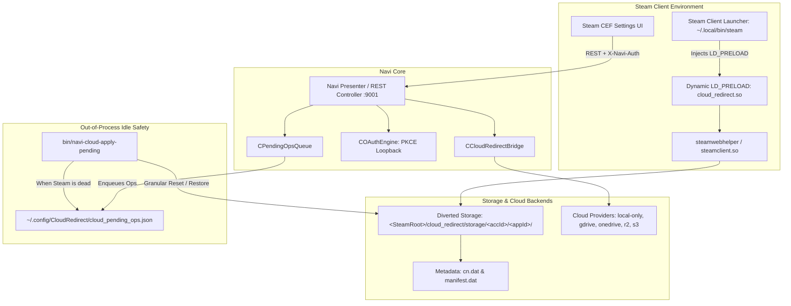

# Navi CloudRedirect Linux Integration

Architectural and operational guide for the Cloud Saves subsystem integrated into Navi,
powered by **CloudRedirect** (v2.6.5). Deep details live in modular references; this
entry document only carries the system overview you need before diving in.

---

## 1. Architecture Overview

Navi integrates CloudRedirect to redirect Steam Cloud save operations to custom storage paths and remote cloud backends for unowned, sideloaded, or redirected titles without requiring proprietary cloud infrastructure.

### Components

1. **Prebuilt 32-bit Engine (`cloud_redirect.so` v2.6.5)**:
   - Intercepts Steam I/O and cloud synchronization syscalls in 32-bit `steamclient.so` processes.
   - Diverts remote file writes away from standard Steam Cloud paths into local and remote synchronized storage.
2. **CLI Utility (`cloud_redirect_cli`)**:
   - Manages standalone cloud authentication, token caching, status verification, and manual backend synchronization.
3. **Dynamic `LD_PRELOAD` Launcher Wrapper (`~/.local/bin/steam`)**:
   - Sits in the user's execution path before `/usr/bin/steam`.
   - Checks the Navi cloud enablement flag and environment; when active, injects `cloud_redirect.so` into the 32-bit Steam launcher runtime.
4. **Navi Embedded Presenter & REST Controller**:
   - Listens on `127.0.0.1:9001`.
   - Serves the CEF UI with live status, auth flow coordination, app redirection toggles, and safe backup/restore management.

---

## 2. Reading Map

| Need | Document |
| :--- | :--- |
| Storage layout, `cn.dat`/`manifest.dat`, PrefixBucketSync cross-device sync | [`references/cloud-redirect-architecture.md`](references/cloud-redirect-architecture.md) |
| Provider catalog, OAuth loopback ports, all `CloudSaves*` / `PrefixSync` config | [`references/cloud-redirect-backends.md`](references/cloud-redirect-backends.md) |
| Pending-ops safety model, killswitch, CLI diagnostics, manual recovery | [`references/cloud-redirect-runbook.md`](references/cloud-redirect-runbook.md) |
| REST endpoints (`X-Navi-Auth`, origin allowlist, `/cloud/*`) | [`api/rest.md`](api/rest.md) — indexed by [`API.md`](api/API.md) |
