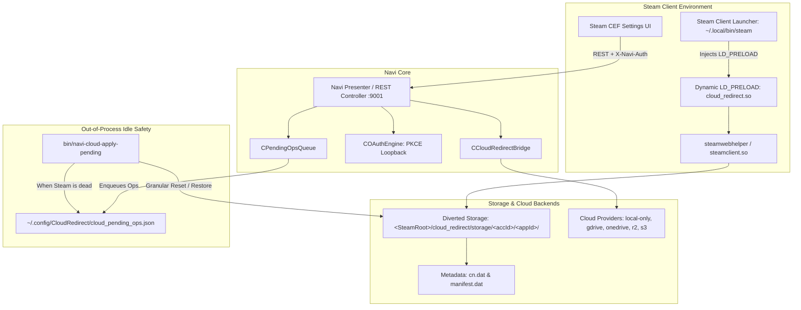

# Navi CloudRedirect Linux Integration

This document provides a comprehensive architectural and operational guide for the Cloud Saves subsystem integrated into Navi, powered by **CloudRedirect** (v2.6.5).

---

## 1. Architecture Overview

Navi integrates CloudRedirect to redirect Steam Cloud save operations to custom storage paths and remote cloud backends for unowned, sideloaded, or redirected titles without requiring proprietary cloud infrastructure.



### Components

1. **Prebuilt 32-bit Engine (`cloud_redirect.so` v2.6.5)**:
   - Intercepts Steam I/O and cloud synchronization syscalls in 32-bit `steamclient.so` processes.
   - Diverts remote file writes away from standard Steam Cloud paths into local and remote synchronized storage.
2. **CLI Utility (`cloud_redirect_cli`)**:
   - Manages standalone cloud authentication, token caching, status verification, and manual backend synchronization.
3. **Dynamic `LD_PRELOAD` Launcher Wrapper (`~/.local/bin/steam`)**:
   - Sits in the user's execution path before `/usr/bin/steam`.
   - Checks the Navi cloud enablement flag and environment; when active, injects `cloud_redirect.so` into the 32-bit Steam launcher runtime.
4. **Navi Embedded Presenter & REST Controller**:
   - Listens on `127.0.0.1:9001`.
   - Serves the CEF UI with live status, auth flow coordination, app redirection toggles, and safe backup/restore management.

---

## 2. Storage Layout & Metadata

Diverted game saves and sync states are stored hierarchically inside the user's Steam installation directory:

```
<SteamRoot>/cloud_redirect/
└── storage/
    └── <accountId>/
        └── <appId>/
            ├── cn.dat            # Cloud metadata and sync status
            ├── manifest.dat      # File manifest and checksum ledger
            └── <SaveFiles...>    # Diverted save games and configuration data
```

- **`cn.dat`**: Records sync state, revision timestamps, remote object IDs, and provider sync markers.
- **`manifest.dat`**: Contains cryptographic hashes (SHA-256) and directory trees for the game's save files to detect modified, deleted, or conflicted files.
- **Steam Userdata Mirror**: When redirected, `<SteamRoot>/userdata/<accountId>/<appId>/remote/` and `remotecache.vdf` are linked or synchronized into the redirected storage hierarchy.

### 2.1 Proton Prefix Emulator Save Synchronization (`PrefixBucketSync`)

Games running with Goldberg or GSE (`steam_api(64).dll` / `libsteam_api.so` replacements) handle `ISteamRemoteStorage` inside the emulated DLL rather than calling `steamclient.so`'s `CUserRemoteStorage`. Consequently, their save files are written inside the Proton prefix under:

```
<library>/steamapps/compatdata/<appId>/pfx/drive_c/users/<user>/AppData/{Roaming,Local,LocalLow}/<emulatorDir>/<appId>/{remote/,...}
```

`PrefixBucketSync` (`src/presenter/prefix_bucket_sync.cpp`) bridges these Proton prefix buckets with CloudRedirect's remote backend (`gdrive`, `onedrive`, `r2`, `s3`) automatically across devices without any hardcoded AppIDs, usernames, or emulator folder names:

- **Structural Discovery**: Scans all Steam library `compatdata/<appId>/pfx/drive_c/users/<user>/AppData/{Roaming,Local,LocalLow}` trees for `<appId>` save buckets (`GSE Saves/<appId>/remote`, `Goldberg SteamEmu Saves/<appId>/remote`, or custom `<dir>/<appId>`).
- **Pull on Startup & Game Launch (`sync-remote-app`)**: Before or upon launching a game, `PrefixBucketSync` invokes `cloud_redirect_cli sync-remote-app <provider> <accountId> <appId> <cloudRoot>`, materializes remote `<cleanPath>/<sha1>` blobs into the Proton prefix bucket (synthesizing the bucket directory on a fresh second device if needed), and backs up any conflicting local files under `~/.config/navi/cloud_backups/<appId>/prefix-conflict-<timestamp>/`.
- **Push on Game Exit & Startup (`publish-full-manifest`)**: When a game exits, `PrefixBucketSync` mirrors updated save files into `~/.config/CloudRedirect/storage/<accountId>/<appId>/<cleanPath>`, seeds `root_token.cloudredirect` and `file_tokens.cloudredirect`, increments `cn.cloudredirect`, and runs `cloud_redirect_cli publish-full-manifest <provider> <accountId> <appId> <cloudRoot>`.
- **Configuration (`~/.config/navi/config.yaml`)**:
  ```yaml
  CloudSaves:
    PrefixSync:
      Enabled: yes
      SyncAtStartup: yes
      SyncOnLaunch: yes
      SyncOnExit: yes
      MaxFileMb: 64
  ```

---

## 3. Supported Cloud Providers

Navi CloudRedirect supports five storage targets:

| Provider ID | Provider Name | Type | Description |
| :--- | :--- | :--- | :--- |
| `local-only` | Offline Diversion | Local Storage | Diverts saves locally without cloud syncing. Default fallback mode. |
| `gdrive` | Google Drive | OAuth2 (PKCE) | Authenticates via loopback port `53692` with `tokens_gdrive.json`. |
| `onedrive` | Microsoft OneDrive | OAuth2 (PKCE) | Authenticates via loopback port `53682` with `tokens_onedrive.json`. |
| `r2` | Cloudflare R2 | S3 Compatible | Custom endpoint with access key / secret credentials. |
| `s3` | Amazon AWS S3 | Object Storage | AWS S3 bucket storage with AWS credentials and region config. |

OAuth tokens are stored in `~/.config/CloudRedirect/tokens_<provider>.json` with restricted user-only permissions (`0600`).

---

## 4. Non-Destructive SLSsteam YAML Synchronization

Navi coordinates seamlessly with existing SLSsteam installations (`~/.config/SLSsteam/config.yaml`). To ensure user-defined configurations are never lost or corrupted, Navi uses a strict sentinel block and set union merge strategy.

### Sentinel Block

Navi inserts and updates its managed configurations strictly inside designated sentinel markers:

```yaml
# Existing user-defined SLSsteam settings
DisableFamilySharing: yes

# >>> NAVI CLOUD SHIM (DO NOT EDIT MANUALLY)
DisableCloud: no
AdditionalApps:
  - 480
  - 730
# <<< NAVI CLOUD SHIM
```

### Set Union Algorithm

1. **Read & Parse**: Navi parses `config.yaml`, extracting both user-defined `AdditionalApps` outside the block and any existing entries.
2. **Merge ($S_{merged} = S_{user} \cup S_{navi}$)**:
   The list of active apps is merged using set union semantics:
   $$S_{merged} = S_{user} \cup S_{navi}$$
   User-configured AppIDs are always preserved.
3. **Atomic Write**: The updated configuration is rendered and atomically written using `AtomicFile::write` (temporary file write followed by `rename`) to avoid partial writes or race conditions.
4. **Safe Removal / Revert**:
   When an app is removed from cloud management, Navi performs safe set subtraction:
   $$S_{remaining} = S_{merged} \setminus S_{removed}$$
   If no other keys remain and the list is empty, Navi cleans up gracefully without leaving orphaned files.

---

## 5. Idle Pending Operations Helper (`bin/navi-cloud-apply-pending`)

Directly modifying or resetting save files while Steam or `steamwebhelper` is running can cause SQLite lockups, in-memory cache overwrites, or Steam Cloud conflict errors. To prevent this, Navi enforces an **out-of-process safety model**.

### Architecture & Safety Protocol

```
CEF UI / API Client
       │
       ▼ (Request: Reset / Restore)
Navi REST Controller (:9001)
       │
       ▼ (Enqueue Operation)
~/.config/CloudRedirect/cloud_pending_ops.json
       │
       ▼ (UI displays: Restart Required)
User exits Steam
       │
       ▼
bin/navi-cloud-apply-pending --process-all
       │
       ├── 1. Verify Steam is dead (scan /proc for steam & steamwebhelper)
       ├── 2. Create pre-operation safety backup (.tar.gz)
       ├── 3. Execute atomic reset or restore
       └── 4. Mark status COMPLETED (or ROLLBACK on error)
```

1. **Queue File**: Pending tasks are serialized into `~/.config/CloudRedirect/cloud_pending_ops.json`.
2. **Process Idle Check**: Before executing any operation, `AssertSteamIdle()` scans `/proc` PID directories and validates that neither `steam` nor `steamwebhelper` processes are active. If any Steam process is alive, execution immediately halts (fail-safe).
3. **Pre-Reset Backup**: Prior to wiping any save directory, an automatic compressed tarball backup (`.tar.gz`) is written to `~/.config/navi/cloud_backups/<appId>/`.
4. **Fail-Closed Rollback**: If a restore or reset fails halfway through execution, the helper automatically restores from the pre-operation backup and records `status: "ROLLED_BACK"` with the error log.

---

## 6. Security Guardrails

Navi implements strict security measures to protect game saves and the local filesystem:

1. **Origin Allowlisting**:
   The internal HTTP REST daemon accepts requests only from verified origins:
   - `https://steamloopback.host` (Steam CEF internal UI)
   - `http://127.0.0.1:9001` / `http://localhost:9001`
   Cross-origin requests from arbitrary browser tabs are rejected with HTTP 403 Forbidden.

2. **Constant-Time Authentication (`X-Navi-Auth`)**:
   State-altering endpoints (`POST /cloud/*`) require the `X-Navi-Auth` header. Tokens are validated via `CRYPTO_memcmp` constant-time comparison to prevent timing attacks.

3. **Typed Confirmation for Destructive Actions**:
   Destructive resets (`POST /cloud/apps/<appId>/reset`) require explicit JSON confirmation:
   ```json
   {
     "confirm": "RESET"
   }
   ```
   Any request without this exact string is rejected with HTTP 400 Bad Request.

4. **Automated Backups**:
   All manual backups and pre-reset snapshots are saved under:
   `~/.config/navi/cloud_backups/<appId>/`
   Manual backups use the naming convention `manual-<timestamp>.tar.gz`.

---

## 7. Troubleshooting & Diagnostics

### Emergency Killswitch

If CloudRedirect prevents Steam from launching or introduces issues with game saves, activate the file-based killswitch:

```bash
# Disable CloudRedirect immediately
touch ~/.config/CloudRedirect/disable

# Re-enable CloudRedirect
rm -f ~/.config/CloudRedirect/disable
```

When this file exists, the dynamic loader wrapper and engine bypass all diversion hooks completely.

### CLI Status Inspection

Inspect provider authentication status, active tokens, and sync states via the bundled CLI:

```bash
# Check OAuth status
~/.local/share/navi/bin/cloud_redirect_cli auth-status

# Verify local token files
ls -la ~/.config/CloudRedirect/tokens_*.json

# View pending out-of-process operations
cat ~/.config/CloudRedirect/cloud_pending_ops.json
```

### Manual Processing of Pending Operations

If pending operations did not run automatically on exit:

```bash
# Ensure Steam is completely closed
killall -9 steam steamwebhelper 2>/dev/null

# Process all queued operations manually
~/.local/share/navi/bin/navi-cloud-apply-pending --process-all
```
